# Manih Grant Management — Business Analysis Package

Requirements specification reverse-engineered from the **Manih** interactive prototype (`WBLcompany/manih`, Lovable-built, Arabic RTL, React + TanStack Router + Supabase). It is intended to be managed in ClickUp and used by Business Analysts, Developers, UI/UX Designers, QA Engineers and Product Owners.

## 1. Method & limitations

- **Source of evidence:** the prototype's source code at commit `cfb75c2` (routes, components, business-logic libraries, Supabase migrations and generated types), plus the project's own architecture notes (`AGENTS.md`).
- **The live demo (https://manih.lovable.app) was not inspected.** Screens, fields, states and messages are documented from the code that renders them. Visual layout, copy as rendered and runtime data were not observed.
- Ten modules were analyzed independently against one shared spec (`_SPEC.md`), each with a full file list in its *Scope & Coverage* section. All in-scope files were read; no module reports an unanalyzed file.
- Several tables and columns used by the code (e.g. `project_indicators`, `project_plan_allocations`, `tenant_roles`, `proposed_changes`, `external_ai_*`) exist in the generated types but not in the migrations folder; their structure was taken from `types.ts` and usage.

### Evidence labels (used on every rule, requirement and behaviour)

| Label | Meaning |
|---|---|
| **[Observed]** | Implemented in the prototype code (with file reference) |
| **[Inferred]** | Reasonable reading of the code's intent, not explicit |
| **[Recommended]** | Analyst proposal; not in the prototype |
| **[To Confirm]** | Business decision, value or role that stakeholders must confirm |

## 2. Package contents

| File | Purpose |
|---|---|
| `README.md` | This overview, cross-module findings and usage guide |
| `modules/01-PLT.md` … `modules/10-TSK.md` | Full analysis per module: screen & interaction inventory, workflows (Mermaid), business rules, data requirements, epics/features, functional requirements, user stories (Given/When/Then), issues, open questions |
| `traceability-matrix.md` | Requirement → Feature → Epic → Stories → Screens, per module |
| `coverage.md` | Record counts per module |
| `clickup-import.csv` | 494 rows (Epics, Features, User Stories) ready for ClickUp CSV import |
| `data/*.json` | Machine-readable records per module (source for the CSV and matrix) |
| `Manih-BA-Package.md` | Everything above concatenated into a single file |
| `_SPEC.md`, `build.py` | Authoring spec and the assembler (`python3 build.py` regenerates CSV, matrix, coverage, combined file) |

## 3. Modules & coverage

| # | Code | Module | Screens | Features | FRs | Stories | Issues |
|---|---|---|---|---|---|---|---|
| 01 | PLT | Platform: shell, navigation, personas, login, search, AI copilot, shared UI | 14 | 17 | 65 | 32 | 28 |
| 02 | CFG | Settings & configuration (team, roles, departments, workflow, forms, endowments, taxonomies) | 13 | 16 | 54 | 34 | 22 |
| 03 | PLN | Annual plans, endowments, budget adjustments, initiatives | 14 | 17 | 67 | 28 | 25 |
| 04 | PRG | Grant opportunities, workflow engines, products, RFP, eligibility | 17 | 20 | 65 | 31 | 24 |
| 05 | PTL | Partner portal: registration, apply, track, respond, license update | 12 | 20 | 54 | 23 | 24 |
| 06 | BEN | Partner organizations management (staff side) | 6 | 13 | 45 | 24 | 21 |
| 07 | REV | Application review & decision workflow, committee, merge, transfer | 12 | 20 | 72 | 28 | 27 |
| 08 | PRJ | Projects & contracts, BOQ, activities, revisions, indicators | 11 | 16 | 57 | 31 | 26 |
| 09 | FIN | Payments approval chain, disbursement, reports & analytics | 8 | 11 | 56 | 22 | 22 |
| 10 | TSK | My tasks, derived vs manual tasks, focus mode | 9 | 11 | 40 | 22 | 17 |
| | | **Total** | **116** | **161** | **575** | **275** | **236** |

Also: 58 epics, 332 business rules, 149 open questions.

### Roles

`admin`, `grants_manager`, `reviewer`, `committee_secretary`, `project_manager`, `finance`, `ceo`, `applicant` (partner organization user). In the prototype, roles are demo personas switched from the header on one shared account; see PLT §5.1 for the role × navigation matrix.

### End-to-end business flow

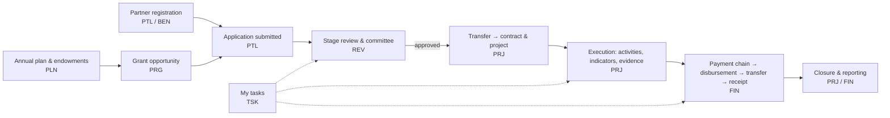

## 4. Cross-module findings (read before planning implementation)

These themes recur across modules; they are the main gap between the prototype and a production system. 41 issues are rated High.

1. **No real authentication or authorization** — every visitor signs into one shared demo account (credentials in the client bundle); roles are chosen in the browser; the permission matrix in Settings is never enforced; database RLS lets any signed-in user read/write every table. *(ISS-PLT-01/02/03, ISS-CFG-01, ISS-REV-01, ISS-PRG-02, ISS-PLN-04, ISS-PRJ-01/02, ISS-FIN-01, ISS-BEN-01)*
2. **Business rules enforced only in the UI** — pass score, eligibility, open window, quota, stock, approval authority and state transitions are checked in pages, not in the domain layer; alternative entry points (tasks, focus mode, committee minutes, invitation links) bypass them. *(ISS-REV-02, ISS-PTL-03, ISS-PRG-04, ISS-TSK-02)*
3. **Multi-step writes without transactions** — submission, transfer to contract/projects, merge, budget adjustments, plan edits and revisions run as sequences of client writes; a failure part-way leaves partial data. *(ISS-PTL-04, ISS-REV-24, ISS-PRJ-06, ISS-PLN-01/02)*
4. **No tenant isolation in queries** — several pages, search, copilot and task lists load data across organizations and filter in the browser. *(ISS-PLT-04/05, ISS-PTL-02, ISS-FIN-08, ISS-PLN-10)*
5. **Financial integrity gaps** — payee/IBAN editable after full approval without re-approval or audit; "paid" defined differently across screens; the "pending" bucket is always 0; payments can exceed project budget after AI re-planning. *(ISS-FIN-02/05, ISS-PLN-21, ISS-PRJ-05)*
6. **Hard-coded three-stage workflow** despite configurable workflow templates. *(ISS-REV-13, ISS-PRG-09)*
7. **Data-model drift** — tables/columns used in code are missing from migrations; some settings (templates, taxonomies, tenant suspension) are saved but never read. *(ISS-PLN-20, ISS-CFG, ISS-PRJ-26)*

Each module's §13 lists its issues with location, severity and recommendation; §14 lists open questions for stakeholders.

## 5. ID conventions

`SCR-` screen · `INT-` interaction · `EP-` epic · `FT-` feature · `FR-` functional requirement · `US-` user story · `BR-` business rule · `ISS-` issue · `OQ-` open question — each followed by the module code and a number (e.g. `FR-REV-012`). IDs are stable; cross-module references name the owning module.

## 6. Using this package

### In a Claude.ai Project
Upload `README.md`, `traceability-matrix.md` and the ten `modules/*.md` files to the project's knowledge (or the single `Manih-BA-Package.md`, ~1.8 MB). Upload `clickup-import.csv` only if you also want Claude to work with the backlog rows.

### In ClickUp
1. Create a Space for the product and one Folder or List per module (or one List with a *Module* custom field).
2. Import `clickup-import.csv` (Settings → Import/Export → CSV). Map **Task Name**, **Description**, **Priority** and **Tags** to the built-in fields; map **Task Type**, **Custom ID**, **Parent ID**, **Module Code** and **Acceptance Criteria** to custom fields.
3. After import, use **Parent ID** to nest Features under Epics and Stories under Features (ClickUp CSV import does not create parent links automatically).
4. Priority mapping: Must → High, Should → Normal, Could/Won't → Low.

### Regenerating
After editing any `data/*.json`, run `python3 docs/business-analysis/build.py` to rebuild the CSV, matrix, coverage and combined file. Keep the matching `modules/*.md` in sync by hand.


---

# PLT — Platform: Shell, Navigation, Personas & Shared UI

## 1. Scope & Coverage

**Module scope.** Cross-cutting platform capabilities of the Manih grant-management prototype: application shell and role-based navigation, session/login, demo personas and persona switcher, public landing page, partner self-registration (`/register-tenant`), invitation landing (`/invite/$token`), global search, AI Copilot, saved views, theme/palette/RTL/digit localization, demo guide and scripted demo controls, the admin workshop deck, and the shared UI components every other module reuses.

**Files analyzed (all read in full, `/home/user/manih/src/…`):**

- `routes/__root.tsx`
- `routes/index.tsx`
- `routes/login.tsx`
- `routes/register-tenant.tsx`
- `routes/invite.$token.tsx`
- `routes/admin.tsx (gate, tabs, workshop tab; tenants & registrations tabs only for context)`
- `routes/api/chat.ts`
- `components/AppShell.tsx`
- `components/DemoSession.tsx`
- `components/DemoGuide.tsx`
- `components/DemoControls.tsx`
- `lib/demoScript.ts`
- `components/GlobalSearch.tsx`
- `components/Copilot.tsx`
- `lib/viewPrefs.tsx`
- `components/ThemeToggle.tsx`
- `components/PalettePicker.tsx`
- `components/WorkshopDeck.tsx`
- `lib/persona.tsx`
- `components/LatinDigits.tsx`
- `components/SmartFlow.tsx`
- `components/InfoTip.tsx`
- `components/common.tsx`
- `components/DataTable.tsx`
- `components/FilterBar.tsx`
- `components/PageSkeleton.tsx`
- `components/SectionTabs.tsx`
- `components/StatCard.tsx`
- `lib/error-capture.ts`
- `lib/error-page.ts`
- `integrations/supabase/auth-middleware.ts`
- `lib/queries.ts`
- `lib/data.ts`

**Closely related files consulted:**

- `lib/navCounts.ts`
- `lib/lovable-error-reporting.ts`
- `integrations/supabase/{client,auth-attacher,previewAuthStorage,cron-auth}.ts`
- `lib/registrations.ts (lookup/submit/delegate functions)`
- `components/OtpVerifiedInput.tsx`
- `lib/applicantTypes.ts (ENTITY_TYPES, useClosedTypes)`
- `lib/rfp.ts (markInvitation)`
- `components/ui/useAutoSteps.tsx (header only)`
- `components/AmountInput.tsx (header only)`
- `routes/portal.tsx:75-90 (applicant gate)`
- `routes/settings.tsx:45-70,150-260 (tab routing, declared permission matrix)`
- `routes/projects.$id.tsx:32-33,170 (DemoControls mount)`
- `server.ts / start.ts (error-page usage, grep)`
- `supabase/migrations: 20261004085937 (tenants, personas), 20261005054632 (user_view_prefs), 20261006134413 (program_invitations), 20261006140739 (RLS reset)`
- `src/integrations/supabase/types.ts (entity_registrations, beneficiary_memberships, program_invitations, user_view_prefs, tenants, personas)`

**Coverage notes & limitations.**

- Analysis is from source only; the live demo (https://manih.lovable.app) was not inspected. Line numbers refer to the files as read on 2026-10-19.
- `/admin` tabs *Tenants* and *Registration requests* are owned by CFG and BEN respectively; the *Registration review* that approves submissions from SCR-PLT-03 is in BEN. The portal (`/portal`) is in PTL; this module only documents its persona gate.
- Permission differences between roles are **UI-level only**. All data access goes through the loose `db` client under one shared Supabase account, and RLS allows any signed-in user full access (see §13).
- `personas.role` was converted from an enum (`admin|reviewer|applicant`) to free text in later schema changes (types.ts:2085); the 8 roles are defined in `lib/persona.tsx`.

## 2. Screen Inventory

| Screen ID | Name (EN + Arabic label) | Route / Component | Roles | Purpose | Entry points | Exits / Navigates to |
|---|---|---|---|---|---|---|
| SCR-PLT-01 | Public landing page — «الصفحة الرئيسية — منصة منح» | `/` — routes/index.tsx | public visitor, all personas | Marketing entry: value proposition and list of active grant programs. | Direct URL; brand logo; 404/error 'back home' links | /portal (Browse programs, Apply now); /register-tenant; /login (header) |
| SCR-PLT-02 | Login — «تسجيل الدخول» | `/login` — routes/login.tsx | public visitor, all personas | Cosmetic sign-in form for the demo; forwards to the current persona's home. | Header 'تسجيل الدخول'; registration success (delegate verified) | ROLE_HOME of current persona; /register-tenant |
| SCR-PLT-03 | Partner organization registration — «تسجيل جهة شريكة / سجّل جهتك» | `/register-tenant` — routes/register-tenant.tsx (+ OtpVerifiedInput, lib/registrations.ts) | public visitor (partner representative) | License/ID lookup, registry prefill, OTP-verified contact fields, submission for platform review; delegate verification or delegate-change request for already-registered entities. | Landing CTA; header 'سجّل جهتك'; login link; workshop deck link | / (after success); /login (after delegate verification) |
| SCR-PLT-04 | Invitation landing — «دعوة للتقديم» | `/invite/$token` — routes/invite.$token.tsx | invited partner (applicant) | Shows a private grant opportunity invitation; activate account, proceed to apply or decline. | Invitation link sent from an RFP/targeted program (see PRG) | /portal?apply=<programId> |
| SCR-PLT-05 | Application shell (sidebar + header) — «القائمة / الإطار العام» | `all routes (components/AppShell.tsx)` — components/AppShell.tsx, routes/__root.tsx | all staff roles, applicant (header-only layout) | Persistent layout: brand, role-based sidebar with task badges, header with search, demo guide, copilot, persona switcher, theme toggle; mobile drawer. | Every page | Any sidebar destination |
| SCR-PLT-06 | Persona switcher (demo mode) — «وضع العرض — اختر شخصية» | `dropdown in AppShell` — components/AppShell.tsx (personaMenu) | all personas (demo) | Switch the active demo persona/role; navigates to that role's home. | User card in sidebar footer; header switch icon; landing header user card | ROLE_HOME[role] |
| SCR-PLT-07 | Global search (command palette) — «البحث (Ctrl+K)» | `dialog in header` — components/GlobalSearch.tsx | all signed-in personas incl. applicant | Cross-entity search with Arabic-tolerant matching, page shortcuts and recent items. | Header search icon; Ctrl/Cmd+K | /beneficiaries/:id, /reviewer/:id, /projects/:id, /programs/:id, /plans/:id, /staff/:id, static pages |
| SCR-PLT-08 | AI Copilot panel — «رفيق المنح» | `side sheet in header` — components/Copilot.tsx, routes/api/chat.ts | admin, grants_manager, reviewer, committee_secretary, project_manager, finance, ceo | Arabic conversational assistant over tenant data with read-only tools; proposes actions as link cards. | Header bot icon | Page linked in a proposed-action card |
| SCR-PLT-09 | Demo guide panel — «دليل العرض — عند من واقف الإجراء؟» | `side sheet in header` — components/DemoGuide.tsx | all staff roles (sidebar layout) | Per-page walkthrough hints; on a project page, shows which payment step is pending and lets the presenter switch to the responsible persona. | Header help icon | Same page under another persona |
| SCR-PLT-10 | Interactive demo controls bar — «وضع العرض التفاعلي» | `/projects/<DEMO_PROJECT_ID> (embedded)` — components/DemoControls.tsx, lib/demoScript.ts | any persona viewing the demo project | Advance / undo / reset a 7-step scripted project-payment scenario directly in the database. | Opening the demo project 'ملتقى الشركاء السنوي' | Same page (data refreshed) |
| SCR-PLT-11 | Platform admin — workshop deck tab — «بوابة الآدمن ← عرض ورشة العمل» | `/admin (tab 'workshop')` — routes/admin.tsx (AdminGate, Tabs) + components/WorkshopDeck.tsx | admin | Facilitated requirements-workshop deck (11 slides) with per-session note capture. Other /admin tabs (tenants, registrations) are covered by CFG and BEN. | Sidebar 'الإعدادات' → SectionTabs 'الجهات والمستخدمون'; global search 'الإدارة' | Deep links per session (new tab) |
| SCR-PLT-12 | Appearance — colour palette — «الإعدادات ← المظهر (التدرج اللوني)» | `/settings?tab=appearance` — components/PalettePicker.tsx (rendered by routes/settings.tsx) | all roles that reach Settings | Choose one of three colour palettes, stored on the device. | Settings section tabs 'المظهر' | — |
| SCR-PLT-13 | Not found page — «الصفحة غير موجودة (404)» | `any unknown route` — routes/__root.tsx NotFoundComponent | all | Friendly 404 with link home. | Unknown URL | / |
| SCR-PLT-14 | Error page / error boundary — «تعذّر تحميل الصفحة» | `any route on uncaught error` — routes/__root.tsx ErrorComponent; lib/error-page.ts (SSR) | all | Client error boundary with retry/home and telemetry; server-rendered fallback page. | Uncaught render/loader error | Same route (retry) or / |

## 3. Screen Details

### SCR-PLT-01 — Public landing page («الصفحة الرئيسية — منصة منح»)

- **Data:** hero badge «نسخة عرض أولى», title «إدارة المنح من التقديم حتى الاعتماد», subtitle [Observed] `routes/index.tsx:54-76`.
- **Actions:** «تصفح برامج المنح» → `/portal`; «سجّل جهتك كمانحة» → `/register-tenant` [Observed] `index.tsx:66-75`.
- **Sections:** three capability cards — «تقديم إلكتروني», «سير مراجعة واضح», «مؤشرات لحظية» [Observed] `index.tsx:79-109`.
- **Program cards:** title, description (2 lines), «الميزانية» (formatSAR), «آخر موعد» (formatDate of `deadline`), button «قدّم الآن» → `/portal` [Observed] `index.tsx:111-140`. Source: `grant_programs` where `status='active'` order by `created_at desc` [Observed] `index.tsx:39-50`.
- **Header (public layout):** brand logo, theme toggle, persona user card (≥sm), «تسجيل الدخول», «سجّل جهتك» [Observed] `AppShell.tsx:172-186`.
- **States:** no loading/empty/error UI for programs — an empty grid is shown [Observed]; page blocked by the global «جارٍ التحميل…» until the demo session exists [Observed] `DemoSession.tsx:21`.

### SCR-PLT-02 — Login («تسجيل الدخول»)

- **Fields:** «البريد الإلكتروني» (email, LTR, required, placeholder name@example.com); «كلمة المرور» (password, LTR, required) [Observed] `login.tsx:63-85`.
- **Actions:** «دخول» submits → navigate to `ROLE_HOME[current.role]` or `/portal` [Observed] `login.tsx:43-47`; link «سجّل جهتك» → `/register-tenant` [Observed] `login.tsx:93-98`.
- **Behaviour:** first pointer-down anywhere on the page fills demo credentials (demo@minah.sa / Demo1234) [Observed] `login.tsx:36-41,52`; disclaimer «في نسخة العرض الحالية، الدخول شكلي…» [Observed] `login.tsx:89-91`.
- **States:** validation = HTML required/email only; no error, lockout or loading state [Observed].

### SCR-PLT-03 — Partner organization registration («تسجيل جهة شريكة / سجّل جهتك»)

- **Header:** «سجّل جهتك» / «سجّل حسابك» for individuals; description «اختر نوع المستفيد ثم أدخل رقم التحقق…» [Observed] `register-tenant.tsx:82-85`.
- **Type chips:** portal-enabled types not closed by the tenant: جمعية أهلية، مؤسسة غير ربحية، شركة، فرد، وقف، أخرى (government excluded) [Observed] `register-tenant.tsx:33-36,87-92`; `applicantTypes.ts:7-15`. Changing type clears the lookup result.
- **Lookup form:** ID input (placeholder = type's idLabel, LTR) + «تحقق»; demo hint links «مسجلة 1234 · جديدة 7781 8890» [Observed] `register-tenant.tsx:93-97`.
- **Result = registered:** card ««name» مسجلة مسبقاً», masked delegates list (primary flagged), buttons «إرسال رمز تحقق للمفوض» (disabled if none) and «طلب تغيير المفوض» [Observed] `register-tenant.tsx:173-184`.
  - *OTP sub-form:* message, demo code displayed, 6-digit input, «تحقق», «رجوع»; wrong code → toast «الرمز غير صحيح — تأكد وأعد المحاولة» [Observed] `:186-196,159-163`.
  - *Verified:* green panel «تم التحقق من صلتك بالجهة», «سجّل دخولك وسيضيفك المفوض لفريق الجهة», button «تسجيل الدخول» [Observed] `:198-204`.
  - *Change request sub-form:* «اسم المفوض الجديد *», «رقم الهوية *», «جوال المفوض الجديد *», «سبب التغيير *», «إرسال الطلب», «رجوع» → confirmation «أُرسل طلب تغيير المفوض» [Observed] `:206-227`.
- **Result = pending:** «يوجد طلب تسجيل لهذا الترخيص قيد التدقيق — قدمه <masked name> وجواله ينتهي بـ<masked mobile>» [Observed] `:100-105`.
- **Result = new:** provenance banner («جلبنا البيانات من السجل الرسمي…» or «لم نجد الرقم في السجل…»), OTP hint, 2-column field grid (REG_FIELDS) with «من السجل» / «معدّل عن السجل» tags, OTP inputs for البريد الرسمي، هاتف الجهة، جوال المفوض, submit «تأكيد البيانات وإرسالها للتدقيق» [Observed] `:107-139`.
- **Validation:** HTML required per field; unverified OTP fields → toast «تحقق أولاً من: …» [Observed] `:58-62`. No format validation of IBAN, national ID or mobile [Observed – gap].
- **Success state:** card «أُرسل الطلب للتدقيق» — «تدقق إدارة المنصة الحقول المؤكدة والمدخلة، وتُفعَّل الجهة بعد اعتمادها.», button «العودة للرئيسية» [Observed] `:68-76`.
- **Error state:** toast with DB error message [Observed] `:65`.

### SCR-PLT-04 — Invitation landing («دعوة للتقديم»)

- **Loading:** PageSkeleton [Observed] `invite.$token.tsx:40`. **Invalid:** «رابط الدعوة غير صالح» [Observed] `:41`.
- **Header line:** «دعوة خاصة لـ <beneficiary name>» [Observed] `:65`.
- **Opportunity card:** title; chips: kind label, «السقف <budget>», «آخر موعد <close_at>», «مدة التنفيذ N يوم» (if set); description; «نطاق العمل»; «المخرجات» [Observed] `:66-79`.
- **Final states:** declined → «سجّلتم اعتذاركم عن هذه الفرصة.»; applied → «قدّمتم عرضكم على هذه الفرصة، تابعوا حالته من البوابة.» [Observed] `:80-81`.
- **Active account actions:** «الانتقال للتقديم», «اعتذار» [Observed] `:82-83`.
- **Inactive account:** card «تفعيل حساب الجهة» with fields الاسم، رقم الهوية، البريد الرسمي (prefilled), كلمة المرور — all required, demo defaults prefilled; buttons «تفعيل والانتقال للتقديم», «اعتذار» [Observed] `:84-97`.
- **Toasts:** «مرحباً بك» / «تم تفعيل حساب الجهة»; «تم تسجيل الاعتذار، شكراً لكم» [Observed] `:53,59`.

### SCR-PLT-05 — Application shell (sidebar + header) («القائمة / الإطار العام»)

- **Root:** `<html lang="ar" dir="rtl">`, React Query provider, Radix `DirectionProvider dir="rtl"`, DemoSession gate, PersonaProvider, Toaster (top-center, rich colours), LatinDigits [Observed] `__root.tsx:117-155`.
- **Sidebar layout (staff roles, non-public pages):** brand link (admin → /analytics, others → /tasks), section label «القائمة», role items with icon, label and badge, footer user card (initials, name, role, switch chevron) [Observed] `AppShell.tsx:141-170,201-211`.
- **Header (sidebar layout):** mobile menu button «القائمة الجانبية», active item icon+label, GlobalSearch, DemoGuide, Copilot, persona switch icon «تبديل المستخدم (وضع العرض)», ThemeToggle [Observed] `:212-237`.
- **Header-only layout:** public pages and applicant role — see FR-PLT-013 [Observed] `:172-199`.
- **Mobile drawer:** Sheet from the right with brand and the same navigation [Observed] `:241-248`.
- **States:** global loading «جارٍ التحميل…» until session [Observed] `DemoSession.tsx:21`; FocusPill (TSK) mounted under every page [Observed] `AppShell.tsx:196,239`.

### SCR-PLT-06 — Persona switcher (demo mode) («وضع العرض — اختر شخصية»)

- **Content:** label «وضع العرض — اختر شخصية», one item per persona (initials avatar, name, Arabic role label, check on current), scrollable (max 70vh) [Observed] `AppShell.tsx:100-123`.
- **Visibility:** landing page and all non-public pages; hidden on /login and /register-tenant [Observed] `:89`.
- **Action:** select → persist persona → navigate to ROLE_HOME [Observed] `:94-98`.

### SCR-PLT-07 — Global search (command palette) («البحث (Ctrl+K)»)

- **Trigger:** search icon «البحث (Ctrl+K)» or Ctrl/Cmd+K [Observed] `GlobalSearch.tsx:45-52,97-99`.
- **Input:** placeholder «ابحث عن جهة، طلب، مشروع، دفعة، شخص…» [Observed] `:101`.
- **Groups:** الصفحات، الجهات الشريكة، طلبات المنح، المشاريع والمبادرات، الدفعات، فرص ومسارات المنح، الخطط السنوية، أعضاء الفريق; recent group «آخر ما فتحته» [Observed] `:19-28,104-123`.
- **Result row:** icon, title, subtitle (ref no · city/partner/project/year/e-mail) [Observed] `:68-76,113-117`.
- **Empty states:** «اكتب حرفين على الأقل» / «لا نتائج» [Observed] `:103`. No loading indicator while querying [Observed – gap].

### SCR-PLT-08 — AI Copilot panel («رفيق المنح»)

- **Trigger:** outline bot button «رفيق المنح» (hidden for applicant) [Observed] `Copilot.tsx:152-157`.
- **Panel:** left-side sheet, title «رفيق المنح», expand/minimise toggle (≥sm) [Observed] `:158-167`.
- **Empty conversation:** intro text and section-specific prompt chips [Observed] `:71-80`.
- **Messages:** user bubbles (primary colour), assistant text (Markdown asterisks stripped), tool progress «قراءة البيانات» with spinner/✓, proposed-action cards (title, details, link «فتح الصفحة للتأكيد») [Observed] `:81-108`.
- **Composer:** textarea «اكتب طلبك…» (Enter sends, Shift+Enter newline), send / stop buttons; trash icon «محادثة جديدة» [Observed] `:115-143`.
- **States:** submitted spinner; error banner «تعذر الحصول على رد: …» [Observed] `:109-112`.

### SCR-PLT-09 — Demo guide panel («دليل العرض — عند من واقف الإجراء؟»)

- **Trigger:** help icon «دليل العرض — عند من واقف الإجراء؟» (hidden on public pages; only in sidebar layout) [Observed] `DemoGuide.tsx:111,117-125`.
- **Pending-action box (project pages):** loading «جارٍ تحديد الخطوة الحالية…»; «الإجراء واقف عند خطوة «label» (payment title)»; persona card with «بدّل إليه» or «أنت هنا الآن»; «لا يوجد حساب بدور …» ; «كل الدفعات مكتملة — لا إجراء معلّق على هذا المشروع.» [Observed] `:132-175`.
- **Steps list:** title and hint per step; generic text «تجوّل في الصفحات وسيظهر لك شرح كل شاشة هنا.» [Observed] `:176-187`.

### SCR-PLT-10 — Interactive demo controls bar («وضع العرض التفاعلي»)

- **Bar:** «وضع العرض التفاعلي», «الخطوة n من 7», buttons «تراجع», «تقدّم», «تصفير»; «آخر خطوة منفذة: … (actor)»; «الخطوة التالية: … (actor)» or «اكتملت كل خطوات العرض — استخدم «تصفير» لإعادته.» [Observed] `DemoControls.tsx:37-72`.
- **Scenario steps (actor):** رفع شاهد المرحلة الأولى (الجمعية الشريكة) → الفحص الذكي → رفع تقرير المرحلة الأولى → اعتماد المحطة الأولى (مدير المنح) → اعتماد إذن صرف دفعة التجهيزات (مدير المنح) → تحويل الدفعة وإرفاق إشعار الحوالة (المسؤول المالي) → إرفاق سند القبض وإقفال الدفعة (الجمعية) [Observed] `demoScript.ts:23-31`.
- **States:** buttons disabled while busy/at limits; success toasts «تم تصفير المشروع…» / «الحالة الآن: بعد خطوة n من 7»; error toast [Observed] `DemoControls.tsx:19-32`.

### SCR-PLT-11 — Platform admin — workshop deck tab («بوابة الآدمن ← عرض ورشة العمل»)

- **Gate:** non-admin → «هذه الصفحة خاصة بإدارة المنصة» + «الانتقال إلى فريق العمل» [Observed] `admin.tsx:58-71`.
- **Page header:** «الإعدادات», «كل ما يخص تهيئة المنصة في مكان واحد», SETTINGS_TABS; inner tabs «الجهات (n)», «طلبات تسجيل الجهات», «عرض ورشة العمل» [Observed] `admin.tsx:136-160`. (Tenants tab → CFG; registrations → BEN.)
- **Deck toolbar:** previous/next, «i / 11», progress bar, «ملء الشاشة»/«خروج»; footer hint «الأسهم للتنقل · F لملء الشاشة · الملاحظات تُحفظ تلقائياً على هذا الجهاز» [Observed] `WorkshopDeck.tsx:175-187`.
- **Slides (11):** 1 Welcome (WBL & Noura logos, «ورشة عمل تحليل نظام مانح»); 2 Agenda (09:00–15:00 incl. prayer/lunch break); 3 Method (40% live demo / 40% comparison / 20% open space); 4–9 Sessions 1–6 (time, title, goal, 4 points, comparison questions, deep links, three note boxes «ميزات لاحظها العميل في مانح», «كيف تتم في نظامهم الحالي», «تحديات ومتطلبات جديدة»); 10 Parking lot «الاستطرادات المؤجلة»; 11 Summary (aggregated notes by category + «الخطوات القادمة والمسؤوليات») [Observed] `WorkshopDeck.tsx:14-149`.
- **Frame:** header logos and «ورشة عمل تحليل نظام مانح», footer «شركة وبل WBL» and page number [Observed] `:59-71`.

### SCR-PLT-12 — Appearance — colour palette («الإعدادات ← المظهر (التدرج اللوني)»)

- **Card:** «التدرج اللوني», «اختر الهوية اللونية للمنصة — تُحفظ على هذا الجهاز», three swatch buttons طيني / أخضر مائي / خزامى with active check [Observed] `PalettePicker.tsx:22-65`.

### SCR-PLT-13 — Not found page («الصفحة غير موجودة (404)»)

- «404», «الصفحة غير موجودة», «الصفحة التي تبحث عنها غير موجودة أو تم نقلها.», link «العودة للرئيسية» [Observed] `__root.tsx:22-44`.

### SCR-PLT-14 — Error page / error boundary («تعذّر تحميل الصفحة»)

- **Client:** «تعذّر تحميل الصفحة», «حدث خطأ من جهتنا…», «حاول مجدداً» (router.invalidate + reset), «العودة للرئيسية»; error logged and reported via `reportLovableError` [Observed] `__root.tsx:46-82`.
- **Server (SSR):** static English page «This page didn't load» with «Try again»/«Go home» [Observed] `lib/error-page.ts`; console.error expanded with cause chain and last error captured for 5 s [Observed] `lib/error-capture.ts`.

## 4. Interaction Inventory

| INT ID | Screen | Trigger (control) | System response | Data written | Evidence |
|---|---|---|---|---|---|
| INT-PLT-001 | SCR-PLT-01 | Button «تصفح برامج المنح» / «قدّم الآن» | Navigate to /portal | — | [Observed] index.tsx:67,131 |
| INT-PLT-002 | SCR-PLT-01 | Button «سجّل جهتك كمانحة» | Navigate to /register-tenant | — | [Observed] index.tsx:70 |
| INT-PLT-003 | SCR-PLT-02 | Pointer-down on page | Autofill demo e-mail/password once | — | [Observed] login.tsx:36-41,52 |
| INT-PLT-004 | SCR-PLT-02 | Submit «دخول» | Navigate to ROLE_HOME of current persona (or /portal) | — | [Observed] login.tsx:43-47 |
| INT-PLT-005 | SCR-PLT-03 | Type chip | Set entity type; reset lookup result; adapt ID label/fields | — | [Observed] register-tenant.tsx:88-91 |
| INT-PLT-006 | SCR-PLT-03 | «تحقق» / demo license link | lookupLicense → registered / pending / new; prefill values | — (reads beneficiaries, beneficiary_memberships, entity_registrations) | [Observed] register-tenant.tsx:46-55,93-97 |
| INT-PLT-007 | SCR-PLT-03 | OTP icon → code → «تأكيد» | Generate and show demo code; mark field verified on match | — (client state) | [Observed] OtpVerifiedInput.tsx:14-15 |
| INT-PLT-008 | SCR-PLT-03 | Submit «تأكيد البيانات وإرسالها للتدقيق» | Block if unverified OTP; insert registration; show success | entity_registrations (insert, status pending) | [Observed] register-tenant.tsx:58-66; registrations.ts:69-77 |
| INT-PLT-009 | SCR-PLT-03 | «إرسال رمز تحقق للمفوض» → «تحقق» | Show demo 6-digit code; on match show verified panel | — | [Observed] register-tenant.tsx:155-163 |
| INT-PLT-010 | SCR-PLT-03 | «طلب تغيير المفوض» → «إرسال الطلب» | Insert delegate-change request; confirmation | entity_registrations (insert with note) | [Observed] register-tenant.tsx:164-171; registrations.ts:85-97 |
| INT-PLT-011 | SCR-PLT-04 | Page load | Load invitation; mark opened if 'sent' | program_invitations (status opened, opened_at) | [Observed] invite.$token.tsx:35-39 |
| INT-PLT-012 | SCR-PLT-04 | «الانتقال للتقديم» / «تفعيل والانتقال للتقديم» | Activate account if inactive; select partner persona; toast; go to /portal?apply= | beneficiaries (account_status, activated_at) | [Observed] invite.$token.tsx:46-56 |
| INT-PLT-013 | SCR-PLT-04 | «اعتذار» | Mark declined; toast | program_invitations (declined, responded_at) | [Observed] invite.$token.tsx:57-60 |
| INT-PLT-014 | SCR-PLT-05 | Sidebar item | Navigate; highlight active | — | [Observed] AppShell.tsx:145-166 |
| INT-PLT-015 | SCR-PLT-05 | Mobile menu button | Open navigation drawer; close on navigate | — | [Observed] AppShell.tsx:215,241-248 |
| INT-PLT-016 | SCR-PLT-05 | Theme toggle | Toggle dark class; persist | localStorage theme | [Observed] ThemeToggle.tsx:10-17 |
| INT-PLT-017 | SCR-PLT-06 | Persona menu item | Select persona; navigate to role home | localStorage grants-poc-persona | [Observed] AppShell.tsx:94-98; persona.tsx:77-80 |
| INT-PLT-018 | SCR-PLT-07 | Ctrl/Cmd+K or search icon | Toggle search dialog | — | [Observed] GlobalSearch.tsx:47-49 |
| INT-PLT-019 | SCR-PLT-07 | Typing (≥2 chars) | Debounced tenant-scoped search of 7 entity types | — | [Observed] GlobalSearch.tsx:54-80 |
| INT-PLT-020 | SCR-PLT-07 | Select result | Navigate; save to recent (max 6) | localStorage recent-search | [Observed] GlobalSearch.tsx:82-88 |
| INT-PLT-021 | SCR-PLT-08 | Bot button | Open Copilot sheet | — | [Observed] Copilot.tsx:155 |
| INT-PLT-022 | SCR-PLT-08 | Prompt chip / Send (Enter) | POST /api/chat with persona context; stream answer | localStorage copilot:<personaId> | [Observed] Copilot.tsx:30-64; chat.ts:12-145 |
| INT-PLT-023 | SCR-PLT-08 | Stop / New chat / Expand | Abort stream / clear history / widen panel | localStorage (remove) | [Observed] Copilot.tsx:128-143,163 |
| INT-PLT-024 | SCR-PLT-08 | Proposed-action link «فتح الصفحة للتأكيد» | Close panel; open target page | — | [Observed] Copilot.tsx:92-94 |
| INT-PLT-025 | SCR-PLT-09 | Help icon | Open guide; on project page compute pending payment step | — | [Observed] DemoGuide.tsx:82-109 |
| INT-PLT-026 | SCR-PLT-09 | «بدّل إليه» | Switch persona; close sheet | localStorage persona | [Observed] DemoGuide.tsx:154-164 |
| INT-PLT-027 | SCR-PLT-10 | «تقدّم» / «تراجع» / «تصفير» | Apply scenario state n; invalidate all queries; toast | project_activities, project_reports (upsert/delete), payments, projects; localStorage demo-step-<id> | [Observed] DemoControls.tsx:19-32; demoScript.ts:97-110 |
| INT-PLT-028 | SCR-PLT-11 | Inner tab «عرض ورشة العمل» | Render deck | — | [Observed] admin.tsx:150,157-159 |
| INT-PLT-029 | SCR-PLT-11 | Prev/Next, ←/→/space, F, «ملء الشاشة» | Change slide / toggle fullscreen (ignored while typing) | — | [Observed] WorkshopDeck.tsx:151-173 |
| INT-PLT-030 | SCR-PLT-11 | Typing in a note box | Autosave note | localStorage workshop-notes | [Observed] WorkshopDeck.tsx:52-57,73-78 |
| INT-PLT-031 | SCR-PLT-11 | Session deep link | Open target page in new tab | — | [Observed] WorkshopDeck.tsx:123 |
| INT-PLT-032 | SCR-PLT-12 | Palette swatch | Apply data-palette; persist | localStorage palette | [Observed] PalettePicker.tsx:13-20,40-43 |
| INT-PLT-033 | SCR-PLT-13 | «العودة للرئيسية» | Navigate to / | — | [Observed] __root.tsx:34-39 |
| INT-PLT-034 | SCR-PLT-14 | «حاول مجدداً» | router.invalidate(); reset boundary | — | [Observed] __root.tsx:63-71 |
| INT-PLT-035 | (any list page) | DataTable search / columns / page size / paging / row click | Filter, toggle columns, paginate, open details | — (view state local until pinned) | [Observed] DataTable.tsx:42-150 |
| INT-PLT-036 | (any list page) | DataTable «تصدير» XLSX / CSV | Download file of filtered rows, visible columns | — (file) | [Observed] DataTable.tsx:64-78,111-119 |
| INT-PLT-037 | (any list page) | Pin «حفظ كعرض افتراضي» / «استعادة العرض الأصلي» | Upsert / delete saved view | user_view_prefs | [Observed] viewPrefs.tsx:48-65,68-88 |
| INT-PLT-038 | (any list page) | «تصفية» popover / chip × | Open secondary filters / clear one filter | — | [Observed] FilterBar.tsx |
| INT-PLT-039 | (PageSkeleton) | «إعادة المحاولة» | Refetch failed active queries | — | [Observed] PageSkeleton.tsx:23-25 |
| INT-PLT-040 | (SmartFlow) | Step dot / «السابق» / next / finish | Move between steps; run onFinish | Depends on host flow | [Observed] SmartFlow.tsx:33-63 |
| INT-PLT-041 | (InfoTip) | Info icon | Show concept popover | — | [Observed] InfoTip.tsx:20-36 |

## 5. Shared Components & Dependencies

### 5.1 Role × navigation / permission matrix

Legend: ✓ = shown/allowed in UI; — = not shown; *URL* = not in sidebar but reachable by typing the URL (no route guard). All entries are **UI-level only** [Observed] — the database accepts any operation from the shared signed-in account (ISS-PLT-02/03).

| Role | Home (ROLE_HOME) | Data & reports `/analytics` (+/reports) | Annual plan `/plans` | My tasks `/tasks` | Grant applications `/reviewer` (+/programs) | Projects `/projects` (+/finance, /contracts) | Partners `/beneficiaries` | Settings `/settings` (+/admin) | My portal `/portal` |
|---|---|---|---|---|---|---|---|---|---|
| `admin` | /tasks (logo → /analytics) | ✓ | ✓ | ✓ | ✓ | ✓ | ✓ | ✓ | URL (gated: 'switch persona') |
| `grants_manager` | /tasks | ✓ | ✓ | ✓ | ✓ | ✓ | ✓ | ✓ | URL (gated: 'switch persona') |
| `reviewer` | /tasks | ✓ | URL | ✓ | ✓ | URL | ✓ | URL | URL (gated: 'switch persona') |
| `committee_secretary` | /analytics | URL | URL | ✓ | ✓ | URL | URL | URL | URL (gated: 'switch persona') |
| `project_manager` | /tasks | URL | URL | ✓ | URL | ✓ | URL | URL | URL (gated: 'switch persona') |
| `finance` | /tasks | ✓ | ✓ | ✓ | URL | ✓ | URL | URL | URL (gated: 'switch persona') |
| `ceo` | /analytics | ✓ | ✓ | ✓ | ✓ | ✓ | URL | URL | URL (gated: 'switch persona') |
| `applicant` | /portal | URL | URL | URL | URL | URL | URL | URL | ✓ |

Source: `components/AppShell.tsx:40-62`, `lib/persona.tsx:106-115`, `routes/portal.tsx:82`.

**Header tools and page gates by role** [Observed]:

| Role | Global search | AI Copilot | Demo guide | Persona switcher | Theme toggle | /admin page | Settings tabs | /portal content |
|---|---|---|---|---|---|---|---|---|
| `admin` | ✓ | ✓ | ✓ | ✓ | ✓ | ✓ | ✓ (Tenants & users; no Team/Roles/Endowments) | message |
| `grants_manager` | ✓ | ✓ | ✓ | ✓ | ✓ | message → Team | ✓ (Team, Roles, Endowments…) | message |
| `reviewer` | ✓ | ✓ | ✓ | ✓ | ✓ | message → Team | URL only (tabs per tenant scope) | message |
| `committee_secretary` | ✓ | ✓ | ✓ | ✓ | ✓ | message → Team | URL only (tabs per tenant scope) | message |
| `project_manager` | ✓ | ✓ | ✓ | ✓ | ✓ | message → Team | URL only (tabs per tenant scope) | message |
| `finance` | ✓ | ✓ | ✓ | ✓ | ✓ | message → Team | URL only (tabs per tenant scope) | message |
| `ceo` | ✓ | ✓ | ✓ | ✓ | ✓ | message → Team | URL only (tabs per tenant scope) | message |
| `applicant` | ✓ | — | — | ✓ | ✓ | message → Team | URL only (tabs per tenant scope) | ✓ |

Sources: `AppShell.tsx:186-237`, `Copilot.tsx:152`, `DemoGuide.tsx:111`, `admin.tsx:61`, `SectionTabs.tsx:11-12`, `portal.tsx:82`. Applicants see Global Search but not Copilot or Demo guide (applicant uses the header-only layout which does not mount DemoGuide).

**Declared (not enforced) permission matrix in Settings › Roles (CFG)** — shown for traceability; compare with sidebar access [Observed] `routes/settings.tsx:156-181`:

| Group | Permission | System roles granted |
|---|---|---|
| Applications & review | apps_view — view applications | grants_manager, reviewer, ceo, committee_secretary |
|  | apps_review — evaluate / accept / reject | reviewer |
|  | apps_approve — final approval | grants_manager, ceo, committee_secretary |
|  | apps_transfer — transfer approved application to project | grants_manager |
| Finance & payments | fin_orders — issue disbursement orders | grants_manager |
|  | fin_pay — execute transfer & attach remittance | finance |
|  | fin_plans — manage annual plan & budgets | grants_manager, finance, ceo |
| Projects & evidence | proj_view — view projects & milestones | grants_manager, project_manager, finance, ceo |
|  | proj_manage — manage milestones & tasks | project_manager, grants_manager |
|  | proj_replan — approve execution-plan changes | grants_manager |
| Settings | set_team — manage team & roles | grants_manager |
|  | set_workflow — edit workflows & forms | grants_manager |
|  | set_endow — manage endowments | grants_manager, finance |

Observations: `admin` appears in no permission row although it has the widest sidebar; `reviewer` has the Partners sidebar entry with no matching permission; `committee_secretary` holds `apps_approve` but its home (/analytics) is not in its sidebar; `finance` has no application permission and indeed no Applications entry. None of these permissions is checked by any page or library (grep for permission keys outside settings.tsx returns nothing) — see ISS-PLT-03.

### 5.2 Shared UI components (reusable patterns referenced by other modules)

| Component / API | File | Contract & behaviour | Used by |
|---|---|---|---|
| AppShell | components/AppShell.tsx | Layout, role sidebar (NAV_BY_ROLE), header tools, persona menu, mobile drawer. | Root (all pages) |
| PersonaProvider / usePersona / ROLE_LABELS / ROLE_HOME | lib/persona.tsx | Current persona context, role labels/home. | Almost every page and lib hook |
| Page, PageHeader(title, description, actions, info) | components/common.tsx:6-32 | Standard page container and title row with optional InfoTip and actions. | All module pages |
| StatCard (clickable KPI filter) | components/common.tsx:34-75 | Label/value/hint, tone (default/warn/good/bad), onClick + active (role=button, Enter/Space). | Lists with KPI filters (REV, PRJ, FIN, BEN…) |
| StatCard (simple) | components/StatCard.tsx | Plain KPI card (duplicate, ISS-PLT-17). | Some dashboards |
| Pill / Field / StageTracker | components/common.tsx:77-142 | Status pill (hidden if empty); label/value hiding empty/zero; fixed 3-stage tracker. | Detail pages (REV, BEN, PRJ) |
| DataTable<T>(rows, columns, filters, fileName, empty, view, onRowClick) | components/DataTable.tsx | Search, column chooser (defaultHidden), page size 15-50, paging, XLSX/CSV export, row click, saved view. | All list pages (AGENTS.md); 5+ routes |
| useSavedView / SaveViewButton | lib/viewPrefs.tsx | Per-persona pinned view (user_view_prefs). | DataTable, finance, plans.index, reviewer.index, tasks |
| MoreFilters / FilterChips / FilterField | components/FilterBar.tsx | Secondary filters popover with count and removable chips. | List pages |
| PageSkeleton(compact) | components/PageSkeleton.tsx | Loading skeleton → error + retry when an active query failed. | Detail and list pages |
| SectionTabs + GRANTS_TABS / SETTINGS_TABS / DATA_TABS / PROJECT_TABS | components/SectionTabs.tsx | Link tabs grouping pages under one sidebar entry; platformOnly/tenantOnly. | reviewer, programs*, settings, admin, analytics, reports, projects, contracts, finance |
| SmartFlow(open, title, steps[], onFinish, finishLabel, busy, extraActions) | components/SmartFlow.tsx | Guided step dialog with kinds info/ai/input/decision. | CreateOpportunityFlow (PRG), PaymentActions (FIN) |
| InfoTip(k) + CONCEPTS | components/InfoTip.tsx | Concept glossary popover (11 concepts). | PageHeader info, forms |
| useAutoSteps (DialogContent autoSteps) | components/ui/useAutoSteps.tsx | Auto-paginates dialogs to ≤3 fields per step. | All entry/edit dialogs |
| AmountInput | components/AmountInput.tsx | Money input with thousands separators (AGENTS.md). | PLN, PRG, FIN, PRJ forms |
| LatinDigits / formatSAR / formatDate | components/LatinDigits.tsx; lib/data.ts:377-390 | Western-digit rendering. | Global |
| GlobalSearch, Copilot, DemoGuide, ThemeToggle | components/*.tsx | Header tools. | AppShell |
| Status label/colour dictionaries | lib/data.ts:218-375 | APPLICATION_*, STAGE_*, BENEFICIARY_*, BANK_*, CONTRACT_*, PROJECT_*, PAYMENT_* labels/colours; PAYMENT_APPROVAL_CHAIN; CLOSE_REASONS; REGIONS; ACCOUNT_TYPES. | All modules |
| Query hooks | lib/queries.ts | useApplications, usePrograms, useBeneficiaries, usePartnerGroups, useStages, useProjects, usePayments; projectProgress (weighted). | REV, PRJ, FIN, TSK, BEN |
| db (loose client), TENANT_ID, isPeriodOpen, downloadCSV, normalizeRegion | lib/data.ts | Untyped Supabase client and helpers. | All modules |
| requireSupabaseAuth / attachSupabaseAuth | integrations/supabase/auth-middleware.ts, auth-attacher.ts | Bearer-token middleware for server functions. | docAi, attachmentAi, entityUpdates functions |

### 5.3 External dependencies

- **Supabase** (Auth, Postgres, Storage) — single shared account in the prototype [Observed].
- **Lovable AI gateway** (`https://ai.gateway.lovable.dev/v1`, model id `openai/gpt-6-astra`, env `LOVABLE_API_KEY`) via Vercel AI SDK [Observed] `chat.ts:31-52,133`.
- **Lovable telemetry** (`window.__lovableEvents`, `__lovableReportRuntimeError`) [Observed] `lovable-error-reporting.ts`.
- **xlsx** library (dynamic import) for exports [Observed] `DataTable.tsx:70`.
- **Simulated National Center registry** (2 hard-coded licenses) and **simulated OTP** [Observed] `registrations.ts:27-32,79-83`.
- Other modules: TSK (task derivation for nav badges, FocusPill), CFG (settings tabs, roles, applicant types), BEN (registration review, team), PRG (programs, invitations), PTL (portal application), FIN (payments in demo guide/controls), PRJ (demo project).

## 6. Business Process Workflows

### 6.1 Session, persona and navigation (prototype)

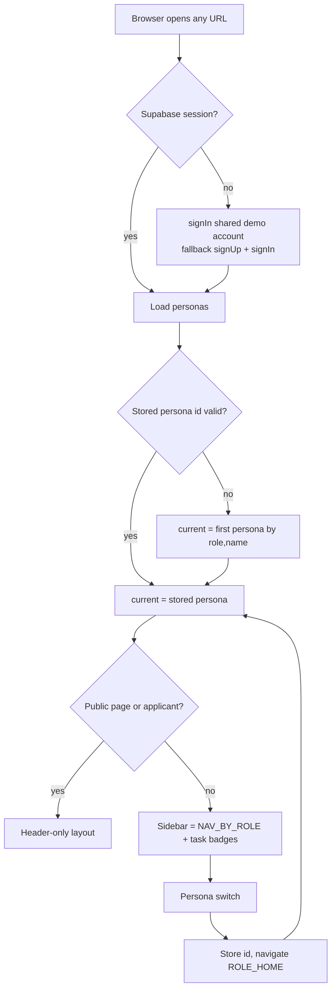

[Observed] `DemoSession.tsx`, `persona.tsx`, `AppShell.tsx`. Actor: any visitor. Guard: none server-side.

### 6.2 Partner registration (license lookup)

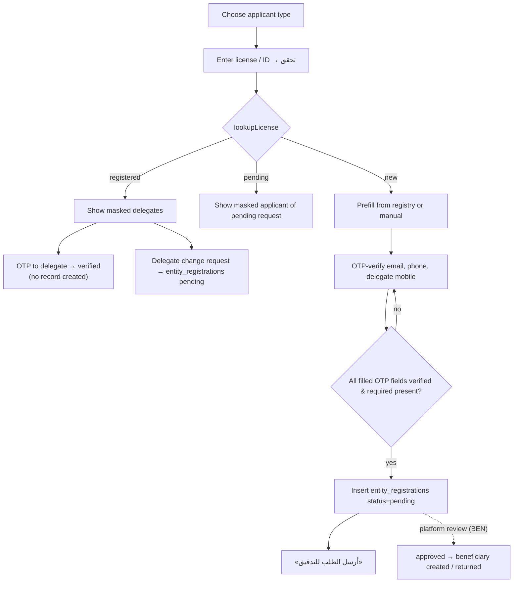

Entity registration status values observed: `pending` (on submit), `returned`, `approved` (set in BEN review, `registrations.ts:105-121`). Field decision values: `pending | accepted | rejected`; field source: `registry | registry_edited | manual` [Observed] `registrations.ts:4-9`.

### 6.3 Invitation lifecycle

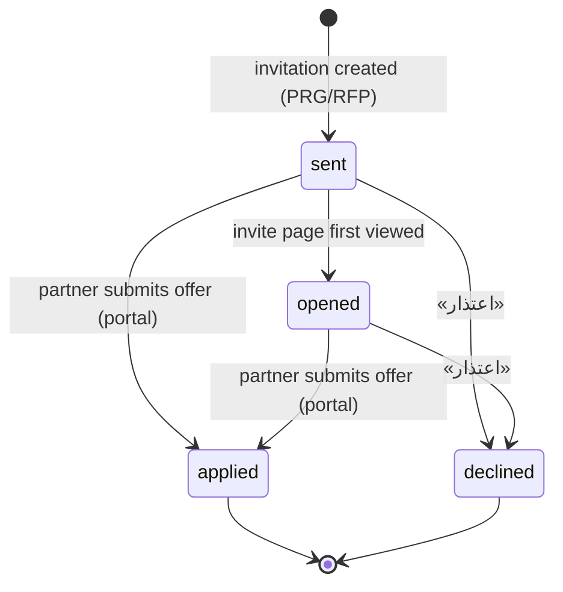

[Observed] `program_invitations.status` default `sent`; `markInvitation` (`rfp.ts:43-51`) sets `opened` (only from `sent`), `applied`, `declined`. The transition to `applied` happens in the portal (PTL). Guard for 'proceed': status not declined/applied. Side effect: inactive beneficiary account → `active` [Observed] `invite.$token.tsx:50`. No expiry state exists [Observed – gap].

### 6.4 Copilot request

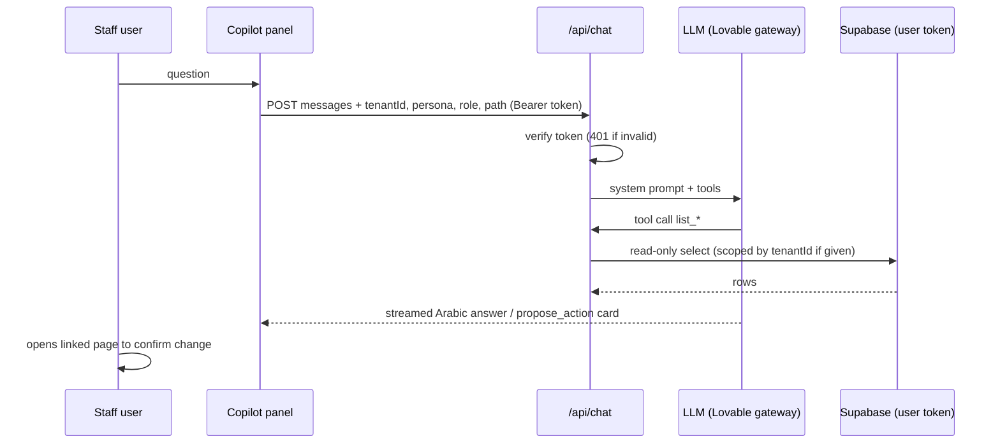

### 6.5 Scripted demo scenario (demo project only)

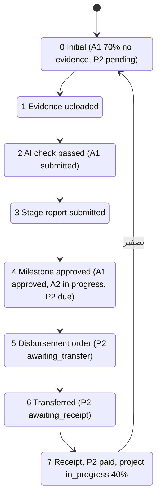

[Observed] `lib/demoScript.ts:36-94`. Each arrow is reversible with «تراجع». Actors are narrated only (partner, AI check, grants manager, finance officer) — all executed from one account.

## 7. Business Rules

| BR ID | Rule | Evidence label + reference |
|---|---|---|
| BR-PLT-01 | Every page renders only after an authenticated Supabase session exists; if none, the client signs into (or signs up) one shared demo account before rendering. | [Observed] components/DemoSession.tsx:4-22 |
| BR-PLT-02 | The active persona is chosen client-side and persisted in browser storage (key 'grants-poc-persona'); if none is stored, the first persona (ordered by role, then name) is used. | [Observed] lib/persona.tsx:32,48-80 |
| BR-PLT-03 | Each role has a fixed sidebar set (NAV_BY_ROLE) and a home route (ROLE_HOME); switching persona navigates to the role home. | [Observed] components/AppShell.tsx:53-62,94-98; lib/persona.tsx:106-115 |
| BR-PLT-04 | The sidebar is hidden on public pages ('/', '/login', '/register-tenant') and for the applicant role, which uses a header-only layout. | [Observed] components/AppShell.tsx:85-87,172-199 |
| BR-PLT-05 | /admin is available only to the 'admin' role; other roles see a message pointing to Settings > Team. | [Observed] routes/admin.tsx:58-71 |
| BR-PLT-06 | /portal content is available only to the 'applicant' role; other roles are asked to switch persona. | [Observed] routes/portal.tsx:82-83 |
| BR-PLT-07 | Settings section tabs flagged platformOnly are shown only to admin; tabs flagged tenantOnly are hidden from admin. | [Observed] components/SectionTabs.tsx:11-12,23-34 |
| BR-PLT-08 | The AI Copilot is not available to applicant personas. | [Observed] components/Copilot.tsx:152 |
| BR-PLT-09 | The Copilot never writes data: it uses read-only query tools and returns any change as a 'propose_action' link card that the employee confirms on the real page. | [Observed] routes/api/chat.ts:7-8,121-129,137 |
| BR-PLT-10 | The Copilot answers in Arabic plain text with Western digits and SAR amounts, uses tools instead of inventing figures, and is limited to 6 model/tool steps per answer. | [Observed] routes/api/chat.ts:134-140 |
| BR-PLT-11 | Global search runs only for terms of at least 2 characters, debounced 250 ms, scoped to the current persona's tenant, returning at most 5 hits per entity type. | [Observed] components/GlobalSearch.tsx:54-80 |
| BR-PLT-12 | Search matching treats hamza variants of alef, taa marbuta/haa, alef maqsura/yaa and Eastern/Western digits as equivalent. | [Observed] components/GlobalSearch.tsx:30-33 |
| BR-PLT-13 | The recent-items list keeps the last 6 opened results, de-duplicated by link. | [Observed] components/GlobalSearch.tsx:82-88 |
| BR-PLT-14 | Self-registration offers only applicant types flagged for the portal and not closed by the tenant; government entities are internal-only. | [Observed] lib/applicantTypes.ts:7-15; routes/register-tenant.tsx:33-36 |
| BR-PLT-15 | License lookup precedence: an existing beneficiary with that license → 'registered'; else a pending registration → 'pending'; else 'new' (with registry prefill when found). | [Observed] lib/registrations.ts:48-67 |
| BR-PLT-16 | Email, entity phone and delegate mobile must be OTP-verified when filled before a registration can be submitted. | [Observed] routes/register-tenant.tsx:30,58-62 |
| BR-PLT-17 | A registration is stored as a pending request with per-field source (registry / registry_edited / manual) and decision 'pending'; the partner organization is created only when the platform approves it (see BEN). | [Observed] lib/registrations.ts:69-77,105-121; AGENTS.md |
| BR-PLT-18 | Delegate identity shown to anonymous users is masked: mobile shows only the last 4 digits; name shows initials plus the first 3 letters of the family name. | [Observed] lib/registrations.ts:34-46 |
| BR-PLT-19 | For the 'individual' type, organization-only fields (entity type, unified number, classification, entity phone, delegate name/ID) are hidden and labels are personalised. | [Observed] routes/register-tenant.tsx:56-57 |
| BR-PLT-20 | An invitation is marked 'opened' only when its status is still 'sent'; accept/decline set 'applied'/'declined' with a response timestamp. | [Observed] lib/rfp.ts:43-51; routes/invite.$token.tsx:39,57-60 |
| BR-PLT-21 | Proceeding from an invitation for an inactive partner account activates the account (account_status='active', activated_at). | [Observed] routes/invite.$token.tsx:46-55 |
| BR-PLT-22 | Saved views store only values the user explicitly pins (e.g. hidden columns, page size, page filters) per persona and view key; search text and page number are never saved. | [Observed] lib/viewPrefs.tsx:23-66; AGENTS.md; migration 20261005054632 (UNIQUE persona_id, view_key) |
| BR-PLT-23 | List exports contain only visible columns that define an export value, for all filtered rows (not just the current page); CSV is UTF-8 with BOM, XLSX is right-to-left. | [Observed] components/DataTable.tsx:64-78; lib/data.ts:411-423 |
| BR-PLT-24 | Rendered labels and visible attributes are normalised to Western digits; inputs, textareas, code and [data-no-convert] are excluded; formatters use the '-u-nu-latn' locale extension. | [Observed] components/LatinDigits.tsx:5-75; lib/data.ts:377-390 |
| BR-PLT-25 | The Field display component hides empty, '—' and zero values. | [Observed] components/common.tsx:97-106 |
| BR-PLT-26 | Sidebar badges count open tasks from the same source as 'My tasks': total for /tasks, application tasks for /reviewer, payment tasks for /projects and /finance; manual tasks count only if assigned to or attended by the current persona. | [Observed] lib/navCounts.ts:7-21 |
| BR-PLT-27 | Demo controls appear only on the designated demo project; step k moves the scenario from state k to k+1 across 7 steps; reset returns to state 0. | [Observed] lib/demoScript.ts:4,23-31; routes/projects.$id.tsx:170 |
| BR-PLT-28 | A stored theme preference overrides the operating-system colour-scheme preference and is applied before hydration. | [Observed] routes/__root.tsx:122-127; components/ThemeToggle.tsx |
| BR-PLT-29 | Workshop notes autosave to the presenting device; deck keyboard shortcuts are ignored while typing in a note. | [Observed] components/WorkshopDeck.tsx:49-57,158-171 |
| BR-PLT-30 | In production, every request must be authorised server-side by the authenticated user's tenant and role, not by a client-selected persona. | [Recommended] Analyst — closes ISS-PLT-01..05 |

## 8. Data Requirements

### personas

Demo user identities per tenant (one row per person-role). [Observed] (migrations / types.ts).

| Field | Type | Required | Meaning |
|---|---|---|---|
| id | uuid | Y | PK |
| tenant_id | uuid → tenants | Y | Owning tenant |
| name | text | Y | Display name (initials derived) |
| email | text | N | Contact |
| role | text (was enum) | Y | One of 8 roles (lib/persona.tsx) |
| beneficiary_id | uuid → beneficiaries | N | Partner org for applicant personas |
| avatar_url | text | N | Bundled avatar mapping |
| department_id | uuid → departments | N | Org unit (CFG) |

**Relationships:** Referenced by user_view_prefs, manual_tasks, application history, etc.  
**Lifecycle / status:** No status; selection stored client-side.

### tenants

Donor organizations (read for counts on /admin; managed in CFG). [Observed] (migrations / types.ts).

| Field | Type | Required | Meaning |
|---|---|---|---|
| id | uuid | Y | PK |
| name | text | Y | Tenant name |
| contact_email | text | N | Official e-mail |
| status | text | Y | active \| suspended |
| created_at | timestamptz | Y | Creation |

**Relationships:** 1:N personas, programs, beneficiaries…  
**Lifecycle / status:** active ↔ suspended (CFG).

### user_view_prefs

Per-persona saved list views. [Observed] (migrations / types.ts).

| Field | Type | Required | Meaning |
|---|---|---|---|
| id | uuid | Y | PK |
| persona_id | uuid → personas (cascade) | Y | Owner |
| view_key | text | Y | e.g. 'table:<fileName>' or page key |
| prefs | jsonb | Y | Pinned values (hidden[], size, filters) |
| updated_at | timestamptz | Y | Last save |

**Relationships:** UNIQUE(persona_id, view_key).  
**Lifecycle / status:** Created on pin; deleted on reset.

### entity_registrations

Partner registration and delegate-change requests (written here, reviewed in BEN). [Observed] (migrations / types.ts).

| Field | Type | Required | Meaning |
|---|---|---|---|
| id | uuid | Y | PK |
| tenant_id | uuid | Y | Hard-coded TENANT_ID in prototype |
| license_no | text | Y | License / ID entered |
| fields | jsonb RegField[] | Y | {key, label, value, registry_value, source, decision} |
| status | text | Y | pending \| returned \| approved |
| note | text | N | Delegate-change reason / review note |
| beneficiary_id | uuid | N | Set on approval |
| decided_by / decided_at | uuid / timestamptz | N | Reviewer and time |

**Relationships:** → beneficiaries on approval.  
**Lifecycle / status:** pending → approved | returned.

### beneficiary_memberships

Links personas to partner orgs (read for delegate lookup). [Observed] (migrations / types.ts).

| Field | Type | Required | Meaning |
|---|---|---|---|
| beneficiary_id | uuid | Y | Partner |
| persona_id | uuid | Y | Member |
| role | text | Y | primary_delegate \| delegate \| … |
| is_primary | bool | Y | Primary delegate |
| mobile | text | N | Shown masked |
| national_id | text | N | — |
| active | bool | Y | Only active shown |
| verified_via | text | Y | Verification channel |
| start_at / end_at | timestamptz | Y/N | Validity |

**Relationships:** Managed in BEN.  
**Lifecycle / status:** active true/false.

### program_invitations

Private invitations to apply. [Observed] (migrations / types.ts).

| Field | Type | Required | Meaning |
|---|---|---|---|
| id | uuid | Y | PK |
| program_id | uuid → grant_programs | Y | Opportunity |
| beneficiary_id | uuid → beneficiaries | Y | Invitee |
| token | text unique | Y | Random 32-hex link token |
| email | text | N | Invite e-mail |
| status | text | Y | sent \| opened \| applied \| declined |
| sent_by | uuid → personas | N | Sender |
| sent_at / opened_at / responded_at | timestamptz | Y/N/N | Timeline |

**Relationships:** UNIQUE(program_id, beneficiary_id).  
**Lifecycle / status:** See §6.3.

### beneficiaries (subset)

Partner org fields touched by PLT. [Observed] (migrations / types.ts).

| Field | Type | Required | Meaning |
|---|---|---|---|
| license_no | text | N | Lookup key |
| account_status | text | Y | pending \| active \| … |
| activated_at | timestamptz | N | Set on invite activation |
| name, email | text | Y/N | Displayed |

**Relationships:** Owned by BEN.  
**Lifecycle / status:** account_status → active via invitation.

### grant_programs (subset)

Displayed on landing/invite; searched. [Observed] (migrations / types.ts).

| Field | Type | Required | Meaning |
|---|---|---|---|
| title, description, budget, status, deadline, close_at, kind, rfp_scope, rfp_deliverables, rfp_duration_days, created_at | various | — | Read-only here |

**Relationships:** Owned by PRG.  
**Lifecycle / status:** active | closed.

### Demo scenario rows

project_activities, project_reports, payments, projects with fixed UUIDs. [Observed] (migrations / types.ts).

| Field | Type | Required | Meaning |
|---|---|---|---|
| A1–A4, P1–P3, R1, DEMO_PROJECT_ID | uuid | Y | Seeded ids in demoScript.ts:4-13 |

**Relationships:** Owned by PRJ/FIN.  
**Lifecycle / status:** See §6.5.

### Browser storage (client-side)

Non-database state. [Observed] (migrations / types.ts).

| Field | Type | Required | Meaning |
|---|---|---|---|
| grants-poc-persona | string | — | Current persona id |
| theme / palette | string | — | UI prefs |
| recent-search | JSON Hit[] | — | Last 6 search hits |
| copilot:<personaId> | JSON UIMessage[] | — | Chat history |
| workshop-notes | JSON map | — | Deck notes |
| demo-step-<projectId> | number | — | Demo step pointer |

**Relationships:** —  
**Lifecycle / status:** —

## 9. Product Structure

- **EP-PLT-01 — Identity, Session & Access Control**: Session establishment, login, personas/roles and (recommended) production-grade authentication and authorization.
  - FT-PLT-01 — Session establishment & login *(Priority: Must)*
  - FT-PLT-02 — Persona & role model with demo switcher *(Priority: Must)*
  - FT-PLT-17 — Production identity & authorization (recommended) *(Priority: Must)*
- **EP-PLT-02 — Public Entry & Partner Onboarding**: Landing page, partner self-registration with registry lookup and OTP, delegate verification, invitation acceptance.
  - FT-PLT-04 — Public landing page *(Priority: Should)*
  - FT-PLT-05 — Partner self-registration (license lookup, registry prefill, OTP) *(Priority: Must)*
  - FT-PLT-06 — Existing-entity delegate verification & delegate change request *(Priority: Should)*
  - FT-PLT-07 — Invitation acceptance *(Priority: Should)*
- **EP-PLT-03 — Workspace Shell & Navigation**: Role-based sidebar, header tools, global search, theme/palette, RTL and digit localization.
  - FT-PLT-03 — Role-based navigation & page gates *(Priority: Must)*
  - FT-PLT-08 — Global search *(Priority: Should)*
  - FT-PLT-09 — Theme, palette, RTL & digit localization *(Priority: Must)*
- **EP-PLT-04 — AI Copilot**: Read-only conversational assistant over tenant data that proposes actions for human confirmation.
  - FT-PLT-10 — AI Copilot (read-only assistant) *(Priority: Should)*
- **EP-PLT-05 — Demo & Workshop Enablement**: Contextual demo guide, scripted demo controls and the requirements-workshop deck.
  - FT-PLT-11 — Contextual demo guide *(Priority: Could)*
  - FT-PLT-12 — Scripted demo controls *(Priority: Won't)*
  - FT-PLT-13 — Requirements-workshop deck with notes *(Priority: Could)*
- **EP-PLT-06 — Shared UI Framework**: Reusable list, view-preference, loading/error, guided-dialog and help patterns used by all modules.
  - FT-PLT-14 — Data table & saved views *(Priority: Must)*
  - FT-PLT-15 — Page scaffolding, loading and error handling *(Priority: Must)*
  - FT-PLT-16 — Guided actions, concept help & layout helpers *(Priority: Should)*

## 10. Features

### FT-PLT-01 — Session establishment & login

- **Feature ID:** FT-PLT-01 (Epic EP-PLT-01)
- **Name:** Session establishment & login
- **Description:** Ensures a Supabase session before rendering; provides a login page (cosmetic in the prototype) and bearer-token authentication for server functions.
- **Business Objective:** [Inferred] Keep data unreadable by anonymous visitors while allowing frictionless demo access (DemoSession.tsx:4 comment).
- **Expected Business Value:** [To Confirm]
- **Primary User Roles:** all
- **Scope:** Auto sign-in to shared account; loading state; login form with demo autofill; redirect to role home; server-function auth middleware; token attachment for RPCs.
- **Out of Scope:** Real per-user credentials, password reset, MFA, SSO (see FT-PLT-17).
- **Functional Requirements:** FR-PLT-001, FR-PLT-002, FR-PLT-003
- **User Stories:** US-PLT-001, US-PLT-002
- **Business Rules:** BR-PLT-01
- **Dependencies:** Supabase Auth; lib/persona.tsx
- **Related Screens:** SCR-PLT-02, SCR-PLT-05
- **Acceptance Criteria:**
  - No page content renders before a session exists.
  - Submitting the login form lands the user on their role's home page.
  - Server functions reject requests without a valid bearer JWT.
- **Open Questions:** OQ-PLT-01
- **Assumptions:** Prototype login is intentionally cosmetic.
- **Priority Recommendation (MoSCoW):** Must

### FT-PLT-02 — Persona & role model with demo switcher

- **Feature ID:** FT-PLT-02 (Epic EP-PLT-01)
- **Name:** Persona & role model with demo switcher
- **Description:** Loads personas, keeps a current persona per browser and lets a presenter switch persona; defines role labels and role home pages.
- **Business Objective:** [Inferred] Demonstrate each role's experience from one browser.
- **Expected Business Value:** [To Confirm]
- **Primary User Roles:** all (demo presenter)
- **Scope:** Persona context, persistence, switcher menu (initials, name, role label, check mark), ROLE_LABELS, ROLE_HOME.
- **Out of Scope:** Real user-role assignment and multi-membership switching (see CFG memberships).
- **Functional Requirements:** FR-PLT-007, FR-PLT-008, FR-PLT-009
- **User Stories:** US-PLT-005
- **Business Rules:** BR-PLT-02, BR-PLT-03
- **Dependencies:** personas table
- **Related Screens:** SCR-PLT-06, SCR-PLT-05
- **Acceptance Criteria:**
  - Switching persona updates sidebar, header and lands on the role home.
  - The selected persona survives a page reload on the same browser.
- **Open Questions:** OQ-PLT-02, OQ-PLT-03
- **Assumptions:** Persona switching is a demo-only capability.
- **Priority Recommendation (MoSCoW):** Must

### FT-PLT-03 — Role-based navigation & page gates

- **Feature ID:** FT-PLT-03 (Epic EP-PLT-03)
- **Name:** Role-based navigation & page gates
- **Description:** Role-specific sidebar with active-state, grouped sub-routes, open-task badges, header breadcrumb, mobile drawer; page-level gates for /admin, /portal and settings tabs.
- **Business Objective:** [Inferred] Show each role only the sections relevant to its work and surface pending work.
- **Expected Business Value:** [To Confirm]
- **Primary User Roles:** admin, grants_manager, reviewer, committee_secretary, project_manager, finance, ceo, applicant
- **Scope:** NAV_BY_ROLE, active matching incl. 'also' routes, badges from navCounts, mobile Sheet, applicant/public header layout, AdminGate, portal gate, SectionTabs filtering.
- **Out of Scope:** Server-side authorization (FT-PLT-17); content of destination pages (other modules).
- **Functional Requirements:** FR-PLT-010, FR-PLT-011, FR-PLT-012, FR-PLT-013, FR-PLT-014, FR-PLT-015, FR-PLT-016
- **User Stories:** US-PLT-006, US-PLT-007, US-PLT-008
- **Business Rules:** BR-PLT-03, BR-PLT-04, BR-PLT-05, BR-PLT-06, BR-PLT-07, BR-PLT-26
- **Dependencies:** TSK (task derivation for badges); CFG (settings tabs)
- **Related Screens:** SCR-PLT-05, SCR-PLT-11
- **Acceptance Criteria:**
  - Each role sees exactly its configured sidebar items.
  - Badge counts equal the open items on 'My tasks'.
  - A non-admin opening /admin sees the restriction message.
- **Open Questions:** OQ-PLT-04, OQ-PLT-13
- **Assumptions:** Sidebar visibility is not a security control in the prototype.
- **Priority Recommendation (MoSCoW):** Must

### FT-PLT-04 — Public landing page

- **Feature ID:** FT-PLT-04 (Epic EP-PLT-02)
- **Name:** Public landing page
- **Description:** Hero with calls to action, three capability cards and cards for active grant programs.
- **Business Objective:** [Inferred] Attract applicants and partner organizations to the portal and registration.
- **Expected Business Value:** [To Confirm]
- **Primary User Roles:** public visitor
- **Scope:** Hero, CTAs (browse programs, register entity), capability cards, active program cards with budget/deadline and 'Apply now'.
- **Out of Scope:** Program detail page; tenant branding per donor.
- **Functional Requirements:** FR-PLT-017, FR-PLT-018
- **User Stories:** US-PLT-009
- **Business Rules:** —
- **Dependencies:** grant_programs (PRG)
- **Related Screens:** SCR-PLT-01
- **Acceptance Criteria:**
  - Active programs are listed newest first with budget and deadline.
  - CTAs navigate to /portal and /register-tenant.
- **Open Questions:** OQ-PLT-07
- **Assumptions:** The landing page is reachable only after the shared demo session is established.
- **Priority Recommendation (MoSCoW):** Should

### FT-PLT-05 — Partner self-registration (license lookup, registry prefill, OTP)

- **Feature ID:** FT-PLT-05 (Epic EP-PLT-02)
- **Name:** Partner self-registration (license lookup, registry prefill, OTP)
- **Description:** A partner representative selects an applicant type, looks up the license/ID, completes registry-prefilled fields, verifies contact channels by OTP and submits for platform review.
- **Business Objective:** [Inferred] Ensure verified, registry-backed partner data before activation (registrations.ts header comment).
- **Expected Business Value:** [To Confirm]
- **Primary User Roles:** public visitor (partner representative)
- **Scope:** Type chips, lookup states (registered/pending/new), registry prefill and provenance tags, OTP inputs, required-field validation, submission & confirmation screen.
- **Out of Scope:** Platform review/approval of registrations (BEN); real registry (NCNP) integration; real SMS/email OTP.
- **Functional Requirements:** FR-PLT-019, FR-PLT-020, FR-PLT-021, FR-PLT-022, FR-PLT-023, FR-PLT-024
- **User Stories:** US-PLT-010, US-PLT-011, US-PLT-012
- **Business Rules:** BR-PLT-14, BR-PLT-15, BR-PLT-16, BR-PLT-17, BR-PLT-18, BR-PLT-19
- **Dependencies:** lib/registrations.ts; lib/applicantTypes.ts; BEN (RegistrationReview)
- **Related Screens:** SCR-PLT-03
- **Acceptance Criteria:**
  - A new license produces a form prefilled from the registry where available.
  - Submission is blocked until filled OTP fields are verified.
  - A successful submission creates a pending entity_registrations row.
- **Open Questions:** OQ-PLT-08, OQ-PLT-12
- **Assumptions:** Registry data and OTP codes are simulated in the prototype.
- **Priority Recommendation (MoSCoW):** Must

### FT-PLT-06 — Existing-entity delegate verification & delegate change request

- **Feature ID:** FT-PLT-06 (Epic EP-PLT-02)
- **Name:** Existing-entity delegate verification & delegate change request
- **Description:** For an already-registered license, shows masked delegates, lets the user verify affiliation by OTP to the delegate, or request a delegate change for platform review.
- **Business Objective:** [Inferred] Prevent duplicate entities and tie new users to the existing organization through its authorised delegate.
- **Expected Business Value:** [To Confirm]
- **Primary User Roles:** public visitor (staff of a registered partner)
- **Scope:** Masked delegate list, OTP to delegate, verification result, change-request form (name, national ID, mobile, reason).
- **Out of Scope:** Actual team-join workflow (BEN team); delegate-change approval (BEN).
- **Functional Requirements:** FR-PLT-025, FR-PLT-026, FR-PLT-027
- **User Stories:** US-PLT-013, US-PLT-014
- **Business Rules:** BR-PLT-15, BR-PLT-18
- **Dependencies:** lib/registrations.ts; BEN
- **Related Screens:** SCR-PLT-03
- **Acceptance Criteria:**
  - Delegates are displayed masked.
  - A delegate-change request is stored for platform review.
- **Open Questions:** OQ-PLT-08
- **Assumptions:** Verification success currently persists nothing (ISS-PLT-10).
- **Priority Recommendation (MoSCoW):** Should

### FT-PLT-07 — Invitation acceptance

- **Feature ID:** FT-PLT-07 (Epic EP-PLT-02)
- **Name:** Invitation acceptance
- **Description:** Token-based invitation page showing the opportunity, with activate-and-apply, apply, or decline paths.
- **Business Objective:** [Inferred] Let invited partners respond to private/RFP opportunities with minimal friction.
- **Expected Business Value:** [To Confirm]
- **Primary User Roles:** invited partner (applicant)
- **Scope:** Token lookup, invalid-link state, opened tracking, program summary, account activation form, proceed to portal application, decline, final states.
- **Out of Scope:** Sending invitations (PRG/RFP); the application form itself (PTL).
- **Functional Requirements:** FR-PLT-028, FR-PLT-029, FR-PLT-030, FR-PLT-031, FR-PLT-032, FR-PLT-033
- **User Stories:** US-PLT-015, US-PLT-016, US-PLT-017
- **Business Rules:** BR-PLT-20, BR-PLT-21
- **Dependencies:** program_invitations; lib/rfp.ts; PTL portal
- **Related Screens:** SCR-PLT-04
- **Acceptance Criteria:**
  - An unknown token shows 'invalid invitation link'.
  - First view of a 'sent' invitation sets it to 'opened'.
  - Proceeding opens the portal application for that program.
- **Open Questions:** OQ-PLT-09
- **Assumptions:** —
- **Priority Recommendation (MoSCoW):** Should

### FT-PLT-08 — Global search

- **Feature ID:** FT-PLT-08 (Epic EP-PLT-03)
- **Name:** Global search
- **Description:** Command-palette search across partners, applications, projects/initiatives, payments, programs, plans and staff plus page shortcuts and recent items.
- **Business Objective:** [Inferred] Reduce navigation time to any record.
- **Expected Business Value:** [To Confirm]
- **Primary User Roles:** all signed-in personas
- **Scope:** Ctrl/Cmd+K, tenant-scoped ilike search with Arabic normalisation, grouped results, page shortcuts, recent list.
- **Out of Scope:** Full-text ranking; permission-aware filtering (recommended FR-PLT-041).
- **Functional Requirements:** FR-PLT-034, FR-PLT-035, FR-PLT-036, FR-PLT-037
- **User Stories:** US-PLT-018, US-PLT-019
- **Business Rules:** BR-PLT-11, BR-PLT-12, BR-PLT-13
- **Dependencies:** All entity tables
- **Related Screens:** SCR-PLT-07
- **Acceptance Criteria:**
  - Typing ≥2 characters returns grouped results within the tenant.
  - Selecting a result navigates and adds it to recent items.
- **Open Questions:** OQ-PLT-05
- **Assumptions:** —
- **Priority Recommendation (MoSCoW):** Should

### FT-PLT-09 — Theme, palette, RTL & digit localization

- **Feature ID:** FT-PLT-09 (Epic EP-PLT-03)
- **Name:** Theme, palette, RTL & digit localization
- **Description:** Light/dark mode, three colour palettes, Arabic RTL document with Radix direction provider, Western-digit normalisation.
- **Business Objective:** [Observed] Arabic-first UI consistent with the project decision on Western digits (AGENTS.md).
- **Expected Business Value:** [To Confirm]
- **Primary User Roles:** all
- **Scope:** ThemeToggle, PalettePicker, pre-hydration script, DirectionProvider rtl, LatinDigits, -u-nu-latn formatters.
- **Out of Scope:** Organisation-level branding; English UI.
- **Functional Requirements:** FR-PLT-038, FR-PLT-039, FR-PLT-040, FR-PLT-041
- **User Stories:** US-PLT-020, US-PLT-021
- **Business Rules:** BR-PLT-24, BR-PLT-28
- **Dependencies:** styles.css tokens
- **Related Screens:** SCR-PLT-05, SCR-PLT-12
- **Acceptance Criteria:**
  - Theme and palette persist across reloads on the same device.
  - Eastern Arabic digits never appear in rendered labels.
- **Open Questions:** OQ-PLT-10
- **Assumptions:** —
- **Priority Recommendation (MoSCoW):** Must

### FT-PLT-10 — AI Copilot (read-only assistant)

- **Feature ID:** FT-PLT-10 (Epic EP-PLT-04)
- **Name:** AI Copilot (read-only assistant)
- **Description:** Side-panel chat that answers questions using read-only tools over tenant data and proposes changes as link cards.
- **Business Objective:** [Observed] Assist staff while keeping humans in control of changes (chat.ts:7-8).
- **Expected Business Value:** [To Confirm]
- **Primary User Roles:** admin, grants_manager, reviewer, committee_secretary, project_manager, finance, ceo
- **Scope:** Section-specific suggested prompts, streaming answers, tool progress, proposed-action cards, per-persona local history, new chat, stop, wide mode, error display; /api/chat endpoint with auth check and 7 tools.
- **Out of Scope:** Executing changes; applicant access; document upload to chat.
- **Functional Requirements:** FR-PLT-042, FR-PLT-043, FR-PLT-044, FR-PLT-045, FR-PLT-046, FR-PLT-047
- **User Stories:** US-PLT-022, US-PLT-023
- **Business Rules:** BR-PLT-08, BR-PLT-09, BR-PLT-10
- **Dependencies:** Lovable AI gateway (LOVABLE_API_KEY); Supabase
- **Related Screens:** SCR-PLT-08
- **Acceptance Criteria:**
  - Answers use live data from tools.
  - Any change request yields a link card, never a data write.
  - Requests without a valid session get 401.
- **Open Questions:** OQ-PLT-06
- **Assumptions:** —
- **Priority Recommendation (MoSCoW):** Should

### FT-PLT-11 — Contextual demo guide

- **Feature ID:** FT-PLT-11 (Epic EP-PLT-05)
- **Name:** Contextual demo guide
- **Description:** Help sheet with page-specific walkthrough steps; on project pages it identifies the pending payment step and the persona to switch to.
- **Business Objective:** [Observed] Support live demos ('عند من واقف الإجراء؟').
- **Expected Business Value:** [To Confirm]
- **Primary User Roles:** demo presenter (any staff persona)
- **Scope:** Guides for 6 route patterns; pending-payment detection; one-click persona switch.
- **Out of Scope:** Production help centre.
- **Functional Requirements:** FR-PLT-048, FR-PLT-049
- **User Stories:** US-PLT-024
- **Business Rules:** —
- **Dependencies:** payments, projects tables; FT-PLT-02
- **Related Screens:** SCR-PLT-09
- **Acceptance Criteria:**
  - On a project with a payment awaiting transfer, the guide proposes the finance persona.
  - Pages without a guide show a generic hint.
- **Open Questions:** OQ-PLT-11
- **Assumptions:** Demo-only.
- **Priority Recommendation (MoSCoW):** Could

### FT-PLT-12 — Scripted demo controls

- **Feature ID:** FT-PLT-12 (Epic EP-PLT-05)
- **Name:** Scripted demo controls
- **Description:** Advance/undo/reset a 7-step scenario on the demo project by writing predefined states to the database.
- **Business Objective:** [Observed] Run a repeatable client demo from one account (demoScript.ts:22 comment).
- **Expected Business Value:** [To Confirm]
- **Primary User Roles:** demo presenter
- **Scope:** Step bar, last/next step text with actor, DB snapshot application, query invalidation, local step pointer.
- **Out of Scope:** Any production use.
- **Functional Requirements:** FR-PLT-050
- **User Stories:** US-PLT-025
- **Business Rules:** BR-PLT-27
- **Dependencies:** project_activities, project_reports, payments, projects
- **Related Screens:** SCR-PLT-10
- **Acceptance Criteria:**
  - 'Advance' applies the next scripted state and refreshes the page data.
  - 'Reset' returns the project to its initial state.
- **Open Questions:** OQ-PLT-11
- **Assumptions:** Demo-only; to be removed before production.
- **Priority Recommendation (MoSCoW):** Won't

### FT-PLT-13 — Requirements-workshop deck with notes

- **Feature ID:** FT-PLT-13 (Epic EP-PLT-05)
- **Name:** Requirements-workshop deck with notes
- **Description:** 11-slide 16:9 presentation inside /admin with agenda, method, six sessions (goal, points, comparison questions, deep links) and note boxes, a parking lot and a summary.
- **Business Objective:** [Observed] Run a gap-analysis workshop comparing the prototype with the client's current system.
- **Expected Business Value:** [To Confirm]
- **Primary User Roles:** admin (facilitator)
- **Scope:** Slides, scaling, navigation (buttons, keyboard, progress), fullscreen, note capture/autosave, summary aggregation.
- **Out of Scope:** Sharing/exporting notes (recommended); editing slide content.
- **Functional Requirements:** FR-PLT-051, FR-PLT-052, FR-PLT-053
- **User Stories:** US-PLT-026, US-PLT-027
- **Business Rules:** BR-PLT-29
- **Dependencies:** browser storage
- **Related Screens:** SCR-PLT-11
- **Acceptance Criteria:**
  - Arrow keys/space navigate slides when not typing.
  - Notes typed in a session reappear in the summary slide.
- **Open Questions:** OQ-PLT-11
- **Assumptions:** —
- **Priority Recommendation (MoSCoW):** Could

### FT-PLT-14 — Data table & saved views

- **Feature ID:** FT-PLT-14 (Epic EP-PLT-06)
- **Name:** Data table & saved views
- **Description:** Reusable list component with search, column chooser, pagination, export and per-user pinned views, plus a secondary-filter popover with chips.
- **Business Objective:** [Observed] One consistent list experience across modules (AGENTS.md: 'list pages share DataTable').
- **Expected Business Value:** [To Confirm]
- **Primary User Roles:** all staff roles
- **Scope:** DataTable, useSavedView/SaveViewButton, MoreFilters/FilterChips/FilterField.
- **Out of Scope:** Server-side pagination/sorting; column sorting (not present).
- **Functional Requirements:** FR-PLT-054, FR-PLT-055, FR-PLT-056, FR-PLT-057
- **User Stories:** US-PLT-028, US-PLT-029
- **Business Rules:** BR-PLT-22, BR-PLT-23
- **Dependencies:** user_view_prefs; xlsx library
- **Related Screens:** (used by list screens in other modules)
- **Acceptance Criteria:**
  - Export contains only visible exportable columns of all filtered rows.
  - A pinned view is restored on next visit for the same persona.
- **Open Questions:** OQ-PLT-14
- **Assumptions:** —
- **Priority Recommendation (MoSCoW):** Must

### FT-PLT-15 — Page scaffolding, loading and error handling

- **Feature ID:** FT-PLT-15 (Epic EP-PLT-06)
- **Name:** Page scaffolding, loading and error handling
- **Description:** Page container and header, page-shaped skeleton that turns into an error-with-retry, 404 page, root error boundary, telemetry reporting and SSR error capture.
- **Business Objective:** [Inferred] Predictable states on every page.
- **Expected Business Value:** [To Confirm]
- **Primary User Roles:** all
- **Scope:** Page, PageHeader, PageSkeleton, NotFoundComponent, ErrorComponent, reportLovableError, error-capture, error-page.
- **Out of Scope:** Offline mode.
- **Functional Requirements:** FR-PLT-058, FR-PLT-059, FR-PLT-060
- **User Stories:** US-PLT-030
- **Business Rules:** —
- **Dependencies:** React Query cache; Lovable telemetry
- **Related Screens:** SCR-PLT-13, SCR-PLT-14
- **Acceptance Criteria:**
  - A failed query on a loading page shows 'تعذّر تحميل البيانات' with retry.
  - Unknown URLs show the 404 page.
- **Open Questions:** —
- **Assumptions:** —
- **Priority Recommendation (MoSCoW):** Must

### FT-PLT-16 — Guided actions, concept help & layout helpers

- **Feature ID:** FT-PLT-16 (Epic EP-PLT-06)
- **Name:** Guided actions, concept help & layout helpers
- **Description:** SmartFlow step dialog, auto-stepping long dialogs, InfoTip concept glossary, SectionTabs, StatCard (clickable filter), Pill, Field, StageTracker.
- **Business Objective:** [Observed] Break complex actions into confirmable steps and explain domain concepts in place.
- **Expected Business Value:** [To Confirm]
- **Primary User Roles:** all staff roles
- **Scope:** Component behaviour and contracts as reusable patterns.
- **Out of Scope:** Business logic of the flows that use them (PRG, FIN).
- **Functional Requirements:** FR-PLT-061, FR-PLT-062, FR-PLT-063, FR-PLT-064, FR-PLT-065
- **User Stories:** US-PLT-031, US-PLT-032
- **Business Rules:** BR-PLT-25
- **Dependencies:** components/ui/useAutoSteps.tsx
- **Related Screens:** (embedded in other modules)
- **Acceptance Criteria:**
  - SmartFlow shows a stepper only when there is more than one step.
  - Clicking a StatCard toggles its table filter and shows an active ring.
- **Open Questions:** —
- **Assumptions:** —
- **Priority Recommendation (MoSCoW):** Should

### FT-PLT-17 — Production identity & authorization (recommended)

- **Feature ID:** FT-PLT-17 (Epic EP-PLT-01)
- **Name:** Production identity & authorization (recommended)
- **Description:** Replace the shared demo account and client-side persona with per-user authentication, server-side role/tenant authorization and tenant-scoped RLS.
- **Business Objective:** [Recommended] Make every action attributable and data access enforceable.
- **Expected Business Value:** [To Confirm]
- **Primary User Roles:** all
- **Scope:** Per-user sign-in, user↔persona binding, role/permission enforcement in RLS and server functions, removal of demo artefacts.
- **Out of Scope:** Choice of identity provider (OQ-PLT-01).
- **Functional Requirements:** FR-PLT-004, FR-PLT-005, FR-PLT-006
- **User Stories:** US-PLT-003, US-PLT-004
- **Business Rules:** BR-PLT-30
- **Dependencies:** CFG (roles & permissions, memberships)
- **Related Screens:** SCR-PLT-02
- **Acceptance Criteria:**
  - A user can only read and write rows of their own tenant permitted by their role.
  - Demo credentials and switchers are absent from production builds.
- **Open Questions:** OQ-PLT-01, OQ-PLT-02, OQ-PLT-03, OQ-PLT-04
- **Assumptions:** —
- **Priority Recommendation (MoSCoW):** Must

## 11. Functional Requirements

### FR-PLT-001

- **Statement:** The system shall establish an authenticated session before rendering any page.
- **Description:** On load, reuse an existing Supabase session; otherwise sign in to the shared demo account, signing it up on first use; show 'جارٍ التحميل…' until done.
- **Type:** Security
- **Source / Prototype reference:** `components/DemoSession.tsx:8-22`
- **Related Feature:** FT-PLT-01 · **Related Story:** US-PLT-001
- **Priority:** Must · **Dependencies:** Supabase Auth
- **Acceptance Criteria:**
  - Given no session, when the app loads, then a loading message shows until a session exists and the page renders.
  - Given an existing session, when the app loads, then no new sign-in occurs.
- **Validation Rules:** —
- **Exceptions & Alternative Flows:** If sign-in and sign-up both fail the page still renders (finally) and data queries fail → PageSkeleton error state.
- **Open Questions:** —
- **Evidence:** [Observed]

### FR-PLT-002

- **Statement:** The system shall provide a login page with email and password fields that forwards the user to the home page of the active role.
- **Description:** Prototype: credentials are not checked; any pointer-down on the page autofills demo@minah.sa / Demo1234; submit navigates to ROLE_HOME[current.role] or /portal; a link offers registration.
- **Type:** UI
- **Source / Prototype reference:** `routes/login.tsx:29-103`
- **Related Feature:** FT-PLT-01 · **Related Story:** US-PLT-002
- **Priority:** Must · **Dependencies:** FR-PLT-008
- **Acceptance Criteria:**
  - Given the login page, when the user submits, then they land on their role home.
  - Given the login page, when the user clicks anywhere, then the demo credentials are filled once.
- **Validation Rules:** Email type=email, both fields required (HTML).
- **Exceptions & Alternative Flows:** No error state exists because no verification occurs (ISS-PLT-06).
- **Open Questions:** OQ-PLT-01
- **Evidence:** [Observed]

### FR-PLT-003

- **Statement:** The system shall require a valid bearer JWT on authenticated server functions and execute their database calls under the caller's token.
- **Description:** requireSupabaseAuth checks env, Authorization header format, JWT shape and claims (sub); attachSupabaseAuth adds the token to client RPCs. Used by docAi, attachmentAi, entityUpdates functions.
- **Type:** Security
- **Source / Prototype reference:** `integrations/supabase/auth-middleware.ts:34-111; auth-attacher.ts; lib/*.functions.ts`
- **Related Feature:** FT-PLT-01 · **Related Story:** US-PLT-001
- **Priority:** Must · **Dependencies:** Supabase Auth
- **Acceptance Criteria:**
  - Given a request without Authorization, when a protected server function is called, then it fails with 'Unauthorized'.
  - Given a valid token, when called, then the function receives userId and a user-scoped client.
- **Validation Rules:** —
- **Exceptions & Alternative Flows:** Missing SUPABASE_URL/KEY → configuration error thrown.
- **Open Questions:** —
- **Evidence:** [Observed]

### FR-PLT-004

- **Statement:** The system shall authenticate each person with individual credentials and bind the session to exactly one user record (persona) per tenant membership.
- **Description:** Replace the shared demo account and client-chosen persona; current persona derived from the authenticated user.
- **Type:** Security
- **Source / Prototype reference:** `Analyst (gap vs DemoSession.tsx, persona.tsx)`
- **Related Feature:** FT-PLT-17 · **Related Story:** US-PLT-003
- **Priority:** Must · **Dependencies:** Identity provider decision
- **Acceptance Criteria:**
  - Given two different users, when they sign in, then each sees only their own persona and role.
  - Given an unauthenticated visitor, when they open a staff page, then they are redirected to login.
- **Validation Rules:** —
- **Exceptions & Alternative Flows:** —
- **Open Questions:** OQ-PLT-01, OQ-PLT-02
- **Evidence:** [Recommended]

### FR-PLT-005

- **Statement:** The system shall enforce tenant isolation and role permissions in database policies and server functions.
- **Description:** RLS policies keyed on the user's tenant and role/permissions (CFG permission matrix); server endpoints derive tenant from the token, not the request body.
- **Type:** Security
- **Source / Prototype reference:** `Analyst (gap vs migration 20261006140739, chat.ts:33)`
- **Related Feature:** FT-PLT-17 · **Related Story:** US-PLT-004
- **Priority:** Must · **Dependencies:** FR-PLT-004; CFG roles
- **Acceptance Criteria:**
  - Given a reviewer, when they call an update on payments directly, then the database rejects it.
  - Given a user of tenant A, when they query tenant B rows, then none are returned.
- **Validation Rules:** —
- **Exceptions & Alternative Flows:** —
- **Open Questions:** —
- **Evidence:** [Recommended]

### FR-PLT-006

- **Statement:** The system shall exclude demo artefacts (shared credentials, persona switcher, demo guide, demo controls, demo OTP display) from production builds.
- **Description:** Feature-flag or remove DemoSession credentials, personaMenu, DemoGuide, DemoControls, on-screen OTP codes, login autofill.
- **Type:** Security
- **Source / Prototype reference:** `Analyst`
- **Related Feature:** FT-PLT-17 · **Related Story:** US-PLT-003
- **Priority:** Must · **Dependencies:** FR-PLT-004
- **Acceptance Criteria:**
  - Given a production build, when any page loads, then no persona switcher or demo bar is rendered.
  - Given the production bundle, when inspected, then it contains no hard-coded passwords.
- **Validation Rules:** —
- **Exceptions & Alternative Flows:** —
- **Open Questions:** —
- **Evidence:** [Recommended]

### FR-PLT-007

- **Statement:** The system shall load the persona list and maintain a current persona persisted in the browser, defaulting to the first persona.
- **Description:** personas ordered by role then name; selection stored under 'grants-poc-persona'; invalid stored id falls back to first persona.
- **Type:** Functional
- **Source / Prototype reference:** `lib/persona.tsx:48-89`
- **Related Feature:** FT-PLT-02 · **Related Story:** US-PLT-005
- **Priority:** Must · **Dependencies:** personas table
- **Acceptance Criteria:**
  - Given a stored persona id, when the app reloads, then that persona is active.
  - Given no stored id, when personas load, then the first persona becomes active and is stored.
- **Validation Rules:** —
- **Exceptions & Alternative Flows:** —
- **Open Questions:** —
- **Evidence:** [Observed]

### FR-PLT-008

- **Statement:** The system shall define a display label and a home route for each of the 8 roles.
- **Description:** ROLE_LABELS (e.g. grants_manager='مدير المنح') and ROLE_HOME (staff → /tasks; ceo, committee_secretary → /analytics; applicant → /portal).
- **Type:** Data
- **Source / Prototype reference:** `lib/persona.tsx:95-115`
- **Related Feature:** FT-PLT-02 · **Related Story:** US-PLT-005
- **Priority:** Must · **Dependencies:** —
- **Acceptance Criteria:**
  - Given any role, when displayed, then its Arabic label is shown.
  - Given a persona switch, when completed, then navigation goes to ROLE_HOME of the new role.
- **Validation Rules:** —
- **Exceptions & Alternative Flows:** —
- **Open Questions:** OQ-PLT-13
- **Evidence:** [Observed]

### FR-PLT-009

- **Statement:** The system shall let the user switch persona from a 'demo mode' menu listing all personas with initials, name, role and current marker.
- **Description:** Available from the sidebar user card, header icon (sidebar layout) and landing header; selecting navigates to the role home.
- **Type:** UI
- **Source / Prototype reference:** `components/AppShell.tsx:89-139`
- **Related Feature:** FT-PLT-02 · **Related Story:** US-PLT-005
- **Priority:** Must · **Dependencies:** FR-PLT-007, FR-PLT-008
- **Acceptance Criteria:**
  - Given the menu, when a persona is chosen, then it becomes current and the user lands on its home.
  - Given the menu, when opened, then the current persona shows a check mark.
- **Validation Rules:** —
- **Exceptions & Alternative Flows:** On /login and /register-tenant the switcher is hidden.
- **Open Questions:** OQ-PLT-03
- **Evidence:** [Observed]

### FR-PLT-010

- **Statement:** The system shall show a sidebar whose items depend on the current role (NAV_BY_ROLE).
- **Description:** See role × navigation matrix in §5.1.
- **Type:** UI
- **Source / Prototype reference:** `components/AppShell.tsx:40-62,141-170`
- **Related Feature:** FT-PLT-03 · **Related Story:** US-PLT-006
- **Priority:** Must · **Dependencies:** FR-PLT-007
- **Acceptance Criteria:**
  - Given role reviewer, when the shell renders, then the sidebar shows exactly Data & reports, My tasks, Grant applications, Partner organizations.
  - Given role project_manager, then only My tasks and Projects are shown.
- **Validation Rules:** —
- **Exceptions & Alternative Flows:** —
- **Open Questions:** —
- **Evidence:** [Observed]

### FR-PLT-011

- **Statement:** The system shall highlight the active sidebar item, including grouped sub-routes, and show its icon and label in the header.
- **Description:** Matching on 'to' and 'also' prefixes (dashboard also /reports; applications also /programs; projects also /finance; settings also /admin).
- **Type:** UI
- **Source / Prototype reference:** `components/AppShell.tsx:90-92,218-225`
- **Related Feature:** FT-PLT-03 · **Related Story:** US-PLT-006
- **Priority:** Should · **Dependencies:** FR-PLT-010
- **Acceptance Criteria:**
  - Given /programs/123, when rendered for grants_manager, then 'طلبات المنح' is active.
  - Given a route not in the role's sidebar, then no item is active and the header label is empty.
- **Validation Rules:** —
- **Exceptions & Alternative Flows:** —
- **Open Questions:** —
- **Evidence:** [Observed]

### FR-PLT-012

- **Statement:** The system shall display open-task count badges on sidebar items.
- **Description:** /tasks = all open tasks; /reviewer = application tasks; /projects and /finance = payment tasks; badge hidden at 0.
- **Type:** UI
- **Source / Prototype reference:** `lib/navCounts.ts:7-21; components/AppShell.tsx:146,163`
- **Related Feature:** FT-PLT-03 · **Related Story:** US-PLT-006
- **Priority:** Should · **Dependencies:** TSK task derivation (lib/tasks.ts)
- **Acceptance Criteria:**
  - Given 3 open application tasks, when the sidebar renders, then 'طلبات المنح' shows 3.
  - Given no open tasks, then no badge is shown.
- **Validation Rules:** —
- **Exceptions & Alternative Flows:** —
- **Open Questions:** —
- **Evidence:** [Observed]

### FR-PLT-013

- **Statement:** The system shall render a header-only layout for public pages and the applicant role.
- **Description:** Public: brand, theme, user card (landing only), login and register buttons. Applicant: brand, theme, global search, copilot (hidden for applicant), user card.
- **Type:** UI
- **Source / Prototype reference:** `components/AppShell.tsx:172-199`
- **Related Feature:** FT-PLT-03 · **Related Story:** US-PLT-007
- **Priority:** Must · **Dependencies:** —
- **Acceptance Criteria:**
  - Given an applicant persona, when any page renders, then no sidebar is shown.
  - Given /login, when rendered, then login and register buttons appear in the header.
- **Validation Rules:** —
- **Exceptions & Alternative Flows:** —
- **Open Questions:** —
- **Evidence:** [Observed]

### FR-PLT-014

- **Statement:** The system shall provide the sidebar as a slide-in drawer on small screens.
- **Description:** Menu button (md:hidden) opens a right-side Sheet with the same navigation; choosing an item closes it.
- **Type:** UI
- **Source / Prototype reference:** `components/AppShell.tsx:215-217,241-248`
- **Related Feature:** FT-PLT-03 · **Related Story:** US-PLT-007
- **Priority:** Should · **Dependencies:** FR-PLT-010
- **Acceptance Criteria:**
  - Given a mobile viewport, when the menu button is tapped, then the drawer opens with role items.
  - Given the drawer, when an item is chosen, then the drawer closes and navigation occurs.
- **Validation Rules:** —
- **Exceptions & Alternative Flows:** —
- **Open Questions:** —
- **Evidence:** [Observed]

### FR-PLT-015

- **Statement:** The system shall restrict the platform admin page (/admin) to the admin role.
- **Description:** Non-admin personas see 'هذه الصفحة خاصة بإدارة المنصة' with a link to /settings?tab=team; nothing renders while personas load.
- **Type:** Security
- **Source / Prototype reference:** `routes/admin.tsx:58-71`
- **Related Feature:** FT-PLT-03 · **Related Story:** US-PLT-008
- **Priority:** Must · **Dependencies:** FR-PLT-007
- **Acceptance Criteria:**
  - Given a grants_manager, when opening /admin, then the restriction message and Team link are shown.
  - Given admin, when opening /admin, then the tabs render.
- **Validation Rules:** —
- **Exceptions & Alternative Flows:** —
- **Open Questions:** —
- **Evidence:** [Observed]

### FR-PLT-016

- **Statement:** The system shall filter Settings section tabs by platform vs tenant scope.
- **Description:** platformOnly tabs (Tenants & users) only for admin; tenantOnly tabs (Team, Roles, Endowments) hidden for admin.
- **Type:** UI
- **Source / Prototype reference:** `components/SectionTabs.tsx:8-34`
- **Related Feature:** FT-PLT-03 · **Related Story:** US-PLT-008
- **Priority:** Must · **Dependencies:** CFG settings
- **Acceptance Criteria:**
  - Given admin, when Settings renders, then 'الجهات والمستخدمون' is shown and 'فريق العمل' is hidden.
  - Given grants_manager, then the reverse holds.
- **Validation Rules:** —
- **Exceptions & Alternative Flows:** —
- **Open Questions:** —
- **Evidence:** [Observed]

### FR-PLT-017

- **Statement:** The system shall show a landing page with hero text, calls to action and three capability cards.
- **Description:** CTAs: 'تصفح برامج المنح' → /portal; 'سجّل جهتك كمانحة' → /register-tenant. Cards: electronic submission, clear review flow, live indicators.
- **Type:** UI
- **Source / Prototype reference:** `routes/index.tsx:52-109`
- **Related Feature:** FT-PLT-04 · **Related Story:** US-PLT-009
- **Priority:** Should · **Dependencies:** —
- **Acceptance Criteria:**
  - Given the landing page, when 'تصفح برامج المنح' is clicked, then /portal opens.
  - Given the landing page, then three capability cards are shown.
- **Validation Rules:** —
- **Exceptions & Alternative Flows:** —
- **Open Questions:** OQ-PLT-07
- **Evidence:** [Observed]

### FR-PLT-018

- **Statement:** The system shall list active grant programs on the landing page with title, description, budget and deadline.
- **Description:** Query grant_programs where status='active' ordered by created_at desc; 'قدّم الآن' → /portal.
- **Type:** Functional
- **Source / Prototype reference:** `routes/index.tsx:38-50,111-140`
- **Related Feature:** FT-PLT-04 · **Related Story:** US-PLT-009
- **Priority:** Should · **Dependencies:** PRG grant_programs
- **Acceptance Criteria:**
  - Given two active programs, when the landing renders, then both appear newest first.
  - Given a closed program, then it is not listed.
- **Validation Rules:** —
- **Exceptions & Alternative Flows:** Query error → list silently empty (no error UI).
- **Open Questions:** OQ-PLT-07
- **Evidence:** [Observed]

### FR-PLT-019

- **Statement:** The system shall let the representative choose an applicant type from the portal-enabled, open types of the tenant.
- **Description:** Chips from ENTITY_TYPES filtered by portal && !closed; each type defines the ID label (e.g. license number, commercial registration, national ID).
- **Type:** Functional
- **Source / Prototype reference:** `routes/register-tenant.tsx:33-44,87-92; lib/applicantTypes.ts:7-30`
- **Related Feature:** FT-PLT-05 · **Related Story:** US-PLT-010
- **Priority:** Must · **Dependencies:** CFG applicant types
- **Acceptance Criteria:**
  - Given the tenant closed 'company', when the page loads, then the 'شركة' chip is absent.
  - Given 'فرد' is chosen, then the ID placeholder reads 'رقم الهوية الوطنية / الإقامة'.
- **Validation Rules:** —
- **Exceptions & Alternative Flows:** —
- **Open Questions:** —
- **Evidence:** [Observed]

### FR-PLT-020

- **Statement:** The system shall look up the entered license/ID and classify it as registered, pending or new.
- **Description:** Precedence per BR-PLT-15; editing the ID resets the result; demo shortcuts 1234 (registered), 7781/8890 (new with registry data).
- **Type:** Integration
- **Source / Prototype reference:** `lib/registrations.ts:48-67; routes/register-tenant.tsx:46-55,93-105`
- **Related Feature:** FT-PLT-05 · **Related Story:** US-PLT-010
- **Priority:** Must · **Dependencies:** beneficiaries, beneficiary_memberships, entity_registrations
- **Acceptance Criteria:**
  - Given license 1234, when 'تحقق' is pressed, then the registered card is shown.
  - Given a license with a pending request, then the masked applicant name and mobile are shown.
- **Validation Rules:** Empty input ignored.
- **Exceptions & Alternative Flows:** Lookup errors are not surfaced (busy flag resets).
- **Open Questions:** OQ-PLT-08
- **Evidence:** [Observed]

### FR-PLT-021

- **Statement:** The system shall prefill registration fields from the official registry and mark each field's provenance.
- **Description:** Tags 'من السجل' (unchanged) / 'معدّل عن السجل' (edited); account_type defaults to the chosen type label; message when not found in registry.
- **Type:** Integration
- **Source / Prototype reference:** `routes/register-tenant.tsx:53,107-136; lib/registrations.ts:27-32`
- **Related Feature:** FT-PLT-05 · **Related Story:** US-PLT-011
- **Priority:** Must · **Dependencies:** Registry (simulated)
- **Acceptance Criteria:**
  - Given license 7781, when looked up, then name, unified number, region, city, classification, phone and delegate name are prefilled and tagged 'من السجل'.
  - Given a prefilled field is edited, then its tag changes to 'معدّل عن السجل'.
- **Validation Rules:** —
- **Exceptions & Alternative Flows:** —
- **Open Questions:** —
- **Evidence:** [Observed]

### FR-PLT-022

- **Statement:** The system shall collect the registration field set with required-field validation, adapting it for individuals.
- **Description:** Fields: name*, account_type*, entity_number, region*, city*, classification_group, email*, phone*, delegate_name*, delegate_id*, delegate_mobile*, bank_name, iban. Individual: hides account_type, entity_number, classification_group, phone, delegate_name, delegate_id; relabels name/mobile/email.
- **Type:** Data
- **Source / Prototype reference:** `lib/registrations.ts:11-25; routes/register-tenant.tsx:56-57`
- **Related Feature:** FT-PLT-05 · **Related Story:** US-PLT-011
- **Priority:** Must · **Dependencies:** —
- **Acceptance Criteria:**
  - Given an empty required field, when submitting, then the browser blocks submission.
  - Given type 'فرد', then only personal fields are displayed.
- **Validation Rules:** HTML required only; no IBAN/ID/mobile format validation (gap).
- **Exceptions & Alternative Flows:** —
- **Open Questions:** —
- **Evidence:** [Observed]

### FR-PLT-023

- **Statement:** The system shall verify email, entity phone and delegate mobile by one-time code before submission.
- **Description:** Per-field send-code icon; 4-digit code; confirm; verified badge; editing the value resets verification; submit lists unverified fields in a toast.
- **Type:** Security
- **Source / Prototype reference:** `components/OtpVerifiedInput.tsx; routes/register-tenant.tsx:30,58-62`
- **Related Feature:** FT-PLT-05 · **Related Story:** US-PLT-012
- **Priority:** Must · **Dependencies:** SMS/email gateway (production)
- **Acceptance Criteria:**
  - Given an unverified mobile, when submitting, then a toast 'تحقق أولاً من: …' appears.
  - Given a wrong code, when confirming, then 'الرمز غير صحيح' is shown.
- **Validation Rules:** —
- **Exceptions & Alternative Flows:** Prototype shows the code on screen (ISS-PLT-09).
- **Open Questions:** OQ-PLT-08
- **Evidence:** [Observed]

### FR-PLT-024

- **Statement:** The system shall submit the registration as a pending request for platform review and confirm it to the user.
- **Description:** Insert entity_registrations {tenant_id, license_no, fields[] with value, registry_value, source, decision='pending'}; success card 'أُرسل الطلب للتدقيق'.
- **Type:** Data
- **Source / Prototype reference:** `lib/registrations.ts:69-77; routes/register-tenant.tsx:63-76`
- **Related Feature:** FT-PLT-05 · **Related Story:** US-PLT-011
- **Priority:** Must · **Dependencies:** BEN registration review
- **Acceptance Criteria:**
  - Given a valid form, when submitted, then a pending registration exists and the confirmation card is shown.
  - Given a database error, then a toast shows the error and the form stays.
- **Validation Rules:** —
- **Exceptions & Alternative Flows:** —
- **Open Questions:** —
- **Evidence:** [Observed]

### FR-PLT-025

- **Statement:** The system shall let a user of a registered entity verify affiliation with a code sent to the current delegate.
- **Description:** Masked delegates (primary flagged); 'إرسال رمز تحقق للمفوض' disabled when no delegate; 6-digit code; success panel with login link.
- **Type:** Security
- **Source / Prototype reference:** `routes/register-tenant.tsx:148-204; lib/registrations.ts:79-83`
- **Related Feature:** FT-PLT-06 · **Related Story:** US-PLT-013
- **Priority:** Should · **Dependencies:** SMS gateway (production)
- **Acceptance Criteria:**
  - Given a registered entity with a delegate, when the correct code is entered, then 'تم التحقق من صلتك بالجهة' appears.
  - Given a wrong code, then a toast error appears.
- **Validation Rules:** —
- **Exceptions & Alternative Flows:** —
- **Open Questions:** —
- **Evidence:** [Observed]

### FR-PLT-026

- **Statement:** The system shall accept a delegate-change request (new delegate name, national ID, mobile, reason) for platform review.
- **Description:** Stored as entity_registrations with entity name pre-accepted and delegate fields pending; note holds the reason.
- **Type:** Functional
- **Source / Prototype reference:** `routes/register-tenant.tsx:164-171,206-226; lib/registrations.ts:85-97`
- **Related Feature:** FT-PLT-06 · **Related Story:** US-PLT-014
- **Priority:** Should · **Dependencies:** BEN registration review
- **Acceptance Criteria:**
  - Given all four fields, when submitted, then 'أُرسل طلب تغيير المفوض' is shown.
  - Given an empty field, then the browser blocks submission.
- **Validation Rules:** —
- **Exceptions & Alternative Flows:** —
- **Open Questions:** —
- **Evidence:** [Observed]

### FR-PLT-027

- **Statement:** The system shall create a pending team-join request linked to the entity when a user successfully verifies affiliation through the delegate.
- **Description:** Today the success state persists nothing; the delegate should see and approve the request (BEN team).
- **Type:** Functional
- **Source / Prototype reference:** `Analyst (gap at routes/register-tenant.tsx:198-203)`
- **Related Feature:** FT-PLT-06 · **Related Story:** US-PLT-013
- **Priority:** Should · **Dependencies:** BEN team management
- **Acceptance Criteria:**
  - Given successful delegate verification, when the user signs in, then a join request is visible to the delegate.
  - Given the delegate rejects, then the user is notified.
- **Validation Rules:** —
- **Exceptions & Alternative Flows:** —
- **Open Questions:** —
- **Evidence:** [Recommended]

### FR-PLT-028

- **Statement:** The system shall resolve an invitation by its token and show an invalid-link message when not found.
- **Description:** Loads program_invitations with program and beneficiary; skeleton while loading.
- **Type:** Functional
- **Source / Prototype reference:** `routes/invite.$token.tsx:35-41`
- **Related Feature:** FT-PLT-07 · **Related Story:** US-PLT-015
- **Priority:** Should · **Dependencies:** program_invitations
- **Acceptance Criteria:**
  - Given an unknown token, then 'رابط الدعوة غير صالح' is shown.
  - Given a valid token, then the invited entity name and opportunity are shown.
- **Validation Rules:** —
- **Exceptions & Alternative Flows:** —
- **Open Questions:** —
- **Evidence:** [Observed]

### FR-PLT-029

- **Statement:** The system shall record the first opening of an invitation.
- **Description:** status 'sent' → 'opened' with opened_at.
- **Type:** Data
- **Source / Prototype reference:** `routes/invite.$token.tsx:39; lib/rfp.ts:43-51`
- **Related Feature:** FT-PLT-07 · **Related Story:** US-PLT-015
- **Priority:** Should · **Dependencies:** FR-PLT-028
- **Acceptance Criteria:**
  - Given status 'sent', when the page loads, then status becomes 'opened'.
  - Given status 'opened', then it is unchanged.
- **Validation Rules:** —
- **Exceptions & Alternative Flows:** —
- **Open Questions:** —
- **Evidence:** [Observed]

### FR-PLT-030

- **Statement:** The system shall display the invited opportunity's kind, ceiling, closing date, duration, description, scope and deliverables.
- **Description:** Optional fields hidden when empty.
- **Type:** UI
- **Source / Prototype reference:** `routes/invite.$token.tsx:62-79`
- **Related Feature:** FT-PLT-07 · **Related Story:** US-PLT-015
- **Priority:** Should · **Dependencies:** PRG
- **Acceptance Criteria:**
  - Given an RFP with scope and deliverables, then both sections are shown.
  - Given no duration, then the duration label is hidden.
- **Validation Rules:** —
- **Exceptions & Alternative Flows:** —
- **Open Questions:** —
- **Evidence:** [Observed]

### FR-PLT-031

- **Statement:** The system shall let an invited partner proceed to the application for the invited program.
- **Description:** Switch to the applicant persona linked to the beneficiary (if any), toast, navigate to /portal?apply=<programId>.
- **Type:** Functional
- **Source / Prototype reference:** `routes/invite.$token.tsx:46-56,82-83`
- **Related Feature:** FT-PLT-07 · **Related Story:** US-PLT-015, US-PLT-016
- **Priority:** Should · **Dependencies:** PTL portal
- **Acceptance Criteria:**
  - Given an active account, when 'الانتقال للتقديم' is clicked, then the portal opens with the program's application.
  - Given status 'applied', then a 'track from portal' message replaces the actions.
- **Validation Rules:** —
- **Exceptions & Alternative Flows:** —
- **Open Questions:** —
- **Evidence:** [Observed]

### FR-PLT-032

- **Statement:** The system shall activate an inactive partner account from the invitation before proceeding.
- **Description:** Form: name, national ID, official email (prefilled from invitation/entity), password (all required); sets account_status='active', activated_at.
- **Type:** Functional
- **Source / Prototype reference:** `routes/invite.$token.tsx:50,84-97`
- **Related Feature:** FT-PLT-07 · **Related Story:** US-PLT-016
- **Priority:** Should · **Dependencies:** beneficiaries
- **Acceptance Criteria:**
  - Given an inactive account, when the form is submitted, then the account becomes active and the portal opens.
  - Given a missing field, then the browser blocks submission.
- **Validation Rules:** —
- **Exceptions & Alternative Flows:** Entered identity data is not stored (ISS-PLT-11).
- **Open Questions:** OQ-PLT-09
- **Evidence:** [Observed]

### FR-PLT-033

- **Statement:** The system shall let an invited partner decline an invitation.
- **Description:** Sets status 'declined' with responded_at and shows a thank-you toast; declined invitations show 'سجّلتم اعتذاركم'.
- **Type:** Functional
- **Source / Prototype reference:** `routes/invite.$token.tsx:57-60,80`
- **Related Feature:** FT-PLT-07 · **Related Story:** US-PLT-017
- **Priority:** Should · **Dependencies:** lib/rfp.ts
- **Acceptance Criteria:**
  - Given an open invitation, when 'اعتذار' is clicked, then status becomes 'declined'.
  - Given a declined invitation on reload, then only the declined message is shown.
- **Validation Rules:** —
- **Exceptions & Alternative Flows:** The page does not refresh after declining (ISS-PLT-12).
- **Open Questions:** —
- **Evidence:** [Observed]

### FR-PLT-034

- **Statement:** The system shall open global search from a header button or Ctrl/Cmd+K.
- **Description:** CommandDialog with Arabic placeholder; toggle on shortcut.
- **Type:** UI
- **Source / Prototype reference:** `components/GlobalSearch.tsx:45-52,97-101`
- **Related Feature:** FT-PLT-08 · **Related Story:** US-PLT-018
- **Priority:** Should · **Dependencies:** —
- **Acceptance Criteria:**
  - Given any shell page, when Ctrl+K is pressed, then the search dialog toggles.
  - Given the dialog, when Esc is pressed, then it closes.
- **Validation Rules:** —
- **Exceptions & Alternative Flows:** —
- **Open Questions:** —
- **Evidence:** [Observed]

### FR-PLT-035

- **Statement:** The system shall search partners, applications, projects/initiatives, payments, programs, plans and staff within the current tenant.
- **Description:** Fields: partner name/license; application title/ref; project title/ref; payment title/ref; program title; plan name/ref; staff name. Max 5 each; subtitle shows ref/context.
- **Type:** Functional
- **Source / Prototype reference:** `components/GlobalSearch.tsx:54-80`
- **Related Feature:** FT-PLT-08 · **Related Story:** US-PLT-018
- **Priority:** Should · **Dependencies:** All entity tables
- **Acceptance Criteria:**
  - Given 'سند', when typed, then partners named 'جمعية سند…' appear under 'الجهات الشريكة'.
  - Given a 1-character term, then 'اكتب حرفين على الأقل' is shown.
- **Validation Rules:** —
- **Exceptions & Alternative Flows:** —
- **Open Questions:** —
- **Evidence:** [Observed]

### FR-PLT-036

- **Statement:** The system shall match page shortcuts by normalised title and navigate on selection, recording recent items.
- **Description:** 17 static pages; recent list (max 6) stored locally and shown when the query is empty.
- **Type:** Functional
- **Source / Prototype reference:** `components/GlobalSearch.tsx:11-17,82-93`
- **Related Feature:** FT-PLT-08 · **Related Story:** US-PLT-018
- **Priority:** Could · **Dependencies:** —
- **Acceptance Criteria:**
  - Given 'مالية', then the 'المالية' page shortcut is listed.
  - Given an empty query after previous use, then 'آخر ما فتحته' lists recent items.
- **Validation Rules:** —
- **Exceptions & Alternative Flows:** —
- **Open Questions:** —
- **Evidence:** [Observed]

### FR-PLT-037

- **Statement:** The system shall restrict search results and page shortcuts to entities and pages the user's role may access; applicants shall only find their own organization's records.
- **Description:** Today applicants see tenant-wide results and staff see shortcuts to pages outside their role.
- **Type:** Security
- **Source / Prototype reference:** `Analyst (gap: AppShell.tsx:188, GlobalSearch.tsx:11-17,59-66)`
- **Related Feature:** FT-PLT-08 · **Related Story:** US-PLT-019
- **Priority:** Must · **Dependencies:** FR-PLT-005
- **Acceptance Criteria:**
  - Given an applicant, when searching another partner's name, then no result is returned.
  - Given a reviewer, then '/admin' is not offered as a shortcut.
- **Validation Rules:** —
- **Exceptions & Alternative Flows:** —
- **Open Questions:** —
- **Evidence:** [Recommended]

### FR-PLT-038

- **Statement:** The system shall offer a light/dark theme toggle persisted on the device and applied before first paint.
- **Description:** localStorage 'theme'; falls back to prefers-color-scheme.
- **Type:** UI
- **Source / Prototype reference:** `components/ThemeToggle.tsx; routes/__root.tsx:122-127`
- **Related Feature:** FT-PLT-09 · **Related Story:** US-PLT-020
- **Priority:** Should · **Dependencies:** —
- **Acceptance Criteria:**
  - Given dark selected, when reloading, then the page renders dark without flashing light.
  - Given no stored choice and OS dark mode, then dark is used.
- **Validation Rules:** —
- **Exceptions & Alternative Flows:** —
- **Open Questions:** —
- **Evidence:** [Observed]

### FR-PLT-039

- **Statement:** The system shall let the user choose a colour palette (clay default, teal, lavender) stored on the device.
- **Description:** Settings › Appearance; data-palette attribute on <html>.
- **Type:** UI
- **Source / Prototype reference:** `components/PalettePicker.tsx; routes/settings.tsx:68`
- **Related Feature:** FT-PLT-09 · **Related Story:** US-PLT-020
- **Priority:** Could · **Dependencies:** styles.css palettes
- **Acceptance Criteria:**
  - Given 'أخضر مائي' is chosen, then the UI switches palette immediately and after reload.
  - Given 'طيني', then the data-palette attribute is removed.
- **Validation Rules:** —
- **Exceptions & Alternative Flows:** —
- **Open Questions:** OQ-PLT-10
- **Evidence:** [Observed]

### FR-PLT-040

- **Statement:** The system shall render the application in Arabic, right-to-left, with portaled menus and dialogs following RTL.
- **Description:** <html lang='ar' dir='rtl'>; Radix DirectionProvider dir='rtl'; logical alignment in shared controls.
- **Type:** UI
- **Source / Prototype reference:** `routes/__root.tsx:117-155; AGENTS.md`
- **Related Feature:** FT-PLT-09 · **Related Story:** US-PLT-021
- **Priority:** Must · **Dependencies:** —
- **Acceptance Criteria:**
  - Given any dropdown or dialog, when opened, then its content aligns right-to-left.
  - Given the document, then lang='ar' and dir='rtl'.
- **Validation Rules:** —
- **Exceptions & Alternative Flows:** —
- **Open Questions:** —
- **Evidence:** [Observed]

### FR-PLT-041

- **Statement:** The system shall display all numbers with Western digits (0-9) without altering form inputs or exported data.
- **Description:** Formatters (formatSAR, formatDate) use ar-SA-u-nu-latn; LatinDigits observer rewrites rendered text and title/placeholder/aria-label after a 1 s delay.
- **Type:** UI
- **Source / Prototype reference:** `components/LatinDigits.tsx; lib/data.ts:377-390`
- **Related Feature:** FT-PLT-09 · **Related Story:** US-PLT-021
- **Priority:** Must · **Dependencies:** —
- **Acceptance Criteria:**
  - Given an amount, then it renders like '1,250,000 ر.س' with Western digits.
  - Given a textarea containing Eastern digits, then its value is not changed.
- **Validation Rules:** —
- **Exceptions & Alternative Flows:** —
- **Open Questions:** —
- **Evidence:** [Observed]

### FR-PLT-042

- **Statement:** The system shall provide the AI Copilot to non-applicant personas in an expandable side panel.
- **Description:** Header bot button; sheet (md / wide 3xl); hidden for applicant or no persona.
- **Type:** AI
- **Source / Prototype reference:** `components/Copilot.tsx:148-173`
- **Related Feature:** FT-PLT-10 · **Related Story:** US-PLT-022
- **Priority:** Should · **Dependencies:** FR-PLT-007
- **Acceptance Criteria:**
  - Given an applicant persona, then the Copilot button is not rendered.
  - Given a staff persona, when the expand icon is clicked, then the panel widens.
- **Validation Rules:** —
- **Exceptions & Alternative Flows:** —
- **Open Questions:** —
- **Evidence:** [Observed]

### FR-PLT-043

- **Statement:** The system shall offer suggested prompts based on the current section.
- **Description:** Sets for /programs, /beneficiaries, /finance, /projects and a default set; shown when the conversation is empty.
- **Type:** AI
- **Source / Prototype reference:** `components/Copilot.tsx:13-19,65-79`
- **Related Feature:** FT-PLT-10 · **Related Story:** US-PLT-022
- **Priority:** Could · **Dependencies:** —
- **Acceptance Criteria:**
  - Given /finance with an empty chat, then prompts about due payments are shown.
  - Given a prompt is clicked, then it is sent as a message.
- **Validation Rules:** —
- **Exceptions & Alternative Flows:** —
- **Open Questions:** —
- **Evidence:** [Observed]

### FR-PLT-044

- **Statement:** The system shall authenticate Copilot requests and answer using read-only tools over the tenant's data.
- **Description:** POST /api/chat requires Bearer token validated with getUser (401 otherwise); 500 if AI key missing; tools: list_programs, list_applications, list_partners, list_projects, list_payments, list_plan_levels, list_tasks (limits 50–100 rows); context: persona name, role label, pathname, date.
- **Type:** AI
- **Source / Prototype reference:** `routes/api/chat.ts:12-131`
- **Related Feature:** FT-PLT-10 · **Related Story:** US-PLT-022
- **Priority:** Should · **Dependencies:** Lovable AI gateway; Supabase
- **Acceptance Criteria:**
  - Given no token, when posting to /api/chat, then 401 is returned.
  - Given 'ما الطلبات التي تنتظر قراراً؟', then the answer is based on list_applications results.
- **Validation Rules:** —
- **Exceptions & Alternative Flows:** Tool errors are returned to the model as {error}; UI shows 'تعذر الحصول على رد' on transport errors.
- **Open Questions:** OQ-PLT-06
- **Evidence:** [Observed]

### FR-PLT-045

- **Statement:** The system shall present any requested change as a proposed-action card linking to the page where the user confirms it.
- **Description:** propose_action(title, details, path) → card with 'فتح الصفحة للتأكيد'; the assistant never writes.
- **Type:** AI
- **Source / Prototype reference:** `routes/api/chat.ts:121-129,137; components/Copilot.tsx:86-97`
- **Related Feature:** FT-PLT-10 · **Related Story:** US-PLT-023
- **Priority:** Should · **Dependencies:** Target pages
- **Acceptance Criteria:**
  - Given 'اعتمد الدفعة X', then a card links to the relevant page and no data changes.
  - Given the card link is clicked, then the panel closes and the page opens.
- **Validation Rules:** —
- **Exceptions & Alternative Flows:** —
- **Open Questions:** —
- **Evidence:** [Observed]

### FR-PLT-046

- **Statement:** The system shall keep the conversation per persona on the device and allow stopping a response and starting a new conversation.
- **Description:** localStorage key 'copilot:<personaId>'; stop button while streaming; trash icon clears history.
- **Type:** AI
- **Source / Prototype reference:** `components/Copilot.tsx:47-58,128-143,168`
- **Related Feature:** FT-PLT-10 · **Related Story:** US-PLT-022
- **Priority:** Could · **Dependencies:** —
- **Acceptance Criteria:**
  - Given a reload, when the panel reopens, then previous messages for that persona are shown.
  - Given 'محادثة جديدة', then messages are cleared.
- **Validation Rules:** —
- **Exceptions & Alternative Flows:** —
- **Open Questions:** OQ-PLT-06
- **Evidence:** [Observed]

### FR-PLT-047

- **Statement:** The system shall derive the Copilot's tenant scope from the authenticated user on the server and log each request for audit.
- **Description:** Currently tenantId comes from the request body and plan levels are unscoped.
- **Type:** Security
- **Source / Prototype reference:** `Analyst (gap: chat.ts:33-34,107)`
- **Related Feature:** FT-PLT-10 · **Related Story:** US-PLT-023
- **Priority:** Must · **Dependencies:** FR-PLT-004
- **Acceptance Criteria:**
  - Given a body with another tenant's id, then results remain limited to the caller's tenant.
  - Given any Copilot call, then an audit record with user, time and tools used exists.
- **Validation Rules:** —
- **Exceptions & Alternative Flows:** —
- **Open Questions:** —
- **Evidence:** [Recommended]

### FR-PLT-048

- **Statement:** The system shall show page-specific demo walkthrough steps in a help panel.
- **Description:** Patterns: project detail, application detail, tasks, finance, partner detail, settings; generic hint otherwise; hidden on public pages.
- **Type:** UI
- **Source / Prototype reference:** `components/DemoGuide.tsx:11-63,111-190`
- **Related Feature:** FT-PLT-11 · **Related Story:** US-PLT-024
- **Priority:** Could · **Dependencies:** —
- **Acceptance Criteria:**
  - Given /tasks, when the guide opens, then 'وضع التركيز' and 'المهام المتخطاة' steps are listed.
  - Given a page without a guide, then the generic hint is shown.
- **Validation Rules:** —
- **Exceptions & Alternative Flows:** —
- **Open Questions:** —
- **Evidence:** [Observed]

### FR-PLT-049

- **Statement:** The system shall identify the pending payment step on a project and offer to switch to the responsible persona.
- **Description:** First payment with status awaiting_approval/due (grants_manager), awaiting_transfer (finance), awaiting_receipt (applicant of the project's beneficiary); 'بدّل إليه' or 'أنت هنا الآن'.
- **Type:** Functional
- **Source / Prototype reference:** `components/DemoGuide.tsx:65-109,132-175`
- **Related Feature:** FT-PLT-11 · **Related Story:** US-PLT-024
- **Priority:** Could · **Dependencies:** payments, projects; FT-PLT-02
- **Acceptance Criteria:**
  - Given a payment awaiting receipt, then the guide proposes the beneficiary's applicant persona.
  - Given all payments paid, then 'كل الدفعات مكتملة' is shown.
- **Validation Rules:** —
- **Exceptions & Alternative Flows:** —
- **Open Questions:** —
- **Evidence:** [Observed]

### FR-PLT-050

- **Statement:** The system shall provide advance, undo and reset controls that apply predefined scenario states to the demo project.
- **Description:** 7 steps (evidence upload, AI check, report, milestone approval, disbursement order, transfer, receipt); writes project_activities, project_reports, payments, projects; step stored in localStorage; all queries invalidated.
- **Type:** Functional
- **Source / Prototype reference:** `components/DemoControls.tsx; lib/demoScript.ts`
- **Related Feature:** FT-PLT-12 · **Related Story:** US-PLT-025
- **Priority:** Won't · **Dependencies:** Demo project seed data
- **Acceptance Criteria:**
  - Given step 4, when 'تقدّم' is clicked, then the disbursement order exists and the bar shows step 5 of 7.
  - Given any step, when 'تصفير' is clicked, then the project returns to its initial state.
- **Validation Rules:** —
- **Exceptions & Alternative Flows:** DB error → toast with message; step unchanged.
- **Open Questions:** —
- **Evidence:** [Observed]

### FR-PLT-051

- **Statement:** The system shall present the workshop deck with slide navigation, progress, keyboard shortcuts and fullscreen.
- **Description:** 11 slides at 1920×1080 scaled to container; ←/space next, → previous, F fullscreen; buttons disabled at ends.
- **Type:** UI
- **Source / Prototype reference:** `components/WorkshopDeck.tsx:80-188; routes/admin.tsx:150-159`
- **Related Feature:** FT-PLT-13 · **Related Story:** US-PLT-026
- **Priority:** Could · **Dependencies:** FR-PLT-015
- **Acceptance Criteria:**
  - Given slide 1, when space is pressed, then slide 2 shows and progress updates.
  - Given F, then the deck enters fullscreen.
- **Validation Rules:** —
- **Exceptions & Alternative Flows:** —
- **Open Questions:** —
- **Evidence:** [Observed]

### FR-PLT-052

- **Statement:** The system shall capture notes per session in three categories and aggregate them on the summary slide.
- **Description:** Per session: features noticed, current system, challenges/new requirements; plus parking lot and next steps; autosaved locally.
- **Type:** Functional
- **Source / Prototype reference:** `components/WorkshopDeck.tsx:49-78,115-148`
- **Related Feature:** FT-PLT-13 · **Related Story:** US-PLT-027
- **Priority:** Could · **Dependencies:** —
- **Acceptance Criteria:**
  - Given a note in session 3 'challenges', then the summary slide lists it under 'تحديات ومتطلبات' with the session title.
  - Given a reload on the same device, then notes persist.
- **Validation Rules:** —
- **Exceptions & Alternative Flows:** —
- **Open Questions:** —
- **Evidence:** [Observed]

### FR-PLT-053

- **Statement:** The system shall allow exporting or sharing workshop notes.
- **Description:** No export exists; notes are device-local.
- **Type:** Reporting
- **Source / Prototype reference:** `Analyst`
- **Related Feature:** FT-PLT-13 · **Related Story:** US-PLT-027
- **Priority:** Could · **Dependencies:** —
- **Acceptance Criteria:**
  - Given notes, when 'export' is chosen, then a document with all sessions' notes downloads.
  - Given another facilitator device, then shared notes are visible.
- **Validation Rules:** —
- **Exceptions & Alternative Flows:** —
- **Open Questions:** —
- **Evidence:** [Recommended]

### FR-PLT-054

- **Statement:** The system shall provide a reusable data table with free-text search, column visibility, pagination and row navigation.
- **Description:** Search over column value accessors; columns may be defaultHidden; page sizes 15/20/30/40/50 (default 15); total count; row click ignores clicks on buttons/links/inputs; empty message.
- **Type:** UI
- **Source / Prototype reference:** `components/DataTable.tsx:17-155`
- **Related Feature:** FT-PLT-14 · **Related Story:** US-PLT-028
- **Priority:** Must · **Dependencies:** FR-PLT-056
- **Acceptance Criteria:**
  - Given 40 rows and size 15, then 3 pages are available.
  - Given a search term, then only rows whose exported values contain it are shown and paging resets to page 1.
- **Validation Rules:** —
- **Exceptions & Alternative Flows:** —
- **Open Questions:** —
- **Evidence:** [Observed]

### FR-PLT-055

- **Statement:** The system shall export the filtered table to XLSX and CSV.
- **Description:** Per BR-PLT-23.
- **Type:** Reporting
- **Source / Prototype reference:** `components/DataTable.tsx:64-78,111-119; lib/data.ts:411-423`
- **Related Feature:** FT-PLT-14 · **Related Story:** US-PLT-028
- **Priority:** Must · **Dependencies:** xlsx library
- **Acceptance Criteria:**
  - Given a filter leaving 22 rows across 2 pages, when exporting CSV, then the file has 22 data rows.
  - Given a hidden column, then it is not exported.
- **Validation Rules:** —
- **Exceptions & Alternative Flows:** —
- **Open Questions:** OQ-PLT-14
- **Evidence:** [Observed]

### FR-PLT-056

- **Statement:** The system shall let each user pin the current view as their default and restore the original.
- **Description:** useSavedView(viewKey, defaults): local changes mark 'dirty'; pin button highlighted when dirty; save upserts user_view_prefs; reset deletes it.
- **Type:** Data
- **Source / Prototype reference:** `lib/viewPrefs.tsx:23-88`
- **Related Feature:** FT-PLT-14 · **Related Story:** US-PLT-029
- **Priority:** Should · **Dependencies:** user_view_prefs
- **Acceptance Criteria:**
  - Given hidden columns changed, when 'حفظ كعرض افتراضي' is chosen, then the next visit restores them.
  - Given a saved view, when 'استعادة العرض الأصلي' is chosen, then defaults return.
- **Validation Rules:** —
- **Exceptions & Alternative Flows:** Save error → toast 'تعذر حفظ العرض'.
- **Open Questions:** —
- **Evidence:** [Observed]

### FR-PLT-057

- **Statement:** The system shall group secondary filters behind a 'تصفية' popover showing the active count and removable chips.
- **Description:** MoreFilters, FilterChips, FilterField.
- **Type:** UI
- **Source / Prototype reference:** `components/FilterBar.tsx`
- **Related Feature:** FT-PLT-14 · **Related Story:** US-PLT-028
- **Priority:** Should · **Dependencies:** —
- **Acceptance Criteria:**
  - Given two active secondary filters, then the button shows 2 and two chips appear.
  - Given a chip's ×, then that filter clears.
- **Validation Rules:** —
- **Exceptions & Alternative Flows:** —
- **Open Questions:** —
- **Evidence:** [Observed]

### FR-PLT-058

- **Statement:** The system shall show a page-shaped loading skeleton that switches to an error message with retry when an active query fails.
- **Description:** Full and compact variants; retry refetches failed active queries.
- **Type:** UI
- **Source / Prototype reference:** `components/PageSkeleton.tsx`
- **Related Feature:** FT-PLT-15 · **Related Story:** US-PLT-030
- **Priority:** Must · **Dependencies:** React Query
- **Acceptance Criteria:**
  - Given a failing query, then 'تعذّر تحميل البيانات' with 'إعادة المحاولة' is shown.
  - Given retry succeeds, then the page renders.
- **Validation Rules:** —
- **Exceptions & Alternative Flows:** —
- **Open Questions:** —
- **Evidence:** [Observed]

### FR-PLT-059

- **Statement:** The system shall show a 404 page for unknown routes and an error page with retry and home actions for uncaught errors, reporting them to telemetry.
- **Description:** Root notFound/error components; reportLovableError; server console.error expansion and SSR fallback page.
- **Type:** UI
- **Source / Prototype reference:** `routes/__root.tsx:22-82; lib/lovable-error-reporting.ts; lib/error-capture.ts; lib/error-page.ts`
- **Related Feature:** FT-PLT-15 · **Related Story:** US-PLT-030
- **Priority:** Must · **Dependencies:** —
- **Acceptance Criteria:**
  - Given /unknown, then 'الصفحة غير موجودة' with 'العودة للرئيسية' is shown.
  - Given a render error, when 'حاول مجدداً' is clicked, then the route reloads.
- **Validation Rules:** —
- **Exceptions & Alternative Flows:** —
- **Open Questions:** —
- **Evidence:** [Observed]

### FR-PLT-060

- **Statement:** The system shall provide a standard page container and page header with optional concept help and actions.
- **Description:** Page (max-w-7xl, responsive padding); PageHeader(title, description, actions, info).
- **Type:** UI
- **Source / Prototype reference:** `components/common.tsx:6-32`
- **Related Feature:** FT-PLT-15 · **Related Story:** US-PLT-030
- **Priority:** Should · **Dependencies:** FR-PLT-062
- **Acceptance Criteria:**
  - Given PageHeader with info='plan', then an info icon opens the plan concept.
  - Given actions, then they render aligned at the end of the header.
- **Validation Rules:** —
- **Exceptions & Alternative Flows:** —
- **Open Questions:** —
- **Evidence:** [Observed]

### FR-PLT-061

- **Statement:** The system shall provide a guided 'smart path' dialog that walks the user through typed steps before a final action.
- **Description:** Step kinds info/ai/input/decision with labels; stepper for >1 step; back; next label per kind; canNext guard; finish with busy state; extra actions on last step; resets on close.
- **Type:** UI
- **Source / Prototype reference:** `components/SmartFlow.tsx`
- **Related Feature:** FT-PLT-16 · **Related Story:** US-PLT-031
- **Priority:** Should · **Dependencies:** Used by CreateOpportunityFlow (PRG), PaymentActions (FIN)
- **Acceptance Criteria:**
  - Given a 3-step flow, when on step 1, then later steps cannot be jumped to.
  - Given canNext=false, then the next/finish button is disabled.
- **Validation Rules:** —
- **Exceptions & Alternative Flows:** —
- **Open Questions:** —
- **Evidence:** [Observed]

### FR-PLT-062

- **Statement:** The system shall explain key domain concepts in place through info popovers.
- **Description:** 11 concepts: plan, track, endowment, program, kind, product, engine, initiative, project, evidence, targeting — title, explanation, example.
- **Type:** UI
- **Source / Prototype reference:** `components/InfoTip.tsx`
- **Related Feature:** FT-PLT-16 · **Related Story:** US-PLT-032
- **Priority:** Could · **Dependencies:** —
- **Acceptance Criteria:**
  - Given the info icon next to 'الخطة السنوية', then its definition and example are shown.
  - Given a concept with empty example, then no example line is shown.
- **Validation Rules:** —
- **Exceptions & Alternative Flows:** —
- **Open Questions:** —
- **Evidence:** [Observed]

### FR-PLT-063

- **Statement:** The system shall split long entry dialogs into steps of at most three fields automatically unless opted out.
- **Description:** ui/useAutoSteps.tsx; DialogContent autoSteps={false} opts out.
- **Type:** UI
- **Source / Prototype reference:** `components/ui/useAutoSteps.tsx:5-30; AGENTS.md`
- **Related Feature:** FT-PLT-16 · **Related Story:** US-PLT-031
- **Priority:** Should · **Dependencies:** —
- **Acceptance Criteria:**
  - Given a dialog with 7 fields, then it shows 3 steps with the submit button on the last.
  - Given autoSteps={false}, then all fields show at once.
- **Validation Rules:** —
- **Exceptions & Alternative Flows:** —
- **Open Questions:** —
- **Evidence:** [Observed]

### FR-PLT-064

- **Statement:** The system shall provide link tabs that group related pages under one sidebar entry.
- **Description:** GRANTS_TABS, SETTINGS_TABS, DATA_TABS, PROJECT_TABS; active by path and ?tab.
- **Type:** UI
- **Source / Prototype reference:** `components/SectionTabs.tsx`
- **Related Feature:** FT-PLT-16 · **Related Story:** US-PLT-032
- **Priority:** Should · **Dependencies:** —
- **Acceptance Criteria:**
  - Given /contracts, then 'العقود' is active within PROJECT_TABS.
  - Given /settings without tab, then the first settings tab for the role is active.
- **Validation Rules:** —
- **Exceptions & Alternative Flows:** —
- **Open Questions:** —
- **Evidence:** [Observed]

### FR-PLT-065

- **Statement:** The system shall provide KPI cards that can act as accessible table filters, and standard Pill, Field and StageTracker display elements.
- **Description:** StatCard(label, value, hint, tone, onClick, active) with role=button, Enter/Space; Pill hidden for empty/'—'; Field hides empty/zero; StageTracker 3 fixed stages.
- **Type:** UI
- **Source / Prototype reference:** `components/common.tsx:34-142; components/StatCard.tsx`
- **Related Feature:** FT-PLT-16 · **Related Story:** US-PLT-028
- **Priority:** Should · **Dependencies:** —
- **Acceptance Criteria:**
  - Given a clickable StatCard, when Enter is pressed, then its filter applies and the card shows an active ring.
  - Given Field value 0, then nothing renders.
- **Validation Rules:** —
- **Exceptions & Alternative Flows:** —
- **Open Questions:** —
- **Evidence:** [Observed]

## 12. User Stories

### US-PLT-001 — The platform to establish my authenticated session before showing data

- **Parent Epic:** EP-PLT-01 · **Parent Feature:** FT-PLT-01 · **User Role:** Any user
- **Story:** As any user, I want the platform to establish my authenticated session before showing data so that records are never readable anonymously.
- **Related Requirements:** FR-PLT-001, FR-PLT-003
- **Preconditions:** Browser opens any route.
- **Main Flow:**
  1. System checks for an existing session.
  2. If none, system signs in (or signs up then signs in) the demo account.
  3. System renders the requested page.
- **Alternative Flows:** Existing session → render immediately.
- **Exception Flows:** Sign-in fails → page renders but data queries fail and PageSkeleton shows error with retry.
- **Business Rules:** BR-PLT-01
- **Acceptance Criteria:**
  - Given no session, When the app loads, Then 'جارٍ التحميل…' shows until the session exists.
  - Given a valid session, When a server function is called, Then it runs with the caller's token.
  - Given a call without token, When a protected server function runs, Then it fails 'Unauthorized'.
- **Required Data:** Supabase auth session (access token).
- **Field Validations:** —
- **Permissions:** None (pre-auth).
- **Error Handling:** Unauthorized errors from server functions.
- **Dependencies:** Supabase Auth
- **Definition of Ready:**
  - [ ] Story statement agreed with business owner
  - [x] Acceptance criteria defined
  - [x] Business rules identified
  - [x] Data requirements identified
  - [x] UI reference available (prototype)
  - [x] Dependencies identified
  - [ ] Open questions resolved
  - [ ] Security / permissions defined
- **Suggested Priority:** Must
- **Open Questions:** OQ-PLT-01

### US-PLT-002 — Sign in from a login page

- **Parent Epic:** EP-PLT-01 · **Parent Feature:** FT-PLT-01 · **User Role:** Staff user / partner user
- **Story:** As a returning user, I want to sign in from a login page so that I reach my workspace.
- **Related Requirements:** FR-PLT-002
- **Preconditions:** User on /login.
- **Main Flow:**
  1. User enters email and password.
  2. User presses 'دخول'.
  3. System navigates to the home page of the active role.
- **Alternative Flows:** User clicks 'سجّل جهتك' → /register-tenant.
- **Exception Flows:** Prototype: invalid credentials are not detected (ISS-PLT-06).
- **Business Rules:** BR-PLT-03
- **Acceptance Criteria:**
  - Given the login page, When the form is submitted, Then the user lands on ROLE_HOME of the active persona.
  - Given required fields are empty, When submitting, Then the browser blocks submission.
- **Required Data:** email, password.
- **Field Validations:** Email format; both required.
- **Permissions:** Public page.
- **Error Handling:** No server error handling (cosmetic).
- **Dependencies:** FR-PLT-008
- **Definition of Ready:**
  - [ ] Story statement agreed with business owner
  - [x] Acceptance criteria defined
  - [x] Business rules identified
  - [x] Data requirements identified
  - [x] UI reference available (prototype)
  - [x] Dependencies identified
  - [ ] Open questions resolved
  - [ ] Security / permissions defined
- **Suggested Priority:** Must
- **Open Questions:** OQ-PLT-01

### US-PLT-003 — Each person to sign in with individual credentials and no demo shortcuts in production

- **Parent Epic:** EP-PLT-01 · **Parent Feature:** FT-PLT-17 · **User Role:** Platform administrator
- **Story:** As a platform administrator, I want each person to sign in with individual credentials and no demo shortcuts in production so that every action is attributable.
- **Related Requirements:** FR-PLT-004, FR-PLT-006
- **Preconditions:** Identity provider chosen.
- **Main Flow:**
  1. User signs in with own credentials.
  2. System resolves the user's persona(s)/membership.
  3. System renders the role workspace without demo artefacts.
- **Alternative Flows:** User with several memberships chooses the active organization/role (see CFG).
- **Exception Flows:** Invalid credentials → error message; account locked after N attempts [To Confirm].
- **Business Rules:** BR-PLT-30
- **Acceptance Criteria:**
  - Given two users, When each signs in, Then audit records show their own identity.
  - Given a production build, When any page loads, Then no persona switcher, demo guide or demo bar is visible.
- **Required Data:** auth user ↔ personas mapping.
- **Field Validations:** [To Confirm] password policy / SSO.
- **Permissions:** All roles.
- **Error Handling:** Clear Arabic error messages.
- **Dependencies:** Identity provider; CFG memberships
- **Definition of Ready:**
  - [ ] Story statement agreed with business owner
  - [x] Acceptance criteria defined
  - [ ] Business rules identified
  - [ ] Data requirements identified
  - [ ] UI reference available (prototype)
  - [x] Dependencies identified
  - [ ] Open questions resolved
  - [ ] Security / permissions defined
- **Suggested Priority:** Must
- **Open Questions:** OQ-PLT-01, OQ-PLT-02, OQ-PLT-03

### US-PLT-004 — Data access enforced by tenant and role on the server

- **Parent Epic:** EP-PLT-01 · **Parent Feature:** FT-PLT-17 · **User Role:** Tenant administrator
- **Story:** As a tenant administrator, I want data access enforced by tenant and role on the server so that users cannot see or change data outside their remit.
- **Related Requirements:** FR-PLT-005
- **Preconditions:** FR-PLT-004 in place.
- **Main Flow:**
  1. User performs a read/write.
  2. Database policy checks tenant and permission.
  3. Allowed operations succeed; others are rejected.
- **Alternative Flows:** —
- **Exception Flows:** Rejected operation → user-friendly 'not permitted' message.
- **Business Rules:** BR-PLT-30
- **Acceptance Criteria:**
  - Given a reviewer, When attempting to update a payment via API, Then the request is rejected.
  - Given a user of tenant A, When listing applications, Then no tenant B rows are returned.
- **Required Data:** tenant_id on all business tables; role/permission mapping (CFG).
- **Field Validations:** —
- **Permissions:** Per CFG permission matrix.
- **Error Handling:** 403-style errors surfaced as toasts.
- **Dependencies:** CFG roles & permissions
- **Definition of Ready:**
  - [ ] Story statement agreed with business owner
  - [x] Acceptance criteria defined
  - [ ] Business rules identified
  - [ ] Data requirements identified
  - [ ] UI reference available (prototype)
  - [x] Dependencies identified
  - [ ] Open questions resolved
  - [ ] Security / permissions defined
- **Suggested Priority:** Must
- **Open Questions:** OQ-PLT-04

### US-PLT-005 — Switch between personas

- **Parent Epic:** EP-PLT-01 · **Parent Feature:** FT-PLT-02 · **User Role:** Demo presenter
- **Story:** As a demo presenter, I want to switch between personas so that I can show each role's experience from one browser.
- **Related Requirements:** FR-PLT-007, FR-PLT-008, FR-PLT-009
- **Preconditions:** Personas exist in the database.
- **Main Flow:**
  1. Presenter opens the user card or switch icon.
  2. Presenter picks a persona.
  3. System stores it and navigates to that role's home.
- **Alternative Flows:** Reload keeps the selected persona.
- **Exception Flows:** Personas fail to load → no current persona; shell shows header only.
- **Business Rules:** BR-PLT-02, BR-PLT-03
- **Acceptance Criteria:**
  - Given the persona menu, When 'مدير المنح' persona is selected, Then the sidebar shows the grants-manager items and /tasks opens.
  - Given a reload, When the app starts, Then the same persona is active.
- **Required Data:** personas: id, name, role, tenant_id, beneficiary_id.
- **Field Validations:** —
- **Permissions:** Any visitor (demo).
- **Error Handling:** —
- **Dependencies:** personas table
- **Definition of Ready:**
  - [ ] Story statement agreed with business owner
  - [x] Acceptance criteria defined
  - [x] Business rules identified
  - [x] Data requirements identified
  - [x] UI reference available (prototype)
  - [x] Dependencies identified
  - [ ] Open questions resolved
  - [ ] Security / permissions defined
- **Suggested Priority:** Must
- **Open Questions:** OQ-PLT-03

### US-PLT-006 — A sidebar showing only my role's sections with pending-work badges

- **Parent Epic:** EP-PLT-03 · **Parent Feature:** FT-PLT-03 · **User Role:** Staff user (any staff role)
- **Story:** As a staff user, I want a sidebar showing only my role's sections with pending-work badges so that I can go straight to my work.
- **Related Requirements:** FR-PLT-010, FR-PLT-011, FR-PLT-012
- **Preconditions:** Staff persona active.
- **Main Flow:**
  1. System builds sidebar from NAV_BY_ROLE.
  2. System computes open-task counts.
  3. User selects an item; active item and header label update.
- **Alternative Flows:** Sub-route (e.g. /finance) highlights its parent (Projects).
- **Exception Flows:** Task queries fail → badges absent.
- **Business Rules:** BR-PLT-03, BR-PLT-26
- **Acceptance Criteria:**
  - Given role finance, When the shell renders, Then items are Data & reports, Annual plan, My tasks, Projects.
  - Given 2 open payment tasks, When rendered, Then 'المشاريع' shows badge 2.
- **Required Data:** Tasks (derived), manual_tasks.
- **Field Validations:** —
- **Permissions:** UI-level only.
- **Error Handling:** —
- **Dependencies:** TSK
- **Definition of Ready:**
  - [ ] Story statement agreed with business owner
  - [x] Acceptance criteria defined
  - [x] Business rules identified
  - [x] Data requirements identified
  - [x] UI reference available (prototype)
  - [x] Dependencies identified
  - [ ] Open questions resolved
  - [ ] Security / permissions defined
- **Suggested Priority:** Must
- **Open Questions:** OQ-PLT-13

### US-PLT-007 — A layout suited to my context (header-only portal layout; navigation drawer on phones)

- **Parent Epic:** EP-PLT-03 · **Parent Feature:** FT-PLT-03 · **User Role:** Applicant / mobile user
- **Story:** As an applicant or mobile user, I want a layout suited to my context (header-only portal layout; navigation drawer on phones) so that the interface stays usable.
- **Related Requirements:** FR-PLT-013, FR-PLT-014
- **Preconditions:** Applicant persona or small viewport.
- **Main Flow:**
  1. Applicant: header with brand, theme, search, user card.
  2. Mobile staff: tap menu → drawer → choose item → drawer closes.
- **Alternative Flows:** Public pages show login/register buttons.
- **Exception Flows:** —
- **Business Rules:** BR-PLT-04
- **Acceptance Criteria:**
  - Given an applicant persona, When any page renders, Then no sidebar is shown.
  - Given a phone viewport, When the menu is tapped, Then the role navigation opens in a drawer from the right.
- **Required Data:** —
- **Field Validations:** —
- **Permissions:** —
- **Error Handling:** —
- **Dependencies:** —
- **Definition of Ready:**
  - [ ] Story statement agreed with business owner
  - [x] Acceptance criteria defined
  - [x] Business rules identified
  - [x] Data requirements identified
  - [x] UI reference available (prototype)
  - [x] Dependencies identified
  - [x] Open questions resolved
  - [ ] Security / permissions defined
- **Suggested Priority:** Should
- **Open Questions:** —

### US-PLT-008 — Platform-level pages and settings tabs hidden from tenant users

- **Parent Epic:** EP-PLT-03 · **Parent Feature:** FT-PLT-03 · **User Role:** Platform administrator
- **Story:** As a platform administrator, I want platform-level pages and settings tabs hidden from tenant users so that tenant staff only manage their own organization.
- **Related Requirements:** FR-PLT-015, FR-PLT-016
- **Preconditions:** Persona loaded.
- **Main Flow:**
  1. Non-admin opens /admin → restriction message with link to Team.
  2. Settings tabs filtered by scope.
- **Alternative Flows:** Admin sees Tenants & users tab; tenant users see Team/Roles/Endowments.
- **Exception Flows:** —
- **Business Rules:** BR-PLT-05, BR-PLT-07
- **Acceptance Criteria:**
  - Given a grants_manager, When opening /admin, Then 'هذه الصفحة خاصة بإدارة المنصة' is shown.
  - Given admin, When opening Settings, Then 'فريق العمل' tab is not shown.
- **Required Data:** —
- **Field Validations:** —
- **Permissions:** admin vs others.
- **Error Handling:** —
- **Dependencies:** CFG
- **Definition of Ready:**
  - [ ] Story statement agreed with business owner
  - [x] Acceptance criteria defined
  - [x] Business rules identified
  - [x] Data requirements identified
  - [x] UI reference available (prototype)
  - [x] Dependencies identified
  - [ ] Open questions resolved
  - [ ] Security / permissions defined
- **Suggested Priority:** Must
- **Open Questions:** OQ-PLT-04

### US-PLT-009 — See the platform's purpose and currently active grant programs

- **Parent Epic:** EP-PLT-02 · **Parent Feature:** FT-PLT-04 · **User Role:** Public visitor
- **Story:** As a prospective applicant, I want to see the platform's purpose and currently active grant programs so that I can decide to apply or register.
- **Related Requirements:** FR-PLT-017, FR-PLT-018
- **Preconditions:** Visitor on /.
- **Main Flow:**
  1. System shows hero, CTAs, capability cards.
  2. System lists active programs with budget and deadline.
  3. Visitor chooses 'قدّم الآن' or 'تصفح برامج المنح' → /portal.
- **Alternative Flows:** Visitor chooses 'سجّل جهتك كمانحة' → /register-tenant.
- **Exception Flows:** No active programs → section heading with empty grid.
- **Business Rules:** —
- **Acceptance Criteria:**
  - Given active programs exist, When the landing loads, Then each shows title, description, budget and deadline.
  - Given 'تصفح برامج المنح', When clicked, Then /portal opens.
- **Required Data:** grant_programs: title, description, budget, deadline, status, created_at.
- **Field Validations:** —
- **Permissions:** Public.
- **Error Handling:** Query failure silently shows none.
- **Dependencies:** PRG
- **Definition of Ready:**
  - [ ] Story statement agreed with business owner
  - [x] Acceptance criteria defined
  - [x] Business rules identified
  - [x] Data requirements identified
  - [x] UI reference available (prototype)
  - [x] Dependencies identified
  - [ ] Open questions resolved
  - [ ] Security / permissions defined
- **Suggested Priority:** Should
- **Open Questions:** OQ-PLT-07

### US-PLT-010 — Choose my entity type and check my license/ID

- **Parent Epic:** EP-PLT-02 · **Parent Feature:** FT-PLT-05 · **User Role:** Partner representative
- **Story:** As a partner representative, I want to choose my entity type and check my license/ID so that I know whether my entity is already registered.
- **Related Requirements:** FR-PLT-019, FR-PLT-020
- **Preconditions:** On /register-tenant.
- **Main Flow:**
  1. Select type chip.
  2. Enter license/ID and press 'تحقق'.
  3. System shows registered / pending / new outcome.
- **Alternative Flows:** Demo shortcut links fill and check sample licenses.
- **Exception Flows:** Empty ID → nothing happens.
- **Business Rules:** BR-PLT-14, BR-PLT-15, BR-PLT-18
- **Acceptance Criteria:**
  - Given license 1234, When checked, Then '«…» مسجلة مسبقاً' with masked delegates appears.
  - Given a pending license, When checked, Then the masked applicant name and mobile are shown.
- **Required Data:** license_no; beneficiaries; entity_registrations; beneficiary_memberships.
- **Field Validations:** Non-empty ID.
- **Permissions:** Public.
- **Error Handling:** —
- **Dependencies:** CFG applicant types
- **Definition of Ready:**
  - [ ] Story statement agreed with business owner
  - [x] Acceptance criteria defined
  - [x] Business rules identified
  - [x] Data requirements identified
  - [x] UI reference available (prototype)
  - [x] Dependencies identified
  - [ ] Open questions resolved
  - [ ] Security / permissions defined
- **Suggested Priority:** Must
- **Open Questions:** OQ-PLT-08

### US-PLT-011 — The form prefilled from the official registry and to submit it for review

- **Parent Epic:** EP-PLT-02 · **Parent Feature:** FT-PLT-05 · **User Role:** Partner representative
- **Story:** As a representative of a new entity, I want the form prefilled from the official registry and to submit it for review so that registration is fast and accurate.
- **Related Requirements:** FR-PLT-021, FR-PLT-022, FR-PLT-024
- **Preconditions:** Lookup result 'new'.
- **Main Flow:**
  1. System prefills from registry and tags provenance.
  2. Representative completes/corrects fields.
  3. Representative submits; system stores pending request and shows confirmation.
- **Alternative Flows:** Not in registry → manual entry message.; Type 'فرد' → personal field set.
- **Exception Flows:** Insert error → toast; form kept.
- **Business Rules:** BR-PLT-16, BR-PLT-17, BR-PLT-19
- **Acceptance Criteria:**
  - Given license 7781, When looked up, Then registry fields are prefilled and tagged 'من السجل'.
  - Given a complete verified form, When submitted, Then 'أُرسل الطلب للتدقيق' is shown and a pending registration exists.
- **Required Data:** REG_FIELDS values; entity_registrations.fields[].
- **Field Validations:** Required fields per REG_FIELDS.
- **Permissions:** Public.
- **Error Handling:** Toast on error.
- **Dependencies:** BEN review
- **Definition of Ready:**
  - [ ] Story statement agreed with business owner
  - [x] Acceptance criteria defined
  - [x] Business rules identified
  - [x] Data requirements identified
  - [x] UI reference available (prototype)
  - [x] Dependencies identified
  - [ ] Open questions resolved
  - [ ] Security / permissions defined
- **Suggested Priority:** Must
- **Open Questions:** OQ-PLT-08, OQ-PLT-12

### US-PLT-012 — Confirm my email and mobile numbers with a one-time code

- **Parent Epic:** EP-PLT-02 · **Parent Feature:** FT-PLT-05 · **User Role:** Partner representative
- **Story:** As a partner representative, I want to confirm my email and mobile numbers with a one-time code so that the platform can trust the contact channels.
- **Related Requirements:** FR-PLT-023
- **Preconditions:** Registration form displayed.
- **Main Flow:**
  1. Representative enters value and taps the verify icon.
  2. System sends code (demo: displayed).
  3. Representative enters code and confirms; verified badge shows.
- **Alternative Flows:** Editing a verified value resets verification.
- **Exception Flows:** Wrong code → 'الرمز غير صحيح'.; Submit with unverified filled field → toast listing fields.
- **Business Rules:** BR-PLT-16
- **Acceptance Criteria:**
  - Given an unverified mobile, When submitting, Then 'تحقق أولاً من: جوال المفوض' appears.
  - Given the correct code, When confirming, Then the field shows a verified badge.
- **Required Data:** email, phone, delegate_mobile.
- **Field Validations:** Code equality; value non-empty to send.
- **Permissions:** Public.
- **Error Handling:** Inline error.
- **Dependencies:** SMS/email gateway
- **Definition of Ready:**
  - [ ] Story statement agreed with business owner
  - [x] Acceptance criteria defined
  - [x] Business rules identified
  - [x] Data requirements identified
  - [x] UI reference available (prototype)
  - [x] Dependencies identified
  - [ ] Open questions resolved
  - [ ] Security / permissions defined
- **Suggested Priority:** Must
- **Open Questions:** OQ-PLT-08

### US-PLT-013 — Prove my affiliation through the current delegate

- **Parent Epic:** EP-PLT-02 · **Parent Feature:** FT-PLT-06 · **User Role:** Staff member of a registered partner
- **Story:** As an employee of an already-registered entity, I want to prove my affiliation through the current delegate so that I can join my organization's team.
- **Related Requirements:** FR-PLT-025, FR-PLT-027
- **Preconditions:** Lookup result 'registered' with ≥1 delegate.
- **Main Flow:**
  1. User presses 'إرسال رمز تحقق للمفوض'.
  2. User enters the code received by the delegate.
  3. System confirms and invites the user to sign in.
- **Alternative Flows:** No delegate → button disabled; user may request delegate change.
- **Exception Flows:** Wrong code → toast.
- **Business Rules:** BR-PLT-18
- **Acceptance Criteria:**
  - Given the correct code, When verifying, Then 'تم التحقق من صلتك بالجهة' with a login button appears.
  - Given verification succeeded, When the delegate signs in, Then a pending join request is visible (recommended).
- **Required Data:** beneficiary_memberships (delegates).
- **Field Validations:** 6-digit code.
- **Permissions:** Public.
- **Error Handling:** Toast.
- **Dependencies:** BEN team
- **Definition of Ready:**
  - [ ] Story statement agreed with business owner
  - [x] Acceptance criteria defined
  - [x] Business rules identified
  - [x] Data requirements identified
  - [x] UI reference available (prototype)
  - [x] Dependencies identified
  - [ ] Open questions resolved
  - [ ] Security / permissions defined
- **Suggested Priority:** Should
- **Open Questions:** OQ-PLT-08

### US-PLT-014 — Request a change of delegate

- **Parent Epic:** EP-PLT-02 · **Parent Feature:** FT-PLT-06 · **User Role:** Staff member of a registered partner
- **Story:** As a member of a registered entity, I want to request a change of delegate so that the organization's authorised contact stays current.
- **Related Requirements:** FR-PLT-026
- **Preconditions:** Lookup result 'registered'.
- **Main Flow:**
  1. User opens 'طلب تغيير المفوض'.
  2. User enters new delegate name, national ID, mobile and reason.
  3. System stores request and confirms.
- **Alternative Flows:** 'رجوع' returns to options.
- **Exception Flows:** Insert error → toast.
- **Business Rules:** BR-PLT-17
- **Acceptance Criteria:**
  - Given all fields, When submitted, Then 'أُرسل طلب تغيير المفوض' appears.
  - Given the request, When the platform opens registration review, Then it lists the delegate fields as pending (see BEN).
- **Required Data:** entity_registrations with note.
- **Field Validations:** All four fields required.
- **Permissions:** Public.
- **Error Handling:** Toast.
- **Dependencies:** BEN
- **Definition of Ready:**
  - [ ] Story statement agreed with business owner
  - [x] Acceptance criteria defined
  - [x] Business rules identified
  - [x] Data requirements identified
  - [x] UI reference available (prototype)
  - [x] Dependencies identified
  - [ ] Open questions resolved
  - [ ] Security / permissions defined
- **Suggested Priority:** Should
- **Open Questions:** OQ-PLT-08

### US-PLT-015 — Open my invitation link and go straight to the application

- **Parent Epic:** EP-PLT-02 · **Parent Feature:** FT-PLT-07 · **User Role:** Invited partner
- **Story:** As an invited partner, I want to open my invitation link and go straight to the application so that I can respond to the opportunity quickly.
- **Related Requirements:** FR-PLT-028, FR-PLT-029, FR-PLT-030, FR-PLT-031
- **Preconditions:** Valid invitation token; partner account active.
- **Main Flow:**
  1. Partner opens link; status becomes 'opened'.
  2. Partner reviews the opportunity details.
  3. Partner presses 'الانتقال للتقديم' and lands in the portal application.
- **Alternative Flows:** Already applied → message to track from portal.
- **Exception Flows:** Invalid token → 'رابط الدعوة غير صالح'.
- **Business Rules:** BR-PLT-20
- **Acceptance Criteria:**
  - Given a 'sent' invitation, When opened, Then status becomes 'opened'.
  - Given an active account, When proceeding, Then /portal?apply=<programId> opens under the partner's applicant persona.
- **Required Data:** program_invitations; grant_programs; beneficiaries.
- **Field Validations:** —
- **Permissions:** Token holder.
- **Error Handling:** —
- **Dependencies:** PTL portal; PRG
- **Definition of Ready:**
  - [ ] Story statement agreed with business owner
  - [x] Acceptance criteria defined
  - [x] Business rules identified
  - [x] Data requirements identified
  - [x] UI reference available (prototype)
  - [x] Dependencies identified
  - [ ] Open questions resolved
  - [ ] Security / permissions defined
- **Suggested Priority:** Should
- **Open Questions:** OQ-PLT-09

### US-PLT-016 — Activate it from the invitation

- **Parent Epic:** EP-PLT-02 · **Parent Feature:** FT-PLT-07 · **User Role:** Invited partner (inactive account)
- **Story:** As an invited partner whose account is not yet active, I want to activate it from the invitation so that I can apply without a separate registration.
- **Related Requirements:** FR-PLT-031, FR-PLT-032
- **Preconditions:** Valid invitation; beneficiary account_status ≠ active.
- **Main Flow:**
  1. Partner completes name, national ID, official email, password.
  2. System activates the account.
  3. System opens the application.
- **Alternative Flows:** —
- **Exception Flows:** Missing field → browser blocks submit.
- **Business Rules:** BR-PLT-21
- **Acceptance Criteria:**
  - Given an inactive account, When the activation form is submitted, Then account_status becomes 'active' and the toast 'تم تفعيل حساب الجهة' shows.
  - Given activation, When complete, Then the portal application opens.
- **Required Data:** beneficiaries.account_status, activated_at.
- **Field Validations:** All fields required; email format.
- **Permissions:** Token holder.
- **Error Handling:** —
- **Dependencies:** FR-PLT-004 (real accounts)
- **Definition of Ready:**
  - [ ] Story statement agreed with business owner
  - [x] Acceptance criteria defined
  - [x] Business rules identified
  - [x] Data requirements identified
  - [x] UI reference available (prototype)
  - [x] Dependencies identified
  - [ ] Open questions resolved
  - [ ] Security / permissions defined
- **Suggested Priority:** Should
- **Open Questions:** OQ-PLT-09

### US-PLT-017 — Decline an invitation

- **Parent Epic:** EP-PLT-02 · **Parent Feature:** FT-PLT-07 · **User Role:** Invited partner
- **Story:** As an invited partner, I want to decline an invitation so that the donor knows we will not apply.
- **Related Requirements:** FR-PLT-033
- **Preconditions:** Valid, not yet answered invitation.
- **Main Flow:**
  1. Partner presses 'اعتذار'.
  2. System records declined status and thanks the partner.
- **Alternative Flows:** —
- **Exception Flows:** Update fails silently (no error handling).
- **Business Rules:** BR-PLT-20
- **Acceptance Criteria:**
  - Given an open invitation, When 'اعتذار' is pressed, Then status 'declined' and responded_at are stored.
  - Given a declined invitation, When reopened, Then 'سجّلتم اعتذاركم عن هذه الفرصة' is shown.
- **Required Data:** program_invitations.status, responded_at.
- **Field Validations:** —
- **Permissions:** Token holder.
- **Error Handling:** Toast success only.
- **Dependencies:** PRG RFP tracking
- **Definition of Ready:**
  - [ ] Story statement agreed with business owner
  - [x] Acceptance criteria defined
  - [x] Business rules identified
  - [x] Data requirements identified
  - [x] UI reference available (prototype)
  - [x] Dependencies identified
  - [x] Open questions resolved
  - [ ] Security / permissions defined
- **Suggested Priority:** Should
- **Open Questions:** —

### US-PLT-018 — Search across partners, applications, projects, payments, programs, plans and colleagues from anywhe

- **Parent Epic:** EP-PLT-03 · **Parent Feature:** FT-PLT-08 · **User Role:** Staff user
- **Story:** As a staff user, I want to search across partners, applications, projects, payments, programs, plans and colleagues from anywhere so that I can open any record quickly.
- **Related Requirements:** FR-PLT-034, FR-PLT-035, FR-PLT-036
- **Preconditions:** Signed-in persona with tenant.
- **Main Flow:**
  1. User presses Ctrl+K or the search icon.
  2. User types ≥2 characters.
  3. System shows grouped results and page shortcuts.
  4. User selects; system navigates and stores the item in recent.
- **Alternative Flows:** Empty query → recent items.
- **Exception Flows:** <2 characters → hint.; No hits → 'لا نتائج'.
- **Business Rules:** BR-PLT-11, BR-PLT-12, BR-PLT-13
- **Acceptance Criteria:**
  - Given 'اسرة' typed, When results return, Then 'جمعية سند الأسرية' is matched despite hamza/taa-marbuta differences.
  - Given a result is selected, When the dialog closes, Then the record page opens and appears first in recent items.
- **Required Data:** Names/ref numbers of 7 entity types.
- **Field Validations:** Min length 2.
- **Permissions:** Tenant-scoped (UI).
- **Error Handling:** —
- **Dependencies:** All modules' detail pages
- **Definition of Ready:**
  - [ ] Story statement agreed with business owner
  - [x] Acceptance criteria defined
  - [x] Business rules identified
  - [x] Data requirements identified
  - [x] UI reference available (prototype)
  - [x] Dependencies identified
  - [ ] Open questions resolved
  - [ ] Security / permissions defined
- **Suggested Priority:** Should
- **Open Questions:** OQ-PLT-05

### US-PLT-019 — Search to return only records and pages the user is entitled to

- **Parent Epic:** EP-PLT-03 · **Parent Feature:** FT-PLT-08 · **User Role:** Applicant / staff user
- **Story:** As a data owner, I want search to return only records and pages the user is entitled to so that confidential partner data is not exposed.
- **Related Requirements:** FR-PLT-037
- **Preconditions:** FR-PLT-005 implemented.
- **Main Flow:**
  1. User searches.
  2. System filters results by tenant, role and (for applicants) own organization.
- **Alternative Flows:** —
- **Exception Flows:** —
- **Business Rules:** BR-PLT-30
- **Acceptance Criteria:**
  - Given an applicant, When searching another partner's name, Then no result is returned.
  - Given a reviewer, When typing 'الإدارة', Then no /admin shortcut is shown.
- **Required Data:** —
- **Field Validations:** —
- **Permissions:** Role-aware.
- **Error Handling:** —
- **Dependencies:** FR-PLT-005
- **Definition of Ready:**
  - [ ] Story statement agreed with business owner
  - [x] Acceptance criteria defined
  - [ ] Business rules identified
  - [ ] Data requirements identified
  - [ ] UI reference available (prototype)
  - [x] Dependencies identified
  - [ ] Open questions resolved
  - [ ] Security / permissions defined
- **Suggested Priority:** Must
- **Open Questions:** OQ-PLT-05

### US-PLT-020 — Choose light/dark mode and a colour palette

- **Parent Epic:** EP-PLT-03 · **Parent Feature:** FT-PLT-09 · **User Role:** Any user
- **Story:** As a user, I want to choose light/dark mode and a colour palette so that the interface is comfortable for me.
- **Related Requirements:** FR-PLT-038, FR-PLT-039
- **Preconditions:** Any page.
- **Main Flow:**
  1. User toggles theme in header.
  2. User picks palette in Settings › Appearance.
  3. Choices persist on the device.
- **Alternative Flows:** No stored theme → OS preference.
- **Exception Flows:** Storage blocked → choice applies for the session only.
- **Business Rules:** BR-PLT-28
- **Acceptance Criteria:**
  - Given dark mode chosen, When reloading, Then the page renders dark from first paint.
  - Given palette 'خزامى', When selected, Then colours update immediately and persist.
- **Required Data:** localStorage theme, palette.
- **Field Validations:** —
- **Permissions:** All.
- **Error Handling:** —
- **Dependencies:** styles.css
- **Definition of Ready:**
  - [ ] Story statement agreed with business owner
  - [x] Acceptance criteria defined
  - [x] Business rules identified
  - [x] Data requirements identified
  - [x] UI reference available (prototype)
  - [x] Dependencies identified
  - [ ] Open questions resolved
  - [ ] Security / permissions defined
- **Suggested Priority:** Could
- **Open Questions:** OQ-PLT-10

### US-PLT-021 — A right-to-left interface with Western digits everywhere

- **Parent Epic:** EP-PLT-03 · **Parent Feature:** FT-PLT-09 · **User Role:** Any user
- **Story:** As an Arabic-speaking user, I want a right-to-left interface with Western digits everywhere so that reading figures is consistent.
- **Related Requirements:** FR-PLT-040, FR-PLT-041
- **Preconditions:** —
- **Main Flow:**
  1. System renders RTL with DirectionProvider.
  2. System formats numbers with Latin digits and normalises rendered text.
- **Alternative Flows:** —
- **Exception Flows:** —
- **Business Rules:** BR-PLT-24
- **Acceptance Criteria:**
  - Given any dialog or menu, When opened, Then it aligns right-to-left.
  - Given a date or amount, When displayed, Then it uses digits 0-9.
  - Given a text input with Eastern digits, Then its value is unchanged.
- **Required Data:** —
- **Field Validations:** —
- **Permissions:** All.
- **Error Handling:** —
- **Dependencies:** —
- **Definition of Ready:**
  - [ ] Story statement agreed with business owner
  - [x] Acceptance criteria defined
  - [x] Business rules identified
  - [x] Data requirements identified
  - [x] UI reference available (prototype)
  - [x] Dependencies identified
  - [x] Open questions resolved
  - [ ] Security / permissions defined
- **Suggested Priority:** Must
- **Open Questions:** —

### US-PLT-022 — Ask the Copilot questions about programs, applications, partners, projects, payments, plans and task

- **Parent Epic:** EP-PLT-04 · **Parent Feature:** FT-PLT-10 · **User Role:** Grants staff (admin, grants manager, reviewer, secretary, PM, finance, CEO)
- **Story:** As a grants staff member, I want to ask the Copilot questions about programs, applications, partners, projects, payments, plans and tasks in Arabic so that I get answers from live data without building reports.
- **Related Requirements:** FR-PLT-042, FR-PLT-043, FR-PLT-044, FR-PLT-046
- **Preconditions:** Staff persona; AI key configured.
- **Main Flow:**
  1. User opens 'رفيق المنح'.
  2. User picks a suggested prompt or types a question.
  3. System streams an answer, showing data-reading progress.
  4. History is kept for the persona; user may stop or start a new conversation.
- **Alternative Flows:** Wide mode.
- **Exception Flows:** No token → 401; missing AI key → 500; error banner 'تعذر الحصول على رد'.
- **Business Rules:** BR-PLT-08, BR-PLT-10
- **Acceptance Criteria:**
  - Given an applicant persona, Then the Copilot button is hidden.
  - Given 'ما الدفعات المستحقة هذا الشهر؟', When asked, Then the answer cites amounts from list_payments with Western digits.
  - Given 'محادثة جديدة', When clicked, Then history clears.
- **Required Data:** Read-only views of 7 tables.
- **Field Validations:** —
- **Permissions:** Non-applicant (UI); RLS (any signed-in).
- **Error Handling:** Error banner.
- **Dependencies:** Lovable AI gateway
- **Definition of Ready:**
  - [ ] Story statement agreed with business owner
  - [x] Acceptance criteria defined
  - [x] Business rules identified
  - [x] Data requirements identified
  - [x] UI reference available (prototype)
  - [x] Dependencies identified
  - [ ] Open questions resolved
  - [ ] Security / permissions defined
- **Suggested Priority:** Should
- **Open Questions:** OQ-PLT-06

### US-PLT-023 — The Copilot to propose actions as links I confirm on the real page

- **Parent Epic:** EP-PLT-04 · **Parent Feature:** FT-PLT-10 · **User Role:** Grants staff
- **Story:** As a grants staff member, I want the Copilot to propose actions as links I confirm on the real page so that no change happens without my explicit approval and evidence.
- **Related Requirements:** FR-PLT-045, FR-PLT-047
- **Preconditions:** Conversation open.
- **Main Flow:**
  1. User asks for a change (e.g. approve, create).
  2. Copilot returns a proposed-action card.
  3. User opens the page and performs the action there.
- **Alternative Flows:** —
- **Exception Flows:** —
- **Business Rules:** BR-PLT-09
- **Acceptance Criteria:**
  - Given a request to approve a payment, When answered, Then a card with 'فتح الصفحة للتأكيد' appears and no data changes.
  - Given a forged tenant id in the request, When tools run, Then results stay within the caller's tenant (recommended).
- **Required Data:** propose_action {title, details, path}.
- **Field Validations:** —
- **Permissions:** As target page.
- **Error Handling:** —
- **Dependencies:** Target module pages
- **Definition of Ready:**
  - [ ] Story statement agreed with business owner
  - [x] Acceptance criteria defined
  - [x] Business rules identified
  - [x] Data requirements identified
  - [x] UI reference available (prototype)
  - [x] Dependencies identified
  - [ ] Open questions resolved
  - [ ] Security / permissions defined
- **Suggested Priority:** Should
- **Open Questions:** OQ-PLT-06

### US-PLT-024 — A contextual guide that tells me who holds the pending action and lets me switch to that persona

- **Parent Epic:** EP-PLT-05 · **Parent Feature:** FT-PLT-11 · **User Role:** Demo presenter
- **Story:** As a demo presenter, I want a contextual guide that tells me who holds the pending action and lets me switch to that persona so that I can narrate the end-to-end flow.
- **Related Requirements:** FR-PLT-048, FR-PLT-049
- **Preconditions:** Staff layout; on a supported page.
- **Main Flow:**
  1. Presenter opens the help icon.
  2. System shows page steps; on a project, the pending payment step and responsible persona.
  3. Presenter clicks 'بدّل إليه'.
- **Alternative Flows:** Presenter is already that persona → 'أنت هنا الآن'.
- **Exception Flows:** No persona for the role → informative message.
- **Business Rules:** —
- **Acceptance Criteria:**
  - Given a payment awaiting transfer, When the guide opens on its project, Then the finance persona is proposed.
  - Given 'بدّل إليه', When clicked, Then the persona switches and the sheet closes.
- **Required Data:** payments.status, projects.beneficiary_id, personas.
- **Field Validations:** —
- **Permissions:** Demo.
- **Error Handling:** —
- **Dependencies:** FT-PLT-02
- **Definition of Ready:**
  - [ ] Story statement agreed with business owner
  - [x] Acceptance criteria defined
  - [x] Business rules identified
  - [x] Data requirements identified
  - [x] UI reference available (prototype)
  - [x] Dependencies identified
  - [ ] Open questions resolved
  - [ ] Security / permissions defined
- **Suggested Priority:** Could
- **Open Questions:** OQ-PLT-11

### US-PLT-025 — Advance, undo or reset a scripted scenario on the demo project

- **Parent Epic:** EP-PLT-05 · **Parent Feature:** FT-PLT-12 · **User Role:** Demo presenter
- **Story:** As a demo presenter, I want to advance, undo or reset a scripted scenario on the demo project so that I can replay the milestone-to-receipt flow reliably.
- **Related Requirements:** FR-PLT-050
- **Preconditions:** Viewing the demo project.
- **Main Flow:**
  1. Presenter presses 'تقدّم'.
  2. System writes the next state and refreshes data.
  3. Bar shows last and next step with actor.
- **Alternative Flows:** 'تراجع' goes back one step; 'تصفير' returns to start.
- **Exception Flows:** DB error → toast; step unchanged.
- **Business Rules:** BR-PLT-27
- **Acceptance Criteria:**
  - Given step 0, When 'تقدّم' is pressed, Then the first activity has evidence 'العقد الموقع.pdf' and the bar shows step 1 of 7.
  - Given step 7, Then 'اكتملت كل خطوات العرض' is shown and 'تقدّم' is disabled.
- **Required Data:** project_activities, project_reports, payments, projects.
- **Field Validations:** —
- **Permissions:** Any (demo).
- **Error Handling:** Toast.
- **Dependencies:** Seed data IDs
- **Definition of Ready:**
  - [ ] Story statement agreed with business owner
  - [x] Acceptance criteria defined
  - [x] Business rules identified
  - [x] Data requirements identified
  - [x] UI reference available (prototype)
  - [x] Dependencies identified
  - [ ] Open questions resolved
  - [ ] Security / permissions defined
- **Suggested Priority:** Won't
- **Open Questions:** OQ-PLT-11

### US-PLT-026 — Present the agenda and sessions from inside the platform

- **Parent Epic:** EP-PLT-05 · **Parent Feature:** FT-PLT-13 · **User Role:** Platform admin (workshop facilitator)
- **Story:** As a workshop facilitator, I want to present the agenda and sessions from inside the platform so that I can switch between slides and live screens.
- **Related Requirements:** FR-PLT-051
- **Preconditions:** Admin persona on /admin › 'عرض ورشة العمل'.
- **Main Flow:**
  1. Facilitator navigates slides by buttons/keys.
  2. Facilitator opens session deep links in a new tab.
  3. Facilitator toggles fullscreen.
- **Alternative Flows:** —
- **Exception Flows:** —
- **Business Rules:** BR-PLT-29
- **Acceptance Criteria:**
  - Given slide 4, When ArrowRight is pressed, Then slide 3 shows.
  - Given a session slide, When 'فرص المنح' link is clicked, Then /programs opens in a new tab.
- **Required Data:** —
- **Field Validations:** —
- **Permissions:** admin only (UI).
- **Error Handling:** —
- **Dependencies:** FR-PLT-015
- **Definition of Ready:**
  - [ ] Story statement agreed with business owner
  - [x] Acceptance criteria defined
  - [x] Business rules identified
  - [x] Data requirements identified
  - [x] UI reference available (prototype)
  - [x] Dependencies identified
  - [ ] Open questions resolved
  - [ ] Security / permissions defined
- **Suggested Priority:** Could
- **Open Questions:** OQ-PLT-11

### US-PLT-027 — Capture notes per session and see them consolidated

- **Parent Epic:** EP-PLT-05 · **Parent Feature:** FT-PLT-13 · **User Role:** Platform admin (workshop facilitator)
- **Story:** As a workshop facilitator, I want to capture notes per session and see them consolidated so that workshop outcomes are not lost.
- **Related Requirements:** FR-PLT-052, FR-PLT-053
- **Preconditions:** Deck open.
- **Main Flow:**
  1. Facilitator types in a session's note box.
  2. Notes autosave.
  3. Summary slide aggregates notes by category; facilitator records next steps.
- **Alternative Flows:** Export/share notes (recommended).
- **Exception Flows:** Storage unavailable → notes lost on reload.
- **Business Rules:** BR-PLT-29
- **Acceptance Criteria:**
  - Given notes in sessions 1 and 5 under 'ميزات', When the summary slide opens, Then both appear with their session titles.
  - Given a reload, When the deck reopens, Then notes are restored.
- **Required Data:** Notes map (device-local).
- **Field Validations:** —
- **Permissions:** admin.
- **Error Handling:** —
- **Dependencies:** —
- **Definition of Ready:**
  - [ ] Story statement agreed with business owner
  - [x] Acceptance criteria defined
  - [x] Business rules identified
  - [x] Data requirements identified
  - [x] UI reference available (prototype)
  - [x] Dependencies identified
  - [ ] Open questions resolved
  - [ ] Security / permissions defined
- **Suggested Priority:** Could
- **Open Questions:** OQ-PLT-11

### US-PLT-028 — Lists with search, secondary filters, KPI-card filters, column selection, paging and Excel/CSV expor

- **Parent Epic:** EP-PLT-06 · **Parent Feature:** FT-PLT-14 · **User Role:** Staff user
- **Story:** As a staff user, I want lists with search, secondary filters, KPI-card filters, column selection, paging and Excel/CSV export so that I can analyse and share data consistently across modules.
- **Related Requirements:** FR-PLT-054, FR-PLT-055, FR-PLT-057, FR-PLT-065
- **Preconditions:** A list page using DataTable.
- **Main Flow:**
  1. User searches and/or applies filters.
  2. User hides/shows columns and changes page size.
  3. User exports XLSX or CSV.
  4. User clicks a row to open details.
- **Alternative Flows:** KPI StatCard click applies its filter.
- **Exception Flows:** No rows → empty message.
- **Business Rules:** BR-PLT-23
- **Acceptance Criteria:**
  - Given a search term, When typed, Then the table filters and returns to page 1.
  - Given hidden columns, When exporting XLSX, Then only visible exportable columns of all filtered rows are written in an RTL sheet.
- **Required Data:** Column definitions per page.
- **Field Validations:** —
- **Permissions:** As the hosting page.
- **Error Handling:** —
- **Dependencies:** xlsx
- **Definition of Ready:**
  - [ ] Story statement agreed with business owner
  - [x] Acceptance criteria defined
  - [x] Business rules identified
  - [x] Data requirements identified
  - [x] UI reference available (prototype)
  - [x] Dependencies identified
  - [ ] Open questions resolved
  - [ ] Security / permissions defined
- **Suggested Priority:** Must
- **Open Questions:** OQ-PLT-14

### US-PLT-029 — Pin my preferred columns, page size and filters as my default view

- **Parent Epic:** EP-PLT-06 · **Parent Feature:** FT-PLT-14 · **User Role:** Staff user
- **Story:** As a staff user, I want to pin my preferred columns, page size and filters as my default view so that lists open the way I work.
- **Related Requirements:** FR-PLT-056
- **Preconditions:** List with SaveViewButton.
- **Main Flow:**
  1. User changes view; pin button highlights.
  2. User selects 'حفظ كعرض افتراضي'.
  3. Next visit restores the view.
- **Alternative Flows:** 'استعادة العرض الأصلي' deletes the saved view.
- **Exception Flows:** Save error → toast.
- **Business Rules:** BR-PLT-22
- **Acceptance Criteria:**
  - Given a pinned view, When the page is reopened, Then the saved columns and page size apply.
  - Given a reset, When completed, Then defaults return and the toast 'رجع العرض لشكله الأصلي' shows.
- **Required Data:** user_view_prefs(persona_id, view_key, prefs).
- **Field Validations:** Unique persona+view.
- **Permissions:** Own prefs.
- **Error Handling:** Toast.
- **Dependencies:** —
- **Definition of Ready:**
  - [ ] Story statement agreed with business owner
  - [x] Acceptance criteria defined
  - [x] Business rules identified
  - [x] Data requirements identified
  - [x] UI reference available (prototype)
  - [x] Dependencies identified
  - [x] Open questions resolved
  - [ ] Security / permissions defined
- **Suggested Priority:** Should
- **Open Questions:** —

### US-PLT-030 — Clear loading, not-found and error states with retry

- **Parent Epic:** EP-PLT-06 · **Parent Feature:** FT-PLT-15 · **User Role:** Any user
- **Story:** As a user, I want clear loading, not-found and error states with retry so that I always know what is happening.
- **Related Requirements:** FR-PLT-058, FR-PLT-059, FR-PLT-060
- **Preconditions:** —
- **Main Flow:**
  1. Page shows skeleton while loading.
  2. On failure, error with retry is shown.
  3. Unknown routes show 404; crashes show error page with retry/home.
- **Alternative Flows:** —
- **Exception Flows:** Repeated failures → message persists.
- **Business Rules:** —
- **Acceptance Criteria:**
  - Given a failed query, When the skeleton renders, Then 'تعذّر تحميل البيانات' and 'إعادة المحاولة' appear.
  - Given an unknown URL, Then the 404 page with 'العودة للرئيسية' is shown.
- **Required Data:** —
- **Field Validations:** —
- **Permissions:** All.
- **Error Handling:** Telemetry report on boundary errors.
- **Dependencies:** —
- **Definition of Ready:**
  - [ ] Story statement agreed with business owner
  - [x] Acceptance criteria defined
  - [x] Business rules identified
  - [x] Data requirements identified
  - [x] UI reference available (prototype)
  - [x] Dependencies identified
  - [x] Open questions resolved
  - [ ] Security / permissions defined
- **Suggested Priority:** Must
- **Open Questions:** —

### US-PLT-031 — Complex actions and long forms broken into short guided steps

- **Parent Epic:** EP-PLT-06 · **Parent Feature:** FT-PLT-16 · **User Role:** Staff user
- **Story:** As a staff user, I want complex actions and long forms broken into short guided steps so that I can complete them without errors.
- **Related Requirements:** FR-PLT-061, FR-PLT-063
- **Preconditions:** Action using SmartFlow or a dialog with >3 fields.
- **Main Flow:**
  1. System shows step 1 with its kind label.
  2. User confirms/accepts/enters and moves next.
  3. User executes on the last step.
- **Alternative Flows:** Back to previous step.
- **Exception Flows:** canNext=false → button disabled.
- **Business Rules:** —
- **Acceptance Criteria:**
  - Given a 3-step smart path, When on step 2, Then 'السابق' returns to step 1 and step 3 is not clickable.
  - Given a 7-field dialog, When opened, Then fields are grouped into steps of at most 3.
- **Required Data:** —
- **Field Validations:** Per step canNext.
- **Permissions:** As hosting action.
- **Error Handling:** —
- **Dependencies:** PRG, FIN flows
- **Definition of Ready:**
  - [ ] Story statement agreed with business owner
  - [x] Acceptance criteria defined
  - [x] Business rules identified
  - [x] Data requirements identified
  - [x] UI reference available (prototype)
  - [x] Dependencies identified
  - [x] Open questions resolved
  - [ ] Security / permissions defined
- **Suggested Priority:** Should
- **Open Questions:** —

### US-PLT-032 — Inline explanations of domain concepts and grouped section tabs

- **Parent Epic:** EP-PLT-06 · **Parent Feature:** FT-PLT-16 · **User Role:** New staff user
- **Story:** As a new staff user, I want inline explanations of domain concepts and grouped section tabs so that I understand where I am and what terms mean.
- **Related Requirements:** FR-PLT-062, FR-PLT-064
- **Preconditions:** —
- **Main Flow:**
  1. User clicks an info icon → concept popover.
  2. User moves between related pages via section tabs.
- **Alternative Flows:** —
- **Exception Flows:** —
- **Business Rules:** —
- **Acceptance Criteria:**
  - Given the info icon next to 'محرك سير الإجراء', When clicked, Then the definition and example 'استقبال ← دراسة ← لجنة' show.
  - Given /reports, Then the DATA_TABS tab 'التقارير التفصيلية' is active.
- **Required Data:** —
- **Field Validations:** —
- **Permissions:** All.
- **Error Handling:** —
- **Dependencies:** —
- **Definition of Ready:**
  - [ ] Story statement agreed with business owner
  - [x] Acceptance criteria defined
  - [x] Business rules identified
  - [x] Data requirements identified
  - [x] UI reference available (prototype)
  - [x] Dependencies identified
  - [x] Open questions resolved
  - [ ] Security / permissions defined
- **Suggested Priority:** Could
- **Open Questions:** —

## 13. Issues, Inconsistencies & Prototype Gaps

| ISS ID | Description | Location | Severity | Recommendation |
|---|---|---|---|---|
| ISS-PLT-01 | Shared demo account: hard-coded e-mail/password in the client bundle with a sign-up fallback; every visitor is silently authenticated as the same user, so 'signed-in only' RLS is effectively public access and no action is attributable to a person. | components/DemoSession.tsx:4-16 | High | Replace with per-user authentication (FR-PLT-004); remove credentials from source; rotate the demo account password. |
| ISS-PLT-02 | RLS policies grant any authenticated user full SELECT/INSERT/UPDATE/DELETE on every public table and the attachments bucket; no tenant isolation, no role checks. | supabase/migrations/20261006140739_*.sql | High | Tenant- and permission-scoped policies; append-only audit tables; storage paths scoped by tenant (FR-PLT-005). |
| ISS-PLT-03 | Permissions are UI-only: the persona is chosen client-side (localStorage) so anyone can become 'admin'; only /admin and /portal have page gates; every other route is reachable by URL; the Settings › Roles permission matrix is declarative and enforced nowhere. | lib/persona.tsx:48-80; routes/admin.tsx:61; routes/portal.tsx:82; routes/settings.tsx:156-181 | High | Server-side authorization, route guards (beforeLoad) driven by the authenticated user's permissions. |
| ISS-PLT-04 | Applicant personas get Global Search in their header, which queries tenant-wide partners, applications, payments and staff — exposing other partners' data to an external user. | components/AppShell.tsx:186-191; components/GlobalSearch.tsx:59-66 | High | Hide or scope search for applicants to their own organization (FR-PLT-037). |
| ISS-PLT-05 | Copilot tenant scope comes from the client request body (tenantId); omitted or forged values widen the scope; list_plan_levels is never tenant-scoped; no audit log or rate limit; reasoning is streamed to the client. | routes/api/chat.ts:24-38,103-111,144 | High | Derive tenant/role from the token server-side; scope every tool; log calls; quotas (FR-PLT-047). |
| ISS-PLT-06 | Login is cosmetic: credentials are ignored and any pointer-down autofills 'demo@minah.sa / Demo1234', which is not even the account actually used by DemoSession. | routes/login.tsx:36-47 | Medium | Implement real sign-in; remove autofill. |
| ISS-PLT-07 | Shared query hooks and the persona list load rows of all tenants without a tenant filter; the persona switcher lists personas from every tenant. | lib/queries.ts:4-92; lib/persona.tsx:54-65 | Medium | Filter by the user's tenant in queries and RLS. |
| ISS-PLT-08 | Terminology/route mismatch: route '/register-tenant' and CTAs 'سجّل جهتك كمانحة' (register as donor) / 'جهة مانحة جديدة؟' lead to a page that registers partner (beneficiary) organizations; registration writes to a hard-coded TENANT_ID. | routes/index.tsx:70-73; routes/login.tsx:94-97; routes/register-tenant.tsx:14-25; lib/data.ts:7; lib/registrations.ts:75 | Medium | Rename route/labels to partner registration; resolve tenant from context (domain/invitation); decide whether donor (tenant) self-onboarding exists (OQ-PLT-12). |
| ISS-PLT-09 | OTP codes are generated with Math.random in the browser and displayed on screen; verification is client-side only, so verification can be bypassed and is not recorded. | components/OtpVerifiedInput.tsx:14-15; lib/registrations.ts:79-83; routes/register-tenant.tsx:155-163 | Medium | Server-generated OTP via SMS/e-mail provider, expiry, attempt limits, verification stored with the registration. |
| ISS-PLT-10 | Successful delegate verification persists nothing: the user is told the delegate will add them, but no join request is created. | routes/register-tenant.tsx:159-162,198-203 | Medium | Create a pending membership/join request (FR-PLT-027). |
| ISS-PLT-11 | Invitation activation form has hard-coded demo defaults (name, national ID, password 'demo1234') and stores none of the entered values; token links have no expiry and no check that the program is still open; the invite page renders inside whatever persona's shell is active (staff sidebar for the default admin). | routes/invite.$token.tsx:46-56,84-97; components/AppShell.tsx:85 | Medium | Persist delegate identity (ideally via national SSO), add expiry/open-window checks, treat /invite as a public layout. |
| ISS-PLT-12 | Declining an invitation does not refresh the query; the actions remain visible until reload. | routes/invite.$token.tsx:57-60 | Low | Invalidate the invite query after decline. |
| ISS-PLT-13 | Role home inconsistencies: committee_secretary's home is /analytics, which is not in its sidebar; admin's home is /tasks while the brand logo sends admin to /analytics. | lib/persona.tsx:106-115; components/AppShell.tsx:53-62,204-206 | Medium | Align ROLE_HOME with NAV_BY_ROLE (OQ-PLT-13). |
| ISS-PLT-14 | Landing lists programs with status 'active' regardless of 'published' and open window (isPeriodOpen not applied), across all tenants, and shows the legacy 'deadline' field instead of close_at; 'Apply now' sends visitors to /portal, which for the default non-applicant persona only says 'switch persona'. | routes/index.tsx:39-50,128-133; lib/data.ts:403-409 | Medium | Use isPeriodOpen and close_at; route visitors to registration/login when not an applicant. |
| ISS-PLT-15 | Demo controls write directly to project/payment tables bypassing workflow/payment libraries, use payment status 'pending' (not in PAYMENT_STATUS_LABELS), are visible to every role, and keep the step pointer per device so it can desync from the database. | lib/demoScript.ts:70-92,97-110; components/DemoControls.tsx:8-16; lib/data.ts:351-359 | Medium | Keep demo-only behind a flag; derive step from DB state; align status values. |
| ISS-PLT-16 | Demo guide maps 'awaiting_approval' payments to grants_manager only, whereas the approval chain is project_manager → grants_manager → ceo. | components/DemoGuide.tsx:65-70; lib/data.ts:371-375 | Low | Derive the responsible role from approval_step (see FIN). |
| ISS-PLT-17 | Two different StatCard components exist (common.tsx with tone/onClick and StatCard.tsx without). | components/common.tsx:34-75; components/StatCard.tsx | Low | Consolidate into one shared component. |
| ISS-PLT-18 | StageTracker hard-codes three stages (استقبال، دراسة، اعتماد) while workflow stages are configurable per program/template. | components/common.tsx:108-142 | Medium | Render stages from workflow_stages (see PRG/REV). |
| ISS-PLT-19 | Field hides zero values, so legitimate zeros (e.g. 0 SAR spent, 0%) disappear. | components/common.tsx:97-99 | Low | Hide only null/empty; let callers opt-in to hiding zero. |
| ISS-PLT-20 | LatinDigits starts after a 1 s delay and observes the whole DOM, causing a flash of Eastern digits and runtime cost. | components/LatinDigits.tsx:48-73 | Low | Format at source (-u-nu-latn) and keep the observer only as a fallback. |
| ISS-PLT-21 | The server-side error page is in English and LTR while the product is Arabic RTL. | lib/error-page.ts | Low | Localise the SSR error page. |
| ISS-PLT-22 | Browser storage holds potentially sensitive data: Copilot transcripts per persona, recent-search items (one key shared by all personas on the device), workshop notes. | components/Copilot.tsx:47-55; components/GlobalSearch.tsx:34,83-85; components/WorkshopDeck.tsx:49-57 | Low | Store server-side per user or clear on sign-out; key recent items per user. |
| ISS-PLT-23 | Global-search page shortcuts are not filtered by role (e.g. /admin, /finance offered to reviewers). | components/GlobalSearch.tsx:11-17,91 | Low | Filter shortcuts by role permissions. |
| ISS-PLT-24 | Product naming is inconsistent: 'منصة منح' (page titles), 'مانح' (workshop deck), Noura Al-Mallahi Foundation logo in the shell, repository 'manih', demo e-mail domain 'minah.sa'. | routes/__root.tsx:90; components/WorkshopDeck.tsx:63; components/AppShell.tsx:68-78 | Low | Confirm product and brand names (OQ-PLT-15). |
| ISS-PLT-25 | Authenticated server functions resolve userId to the shared demo account, and audit fields (changed_by, actor_id, sent_by) take persona ids supplied by the client — audit trails are not trustworthy. | integrations/supabase/auth-middleware.ts:94-109; lib/registrations.ts:105-121 | Medium | Derive actor from the token on the server (FR-PLT-004/005). |
| ISS-PLT-26 | Unused navigation definitions (ALL.finance, ALL.reports) and a header label 'الإعدادات' on /admin while the page is titled 'بوابة الآدمن' in metadata. | components/AppShell.tsx:46-47; routes/admin.tsx:44,138 | Low | Clean up; align titles. |
| ISS-PLT-27 | Workshop deck content (client names, agenda times, questions) is hard-coded; notes cannot be exported or shared between facilitators. | components/WorkshopDeck.tsx:14-47 | Low | Externalise content; add export (FR-PLT-053) or remove after the workshop. |
| ISS-PLT-28 | Landing page queries and other list queries show no error UI (failures render empty lists). | routes/index.tsx:39-50 | Low | Use PageSkeleton error pattern. |

## 14. Open Questions & Assumptions

### Open questions

| OQ ID | Question | Related |
|---|---|---|
| OQ-PLT-01 | Which identity provider(s) will production use (e.g. national SSO such as Nafath for partner delegates, e-mail/password, corporate SSO for staff)? Is MFA required for any role? | FT-PLT-01, FT-PLT-17 |
| OQ-PLT-02 | Can one person hold several roles or organization memberships at once (persona_memberships / beneficiary_memberships), and how is the active role chosen in production? | FT-PLT-02, FT-PLT-17 |
| OQ-PLT-03 | Is any persona-switching/impersonation capability needed in production (e.g. support), or is it removed entirely? | FT-PLT-02, FR-PLT-006 |
| OQ-PLT-04 | Is the product a multi-tenant SaaS operated by a platform admin, or a single-donor deployment? What exactly may the 'admin' role see across tenants? | FT-PLT-03, FT-PLT-17 |
| OQ-PLT-05 | Should partner (applicant) users have global search, and over which records? | FT-PLT-08 |
| OQ-PLT-06 | Copilot: approved LLM provider and data-residency constraints, roles allowed, conversation retention/logging, and per-user quotas? | FT-PLT-10 |
| OQ-PLT-07 | Must the landing page be truly public (no session), and should it list only published, open opportunities — of which tenant(s)? | FT-PLT-04 |
| OQ-PLT-08 | Registry and OTP integration: which registry API (e.g. National Center for Non-Profit Sector) per applicant type, which SMS/e-mail provider, code length/expiry/attempt limits? | FT-PLT-05, FT-PLT-06 |
| OQ-PLT-09 | Invitation policy: link expiry, resend, who may activate the account, and what identity proof is required on activation? | FT-PLT-07 |
| OQ-PLT-10 | Should theme/palette/saved views be per user (server-side) or per device; is there organization-level branding? | FT-PLT-09, FT-PLT-14 |
| OQ-PLT-11 | Are the demo guide, demo controls and workshop deck retained after the analysis phase (e.g. as a training mode) or removed? | FT-PLT-11, FT-PLT-12, FT-PLT-13 |
| OQ-PLT-12 | Is self-service onboarding of donor organizations (tenants) in scope, or only partner registration? (Route is named register-tenant.) | FT-PLT-05 |
| OQ-PLT-13 | What should be the home page and dashboard access of the committee secretary (home is /analytics but it is not in its sidebar)? | FT-PLT-03 |
| OQ-PLT-14 | Which roles may export lists to Excel/CSV, and are exports to be logged or watermarked? | FT-PLT-14 |
| OQ-PLT-15 | What is the official product name and branding (منصة منح / مانح / Manih) and whose logo appears in the shell? | ISS-PLT-24 |

### Assumptions

- [Inferred] The persona switcher, demo guide, demo controls, login autofill and on-screen OTP codes exist only for demonstrations and are not intended for production.
- [Inferred] '/register-tenant' is the partner (beneficiary) registration entry; donor (tenant) creation is done by the platform admin in /admin (CFG).
- [Inferred] 'admin' represents a platform operator above tenants (Tenants & users tab, 'بوابة الآدمن'), while grants_manager acts as the tenant administrator.
- [Inferred] Sidebar composition per role reflects intended job scope, but must be confirmed against the declared permission matrix (§5.1).
- [Assumed] All business entities carry tenant_id, which allows tenant-scoped RLS to be introduced without schema redesign (to be verified per table by each module).


---

# CFG — Settings & Configuration

## 1. Scope & Coverage

**Files analyzed (source: `/home/user/manih`):**
- `src/routes/settings.tsx` — settings page and all nine tabs (Team, Roles, Departments, Workflow, Forms, Endowments, Templates, Taxonomies incl. Applicant Types, Appearance)
- `src/routes/admin.tsx` — platform admin page (tenants tab; registrations tab hosts `RegistrationReview` — see BEN; workshop tab hosts `WorkshopDeck` — see PLT)
- `src/lib/applicantTypes.ts`, `src/lib/memberships.ts`, `src/lib/configEdits.ts`
- `src/components/FormBuilder.tsx`, `src/components/PalettePicker.tsx`, `src/components/SectionTabs.tsx` (SETTINGS_TABS), `src/components/EditSession.tsx` (UI for configEdits)
- `src/routes/staff.$id.tsx`
- Supporting reads: `src/lib/persona.tsx` (roles, ROLE_LABELS), `src/components/AppShell.tsx` (NAV_BY_ROLE), `src/lib/data.ts` (FIELD_TYPE_LABELS), `src/lib/plans.ts` (endowment size/active), `src/routes/register-tenant.tsx` (closed-type consumer), `src/integrations/supabase/types.ts`, migrations for tenants, personas, persona_memberships, departments, templates, taxonomies, endowments, plan_level_endowments, application_forms, form_fields, config_edit_history, beneficiary_memberships, delegate_transfers.

**Coverage notes and limitations**
- Analysis is from source only; the live demo was not inspected. [Observed]
- Personas are switched through a demo persona switcher on one shared Supabase account; RLS allows any signed-in user (`supabase/migrations/20261006140739_*.sql`). All role restrictions documented here are UI-level only. [Observed]
- Out of module: Registration review UI (BEN), Workshop deck (PLT), program/engine/product configuration screens that host the edit session (PRG), endowment detail page `/endowments/$id` and plan allocation (PLN), entity team UI `BeneficiaryTeam` (BEN). `lib/memberships.ts` is documented here as a service library; its screens are in BEN/PTL.
- `tenant_roles` and `role_audit_log` exist in `types.ts` but no migration creates them (see ISS-CFG-05).

## 2. Screen Inventory

| Screen ID | Name (EN + Arabic label) | Route / Component | Roles | Purpose | Entry points | Exits / Navigates to |
|---|---|---|---|---|---|---|
| SCR-CFG-01 | Team — فريق العمل | `/settings?tab=team` (Team) | grants_manager (sidebar); hidden for admin | Manage the organization's staff, their role and department | Sidebar «الإعدادات» (default tab for non-admin); /admin gate link | /staff/$id (name link) |
| SCR-CFG-02 | Roles & Permissions — الأدوار والصلاحيات | `/settings?tab=roles` (Roles) | grants_manager; hidden for admin | View system role permissions; create/edit/delete custom roles; view role audit | Settings tabs; Workshop deck link (PLT) | Role audit sheet; New role dialog |
| SCR-CFG-03 | Departments — الإدارات | `/settings?tab=departments` | grants_manager, admin (default tab for admin) | Maintain organizational departments | Settings tabs | — |
| SCR-CFG-04 | Workflow hub — سير الإجراءات | `/settings?tab=workflow` | grants_manager, admin | Entry point to per-program stages/criteria/form configuration | Settings tabs | /programs/$id (see PRG) |
| SCR-CFG-05 | Form library — نماذج التقديم | `/settings?tab=forms` + FormBuilder | grants_manager, admin | Maintain reusable application forms and their fields | Settings tabs; «إدارة مكتبة النماذج» link on /programs/$id | — |
| SCR-CFG-06 | Endowments — الأوقاف | `/settings?tab=endowments` | grants_manager; hidden for admin | Register funding sources (endowments) used to fund plan tracks | Settings tabs; back link from /endowments/$id | /endowments/$id (see PLN) |
| SCR-CFG-07 | Templates — القوالب | `/settings?tab=templates` | grants_manager, admin | Maintain text templates (apology / contract / notification) | Settings tabs | Template editor dialog |
| SCR-CFG-08 | Taxonomies — التصنيفات (incl. أنواع المتقدمين) | `/settings?tab=taxonomies` | grants_manager, admin | Open/close applicant types for registration; maintain reference lists | Settings tabs | — |
| SCR-CFG-09 | Appearance — المظهر | `/settings?tab=appearance` (PalettePicker) | grants_manager, admin | Choose color palette for this device | Settings tabs | — |
| SCR-CFG-10 | Platform admin — الجهات والمستخدمون (بوابة الآدمن) | `/admin` (AdminPage) | admin only | Manage grantor organizations (tenants); host registration review and workshop deck tabs | Settings tab «الجهات والمستخدمون» (platform only); sidebar settings `also: /admin` | Registrations tab (see BEN); Workshop tab (see PLT) |
| SCR-CFG-11 | Admin access notice | `/admin` (AdminGate, non-admin) | Any non-admin persona | Explain page is platform-only and redirect to team settings | Direct URL | /settings?tab=team |
| SCR-CFG-12 | Staff profile — ملف الموظف وأداؤه | `/staff/$id` | Any staff persona (no guard) | Show a staff member's KPIs, open manual tasks and managed projects | Team table name link; assignee avatar on /tasks (see TSK) | /projects/$id (see PRJ) |
| SCR-CFG-13 | Config edit session — وضع التعديل / تأكيد التعديلات | `components/EditSession.tsx` (+ `lib/configEdits.ts`) | grants_manager, admin (screens in PRG) | Edit-by-session with mandatory evidence and change history for programs, engines, product catalog | «تعديل» button on PRG configuration pages | Change history section; evidence signed URL |

## 3. Screen Details

### Settings page shell (frame shared by SCR-CFG-01 … SCR-CFG-09)
- Header «الإعدادات» / «كل ما يخص تهيئة المنصة في مكان واحد»; `SectionTabs` with SETTINGS_TABS rendered as URL links (`?tab=`). [Observed] settings.tsx:57-69
- `tab` search param validated by zod enum of 9 values; invalid values fall back to the default tab (BR-CFG-02). [Observed] settings.tsx:28-31,56
- No route-level authorization: any persona can open `/settings?tab=…` by URL; only the sidebar hides it (settings item is in NAV_BY_ROLE for grants_manager and admin only). [Observed] AppShell.tsx:53-62

### SCR-CFG-01 Team (فريق العمل)
- Intro «موظفو جهتك فقط وأدوارهم وإداراتهم». [Observed] settings.tsx:120
- Table columns: الاسم (link to /staff/$id), البريد ("—" if empty), الدور (ROLE_LABELS or custom role label or raw value), الإدارة («بدون إدارة» if none), actions. [Observed] settings.tsx:123-139
- Row edit mode (pencil ↔ check): role select (system TEAM_ROLES + custom roles), department select, trash (not on own row). Changes save immediately on selection with toast. [Observed] settings.tsx:128-136
- Add-employee dialog: AI assist (free-text → name/email), الاسم (required, max 100), البريد (email, max 255), الدور select (default reviewer), الإدارة select (default none); buttons إلغاء / إضافة. [Observed] settings.tsx:140-151
- States: validation toast «الاسم مطلوب»; error toast «تعذّر إضافة الموظف»; success toasts; no loading or empty-state message (empty table). [Observed]; [Inferred] membership `active` flag not displayed.

### SCR-CFG-02 Roles & Permissions (الأدوار والصلاحيات)
- Toolbar card: role select (system roles suffixed «(نظامي)»), badge «نظامي — للقراءة فقط» for system roles, history icon, edit pencil (custom only); in edit mode حفظ / إلغاء / delete; header-level «كل الصلاحيات» action toggles. [Observed] settings.tsx:320-337
- Four permission group cards (الطلبات والمراجعة; المالية والمدفوعات; المشاريع والشواهد; الإعدادات والتخصيص) with 13 permissions; each row has icon toggles عرض/كتابة/حذف/تحديد الكل; group header has text toggles. Disabled unless editing. [Observed] settings.tsx:156-178,296-347
- New role dialog: اسم الدور (max 60, placeholder «مثال: منسق برامج»), «نسخ صلاحيات قالب» (optional system role), helper text; إلغاء / إنشاء. [Observed] settings.tsx:369-379
- Role audit sheet (left side): events (إنشاء الدور / تعديل الصلاحيات / حذف الدور), timestamp (ar-SA latn digits), actor name, per-permission diff "from ← to"; empty «لا توجد أحداث مسجلة لهذا الدور بعد»; «حفظ بدون تغييرات» for empty updates. [Observed] settings.tsx:349-367
- Errors: «اسم الدور مطلوب», «تعذّر إنشاء الدور», «الدور مُسند لموظفين — غيّر أدوارهم أولاً». [Observed]

### SCR-CFG-03 Departments (الإدارات)
- Inline add form (اسم الإدارة, max 100, «إضافة»). Grid of cards: name, «N مستخدم», member name chips (personas with department_id), trash. No empty state. [Observed] settings.tsx:388-409

### SCR-CFG-04 Workflow hub (سير الإجراءات)
- Explanatory text; grid of program cards (title, «سير الإجراءات · المعايير · النموذج») linking to `/programs/$id`. Programs list is not tenant-filtered (`usePrograms`). [Observed] settings.tsx:411-417; queries.ts:20-29

### SCR-CFG-05 Application form library (نماذج التقديم)
- Left list: forms with «مستخدم في N فرصة»; inline create («نموذج جديد» + «+»). Right card: form name, explanation, delete (disabled with tooltip «النموذج مستخدم في فرص» when used), FormBuilder. Empty: «لا توجد نماذج بعد.» [Observed] settings.tsx:467-499
- FormBuilder: field rows (label, * if required, type badge, options, «إلزامي» switch, delete); empty «لا توجد حقول بعد.»; add row (عنوان الحقل, type select, إلزامي checkbox, «إضافة حقل», options input when type=select). No edit of label/type/options, no reordering. [Observed] FormBuilder.tsx

### SCR-CFG-06 Endowments (الأوقاف)
- Explanatory text on single vs. multiple endowments. Table: الوقف (link), الوصف, الحجم الحالي (formatSAR of fundings or "—"), نشط (switch), delete. Add form: اسم الوقف, الوصف (اختياري), إضافة. No empty state; no delete confirmation. [Observed] settings.tsx:501-526

### SCR-CFG-07 Templates (القوالب)
- «قالب جديد» button; variables hint; grid of cards (kind label, name, 3-line body preview, edit pencil). Editor dialog: النوع select, الاسم, النص (textarea 6 rows); إلغاء / حفظ. No delete. [Observed] settings.tsx:419-449

### SCR-CFG-08 Taxonomies & applicant types (التصنيفات)
- Card «أنواع المتقدمين»: note that closed types do not appear on registration and government entities are added internally; switch per portal type showing label and identifier label (e.g., «رقم السجل التجاري»). [Observed] settings.tsx:73-83
- Three cards (أنواع الجهات, المناطق, الفئات المستهدفة) with removable chips and add input (max 80) + «+». [Observed] settings.tsx:451-465

### SCR-CFG-09 Appearance (المظهر)
- Card «التدرج اللوني», hint «تُحفظ على هذا الجهاز»; three swatch buttons (طيني, أخضر مائي, خزامى) with check on active. [Observed] PalettePicker.tsx

### SCR-CFG-10 Platform admin – Organizations
- Header «الإعدادات» + SectionTabs; inner Tabs (default «الجهات (N)», «طلبات تسجيل الجهات», «عرض ورشة العمل»); tab state not in URL. [Observed] admin.tsx:136-160
- Tenants table: الجهة, البريد (LTR), المستخدمون (count), تاريخ الإنشاء, الحالة badge (فعّالة / موقوفة), action (إيقاف / تفعيل). [Observed] admin.tsx:167-217
- New tenant dialog: AI assist, اسم الجهة (required, max 120), البريد الرسمي (email, LTR); button disabled while saving («جارٍ الحفظ...»). [Observed] admin.tsx:222-242

### SCR-CFG-11 Admin access notice
- Renders nothing while persona loading; non-admin sees «هذه الصفحة خاصة بإدارة المنصة» + link to team settings. [Observed] admin.tsx:58-71

### SCR-CFG-12 Staff profile & performance
- Header: name; description = role label · email. KPI cards: قرارات آخر 30 يوم, مهام منجزة, متوسط زمن إنجاز المهمة («—» if none), مهام عالقة. Cards: المهام العالقة (title + due date, red if overdue; empty «لا توجد مهام عالقة.»), المشاريع التي يشرف عليها (links; empty «لا يشرف على مشاريع.»). Loading skeleton; «الموظف غير موجود.» when not found. [Observed] staff.$id.tsx

### SCR-CFG-13 Configuration edit session & evidence dialog
- View mode: «تعديل» button. Edit mode: amber bar «وضع التعديل — التغييرات لا تُعتمد إلا بإرفاق المستند الشاهد» with تراجع and حفظ التعديلات; page controls wrapped in disabled fieldset when not editing. [Observed] EditSession.tsx:51-66,89-91
- Evidence dialog «تأكيد التعديلات»: المستند الشاهد (إلزامي) file + DocAiCheck (advisory), ملاحظة; «رجوع للتعديل» / «اعتماد وحفظ» (disabled without file). [Observed] EditSession.tsx:68-86
- History section «سجل التغييرات»: target name — note, actor · date, evidence button; empty «لا توجد تعديلات موثقة بعد.» [Observed] EditSession.tsx:93-119

## 4. Interaction Inventory

| INT ID | Screen | Trigger (control) | System response | Data written | Evidence |
|---|---|---|---|---|---|
| INT-CFG-001 | SCR-CFG-01 | «إضافة موظف» button | Opens Add-employee dialog (name, email, role, department, AI assist) | — | [Observed] settings.tsx:121,140-151 |
| INT-CFG-002 | SCR-CFG-01 | Dialog «إضافة» (submit) | Validates name; inserts persona then membership; toast; closes; refreshes | personas (tenant_id, name, email, role, department_id); persona_memberships (persona_id, tenant_id, role) | [Observed] settings.tsx:108-116 |
| INT-CFG-003 | SCR-CFG-01 | AI assist (AiAssist) in dialog | Proposes name/email from free text and fills form fields | — (proposal only) | [Observed] settings.tsx:143-144 |
| INT-CFG-004 | SCR-CFG-01 | Row pencil icon | Toggles row edit mode (role and department become selects; trash appears unless self) | — | [Observed] settings.tsx:135-136 |
| INT-CFG-005 | SCR-CFG-01 | Role select (edit mode) | Updates membership role immediately; toast «تم تحديث الدور» | persona_memberships.role | [Observed] settings.tsx:128 |
| INT-CFG-006 | SCR-CFG-01 | Department select (edit mode) | Updates persona department immediately | personas.department_id | [Observed] settings.tsx:131 |
| INT-CFG-007 | SCR-CFG-01 | Trash icon «إزالة من الفريق» | Deletes membership (no confirmation); hidden for own row | persona_memberships (delete) | [Observed] settings.tsx:136 |
| INT-CFG-008 | SCR-CFG-01 | Staff name link | Navigates to staff profile | — | [Observed] settings.tsx:126 |
| INT-CFG-009 | SCR-CFG-02 | Role select | Switches displayed role, exits edit mode, discards draft | — | [Observed] settings.tsx:321 |
| INT-CFG-010 | SCR-CFG-02 | «دور جديد» → dialog «إنشاء» | Validates name, copies optional template permissions, inserts role, logs audit 'create', selects new role | tenant_roles; role_audit_log | [Observed] settings.tsx:272-279 |
| INT-CFG-011 | SCR-CFG-02 | Pencil «تعديل الدور» (custom only) | Enters edit mode with draft = current permissions; toggles become enabled | — | [Observed] settings.tsx:327 |
| INT-CFG-012 | SCR-CFG-02 | Permission toggles (cell / group header / global header / «الكل») | Updates draft for view/write/delete of one, a group, or all permissions | — (draft) | [Observed] settings.tsx:253-256,296-313 |
| INT-CFG-013 | SCR-CFG-02 | «حفظ» | Encodes draft, updates role, logs per-permission from/to diff | tenant_roles.permissions; role_audit_log | [Observed] settings.tsx:263-271 |
| INT-CFG-014 | SCR-CFG-02 | «إلغاء» (edit) | Discards draft, exits edit mode | — | [Observed] settings.tsx:330 |
| INT-CFG-015 | SCR-CFG-02 | Trash «حذف الدور» | Blocks if any membership uses role (error toast); else deletes and logs 'delete' | tenant_roles (delete); role_audit_log | [Observed] settings.tsx:280-287 |
| INT-CFG-016 | SCR-CFG-02 | History icon «سجل الدور» | Opens side sheet with audit events for selected role (system or custom) | — | [Observed] settings.tsx:326,349-367 |
| INT-CFG-017 | SCR-CFG-03 | «إضافة» department form | Inserts department if name non-empty; clears input | departments | [Observed] settings.tsx:395 |
| INT-CFG-018 | SCR-CFG-03 | Trash on department card | Deletes department immediately (no confirmation) | departments (delete) → personas/projects.department_id set NULL (FK) | [Observed] settings.tsx:403; migration 20261004132647 |
| INT-CFG-019 | SCR-CFG-04 | Program card | Navigates to program configuration | — | [Observed] settings.tsx:415 |
| INT-CFG-020 | SCR-CFG-05 | Form list item | Selects form; loads its fields | — | [Observed] settings.tsx:481 |
| INT-CFG-021 | SCR-CFG-05 | «نموذج جديد» + «+» | Inserts form; selects it; toast | application_forms | [Observed] settings.tsx:483-488 |
| INT-CFG-022 | SCR-CFG-05 | Trash «حذف النموذج» | Disabled when used by ≥1 program; else deletes form (fields cascade) | application_forms (delete), form_fields (cascade) | [Observed] settings.tsx:493-494; migration 20261004144143 |
| INT-CFG-023 | SCR-CFG-05 | FormBuilder «إضافة حقل» | Inserts field with label, type, required, options (select only), sort_order | form_fields | [Observed] FormBuilder.tsx:16-24 |
| INT-CFG-024 | SCR-CFG-05 | FormBuilder «إلزامي» switch | Toggles required flag | form_fields.required | [Observed] FormBuilder.tsx:26 |
| INT-CFG-025 | SCR-CFG-05 | FormBuilder trash «حذف الحقل» | Deletes field (no confirmation) | form_fields (delete) | [Observed] FormBuilder.tsx:25 |
| INT-CFG-026 | SCR-CFG-06 | Endowment name link | Navigates to endowment detail | — | [Observed] settings.tsx:513 |
| INT-CFG-027 | SCR-CFG-06 | «نشط» switch | Updates active flag; refreshes plan data | endowments.active | [Observed] settings.tsx:516 |
| INT-CFG-028 | SCR-CFG-06 | Trash «حذف» | Deletes endowment (no confirmation; cascades plan_level_endowments) | endowments (delete) | [Observed] settings.tsx:517; migration 20261004184736 |
| INT-CFG-029 | SCR-CFG-06 | Add form «إضافة» | Inserts endowment with name and optional description | endowments | [Observed] settings.tsx:519-524 |
| INT-CFG-030 | SCR-CFG-07 | «قالب جديد» / pencil on card | Opens template editor (kind, name, body) | — | [Observed] settings.tsx:432,436,439-447 |
| INT-CFG-031 | SCR-CFG-07 | Editor «حفظ» | Ignores if name empty; inserts or updates template; toast | templates | [Observed] settings.tsx:425-430 |
| INT-CFG-032 | SCR-CFG-08 | Applicant type switch | Open → deletes closed marker; closed → inserts marker; toast | taxonomies (kind=closed_applicant_type, label=type key) | [Observed] settings.tsx:80; applicantTypes.ts:27-31 |
| INT-CFG-033 | SCR-CFG-08 | Taxonomy «+» add | Inserts value for kind if non-empty | taxonomies (kind, label) | [Observed] settings.tsx:460 |
| INT-CFG-034 | SCR-CFG-08 | Chip «×» | Deletes taxonomy value (no confirmation) | taxonomies (delete) | [Observed] settings.tsx:459 |
| INT-CFG-035 | SCR-CFG-09 | Palette card | Applies palette to document and stores in localStorage | localStorage `palette` | [Observed] PalettePicker.tsx:13-20,40-43 |
| INT-CFG-036 | SCR-CFG-10 | «جهة جديدة» → dialog «إنشاء الجهة» | Inserts tenant (name, contact email); toast; refresh | tenants | [Observed] admin.tsx:104-120,222-242 |
| INT-CFG-037 | SCR-CFG-10 | Row «إيقاف» / «تفعيل» | Toggles tenant status active↔suspended | tenants.status | [Observed] admin.tsx:122-134 |
| INT-CFG-038 | SCR-CFG-10 | Tab «طلبات تسجيل الجهات» | Renders RegistrationReview (see module BEN) | see BEN | [Observed] admin.tsx:153-155 |
| INT-CFG-039 | SCR-CFG-10 | Tab «عرض ورشة العمل» | Renders WorkshopDeck (see module PLT) | — | [Observed] admin.tsx:157-159 |
| INT-CFG-040 | SCR-CFG-11 | «الانتقال إلى فريق العمل» link | Navigates to /settings?tab=team | — | [Observed] admin.tsx:66 |
| INT-CFG-041 | SCR-CFG-12 | Project link | Navigates to project detail | — | [Observed] staff.$id.tsx:64 |
| INT-CFG-042 | SCR-CFG-13 | «تعديل» | Takes snapshot; enables controls (Editable fieldset); shows amber edit bar | — | [Observed] EditSession.tsx:27,51-61,89-91 |
| INT-CFG-043 | SCR-CFG-13 | «حفظ التعديلات» | Compares snapshot; if unchanged → info toast and exit; else opens evidence dialog | — | [Observed] EditSession.tsx:34-38 |
| INT-CFG-044 | SCR-CFG-13 | Evidence dialog «اعتماد وحفظ» | Requires file; AI doc check (advisory); uploads evidence; inserts history; rollback file on failure | storage attachments/config/...; config_edit_history | [Observed] EditSession.tsx:39-50,68-86; configEdits.ts:11-26 |
| INT-CFG-045 | SCR-CFG-13 | «تراجع» | Restores pre-edit snapshot via page-supplied restore() | Entity table restored (PRG) | [Observed] EditSession.tsx:28-33 |
| INT-CFG-046 | SCR-CFG-13 | History row evidence button | Creates 300 s signed URL and opens evidence in new tab | — | [Observed] EditSession.tsx:102-106 |

## 5. Shared Components & Dependencies

| Component / lib | Used for | Notes |
|---|---|---|
| `SectionTabs` / `SETTINGS_TABS` | Settings navigation (also on /admin) | platformOnly / tenantOnly filtering (BR-CFG-01) |
| `AiAssist` + `fillForm` | Prefill Add-employee and New-tenant dialogs | Proposes values only (see PLT) |
| `FormBuilder` | Field editor for library forms | Direct DB writes, no error handling |
| `PalettePicker` (`applyPalette`) | Appearance tab | Boot script in `__root.tsx` re-applies |
| `EditSession` (`useEditSession`, `Editable`, `ConfigEditHistory`) + `lib/configEdits.ts` | Evidence-backed config edits on PRG pages | Entity types: product_catalog, engine, program |
| `DocAiCheck` | Advisory AI check of evidence file | See REV/attachments; never blocks |
| `RegistrationReview` | /admin registrations tab | See module BEN |
| `WorkshopDeck` | /admin workshop tab | See module PLT |
| `lib/applicantTypes.ts` | Taxonomies tab, public registration | See PTL/PLT for registration |
| `lib/memberships.ts` | Entity team (BeneficiaryTeam, beneficiaries list/detail, portal) | UI in BEN/PTL |
| `usePersona` (`lib/persona.tsx`) | Current persona, tenant, role labels | Demo persona switcher (PLT) |
| `usePlanData`, `endowmentSize` (`lib/plans.ts`) | Endowment current size | See PLN |
| `usePrograms` (`lib/queries.ts`) | Workflow hub, form usage counts | Not tenant-filtered |

## 6. Business Process Workflows

### 6.1 Employee onboarding and maintenance
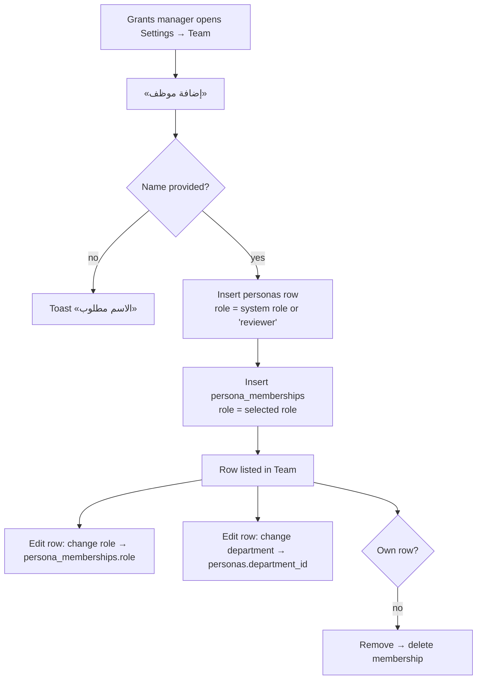

### 6.2 Custom role lifecycle
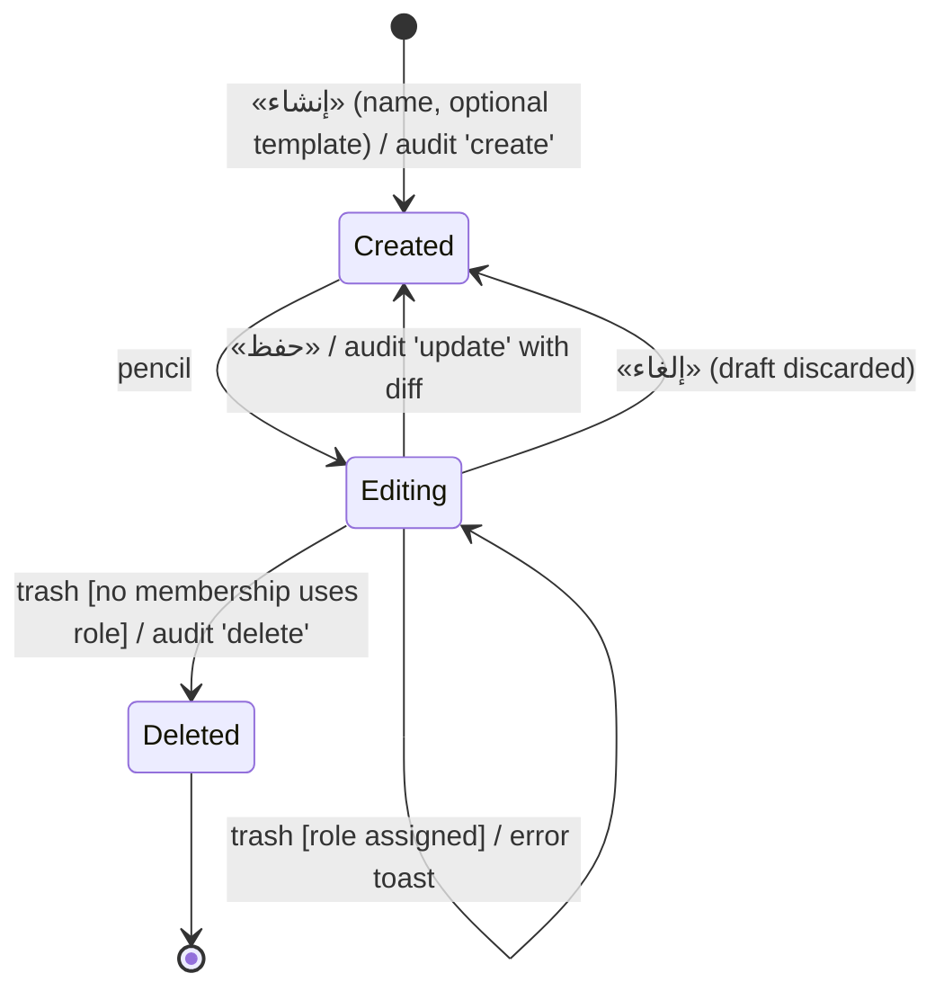

### 6.3 Applicant type availability
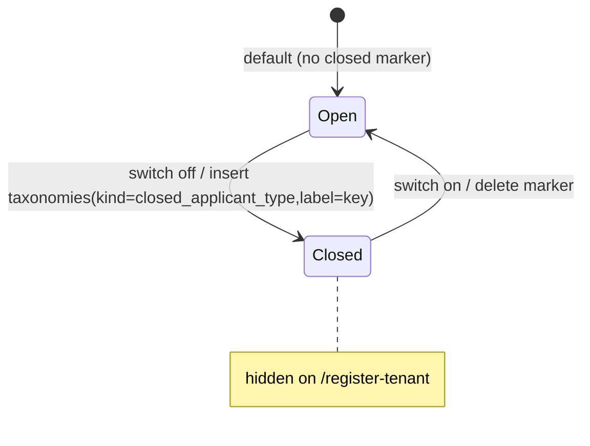
Government type is never shown on the portal and has no switch. [Observed]

### 6.4 Tenant status
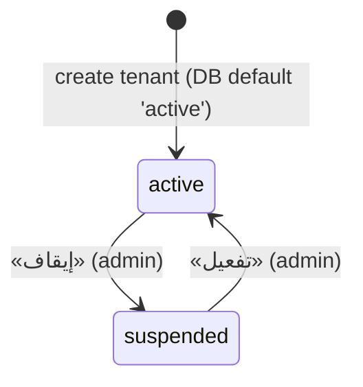
No downstream effect of suspension was found in code (ISS-CFG-08). [Observed]

### 6.5 Evidence-backed configuration edit (programs, engines, product catalog)
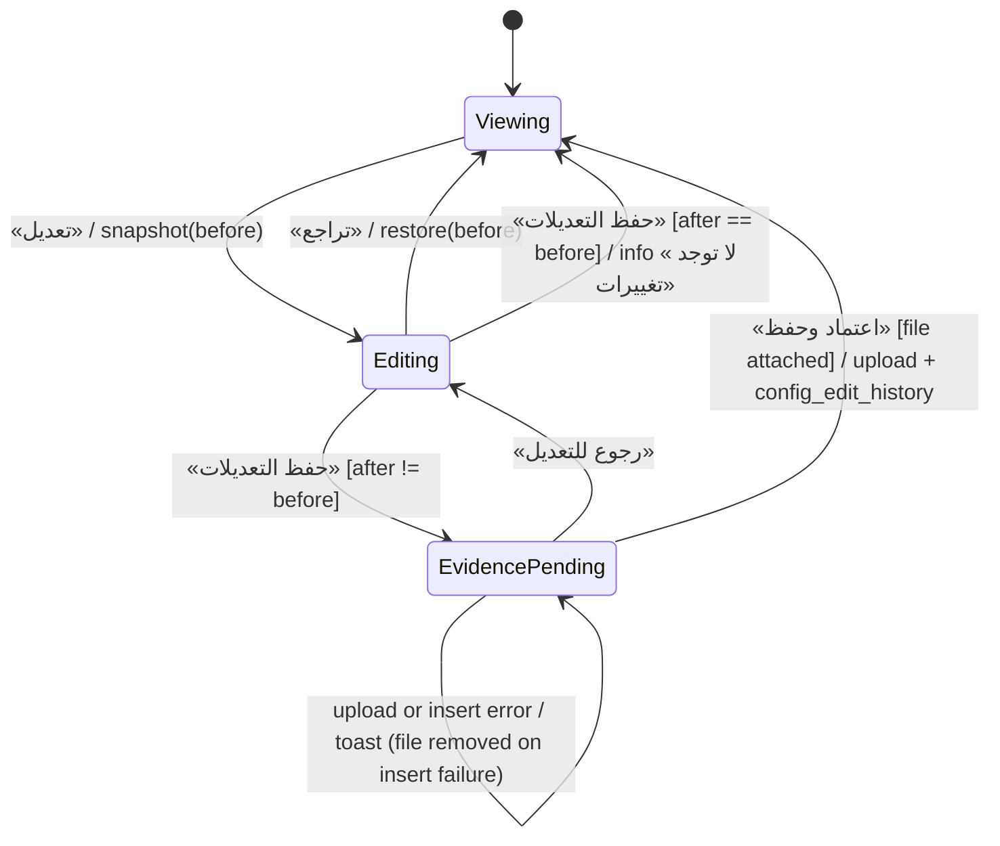

### 6.6 Partner primary-delegate transfer (service library; UI in BEN)
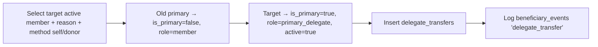

## 7. Business Rules

| BR ID | Rule | Evidence label + reference |
|---|---|---|
| BR-CFG-01 | Settings tab visibility: «الجهات والمستخدمون» (/admin) is shown only to the platform admin; Team, Roles and Endowments tabs are tenant-only (hidden for admin); other tabs show to both. | [Observed] `src/components/SectionTabs.tsx:12,23-34` |
| BR-CFG-02 | Default settings tab: admin → Departments; others → Team. An admin requesting tab=team is shown Departments. | [Observed] `src/routes/settings.tsx:56` |
| BR-CFG-03 | /admin renders only for the admin persona; any other persona sees a notice and a link to Settings → Team. | [Observed] `src/routes/admin.tsx:58-71` |
| BR-CFG-04 | The Team list shows only memberships of the current tenant whose role is neither 'applicant' nor 'admin'. | [Observed] `src/routes/settings.tsx:93` |
| BR-CFG-05 | Adding an employee requires a name (≤100 chars); email optional (≤255, email input type); department optional. | [Observed] `src/routes/settings.tsx:112,145-148` |
| BR-CFG-06 | On employee creation the persona's base role is the selected system role, or 'reviewer' when a custom role is selected; the membership stores the selected role (system key or custom role id). | [Observed] `src/routes/settings.tsx:113-115` |
| BR-CFG-07 | A user cannot remove their own membership from the team (trash hidden on own row). | [Observed] `src/routes/settings.tsx:136` |
| BR-CFG-08 | System roles (grants_manager, reviewer, project_manager, finance, ceo, committee_secretary) are read-only. Their matrix is derived: View if the role is listed for a permission; Write if listed and the permission key does not end with '_view'; Delete only for grants_manager. | [Observed] `src/routes/settings.tsx:155-199` |
| BR-CFG-09 | Custom role permissions are stored as strings: 'key' means view+write+delete; 'key:view|write|delete' grants a single level. | [Observed] `src/routes/settings.tsx:200-219` |
| BR-CFG-10 | A custom role requires a name (≤60 chars) and may start from a copy of a system role's permissions; otherwise it starts empty. | [Observed] `src/routes/settings.tsx:272-279,372-375` |
| BR-CFG-11 | A custom role cannot be deleted while any membership in the tenant is assigned to it. | [Observed] `src/routes/settings.tsx:282` |
| BR-CFG-12 | Every custom-role create, permission update and delete is written to role_audit_log with actor, timestamp and, for updates, a per-permission from/to diff. | [Observed] `src/routes/settings.tsx:258-287` |
| BR-CFG-13 | The permission matrix is descriptive only: no code reads tenant_roles.permissions or the system matrix to allow/deny actions; access is driven by personas.role in the sidebar and per-page checks. | [Observed] `grep of src for tenant_roles/.permissions (only settings.tsx)` |
| BR-CFG-14 | Department name is required (trimmed, ≤100). Deleting a department nulls department_id on personas and projects (FK ON DELETE SET NULL). | [Observed] `src/routes/settings.tsx:395-396; supabase/migrations/20261004132647_*.sql` |
| BR-CFG-15 | Templates have a kind of apology (اعتذار), contract (عقد) or notification (إشعار; default) and a required name; the body may use {ref}, {program}, {beneficiary}, {amount} placeholders. | [Observed] `src/routes/settings.tsx:42,425-433` |
| BR-CFG-16 | Reference taxonomies are per tenant in three kinds: account_type (أنواع الجهات), region (المناطق), target_group (الفئات المستهدفة); a value is required and ≤80 chars. | [Observed] `src/routes/settings.tsx:43,451-465` |
| BR-CFG-17 | Applicant types are a fixed list (association, nonprofit, company, individual, endowment, government, other). Government is internal-only (portal=false) and is not switchable; others are open by default and closed per tenant by a taxonomies row of kind 'closed_applicant_type' whose label is the type key. | [Observed] `src/lib/applicantTypes.ts:5-33` |
| BR-CFG-18 | Closed applicant types are hidden from the public registration page. | [Observed] `src/routes/register-tenant.tsx:33-34` |
| BR-CFG-19 | An application form cannot be deleted while any grant program references it (form_id); deleting a form deletes its fields (cascade). | [Observed] `src/routes/settings.tsx:478,493; supabase/migrations/20261004144143_*.sql` |
| BR-CFG-20 | Form fields require a label; type ∈ text, textarea, number, date, select, file, email, phone; select options are split on ',' or '،' and trimmed; new fields append at sort_order = count+1. | [Observed] `src/components/FormBuilder.tsx:15-24; src/lib/data.ts:304-313` |
| BR-CFG-21 | Library form fields are shown to applicants after the base data in every program that uses the form (one form reused across periods). | [Observed] `src/routes/settings.tsx:492; AGENTS.md` |
| BR-CFG-22 | Endowment name is required; description optional. If the tenant has a single endowment the whole plan is counted against it and no split is shown; splits appear only with 2+ active endowments. | [Observed] `src/routes/settings.tsx:510,519-520; AGENTS.md` |
| BR-CFG-23 | Only active endowments participate in plan allocation; the displayed current size is the sum of the endowment's fundings (see PLN). | [Observed] `src/lib/plans.ts:118-121,195; src/routes/settings.tsx:515` |
| BR-CFG-24 | Deleting an endowment is not guarded and cascades its plan_level_endowments shares. | [Observed] `src/routes/settings.tsx:517; supabase/migrations/20261004184736_*.sql` |
| BR-CFG-25 | A tenant requires a name (≤120); contact email optional; status toggles between active and suspended; user count = number of persona_memberships rows for the tenant (aggregate only, no personal data). | [Observed] `src/routes/admin.tsx:91-134,231` |
| BR-CFG-26 | Committing a configuration edit requires an evidence document; it is uploaded to attachments/config/<entity_type>/<entity_id|catalog>/<timestamp>-<sanitized name>, and a config_edit_history row stores before/after snapshots, note and actor. If the history insert fails the uploaded file is removed. | [Observed] `src/lib/configEdits.ts:11-26` |
| BR-CFG-27 | An edit session with no differences between the entry snapshot and the current state is closed without saving ('لا توجد تغييرات'); cancel restores the entry snapshot. | [Observed] `src/components/EditSession.tsx:28-38; src/lib/configEdits.ts:28` |
| BR-CFG-28 | Configuration history is append-only (only SELECT and INSERT policies). | [Observed] `supabase/migrations/20261006140739_*.sql:13-16` |
| BR-CFG-29 | The colour palette (clay default, teal, lavender) is a per-device preference in localStorage, applied before render. | [Observed] `src/components/PalettePicker.tsx; src/routes/__root.tsx:125` |
| BR-CFG-30 | Staff KPIs: decisions in last 30 days = application_status_history rows changed_by the person + payment_approvals by the person; completed tasks = manual tasks done; average completion = mean(updated_at − created_at) of done manual tasks in days; open tasks = manual tasks not done; overdue due dates shown in red. | [Observed] `src/routes/staff.$id.tsx:25-52,60` |
| BR-CFG-31 | Partner-entity memberships: one person may represent many entities with different roles (primary_delegate, project_manager, finance, member); each entity has one primary delegate; the primary cannot be deactivated before delegation is transferred; deactivation sets active=false and end_at. | [Observed] `src/lib/memberships.ts:1-49` |
| BR-CFG-32 | Adding an entity team member reuses an existing persona with the same email, otherwise creates an applicant persona; the membership is upserted on (persona_id, beneficiary_id). | [Observed] `src/lib/memberships.ts:61-78` |
| BR-CFG-33 | Transferring primary delegation demotes the previous primary to 'member', promotes the target (active), records delegate_transfers (reason, method self|donor) and a beneficiary_events 'delegate_transfer' entry. | [Observed] `src/lib/memberships.ts:86-101` |
| BR-CFG-34 | Inviting an entity sets account_status='invited', invited_email and invited_at and logs an 'invited' event. | [Observed] `src/lib/memberships.ts:103-107` |

## 8. Data Requirements

### tenants (grantor organization)
| Field | Type | Req | Meaning |
|---|---|---|---|
| id | uuid | Y | PK |
| name | text | Y | Organization name |
| contact_email | text | N | Official email |
| status | text | Y | 'active' (default) / 'suspended' |
| created_at | timestamptz | Y | Creation date |
Relationships: parent of personas, persona_memberships, departments, templates, taxonomies, endowments, application_forms, tenant_roles (cascade on most). [Observed] migration 20261004085937

### personas (staff and applicant users)
id, tenant_id (FK tenants), name (req), email, role (persona_role enum: admin, grants_manager, reviewer, project_manager, finance, ceo, committee_secretary, applicant), beneficiary_id, avatar_url, department_id (FK departments, ON DELETE SET NULL). `role` drives sidebar/home and task derivation. [Observed]

### persona_memberships (per-organization role)
| Field | Type | Req | Meaning |
|---|---|---|---|
| id | uuid | Y | PK |
| persona_id | uuid | Y | FK personas (cascade) |
| tenant_id | uuid | Y | FK tenants (cascade) |
| role | text | Y | System role key or tenant_roles.id |
| active | boolean | Y | default true; used by task assignee validation (TSK) |
| created_at | timestamptz | Y | |
Unique (persona_id, tenant_id). [Observed] migration 20261004103715

### tenant_roles (custom roles)
id, tenant_id, label (req, ≤60 UI), permissions text[] (encoded per BR-CFG-09), created_at. **No migration in repo.** [Observed] types.ts

### role_audit_log
id, tenant_id, role_id (system key or custom id), role_label, action ('create'|'update'|'delete'), changes jsonb ({template} or {permKey: {from, to}}), actor_id, created_at. **No migration in repo.** [Observed]

### departments
id, tenant_id (cascade), name (req), created_at. Referenced by personas.department_id, projects.department_id, initiatives.department_id (SET NULL). [Observed]

### templates
id, tenant_id, kind ('apology'|'contract'|'notification'; free text in DB), name (req), body (default ''), created_at. [Observed]

### taxonomies
id, tenant_id, kind ('account_type'|'region'|'target_group'|'closed_applicant_type'), label (req), sort_order int (default 0, unused), created_at. [Observed]

### endowments
id, tenant_id (cascade), name (req), description, active (default true), created_at. Children: plan_level_endowments (percent, cascade on delete), fundings (see PLN). [Observed]

### application_forms
id, tenant_id (cascade), name (req), description (not editable in UI), created_at. Referenced by grant_programs.form_id (SET NULL). [Observed]

### form_fields
id, form_id (FK application_forms, cascade), program_id (legacy, nullable), label (req), field_type (default 'text'), required (default false), options text[], sort_order int, created_at. [Observed]

### config_edit_history (append-only)
id, tenant_id, entity_type ('product_catalog'|'engine'|'program'), entity_id (null = catalog), target_name, before_values jsonb, after_values jsonb, note, evidence_name (req), evidence_path (req), actor_id (FK personas), created_at. Index (entity_type, entity_id). [Observed]

### beneficiary_memberships / delegate_transfers (service library)
beneficiary_memberships: id, persona_id, beneficiary_id, role (primary_delegate|project_manager|finance|member), is_primary, active, national_id, mobile, verified_via, start_at, end_at; unique (persona_id, beneficiary_id). delegate_transfers: id, beneficiary_id, from_persona_id, to_persona_id, reason, method ('self'|'donor'), created_at (insert-only). [Observed]

### Device-local data
localStorage `palette` (clay|teal|lavender). [Observed]

## 9. Product Structure

**EP-CFG-01 — Organization & Access Management**: Staff, roles and permissions, departments, staff performance and partner-entity membership services.

- FT-CFG-01 — Team member management (Must)
- FT-CFG-02 — Roles & permission matrix (Must)
- FT-CFG-03 — Role change audit log (Should)
- FT-CFG-04 — Departments (Should)
- FT-CFG-05 — Staff performance profile (Should)
- FT-CFG-16 — Partner-entity membership services (Must)

**EP-CFG-02 — Grant Configuration Libraries**: Reusable application forms, workflow configuration entry, text templates, reference taxonomies and applicant types.

- FT-CFG-06 — Application form library & builder (Must)
- FT-CFG-07 — Workflow settings hub (Could)
- FT-CFG-08 — Communication templates (Should)
- FT-CFG-09 — Reference taxonomies (Should)
- FT-CFG-10 — Applicant type registration switch (Should)

**EP-CFG-03 — Funding Source Configuration**: Registry of endowments (funding sources) used by annual plans.

- FT-CFG-11 — Endowment registry (Must)

**EP-CFG-04 — Platform Administration**: Platform-level management of grantor organizations and separation of platform vs. tenant settings.

- FT-CFG-12 — Organization (tenant) management (Must)
- FT-CFG-13 — Platform vs. tenant settings separation (Must)

**EP-CFG-05 — Configuration Governance & Personalization**: Evidence-backed, audited configuration changes and per-device appearance.

- FT-CFG-14 — Evidence-backed configuration edits (Must)
- FT-CFG-15 — Appearance palette (Could)

## 10. Features

### FT-CFG-01 — Team member management

- **Feature ID:** FT-CFG-01 (Epic EP-CFG-01)
- **Name:** Team member management
- **Description:** List, add, edit (role, department) and remove the organization's staff.
- **Business Objective:** Let each grantor organization administer its own staff roster.
- **Expected Business Value:** [To Confirm] — not stated in prototype; inferred: decentralised user administration per tenant.
- **Primary User Roles:** grants_manager
- **Scope:**
  - Team table
  - Add-employee dialog with AI prefill
  - Inline role/department edit
  - Remove membership (not self)
- **Out of Scope:**
  - Real authentication/invitations for staff (PLT)
  - Applicant/partner users (BEN)
  - Platform admins
- **Functional Requirements:** FR-CFG-001, FR-CFG-002, FR-CFG-003, FR-CFG-004
- **Business Rules:** BR-CFG-04, BR-CFG-05, BR-CFG-06, BR-CFG-07
- **Dependencies:** PLT persona model; FT-CFG-02 custom roles; FT-CFG-04 departments
- **Related Screens:** SCR-CFG-01, SCR-CFG-12
- **Acceptance Criteria:**
  - Only tenant staff (no applicant/admin) are listed
  - A new employee appears with chosen role and department
  - A user cannot remove themselves
- **Open Questions:** OQ-CFG-01; OQ-CFG-02
- **Assumptions:**
  - Email uniqueness is not required by the prototype
- **Priority Recommendation (MoSCoW):** Must

### FT-CFG-02 — Roles & permission matrix

- **Feature ID:** FT-CFG-02 (Epic EP-CFG-01)
- **Name:** Roles & permission matrix
- **Description:** Read-only matrix for system roles and editable custom roles with view/write/delete per permission.
- **Business Objective:** Make each role's responsibilities transparent and allow organization-specific roles.
- **Expected Business Value:** [To Confirm] — not stated in prototype
- **Primary User Roles:** grants_manager
- **Scope:**
  - 13 permissions in 4 groups
  - System role matrix (derived)
  - Custom role create (with template copy) / edit / delete
- **Out of Scope:**
  - Runtime enforcement (not implemented — see FR-CFG-009 Recommended)
  - Per-record permissions
- **Functional Requirements:** FR-CFG-005, FR-CFG-006, FR-CFG-007, FR-CFG-008, FR-CFG-009
- **Business Rules:** BR-CFG-08, BR-CFG-09, BR-CFG-10, BR-CFG-11, BR-CFG-13
- **Dependencies:** FT-CFG-03 audit; PLT navigation by role
- **Related Screens:** SCR-CFG-02
- **Acceptance Criteria:**
  - System roles cannot be edited
  - Custom role permission changes persist
  - Assigned custom roles cannot be deleted
- **Open Questions:** OQ-CFG-01
- **Assumptions:**
  - Permission list is fixed in code
- **Priority Recommendation (MoSCoW):** Must

### FT-CFG-03 — Role change audit log

- **Feature ID:** FT-CFG-03 (Epic EP-CFG-01)
- **Name:** Role change audit log
- **Description:** Record and display the history of custom role creation, permission changes and deletion.
- **Business Objective:** Accountability for access-right changes.
- **Expected Business Value:** Inferred: audit/compliance for access changes; [To Confirm] — not stated in prototype
- **Primary User Roles:** grants_manager
- **Scope:**
  - Audit insert on create/update/delete
  - Per-role audit side sheet with diffs
- **Out of Scope:**
  - Audit of team membership changes (not implemented)
- **Functional Requirements:** FR-CFG-010, FR-CFG-011
- **Business Rules:** BR-CFG-12
- **Dependencies:** FT-CFG-02
- **Related Screens:** SCR-CFG-02
- **Acceptance Criteria:**
  - Each change shows actor, time, and from→to per permission
- **Open Questions:** OQ-CFG-12
- **Assumptions:**
  - Actor = currently selected demo persona
- **Priority Recommendation (MoSCoW):** Should

### FT-CFG-04 — Departments

- **Feature ID:** FT-CFG-04 (Epic EP-CFG-01)
- **Name:** Departments
- **Description:** Maintain the organization's departments and see member counts.
- **Business Objective:** Organise staff and initiatives/projects by department.
- **Expected Business Value:** [To Confirm] — not stated in prototype
- **Primary User Roles:** grants_manager, admin
- **Scope:**
  - Add department
  - List with member chips
  - Delete department
- **Out of Scope:**
  - Department hierarchy
  - Department heads
- **Functional Requirements:** FR-CFG-012, FR-CFG-013, FR-CFG-014
- **Business Rules:** BR-CFG-14
- **Dependencies:** PRJ (projects.department_id); PLN initiatives
- **Related Screens:** SCR-CFG-03
- **Acceptance Criteria:**
  - Departments listed with correct member counts
  - Deleting a department unassigns staff and projects
- **Open Questions:** None
- **Assumptions:**
  - Names need not be unique
- **Priority Recommendation (MoSCoW):** Should

### FT-CFG-05 — Staff performance profile

- **Feature ID:** FT-CFG-05 (Epic EP-CFG-01)
- **Name:** Staff performance profile
- **Description:** Per-staff page with decision and task KPIs, open tasks and managed projects.
- **Business Objective:** Give managers visibility of individual workload and throughput.
- **Expected Business Value:** [To Confirm] — not stated in prototype
- **Primary User Roles:** grants_manager, all staff
- **Scope:**
  - KPIs (decisions 30 days, done tasks, avg completion, open tasks)
  - Open manual tasks list
  - Managed projects list
- **Out of Scope:**
  - Derived (workflow/payment) tasks in KPIs
  - Period filters
- **Functional Requirements:** FR-CFG-015, FR-CFG-016, FR-CFG-017
- **Business Rules:** BR-CFG-30
- **Dependencies:** TSK manual_tasks; REV status history; FIN payment approvals; PRJ projects
- **Related Screens:** SCR-CFG-12
- **Acceptance Criteria:**
  - KPIs match the formulas in BR-CFG-30
  - Overdue tasks highlighted
- **Open Questions:** OQ-CFG-09
- **Assumptions:**
  - Only manual tasks count as tasks
- **Priority Recommendation (MoSCoW):** Should

### FT-CFG-06 — Application form library & builder

- **Feature ID:** FT-CFG-06 (Epic EP-CFG-02)
- **Name:** Application form library & builder
- **Description:** Per-organization library of application forms with field builder, reusable across programs and periods.
- **Business Objective:** Reuse one application form across programs instead of per-program forms.
- **Expected Business Value:** Inferred from AGENTS.md: one form reused across periods; [To Confirm] — not stated in prototype
- **Primary User Roles:** grants_manager, admin
- **Scope:**
  - Form list with usage count
  - Create/delete form
  - Add field, toggle required, delete field
- **Out of Scope:**
  - Field editing/reordering (Recommended FR-CFG-023)
  - Conditional logic
  - Program-to-form assignment (PRG)
- **Functional Requirements:** FR-CFG-018, FR-CFG-019, FR-CFG-020, FR-CFG-021, FR-CFG-022, FR-CFG-023
- **Business Rules:** BR-CFG-19, BR-CFG-20, BR-CFG-21
- **Dependencies:** PRG grant_programs.form_id; PTL application form rendering
- **Related Screens:** SCR-CFG-05
- **Acceptance Criteria:**
  - Used forms cannot be deleted
  - Select fields store options
  - Fields appear in applicant form of programs using the form
- **Open Questions:** OQ-CFG-07
- **Assumptions:**
  - Applications freeze data in applications.snapshot, so field changes do not alter submitted data
- **Priority Recommendation (MoSCoW):** Must

### FT-CFG-07 — Workflow settings hub

- **Feature ID:** FT-CFG-07 (Epic EP-CFG-02)
- **Name:** Workflow settings hub
- **Description:** Settings tab listing programs as entry points to their stages, committee secretary, criteria and form.
- **Business Objective:** Single place to reach per-program workflow configuration.
- **Expected Business Value:** [To Confirm] — not stated in prototype
- **Primary User Roles:** grants_manager, admin
- **Scope:**
  - Program cards linking to /programs/$id
- **Out of Scope:**
  - Stage/criteria editing itself (PRG)
- **Functional Requirements:** FR-CFG-024
- **Business Rules:** None
- **Dependencies:** PRG
- **Related Screens:** SCR-CFG-04
- **Acceptance Criteria:**
  - Each program of the tenant is listed and opens its configuration
- **Open Questions:** None
- **Assumptions:**
  - Hub only; configuration rules live in PRG
- **Priority Recommendation (MoSCoW):** Could

### FT-CFG-08 — Communication templates

- **Feature ID:** FT-CFG-08 (Epic EP-CFG-02)
- **Name:** Communication templates
- **Description:** Maintain apology, contract and notification text templates with placeholders.
- **Business Objective:** Standardise outgoing communications.
- **Expected Business Value:** [To Confirm] — not stated in prototype
- **Primary User Roles:** grants_manager, admin
- **Scope:**
  - List
  - Create/edit (kind, name, body)
  - Placeholder hint
- **Out of Scope:**
  - Template rendering/merge, sending, delete (not implemented)
- **Functional Requirements:** FR-CFG-025, FR-CFG-026, FR-CFG-027
- **Business Rules:** BR-CFG-15
- **Dependencies:** REV (apology/close), PRJ (contracts) — consumers to be confirmed
- **Related Screens:** SCR-CFG-07
- **Acceptance Criteria:**
  - Template saved with kind, name and body
- **Open Questions:** OQ-CFG-03
- **Assumptions:**
  - Placeholders are documented only
- **Priority Recommendation (MoSCoW):** Should

### FT-CFG-09 — Reference taxonomies

- **Feature ID:** FT-CFG-09 (Epic EP-CFG-02)
- **Name:** Reference taxonomies
- **Description:** Tenant-maintained value lists: entity types, regions, target groups.
- **Business Objective:** Configurable reference data instead of hard-coded lists.
- **Expected Business Value:** [To Confirm] — not stated in prototype
- **Primary User Roles:** grants_manager, admin
- **Scope:**
  - Add value
  - Delete value
- **Out of Scope:**
  - Consumption by registration/partner forms (not implemented)
  - Ordering
- **Functional Requirements:** FR-CFG-028, FR-CFG-029
- **Business Rules:** BR-CFG-16
- **Dependencies:** PTL/BEN forms (future consumers)
- **Related Screens:** SCR-CFG-08
- **Acceptance Criteria:**
  - Values can be added and removed per kind
- **Open Questions:** OQ-CFG-04
- **Assumptions:**
  - None
- **Priority Recommendation (MoSCoW):** Should

### FT-CFG-10 — Applicant type registration switch

- **Feature ID:** FT-CFG-10 (Epic EP-CFG-02)
- **Name:** Applicant type registration switch
- **Description:** Open or close each applicant type for public registration per organization.
- **Business Objective:** Control which kinds of partners may self-register.
- **Expected Business Value:** [To Confirm] — not stated in prototype
- **Primary User Roles:** grants_manager, admin
- **Scope:**
  - Switch per portal type
  - Closed types hidden on registration
- **Out of Scope:**
  - Government partners (internal only, BEN)
- **Functional Requirements:** FR-CFG-030, FR-CFG-031
- **Business Rules:** BR-CFG-17, BR-CFG-18
- **Dependencies:** PTL/PLT registration page
- **Related Screens:** SCR-CFG-08
- **Acceptance Criteria:**
  - Closing a type hides it on the registration page
  - Government is never listed
- **Open Questions:** OQ-CFG-11
- **Assumptions:**
  - Registration page reads the demo TENANT_ID
- **Priority Recommendation (MoSCoW):** Should

### FT-CFG-11 — Endowment registry

- **Feature ID:** FT-CFG-11 (Epic EP-CFG-03)
- **Name:** Endowment registry
- **Description:** Register funding sources (endowments), activate/deactivate, see current size and open detail.
- **Business Objective:** Know which funding sources finance plan tracks.
- **Expected Business Value:** [To Confirm] — not stated in prototype
- **Primary User Roles:** grants_manager, finance (per matrix)
- **Scope:**
  - List with size
  - Add
  - Activate/deactivate
  - Delete
- **Out of Scope:**
  - Funding entries and plan splits (PLN)
- **Functional Requirements:** FR-CFG-032, FR-CFG-033, FR-CFG-034, FR-CFG-035
- **Business Rules:** BR-CFG-22, BR-CFG-23, BR-CFG-24
- **Dependencies:** PLN plans.ts, /endowments/$id
- **Related Screens:** SCR-CFG-06
- **Acceptance Criteria:**
  - Only active endowments participate in plan
  - Size equals sum of fundings
- **Open Questions:** OQ-CFG-05
- **Assumptions:**
  - None
- **Priority Recommendation (MoSCoW):** Must

### FT-CFG-12 — Organization (tenant) management

- **Feature ID:** FT-CFG-12 (Epic EP-CFG-04)
- **Name:** Organization (tenant) management
- **Description:** Platform admin lists, creates and suspends/activates grantor organizations.
- **Business Objective:** Onboard and control organizations on the multi-tenant platform.
- **Expected Business Value:** [To Confirm] — not stated in prototype
- **Primary User Roles:** admin
- **Scope:**
  - Tenants table
  - Create tenant
  - Suspend/activate
- **Out of Scope:**
  - Tenant self-registration (PLT)
  - Registration review (BEN)
  - Effects of suspension (not implemented)
- **Functional Requirements:** FR-CFG-036, FR-CFG-037, FR-CFG-038, FR-CFG-039
- **Business Rules:** BR-CFG-25
- **Dependencies:** PLT
- **Related Screens:** SCR-CFG-10
- **Acceptance Criteria:**
  - Admin sees all tenants with user counts
  - Status toggles
- **Open Questions:** OQ-CFG-06
- **Assumptions:**
  - None
- **Priority Recommendation (MoSCoW):** Must

### FT-CFG-13 — Platform vs. tenant settings separation

- **Feature ID:** FT-CFG-13 (Epic EP-CFG-04)
- **Name:** Platform vs. tenant settings separation
- **Description:** Tab visibility, default tab and admin-only gate separate platform administration from tenant configuration.
- **Business Objective:** Delegate user administration to each organization while keeping platform admin separate.
- **Expected Business Value:** Inferred from admin.tsx:91 comment; [To Confirm] — not stated in prototype
- **Primary User Roles:** admin, grants_manager
- **Scope:**
  - Tab filtering
  - Default tab
  - /admin gate
  - Route-level authorization (Recommended)
- **Out of Scope:**
  - Real auth (PLT)
- **Functional Requirements:** FR-CFG-040, FR-CFG-041, FR-CFG-042, FR-CFG-043
- **Business Rules:** BR-CFG-01, BR-CFG-02, BR-CFG-03
- **Dependencies:** PLT AppShell
- **Related Screens:** SCR-CFG-10, SCR-CFG-11, SCR-CFG-01
- **Acceptance Criteria:**
  - Admin never sees Team/Roles/Endowments tabs
  - Non-admin cannot use /admin
- **Open Questions:** OQ-CFG-02
- **Assumptions:**
  - None
- **Priority Recommendation (MoSCoW):** Must

### FT-CFG-14 — Evidence-backed configuration edits

- **Feature ID:** FT-CFG-14 (Epic EP-CFG-05)
- **Name:** Evidence-backed configuration edits
- **Description:** Edit sessions with snapshot, mandatory evidence document, rollback and append-only change history for programs, engines and product catalog.
- **Business Objective:** Every configuration change is attributable and supported by a document.
- **Expected Business Value:** Inferred: auditability of configuration; [To Confirm] — not stated in prototype
- **Primary User Roles:** grants_manager, admin
- **Scope:**
  - Edit/view mode
  - No-change detection
  - Evidence dialog
  - Rollback
  - History with evidence download
- **Out of Scope:**
  - Settings tabs in this module (they save directly — see ISS-CFG-21)
  - Approval workflow for config changes
- **Functional Requirements:** FR-CFG-044, FR-CFG-045, FR-CFG-046, FR-CFG-047, FR-CFG-048
- **Business Rules:** BR-CFG-26, BR-CFG-27, BR-CFG-28
- **Dependencies:** PRG pages; attachments bucket; DocAiCheck
- **Related Screens:** SCR-CFG-13
- **Acceptance Criteria:**
  - Cannot commit without evidence
  - Cancel restores
  - History lists evidence
- **Open Questions:** OQ-CFG-08
- **Assumptions:**
  - None
- **Priority Recommendation (MoSCoW):** Must

### FT-CFG-15 — Appearance palette

- **Feature ID:** FT-CFG-15 (Epic EP-CFG-05)
- **Name:** Appearance palette
- **Description:** Per-device colour palette selection.
- **Business Objective:** Visual personalisation.
- **Expected Business Value:** [To Confirm] — not stated in prototype
- **Primary User Roles:** all staff
- **Scope:**
  - Three palettes
  - Persist per device
- **Out of Scope:**
  - Tenant branding
- **Functional Requirements:** FR-CFG-049
- **Business Rules:** BR-CFG-29
- **Dependencies:** PLT theme
- **Related Screens:** SCR-CFG-09
- **Acceptance Criteria:**
  - Selected palette persists after reload on the same device
- **Open Questions:** OQ-CFG-10
- **Assumptions:**
  - None
- **Priority Recommendation (MoSCoW):** Could

### FT-CFG-16 — Partner-entity membership services

- **Feature ID:** FT-CFG-16 (Epic EP-CFG-01)
- **Name:** Partner-entity membership services
- **Description:** Library services for partner entity teams: fetch memberships, add/deactivate members, transfer primary delegation, invite entity.
- **Business Objective:** Every partner action is attributable to a verified delegate; one person can represent several entities.
- **Expected Business Value:** Inferred from AGENTS.md (every action attributable); [To Confirm] — not stated in prototype
- **Primary User Roles:** applicant (primary delegate), grants_manager
- **Scope:**
  - fetchMembershipsForPersona, fetchTeam, fetchTransfers
  - addTeamMember, deactivateMember
  - transferPrimary
  - inviteEntity
- **Out of Scope:**
  - Team UI (BEN/PTL)
  - Identity verification (Nafath etc.)
- **Functional Requirements:** FR-CFG-050, FR-CFG-051, FR-CFG-052, FR-CFG-053, FR-CFG-054
- **Business Rules:** BR-CFG-31, BR-CFG-32, BR-CFG-33, BR-CFG-34
- **Dependencies:** BEN BeneficiaryTeam, beneficiaryActions.logEvent (screens in BEN/PTL); PTL portal
- **Related Screens:** 
- **Acceptance Criteria:**
  - Exactly one primary per entity after transfer
  - Primary cannot be deactivated
- **Open Questions:** OQ-CFG-13
- **Assumptions:**
  - Screens documented in BEN
- **Priority Recommendation (MoSCoW):** Must

## 11. Functional Requirements

### FR-CFG-001

- **Statement:** The system shall list the current organization's staff memberships (excluding applicant and admin roles) with name, email, role label and department.
- **Description:** Team table joins memberships to personas; role label resolves system or custom role names.
- **Type:** UI
- **Source/Prototype reference:** `src/routes/settings.tsx:88-139`
- **Related Feature:** FT-CFG-01
- **Related Story:** US-CFG-001
- **Priority:** Must
- **Dependencies:** persona_memberships, personas, tenant_roles, departments
- **Acceptance Criteria:**
  - Given memberships with roles reviewer and applicant When the Team tab opens Then only the reviewer is listed
  - Given a custom role id When listed Then its label is shown
- **Validation Rules:** None
- **Exceptions & Alternative Flows:** None
- **Open Questions:** None
- **Evidence label:** [Observed]

### FR-CFG-002

- **Statement:** The system shall allow adding an employee with name (required), email, role and department, creating a persona and a tenant membership.
- **Description:** Dialog with AI assist prefill; persona base role falls back to reviewer for custom roles.
- **Type:** Functional
- **Source/Prototype reference:** `src/routes/settings.tsx:108-116,140-151`
- **Related Feature:** FT-CFG-01
- **Related Story:** US-CFG-001
- **Priority:** Must
- **Dependencies:** None
- **Acceptance Criteria:**
  - Given an empty name When «إضافة» Then toast «الاسم مطلوب» and nothing is saved
  - Given valid data When «إضافة» Then a persona and membership are created and the row appears
- **Validation Rules:** name ≤100, email type ≤255
- **Exceptions & Alternative Flows:** Persona insert fails → «تعذّر إضافة الموظف»; membership insert fails → error toast (persona remains orphaned).
- **Open Questions:** OQ-CFG-01
- **Evidence label:** [Observed]

### FR-CFG-003

- **Statement:** The system shall allow editing a member's role and department inline, saving each change immediately.
- **Description:** Role updates persona_memberships.role; department updates personas.department_id.
- **Type:** Functional
- **Source/Prototype reference:** `src/routes/settings.tsx:128-135`
- **Related Feature:** FT-CFG-01
- **Related Story:** US-CFG-002
- **Priority:** Must
- **Dependencies:** None
- **Acceptance Criteria:**
  - Given edit mode When a new role is selected Then membership role is updated and toast shown
  - Given edit mode When «بدون إدارة» is selected Then department_id becomes null
- **Validation Rules:** None
- **Exceptions & Alternative Flows:** DB error → error toast, value not changed.
- **Open Questions:** OQ-CFG-01
- **Evidence label:** [Observed]

### FR-CFG-004

- **Statement:** The system shall allow removing a member from the team except the current user.
- **Description:** Deletes the membership row; persona remains.
- **Type:** Functional
- **Source/Prototype reference:** `src/routes/settings.tsx:136`
- **Related Feature:** FT-CFG-01
- **Related Story:** US-CFG-003
- **Priority:** Must
- **Dependencies:** None
- **Acceptance Criteria:**
  - Given my own row in edit mode Then no remove button is shown
  - Given another member When remove Then the membership is deleted and the row disappears
- **Validation Rules:** None
- **Exceptions & Alternative Flows:** None
- **Open Questions:** None
- **Evidence label:** [Observed]

### FR-CFG-005

- **Statement:** The system shall display, for a selected role, a matrix of 13 permissions in 4 groups with view/write/delete levels; system roles are read-only.
- **Description:** System matrix is derived by rule BR-CFG-08.
- **Type:** UI
- **Source/Prototype reference:** `src/routes/settings.tsx:155-199,315-347`
- **Related Feature:** FT-CFG-02
- **Related Story:** US-CFG-004
- **Priority:** Must
- **Dependencies:** None
- **Acceptance Criteria:**
  - Given role 'reviewer' When selected Then 'تقييم الطلبات' shows view+write and no delete
  - Given a system role Then toggles are disabled and the read-only badge shows
- **Validation Rules:** None
- **Exceptions & Alternative Flows:** None
- **Open Questions:** None
- **Evidence label:** [Observed]

### FR-CFG-006

- **Statement:** The system shall allow creating a custom role with a name and an optional system-role template whose permissions are copied.
- **Description:** 
- **Type:** Functional
- **Source/Prototype reference:** `src/routes/settings.tsx:272-279,369-379`
- **Related Feature:** FT-CFG-02
- **Related Story:** US-CFG-005
- **Priority:** Must
- **Dependencies:** None
- **Acceptance Criteria:**
  - Given name 'منسق برامج' and template reviewer When «إنشاء» Then a role with reviewer's permissions exists and is selected
  - Given empty name Then toast «اسم الدور مطلوب»
- **Validation Rules:** name required, ≤60
- **Exceptions & Alternative Flows:** None
- **Open Questions:** None
- **Evidence label:** [Observed]

### FR-CFG-007

- **Statement:** The system shall allow editing a custom role's permissions per cell, per group, globally and via 'select all', with save and cancel.
- **Description:** Draft is held client-side until «حفظ».
- **Type:** Functional
- **Source/Prototype reference:** `src/routes/settings.tsx:253-271,296-313,327-332`
- **Related Feature:** FT-CFG-02
- **Related Story:** US-CFG-006
- **Priority:** Must
- **Dependencies:** None
- **Acceptance Criteria:**
  - Given edit mode When group 'الكل' toggled on Then all permissions of the group get view/write/delete
  - Given changes When «إلغاء» Then stored permissions are unchanged
- **Validation Rules:** None
- **Exceptions & Alternative Flows:** None
- **Open Questions:** None
- **Evidence label:** [Observed]

### FR-CFG-008

- **Statement:** The system shall delete a custom role only if no membership is assigned to it.
- **Description:** 
- **Type:** Functional
- **Source/Prototype reference:** `src/routes/settings.tsx:280-287`
- **Related Feature:** FT-CFG-02
- **Related Story:** US-CFG-007
- **Priority:** Must
- **Dependencies:** None
- **Acceptance Criteria:**
  - Given role assigned to a member When delete Then error «الدور مُسند لموظفين — غيّر أدوارهم أولاً»
  - Given unassigned role When delete Then role removed and selection returns to grants_manager
- **Validation Rules:** None
- **Exceptions & Alternative Flows:** None
- **Open Questions:** None
- **Evidence label:** [Observed]

### FR-CFG-009

- **Statement:** The system shall enforce role permissions (system and custom) on navigation, actions and data access server-side.
- **Description:** Not implemented: matrix is descriptive only (BR-CFG-13).
- **Type:** Security
- **Source/Prototype reference:** `n/a (absent)`
- **Related Feature:** FT-CFG-02
- **Related Story:** US-CFG-008
- **Priority:** Must
- **Dependencies:** None
- **Acceptance Criteria:**
  - Given a custom role without 'apps_approve' When the user attempts final approval Then the action is denied server-side
  - Given RLS When a user of another tenant queries data Then no rows are returned
- **Validation Rules:** None
- **Exceptions & Alternative Flows:** None
- **Open Questions:** OQ-CFG-01
- **Evidence label:** [Recommended]

### FR-CFG-010

- **Statement:** The system shall record each custom role creation, permission update and deletion in an audit log with actor, time and changes.
- **Description:** Updates store per-permission {from,to}; create stores template.
- **Type:** Data
- **Source/Prototype reference:** `src/routes/settings.tsx:258-287`
- **Related Feature:** FT-CFG-03
- **Related Story:** US-CFG-009
- **Priority:** Should
- **Dependencies:** None
- **Acceptance Criteria:**
  - Given a permission change When saved Then an 'update' entry with from/to for that permission is stored
  - Given role deletion Then a 'delete' entry is stored
- **Validation Rules:** None
- **Exceptions & Alternative Flows:** None
- **Open Questions:** None
- **Evidence label:** [Observed]

### FR-CFG-011

- **Statement:** The system shall show a per-role audit sheet listing events newest-first with action, date, actor and diffs.
- **Description:** 
- **Type:** Reporting
- **Source/Prototype reference:** `src/routes/settings.tsx:238-241,349-367`
- **Related Feature:** FT-CFG-03
- **Related Story:** US-CFG-009
- **Priority:** Should
- **Dependencies:** None
- **Acceptance Criteria:**
  - Given no events Then «لا توجد أحداث مسجلة لهذا الدور بعد» is shown
  - Given an update event Then each changed permission shows 'from ← to'
- **Validation Rules:** None
- **Exceptions & Alternative Flows:** None
- **Open Questions:** None
- **Evidence label:** [Observed]

### FR-CFG-012

- **Statement:** The system shall list departments as cards with member count and member names.
- **Description:** 
- **Type:** UI
- **Source/Prototype reference:** `src/routes/settings.tsx:399-407`
- **Related Feature:** FT-CFG-04
- **Related Story:** US-CFG-010
- **Priority:** Should
- **Dependencies:** None
- **Acceptance Criteria:**
  - Given 2 personas in department X Then card X shows «2 مستخدم» and two chips
  - Given no departments Then grid is empty
- **Validation Rules:** None
- **Exceptions & Alternative Flows:** None
- **Open Questions:** None
- **Evidence label:** [Observed]

### FR-CFG-013

- **Statement:** The system shall allow adding a department by name.
- **Description:** 
- **Type:** Functional
- **Source/Prototype reference:** `src/routes/settings.tsx:395-397`
- **Related Feature:** FT-CFG-04
- **Related Story:** US-CFG-010
- **Priority:** Should
- **Dependencies:** None
- **Acceptance Criteria:**
  - Given name 'إدارة المنح' When «إضافة» Then department created and input cleared
  - Given blank name Then nothing happens
- **Validation Rules:** trimmed, ≤100
- **Exceptions & Alternative Flows:** None
- **Open Questions:** None
- **Evidence label:** [Observed]

### FR-CFG-014

- **Statement:** The system shall allow deleting a department, unassigning its staff and projects.
- **Description:** 
- **Type:** Functional
- **Source/Prototype reference:** `src/routes/settings.tsx:403; migration 20261004132647`
- **Related Feature:** FT-CFG-04
- **Related Story:** US-CFG-011
- **Priority:** Should
- **Dependencies:** None
- **Acceptance Criteria:**
  - Given department with members When deleted Then those personas show «بدون إدارة»
  - Given deletion Then toast «تم الحذف»
- **Validation Rules:** None
- **Exceptions & Alternative Flows:** No confirmation (ISS-CFG-04).
- **Open Questions:** None
- **Evidence label:** [Observed]

### FR-CFG-015

- **Statement:** The system shall show a staff member's name, role, email and four KPIs (decisions last 30 days, completed tasks, average completion days, open tasks).
- **Description:** 
- **Type:** Reporting
- **Source/Prototype reference:** `src/routes/staff.$id.tsx:25-56`
- **Related Feature:** FT-CFG-05
- **Related Story:** US-CFG-012
- **Priority:** Should
- **Dependencies:** None
- **Acceptance Criteria:**
  - Given 3 status changes and 1 payment approval in last 30 days Then decisions = 4
  - Given no done tasks Then average shows «—»
- **Validation Rules:** None
- **Exceptions & Alternative Flows:** None
- **Open Questions:** None
- **Evidence label:** [Observed]

### FR-CFG-016

- **Statement:** The system shall list the staff member's open manual tasks (overdue in red) and projects they manage with links.
- **Description:** 
- **Type:** UI
- **Source/Prototype reference:** `src/routes/staff.$id.tsx:59-66`
- **Related Feature:** FT-CFG-05
- **Related Story:** US-CFG-012
- **Priority:** Should
- **Dependencies:** None
- **Acceptance Criteria:**
  - Given an open task due yesterday Then its date is red
  - Given no managed projects Then «لا يشرف على مشاريع.»
- **Validation Rules:** None
- **Exceptions & Alternative Flows:** None
- **Open Questions:** None
- **Evidence label:** [Observed]

### FR-CFG-017

- **Statement:** The system shall show a loading skeleton while loading and «الموظف غير موجود.» for unknown ids.
- **Description:** 
- **Type:** UI
- **Source/Prototype reference:** `src/routes/staff.$id.tsx:38-39`
- **Related Feature:** FT-CFG-05
- **Related Story:** US-CFG-012
- **Priority:** Should
- **Dependencies:** None
- **Acceptance Criteria:**
  - Given an invalid id Then the not-found message shows
  - Given slow load Then skeleton shows
- **Validation Rules:** None
- **Exceptions & Alternative Flows:** None
- **Open Questions:** None
- **Evidence label:** [Observed]

### FR-CFG-018

- **Statement:** The system shall list the organization's application forms with the number of programs using each and allow selecting one.
- **Description:** 
- **Type:** UI
- **Source/Prototype reference:** `src/routes/settings.tsx:470-482`
- **Related Feature:** FT-CFG-06
- **Related Story:** US-CFG-013
- **Priority:** Must
- **Dependencies:** None
- **Acceptance Criteria:**
  - Given form F used by 2 programs Then «مستخدم في 2 فرصة»
  - Given no selection Then the first form is active
- **Validation Rules:** None
- **Exceptions & Alternative Flows:** None
- **Open Questions:** None
- **Evidence label:** [Observed]

### FR-CFG-019

- **Statement:** The system shall allow creating a new form by name and select it.
- **Description:** 
- **Type:** Functional
- **Source/Prototype reference:** `src/routes/settings.tsx:483-488`
- **Related Feature:** FT-CFG-06
- **Related Story:** US-CFG-013
- **Priority:** Must
- **Dependencies:** None
- **Acceptance Criteria:**
  - Given name When + Then form created, selected, toast «تم إنشاء النموذج»
  - Given DB error Then error message toast
- **Validation Rules:** None
- **Exceptions & Alternative Flows:** None
- **Open Questions:** None
- **Evidence label:** [Observed]

### FR-CFG-020

- **Statement:** The system shall prevent deleting a form used by any program and delete unused forms with their fields.
- **Description:** 
- **Type:** Functional
- **Source/Prototype reference:** `src/routes/settings.tsx:493-494`
- **Related Feature:** FT-CFG-06
- **Related Story:** US-CFG-013
- **Priority:** Must
- **Dependencies:** None
- **Acceptance Criteria:**
  - Given a used form Then delete is disabled with tooltip «النموذج مستخدم في فرص»
  - Given unused form When delete Then form and fields removed
- **Validation Rules:** None
- **Exceptions & Alternative Flows:** None
- **Open Questions:** None
- **Evidence label:** [Observed]

### FR-CFG-021

- **Statement:** The system shall allow adding a field with label, type, required flag and (for select) comma-separated options.
- **Description:** 
- **Type:** Functional
- **Source/Prototype reference:** `src/components/FormBuilder.tsx:16-24,39-48`
- **Related Feature:** FT-CFG-06
- **Related Story:** US-CFG-014
- **Priority:** Must
- **Dependencies:** None
- **Acceptance Criteria:**
  - Given type select and options 'أ، ب,ج' When added Then options = [أ,ب,ج]
  - Given empty label Then nothing is added
- **Validation Rules:** label required; type in FIELD_TYPE_LABELS
- **Exceptions & Alternative Flows:** DB errors are ignored silently (ISS-CFG-11).
- **Open Questions:** None
- **Evidence label:** [Observed]

### FR-CFG-022

- **Statement:** The system shall allow toggling a field's required flag and deleting a field.
- **Description:** 
- **Type:** Functional
- **Source/Prototype reference:** `src/components/FormBuilder.tsx:25-26,29-37`
- **Related Feature:** FT-CFG-06
- **Related Story:** US-CFG-014
- **Priority:** Must
- **Dependencies:** None
- **Acceptance Criteria:**
  - Given optional field When switch on Then it shows *
  - Given field When deleted Then it disappears
- **Validation Rules:** None
- **Exceptions & Alternative Flows:** None
- **Open Questions:** None
- **Evidence label:** [Observed]

### FR-CFG-023

- **Statement:** The system shall allow editing a field's label/type/options, reordering fields, and editing form name/description.
- **Description:** Not in prototype.
- **Type:** Functional
- **Source/Prototype reference:** `n/a (absent)`
- **Related Feature:** FT-CFG-06
- **Related Story:** US-CFG-015
- **Priority:** Should
- **Dependencies:** None
- **Acceptance Criteria:**
  - Given a field When label edited Then new label is used in new applications
  - Given drag reorder Then sort_order persists
- **Validation Rules:** None
- **Exceptions & Alternative Flows:** None
- **Open Questions:** OQ-CFG-07
- **Evidence label:** [Recommended]

### FR-CFG-024

- **Statement:** The system shall list grant programs as cards linking to each program's configuration page.
- **Description:** 
- **Type:** UI
- **Source/Prototype reference:** `src/routes/settings.tsx:411-417`
- **Related Feature:** FT-CFG-07
- **Related Story:** US-CFG-016
- **Priority:** Could
- **Dependencies:** None
- **Acceptance Criteria:**
  - Given programs exist When Workflow tab opens Then each program card links to /programs/$id
  - Given another tenant's program Then it should not be listed (currently is — ISS-CFG-09)
- **Validation Rules:** None
- **Exceptions & Alternative Flows:** None
- **Open Questions:** None
- **Evidence label:** [Observed]

### FR-CFG-025

- **Statement:** The system shall list templates showing kind, name and body preview.
- **Description:** 
- **Type:** UI
- **Source/Prototype reference:** `src/routes/settings.tsx:434-438`
- **Related Feature:** FT-CFG-08
- **Related Story:** US-CFG-017
- **Priority:** Should
- **Dependencies:** None
- **Acceptance Criteria:**
  - Given template of kind apology Then label «اعتذار» shows
  - Given long body Then preview is clamped to 3 lines
- **Validation Rules:** None
- **Exceptions & Alternative Flows:** None
- **Open Questions:** None
- **Evidence label:** [Observed]

### FR-CFG-026

- **Statement:** The system shall allow creating and editing a template's kind, name and body.
- **Description:** 
- **Type:** Functional
- **Source/Prototype reference:** `src/routes/settings.tsx:425-447`
- **Related Feature:** FT-CFG-08
- **Related Story:** US-CFG-017
- **Priority:** Should
- **Dependencies:** None
- **Acceptance Criteria:**
  - Given new template with name When «حفظ» Then inserted with tenant_id
  - Given existing template When edited Then updated
- **Validation Rules:** name required (silently ignored when empty)
- **Exceptions & Alternative Flows:** None
- **Open Questions:** None
- **Evidence label:** [Observed]

### FR-CFG-027

- **Statement:** The system shall merge placeholders ({ref}, {program}, {beneficiary}, {amount}) when generating communications and allow deleting templates.
- **Description:** Not implemented; templates are not consumed.
- **Type:** Integration
- **Source/Prototype reference:** `n/a (absent)`
- **Related Feature:** FT-CFG-08
- **Related Story:** US-CFG-018
- **Priority:** Could
- **Dependencies:** None
- **Acceptance Criteria:**
  - Given apology template When an application is closed Then the message uses the template with values substituted
  - Given unused template When deleted Then removed
- **Validation Rules:** None
- **Exceptions & Alternative Flows:** None
- **Open Questions:** OQ-CFG-03
- **Evidence label:** [Recommended]

### FR-CFG-028

- **Statement:** The system shall allow adding and removing values for account types, regions and target groups.
- **Description:** 
- **Type:** Functional
- **Source/Prototype reference:** `src/routes/settings.tsx:451-465`
- **Related Feature:** FT-CFG-09
- **Related Story:** US-CFG-019
- **Priority:** Should
- **Dependencies:** None
- **Acceptance Criteria:**
  - Given value 'الرياض' in المناطق When + Then chip appears
  - Given chip × Then value deleted
- **Validation Rules:** required, ≤80
- **Exceptions & Alternative Flows:** None
- **Open Questions:** None
- **Evidence label:** [Observed]

### FR-CFG-029

- **Statement:** The system shall use taxonomy values as the option lists in partner registration and profile forms, prevent duplicates and support ordering.
- **Description:** Not implemented.
- **Type:** Data
- **Source/Prototype reference:** `n/a (absent)`
- **Related Feature:** FT-CFG-09
- **Related Story:** US-CFG-019
- **Priority:** Should
- **Dependencies:** None
- **Acceptance Criteria:**
  - Given region taxonomy values Then the registration region field offers exactly those values
  - Given duplicate value Then it is rejected
- **Validation Rules:** None
- **Exceptions & Alternative Flows:** None
- **Open Questions:** OQ-CFG-04
- **Evidence label:** [Recommended]

### FR-CFG-030

- **Statement:** The system shall show a switch per portal applicant type with its identifier label, excluding government.
- **Description:** 
- **Type:** UI
- **Source/Prototype reference:** `src/routes/settings.tsx:73-83; src/lib/applicantTypes.ts:7-15`
- **Related Feature:** FT-CFG-10
- **Related Story:** US-CFG-020
- **Priority:** Should
- **Dependencies:** None
- **Acceptance Criteria:**
  - Given the taxonomies tab Then 6 switches show and no 'جهة حكومية'
  - Given 'company' Then label «رقم السجل التجاري» shows
- **Validation Rules:** None
- **Exceptions & Alternative Flows:** None
- **Open Questions:** None
- **Evidence label:** [Observed]

### FR-CFG-031

- **Statement:** The system shall persist a closed applicant type per organization and hide it on the registration page.
- **Description:** 
- **Type:** Functional
- **Source/Prototype reference:** `src/lib/applicantTypes.ts:17-33; src/routes/register-tenant.tsx:33-34`
- **Related Feature:** FT-CFG-10
- **Related Story:** US-CFG-020
- **Priority:** Should
- **Dependencies:** None
- **Acceptance Criteria:**
  - Given 'individual' switched off Then registration does not offer 'فرد'
  - Given switched on again Then it reappears
- **Validation Rules:** None
- **Exceptions & Alternative Flows:** Write errors not handled; success toast always shown (ISS-CFG-12).
- **Open Questions:** None
- **Evidence label:** [Observed]

### FR-CFG-032

- **Statement:** The system shall list endowments with name (link to detail), description, current size and active switch.
- **Description:** 
- **Type:** UI
- **Source/Prototype reference:** `src/routes/settings.tsx:509-518`
- **Related Feature:** FT-CFG-11
- **Related Story:** US-CFG-021
- **Priority:** Must
- **Dependencies:** None
- **Acceptance Criteria:**
  - Given endowment with fundings 1,000,000 Then size shows formatted SAR
  - Given no fundings Then «—»
- **Validation Rules:** None
- **Exceptions & Alternative Flows:** None
- **Open Questions:** None
- **Evidence label:** [Observed]

### FR-CFG-033

- **Statement:** The system shall allow adding an endowment with name and optional description.
- **Description:** 
- **Type:** Functional
- **Source/Prototype reference:** `src/routes/settings.tsx:519-524`
- **Related Feature:** FT-CFG-11
- **Related Story:** US-CFG-021
- **Priority:** Must
- **Dependencies:** None
- **Acceptance Criteria:**
  - Given name When «إضافة» Then endowment created active
  - Given blank name Then nothing happens
- **Validation Rules:** None
- **Exceptions & Alternative Flows:** None
- **Open Questions:** None
- **Evidence label:** [Observed]

### FR-CFG-034

- **Statement:** The system shall allow activating/deactivating an endowment; only active endowments participate in plan allocation.
- **Description:** 
- **Type:** Functional
- **Source/Prototype reference:** `src/routes/settings.tsx:516; src/lib/plans.ts:195`
- **Related Feature:** FT-CFG-11
- **Related Story:** US-CFG-022
- **Priority:** Must
- **Dependencies:** None
- **Acceptance Criteria:**
  - Given endowment deactivated Then plan default shares exclude it
  - Given toggle Then toast «تم التحديث»
- **Validation Rules:** None
- **Exceptions & Alternative Flows:** None
- **Open Questions:** None
- **Evidence label:** [Observed]

### FR-CFG-035

- **Statement:** The system shall allow deleting an endowment only after confirmation and only when it has no fundings or plan shares; otherwise require deactivation.
- **Description:** Prototype deletes immediately with cascade (BR-CFG-24).
- **Type:** Functional
- **Source/Prototype reference:** `src/routes/settings.tsx:517`
- **Related Feature:** FT-CFG-11
- **Related Story:** US-CFG-023
- **Priority:** Must
- **Dependencies:** None
- **Acceptance Criteria:**
  - Given an endowment with plan shares When delete Then the system blocks and suggests deactivation
  - Given an unused endowment When delete confirmed Then removed
- **Validation Rules:** None
- **Exceptions & Alternative Flows:** None
- **Open Questions:** OQ-CFG-05
- **Evidence label:** [Recommended]

### FR-CFG-036

- **Statement:** The system shall list all organizations with name, email, user count, creation date and status.
- **Description:** 
- **Type:** UI
- **Source/Prototype reference:** `src/routes/admin.tsx:79-102,167-217`
- **Related Feature:** FT-CFG-12
- **Related Story:** US-CFG-024
- **Priority:** Must
- **Dependencies:** None
- **Acceptance Criteria:**
  - Given 3 memberships in tenant T Then users = 3
  - Given suspended tenant Then badge «موقوفة»
- **Validation Rules:** None
- **Exceptions & Alternative Flows:** None
- **Open Questions:** None
- **Evidence label:** [Observed]

### FR-CFG-037

- **Statement:** The system shall allow the platform admin to create an organization with name and official email.
- **Description:** 
- **Type:** Functional
- **Source/Prototype reference:** `src/routes/admin.tsx:104-120,222-242`
- **Related Feature:** FT-CFG-12
- **Related Story:** US-CFG-024
- **Priority:** Must
- **Dependencies:** None
- **Acceptance Criteria:**
  - Given name When «إنشاء الجهة» Then tenant created active and dialog closes
  - Given DB error Then «تعذّر إنشاء الجهة»
- **Validation Rules:** name required ≤120; email type
- **Exceptions & Alternative Flows:** None
- **Open Questions:** None
- **Evidence label:** [Observed]

### FR-CFG-038

- **Statement:** The system shall allow the platform admin to suspend and reactivate an organization.
- **Description:** 
- **Type:** Functional
- **Source/Prototype reference:** `src/routes/admin.tsx:122-134`
- **Related Feature:** FT-CFG-12
- **Related Story:** US-CFG-025
- **Priority:** Must
- **Dependencies:** None
- **Acceptance Criteria:**
  - Given active tenant When «إيقاف» Then status suspended
  - Given suspended When «تفعيل» Then active
- **Validation Rules:** None
- **Exceptions & Alternative Flows:** None
- **Open Questions:** None
- **Evidence label:** [Observed]

### FR-CFG-039

- **Statement:** The system shall block sign-in, portal registration and new transactions for users of a suspended organization.
- **Description:** Not implemented.
- **Type:** Security
- **Source/Prototype reference:** `n/a (absent)`
- **Related Feature:** FT-CFG-12
- **Related Story:** US-CFG-025
- **Priority:** Should
- **Dependencies:** None
- **Acceptance Criteria:**
  - Given suspended tenant When a staff user signs in Then access is denied with explanation
  - Given suspended tenant Then its programs are not shown on the public portal
- **Validation Rules:** None
- **Exceptions & Alternative Flows:** None
- **Open Questions:** OQ-CFG-06
- **Evidence label:** [Recommended]

### FR-CFG-040

- **Statement:** The system shall show settings tabs according to platform/tenant context (BR-CFG-01).
- **Description:** 
- **Type:** UI
- **Source/Prototype reference:** `src/components/SectionTabs.tsx:8-34`
- **Related Feature:** FT-CFG-13
- **Related Story:** US-CFG-026
- **Priority:** Must
- **Dependencies:** None
- **Acceptance Criteria:**
  - Given admin Then «الجهات والمستخدمون» shows and Team/Roles/Endowments are hidden
  - Given grants_manager Then the admin tab is hidden
- **Validation Rules:** None
- **Exceptions & Alternative Flows:** None
- **Open Questions:** None
- **Evidence label:** [Observed]

### FR-CFG-041

- **Statement:** The system shall open the Departments tab by default for admin and the Team tab for other users.
- **Description:** 
- **Type:** UI
- **Source/Prototype reference:** `src/routes/settings.tsx:56`
- **Related Feature:** FT-CFG-13
- **Related Story:** US-CFG-026
- **Priority:** Must
- **Dependencies:** None
- **Acceptance Criteria:**
  - Given admin opens /settings Then Departments renders
  - Given grants_manager opens /settings Then Team renders
- **Validation Rules:** None
- **Exceptions & Alternative Flows:** None
- **Open Questions:** None
- **Evidence label:** [Observed]

### FR-CFG-042

- **Statement:** The system shall restrict /admin to the platform admin and show a notice with a link to team settings to others.
- **Description:** 
- **Type:** Security
- **Source/Prototype reference:** `src/routes/admin.tsx:58-71`
- **Related Feature:** FT-CFG-13
- **Related Story:** US-CFG-026
- **Priority:** Must
- **Dependencies:** None
- **Acceptance Criteria:**
  - Given reviewer opens /admin Then notice and link shown
  - Given admin Then admin page shown
- **Validation Rules:** None
- **Exceptions & Alternative Flows:** None
- **Open Questions:** None
- **Evidence label:** [Observed]

### FR-CFG-043

- **Statement:** The system shall authorise /settings tabs per role on the route and server, not only by hiding sidebar items.
- **Description:** Not implemented.
- **Type:** Security
- **Source/Prototype reference:** `n/a (absent)`
- **Related Feature:** FT-CFG-13
- **Related Story:** US-CFG-027
- **Priority:** Must
- **Dependencies:** None
- **Acceptance Criteria:**
  - Given a reviewer When opening /settings?tab=roles by URL Then access is denied
  - Given admin When opening tab=endowments by URL Then access is denied or tenant chosen explicitly
- **Validation Rules:** None
- **Exceptions & Alternative Flows:** None
- **Open Questions:** OQ-CFG-02
- **Evidence label:** [Recommended]

### FR-CFG-044

- **Statement:** The system shall show configuration pages read-only until the user starts an edit session, taking a snapshot of current values.
- **Description:** 
- **Type:** UI
- **Source/Prototype reference:** `src/components/EditSession.tsx:20-27,51-61,89-91`
- **Related Feature:** FT-CFG-14
- **Related Story:** US-CFG-028
- **Priority:** Must
- **Dependencies:** None
- **Acceptance Criteria:**
  - Given view mode Then all inputs inside Editable are disabled
  - Given «تعديل» Then amber edit bar appears
- **Validation Rules:** None
- **Exceptions & Alternative Flows:** None
- **Open Questions:** None
- **Evidence label:** [Observed]

### FR-CFG-045

- **Statement:** The system shall, on save, detect no-change sessions and otherwise require an evidence document (with optional note) before committing.
- **Description:** 
- **Type:** Functional
- **Source/Prototype reference:** `src/components/EditSession.tsx:34-38,68-86`
- **Related Feature:** FT-CFG-14
- **Related Story:** US-CFG-028
- **Priority:** Must
- **Dependencies:** None
- **Acceptance Criteria:**
  - Given no changes When «حفظ التعديلات» Then «لا توجد تغييرات» and session ends
  - Given changes and no file Then «اعتماد وحفظ» disabled
- **Validation Rules:** None
- **Exceptions & Alternative Flows:** None
- **Open Questions:** None
- **Evidence label:** [Observed]

### FR-CFG-046

- **Statement:** The system shall upload the evidence and append a history record with before/after snapshots, removing the file if the record fails.
- **Description:** 
- **Type:** Data
- **Source/Prototype reference:** `src/lib/configEdits.ts:11-26`
- **Related Feature:** FT-CFG-14
- **Related Story:** US-CFG-028
- **Priority:** Must
- **Dependencies:** None
- **Acceptance Criteria:**
  - Given commit Then file stored under config/<type>/<id>/ and history row inserted
  - Given insert failure Then uploaded file removed and error shown
- **Validation Rules:** None
- **Exceptions & Alternative Flows:** None
- **Open Questions:** None
- **Evidence label:** [Observed]

### FR-CFG-047

- **Statement:** The system shall allow cancelling an edit session, restoring the entry snapshot.
- **Description:** 
- **Type:** Functional
- **Source/Prototype reference:** `src/components/EditSession.tsx:28-33`
- **Related Feature:** FT-CFG-14
- **Related Story:** US-CFG-029
- **Priority:** Must
- **Dependencies:** None
- **Acceptance Criteria:**
  - Given edits When «تراجع» Then values return to snapshot and toast «تم التراجع عن التعديلات»
  - Given restore error Then error toast
- **Validation Rules:** None
- **Exceptions & Alternative Flows:** None
- **Open Questions:** None
- **Evidence label:** [Observed]

### FR-CFG-048

- **Statement:** The system shall list configuration change history per entity with target, note, actor, date and a link to open the evidence.
- **Description:** 
- **Type:** Reporting
- **Source/Prototype reference:** `src/components/EditSession.tsx:93-119`
- **Related Feature:** FT-CFG-14
- **Related Story:** US-CFG-030
- **Priority:** Must
- **Dependencies:** None
- **Acceptance Criteria:**
  - Given history Then evidence opens via 5-minute signed URL
  - Given none Then «لا توجد تعديلات موثقة بعد.»
- **Validation Rules:** None
- **Exceptions & Alternative Flows:** None
- **Open Questions:** None
- **Evidence label:** [Observed]

### FR-CFG-049

- **Statement:** The system shall let the user choose a colour palette (clay, teal, lavender) persisted on the device and applied at startup.
- **Description:** 
- **Type:** UI
- **Source/Prototype reference:** `src/components/PalettePicker.tsx; src/routes/__root.tsx:125`
- **Related Feature:** FT-CFG-15
- **Related Story:** US-CFG-031
- **Priority:** Could
- **Dependencies:** None
- **Acceptance Criteria:**
  - Given teal selected When reload Then teal applied
  - Given clay selected Then data-palette removed
- **Validation Rules:** None
- **Exceptions & Alternative Flows:** None
- **Open Questions:** None
- **Evidence label:** [Observed]

### FR-CFG-050

- **Statement:** The system shall provide an entity's team (all memberships, primary first) and a person's active memberships across entities.
- **Description:** 
- **Type:** Integration
- **Source/Prototype reference:** `src/lib/memberships.ts:39-58`
- **Related Feature:** FT-CFG-16
- **Related Story:** US-CFG-032
- **Priority:** Must
- **Dependencies:** None
- **Acceptance Criteria:**
  - Given a person in 2 entities Then both active memberships are returned primary first
  - Given entity Then team includes inactive members
- **Validation Rules:** None
- **Exceptions & Alternative Flows:** None
- **Open Questions:** None
- **Evidence label:** [Observed]

### FR-CFG-051

- **Statement:** The system shall add a team member to an entity, reusing a persona by email or creating an applicant persona, and allow deactivating non-primary members.
- **Description:** 
- **Type:** Functional
- **Source/Prototype reference:** `src/lib/memberships.ts:61-84`
- **Related Feature:** FT-CFG-16
- **Related Story:** US-CFG-032
- **Priority:** Must
- **Dependencies:** None
- **Acceptance Criteria:**
  - Given existing email Then no new persona is created
  - Given primary member When deactivate Then error «لا يمكن إيقاف المفوض الرئيسي قبل نقل التفويض»
- **Validation Rules:** None
- **Exceptions & Alternative Flows:** None
- **Open Questions:** None
- **Evidence label:** [Observed]

### FR-CFG-052

- **Statement:** The system shall transfer primary delegation to another member, recording reason and method and logging an entity event.
- **Description:** 
- **Type:** Functional
- **Source/Prototype reference:** `src/lib/memberships.ts:86-101`
- **Related Feature:** FT-CFG-16
- **Related Story:** US-CFG-033
- **Priority:** Must
- **Dependencies:** None
- **Acceptance Criteria:**
  - Given transfer A→B Then A is member, B is primary_delegate
  - Given transfer Then delegate_transfers and beneficiary_events rows exist
- **Validation Rules:** None
- **Exceptions & Alternative Flows:** None
- **Open Questions:** None
- **Evidence label:** [Observed]

### FR-CFG-053

- **Statement:** The system shall mark an entity as invited with the invited email and timestamp and log the invitation.
- **Description:** 
- **Type:** Functional
- **Source/Prototype reference:** `src/lib/memberships.ts:103-107`
- **Related Feature:** FT-CFG-16
- **Related Story:** US-CFG-034
- **Priority:** Must
- **Dependencies:** None
- **Acceptance Criteria:**
  - Given invite Then account_status = invited
  - Given invite Then event 'invited' logged with email
- **Validation Rules:** None
- **Exceptions & Alternative Flows:** None
- **Open Questions:** None
- **Evidence label:** [Observed]

### FR-CFG-054

- **Statement:** The system shall perform the delegate transfer atomically (single transaction).
- **Description:** Prototype issues sequential updates; partial failure possible.
- **Type:** Data
- **Source/Prototype reference:** `src/lib/memberships.ts:86-101`
- **Related Feature:** FT-CFG-16
- **Related Story:** US-CFG-033
- **Priority:** Should
- **Dependencies:** None
- **Acceptance Criteria:**
  - Given failure after demotion Then no state change persists
  - Given success Then exactly one primary exists
- **Validation Rules:** None
- **Exceptions & Alternative Flows:** None
- **Open Questions:** None
- **Evidence label:** [Recommended]

## 12. User Stories

### US-CFG-001

- **Parent Epic:** EP-CFG-01
- **Parent Feature:** FT-CFG-01
- **User Role:** Grants manager
- **Story:** As a grants manager I want to see my organization's staff and add a new employee with role and department so that the team is ready to work on grants.
- **Preconditions:** Persona is a tenant staff member; Settings → Team open.
- **Main Flow:**
  1. Open Team tab
  2. Review list
  3. Click «إضافة موظف»
  4. Optionally use AI assist
  5. Enter name, email, role, department
  6. Click «إضافة»
- **Alternative Flows:** AI assist fills name/email from text.
- **Exception Flows:** Insert error → toast; possible orphan persona.
- **Business Rules:** BR-CFG-04, BR-CFG-05, BR-CFG-06
- **Acceptance Criteria:**
  - Given the Team tab When it loads Then only non-applicant, non-admin memberships of my tenant are listed
  - Given valid name and role When I click «إضافة» Then the employee appears in the table with toast «تمت إضافة الموظف»
  - Given no name When I submit Then I see «الاسم مطلوب»
- **Required Data:** personas(name,email,role,department_id); persona_memberships(role)
- **Field Validations:** name ≤100 required; email format
- **Permissions:** grants_manager (UI-level only; RLS open to any signed-in user)
- **Error Handling:** Toasts
- **Dependencies:** FT-CFG-02
- **Definition of Ready:**
  - [ ] Business value confirmed by stakeholders
  - [x] Prototype screen / behaviour identified
  - [x] Acceptance criteria defined (Given/When/Then)
  - [x] Business rules identified and referenced
  - [x] Data entities and fields identified
  - [ ] Roles and permissions confirmed
  - [x] Dependencies identified
  - [ ] Open questions resolved
- **Suggested Priority:** Must
- **Requirements:** FR-CFG-001, FR-CFG-002
- **Open Questions:** OQ-CFG-01

### US-CFG-002

- **Parent Epic:** EP-CFG-01
- **Parent Feature:** FT-CFG-01
- **User Role:** Grants manager
- **Story:** As a grants manager I want to change a team member's role or department so that responsibilities reflect reorganisations.
- **Preconditions:** Member listed.
- **Main Flow:**
  1. Click pencil on row
  2. Choose role and/or department
  3. Click check to finish
- **Alternative Flows:** None
- **Exception Flows:** DB error toast.
- **Business Rules:** BR-CFG-06
- **Acceptance Criteria:**
  - Given edit mode When I pick a new role Then the membership role updates and «تم تحديث الدور» shows
  - Given edit mode When I pick «بدون إدارة» Then the member shows «بدون إدارة»
- **Required Data:** persona_memberships.role, personas.department_id
- **Field Validations:** None
- **Permissions:** grants_manager (UI-level only; RLS open to any signed-in user)
- **Error Handling:** None
- **Dependencies:** None
- **Definition of Ready:**
  - [ ] Business value confirmed by stakeholders
  - [x] Prototype screen / behaviour identified
  - [x] Acceptance criteria defined (Given/When/Then)
  - [x] Business rules identified and referenced
  - [x] Data entities and fields identified
  - [ ] Roles and permissions confirmed
  - [x] Dependencies identified
  - [ ] Open questions resolved
- **Suggested Priority:** Must
- **Requirements:** FR-CFG-003
- **Open Questions:** OQ-CFG-01

### US-CFG-003

- **Parent Epic:** EP-CFG-01
- **Parent Feature:** FT-CFG-01
- **User Role:** Grants manager
- **Story:** As a grants manager I want to remove a person from the team so that leavers no longer appear as staff.
- **Preconditions:** Member is not me.
- **Main Flow:**
  1. Click pencil
  2. Click trash «إزالة من الفريق»
- **Alternative Flows:** None
- **Exception Flows:** None
- **Business Rules:** BR-CFG-07
- **Acceptance Criteria:**
  - Given another member When I remove Then the row disappears and «تمت الإزالة من الفريق» shows
  - Given my own row Then no remove control is offered
- **Required Data:** persona_memberships.id
- **Field Validations:** None
- **Permissions:** grants_manager (UI-level only; RLS open to any signed-in user)
- **Error Handling:** DB error toast
- **Dependencies:** None
- **Definition of Ready:**
  - [ ] Business value confirmed by stakeholders
  - [x] Prototype screen / behaviour identified
  - [x] Acceptance criteria defined (Given/When/Then)
  - [x] Business rules identified and referenced
  - [x] Data entities and fields identified
  - [ ] Roles and permissions confirmed
  - [x] Dependencies identified
  - [ ] Open questions resolved
- **Suggested Priority:** Must
- **Requirements:** FR-CFG-004
- **Open Questions:** OQ-CFG-14

### US-CFG-004

- **Parent Epic:** EP-CFG-01
- **Parent Feature:** FT-CFG-02
- **User Role:** Grants manager
- **Story:** As a grants manager I want to view each role's permissions so that I understand who can do what.
- **Preconditions:** Roles tab open.
- **Main Flow:**
  1. Select a role
  2. Review groups and levels
- **Alternative Flows:** None
- **Exception Flows:** None
- **Business Rules:** BR-CFG-08
- **Acceptance Criteria:**
  - Given system role finance When selected Then 'تنفيذ التحويل وإرفاق الحوالة' shows view and write but not delete
  - Given a system role Then the «نظامي — للقراءة فقط» badge shows and toggles are disabled
- **Required Data:** PERMISSION_GROUPS, tenant_roles
- **Field Validations:** None
- **Permissions:** grants_manager (UI-level only; RLS open to any signed-in user)
- **Error Handling:** None
- **Dependencies:** None
- **Definition of Ready:**
  - [ ] Business value confirmed by stakeholders
  - [x] Prototype screen / behaviour identified
  - [x] Acceptance criteria defined (Given/When/Then)
  - [x] Business rules identified and referenced
  - [x] Data entities and fields identified
  - [ ] Roles and permissions confirmed
  - [x] Dependencies identified
  - [x] Open questions resolved
- **Suggested Priority:** Must
- **Requirements:** FR-CFG-005
- **Open Questions:** None

### US-CFG-005

- **Parent Epic:** EP-CFG-01
- **Parent Feature:** FT-CFG-02
- **User Role:** Grants manager
- **Story:** As a grants manager I want to create a custom role, optionally copying a system role, so that I can model organisation-specific positions.
- **Preconditions:** Roles tab open.
- **Main Flow:**
  1. Click «دور جديد»
  2. Enter name
  3. Optionally choose template
  4. Click «إنشاء»
- **Alternative Flows:** None
- **Exception Flows:** None
- **Business Rules:** BR-CFG-10, BR-CFG-12
- **Acceptance Criteria:**
  - Given name and template reviewer When created Then the new role is selected with reviewer's permissions
  - Given no name Then «اسم الدور مطلوب»
  - Given creation Then an audit 'create' entry exists
- **Required Data:** tenant_roles(label, permissions)
- **Field Validations:** name ≤60
- **Permissions:** grants_manager (UI-level only; RLS open to any signed-in user)
- **Error Handling:** None
- **Dependencies:** None
- **Definition of Ready:**
  - [ ] Business value confirmed by stakeholders
  - [x] Prototype screen / behaviour identified
  - [x] Acceptance criteria defined (Given/When/Then)
  - [x] Business rules identified and referenced
  - [x] Data entities and fields identified
  - [ ] Roles and permissions confirmed
  - [x] Dependencies identified
  - [x] Open questions resolved
- **Suggested Priority:** Must
- **Requirements:** FR-CFG-006
- **Open Questions:** None

### US-CFG-006

- **Parent Epic:** EP-CFG-01
- **Parent Feature:** FT-CFG-02
- **User Role:** Grants manager
- **Story:** As a grants manager I want to edit a custom role's permissions at cell, group or global level so that I can tailor access quickly.
- **Preconditions:** Custom role selected.
- **Main Flow:**
  1. Click pencil
  2. Toggle levels
  3. Click «حفظ»
- **Alternative Flows:** None
- **Exception Flows:** None
- **Business Rules:** BR-CFG-09, BR-CFG-12
- **Acceptance Criteria:**
  - Given edit mode When I toggle 'حذف' on a permission and save Then the stored permissions include 'key:delete'
  - Given all three levels on Then the permission is stored as plain 'key'
  - Given «إلغاء» Then nothing changes
- **Required Data:** tenant_roles.permissions
- **Field Validations:** None
- **Permissions:** grants_manager (UI-level only; RLS open to any signed-in user)
- **Error Handling:** None
- **Dependencies:** None
- **Definition of Ready:**
  - [ ] Business value confirmed by stakeholders
  - [x] Prototype screen / behaviour identified
  - [x] Acceptance criteria defined (Given/When/Then)
  - [x] Business rules identified and referenced
  - [x] Data entities and fields identified
  - [ ] Roles and permissions confirmed
  - [x] Dependencies identified
  - [x] Open questions resolved
- **Suggested Priority:** Must
- **Requirements:** FR-CFG-007
- **Open Questions:** None

### US-CFG-007

- **Parent Epic:** EP-CFG-01
- **Parent Feature:** FT-CFG-02
- **User Role:** Grants manager
- **Story:** As a grants manager I want to delete an unused custom role so that the role list stays clean.
- **Preconditions:** Custom role in edit mode.
- **Main Flow:**
  1. Click delete
- **Alternative Flows:** None
- **Exception Flows:** None
- **Business Rules:** BR-CFG-11, BR-CFG-12
- **Acceptance Criteria:**
  - Given the role is assigned to a member When I delete Then I see «الدور مُسند لموظفين — غيّر أدوارهم أولاً»
  - Given unassigned When I delete Then it is removed and an audit 'delete' entry is stored
- **Required Data:** tenant_roles, persona_memberships.role
- **Field Validations:** None
- **Permissions:** grants_manager (UI-level only; RLS open to any signed-in user)
- **Error Handling:** None
- **Dependencies:** None
- **Definition of Ready:**
  - [ ] Business value confirmed by stakeholders
  - [x] Prototype screen / behaviour identified
  - [x] Acceptance criteria defined (Given/When/Then)
  - [x] Business rules identified and referenced
  - [x] Data entities and fields identified
  - [ ] Roles and permissions confirmed
  - [x] Dependencies identified
  - [x] Open questions resolved
- **Suggested Priority:** Must
- **Requirements:** FR-CFG-008
- **Open Questions:** None

### US-CFG-008

- **Parent Epic:** EP-CFG-01
- **Parent Feature:** FT-CFG-02
- **User Role:** Grants manager
- **Story:** As a grants manager I want role permissions to actually restrict what users can see and do so that the matrix is a real control.
- **Preconditions:** Authentication per user exists (PLT).
- **Main Flow:**
  1. Assign role
  2. User attempts restricted action
  3. System denies
- **Alternative Flows:** None
- **Exception Flows:** None
- **Business Rules:** BR-CFG-13
- **Acceptance Criteria:**
  - Given a user without 'fin_orders' When they try to issue a disbursement order Then the server denies it
  - Given a user with 'apps_view' only When they open an application Then decision buttons are hidden and server rejects decisions
- **Required Data:** tenant_roles, persona_memberships
- **Field Validations:** None
- **Permissions:** Security model to be defined
- **Error Handling:** None
- **Dependencies:** PLT real auth
- **Definition of Ready:**
  - [ ] Business value confirmed by stakeholders
  - [ ] Prototype screen / behaviour identified
  - [x] Acceptance criteria defined (Given/When/Then)
  - [x] Business rules identified and referenced
  - [x] Data entities and fields identified
  - [ ] Roles and permissions confirmed
  - [x] Dependencies identified
  - [ ] Open questions resolved
- **Suggested Priority:** Must
- **Requirements:** FR-CFG-009
- **Open Questions:** OQ-CFG-01

### US-CFG-009

- **Parent Epic:** EP-CFG-01
- **Parent Feature:** FT-CFG-03
- **User Role:** Grants manager
- **Story:** As a grants manager I want to see the history of a role's changes so that I can audit who changed access and when.
- **Preconditions:** Role selected.
- **Main Flow:**
  1. Click history icon
  2. Read events
- **Alternative Flows:** None
- **Exception Flows:** None
- **Business Rules:** BR-CFG-12
- **Acceptance Criteria:**
  - Given a role with an update When I open history Then I see «تعديل الصلاحيات», actor, date and each permission's from ← to
  - Given no events Then «لا توجد أحداث مسجلة لهذا الدور بعد»
- **Required Data:** role_audit_log
- **Field Validations:** None
- **Permissions:** grants_manager (UI-level only; RLS open to any signed-in user)
- **Error Handling:** None
- **Dependencies:** None
- **Definition of Ready:**
  - [ ] Business value confirmed by stakeholders
  - [x] Prototype screen / behaviour identified
  - [x] Acceptance criteria defined (Given/When/Then)
  - [x] Business rules identified and referenced
  - [x] Data entities and fields identified
  - [ ] Roles and permissions confirmed
  - [x] Dependencies identified
  - [ ] Open questions resolved
- **Suggested Priority:** Should
- **Requirements:** FR-CFG-010, FR-CFG-011
- **Open Questions:** OQ-CFG-12

### US-CFG-010

- **Parent Epic:** EP-CFG-01
- **Parent Feature:** FT-CFG-04
- **User Role:** Grants manager / admin
- **Story:** As a grants manager I want to add departments and see who belongs to each so that staff and projects can be organised.
- **Preconditions:** Departments tab open.
- **Main Flow:**
  1. Type name
  2. Click «إضافة»
  3. Review cards
- **Alternative Flows:** None
- **Exception Flows:** None
- **Business Rules:** BR-CFG-14
- **Acceptance Criteria:**
  - Given name When added Then a card appears with «0 مستخدم»
  - Given personas assigned Then their names show as chips
- **Required Data:** departments, personas.department_id
- **Field Validations:** ≤100
- **Permissions:** grants_manager (UI-level only; RLS open to any signed-in user)
- **Error Handling:** None
- **Dependencies:** None
- **Definition of Ready:**
  - [ ] Business value confirmed by stakeholders
  - [x] Prototype screen / behaviour identified
  - [x] Acceptance criteria defined (Given/When/Then)
  - [x] Business rules identified and referenced
  - [x] Data entities and fields identified
  - [ ] Roles and permissions confirmed
  - [x] Dependencies identified
  - [x] Open questions resolved
- **Suggested Priority:** Should
- **Requirements:** FR-CFG-012, FR-CFG-013
- **Open Questions:** None

### US-CFG-011

- **Parent Epic:** EP-CFG-01
- **Parent Feature:** FT-CFG-04
- **User Role:** Grants manager / admin
- **Story:** As a grants manager I want to delete an obsolete department so that lists stay current.
- **Preconditions:** Department exists.
- **Main Flow:**
  1. Click trash on card
- **Alternative Flows:** None
- **Exception Flows:** No confirmation (ISS-CFG-04).
- **Business Rules:** BR-CFG-14
- **Acceptance Criteria:**
  - Given department with members When deleted Then members become «بدون إدارة»
  - Given deleted Then toast «تم الحذف»
- **Required Data:** departments
- **Field Validations:** None
- **Permissions:** grants_manager (UI-level only; RLS open to any signed-in user)
- **Error Handling:** None
- **Dependencies:** None
- **Definition of Ready:**
  - [ ] Business value confirmed by stakeholders
  - [x] Prototype screen / behaviour identified
  - [x] Acceptance criteria defined (Given/When/Then)
  - [x] Business rules identified and referenced
  - [x] Data entities and fields identified
  - [ ] Roles and permissions confirmed
  - [x] Dependencies identified
  - [x] Open questions resolved
- **Suggested Priority:** Should
- **Requirements:** FR-CFG-014
- **Open Questions:** None

### US-CFG-012

- **Parent Epic:** EP-CFG-01
- **Parent Feature:** FT-CFG-05
- **User Role:** Grants manager
- **Story:** As a grants manager I want to open a staff member's profile with KPIs, open tasks and managed projects so that I can balance workload.
- **Preconditions:** Staff id known (from Team or task avatar).
- **Main Flow:**
  1. Click name/avatar
  2. Review KPIs
  3. Open a project
- **Alternative Flows:** None
- **Exception Flows:** None
- **Business Rules:** BR-CFG-30
- **Acceptance Criteria:**
  - Given done tasks Then average completion is shown in days with one decimal
  - Given an invalid id Then «الموظف غير موجود.»
  - Given open tasks overdue Then their dates are red
- **Required Data:** personas, manual_tasks, application_status_history, payment_approvals, projects
- **Field Validations:** None
- **Permissions:** Any persona (no guard)
- **Error Handling:** None
- **Dependencies:** None
- **Definition of Ready:**
  - [ ] Business value confirmed by stakeholders
  - [x] Prototype screen / behaviour identified
  - [x] Acceptance criteria defined (Given/When/Then)
  - [x] Business rules identified and referenced
  - [x] Data entities and fields identified
  - [ ] Roles and permissions confirmed
  - [x] Dependencies identified
  - [ ] Open questions resolved
- **Suggested Priority:** Should
- **Requirements:** FR-CFG-015, FR-CFG-016, FR-CFG-017
- **Open Questions:** OQ-CFG-09

### US-CFG-013

- **Parent Epic:** EP-CFG-02
- **Parent Feature:** FT-CFG-06
- **User Role:** Grants manager
- **Story:** As a grants manager I want to create, select and delete application forms in a library so that programs can reuse them.
- **Preconditions:** Forms tab open.
- **Main Flow:**
  1. Review list with usage
  2. Create a form
  3. Delete an unused form
- **Alternative Flows:** None
- **Exception Flows:** None
- **Business Rules:** BR-CFG-19
- **Acceptance Criteria:**
  - Given a form used by a program Then its delete button is disabled
  - Given a new name When + Then the form is created and selected
- **Required Data:** application_forms, grant_programs.form_id
- **Field Validations:** None
- **Permissions:** grants_manager (UI-level only; RLS open to any signed-in user)
- **Error Handling:** None
- **Dependencies:** None
- **Definition of Ready:**
  - [ ] Business value confirmed by stakeholders
  - [x] Prototype screen / behaviour identified
  - [x] Acceptance criteria defined (Given/When/Then)
  - [x] Business rules identified and referenced
  - [x] Data entities and fields identified
  - [ ] Roles and permissions confirmed
  - [x] Dependencies identified
  - [x] Open questions resolved
- **Suggested Priority:** Must
- **Requirements:** FR-CFG-018, FR-CFG-019, FR-CFG-020
- **Open Questions:** None

### US-CFG-014

- **Parent Epic:** EP-CFG-02
- **Parent Feature:** FT-CFG-06
- **User Role:** Grants manager
- **Story:** As a grants manager I want to add, require and remove fields in a form so that applicants supply the information we need.
- **Preconditions:** A form is selected.
- **Main Flow:**
  1. Enter label
  2. Choose type
  3. Set required
  4. Enter options if select
  5. Click «إضافة حقل»
- **Alternative Flows:** None
- **Exception Flows:** None
- **Business Rules:** BR-CFG-20, BR-CFG-21
- **Acceptance Criteria:**
  - Given type select and options 'أ،ب' When added Then the field lists both options
  - Given a field When I toggle «إلزامي» Then it shows *
  - Given empty label Then nothing is added
- **Required Data:** form_fields
- **Field Validations:** None
- **Permissions:** grants_manager (UI-level only; RLS open to any signed-in user)
- **Error Handling:** Silent on DB error (ISS-CFG-11)
- **Dependencies:** None
- **Definition of Ready:**
  - [ ] Business value confirmed by stakeholders
  - [x] Prototype screen / behaviour identified
  - [x] Acceptance criteria defined (Given/When/Then)
  - [x] Business rules identified and referenced
  - [x] Data entities and fields identified
  - [ ] Roles and permissions confirmed
  - [x] Dependencies identified
  - [x] Open questions resolved
- **Suggested Priority:** Must
- **Requirements:** FR-CFG-021, FR-CFG-022
- **Open Questions:** None

### US-CFG-015

- **Parent Epic:** EP-CFG-02
- **Parent Feature:** FT-CFG-06
- **User Role:** Grants manager
- **Story:** As a grants manager I want to edit and reorder existing fields so that I can fix forms without deleting and re-adding fields.
- **Preconditions:** Form selected.
- **Main Flow:**
  1. Edit field
  2. Drag to reorder
  3. Save
- **Alternative Flows:** None
- **Exception Flows:** None
- **Business Rules:** BR-CFG-20
- **Acceptance Criteria:**
  - Given a field When I rename it Then the new label shows in the builder and portal
  - Given reorder Then applicants see the new order
- **Required Data:** form_fields.sort_order
- **Field Validations:** None
- **Permissions:** grants_manager (UI-level only; RLS open to any signed-in user)
- **Error Handling:** None
- **Dependencies:** None
- **Definition of Ready:**
  - [ ] Business value confirmed by stakeholders
  - [ ] Prototype screen / behaviour identified
  - [x] Acceptance criteria defined (Given/When/Then)
  - [x] Business rules identified and referenced
  - [x] Data entities and fields identified
  - [ ] Roles and permissions confirmed
  - [x] Dependencies identified
  - [ ] Open questions resolved
- **Suggested Priority:** Should
- **Requirements:** FR-CFG-023
- **Open Questions:** OQ-CFG-07

### US-CFG-016

- **Parent Epic:** EP-CFG-02
- **Parent Feature:** FT-CFG-07
- **User Role:** Grants manager
- **Story:** As a grants manager I want a list of programs in settings so that I can jump to each program's workflow configuration.
- **Preconditions:** Programs exist.
- **Main Flow:**
  1. Open Workflow tab
  2. Click a program card
- **Alternative Flows:** None
- **Exception Flows:** None
- **Business Rules:** None
- **Acceptance Criteria:**
  - Given programs When opened Then each shows a card
  - Given a card click Then /programs/$id opens
- **Required Data:** grant_programs
- **Field Validations:** None
- **Permissions:** grants_manager (UI-level only; RLS open to any signed-in user)
- **Error Handling:** None
- **Dependencies:** None
- **Definition of Ready:**
  - [ ] Business value confirmed by stakeholders
  - [x] Prototype screen / behaviour identified
  - [x] Acceptance criteria defined (Given/When/Then)
  - [x] Business rules identified and referenced
  - [x] Data entities and fields identified
  - [ ] Roles and permissions confirmed
  - [x] Dependencies identified
  - [x] Open questions resolved
- **Suggested Priority:** Could
- **Requirements:** FR-CFG-024
- **Open Questions:** None

### US-CFG-017

- **Parent Epic:** EP-CFG-02
- **Parent Feature:** FT-CFG-08
- **User Role:** Grants manager
- **Story:** As a grants manager I want to create and edit apology, contract and notification templates so that communications are consistent.
- **Preconditions:** Templates tab open.
- **Main Flow:**
  1. Click «قالب جديد» or pencil
  2. Choose kind, enter name and body
  3. Click «حفظ»
- **Alternative Flows:** None
- **Exception Flows:** None
- **Business Rules:** BR-CFG-15
- **Acceptance Criteria:**
  - Given name and body When saved Then the card shows kind label and preview
  - Given an existing template When edited Then changes persist
- **Required Data:** templates
- **Field Validations:** name required
- **Permissions:** grants_manager (UI-level only; RLS open to any signed-in user)
- **Error Handling:** None
- **Dependencies:** None
- **Definition of Ready:**
  - [ ] Business value confirmed by stakeholders
  - [x] Prototype screen / behaviour identified
  - [x] Acceptance criteria defined (Given/When/Then)
  - [x] Business rules identified and referenced
  - [x] Data entities and fields identified
  - [ ] Roles and permissions confirmed
  - [x] Dependencies identified
  - [x] Open questions resolved
- **Suggested Priority:** Should
- **Requirements:** FR-CFG-025, FR-CFG-026
- **Open Questions:** None

### US-CFG-018

- **Parent Epic:** EP-CFG-02
- **Parent Feature:** FT-CFG-08
- **User Role:** Grants manager
- **Story:** As a grants manager I want templates to be used automatically with placeholders filled so that I do not retype letters.
- **Preconditions:** Templates exist; consumer flows defined.
- **Main Flow:**
  1. Trigger communication
  2. System merges template
- **Alternative Flows:** None
- **Exception Flows:** None
- **Business Rules:** BR-CFG-15
- **Acceptance Criteria:**
  - Given apology template with {ref} When an application is rejected Then the letter contains the reference number
  - Given an unused template When I delete it Then it is removed
- **Required Data:** templates, applications
- **Field Validations:** None
- **Permissions:** grants_manager (UI-level only; RLS open to any signed-in user)
- **Error Handling:** None
- **Dependencies:** None
- **Definition of Ready:**
  - [ ] Business value confirmed by stakeholders
  - [ ] Prototype screen / behaviour identified
  - [x] Acceptance criteria defined (Given/When/Then)
  - [x] Business rules identified and referenced
  - [x] Data entities and fields identified
  - [ ] Roles and permissions confirmed
  - [x] Dependencies identified
  - [ ] Open questions resolved
- **Suggested Priority:** Could
- **Requirements:** FR-CFG-027
- **Open Questions:** OQ-CFG-03

### US-CFG-019

- **Parent Epic:** EP-CFG-02
- **Parent Feature:** FT-CFG-09
- **User Role:** Grants manager
- **Story:** As a grants manager I want to maintain lists of entity types, regions and target groups so that forms use our terminology.
- **Preconditions:** Taxonomies tab open.
- **Main Flow:**
  1. Type value
  2. Click +
  3. Remove with ×
- **Alternative Flows:** None
- **Exception Flows:** None
- **Business Rules:** BR-CFG-16
- **Acceptance Criteria:**
  - Given value When added Then chip shows under its list
  - Given × Then value removed
  - Given the registration form Then it offers the maintained regions (Recommended)
- **Required Data:** taxonomies
- **Field Validations:** ≤80
- **Permissions:** grants_manager (UI-level only; RLS open to any signed-in user)
- **Error Handling:** None
- **Dependencies:** None
- **Definition of Ready:**
  - [ ] Business value confirmed by stakeholders
  - [x] Prototype screen / behaviour identified
  - [x] Acceptance criteria defined (Given/When/Then)
  - [x] Business rules identified and referenced
  - [x] Data entities and fields identified
  - [ ] Roles and permissions confirmed
  - [x] Dependencies identified
  - [ ] Open questions resolved
- **Suggested Priority:** Should
- **Requirements:** FR-CFG-028, FR-CFG-029
- **Open Questions:** OQ-CFG-04

### US-CFG-020

- **Parent Epic:** EP-CFG-02
- **Parent Feature:** FT-CFG-10
- **User Role:** Grants manager
- **Story:** As a grants manager I want to open or close applicant types for registration so that only eligible kinds of partners can self-register.
- **Preconditions:** Taxonomies tab open.
- **Main Flow:**
  1. Toggle a type switch
- **Alternative Flows:** None
- **Exception Flows:** None
- **Business Rules:** BR-CFG-17, BR-CFG-18
- **Acceptance Criteria:**
  - Given 'شركة' switched off Then the registration page no longer offers 'شركة'
  - Given the list Then 'جهة حكومية' is not shown
- **Required Data:** taxonomies(kind=closed_applicant_type)
- **Field Validations:** None
- **Permissions:** grants_manager (UI-level only; RLS open to any signed-in user)
- **Error Handling:** None
- **Dependencies:** None
- **Definition of Ready:**
  - [ ] Business value confirmed by stakeholders
  - [x] Prototype screen / behaviour identified
  - [x] Acceptance criteria defined (Given/When/Then)
  - [x] Business rules identified and referenced
  - [x] Data entities and fields identified
  - [ ] Roles and permissions confirmed
  - [x] Dependencies identified
  - [ ] Open questions resolved
- **Suggested Priority:** Should
- **Requirements:** FR-CFG-030, FR-CFG-031
- **Open Questions:** OQ-CFG-11

### US-CFG-021

- **Parent Epic:** EP-CFG-03
- **Parent Feature:** FT-CFG-11
- **User Role:** Grants manager
- **Story:** As a grants manager I want to register endowments and see their current size so that plan funding sources are known.
- **Preconditions:** Endowments tab open.
- **Main Flow:**
  1. Enter name/description
  2. Click «إضافة»
  3. Review table
- **Alternative Flows:** None
- **Exception Flows:** None
- **Business Rules:** BR-CFG-22, BR-CFG-23
- **Acceptance Criteria:**
  - Given a new endowment Then it appears active with size «—»
  - Given fundings Then size shows SAR total
- **Required Data:** endowments, fundings (PLN)
- **Field Validations:** None
- **Permissions:** grants_manager (UI-level only; RLS open to any signed-in user)
- **Error Handling:** None
- **Dependencies:** None
- **Definition of Ready:**
  - [ ] Business value confirmed by stakeholders
  - [x] Prototype screen / behaviour identified
  - [x] Acceptance criteria defined (Given/When/Then)
  - [x] Business rules identified and referenced
  - [x] Data entities and fields identified
  - [ ] Roles and permissions confirmed
  - [x] Dependencies identified
  - [x] Open questions resolved
- **Suggested Priority:** Must
- **Requirements:** FR-CFG-032, FR-CFG-033
- **Open Questions:** None

### US-CFG-022

- **Parent Epic:** EP-CFG-03
- **Parent Feature:** FT-CFG-11
- **User Role:** Grants manager
- **Story:** As a grants manager I want to deactivate an endowment so that it no longer funds new plan allocations.
- **Preconditions:** Endowment exists.
- **Main Flow:**
  1. Toggle «نشط»
- **Alternative Flows:** None
- **Exception Flows:** None
- **Business Rules:** BR-CFG-23
- **Acceptance Criteria:**
  - Given deactivated Then plan default shares exclude it
  - Given reactivated Then it participates again
- **Required Data:** endowments.active
- **Field Validations:** None
- **Permissions:** grants_manager (UI-level only; RLS open to any signed-in user)
- **Error Handling:** None
- **Dependencies:** None
- **Definition of Ready:**
  - [ ] Business value confirmed by stakeholders
  - [x] Prototype screen / behaviour identified
  - [x] Acceptance criteria defined (Given/When/Then)
  - [x] Business rules identified and referenced
  - [x] Data entities and fields identified
  - [ ] Roles and permissions confirmed
  - [x] Dependencies identified
  - [x] Open questions resolved
- **Suggested Priority:** Must
- **Requirements:** FR-CFG-034
- **Open Questions:** None

### US-CFG-023

- **Parent Epic:** EP-CFG-03
- **Parent Feature:** FT-CFG-11
- **User Role:** Grants manager
- **Story:** As a grants manager I want endowment deletion to be safe so that plan splits are not silently lost.
- **Preconditions:** Endowment exists.
- **Main Flow:**
  1. Click delete
  2. Confirm
- **Alternative Flows:** None
- **Exception Flows:** None
- **Business Rules:** BR-CFG-24
- **Acceptance Criteria:**
  - Given plan shares exist When I delete Then the system blocks and suggests deactivation
  - Given no usage When confirmed Then deleted
- **Required Data:** endowments, plan_level_endowments
- **Field Validations:** None
- **Permissions:** grants_manager (UI-level only; RLS open to any signed-in user)
- **Error Handling:** None
- **Dependencies:** None
- **Definition of Ready:**
  - [ ] Business value confirmed by stakeholders
  - [ ] Prototype screen / behaviour identified
  - [x] Acceptance criteria defined (Given/When/Then)
  - [x] Business rules identified and referenced
  - [x] Data entities and fields identified
  - [ ] Roles and permissions confirmed
  - [x] Dependencies identified
  - [ ] Open questions resolved
- **Suggested Priority:** Must
- **Requirements:** FR-CFG-035
- **Open Questions:** OQ-CFG-05

### US-CFG-024

- **Parent Epic:** EP-CFG-04
- **Parent Feature:** FT-CFG-12
- **User Role:** Platform admin
- **Story:** As the platform admin I want to see all organizations and create new ones so that I can onboard grantors.
- **Preconditions:** Persona role admin.
- **Main Flow:**
  1. Open /admin
  2. Review table
  3. Click «جهة جديدة»
  4. Enter name/email
  5. Click «إنشاء الجهة»
- **Alternative Flows:** None
- **Exception Flows:** None
- **Business Rules:** BR-CFG-25
- **Acceptance Criteria:**
  - Given tenants Then each row shows users count and status
  - Given valid name When created Then the tenant appears with «فعّالة»
- **Required Data:** tenants, persona_memberships (count)
- **Field Validations:** None
- **Permissions:** admin (UI gate only)
- **Error Handling:** None
- **Dependencies:** None
- **Definition of Ready:**
  - [ ] Business value confirmed by stakeholders
  - [x] Prototype screen / behaviour identified
  - [x] Acceptance criteria defined (Given/When/Then)
  - [x] Business rules identified and referenced
  - [x] Data entities and fields identified
  - [ ] Roles and permissions confirmed
  - [x] Dependencies identified
  - [x] Open questions resolved
- **Suggested Priority:** Must
- **Requirements:** FR-CFG-036, FR-CFG-037
- **Open Questions:** None

### US-CFG-025

- **Parent Epic:** EP-CFG-04
- **Parent Feature:** FT-CFG-12
- **User Role:** Platform admin
- **Story:** As the platform admin I want to suspend or reactivate an organization so that I can control platform access.
- **Preconditions:** Tenant exists.
- **Main Flow:**
  1. Click «إيقاف» / «تفعيل»
- **Alternative Flows:** None
- **Exception Flows:** None
- **Business Rules:** BR-CFG-25
- **Acceptance Criteria:**
  - Given active When «إيقاف» Then badge «موقوفة»
  - Given suspended tenant Then its users cannot sign in (Recommended)
- **Required Data:** tenants.status
- **Field Validations:** None
- **Permissions:** admin
- **Error Handling:** None
- **Dependencies:** None
- **Definition of Ready:**
  - [ ] Business value confirmed by stakeholders
  - [x] Prototype screen / behaviour identified
  - [x] Acceptance criteria defined (Given/When/Then)
  - [x] Business rules identified and referenced
  - [x] Data entities and fields identified
  - [ ] Roles and permissions confirmed
  - [x] Dependencies identified
  - [ ] Open questions resolved
- **Suggested Priority:** Must
- **Requirements:** FR-CFG-038, FR-CFG-039
- **Open Questions:** OQ-CFG-06

### US-CFG-026

- **Parent Epic:** EP-CFG-04
- **Parent Feature:** FT-CFG-13
- **User Role:** Platform admin / Grants manager
- **Story:** As a user I want settings to show only the sections relevant to my context so that platform and organization administration are separated.
- **Preconditions:** Persona selected.
- **Main Flow:**
  1. Open Settings
  2. See filtered tabs and default tab
- **Alternative Flows:** None
- **Exception Flows:** None
- **Business Rules:** BR-CFG-01, BR-CFG-02, BR-CFG-03
- **Acceptance Criteria:**
  - Given admin Then «الجهات والمستخدمون» is visible and Team is not
  - Given a reviewer opening /admin Then a notice with link to Team is shown
- **Required Data:** persona.role
- **Field Validations:** None
- **Permissions:** UI-level
- **Error Handling:** None
- **Dependencies:** None
- **Definition of Ready:**
  - [ ] Business value confirmed by stakeholders
  - [x] Prototype screen / behaviour identified
  - [x] Acceptance criteria defined (Given/When/Then)
  - [x] Business rules identified and referenced
  - [x] Data entities and fields identified
  - [ ] Roles and permissions confirmed
  - [x] Dependencies identified
  - [x] Open questions resolved
- **Suggested Priority:** Must
- **Requirements:** FR-CFG-040, FR-CFG-041, FR-CFG-042
- **Open Questions:** None

### US-CFG-027

- **Parent Epic:** EP-CFG-04
- **Parent Feature:** FT-CFG-13
- **User Role:** Security officer
- **Story:** As a security officer I want settings routes to be authorised server-side so that hidden tabs cannot be reached by URL.
- **Preconditions:** Per-user auth (PLT).
- **Main Flow:**
  1. User opens restricted URL
  2. System denies
- **Alternative Flows:** None
- **Exception Flows:** None
- **Business Rules:** BR-CFG-01
- **Acceptance Criteria:**
  - Given reviewer When opening /settings?tab=roles Then access denied
  - Given RLS Then non-authorised writes to tenant_roles fail
- **Required Data:** —
- **Field Validations:** None
- **Permissions:** To define
- **Error Handling:** None
- **Dependencies:** None
- **Definition of Ready:**
  - [ ] Business value confirmed by stakeholders
  - [ ] Prototype screen / behaviour identified
  - [x] Acceptance criteria defined (Given/When/Then)
  - [x] Business rules identified and referenced
  - [x] Data entities and fields identified
  - [ ] Roles and permissions confirmed
  - [x] Dependencies identified
  - [ ] Open questions resolved
- **Suggested Priority:** Must
- **Requirements:** FR-CFG-043
- **Open Questions:** OQ-CFG-02

### US-CFG-028

- **Parent Epic:** EP-CFG-05
- **Parent Feature:** FT-CFG-14
- **User Role:** Grants manager
- **Story:** As a grants manager I want to edit a program, engine or product catalog in an edit session that requires an evidence document so that every change is justified and auditable.
- **Preconditions:** On a PRG configuration page.
- **Main Flow:**
  1. Click «تعديل»
  2. Change values
  3. Click «حفظ التعديلات»
  4. Attach evidence, add note
  5. Click «اعتماد وحفظ»
- **Alternative Flows:** None
- **Exception Flows:** Upload/insert failure → toast, file cleaned up.
- **Business Rules:** BR-CFG-26, BR-CFG-27
- **Acceptance Criteria:**
  - Given no changes When saving Then «لا توجد تغييرات» and the session closes
  - Given changes and no file Then «اعتماد وحفظ» is disabled
  - Given file When committed Then a history entry with before/after is added
- **Required Data:** config_edit_history, attachments
- **Field Validations:** None
- **Permissions:** grants_manager (UI-level only; RLS open to any signed-in user)
- **Error Handling:** None
- **Dependencies:** PRG pages
- **Definition of Ready:**
  - [ ] Business value confirmed by stakeholders
  - [x] Prototype screen / behaviour identified
  - [x] Acceptance criteria defined (Given/When/Then)
  - [x] Business rules identified and referenced
  - [x] Data entities and fields identified
  - [ ] Roles and permissions confirmed
  - [x] Dependencies identified
  - [ ] Open questions resolved
- **Suggested Priority:** Must
- **Requirements:** FR-CFG-044, FR-CFG-045, FR-CFG-046
- **Open Questions:** OQ-CFG-08

### US-CFG-029

- **Parent Epic:** EP-CFG-05
- **Parent Feature:** FT-CFG-14
- **User Role:** Grants manager
- **Story:** As a grants manager I want to cancel an edit session and restore the original values so that experiments do not leak into live configuration.
- **Preconditions:** Edit session active.
- **Main Flow:**
  1. Click «تراجع»
- **Alternative Flows:** None
- **Exception Flows:** None
- **Business Rules:** BR-CFG-27
- **Acceptance Criteria:**
  - Given edits When «تراجع» Then values equal the snapshot and «تم التراجع عن التعديلات» shows
  - Given restore error Then an error toast shows
- **Required Data:** entity snapshot
- **Field Validations:** None
- **Permissions:** grants_manager (UI-level only; RLS open to any signed-in user)
- **Error Handling:** None
- **Dependencies:** PRG restore()
- **Definition of Ready:**
  - [ ] Business value confirmed by stakeholders
  - [x] Prototype screen / behaviour identified
  - [x] Acceptance criteria defined (Given/When/Then)
  - [x] Business rules identified and referenced
  - [x] Data entities and fields identified
  - [ ] Roles and permissions confirmed
  - [x] Dependencies identified
  - [x] Open questions resolved
- **Suggested Priority:** Must
- **Requirements:** FR-CFG-047
- **Open Questions:** None

### US-CFG-030

- **Parent Epic:** EP-CFG-05
- **Parent Feature:** FT-CFG-14
- **User Role:** Grants manager / CEO
- **Story:** As a manager I want to see the change history with evidence for a configuration item so that I can audit it.
- **Preconditions:** Entity has history.
- **Main Flow:**
  1. Scroll to «سجل التغييرات»
  2. Open evidence
- **Alternative Flows:** None
- **Exception Flows:** None
- **Business Rules:** BR-CFG-28
- **Acceptance Criteria:**
  - Given entries Then each shows target, note, actor and date
  - Given evidence click Then the file opens in a new tab
- **Required Data:** config_edit_history
- **Field Validations:** None
- **Permissions:** grants_manager (UI-level only; RLS open to any signed-in user)
- **Error Handling:** None
- **Dependencies:** None
- **Definition of Ready:**
  - [ ] Business value confirmed by stakeholders
  - [x] Prototype screen / behaviour identified
  - [x] Acceptance criteria defined (Given/When/Then)
  - [x] Business rules identified and referenced
  - [x] Data entities and fields identified
  - [ ] Roles and permissions confirmed
  - [x] Dependencies identified
  - [x] Open questions resolved
- **Suggested Priority:** Must
- **Requirements:** FR-CFG-048
- **Open Questions:** None

### US-CFG-031

- **Parent Epic:** EP-CFG-05
- **Parent Feature:** FT-CFG-15
- **User Role:** Any staff user
- **Story:** As a user I want to pick a colour palette so that the interface suits my preference on this device.
- **Preconditions:** Appearance tab open.
- **Main Flow:**
  1. Click a palette
- **Alternative Flows:** None
- **Exception Flows:** None
- **Business Rules:** BR-CFG-29
- **Acceptance Criteria:**
  - Given teal chosen When I reload Then teal is applied
  - Given another device Then default clay applies
- **Required Data:** localStorage palette
- **Field Validations:** None
- **Permissions:** Any
- **Error Handling:** None
- **Dependencies:** None
- **Definition of Ready:**
  - [ ] Business value confirmed by stakeholders
  - [x] Prototype screen / behaviour identified
  - [x] Acceptance criteria defined (Given/When/Then)
  - [x] Business rules identified and referenced
  - [x] Data entities and fields identified
  - [ ] Roles and permissions confirmed
  - [x] Dependencies identified
  - [ ] Open questions resolved
- **Suggested Priority:** Could
- **Requirements:** FR-CFG-049
- **Open Questions:** OQ-CFG-10

### US-CFG-032

- **Parent Epic:** EP-CFG-01
- **Parent Feature:** FT-CFG-16
- **User Role:** Partner primary delegate / Grants manager
- **Story:** As a primary delegate I want to add and deactivate members of my entity's team so that the right people act for the entity.
- **Preconditions:** Entity exists; caller can manage (BEN UI).
- **Main Flow:**
  1. Add member with name, email, national id, role
  2. Deactivate a non-primary member
- **Alternative Flows:** None
- **Exception Flows:** None
- **Business Rules:** BR-CFG-31, BR-CFG-32
- **Acceptance Criteria:**
  - Given an email already registered When added Then the existing persona is linked
  - Given the primary member When deactivation attempted Then «لا يمكن إيقاف المفوض الرئيسي قبل نقل التفويض»
- **Required Data:** beneficiary_memberships, personas
- **Field Validations:** None
- **Permissions:** UI in BEN
- **Error Handling:** None
- **Dependencies:** BEN BeneficiaryTeam
- **Definition of Ready:**
  - [ ] Business value confirmed by stakeholders
  - [x] Prototype screen / behaviour identified
  - [x] Acceptance criteria defined (Given/When/Then)
  - [x] Business rules identified and referenced
  - [x] Data entities and fields identified
  - [ ] Roles and permissions confirmed
  - [x] Dependencies identified
  - [x] Open questions resolved
- **Suggested Priority:** Must
- **Requirements:** FR-CFG-050, FR-CFG-051
- **Open Questions:** None

### US-CFG-033

- **Parent Epic:** EP-CFG-01
- **Parent Feature:** FT-CFG-16
- **User Role:** Partner primary delegate / Grants manager
- **Story:** As a primary delegate (or the donor) I want to transfer primary delegation with a reason so that responsibility changes are documented.
- **Preconditions:** Target is an entity member.
- **Main Flow:**
  1. Choose target
  2. Enter reason
  3. Confirm
- **Alternative Flows:** None
- **Exception Flows:** None
- **Business Rules:** BR-CFG-33
- **Acceptance Criteria:**
  - Given transfer Then exactly one primary_delegate exists for the entity
  - Given transfer Then delegate_transfers and a 'delegate_transfer' event are recorded
- **Required Data:** beneficiary_memberships, delegate_transfers, beneficiary_events
- **Field Validations:** None
- **Permissions:** UI in BEN
- **Error Handling:** None
- **Dependencies:** None
- **Definition of Ready:**
  - [ ] Business value confirmed by stakeholders
  - [x] Prototype screen / behaviour identified
  - [x] Acceptance criteria defined (Given/When/Then)
  - [x] Business rules identified and referenced
  - [x] Data entities and fields identified
  - [ ] Roles and permissions confirmed
  - [x] Dependencies identified
  - [ ] Open questions resolved
- **Suggested Priority:** Must
- **Requirements:** FR-CFG-052, FR-CFG-054
- **Open Questions:** OQ-CFG-13

### US-CFG-034

- **Parent Epic:** EP-CFG-01
- **Parent Feature:** FT-CFG-16
- **User Role:** Grants manager
- **Story:** As a grants manager I want to invite an approved entity by email so that its delegate can activate the account.
- **Preconditions:** Entity unclaimed.
- **Main Flow:**
  1. Enter email
  2. Send invite
- **Alternative Flows:** None
- **Exception Flows:** None
- **Business Rules:** BR-CFG-34
- **Acceptance Criteria:**
  - Given invite Then status shows «تمت دعوته»
  - Given invite Then an 'invited' event with the email is logged
- **Required Data:** beneficiaries.account_status, invited_email, invited_at
- **Field Validations:** None
- **Permissions:** UI in BEN
- **Error Handling:** None
- **Dependencies:** BEN
- **Definition of Ready:**
  - [ ] Business value confirmed by stakeholders
  - [x] Prototype screen / behaviour identified
  - [x] Acceptance criteria defined (Given/When/Then)
  - [x] Business rules identified and referenced
  - [x] Data entities and fields identified
  - [ ] Roles and permissions confirmed
  - [x] Dependencies identified
  - [x] Open questions resolved
- **Suggested Priority:** Must
- **Requirements:** FR-CFG-053
- **Open Questions:** None

## 13. Issues, Inconsistencies & Prototype Gaps

| ISS ID | Description | Location | Severity | Recommendation |
|---|---|---|---|---|
| ISS-CFG-01 | Permission matrix and custom roles are not enforced anywhere; access depends on personas.role and UI hiding, and RLS allows any signed-in user. | `src/routes/settings.tsx:155-219; supabase/migrations/20261006140739_*.sql` | High | Define authoritative role model and enforce server-side (RLS/edge functions) — FR-CFG-009. |
| ISS-CFG-02 | Changing a member's role in Team updates persona_memberships.role only, while sidebar, home page, task derivation and staff page use personas.role; adding with a custom role silently sets personas.role='reviewer'. | `src/routes/settings.tsx:113,128; src/components/AppShell.tsx:87; src/lib/tasks.ts:98` | High | Use one role source (membership) everywhere. |
| ISS-CFG-03 | Endowment delete has no confirmation or usage guard and cascades plan_level_endowments shares (and possibly fundings). | `src/routes/settings.tsx:517; supabase/migrations/20261004184736_*.sql` | High | Block deletion when used; prefer deactivation (FR-CFG-035). |
| ISS-CFG-04 | No confirmation on destructive actions: remove team member, delete department, taxonomy value, form, form field, custom role. | `src/routes/settings.tsx:136,403,459,494; src/components/FormBuilder.tsx:25` | Medium | Add confirmation dialogs consistent with app conventions. |
| ISS-CFG-05 | tenant_roles and role_audit_log tables exist in generated types but no migration creates them (schema drift). | `src/integrations/supabase/types.ts; supabase/migrations/` | Medium | Add migrations with FKs, RLS, and append-only policy for the audit log. |
| ISS-CFG-06 | Templates are maintained but never consumed; placeholders are documented with no merge engine; no delete. | `src/routes/settings.tsx:419-449` | Medium | Confirm consumers (OQ-CFG-03) or hide the tab. |
| ISS-CFG-07 | Taxonomies account_type/region/target_group are not read by any other screen; registration uses hard-coded lists. | `src/routes/settings.tsx:451-465; src/lib/registrations.ts:15` | Medium | Bind forms to taxonomies (FR-CFG-029). |
| ISS-CFG-08 | Tenant suspension has no effect on access, portal or transactions. | `src/routes/admin.tsx:122-134` | Medium | Implement suspension effects (FR-CFG-039). |
| ISS-CFG-09 | usePrograms is not tenant-filtered: Workflow hub lists and form usage counts include other organizations' programs. | `src/lib/queries.ts:20-29; src/routes/settings.tsx:412,478` | Medium | Filter by current tenant. |
| ISS-CFG-10 | Settings tabs and /staff/$id are reachable by URL for any persona; admin can open tenant-only tabs (team redirected, but roles/endowments render for admin's tenant). | `src/routes/settings.tsx:56; src/components/SectionTabs.tsx:12` | Medium | Route guards and server checks (FR-CFG-043). |
| ISS-CFG-11 | FormBuilder ignores DB errors; no field edit/reorder; sort_order may collide after deletions. | `src/components/FormBuilder.tsx:16-26` | Low | Handle errors; add edit/reorder (FR-CFG-023). |
| ISS-CFG-12 | Applicant type toggle shows success toast regardless of write result; closed marker stored in a generic taxonomies table using the type key as label. | `src/routes/settings.tsx:80; src/lib/applicantTypes.ts:27-31` | Low | Check errors; consider a dedicated settings table. |
| ISS-CFG-13 | Template save with an empty name silently does nothing (no message). | `src/routes/settings.tsx:426` | Low | Show validation message. |
| ISS-CFG-14 | Saving a custom role without changes writes an empty 'update' audit entry. | `src/routes/settings.tsx:263-270` | Low | Skip save/log when diff is empty. |
| ISS-CFG-15 | Staff profile is not tenant-scoped and shows personas.role, not membership role. | `src/routes/staff.$id.tsx:25-35,54` | Low | Scope by tenant; use membership role. |
| ISS-CFG-16 | Most settings tabs lack loading, error and empty states (Team, Departments, Templates, Endowments, Taxonomies). | `src/routes/settings.tsx` | Low | Add standard states. |
| ISS-CFG-17 | /admin uses its own layout and non-URL Tabs (defaultValue), unlike Page/PageHeader and URL tabs elsewhere. | `src/routes/admin.tsx:136-160` | Low | Align with shared layout and URL-synced tabs. |
| ISS-CFG-18 | Duplicate taxonomy values, department names and template names are allowed; taxonomies.sort_order is unused. | `src/routes/settings.tsx:395,460` | Low | Add uniqueness per tenant/kind and ordering. |
| ISS-CFG-19 | Public registration reads closed applicant types for the fixed demo TENANT_ID only; other tenants' switches have no effect on registration. | `src/routes/register-tenant.tsx:33; src/lib/data.ts:7` | Medium | Resolve tenant from registration context (OQ-CFG-11). |
| ISS-CFG-20 | Team removal deletes the membership row (history lost) and membership 'active' flag is neither displayed nor managed, though task assignment depends on it. | `src/routes/settings.tsx:136; src/lib/tasks.ts:75` | Low | Deactivate instead of delete; show status. |
| ISS-CFG-21 | Settings tabs in this module (team, roles, forms, endowments, departments) save directly without the evidence-backed edit session used for programs/engines/products — inconsistent governance. | `src/routes/settings.tsx vs src/components/EditSession.tsx` | Medium | Decide which settings require evidence (OQ-CFG-08). |
| ISS-CFG-22 | Adding an employee inserts persona then membership without a transaction; a failed membership insert leaves an orphan persona. | `src/routes/settings.tsx:113-115` | Low | Use a server function/transaction. |

## 14. Open Questions & Assumptions

### Open Questions

| OQ ID | Question | Related |
|---|---|---|
| OQ-CFG-01 | What is the authoritative role source (personas.role vs persona_memberships.role vs custom roles) and must the permission matrix be enforced server-side? | FT-CFG-01, FT-CFG-02, ISS-CFG-01, ISS-CFG-02 |
| OQ-CFG-02 | Which roles may access each settings tab (only grants_manager? finance for endowments as matrix suggests?) and which tenant does the platform admin configure? | FT-CFG-13, ISS-CFG-10 |
| OQ-CFG-03 | Where are templates used (apology on rejection, contract generation, notifications) and what is the full placeholder list? | FT-CFG-08, ISS-CFG-06 |
| OQ-CFG-04 | Which forms should consume the account_type, region and target_group taxonomies? | FT-CFG-09, ISS-CFG-07 |
| OQ-CFG-05 | What is the policy for deleting or deactivating an endowment that has fundings or plan shares? | FT-CFG-11, ISS-CFG-03 |
| OQ-CFG-06 | What exactly should suspension of an organization block (login, portal, payments, data visibility)? | FT-CFG-12, ISS-CFG-08 |
| OQ-CFG-07 | May fields of a form already used by submitted applications be edited/deleted, or must forms be versioned? | FT-CFG-06 |
| OQ-CFG-08 | Should settings changes (roles, forms, endowments) also require evidence documents like programs/engines/products? | FT-CFG-14, ISS-CFG-21 |
| OQ-CFG-09 | How should staff KPIs be defined (include derived workflow/payment tasks, SLA compliance, period selection)? | FT-CFG-05 |
| OQ-CFG-10 | Should the palette be an organization-level branding setting rather than per device? | FT-CFG-15 |
| OQ-CFG-11 | In a multi-tenant deployment, which organization's applicant-type switches apply to the public registration page? | FT-CFG-10, ISS-CFG-19 |
| OQ-CFG-12 | Should team membership changes (add/remove/role change) also be audited? | FT-CFG-03 |
| OQ-CFG-13 | Which identity verification (verified_via) is required before a person becomes primary delegate? | FT-CFG-16 |
| OQ-CFG-14 | Should removing a staff member deactivate rather than delete the membership, and what happens to their open tasks and stage assignments? | FT-CFG-01, ISS-CFG-20 |

### Assumptions

- All role-based restrictions are UI-level; production needs per-user auth and enforcement (AGENTS.md). [Observed]
- Field changes do not affect submitted applications because applications.snapshot freezes data (AGENTS.md). [Inferred]
- The finance role's 'set_endow' permission in the matrix suggests finance should manage endowments, but finance has no Settings sidebar item. [To Confirm]
- Business value statements are marked [To Confirm] where the prototype gives no evidence.


---

# PLN — Annual Plans, Endowments & Initiatives

## 1. Scope & Coverage

**Module purpose (as evidenced in code):** maintain the organization's annual plans (budget ceilings) and their hierarchical breakdown (tracks → items/initiatives), monitor how much of each level is used, committed, due, paid and still available, execute evidenced budget adjustments (increase / decrease / transfer), lock plans against new approvals, and manage endowments (funding sources) that adopt plan levels by percentage.

**Files analyzed (all read in full):**

| File | Role |
|---|---|
| `src/routes/plans.tsx`, `src/routes/plans.$id.tsx` | Layout outlets only (5 lines each) |
| `src/routes/plans.index.tsx` | Annual plans register, KPIs, lock/reopen dialog |
| `src/routes/plans.$id.index.tsx` | Hierarchy view + hierarchy edit session (`?edit=1`) |
| `src/routes/plans.$id.summary.tsx` | Plan summary dashboard |
| `src/routes/plans.$id.tree.tsx` | Read-only tree diagram (React Flow) |
| `src/routes/plans.adjustments.tsx` | Financial operations register |
| `src/routes/endowments.$id.tsx` | Endowment detail, funding ledger, participation, portion report |
| `src/routes/initiatives.tsx` | Legacy redirect to projects filtered by `source=initiative` |
| `src/lib/plans.ts` | All budget math, adjustment engine, edit-session commit, endowment split logic |
| `src/components/AdjustmentDialog.tsx` | Increase / decrease / transfer dialog |
| `src/components/PlanEditors.tsx` | `PlanEditor`, `LevelEditor`, `EvidenceField`, `BudgetWarning`, (disabled) `SharesField` |
| `src/components/PlanEditHistory.tsx` | Evidenced edit-history list |
| `src/components/PlanLevelPicker.tsx` | `PlanLevelPicker`, `InitiativeSelect` (used by other modules) |
| `src/components/PlanViewNav.tsx` | Summary / hierarchy / tree switcher + edit entry |
| `src/components/FinanceBreakdown.tsx` | Five-way money split bar + legend |
| `src/components/AmountInput.tsx` | Money input with thousands separators |
| `src/components/EditSession.tsx` | Generic config edit session — **not used by plans** (used by PRG config pages); documented only as a dependency note |

**Related files consulted (outside scope, referenced only):** `src/lib/workflow.ts:140-158` (plan-lock enforcement in `transferApplication`), `src/components/Indicators.tsx:44-71` (`LevelIndicators` on leaf levels), `src/components/DocAiCheck.tsx` (advisory AI document check), `src/components/ProjectAllocations.tsx`, `src/components/ApplicationEdits.tsx`, `src/routes/portal.tsx:343`, `src/routes/programs.$id.tsx:321` (consumers of the pickers), `src/routes/reports.tsx:40-60`, `src/routes/analytics.tsx:47` (consumers of the breakdown helpers), `src/routes/settings.tsx:501-520` (endowment CRUD — module CFG), `src/components/AppShell.tsx:49-61` (navigation), `src/lib/data.ts` (status label sets), `supabase/migrations/20261004115345_*`, `20261004121507_*`, `20261004123509_*`, `20261004184736_*`, `20261006140739_*`, `src/integrations/supabase/types.ts` (plans, plan_levels, budget_adjustments, plan_edit_history, endowments, plan_level_endowments, endowment_fundings, project_plan_allocations, plan_indicators).

**Coverage notes and limitations**
- Analysis is from source code only; the live demo was not inspected.
- Roles: the Plans sidebar entry is shown to `grants_manager`, `finance`, `ceo`, `admin` (`AppShell.tsx:57-61`). No page, dialog or lib function in this module checks the persona role; any persona can reach every route by URL and RLS allows any signed-in user (`20261006140739_*.sql`). All role statements below are therefore **UI navigation only** unless stated otherwise.
- `plans.budget_locked`, `endowment_fundings` and `project_plan_allocations` exist in `types.ts` but no migration in `supabase/migrations` creates them (schema drift; see ISS-PLN-20).
- Endowment master-data CRUD (create / activate / delete) lives in Settings → Endowments and belongs to module CFG; plan-level indicators (`LevelIndicators`) are shared with REV/PRJ; project allocation splitting UI (`ProjectAllocations`) belongs to PRJ. Only their PLN-facing behaviour is described here.

## 2. Screen Inventory

| Screen ID | Name (EN + Arabic label) | Route / Component | Roles | Purpose | Entry points | Exits / Navigates to |
|---|---|---|---|---|---|---|
| SCR-PLN-01 | Annual Plans register (الخطط السنوية) | `/plans` — `plans.index.tsx` | grants_manager, finance, ceo, admin (nav) | List plans, portfolio KPIs, start adjustments, lock/reopen, create plan | Sidebar «الخطة السنوية»; Global search «الخطط السنوية»; back links on all plan pages | SCR-PLN-02 (row click, eye icon, name), SCR-PLN-04 (menu «تعديل الخطة والاعتماد»), SCR-PLN-06 («العمليات المالية»), SCR-PLN-09, SCR-PLN-10, SCR-PLN-11 |
| SCR-PLN-02 | Plan Summary (ملخص الخطة) | `/plans/$id/summary` — `plans.$id.summary.tsx` | same | One-page financial and KPI overview of a plan | SCR-PLN-01 | SCR-PLN-03/05 via PlanViewNav, SCR-PLN-04 («تعديل الخطة»), SCR-PLN-01 (back) |
| SCR-PLN-03 | Plan Hierarchy view (العرض الهرمي) | `/plans/$id` — `plans.$id.index.tsx` | same | Read the level tree with per-level money split, projects/applications counts, indicators | PlanViewNav «هرمي»; endowment page plan link | Project detail `/projects/$id`, application `/reviewer/$id`, endowment `/endowments/$id`, SCR-PLN-02/05, SCR-PLN-04 |
| SCR-PLN-04 | Plan Hierarchy Edit Session (وضع التعديل) | `/plans/$id?edit=1` — `plans.$id.index.tsx` (`editing`) | same | Draft structure/header changes, then commit once with one evidence document | PlanViewNav «تعديل الخطة»; SCR-PLN-01 row menu | SCR-PLN-03 (cancel / after save), SCR-PLN-09, SCR-PLN-12, SCR-PLN-13 |
| SCR-PLN-05 | Plan Tree diagram (العرض الشجري) | `/plans/$id/tree` — `plans.$id.tree.tsx` | same | Visual tree of levels with amount and share of parent | PlanViewNav «شجري» | SCR-PLN-02/03, SCR-PLN-01 |
| SCR-PLN-06 | Financial Operations register (العمليات المالية) | `/plans/adjustments` — `plans.adjustments.tsx` | same | Browse adjustments by type and plan; open evidence; start a new adjustment | SCR-PLN-01 header button; Global search «المناقلات والتعديلات» | SCR-PLN-10, SCR-PLN-01 (back) |
| SCR-PLN-07 | Endowment detail (تفاصيل الوقف) | `/endowments/$id` — `endowments.$id.tsx` | grants_manager, admin (via Settings → Endowments) | Endowment size, funding ledger, participation per level, portion of plans, funded projects | Settings → Endowments name link; endowment chips on SCR-PLN-03 | SCR-PLN-14, SCR-PLN-03 (plan link), `/projects/$id`, Settings endowments tab (back) |
| SCR-PLN-08 | Initiatives (legacy redirect) (المبادرات) | `/initiatives` — `initiatives.tsx` | any | Keep old links working | Old bookmarks/links | `/projects?source=initiative` (module PRJ) |
| SCR-PLN-09 | Plan editor dialog (خطة جديدة / تعديل الخطة) | `PlanEditor` — `PlanEditors.tsx:37-75` | same as SCR-PLN-01 | Create a plan (direct save) or edit plan header inside an edit session (apply to draft) | SCR-PLN-01 «خطة جديدة»; SCR-PLN-04 pencil next to plan name | Closes back to caller |
| SCR-PLN-10 | Budget adjustment dialog (تعزيز / تخفيض / نقل) | `AdjustmentDialog.tsx` | same | Execute increase / decrease / transfer with evidence | SCR-PLN-01 row menu; SCR-PLN-06 header button | Closes; data refreshed |
| SCR-PLN-11 | Lock / reopen plan dialog (إغلاق الخطة / إعادة فتح الخطة) | AlertDialog in `plans.index.tsx:152-196` | same | Lock a plan budget against new approvals, or reopen | SCR-PLN-01 lock icon | Closes; SCR-PLN-01 |
| SCR-PLN-12 | Level editor dialog (مسار جديد / مستوى فرعي / تعديل مستوى) | `LevelEditor` — `PlanEditors.tsx:110-149` | same | Add or edit one level inside the edit session | SCR-PLN-04 pencil / plus buttons | Closes to SCR-PLN-04 |
| SCR-PLN-13 | Save plan changes dialog (حفظ تعديلات الخطة) | Dialog in `plans.$id.index.tsx:220-227` | same | Review change list, attach evidence, commit | SCR-PLN-04 «حفظ التعديلات» | SCR-PLN-03 on success |
| SCR-PLN-14 | Endowment funding dialog (تغذية الوقف) | `FundingDialog` — `endowments.$id.tsx:39-76` | same as SCR-PLN-07 | Record a dated funding movement with evidence | SCR-PLN-07 «تغذية الوقف» | Closes to SCR-PLN-07 |

## 3. Screen Details

### SCR-PLN-01 — Annual Plans register (`/plans`)
- **Header** «الخطط السنوية» / «الموازنات السنوية وتوزيعها على المسارات والبنود», info tip `plan`; actions «العمليات المالية» (link to SCR-PLN-06) and «خطة جديدة» (opens SCR-PLN-09 prefilled with year = current year + 1, active = true, approved = false) — [Observed] `plans.index.tsx:122-129`.
- **KPI cards** — [Observed] `plans.index.tsx:71-75,131-135`:
  - «عدد الخطط» = count of all loaded plans (all tenants, unfiltered).
  - «الصرف من الموازنة (إجمالي الخطط المعتمدة)» = Σ paid of approved plans ÷ Σ budget of approved plans (sum-based, not an average of %).
  - «إنجاز المؤشرات (مرجّح بالموازنة)» = Σ(indicators_progress × budget) ÷ Σ budget over approved plans.
- **Table (shared DataTable)** columns: actions; «الاسم» (link to summary); «السنة»; «الموازنة» (SAR); «الصرف من الموازنة» (progress bar, BR-PLN-07); «الإنجاز في المؤشرات» (stored `indicators_progress`); «الحالة» (فعال / غير فعال pill); «اعتماد الخطة» (معتمد / غير معتمد pill); «رقم الخطة» (hidden by default); «تاريخ الإضافة» (hidden by default) — [Observed] `plans.index.tsx:77-111`. Row click opens the summary (`:140`). Export file name `annual-plans`; actions column excluded from export (`noExport`).
- **Row actions** — [Observed] `plans.index.tsx:79-100`: eye (view summary); lock icon (red `Lock` when locked, `LockOpen` otherwise → SCR-PLN-11); «المزيد» menu: «تعزيز موازنة», «تخفيض موازنة», «نقل المخصصات المالية» (→ SCR-PLN-10 with the type), «تعديل الخطة والاعتماد» (→ SCR-PLN-04).
- **Filters** — status (all/فعال/غير فعال), approval (all/معتمد/غير معتمد), year (all, 2021–2031), created-from date, created-to date. Status/approval/year, hidden columns and page size (15) are persisted per user through `useSavedView("plans.v2")`; date range is not — [Observed] `plans.index.tsx:47-52,62-70,142-148`.
- **States**: loading → `PageSkeleton` (`:60`); empty table handled by DataTable [Inferred]; errors in core queries throw (React Query error state; no custom message) — [Observed] `plans.ts:164`.

### SCR-PLN-02 — Plan Summary (`/plans/$id/summary`)
- Back link to plans; header «ملخص الخطة — {name}» with subtitle `{year} · معتمدة/غير معتمدة · فعالة/غير فعالة`; PlanViewNav (active = summary) — [Observed] `plans.$id.summary.tsx:38-39`.
- **Budget block**: «الموازنة الإجمالية» + full `FinanceBreakdown` of `planBreakdown()` (BR-PLN-05) — `:40`.
- **«مؤشرات الخطة»**: three progress bars — «الصرف من الموازنة» (BR-PLN-07), «الصرف من المعتمد — خطة {year}» (BR-PLN-08), «إنجاز المؤشرات» (stored value) — `:42-49`.
- **«توزيع الموازنة حسب المسار»**: legend + one bare breakdown bar per root level with code/name, amount and a red «تجاوز الموازنة» badge when the track's breakdown available < 0 (BR-PLN-41) — `:50-60`. Empty: «لا توجد مسارات في الخطة.».
- **«المبادرات المرتبطة بالخطة»** (only if any): cards for linked projects with `source = 'initiative'`, showing title, progress % (BR-PLN-10) and budget — `:63-66`.
- **«آخر التعديلات المالية»**: last 5 adjustments of the plan (type label · ref no, amount, date). Empty: «لا توجد تعديلات مالية بعد.» — `:67-73`.
- **Plan edit history** (PlanEditHistory) — `:75`.
- **States**: skeleton while loading; «الخطة غير موجودة» when id unknown — `:27-29`.

### SCR-PLN-03 — Plan Hierarchy view (`/plans/$id`)
- Back link; header «العرض الهرمي — {name}»; description «الموازنة المالية الإجمالية: {budget} · المستخدم {planUsed}»; PlanViewNav (active = hierarchy, shows «تعديل الخطة» button) — [Observed] `plans.$id.index.tsx:169-174`.
- Plan name row + root `BudgetWarning` comparing Σ root amounts with plan budget (BR-PLN-22) — `:182-191`.
- **Tracks (root levels)** as collapsible cards (open by default): code-name, endowment chips, «قيمة المستوى» + compact FinanceBreakdown, BudgetWarning — `:193-210`.
- **Nested levels** (recursive): code-name, endowment chips (only when org has ≥2 active endowments and the level has its own split; inherited splits are hidden; «بدون وقف» when no shares), stats, BudgetWarning, buttons «المشاريع: n» / «الطلبات: n» (disabled when 0), and `LevelIndicators` on persisted leaf levels — `:107-116,147-164`.
- **Drill-down dialog** (max-w-4xl): projects table (#, ref no → project, title, partner, period start ← end, project manager, status pill) or applications table (#, ref no → `/reviewer/$id`, project title, partner, requested amount, status pill). Counts include all descendants — `:229-269`.
- **PlanEditHistory** at the bottom — `:213`.
- **Empty**: «لا توجد مستويات بعد.» — `:211`.

### SCR-PLN-04 — Plan Hierarchy Edit Session (`/plans/$id?edit=1`)
- Same page as SCR-PLN-03 with `editing = (edit === 1)` (search param validated with zod) — [Observed] `plans.$id.index.tsx:29,60-61`.
- Header description switches to «وضع التعديل: أضف وعدّل العناصر ثم احفظ مرة واحدة مع المستند النظامي»; the «تعديل الخطة» button is hidden — `:172-173`, `PlanViewNav.tsx:8`.
- **Amber session banner**: «{n} تعديل غير محفوظ» or «لا توجد تعديلات بعد — استخدم القلم أو علامة الزائد بجانب العناصر»; buttons «إلغاء» (discard draft, leave edit mode) and «حفظ التعديلات» (disabled when no changes, opens SCR-PLN-13) — `:175-181`.
- **Edit controls**: pencil + plus next to plan name (edit header → SCR-PLN-09 in apply mode; add root track → SCR-PLN-12); pencil «تعديل المستوى» and plus «إضافة عنصر فرعي» on every level — `:129-138,184-189,198`.
- **Draft preview**: all figures, warnings and the tree are recomputed on a copy of the data with pending changes applied (`applyDraft`); changed items are highlighted amber — `:44-56,73-74,150,183,195`.
- Leaf indicators become editable (`LevelIndicators canEdit`) — but these writes are immediate, outside the draft (see ISS-PLN-19) — `:161`.

### SCR-PLN-05 — Plan Tree (`/plans/$id/tree`)
- Header «العرض الشجري — {name}», description «مستويات الخطة السنوية وتوزيع مبالغها»; PlanViewNav (active = tree) — [Observed] `plans.$id.tree.tsx:89-93`.
- React Flow canvas (70vh, LTR container): root node = plan (name, «100%», budget, inverted colours); level nodes show `code - name`, share of parent % (BR-PLN-44), amount, BudgetWarning. Leaves are laid out in columns 280 px apart, parents centred over children, rows 140 px apart. Not draggable/connectable; zoom 0.15–0.7 fit; controls without interactivity toggle — `:30-45,52-81,95-108`.
- PlanEditHistory below — `:110`. States: skeleton; «الخطة غير موجودة».

### SCR-PLN-06 — Financial Operations register (`/plans/adjustments`)
- Header «العمليات المالية», description «التعزيز يرفع مبلغ المستوى، والتخفيض ينقصه، والنقل يحوّل مبلغاً بين مستويين ولا يتجاوز المتاح الفعلي»; action button labelled with the current type (e.g. «تعزيز موازنة») opening SCR-PLN-10 — [Observed] `plans.adjustments.tsx:72-76`.
- **Tabs**: «التعزيزات المالية» / «تخفيض الموازنات» / «نقل المخصصات المالية» (filter by `type`) — `:30-34,77-79`.
- **Filter**: plan select («كل الخطط» or one plan) — `:84-92`. Not persisted.
- **Columns**: «الرقم» (ref_no ADJ-…), «الخطة», «المستوى» (transfer: `source ← target`; others: the single level), «القيمة» (red for decrease, green otherwise), «المنشئ» (persona name), «ملاحظة», «الشاهد النظامي» (button opening a 300-second signed URL; excluded from export), «تاريخ الإضافة» — `:58-67`.
- **Target plan of the «new» button**: the plan selected in the filter, otherwise the first active plan, otherwise the first plan — `:45,94` (see ISS-PLN-11).
- Error: «تعذر فتح الشاهد النظامي» when signing fails — `:54`.

### SCR-PLN-07 — Endowment detail (`/endowments/$id`)
- Back link «الأوقاف» to Settings endowments tab; header = endowment name, description (or «حصة الوقف من خطط الجهة»), info tip `endowment`; action «تغذية الوقف» → SCR-PLN-14 — [Observed] `endowments.$id.tsx:124-126`.
- **Stat cards**: «حجم الوقف الحالي» (Σ fundings, «—» if 0), «حصته من الموازنات» (Σ allocation), «المستخدم من حصته», «المتاح من حصته» (green if ≥0 else red) — `:127-132`.
- **«سجل التغذيات»**: date, amount, note, document name (not clickable). Empty: «لا توجد تغذيات مسجلة بعد — سجّل أول تغذية لتفعيل التوزيع حسب حجم الوقف.» — `:133-145`.
- **«المشاركة في عناصر الخطة»** (only when org has ≥2 active endowments): per plan of the tenant, every level (indented by code depth) with «{my %} من {n} وقف» and a switch to join/leave — `:79-109,147`.
- **Per-plan portion cards**: plan link, «الحصة · المستخدم · المتاح»; levels table (level — marked «(موروث)» when not own, level amount, %, endowment share = amount × %); «المشاريع الممولة منه» table (ref → project, title, budget, %, endowment share, status) — `:149-177`.
- **States**: skeleton; «الوقف غير موجود»; «لا يتبنى هذا الوقف أي مسار بعد.» when report empty — `:115-117,148`.

### SCR-PLN-08 — Initiatives redirect (`/initiatives`)
- `beforeLoad` throws a redirect to `/projects` with `source=initiative`, `replace: true` — [Observed] `initiatives.tsx:4-6`. No UI.

### SCR-PLN-09 — Plan editor dialog
- Fields: AI assist box (context «خطة سنوية», proposes name/year/budget — advisory only, values applied to the form on user action) ; «الاسم»; «السنة» (select 2021–2031); «الموازنة (ر.س)» (AmountInput + BudgetWarning vs Σ root levels for an existing plan); switches «فعّالة», «معتمدة»; «المستند النظامي *» (only for an existing plan edited outside a session — path not reachable in current UI, ISS-PLN-17) — [Observed] `PlanEditors.tsx:60-74`.
- Button «تطبيق» (session mode) or «حفظ» (create). Validation toasts: «الاسم والسنة مطلوبان», «أدخل موازنة صحيحة» — `:45-46`. Success toast «تم حفظ الخطة».

### SCR-PLN-10 — Budget adjustment dialog
- Title «{type label} — {plan name}» — [Observed] `AdjustmentDialog.tsx:82`.
- Fields by type: decrease → «المستوى» (source); increase → «المستوى» (target); transfer → «من المستوى» + «إلى المستوى». Level select lists all plan levels (indented by depth) and, once chosen, shows «المبلغ {amount} · المتاح الفعلي {available}» — `:41-60,84-85`.
- «القيمة (ر.س)» (AmountInput), «ملاحظة» (textarea), «الشاهد النظامي *» (file, accept pdf/doc/docx/xls/xlsx/png/jpg/jpeg) with advisory `DocAiCheck` (context: amount, from, to) — `:86-101`.
- «تنفيذ» disabled while busy or no evidence — `:104`. Fields reset every time the dialog opens — `:37`.
- Messages: see BR-PLN-11…15 (validation errors shown as toasts); success «تم تنفيذ {type label}».

### SCR-PLN-11 — Lock / reopen plan dialog
- **Lock**: title «إغلاق الخطة»; text «إغلاق «{name}»؟ لن تُعتمد مشاريع جديدة من ميزانيتها.»; two mandatory choices — «التزامات متعاقد عليها غير مستحقة» and «التزامات مستحقة غير مصروفة», each «تستمر على هذه الخطة» / «ترحَّل للخطة القادمة»; «الشاهد النظامي (إلزامي)» file picker («إرفاق قرار أو محضر»); destructive button «إغلاق الخطة» enabled only when both choices and a file are set — [Observed] `plans.index.tsx:155-180`.
- **Reopen**: title «إعادة فتح الخطة»; text «… سيتاح اعتماد مشاريع جديدة من ميزانيتها.»; button «إعادة الفتح»; no choices/evidence.
- On confirm only `plans.budget_locked` is updated; toast echoes the choices — `:182-190` (ISS-PLN-03).

### SCR-PLN-12 — Level editor dialog
- Title: «تعديل {code} - {name}» / «مستوى فرعي تحت {parent code}» / «مسار جديد» — [Observed] `PlanEditors.tsx:140`.
- Fields: «الاسم», «المبلغ المخصص (ر.س)» (AmountInput + BudgetWarning vs current children when editing). The endowment split editor is compiled but disabled (`splitting = false`) — `:118,142-144`.
- Button «تطبيق» (adds/updates the draft). Validation: «الاسم مطلوب», «أدخل مبلغاً صحيحاً» — `:122-123`.

### SCR-PLN-13 — Save plan changes dialog
- Title «حفظ تعديلات الخطة»; scrollable list of pending changes: «إضافة {code} - {name} ({amount})», «تعديل بيانات الخطة», «تعديل أوقاف {code} - {name}», «تعديل {code} - {name}» — [Observed] `plans.$id.index.tsx:221-224`.
- Evidence field (when any existing item changed) or note «إضافات فقط — لا يلزم مستند نظامي.» — `:225`.
- «حفظ الكل» disabled while busy or when evidence is needed and missing — `:226`. Success toast «تم حفظ {n} تعديل», then the session closes; error toast «تعذر حفظ بعض التعديلات: …» — `:123`, `plans.ts:372`.

### SCR-PLN-14 — Endowment funding dialog
- Title «تغذية الوقف — {name}»; fields «المبلغ (ر.س)», «تاريخ التغذية» (default today), «ملاحظة (اختياري)», evidence field with AI check (action «تغذية وقف») — [Observed] `endowments.$id.tsx:66-73`.
- «حفظ» disabled while busy or no file. Errors «أدخل مبلغاً صحيحاً», «أرفق المستند النظامي», evidence format/size errors; success «تم تسجيل التغذية» — `:47-64`.

## 4. Interaction Inventory

| INT ID | Screen | Trigger (control) | System response | Data written | Evidence |
|---|---|---|---|---|---|
| INT-PLN-001 | SCR-PLN-01 | Change status / approval / year filter | Re-filters rows; saves preference | `user_view_prefs` (via useSavedView, on explicit save) | [Observed] `plans.index.tsx:47-51` |
| INT-PLN-002 | SCR-PLN-01 | Set from/to date | Filters by `created_at` | — | [Observed] `plans.index.tsx:68-69` |
| INT-PLN-003 | SCR-PLN-01 | Row click / eye / name | Navigate to summary | — | [Observed] `plans.index.tsx:81-83,102,140` |
| INT-PLN-004 | SCR-PLN-01 | «خطة جديدة» → «حفظ» | Validates and inserts plan; ref no assigned by trigger | `plans` insert (tenant_id = constant TENANT_ID) | [Observed] `PlanEditors.tsx:44-58` |
| INT-PLN-005 | SCR-PLN-01 | Lock icon → «إغلاق الخطة» | Sets plan locked; toast with chosen obligation treatment | `plans.budget_locked = true` only | [Observed] `plans.index.tsx:182-190` |
| INT-PLN-006 | SCR-PLN-01 | Lock icon (locked plan) → «إعادة الفتح» | Unlocks plan | `plans.budget_locked = false` | [Observed] same |
| INT-PLN-007 | SCR-PLN-01 / 06 | Menu «تعزيز/تخفيض/نقل» or header button | Opens SCR-PLN-10 for the plan/type | — | [Observed] `plans.index.tsx:92-94`; `plans.adjustments.tsx:75` |
| INT-PLN-008 | SCR-PLN-10 | «تنفيذ» (increase) | Validates; uploads evidence; adds amount to target + ancestors and plan budget; records adjustment | storage `plan-adjustments/…`; `plan_levels.amount`; `plans.budget`; `budget_adjustments` | [Observed] `plans.ts:487-551` |
| INT-PLN-009 | SCR-PLN-10 | «تنفيذ» (decrease) | Validates availability; subtracts from source + ancestors and plan budget; records | same | [Observed] `plans.ts:502-503,527-533` |
| INT-PLN-010 | SCR-PLN-10 | «تنفيذ» (transfer) | Validates availability & distinct levels; subtracts on source chain, re-reads, adds on target chain; records | storage; `plan_levels.amount`; `budget_adjustments` | [Observed] `plans.ts:519-526` |
| INT-PLN-011 | SCR-PLN-10 / 13 / 14 | Pick evidence file | Shows file name; runs advisory AI document check (never blocks) | — (server call `checkOfficialDoc`) | [Observed] `DocAiCheck.tsx:11` |
| INT-PLN-012 | SCR-PLN-02/03/05 | PlanViewNav buttons | Switch summary / hierarchy / tree; «تعديل الخطة» enters edit session | — | [Observed] `PlanViewNav.tsx:5-21` |
| INT-PLN-013 | SCR-PLN-03 | «المشاريع: n» / «الطلبات: n» | Opens drill-down dialog for level + descendants | — | [Observed] `plans.$id.index.tsx:158-159,229-269` |
| INT-PLN-014 | SCR-PLN-03 | Endowment chip | Navigate to endowment detail | — | [Observed] `plans.$id.index.tsx:114` |
| INT-PLN-015 | SCR-PLN-04 | Plus (root / level) → «تطبيق» | Adds draft level with generated code, temp id | client draft only | [Observed] `plans.$id.index.tsx:102-106` |
| INT-PLN-016 | SCR-PLN-04 | Pencil (level) → «تطبيق» | Adds/replaces draft change for level; removed if values equal original | client draft only | [Observed] `plans.$id.index.tsx:84-101` |
| INT-PLN-017 | SCR-PLN-04 | Pencil (plan) → «تطبيق» | Replaces draft plan-header change | client draft only | [Observed] `plans.$id.index.tsx:217-218` |
| INT-PLN-018 | SCR-PLN-04 | «إلغاء» | Clears draft and file; navigates to view mode | — | [Observed] `plans.$id.index.tsx:117` |
| INT-PLN-019 | SCR-PLN-13 | «حفظ الكل» | Validates share totals; uploads evidence (if needed); inserts new levels parents-first; updates edited rows; writes one history row per edited item | storage `plan-edits/…`; `plan_levels`; `plans`; `plan_level_endowments`; `plan_edit_history` | [Observed] `plans.ts:320-374` |
| INT-PLN-020 | SCR-PLN-02/03/05 | Evidence button in history | Opens 300-s signed URL in new tab | — | [Observed] `PlanEditHistory.tsx:9-13` |
| INT-PLN-021 | SCR-PLN-06 | Tab / plan filter | Filters adjustments | — | [Observed] `plans.adjustments.tsx:44` |
| INT-PLN-022 | SCR-PLN-06 | Evidence button | Opens 300-s signed URL | — | [Observed] `plans.adjustments.tsx:52-56` |
| INT-PLN-023 | SCR-PLN-07 / 14 | «تغذية الوقف» → «حفظ» | Validates; uploads evidence; inserts funding; removes file if insert fails | storage `endowment-fundings/…`; `endowment_fundings` | [Observed] `endowments.$id.tsx:47-65` |
| INT-PLN-024 | SCR-PLN-07 | Participation switch | Recomputes participants, rewrites level's own shares as equal split | `plan_level_endowments` delete + insert | [Observed] `plans.ts:219-227` |
| INT-PLN-025 | SCR-PLN-04 | Indicator add / delete on leaf | Immediate insert/delete (outside draft); delete blocked if linked | `plan_indicators` | [Observed] `Indicators.tsx:53-71` |
| INT-PLN-026 | other modules | PlanLevelPicker change | Updates the link column on application/project/program | `applications`/`projects`/`grant_programs`.`plan_level_id` or `default_plan_level_id` | [Observed] `PlanLevelPicker.tsx:21-27` |
| INT-PLN-027 | SCR-PLN-08 | Open `/initiatives` | Redirect to projects (initiative filter) | — | [Observed] `initiatives.tsx:5` |
| INT-PLN-028 | SCR-PLN-01/06 | DataTable export / column toggle | Exports visible rows (actions/evidence excluded) | — | [Observed] `plans.index.tsx:139`; `plans.adjustments.tsx:83` |

## 5. Shared Components & Dependencies

| Component / lib | Used for | Notes |
|---|---|---|
| `lib/plans.ts` | Single source of plan math (`buildPlanIndex`, `breakdownOf`, `projectBreakdown`, `spendProgress`, `spendOfApproved`), adjustments (`applyAdjustment`), session commit (`savePlanDraft`), endowment logic | Also consumed by `reports.tsx`, `analytics.tsx`, `projects.$id.tsx`, `ProjectAllocations.tsx`, `settings.tsx` |
| `usePlanData()` | One React Query (`plan-data`) loading 11 tables in parallel; core tables (plans, plan_levels, budget_adjustments, projects, applications, payments) must load, secondary (plan_edit_history, endowments, plan_level_endowments, endowment_fundings, project_plan_allocations) degrade to empty with a console warning | [Observed] `plans.ts:142-180`. Not tenant-filtered. |
| `useRefreshPlans()` | Invalidates `plan-data`, `projects`, `applications` | `plans.ts:258-265` |
| `FinanceBreakdown` / `FinanceLegend` | Stacked bar + figures for paid (green), due (amber), approved (blue), available (grey); pending shown aside (violet dashed, «محجوز مؤقتاً») | Bar scale = max(total, paid+due+approved, 1); negative available in red. `hidePending` used on project page. |
| `AmountInput` | Money entry with thousands separators; converts Arabic-Indic and Persian digits to Latin; strips non-digits except one decimal point (no negative values possible); exposes number or null | `AmountInput.tsx:10-47` |
| `EvidenceField` + `DocAiCheck` | Evidence file picker (accept pdf/doc/docx/xls/xlsx/png/jpg/jpeg) + advisory AI verdict (مطابق / يحتاج مراجعة / غير مطابق) — never blocks | `PlanEditors.tsx:21-31`; `DocAiCheck.tsx:11` |
| `AiAssist` | Proposes plan name/year/budget from free text | Advisory only (see PTL/PLT for AI assist) |
| `DataTable` + `useSavedView` | Lists, column hiding, export, saved filters | PLT module |
| `PlanLevelPicker`, `InitiativeSelect` | Linking applications/projects/programs to plan items | Consumed by REV, PRJ, PTL, PRG |
| `LevelIndicators` | Leaf-level indicators | Shared with REV/PRJ |
| `transferApplication` (`lib/workflow.ts`) | Enforces plan lock when an approved application becomes a project | REV/PRJ |
| Storage bucket `attachments` (private) | Evidence for adjustments (`plan-adjustments/`), plan edits (`plan-edits/`), fundings (`endowment-fundings/`) | Signed URLs valid 300 s |
| `EditSession.tsx` (`useEditSession`) | Generic snapshot/commit/rollback session for configuration entities with `config_edit_history` | **Not used by plans**; used by PRG (`programs.$id.tsx`, `programs.products.tsx`, `programs.engines_.$id.tsx`). Listed in scope; the plan hierarchy session is a separate mechanism in `plans.$id.index.tsx`. |

## 6. Business Process Workflows

### 6.1 Plan lifecycle (flags, not a formal workflow)
The prototype stores three independent booleans — `active`, `approved`, `budget_locked` — with no enforced ordering [Observed] `plans.ts:4-17`. The diagram shows the practical lifecycle the UI supports.

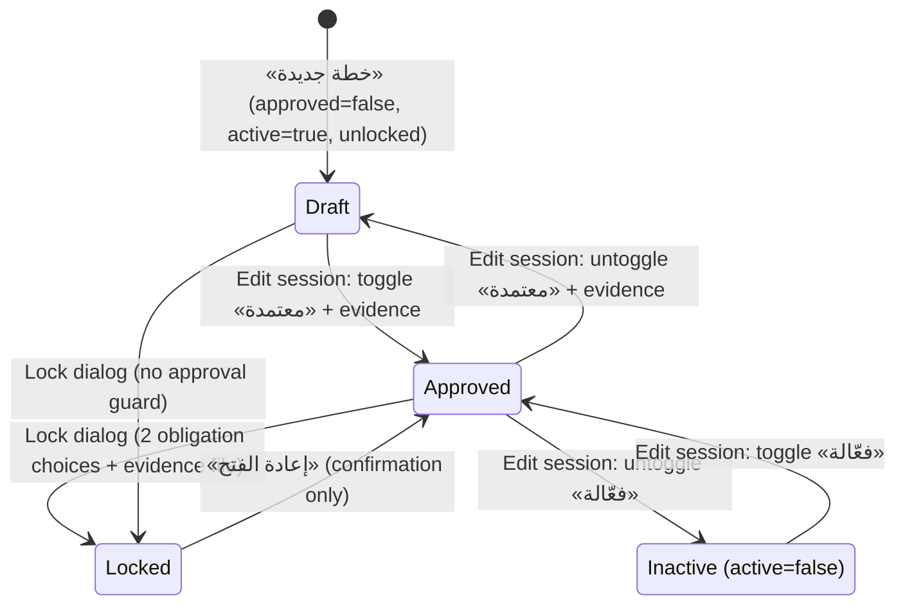
Guards/effects: a locked **or** inactive plan disappears from the plan-item pickers (BR-PLN-35/37); a locked plan blocks `transferApplication` (BR-PLN-35). Approval has no downstream effect in code except the plans-list KPIs (BR-PLN-09) [Observed]; whether approval should gate linking or adjustments is [To Confirm] (OQ-PLN-02).

### 6.2 Hierarchy edit session
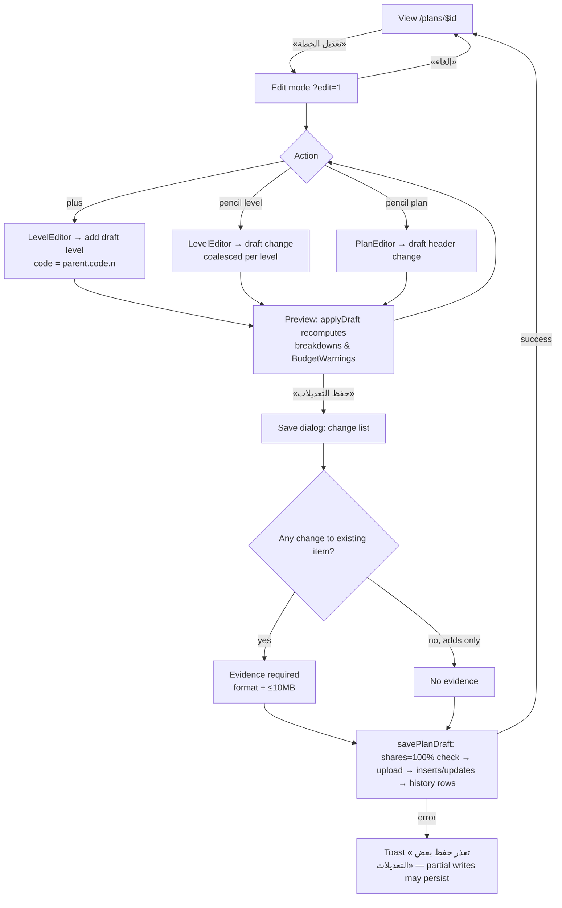

### 6.3 Budget adjustment
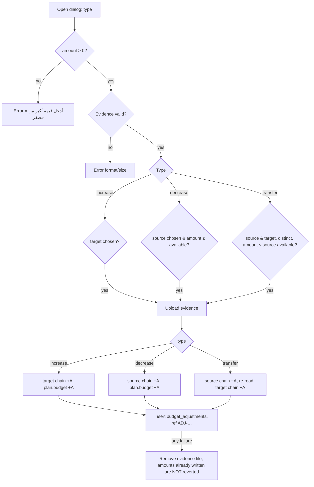
Actors: any persona reaching the page (nav: grants_manager, finance, ceo, admin). No approval step (maker-checker) exists [Observed]; [To Confirm] OQ-PLN-14.

### 6.4 Plan lock
Actor opens lock dialog → chooses treatment for (a) contracted-not-due obligations and (b) due-not-paid obligations (continue on this plan / carry to next plan) → attaches a decision/minutes file → confirms → `budget_locked = true`. Effects: new links to the plan's items disappear from pickers; `transferApplication` throws «ميزانية «…» مقفلة — لا يمكن اعتماد مشاريع جديدة منها»; running projects continue [Observed] `plans.ts:13`, `workflow.ts:154-158`. The choices and file are not persisted (ISS-PLN-03).

### 6.5 Endowment funding & participation
Funding: amount + date + evidence → `endowment_fundings` row; size = Σ fundings. Participation: switch per level → effective participant set ± this endowment → level's own split rewritten as equal shares (min. one participant). Split resolution order: single-endowment org → own rows → nearest ancestor rows → equal split among all active endowments (BR-PLN-26).

### 6.6 Worked examples of the budget math

**Example A — five-way breakdown of one level** (BR-PLN-01…04). Level «1.2» amount = 1,000,000. Linked (directly or via descendants):
- Project P1 budget 400,000; payments: 100,000 `paid`, 50,000 `due`, 80,000 `new`.
- Project P2 budget 200,000; no payments.
- Application A1 `approved`, not transferred, requested 150,000.
- Application A2 `pending` (current status set), requested 80,000.

| Bucket | Calculation | Value |
|---|---|---|
| paid | P1 paid statuses (`awaiting_receipt`,`paid`) | 100,000 |
| due | P1 due statuses (`due`,`awaiting_approval`,`awaiting_transfer`) | 50,000 |
| approved (committed, not due) | max(0, 400,000 − 150,000) + max(0, 200,000 − 0) + A1 150,000 | 600,000 |
| available | 1,000,000 − 600,000 − 50,000 − 100,000 | 250,000 |
| pending («محجوز مؤقتاً») | Σ apps in `submitted`/`under_review` | 0 (A2 is `pending`, not in the set — ISS-PLN-21) |
| used (`idx.used`) | 400,000 + 200,000 + 150,000 | 750,000 |
| actual available (`idx.available`) used by adjustments | 1,000,000 − 750,000 | 250,000 |

The `new` payment (80,000) stays inside «approved» until it becomes due. Spend from budget (plan level) = paid ÷ plan.budget; spend of approved = 100,000 ÷ (600,000 + 50,000 + 100,000) = 13.33 %.

**Example B — multi-initiative project** (BR-PLN-06). Project P3 budget 300,000 with allocations L1 = 200,000 and L2 = 100,000 (2 rows ⇒ split). P3 becomes two pieces: at L1 budget 200,000, share 2/3; at L2 budget 100,000, share 1/3. A paid payment of 90,000 counts 60,000 paid at L1 and 30,000 at L2; approved at L1 = 200,000 − 60,000 = 140,000. With one allocation row, P3 counts 300,000 entirely at its `plan_level_id`.

**Example C — adjustment propagation** (BR-PLN-13…15). Plan budget 1,500,000; Track 1 = 1,000,000 (items 1.1 = 600,000, 1.2 = 400,000); Track 2 = 500,000 (item 2.1 = 500,000).
- Increase 2.1 by 100,000 → 2.1 = 600,000, Track 2 = 600,000, plan = 1,600,000.
- Decrease 1.2 by 50,000 (allowed only if 1.2 actual available ≥ 50,000) → 1.2 = 350,000, Track 1 = 950,000, plan = 1,550,000.
- Transfer 100,000 from 1.1 to 2.1 → 1.1 = 500,000, Track 1 = 900,000; 2.1 = 600,000, Track 2 = 600,000; plan unchanged.
- Transfer 100,000 from 1.1 to 1.2 (same parent) → 1.1 −100,000, 1.2 +100,000, Track 1 −100,000 then +100,000 = unchanged.
- Edge: transfer from 1.1 to its parent Track 1 → 1.1 −100,000; Track 1 −100,000 then +100,000 = unchanged ⇒ Track 1 now has 100,000 unallocated residual (BudgetWarning). Transfer from Track 1 to 1.1 → Track 1 unchanged, 1.1 +100,000 ⇒ children exceed parent (ISS-PLN-06).

**Example D — endowment splits** (BR-PLN-26…30). Org has active endowments A and B; no explicit shares ⇒ every level 50/50 (inherited default). Track 1 = 1,000,000 with children 1.1 = 600,000, 1.2 = 300,000 (residual 100,000).
- A's allocation for Track 1 = 600,000×50 % + 300,000×50 % + 100,000×50 % = 500,000 (each level contributes only its unallocated residual; leaves contribute their full amount).
- If 1.1 has own rows A = 100 %: A = 600,000 + 150,000 + 50,000 = 800,000; B = 0 + 150,000 + 50,000 = 200,000.
- Equal split of 3 endowments = 34 / 33 / 33 (remainder to first). Size-weighted with sizes 5 M / 3 M / 2 M = 50 / 30 / 20; sizes 1/1/1 ⇒ 33/33/33 then +1 to the largest (first maximum) ⇒ 34/33/33. Size-weighted unavailable if any selected endowment has zero fundings.
- A project of 200,000 under 1.1 (A = 100 %) uses 200,000 of A's portion.

## 7. Business Rules

| BR ID | Rule | Evidence label + reference |
|---|---|---|
| BR-PLN-01 | Level «used» = Σ budget of projects linked to the level or any descendant + Σ requested_amount of applications linked to the level or any descendant whose status is `approved` and `transferred = false`. | [Observed] `src/lib/plans.ts:376-418 (countsAsUsedApp, used)` |
| BR-PLN-02 | Level «actual available» (المتاح الفعلي) = level.amount − used. This is the figure shown in the adjustment dialog and used to validate decreases/transfers. Child allocations are not deducted. | [Observed] `src/lib/plans.ts:419; AdjustmentDialog.tsx:56` |
| BR-PLN-03 | Five-way breakdown per level/plan: paid = Σ payments in `awaiting_receipt`/`paid`; due = Σ payments in `due`/`awaiting_approval`/`awaiting_transfer`; approved = Σ max(0, project budget − (paid+due)×share) + Σ approved-not-transferred application amounts; available = total − approved − due − paid. Payments in `new` stay inside approved; `cancelled` payments are ignored. | [Observed] `src/lib/plans.ts:379-437` |
| BR-PLN-04 | «Pending» (محجوز مؤقتاً) = Σ requested_amount of applications in `submitted`/`under_review`; it is informational only and never reduces available or the ceiling. | [Observed] `src/lib/plans.ts:382,424,435; FinanceBreakdown.tsx:12,55-60` |
| BR-PLN-05 | Plan-level breakdown uses plan.budget as total and includes every project/application linked to any level of the plan (not the sum of root-level breakdowns). | [Observed] `src/lib/plans.ts:439-443` |
| BR-PLN-06 | A project with two or more project_plan_allocations rows is counted as one piece per allocation: piece budget = allocation amount, share = amount ÷ Σ allocation amounts (fallback divisor 1); its payments are prorated by share. With fewer than two rows the project counts fully at projects.plan_level_id (share 1). | [Observed] `src/lib/plans.ts:182-191,431-432` |
| BR-PLN-07 | Spend from budget (الصرف من الموازنة) = min(100, plan paid ÷ plan.budget × 100); 0 when budget is 0. | [Observed] `src/lib/plans.ts:448-452` |
| BR-PLN-08 | Spend of approved (الصرف من المعتمد) = min(100, paid ÷ (approved + due + paid) × 100); 0 when the base is 0. | [Observed] `src/lib/plans.ts:454-459` |
| BR-PLN-09 | Plans-list portfolio KPIs consider approved plans only: spend = Σ (spend% × budget) ÷ Σ budget; indicator achievement = Σ(indicators_progress × budget) ÷ Σ budget. «عدد الخطط» counts all plans. | [Observed] `src/routes/plans.index.tsx:71-75,132-134` |
| BR-PLN-10 | Project/initiative progress = round(Σ activity weight × progress ÷ Σ weight) when activities with non-zero total weight exist; otherwise round(stored projects.progress). | [Observed] `src/lib/plans.ts:461-468` |
| BR-PLN-11 | An adjustment amount must be strictly greater than zero. | [Observed] `src/lib/plans.ts:494` |
| BR-PLN-12 | Every adjustment requires an evidence document with extension pdf, doc, docx, xls, xlsx, png, jpg or jpeg and size ≤ 10 MB, stored privately at `plan-adjustments/<plan_id>/<uuid>/<file name>`. | [Observed] `src/lib/plans.ts:497-499,507-509; AdjustmentDialog.tsx:63,104` |
| BR-PLN-13 | Increase: a target level is required; the target and every ancestor are increased by the amount and plan.budget is increased by the amount. | [Observed] `src/lib/plans.ts:500,512-514,530-533,474-484` |
| BR-PLN-14 | Decrease: a source level is required and amount ≤ source actual available (BR-PLN-02); the source and every ancestor are reduced by the amount and plan.budget is reduced by the amount. | [Observed] `src/lib/plans.ts:501-503,516-518,527,530-533` |
| BR-PLN-15 | Transfer: source and target are required and must differ; amount ≤ source actual available; source chain −amount, then levels are re-read and target chain +amount; plan.budget unchanged; common ancestors net to zero. | [Observed] `src/lib/plans.ts:504-505,519-526` |
| BR-PLN-16 | Each executed adjustment is recorded with plan, type, source (null for increase), target (null for decrease), amount, note, acting persona and evidence; reference ADJ-… is assigned by DB trigger. | [Observed] `src/lib/plans.ts:535-545; migration 20261004115345:53` |
| BR-PLN-17 | If any step fails after the evidence upload, the evidence file is deleted; level/plan amounts already written are not reverted. | [Observed] `src/lib/plans.ts:547-550` |
| BR-PLN-18 | Plan structure edits: one evidence document (same format/size rule as BR-PLN-12) per edit session, required when any existing item (plan header, level, endowment split) changes; sessions containing only additions need no evidence. Stored at `plan-edits/<plan_id>/<uuid>/<file name>`. | [Observed] `src/lib/plans.ts:277-282,325-332; plans.$id.index.tsx:118,225-226` |
| BR-PLN-19 | On commit, each changed existing item writes one plan_edit_history row (before/after JSON, shared evidence); added levels write no history row. plan_edit_history is append-only (insert/select policies only). | [Observed] `src/lib/plans.ts:336-370; migration 20261006140739:13-15` |
| BR-PLN-20 | New level code = `<parent code>.<n>` (root: `<n>`) where n = max(sort_order of siblings, including draft siblings) + 1; sort_order = n. | [Observed] `plans.$id.index.tsx:102-106; PlanEditors.tsx:130-132` |
| BR-PLN-21 | Draft coalescing: at most one pending change per existing level; a change whose values equal the original is dropped; editing a draft (added) level updates its add record; only the latest plan-header change is kept. | [Observed] `plans.$id.index.tsx:84-101,218` |
| BR-PLN-22 | When a level (or the plan) has children and Σ children amounts ≠ parent amount (difference rounded to 2 decimals), a non-blocking warning shows the children sum and the absolute difference. Saving is not blocked. | [Observed] `src/lib/plans.ts:269-275; PlanEditors.tsx:16-19` |
| BR-PLN-23 | Plan header: name (trimmed) and year required; budget must be a finite number ≥ 0; year chosen from 2021–2031; new plan defaults: year = current year + 1, active = true, approved = false. | [Observed] `PlanEditors.tsx:45-47; plans.ts:89; plans.index.tsx:128` |
| BR-PLN-24 | Level: name (trimmed) required; amount required, finite and ≥ 0. | [Observed] `PlanEditors.tsx:122-123` |
| BR-PLN-25 | When endowment shares are specified for a level they must total exactly 100 % (rounded to 2 decimals). | [Observed] `src/lib/plans.ts:315-324; PlanEditors.tsx:106` |
| BR-PLN-26 | Effective endowment split of a level: if the organization has exactly one active endowment → that endowment 100 %; else the level's own rows; else the nearest ancestor's rows (inherited); else an equal split among all active endowments. | [Observed] `src/lib/plans.ts:202-216` |
| BR-PLN-27 | Equal split: each endowment gets floor(100 ÷ n); the first gets the remainder so the total is exactly 100 (e.g. 34/33/33). | [Observed] `src/lib/plans.ts:123-128` |
| BR-PLN-28 | Size-weighted split: shares proportional to current endowment sizes, rounded to integers; rounding difference added to the largest endowment; not available when any selected endowment has size ≤ 0. | [Observed] `src/lib/plans.ts:130-140; PlanEditors.tsx:91-93` |
| BR-PLN-29 | Participation toggle: start from the level's effective participants, add or remove the endowment, and rewrite the level's own rows as an equal split; at least one endowment must participate in every level. | [Observed] `src/lib/plans.ts:218-227` |
| BR-PLN-30 | Endowment allocation within a plan = Σ over levels of max(0, level.amount − Σ children amounts) × endowment % at that level (each level contributes only its unallocated residual; leaves contribute their full amount). | [Observed] `src/lib/plans.ts:229-250` |
| BR-PLN-31 | Endowment used = Σ (project piece budget × endowment % at the project's level) + Σ (approved-not-transferred application amount × %); endowment available = allocation − used. | [Observed] `src/lib/plans.ts:246-254` |
| BR-PLN-32 | Endowment size = Σ of its funding movements (endowment_fundings.amount); it grows as the endowment is topped up during the year. | [Observed] `src/lib/plans.ts:118-121` |
| BR-PLN-33 | Recording a funding requires amount > 0, a funding date (default today), and a valid evidence document; note optional. If the insert fails the uploaded file is removed. | [Observed] `src/routes/endowments.$id.tsx:47-61` |
| BR-PLN-34 | Endowment split UI (chips, participation card) is shown only when the organization has two or more active endowments. | [Observed] `src/lib/plans.ts:193; plans.$id.index.tsx:81,108; endowments.$id.tsx:147` |
| BR-PLN-35 | A locked plan (budget_locked) accepts no new project approvals: pickers exclude locked or inactive plans (an existing link stays visible) and transferApplication refuses levels of a locked plan; running projects continue. | [Observed] `src/lib/plans.ts:13; PlanLevelPicker.tsx:19-20,47; workflow.ts:154-158` |
| BR-PLN-36 | Locking requires choosing how contracted-not-due and due-not-paid obligations are treated (continue on this plan / carry to next plan) and attaching an evidence file; reopening requires confirmation only. | [Observed] `src/routes/plans.index.tsx:162-180` |
| BR-PLN-37 | Plan-item pickers list only non-root levels (levels with a parent) of active, unlocked plans, labelled `<year> · <code> - <name>`. | [Observed] `PlanLevelPicker.tsx:34-35,52-53` |
| BR-PLN-38 | Initiatives are projects with projects.source = 'initiative'; the legacy /initiatives route redirects to /projects?source=initiative. | [Observed] `src/routes/initiatives.tsx:3-5; AGENTS.md` |
| BR-PLN-39 | Plan structure and header changes (including the approval and active flags) are made only in the hierarchy edit session (?edit=1) and committed together. | [Observed] `plans.$id.index.tsx:117-127,217-218; AGENTS.md` |
| BR-PLN-40 | Indicators attach to persisted leaf levels only; quantitative indicators need name, unit and target > 0; milestones get unit «تحقق» and target 1; an indicator linked to applications or projects cannot be deleted. | [Observed] `plans.$id.index.tsx:161; Indicators.tsx:53-67` |
| BR-PLN-41 | A root track whose breakdown available < 0 is flagged «تجاوز الموازنة» on the plan summary. | [Observed] `src/routes/plans.$id.summary.tsx:55` |
| BR-PLN-42 | Plans receive reference numbers PLN-… from a DB trigger on insert. | [Observed] `migration 20261004115345:20` |
| BR-PLN-43 | Plans are listed newest year first; default hidden columns are plan number and creation date; default page size 15. | [Observed] `src/lib/plans.ts:147; plans.index.tsx:47` |
| BR-PLN-44 | Tree view share of a level = level.amount ÷ parent amount × 100 (plan.budget for root levels; 0 when parent amount is 0). | [Observed] `src/routes/plans.$id.tree.tsx:65,70,75` |

## 8. Data Requirements

All tables carry RLS «signed in access» (any authenticated user; one shared demo account), except `plan_edit_history` which is insert + select only (append-only) — [Observed] `20261006140739_*.sql:13-17`.

### plans
| Field | Type | Req. | Meaning |
|---|---|---|---|
| id | uuid PK | Y | — |
| tenant_id | uuid FK tenants | Y | Owning organization (UI inserts constant `TENANT_ID`) |
| ref_no | text | auto | `PLN-…` set by trigger `plans_ref` (`set_ref_no('PLN', plan_seq)`) |
| name | text | Y | Plan name |
| year | integer | Y | Plan year (UI list 2021–2031) |
| budget | numeric (default 0) | Y | Plan ceiling; changed by edit session and by increase/decrease adjustments |
| active | boolean (default true) | Y | Active plans appear in pickers |
| approved | boolean (default false) | Y | Approval flag; used by plans-list KPIs |
| budget_locked | boolean | Y | Locked: no new projects may be approved from the plan (not in migrations — ISS-PLN-20) |
| indicators_progress | numeric (default 0) | Y | Stored indicator achievement % (never recomputed — ISS-PLN-09) |
| created_at | timestamptz | auto | Used by date filters |
Relationships: 1-N `plan_levels`, `budget_adjustments`, `plan_edit_history` (all ON DELETE CASCADE).

### plan_levels
| Field | Type | Req. | Meaning |
|---|---|---|---|
| id | uuid PK | Y | — |
| plan_id | uuid FK plans (cascade) | Y | — |
| parent_id | uuid FK plan_levels (cascade) | N | null = root track |
| code | text | Y | Hierarchical code `1`, `1.2`, `1.2.3` (generated, BR-PLN-20) |
| name | text | Y | — |
| amount | numeric (default 0) | Y | Allocated amount (ceiling) |
| sort_order | integer | Y | Sibling ordering (= last code segment) |
Relationships: referenced by `applications.plan_level_id`, `projects.plan_level_id`, `grant_programs.default_plan_level_id` (ON DELETE SET NULL), `plan_level_endowments`, `plan_indicators`, `project_plan_allocations`, `budget_adjustments.source_level_id/target_level_id` (SET NULL).

### budget_adjustments
| Field | Type | Req. | Meaning |
|---|---|---|---|
| id, plan_id (FK cascade) | uuid | Y | — |
| ref_no | text | auto | `ADJ-…` trigger `adj_ref` |
| type | text | Y | `increase` (تعزيز موازنة) / `decrease` (تخفيض موازنة) / `transfer` (نقل مخصصات) — not DB-constrained |
| source_level_id | uuid | cond. | null for increase |
| target_level_id | uuid | cond. | null for decrease |
| amount | numeric | Y | > 0 (app-validated) |
| created_by | uuid FK personas | N | Acting persona |
| note | text | N | — |
| evidence_name / evidence_path | text | app-required | File in private bucket `attachments/plan-adjustments/<plan>/<uuid>/<name>` (nullable in DB) |
| created_at | timestamptz | auto | — |

### plan_edit_history (append-only)
plan_id (FK cascade), level_id (null = plan header; FK SET NULL), target_name, before_values jsonb, after_values jsonb (for share changes: `{endowments: [...]}`), evidence_name, evidence_path (NOT NULL), created_at, updated_at (touch trigger).

### endowments (master data — CFG)
id, tenant_id (FK cascade), name, description, active (default true), created_at.

### plan_level_endowments
plan_level_id (FK cascade), endowment_id (FK cascade), percent numeric default 100; UNIQUE(plan_level_id, endowment_id). Own rows of a level; absence = inherit (BR-PLN-26). Sum = 100 enforced only in `savePlanDraft` (BR-PLN-25).

### endowment_fundings
id, endowment_id, amount (required), funded_at (date, default today in UI), note, evidence_name / evidence_path (required), created_by, created_at. Lifecycle: insert only (no edit/delete UI).

### project_plan_allocations (owned by PRJ/REV)
project_id (nullable), application_id (nullable), plan_level_id (required), amount. ≥2 rows for a project ⇒ split counting (BR-PLN-06).

### plan_indicators (shared with REV/PRJ)
plan_level_id, name, unit, target, kind (`quantitative` | `milestone`).

### Read-only inputs from other modules
- `projects`: id, ref_no, title, budget, status (planning / in_progress / completed / closed / stalled), start_date, end_date, plan_level_id, source (`grant` default | `initiative`), progress, `project_activities(weight, progress)`, partner name, manager name.
- `applications`: id, ref_no, project_title, requested_amount, status (current set: pending / approved / closed / cancelled / awaiting_apology), transferred, plan_level_id, partner name.
- `payments`: project_id, amount, status (new / due / awaiting_approval / awaiting_transfer / awaiting_receipt / paid / cancelled).
- Legacy `initiatives` table exists but is unused (AGENTS.md; `20261004132647_*.sql:17`).

## 9. Product Structure

- **EP-PLN-01 — Annual Plan Portfolio & Lifecycle**: Register of annual plans, creation, approval/active flags and budget locking.
  - FT-PLN-01 — Annual plans register (Must)
  - FT-PLN-02 — Create annual plan (Must)
  - FT-PLN-03 — Plan budget lock and reopen (Must)
- **EP-PLN-02 — Plan Structure Management**: Hierarchical levels (tracks, items, initiatives) edited in an evidenced edit session, with audit history and leaf indicators.
  - FT-PLN-04 — Hierarchy edit session (Must)
  - FT-PLN-05 — Plan edit audit history (Should)
  - FT-PLN-06 — Leaf-level plan indicators (Should)
- **EP-PLN-03 — Budget Monitoring & Visualization**: Single budget-math engine (used, available, pending, approved, due, paid) and the summary, hierarchy and tree views built on it.
  - FT-PLN-07 — Budget breakdown engine (Must)
  - FT-PLN-08 — Plan summary dashboard (Must)
  - FT-PLN-09 — Hierarchical plan view (Must)
  - FT-PLN-10 — Plan tree diagram (Could)
- **EP-PLN-04 — Budget Adjustments**: Evidenced increase, decrease and transfer of level budgets with propagation up the hierarchy, and the operations register.
  - FT-PLN-11 — Budget adjustment execution (Must)
  - FT-PLN-12 — Financial operations register (Must)
- **EP-PLN-05 — Endowments**: Endowment funding ledger, participation and percentage splits across plan levels, and the endowment portion report.
  - FT-PLN-13 — Endowment funding ledger (Should)
  - FT-PLN-14 — Endowment participation and splits (Should)
  - FT-PLN-15 — Endowment portion report (Could)
- **EP-PLN-06 — Plan Linkage & Initiatives**: Linking applications, projects and programs to plan items, lock enforcement, and initiatives modelled as projects.
  - FT-PLN-16 — Plan item linking (Must)
  - FT-PLN-17 — Initiatives as projects (Should)

## 10. Features

### FT-PLN-01 — Annual plans register
- **Feature ID:** FT-PLN-01 (Epic EP-PLN-01)
- **Name:** Annual plans register
- **Description:** Tabular list of annual plans with spend and indicator progress, status/approval/year/date filters, saved view, export, row navigation and per-plan action menu.
- **Business Objective:** [Inferred] Give planners and executives one place to find plans and their execution status.
- **Expected Business Value:** [To Confirm] Faster oversight of plan execution across years.
- **Primary User Roles:** grants_manager, finance, ceo, admin — UI navigation only [To Confirm]
- **Scope:** List, filter, KPI cards, export, navigation to summary/edit/adjustments/lock.
- **Out of Scope:** Plan creation logic (FT-PLN-02); lock logic (FT-PLN-03).
- **Functional Requirements:** FR-PLN-001, FR-PLN-002, FR-PLN-003, FR-PLN-004, FR-PLN-005
- **User Stories:** US-PLN-001, US-PLN-002
- **Business Rules:** BR-PLN-07, BR-PLN-09, BR-PLN-43
- **Dependencies:** PLT DataTable & saved views; FT-PLN-07 budget engine
- **Related Screens:** SCR-PLN-01
- **Acceptance Criteria:**
  - All plans are listed with name, year, budget, spend %, indicator %, status and approval.
  - Filters for status, approval and year persist per user when the view is saved.
  - Portfolio KPIs are computed on approved plans only, sum-based.
- **Open Questions:** OQ-PLN-01
- **Assumptions:** Plans list should be tenant-scoped (currently not — ISS-PLN-10).
- **Priority Recommendation (MoSCoW):** Must

### FT-PLN-02 — Create annual plan
- **Feature ID:** FT-PLN-02 (Epic EP-PLN-01)
- **Name:** Create annual plan
- **Description:** Dialog to create a plan with name, year, budget, active and approved flags, optionally pre-filled by AI assist.
- **Business Objective:** [Inferred] Start a new budget year.
- **Expected Business Value:** [To Confirm]
- **Primary User Roles:** grants_manager, finance, ceo, admin — UI navigation only [To Confirm]
- **Scope:** Create plan header only; levels are added in the edit session.
- **Out of Scope:** Copying a previous year's structure; approval workflow.
- **Functional Requirements:** FR-PLN-006, FR-PLN-007, FR-PLN-008
- **User Stories:** US-PLN-003
- **Business Rules:** BR-PLN-23, BR-PLN-42
- **Dependencies:** AiAssist (PLT)
- **Related Screens:** SCR-PLN-01, SCR-PLN-09
- **Acceptance Criteria:**
  - A plan can be created with name, year and budget ≥ 0.
  - New plans default to next year, active and not approved.
  - A reference number PLN-… is assigned.
- **Open Questions:** OQ-PLN-01, OQ-PLN-05
- **Assumptions:** Creating a plan needs no evidence document (observed).
- **Priority Recommendation (MoSCoW):** Must

### FT-PLN-03 — Plan budget lock and reopen
- **Feature ID:** FT-PLN-03 (Epic EP-PLN-01)
- **Name:** Plan budget lock and reopen
- **Description:** Lock a plan so no new projects can be approved from its budget, recording the treatment of outstanding obligations and a decision document; reopen when needed.
- **Business Objective:** [Inferred] Close a budget year in a controlled way while running projects continue.
- **Expected Business Value:** [To Confirm] Prevents over-commitment after year-end.
- **Primary User Roles:** grants_manager, finance, ceo, admin — UI navigation only [To Confirm]
- **Scope:** Lock/reopen dialog, lock indicator, enforcement in pickers and project transfer.
- **Out of Scope:** Automatic carry-over of obligations (not implemented).
- **Functional Requirements:** FR-PLN-009, FR-PLN-010, FR-PLN-011, FR-PLN-012
- **User Stories:** US-PLN-004, US-PLN-005
- **Business Rules:** BR-PLN-35, BR-PLN-36
- **Dependencies:** FT-PLN-16; REV/PRJ transferApplication
- **Related Screens:** SCR-PLN-01, SCR-PLN-11
- **Acceptance Criteria:**
  - Locking requires both obligation choices and an evidence file.
  - A locked plan's items are not offered in pickers and project transfer is refused.
  - Reopening restores availability.
- **Open Questions:** OQ-PLN-01, OQ-PLN-03
- **Assumptions:** Locking does not change any amounts.
- **Priority Recommendation (MoSCoW):** Must

### FT-PLN-04 — Hierarchy edit session
- **Feature ID:** FT-PLN-04 (Epic EP-PLN-02)
- **Name:** Hierarchy edit session
- **Description:** View-by-default hierarchy with an explicit edit mode (?edit=1) where users draft level additions, level edits and plan-header changes (including approval/active flags), preview their effect, and commit all at once with one evidence document.
- **Business Objective:** [Inferred] Keep plan structure changes deliberate, reviewable and evidenced.
- **Expected Business Value:** [To Confirm] Auditability of plan changes.
- **Primary User Roles:** grants_manager, finance, ceo, admin — UI navigation only [To Confirm]
- **Scope:** Draft add/edit of levels and plan header; preview; consolidated save with conditional evidence; history rows.
- **Out of Scope:** Deleting/moving levels; endowment split editing (disabled); indicator changes (immediate, FT-PLN-06).
- **Functional Requirements:** FR-PLN-013, FR-PLN-014, FR-PLN-015, FR-PLN-016, FR-PLN-017, FR-PLN-018, FR-PLN-019, FR-PLN-020, FR-PLN-021, FR-PLN-022
- **User Stories:** US-PLN-006, US-PLN-007, US-PLN-008, US-PLN-009, US-PLN-010
- **Business Rules:** BR-PLN-18, BR-PLN-19, BR-PLN-20, BR-PLN-21, BR-PLN-22, BR-PLN-23, BR-PLN-24, BR-PLN-25, BR-PLN-39
- **Dependencies:** Storage bucket attachments; DocAiCheck
- **Related Screens:** SCR-PLN-04, SCR-PLN-09, SCR-PLN-12, SCR-PLN-13
- **Acceptance Criteria:**
  - No change is written until «حفظ الكل».
  - Changes to existing items require one evidence document; additions only do not.
  - Each changed existing item produces one history row with before/after values.
- **Open Questions:** OQ-PLN-06, OQ-PLN-07, OQ-PLN-10, OQ-PLN-16
- **Assumptions:** Drafts are per browser session (not shared).
- **Priority Recommendation (MoSCoW):** Must

### FT-PLN-05 — Plan edit audit history
- **Feature ID:** FT-PLN-05 (Epic EP-PLN-02)
- **Name:** Plan edit audit history
- **Description:** List of evidenced plan and level edits on summary, hierarchy and tree pages with access to the evidence document.
- **Business Objective:** [Inferred] Traceability of who-changed-what (document-based).
- **Expected Business Value:** [To Confirm]
- **Primary User Roles:** grants_manager, finance, ceo, admin — UI navigation only [To Confirm]
- **Scope:** Read-only history list with evidence link.
- **Out of Scope:** Before/after diff display; actor name (not stored).
- **Functional Requirements:** FR-PLN-023, FR-PLN-024
- **User Stories:** US-PLN-011
- **Business Rules:** BR-PLN-19
- **Dependencies:** Storage signed URLs
- **Related Screens:** SCR-PLN-02, SCR-PLN-03, SCR-PLN-05
- **Acceptance Criteria:**
  - History lists each edit with type, target, date and document.
  - Evidence opens through a time-limited signed URL.
- **Open Questions:** —
- **Assumptions:** plan_edit_history does not store the acting persona (observed schema).
- **Priority Recommendation (MoSCoW):** Should

### FT-PLN-06 — Leaf-level plan indicators
- **Feature ID:** FT-PLN-06 (Epic EP-PLN-02)
- **Name:** Leaf-level plan indicators
- **Description:** Display and (in edit mode) add/delete quantitative or milestone indicators on leaf plan levels.
- **Business Objective:** [Inferred] Define what each funded item must achieve.
- **Expected Business Value:** [To Confirm]
- **Primary User Roles:** grants_manager, finance, ceo, admin — UI navigation only [To Confirm]
- **Scope:** Indicator list per leaf; add/delete with link guard.
- **Out of Scope:** Linking indicators to applications and measuring achievement (REV/PRJ).
- **Functional Requirements:** FR-PLN-025, FR-PLN-026
- **User Stories:** US-PLN-012
- **Business Rules:** BR-PLN-40
- **Dependencies:** Indicators.tsx (REV/PRJ)
- **Related Screens:** SCR-PLN-03, SCR-PLN-04
- **Acceptance Criteria:**
  - Indicators appear only on persisted leaf levels.
  - A linked indicator cannot be deleted.
- **Open Questions:** OQ-PLN-08
- **Assumptions:** —
- **Priority Recommendation (MoSCoW):** Should

### FT-PLN-07 — Budget breakdown engine
- **Feature ID:** FT-PLN-07 (Epic EP-PLN-03)
- **Name:** Budget breakdown engine
- **Description:** Shared calculation of used, actual available and the five-way split (paid, due, approved/committed, available, pending) per level and per plan, including multi-initiative splits, spend ratios and project progress.
- **Business Objective:** [Inferred] One consistent definition of plan money across all screens and reports.
- **Expected Business Value:** [To Confirm] Reliable availability checks before commitments.
- **Primary User Roles:** grants_manager, finance, ceo, admin — UI navigation only [To Confirm]
- **Scope:** lib/plans.ts helpers and FinanceBreakdown rendering.
- **Out of Scope:** Payment processing (FIN).
- **Functional Requirements:** FR-PLN-027, FR-PLN-028, FR-PLN-029, FR-PLN-030, FR-PLN-031, FR-PLN-032, FR-PLN-033
- **User Stories:** US-PLN-013, US-PLN-014
- **Business Rules:** BR-PLN-01, BR-PLN-02, BR-PLN-03, BR-PLN-04, BR-PLN-05, BR-PLN-06, BR-PLN-07, BR-PLN-08, BR-PLN-10
- **Dependencies:** payments (FIN); project_plan_allocations (PRJ); applications (REV)
- **Related Screens:** SCR-PLN-02, SCR-PLN-03
- **Acceptance Criteria:**
  - Figures follow BR-PLN-01…08 exactly (see worked examples §6.6).
  - Pending never reduces available.
  - A multi-initiative project is counted once in total.
- **Open Questions:** OQ-PLN-11
- **Assumptions:** Payment statuses as defined in FIN.
- **Priority Recommendation (MoSCoW):** Must

### FT-PLN-08 — Plan summary dashboard
- **Feature ID:** FT-PLN-08 (Epic EP-PLN-03)
- **Name:** Plan summary dashboard
- **Description:** One-page overview: total budget split, spend KPIs, per-track distribution with over-budget flag, linked initiatives and recent adjustments.
- **Business Objective:** [Inferred] Executive view of plan health.
- **Expected Business Value:** [To Confirm]
- **Primary User Roles:** grants_manager, finance, ceo, admin — UI navigation only [To Confirm]
- **Scope:** Summary page.
- **Out of Scope:** Cross-plan comparison (analytics, FIN).
- **Functional Requirements:** FR-PLN-034, FR-PLN-035, FR-PLN-036, FR-PLN-037, FR-PLN-038
- **User Stories:** US-PLN-015
- **Business Rules:** BR-PLN-07, BR-PLN-08, BR-PLN-10, BR-PLN-41
- **Dependencies:** FT-PLN-07
- **Related Screens:** SCR-PLN-02
- **Acceptance Criteria:**
  - Summary shows plan breakdown, three KPI bars, per-track bars, initiatives and last five adjustments.
  - Tracks with negative available are flagged.
- **Open Questions:** OQ-PLN-08
- **Assumptions:** —
- **Priority Recommendation (MoSCoW):** Must

### FT-PLN-09 — Hierarchical plan view
- **Feature ID:** FT-PLN-09 (Epic EP-PLN-03)
- **Name:** Hierarchical plan view
- **Description:** Collapsible tree of tracks and nested levels with amount, money split, budget warnings, endowment chips, projects/applications drill-down and a view switcher.
- **Business Objective:** [Inferred] Let planners see where money sits and what consumes it.
- **Expected Business Value:** [To Confirm]
- **Primary User Roles:** grants_manager, finance, ceo, admin — UI navigation only [To Confirm]
- **Scope:** Read mode of /plans/$id.
- **Out of Scope:** Editing (FT-PLN-04).
- **Functional Requirements:** FR-PLN-039, FR-PLN-040, FR-PLN-041, FR-PLN-042
- **User Stories:** US-PLN-016, US-PLN-017
- **Business Rules:** BR-PLN-01, BR-PLN-22, BR-PLN-34
- **Dependencies:** FT-PLN-07
- **Related Screens:** SCR-PLN-03
- **Acceptance Criteria:**
  - Every level shows its amount and breakdown.
  - Project and application counts include descendants and open a list dialog.
- **Open Questions:** —
- **Assumptions:** —
- **Priority Recommendation (MoSCoW):** Must

### FT-PLN-10 — Plan tree diagram
- **Feature ID:** FT-PLN-10 (Epic EP-PLN-03)
- **Name:** Plan tree diagram
- **Description:** Read-only organisation-chart style diagram of the plan with each level's amount and share of its parent.
- **Business Objective:** [Inferred] Visual communication of the plan structure.
- **Expected Business Value:** [To Confirm]
- **Primary User Roles:** grants_manager, finance, ceo, admin — UI navigation only [To Confirm]
- **Scope:** Tree page.
- **Out of Scope:** Editing in the diagram.
- **Functional Requirements:** FR-PLN-043
- **User Stories:** US-PLN-018
- **Business Rules:** BR-PLN-22, BR-PLN-44
- **Dependencies:** @xyflow/react
- **Related Screens:** SCR-PLN-05
- **Acceptance Criteria:**
  - Each node shows code-name, share % and amount.
  - Mismatched children sums show a warning on the node.
- **Open Questions:** —
- **Assumptions:** —
- **Priority Recommendation (MoSCoW):** Could

### FT-PLN-11 — Budget adjustment execution
- **Feature ID:** FT-PLN-11 (Epic EP-PLN-04)
- **Name:** Budget adjustment execution
- **Description:** Dialog to increase, decrease or transfer a level's budget with mandatory evidence; changes propagate to all ancestors and (for increase/decrease) to the plan budget, and are recorded.
- **Business Objective:** [Inferred] Controlled, documented changes to approved allocations during the year.
- **Expected Business Value:** [To Confirm]
- **Primary User Roles:** grants_manager, finance, ceo, admin — UI navigation only [To Confirm]
- **Scope:** Increase, decrease, transfer; validation; propagation; record.
- **Out of Scope:** Approval workflow for adjustments; cascading to children.
- **Functional Requirements:** FR-PLN-044, FR-PLN-045, FR-PLN-046, FR-PLN-047, FR-PLN-048, FR-PLN-049, FR-PLN-050, FR-PLN-051
- **User Stories:** US-PLN-019, US-PLN-020, US-PLN-021
- **Business Rules:** BR-PLN-02, BR-PLN-11, BR-PLN-12, BR-PLN-13, BR-PLN-14, BR-PLN-15, BR-PLN-16, BR-PLN-17
- **Dependencies:** FT-PLN-07; Storage; DocAiCheck
- **Related Screens:** SCR-PLN-10, SCR-PLN-01, SCR-PLN-06
- **Acceptance Criteria:**
  - No adjustment executes without a valid evidence document.
  - Decrease/transfer cannot exceed the source's actual available.
  - Ancestors and plan budget are updated as per BR-PLN-13…15.
- **Open Questions:** OQ-PLN-04, OQ-PLN-12, OQ-PLN-14, OQ-PLN-15
- **Assumptions:** —
- **Priority Recommendation (MoSCoW):** Must

### FT-PLN-12 — Financial operations register
- **Feature ID:** FT-PLN-12 (Epic EP-PLN-04)
- **Name:** Financial operations register
- **Description:** List of executed adjustments by type and plan with reference, levels, amount, creator, note, evidence and date.
- **Business Objective:** [Inferred] Audit trail of budget movements.
- **Expected Business Value:** [To Confirm]
- **Primary User Roles:** grants_manager, finance, ceo, admin — UI navigation only [To Confirm]
- **Scope:** Register page with tabs, plan filter, export.
- **Out of Scope:** Editing/reversing adjustments.
- **Functional Requirements:** FR-PLN-052, FR-PLN-053, FR-PLN-054
- **User Stories:** US-PLN-022
- **Business Rules:** BR-PLN-16
- **Dependencies:** FT-PLN-11
- **Related Screens:** SCR-PLN-06
- **Acceptance Criteria:**
  - Adjustments are filtered by type tab and plan.
  - Evidence opens via signed URL.
- **Open Questions:** —
- **Assumptions:** —
- **Priority Recommendation (MoSCoW):** Must

### FT-PLN-13 — Endowment funding ledger
- **Feature ID:** FT-PLN-13 (Epic EP-PLN-05)
- **Name:** Endowment funding ledger
- **Description:** Record dated, evidenced funding movements for an endowment; endowment size is their sum.
- **Business Objective:** [Inferred] Track the size of each funding source.
- **Expected Business Value:** [To Confirm]
- **Primary User Roles:** grants_manager, admin — UI navigation only [To Confirm]
- **Scope:** Funding dialog, ledger table, size card.
- **Out of Scope:** Endowment CRUD (CFG); reversals.
- **Functional Requirements:** FR-PLN-055, FR-PLN-056
- **User Stories:** US-PLN-023
- **Business Rules:** BR-PLN-32, BR-PLN-33
- **Dependencies:** CFG endowments master data; Storage
- **Related Screens:** SCR-PLN-07, SCR-PLN-14
- **Acceptance Criteria:**
  - A funding needs amount > 0, date and evidence.
  - Endowment size equals the sum of fundings.
- **Open Questions:** OQ-PLN-13
- **Assumptions:** —
- **Priority Recommendation (MoSCoW):** Should

### FT-PLN-14 — Endowment participation and splits
- **Feature ID:** FT-PLN-14 (Epic EP-PLN-05)
- **Name:** Endowment participation and splits
- **Description:** Determine which endowments fund each level and in what percentage (own, inherited or default equal split), and let users toggle an endowment's participation per level.
- **Business Objective:** [Inferred] Attribute plan money to funding sources.
- **Expected Business Value:** [To Confirm]
- **Primary User Roles:** grants_manager, admin — UI navigation only [To Confirm]
- **Scope:** Participation toggles; split resolution; split helpers.
- **Out of Scope:** Manual percentage editing (disabled).
- **Functional Requirements:** FR-PLN-057, FR-PLN-058, FR-PLN-059
- **User Stories:** US-PLN-024
- **Business Rules:** BR-PLN-25, BR-PLN-26, BR-PLN-27, BR-PLN-28, BR-PLN-29, BR-PLN-34
- **Dependencies:** FT-PLN-13
- **Related Screens:** SCR-PLN-07, SCR-PLN-03
- **Acceptance Criteria:**
  - With one active endowment every level is 100 % that endowment.
  - Toggling rewrites the level's split equally among participants; the last participant cannot leave.
- **Open Questions:** OQ-PLN-09
- **Assumptions:** —
- **Priority Recommendation (MoSCoW):** Should

### FT-PLN-15 — Endowment portion report
- **Feature ID:** FT-PLN-15 (Epic EP-PLN-05)
- **Name:** Endowment portion report
- **Description:** Per endowment: its allocation, used and available across the organization's plans, level-by-level percentages and funded projects.
- **Business Objective:** [Inferred] Report to each funding source what it finances.
- **Expected Business Value:** [To Confirm] (OQ-PLN-17)
- **Primary User Roles:** grants_manager, admin — UI navigation only [To Confirm]
- **Scope:** Endowment detail report section.
- **Out of Scope:** Export/print.
- **Functional Requirements:** FR-PLN-060, FR-PLN-061, FR-PLN-062
- **User Stories:** US-PLN-025
- **Business Rules:** BR-PLN-30, BR-PLN-31
- **Dependencies:** FT-PLN-07; FT-PLN-14
- **Related Screens:** SCR-PLN-07
- **Acceptance Criteria:**
  - Allocation, used and available follow BR-PLN-30/31.
  - Inherited percentages are labelled «(موروث)».
- **Open Questions:** OQ-PLN-17
- **Assumptions:** —
- **Priority Recommendation (MoSCoW):** Could

### FT-PLN-16 — Plan item linking
- **Feature ID:** FT-PLN-16 (Epic EP-PLN-06)
- **Name:** Plan item linking
- **Description:** Reusable pickers to link applications, projects and grant programs (default item) to plan items, and applicant-facing initiative selection, both limited to active unlocked plans; lock enforced at project transfer.
- **Business Objective:** [Inferred] Ensure every commitment is charged to a plan item.
- **Expected Business Value:** [To Confirm]
- **Primary User Roles:** grants_manager, finance, ceo, admin, applicant — UI navigation only [To Confirm]
- **Scope:** PlanLevelPicker, InitiativeSelect, lock check.
- **Out of Scope:** Multi-initiative allocation editing (PRJ).
- **Functional Requirements:** FR-PLN-063, FR-PLN-064, FR-PLN-065
- **User Stories:** US-PLN-026, US-PLN-027
- **Business Rules:** BR-PLN-35, BR-PLN-37
- **Dependencies:** REV, PRJ, PTL, PRG consumers
- **Related Screens:** SCR-PLN-03
- **Acceptance Criteria:**
  - Pickers list only non-root levels of active, unlocked plans.
  - Transfer to a project from a locked plan is refused.
- **Open Questions:** OQ-PLN-02, OQ-PLN-16
- **Assumptions:** —
- **Priority Recommendation (MoSCoW):** Must

### FT-PLN-17 — Initiatives as projects
- **Feature ID:** FT-PLN-17 (Epic EP-PLN-06)
- **Name:** Initiatives as projects
- **Description:** Initiatives are projects with source = initiative; legacy route redirects to the filtered projects list; initiative progress is derived from weighted activities and shown on the plan summary.
- **Business Objective:** [Inferred] Single projects module keeps plan usage single-counted.
- **Expected Business Value:** [To Confirm]
- **Primary User Roles:** grants_manager, finance, ceo, admin, project_manager — UI navigation only [To Confirm]
- **Scope:** Redirect; progress calculation; summary cards.
- **Out of Scope:** Initiative creation and management (PRJ).
- **Functional Requirements:** FR-PLN-066, FR-PLN-067
- **User Stories:** US-PLN-028
- **Business Rules:** BR-PLN-10, BR-PLN-38
- **Dependencies:** PRJ projects module
- **Related Screens:** SCR-PLN-08, SCR-PLN-02
- **Acceptance Criteria:**
  - /initiatives lands on /projects?source=initiative.
  - Initiative progress = weighted activity progress.
- **Open Questions:** —
- **Assumptions:** —
- **Priority Recommendation (MoSCoW):** Should

## 11. Functional Requirements

### FR-PLN-001
- **Statement:** The system shall list annual plans with name, year, budget, spend-from-budget %, indicator achievement %, active status and approval status, with plan number and creation date available as optional columns.
- **Description:** Rows come from usePlanData ordered by year descending; spend % per BR-PLN-07.
- **Type:** UI · **Priority:** Must · **Evidence:** [Observed]
- **Source/Prototype reference:** `src/routes/plans.index.tsx:62-111`
- **Related Feature:** FT-PLN-01 · **Related Story:** US-PLN-001
- **Dependencies:** FR-PLN-030
- **Acceptance Criteria:**
  - Each plan appears once with the seven default columns.
  - Plan number and creation date are hidden by default and can be shown.
- **Validation Rules:** —
- **Exceptions & Alternative Flows:** —
- **Open Questions:** —

### FR-PLN-002
- **Statement:** The system shall filter plans by active status, approval status, year (2021–2031) and creation date range, and persist status/approval/year, hidden columns and page size in the user's saved view.
- **Description:** Date range is session-only.
- **Type:** Functional · **Priority:** Must · **Evidence:** [Observed]
- **Source/Prototype reference:** `src/routes/plans.index.tsx:47-70,142-148`
- **Related Feature:** FT-PLN-01 · **Related Story:** US-PLN-001
- **Dependencies:** —
- **Acceptance Criteria:**
  - Selecting «معتمد» shows only approved plans.
  - A saved view restores the status, approval and year filters on next visit.
- **Validation Rules:** From/to dates are ISO dates; ‘to’ is inclusive by day.
- **Exceptions & Alternative Flows:** —
- **Open Questions:** —

### FR-PLN-003
- **Statement:** The system shall show portfolio KPI cards: number of plans, spend from budget across approved plans (sum-based), and budget-weighted indicator achievement across approved plans.
- **Description:** See BR-PLN-09.
- **Type:** Reporting · **Priority:** Should · **Evidence:** [Observed]
- **Source/Prototype reference:** `src/routes/plans.index.tsx:71-75,131-135`
- **Related Feature:** FT-PLN-01 · **Related Story:** US-PLN-002
- **Dependencies:** —
- **Acceptance Criteria:**
  - Spend KPI = Σ paid ÷ Σ budget of approved plans.
  - Unapproved plans do not affect the spend and indicator KPIs.
- **Validation Rules:** —
- **Exceptions & Alternative Flows:** —
- **Open Questions:** OQ-PLN-08

### FR-PLN-004
- **Statement:** The system shall allow exporting the plans table and toggling column visibility, excluding the actions column from exports.
- **Description:** Provided by the shared DataTable (PLT).
- **Type:** Reporting · **Priority:** Should · **Evidence:** [Observed]
- **Source/Prototype reference:** `src/routes/plans.index.tsx:79,136-141`
- **Related Feature:** FT-PLN-01 · **Related Story:** US-PLN-001
- **Dependencies:** PLT DataTable
- **Acceptance Criteria:**
  - Export file is named annual-plans.
  - Actions column is not exported.
- **Validation Rules:** —
- **Exceptions & Alternative Flows:** —
- **Open Questions:** —

### FR-PLN-005
- **Statement:** The system shall provide per-plan actions: view summary (row click, name, eye icon), lock/reopen, increase, decrease, transfer, and «تعديل الخطة والاعتماد» opening the edit session.
- **Type:** UI · **Priority:** Must · **Evidence:** [Observed]
- **Source/Prototype reference:** `src/routes/plans.index.tsx:79-100,140`
- **Related Feature:** FT-PLN-01 · **Related Story:** US-PLN-001
- **Dependencies:** —
- **Acceptance Criteria:**
  - Row click opens /plans/$id/summary.
  - The menu offers the three adjustment types and the edit session link.
- **Validation Rules:** —
- **Exceptions & Alternative Flows:** —
- **Open Questions:** —

### FR-PLN-006
- **Statement:** The system shall create a plan with name, year, budget, active and approved flags, assigning a PLN reference number.
- **Description:** Defaults: year = current + 1, active = true, approved = false. Inserted for the configured tenant.
- **Type:** Data · **Priority:** Must · **Evidence:** [Observed]
- **Source/Prototype reference:** `src/routes/plans.index.tsx:128; PlanEditors.tsx:44-58; migration 20261004115345:20`
- **Related Feature:** FT-PLN-02 · **Related Story:** US-PLN-003
- **Dependencies:** FR-PLN-007
- **Acceptance Criteria:**
  - Saving a valid form inserts a plan and shows «تم حفظ الخطة».
  - The new plan appears in the list with a PLN-… number.
- **Validation Rules:** —
- **Exceptions & Alternative Flows:** —
- **Open Questions:** —

### FR-PLN-007
- **Statement:** The system shall validate that plan name and year are provided and budget is a finite number ≥ 0.
- **Type:** Functional · **Priority:** Must · **Evidence:** [Observed]
- **Source/Prototype reference:** `src/components/PlanEditors.tsx:45-46`
- **Related Feature:** FT-PLN-02 · **Related Story:** US-PLN-003
- **Dependencies:** —
- **Acceptance Criteria:**
  - Empty name shows «الاسم والسنة مطلوبان».
  - Invalid budget shows «أدخل موازنة صحيحة».
- **Validation Rules:** Name trimmed non-empty; year ∈ 2021–2031; budget ≥ 0 (AmountInput blocks negatives).
- **Exceptions & Alternative Flows:** —
- **Open Questions:** —

### FR-PLN-008
- **Statement:** The system shall offer an AI assist that proposes plan name, year and budget from free text, applied to the form only on user action.
- **Description:** Advisory only.
- **Type:** AI · **Priority:** Could · **Evidence:** [Observed]
- **Source/Prototype reference:** `src/components/PlanEditors.tsx:63-65`
- **Related Feature:** FT-PLN-02 · **Related Story:** US-PLN-003
- **Dependencies:** AiAssist (PLT)
- **Acceptance Criteria:**
  - AI proposals populate the form fields without saving.
  - User can edit proposed values before saving.
- **Validation Rules:** —
- **Exceptions & Alternative Flows:** —
- **Open Questions:** —

### FR-PLN-009
- **Statement:** The system shall lock a plan only after the user chooses the treatment of contracted-not-due and due-not-paid obligations and attaches an evidence file, then set budget_locked = true.
- **Type:** Functional · **Priority:** Must · **Evidence:** [Observed]
- **Source/Prototype reference:** `src/routes/plans.index.tsx:162-190`
- **Related Feature:** FT-PLN-03 · **Related Story:** US-PLN-004
- **Dependencies:** —
- **Acceptance Criteria:**
  - «إغلاق الخطة» stays disabled until both choices and a file are set.
  - After confirmation the lock icon turns red and the plan is locked.
- **Validation Rules:** —
- **Exceptions & Alternative Flows:** DB error → toast with message; lock not applied.
- **Open Questions:** OQ-PLN-03

### FR-PLN-010
- **Statement:** The system shall reopen a locked plan after confirmation, setting budget_locked = false.
- **Description:** No evidence required.
- **Type:** Functional · **Priority:** Must · **Evidence:** [Observed]
- **Source/Prototype reference:** `src/routes/plans.index.tsx:155-159,182-190`
- **Related Feature:** FT-PLN-03 · **Related Story:** US-PLN-005
- **Dependencies:** —
- **Acceptance Criteria:**
  - Confirming «إعادة الفتح» unlocks the plan and shows «أُعيد فتح الخطة».
  - Cancelling leaves the plan locked.
- **Validation Rules:** —
- **Exceptions & Alternative Flows:** —
- **Open Questions:** —

### FR-PLN-011
- **Statement:** The system shall indicate each plan's lock state in the register with distinct icons and tooltips.
- **Type:** UI · **Priority:** Should · **Evidence:** [Observed]
- **Source/Prototype reference:** `src/routes/plans.index.tsx:84-88`
- **Related Feature:** FT-PLN-03 · **Related Story:** US-PLN-004, US-PLN-005
- **Dependencies:** —
- **Acceptance Criteria:**
  - Locked plans show a red closed-lock icon titled «الخطة مقفلة — اضغط لإعادة فتحها».
  - Unlocked plans show an open-lock icon titled «إغلاق الخطة».
- **Validation Rules:** —
- **Exceptions & Alternative Flows:** —
- **Open Questions:** —

### FR-PLN-012
- **Statement:** The system shall store each lock/reopen decision with actor, timestamp, obligation treatment choices and the uploaded evidence document.
- **Description:** Gap: currently only the flag is stored (ISS-PLN-03).
- **Type:** Data · **Priority:** Must · **Evidence:** [Recommended]
- **Source/Prototype reference:** `src/routes/plans.index.tsx:171-189`
- **Related Feature:** FT-PLN-03 · **Related Story:** US-PLN-004
- **Dependencies:** —
- **Acceptance Criteria:**
  - The evidence file is uploaded to private storage and retrievable.
  - Lock history shows choices and document.
- **Validation Rules:** —
- **Exceptions & Alternative Flows:** —
- **Open Questions:** OQ-PLN-03

### FR-PLN-013
- **Statement:** The system shall provide an explicit edit mode for a plan's hierarchy (search param edit=1) entered from the plan views or the register, and exited by cancel (discarding drafts) or successful save.
- **Type:** UI · **Priority:** Must · **Evidence:** [Observed]
- **Source/Prototype reference:** `src/routes/plans.$id.index.tsx:29,60-61,117,175-181; PlanViewNav.tsx:8`
- **Related Feature:** FT-PLN-04 · **Related Story:** US-PLN-006, US-PLN-010
- **Dependencies:** —
- **Acceptance Criteria:**
  - Opening /plans/$id?edit=1 shows the amber session banner and edit controls.
  - «إلغاء» clears the draft and returns to view mode.
- **Validation Rules:** —
- **Exceptions & Alternative Flows:** —
- **Open Questions:** —

### FR-PLN-014
- **Statement:** The system shall let users add a root track or a child level to any level as a draft with name and amount, generating code and sort order automatically.
- **Description:** Code rule BR-PLN-20.
- **Type:** Functional · **Priority:** Must · **Evidence:** [Observed]
- **Source/Prototype reference:** `src/routes/plans.$id.index.tsx:102-106,135-136,187`
- **Related Feature:** FT-PLN-04 · **Related Story:** US-PLN-006
- **Dependencies:** —
- **Acceptance Criteria:**
  - Adding under level 1.2 with siblings 1.2.1–1.2.3 creates code 1.2.4.
  - The draft level appears highlighted before saving.
- **Validation Rules:** BR-PLN-24
- **Exceptions & Alternative Flows:** —
- **Open Questions:** —

### FR-PLN-015
- **Statement:** The system shall let users edit a level's name and amount as a draft, keeping one pending change per level and dropping it when values return to the original.
- **Type:** Functional · **Priority:** Must · **Evidence:** [Observed]
- **Source/Prototype reference:** `src/routes/plans.$id.index.tsx:84-101`
- **Related Feature:** FT-PLN-04 · **Related Story:** US-PLN-007
- **Dependencies:** —
- **Acceptance Criteria:**
  - Editing the same level twice yields one change entry.
  - Restoring original values removes the change.
- **Validation Rules:** BR-PLN-24
- **Exceptions & Alternative Flows:** —
- **Open Questions:** —

### FR-PLN-016
- **Statement:** The system shall let users edit plan name, year, budget, active and approved flags as a single draft change within the session.
- **Type:** Functional · **Priority:** Must · **Evidence:** [Observed]
- **Source/Prototype reference:** `src/routes/plans.$id.index.tsx:186,217-218; PlanEditors.tsx:48`
- **Related Feature:** FT-PLN-04 · **Related Story:** US-PLN-008
- **Dependencies:** —
- **Acceptance Criteria:**
  - Applying the plan editor adds «تعديل بيانات الخطة» to the change list.
  - Only the last plan-header change is kept.
- **Validation Rules:** BR-PLN-23
- **Exceptions & Alternative Flows:** —
- **Open Questions:** OQ-PLN-02

### FR-PLN-017
- **Statement:** The system shall recompute all displayed amounts, breakdowns and warnings with drafts applied and highlight changed items and the number of unsaved changes.
- **Type:** UI · **Priority:** Should · **Evidence:** [Observed]
- **Source/Prototype reference:** `src/routes/plans.$id.index.tsx:44-56,73-74,150,176`
- **Related Feature:** FT-PLN-04 · **Related Story:** US-PLN-006, US-PLN-007
- **Dependencies:** —
- **Acceptance Criteria:**
  - After a draft amount change, the level's figures reflect the new amount.
  - Changed levels have an amber border/background.
- **Validation Rules:** —
- **Exceptions & Alternative Flows:** —
- **Open Questions:** —

### FR-PLN-018
- **Statement:** The system shall warn, without blocking, when the sum of a node's children differs from its amount, showing the children sum and the absolute difference.
- **Description:** Applies to plan root, tracks and levels, in view and edit modes and inside editors.
- **Type:** UI · **Priority:** Must · **Evidence:** [Observed]
- **Source/Prototype reference:** `src/lib/plans.ts:269-275; PlanEditors.tsx:16-19,68,143`
- **Related Feature:** FT-PLN-04 · **Related Story:** US-PLN-007
- **Dependencies:** —
- **Acceptance Criteria:**
  - Parent 1,000,000 with children 600,000 + 300,000 shows difference 100,000.
  - Equal sums show no warning.
- **Validation Rules:** —
- **Exceptions & Alternative Flows:** —
- **Open Questions:** OQ-PLN-10

### FR-PLN-019
- **Statement:** The system shall present a save dialog listing all pending changes and require one evidence document when any existing item changes, otherwise stating that no document is needed.
- **Type:** UI · **Priority:** Must · **Evidence:** [Observed]
- **Source/Prototype reference:** `src/routes/plans.$id.index.tsx:118,220-227`
- **Related Feature:** FT-PLN-04 · **Related Story:** US-PLN-009
- **Dependencies:** —
- **Acceptance Criteria:**
  - With a level edit pending, «حفظ الكل» is disabled until a file is chosen.
  - With additions only, the note «إضافات فقط — لا يلزم مستند نظامي.» is shown.
- **Validation Rules:** BR-PLN-18
- **Exceptions & Alternative Flows:** —
- **Open Questions:** —

### FR-PLN-020
- **Statement:** The system shall persist a session by uploading the evidence, inserting new levels parent-first (mapping temporary ids), updating edited plan/level rows and endowment splits, and writing one plan_edit_history row per changed existing item.
- **Type:** Data · **Priority:** Must · **Evidence:** [Observed]
- **Source/Prototype reference:** `src/lib/plans.ts:320-374`
- **Related Feature:** FT-PLN-04 · **Related Story:** US-PLN-009
- **Dependencies:** —
- **Acceptance Criteria:**
  - A child added under a draft parent is saved with the parent's real id.
  - Each edited level produces a history row with before/after values and the evidence path.
- **Validation Rules:** —
- **Exceptions & Alternative Flows:** Any error → «تعذر حفظ بعض التعديلات: …» (partial writes possible — ISS-PLN-02).
- **Open Questions:** —

### FR-PLN-021
- **Statement:** The system shall reject a session whose endowment splits (edited or for added levels) do not total 100 %.
- **Type:** Functional · **Priority:** Should · **Evidence:** [Observed]
- **Source/Prototype reference:** `src/lib/plans.ts:321-324`
- **Related Feature:** FT-PLN-04 · **Related Story:** US-PLN-009
- **Dependencies:** —
- **Acceptance Criteria:**
  - A split of 60 % + 30 % blocks saving with «مجموع نسب الأوقاف لكل مستوى يجب أن يساوي 100%».
  - An empty split (inherit) is accepted.
- **Validation Rules:** BR-PLN-25
- **Exceptions & Alternative Flows:** —
- **Open Questions:** —

### FR-PLN-022
- **Statement:** The system shall commit an edit session atomically (all changes or none) and remove the evidence on failure.
- **Description:** Gap ISS-PLN-02.
- **Type:** Data · **Priority:** Must · **Evidence:** [Recommended]
- **Source/Prototype reference:** `src/lib/plans.ts:320-374`
- **Related Feature:** FT-PLN-04 · **Related Story:** US-PLN-009
- **Dependencies:** —
- **Acceptance Criteria:**
  - A failure in any change leaves the plan unchanged.
  - No orphan evidence file remains after a failed save.
- **Validation Rules:** —
- **Exceptions & Alternative Flows:** —
- **Open Questions:** —

### FR-PLN-023
- **Statement:** The system shall display the plan's edit history (plan vs level edit, target name, date, evidence name) on summary, hierarchy and tree pages, newest first.
- **Type:** Reporting · **Priority:** Should · **Evidence:** [Observed]
- **Source/Prototype reference:** `src/components/PlanEditHistory.tsx:7-21; plans.ts:156`
- **Related Feature:** FT-PLN-05 · **Related Story:** US-PLN-011
- **Dependencies:** —
- **Acceptance Criteria:**
  - Each history row shows «تعديل مستوى» or «تعديل الخطة» with the target name.
  - Empty history shows «لا توجد تعديلات موثقة بعد.».
- **Validation Rules:** —
- **Exceptions & Alternative Flows:** —
- **Open Questions:** —

### FR-PLN-024
- **Statement:** The system shall open evidence documents through a signed URL valid for 300 seconds in a new tab.
- **Type:** Security · **Priority:** Should · **Evidence:** [Observed]
- **Source/Prototype reference:** `src/components/PlanEditHistory.tsx:9-13`
- **Related Feature:** FT-PLN-05 · **Related Story:** US-PLN-011
- **Dependencies:** —
- **Acceptance Criteria:**
  - Clicking the document opens it in a new tab.
  - If signing fails «تعذر فتح المستند النظامي» is shown.
- **Validation Rules:** —
- **Exceptions & Alternative Flows:** —
- **Open Questions:** —

### FR-PLN-025
- **Statement:** The system shall display indicators on persisted leaf levels of the hierarchy.
- **Type:** UI · **Priority:** Should · **Evidence:** [Observed]
- **Source/Prototype reference:** `src/routes/plans.$id.index.tsx:161; Indicators.tsx:44-51`
- **Related Feature:** FT-PLN-06 · **Related Story:** US-PLN-012
- **Dependencies:** —
- **Acceptance Criteria:**
  - A leaf with indicators lists them.
  - Non-leaf levels and draft levels show no indicator block.
- **Validation Rules:** —
- **Exceptions & Alternative Flows:** —
- **Open Questions:** —

### FR-PLN-026
- **Statement:** The system shall allow adding (quantitative or milestone) and deleting leaf indicators in edit mode, preventing deletion of indicators linked to applications or projects.
- **Description:** Writes are immediate (ISS-PLN-19).
- **Type:** Functional · **Priority:** Should · **Evidence:** [Observed]
- **Source/Prototype reference:** `src/components/Indicators.tsx:53-71`
- **Related Feature:** FT-PLN-06 · **Related Story:** US-PLN-012
- **Dependencies:** —
- **Acceptance Criteria:**
  - Quantitative indicator without unit or target is rejected.
  - Deleting a linked indicator shows the link counts and is not executed.
- **Validation Rules:** BR-PLN-40
- **Exceptions & Alternative Flows:** —
- **Open Questions:** —

### FR-PLN-027
- **Statement:** The system shall compute, for every level, used and actual available amounts rolled up over the level and its descendants.
- **Type:** Functional · **Priority:** Must · **Evidence:** [Observed]
- **Source/Prototype reference:** `src/lib/plans.ts:402-422`
- **Related Feature:** FT-PLN-07 · **Related Story:** US-PLN-013
- **Dependencies:** —
- **Acceptance Criteria:**
  - Used includes descendant projects and approved untransferred applications.
  - Available = amount − used.
- **Validation Rules:** BR-PLN-01, BR-PLN-02
- **Exceptions & Alternative Flows:** —
- **Open Questions:** —

### FR-PLN-028
- **Statement:** The system shall compute the five-way split (paid, due, approved, available, pending) per level and per plan from projects, applications and payments.
- **Type:** Functional · **Priority:** Must · **Evidence:** [Observed]
- **Source/Prototype reference:** `src/lib/plans.ts:424-443`
- **Related Feature:** FT-PLN-07 · **Related Story:** US-PLN-013
- **Dependencies:** —
- **Acceptance Criteria:**
  - Worked example A (§6.6) yields paid 100,000, due 50,000, approved 600,000, available 250,000.
  - Pending is excluded from available.
- **Validation Rules:** BR-PLN-03, 04, 05
- **Exceptions & Alternative Flows:** —
- **Open Questions:** OQ-PLN-11

### FR-PLN-029
- **Statement:** The system shall split a project funded by two or more plan allocations into one piece per allocation, prorating its payments by share.
- **Type:** Functional · **Priority:** Must · **Evidence:** [Observed]
- **Source/Prototype reference:** `src/lib/plans.ts:182-191,431-432`
- **Related Feature:** FT-PLN-07 · **Related Story:** US-PLN-014
- **Dependencies:** project_plan_allocations (PRJ)
- **Acceptance Criteria:**
  - Worked example B: 90,000 paid splits into 60,000 and 30,000.
  - A project with one allocation counts fully at its plan_level_id.
- **Validation Rules:** BR-PLN-06
- **Exceptions & Alternative Flows:** —
- **Open Questions:** —

### FR-PLN-030
- **Statement:** The system shall compute spend from budget and spend of approved per plan using a single definition reused across screens.
- **Type:** Reporting · **Priority:** Must · **Evidence:** [Observed]
- **Source/Prototype reference:** `src/lib/plans.ts:448-459`
- **Related Feature:** FT-PLN-07 · **Related Story:** US-PLN-013
- **Dependencies:** —
- **Acceptance Criteria:**
  - Spend from budget is capped at 100 %.
  - A plan with budget 0 shows 0 %.
- **Validation Rules:** BR-PLN-07, 08
- **Exceptions & Alternative Flows:** —
- **Open Questions:** —

### FR-PLN-031
- **Statement:** The system shall render money splits as a stacked bar with paid, due, approved and available figures (full, compact or bare variants), pending shown aside, and negative available highlighted in red.
- **Type:** UI · **Priority:** Must · **Evidence:** [Observed]
- **Source/Prototype reference:** `src/components/FinanceBreakdown.tsx:5-64`
- **Related Feature:** FT-PLN-07 · **Related Story:** US-PLN-013
- **Dependencies:** —
- **Acceptance Criteria:**
  - Bar widths are proportional to max(total, paid+due+approved).
  - Negative available displays in destructive colour.
- **Validation Rules:** —
- **Exceptions & Alternative Flows:** —
- **Open Questions:** —

### FR-PLN-032
- **Statement:** The system shall provide a per-project breakdown (contract value, approved-not-due, due, paid) for use on the project page.
- **Type:** Functional · **Priority:** Should · **Evidence:** [Observed]
- **Source/Prototype reference:** `src/lib/plans.ts:384-389; projects.$id.tsx:159`
- **Related Feature:** FT-PLN-07 · **Related Story:** US-PLN-014
- **Dependencies:** PRJ project page
- **Acceptance Criteria:**
  - Approved = max(0, budget − paid − due).
  - Pending and available are 0 for a project.
- **Validation Rules:** —
- **Exceptions & Alternative Flows:** —
- **Open Questions:** —

### FR-PLN-033
- **Statement:** The system shall load plan data in one query set, failing on core tables but degrading secondary tables (history, endowments, shares, fundings, allocations) to empty with a warning.
- **Type:** Integration · **Priority:** Should · **Evidence:** [Observed]
- **Source/Prototype reference:** `src/lib/plans.ts:142-180`
- **Related Feature:** FT-PLN-07 · **Related Story:** US-PLN-013
- **Dependencies:** —
- **Acceptance Criteria:**
  - If plan_edit_history fails, plan pages still render.
  - If payments fail, the page shows the query error.
- **Validation Rules:** —
- **Exceptions & Alternative Flows:** —
- **Open Questions:** —

### FR-PLN-034
- **Statement:** The system shall show on the plan summary the plan year, approval and active status, total budget and the plan-level five-way breakdown.
- **Type:** Reporting · **Priority:** Must · **Evidence:** [Observed]
- **Source/Prototype reference:** `src/routes/plans.$id.summary.tsx:39-40`
- **Related Feature:** FT-PLN-08 · **Related Story:** US-PLN-015
- **Dependencies:** —
- **Acceptance Criteria:**
  - Header subtitle reads «{year} · معتمدة/غير معتمدة · فعالة/غير فعالة».
  - Unknown plan id shows «الخطة غير موجودة».
- **Validation Rules:** —
- **Exceptions & Alternative Flows:** —
- **Open Questions:** —

### FR-PLN-035
- **Statement:** The system shall show progress bars for spend from budget, spend of approved and indicator achievement.
- **Type:** Reporting · **Priority:** Must · **Evidence:** [Observed]
- **Source/Prototype reference:** `src/routes/plans.$id.summary.tsx:42-49`
- **Related Feature:** FT-PLN-08 · **Related Story:** US-PLN-015
- **Dependencies:** —
- **Acceptance Criteria:**
  - Values equal FR-PLN-030 results.
  - Indicator achievement shows the stored plan value.
- **Validation Rules:** —
- **Exceptions & Alternative Flows:** —
- **Open Questions:** OQ-PLN-08

### FR-PLN-036
- **Statement:** The system shall show per-track amount and breakdown bars with a shared legend and flag tracks with negative available as «تجاوز الموازنة».
- **Type:** Reporting · **Priority:** Must · **Evidence:** [Observed]
- **Source/Prototype reference:** `src/routes/plans.$id.summary.tsx:50-60`
- **Related Feature:** FT-PLN-08 · **Related Story:** US-PLN-015
- **Dependencies:** —
- **Acceptance Criteria:**
  - A track with available −10,000 shows the over-budget badge.
  - A plan without tracks shows «لا توجد مسارات في الخطة.».
- **Validation Rules:** BR-PLN-41
- **Exceptions & Alternative Flows:** —
- **Open Questions:** —

### FR-PLN-037
- **Statement:** The system shall list initiatives (projects with source = initiative) linked to the plan with title, progress and budget.
- **Type:** Reporting · **Priority:** Should · **Evidence:** [Observed]
- **Source/Prototype reference:** `src/routes/plans.$id.summary.tsx:63-66`
- **Related Feature:** FT-PLN-08 · **Related Story:** US-PLN-015, US-PLN-028
- **Dependencies:** —
- **Acceptance Criteria:**
  - Only source = initiative projects appear.
  - Section is hidden when there are none.
- **Validation Rules:** —
- **Exceptions & Alternative Flows:** —
- **Open Questions:** —

### FR-PLN-038
- **Statement:** The system shall show the five most recent adjustments of the plan with type, reference, amount and date.
- **Type:** Reporting · **Priority:** Should · **Evidence:** [Observed]
- **Source/Prototype reference:** `src/routes/plans.$id.summary.tsx:34,67-73`
- **Related Feature:** FT-PLN-08 · **Related Story:** US-PLN-015
- **Dependencies:** —
- **Acceptance Criteria:**
  - At most five rows, newest first.
  - No adjustments shows «لا توجد تعديلات مالية بعد.».
- **Validation Rules:** —
- **Exceptions & Alternative Flows:** —
- **Open Questions:** —

### FR-PLN-039
- **Statement:** The system shall render the plan hierarchy as collapsible tracks with nested levels, each showing code-name, amount, compact breakdown and budget warning.
- **Type:** UI · **Priority:** Must · **Evidence:** [Observed]
- **Source/Prototype reference:** `src/routes/plans.$id.index.tsx:140-164,193-211`
- **Related Feature:** FT-PLN-09 · **Related Story:** US-PLN-016
- **Dependencies:** —
- **Acceptance Criteria:**
  - Tracks are expanded by default and can be collapsed.
  - Empty plan shows «لا توجد مستويات بعد.».
- **Validation Rules:** —
- **Exceptions & Alternative Flows:** —
- **Open Questions:** —

### FR-PLN-040
- **Statement:** The system shall show counts of projects and applications per level (including descendants) and open a list dialog with key columns and links.
- **Type:** UI · **Priority:** Should · **Evidence:** [Observed]
- **Source/Prototype reference:** `src/routes/plans.$id.index.tsx:148-159,229-269`
- **Related Feature:** FT-PLN-09 · **Related Story:** US-PLN-017
- **Dependencies:** —
- **Acceptance Criteria:**
  - Buttons are disabled when count is 0.
  - Project refs link to /projects/$id; application refs link to /reviewer/$id.
- **Validation Rules:** —
- **Exceptions & Alternative Flows:** —
- **Open Questions:** —

### FR-PLN-041
- **Statement:** The system shall show endowment share chips on levels that have their own split when the organization has two or more active endowments, linking to the endowment page.
- **Type:** UI · **Priority:** Could · **Evidence:** [Observed]
- **Source/Prototype reference:** `src/routes/plans.$id.index.tsx:107-116`
- **Related Feature:** FT-PLN-09 · **Related Story:** US-PLN-016
- **Dependencies:** —
- **Acceptance Criteria:**
  - Inherited splits show no chips.
  - With one endowment no chips are shown.
- **Validation Rules:** BR-PLN-34
- **Exceptions & Alternative Flows:** —
- **Open Questions:** —

### FR-PLN-042
- **Statement:** The system shall provide a view switcher (summary, hierarchy, tree) and an edit entry button on plan pages, hiding the edit button while editing.
- **Type:** UI · **Priority:** Should · **Evidence:** [Observed]
- **Source/Prototype reference:** `src/components/PlanViewNav.tsx:5-21`
- **Related Feature:** FT-PLN-09 · **Related Story:** US-PLN-016
- **Dependencies:** —
- **Acceptance Criteria:**
  - The active view button is highlighted.
  - «تعديل الخطة» opens /plans/$id?edit=1.
- **Validation Rules:** —
- **Exceptions & Alternative Flows:** —
- **Open Questions:** —

### FR-PLN-043
- **Statement:** The system shall render a read-only zoomable tree of the plan with each node showing code-name, share of parent and amount, and a budget warning where children sums mismatch.
- **Type:** UI · **Priority:** Could · **Evidence:** [Observed]
- **Source/Prototype reference:** `src/routes/plans.$id.tree.tsx:30-108`
- **Related Feature:** FT-PLN-10 · **Related Story:** US-PLN-018
- **Dependencies:** —
- **Acceptance Criteria:**
  - Root node shows plan name, 100 % and budget.
  - Nodes cannot be dragged or connected.
- **Validation Rules:** BR-PLN-44
- **Exceptions & Alternative Flows:** —
- **Open Questions:** —

### FR-PLN-044
- **Statement:** The system shall open the adjustment dialog for a given plan and type from the plans register menu or the financial operations page, resetting all fields on open.
- **Type:** UI · **Priority:** Must · **Evidence:** [Observed]
- **Source/Prototype reference:** `src/routes/plans.index.tsx:92-94,150; plans.adjustments.tsx:75,94; AdjustmentDialog.tsx:37`
- **Related Feature:** FT-PLN-11 · **Related Story:** US-PLN-019, US-PLN-020, US-PLN-021
- **Dependencies:** —
- **Acceptance Criteria:**
  - Dialog title shows type and plan name.
  - Re-opening shows empty fields.
- **Validation Rules:** —
- **Exceptions & Alternative Flows:** —
- **Open Questions:** —

### FR-PLN-045
- **Statement:** The system shall let the user pick the source and/or target level among all plan levels (indented) and show the chosen level's amount and actual available.
- **Description:** Decrease: source only; increase: target only; transfer: both.
- **Type:** UI · **Priority:** Must · **Evidence:** [Observed]
- **Source/Prototype reference:** `src/components/AdjustmentDialog.tsx:41-60,84-85`
- **Related Feature:** FT-PLN-11 · **Related Story:** US-PLN-019, US-PLN-020, US-PLN-021
- **Dependencies:** —
- **Acceptance Criteria:**
  - Selecting a level shows «المبلغ … · المتاح الفعلي …».
  - Increase shows only one level picker.
- **Validation Rules:** —
- **Exceptions & Alternative Flows:** —
- **Open Questions:** —

### FR-PLN-046
- **Statement:** The system shall validate amount > 0, required levels, distinct source/target for transfers, and amount ≤ source actual available for decreases and transfers.
- **Type:** Functional · **Priority:** Must · **Evidence:** [Observed]
- **Source/Prototype reference:** `src/lib/plans.ts:494-505`
- **Related Feature:** FT-PLN-11 · **Related Story:** US-PLN-020, US-PLN-021
- **Dependencies:** —
- **Acceptance Criteria:**
  - Amount exceeding available shows «القيمة تتجاوز المتاح الفعلي للمستوى (…)».
  - Same source and target shows «لا يمكن النقل إلى نفس المستوى».
- **Validation Rules:** BR-PLN-11, 14, 15
- **Exceptions & Alternative Flows:** —
- **Open Questions:** OQ-PLN-04

### FR-PLN-047
- **Statement:** The system shall require an evidence document (allowed formats, ≤ 10 MB), run an advisory AI check on it, and store it privately before applying the adjustment.
- **Type:** Security · **Priority:** Must · **Evidence:** [Observed]
- **Source/Prototype reference:** `src/lib/plans.ts:497-499,507-509; AdjustmentDialog.tsx:94-104`
- **Related Feature:** FT-PLN-11 · **Related Story:** US-PLN-019, US-PLN-020, US-PLN-021
- **Dependencies:** —
- **Acceptance Criteria:**
  - «تنفيذ» is disabled without a file.
  - A .zip file is rejected with the format message.
- **Validation Rules:** BR-PLN-12
- **Exceptions & Alternative Flows:** —
- **Open Questions:** OQ-PLN-15

### FR-PLN-048
- **Statement:** The system shall apply an increase by adding the amount to the target level, each of its ancestors and the plan budget.
- **Type:** Functional · **Priority:** Must · **Evidence:** [Observed]
- **Source/Prototype reference:** `src/lib/plans.ts:512-514,530-533`
- **Related Feature:** FT-PLN-11 · **Related Story:** US-PLN-019
- **Dependencies:** —
- **Acceptance Criteria:**
  - Worked example C: increase 2.1 by 100,000 → 2.1, Track 2 and plan each +100,000.
  - Sibling levels are unchanged.
- **Validation Rules:** BR-PLN-13
- **Exceptions & Alternative Flows:** —
- **Open Questions:** —

### FR-PLN-049
- **Statement:** The system shall apply a decrease by subtracting the amount from the source level, each of its ancestors and the plan budget.
- **Type:** Functional · **Priority:** Must · **Evidence:** [Observed]
- **Source/Prototype reference:** `src/lib/plans.ts:527,530-533`
- **Related Feature:** FT-PLN-11 · **Related Story:** US-PLN-020
- **Dependencies:** —
- **Acceptance Criteria:**
  - Decrease 1.2 by 50,000 → 1.2, Track 1 and plan each −50,000.
  - Decrease above available is rejected before any write.
- **Validation Rules:** BR-PLN-14
- **Exceptions & Alternative Flows:** —
- **Open Questions:** —

### FR-PLN-050
- **Statement:** The system shall apply a transfer by subtracting the amount along the source chain, re-reading levels and adding it along the target chain, leaving the plan budget unchanged.
- **Type:** Functional · **Priority:** Must · **Evidence:** [Observed]
- **Source/Prototype reference:** `src/lib/plans.ts:519-526`
- **Related Feature:** FT-PLN-11 · **Related Story:** US-PLN-021
- **Dependencies:** —
- **Acceptance Criteria:**
  - Transfer 1.1→2.1 of 100,000: Track 1 −100,000, Track 2 +100,000, plan unchanged.
  - Transfer between siblings leaves the common parent unchanged.
- **Validation Rules:** BR-PLN-15
- **Exceptions & Alternative Flows:** —
- **Open Questions:** OQ-PLN-04

### FR-PLN-051
- **Statement:** The system shall record each executed adjustment (type, levels, amount, note, actor, evidence) with an ADJ reference and refresh plan, project and application data; on failure it shall delete the uploaded evidence.
- **Description:** Amount writes are not rolled back (ISS-PLN-01); atomicity recommended.
- **Type:** Data · **Priority:** Must · **Evidence:** [Observed]
- **Source/Prototype reference:** `src/lib/plans.ts:535-550; AdjustmentDialog.tsx:66-71`
- **Related Feature:** FT-PLN-11 · **Related Story:** US-PLN-019, US-PLN-020, US-PLN-021
- **Dependencies:** —
- **Acceptance Criteria:**
  - Success toast «تم تنفيذ {type}» and the register shows the new row.
  - On insert failure the evidence file no longer exists in storage.
- **Validation Rules:** BR-PLN-16, 17
- **Exceptions & Alternative Flows:** —
- **Open Questions:** —

### FR-PLN-052
- **Statement:** The system shall list adjustments in three tabs (increases, decreases, transfers) filterable by plan.
- **Type:** Reporting · **Priority:** Must · **Evidence:** [Observed]
- **Source/Prototype reference:** `src/routes/plans.adjustments.tsx:30-45,77-92`
- **Related Feature:** FT-PLN-12 · **Related Story:** US-PLN-022
- **Dependencies:** —
- **Acceptance Criteria:**
  - Switching tab shows only that type.
  - Selecting a plan shows only its adjustments.
- **Validation Rules:** —
- **Exceptions & Alternative Flows:** —
- **Open Questions:** —

### FR-PLN-053
- **Statement:** The system shall show reference, plan, level(s) (source ← target for transfers), amount (red for decreases), creator, note, evidence link and date for each adjustment.
- **Type:** UI · **Priority:** Must · **Evidence:** [Observed]
- **Source/Prototype reference:** `src/routes/plans.adjustments.tsx:47-67`
- **Related Feature:** FT-PLN-12 · **Related Story:** US-PLN-022
- **Dependencies:** —
- **Acceptance Criteria:**
  - Transfer rows show «source ← target».
  - Evidence opens via a 300-second signed URL.
- **Validation Rules:** —
- **Exceptions & Alternative Flows:** —
- **Open Questions:** —

### FR-PLN-054
- **Statement:** The system shall export the adjustments of the current tab (file adjustments-<type>), excluding the evidence column.
- **Type:** Reporting · **Priority:** Could · **Evidence:** [Observed]
- **Source/Prototype reference:** `src/routes/plans.adjustments.tsx:65,83`
- **Related Feature:** FT-PLN-12 · **Related Story:** US-PLN-022
- **Dependencies:** —
- **Acceptance Criteria:**
  - Export file name includes the type.
  - Evidence column is not exported.
- **Validation Rules:** —
- **Exceptions & Alternative Flows:** —
- **Open Questions:** —

### FR-PLN-055
- **Statement:** The system shall record an endowment funding with amount, funding date, optional note, evidence document and acting persona.
- **Type:** Data · **Priority:** Must · **Evidence:** [Observed]
- **Source/Prototype reference:** `src/routes/endowments.$id.tsx:47-65`
- **Related Feature:** FT-PLN-13 · **Related Story:** US-PLN-023
- **Dependencies:** —
- **Acceptance Criteria:**
  - Missing evidence shows «أرفق المستند النظامي».
  - Successful save shows «تم تسجيل التغذية» and updates the endowment size.
- **Validation Rules:** BR-PLN-33
- **Exceptions & Alternative Flows:** —
- **Open Questions:** —

### FR-PLN-056
- **Statement:** The system shall display the endowment's current size (sum of fundings) and its funding ledger (date, amount, note, document name).
- **Type:** Reporting · **Priority:** Should · **Evidence:** [Observed]
- **Source/Prototype reference:** `src/routes/endowments.$id.tsx:120-145; plans.ts:118-121`
- **Related Feature:** FT-PLN-13 · **Related Story:** US-PLN-023
- **Dependencies:** —
- **Acceptance Criteria:**
  - Size equals Σ funding amounts.
  - With no fundings the empty-state hint is shown and size shows «—».
- **Validation Rules:** BR-PLN-32
- **Exceptions & Alternative Flows:** —
- **Open Questions:** —

### FR-PLN-057
- **Statement:** The system shall let the user toggle an endowment's participation in each level of each plan of its organization, rewriting that level's split equally among participants.
- **Description:** Shown only with ≥ 2 active endowments.
- **Type:** Functional · **Priority:** Should · **Evidence:** [Observed]
- **Source/Prototype reference:** `src/routes/endowments.$id.tsx:79-109; plans.ts:218-227`
- **Related Feature:** FT-PLN-14 · **Related Story:** US-PLN-024
- **Dependencies:** —
- **Acceptance Criteria:**
  - Turning A off where A, B, C participate leaves B 50 % / C 50 %.
  - Turning off the last participant shows «يجب أن يشارك وقف واحد على الأقل في كل مستوى».
- **Validation Rules:** BR-PLN-29
- **Exceptions & Alternative Flows:** —
- **Open Questions:** OQ-PLN-09

### FR-PLN-058
- **Statement:** The system shall resolve each level's effective endowment split as own rows, else nearest ancestor's rows, else equal default, with a single-endowment organization always 100 %.
- **Type:** Functional · **Priority:** Should · **Evidence:** [Observed]
- **Source/Prototype reference:** `src/lib/plans.ts:202-216`
- **Related Feature:** FT-PLN-14 · **Related Story:** US-PLN-024
- **Dependencies:** —
- **Acceptance Criteria:**
  - A level without own rows under a parent with A 70 / B 30 inherits 70/30.
  - With no rows anywhere and 2 endowments, 50/50 applies.
- **Validation Rules:** BR-PLN-26
- **Exceptions & Alternative Flows:** —
- **Open Questions:** —

### FR-PLN-059
- **Statement:** The system shall provide equal and size-weighted split calculations totalling exactly 100 %.
- **Description:** Size-weighted is used only by the disabled SharesField.
- **Type:** Functional · **Priority:** Could · **Evidence:** [Observed]
- **Source/Prototype reference:** `src/lib/plans.ts:123-140`
- **Related Feature:** FT-PLN-14 · **Related Story:** US-PLN-024
- **Dependencies:** —
- **Acceptance Criteria:**
  - Equal split of 3 = 34/33/33.
  - Size-weighted is unavailable if any endowment has no funding.
- **Validation Rules:** BR-PLN-27, 28
- **Exceptions & Alternative Flows:** —
- **Open Questions:** —

### FR-PLN-060
- **Statement:** The system shall show an endowment's total allocation, used and available across its organization's plans.
- **Type:** Reporting · **Priority:** Could · **Evidence:** [Observed]
- **Source/Prototype reference:** `src/routes/endowments.$id.tsx:118-132; plans.ts:229-256`
- **Related Feature:** FT-PLN-15 · **Related Story:** US-PLN-025
- **Dependencies:** —
- **Acceptance Criteria:**
  - Available is green when ≥ 0, red otherwise.
  - Allocation follows the residual rule BR-PLN-30.
- **Validation Rules:** BR-PLN-30, 31
- **Exceptions & Alternative Flows:** —
- **Open Questions:** —

### FR-PLN-061
- **Statement:** The system shall show, per plan, the levels where the endowment has a share with level amount, percentage, share amount and an «(موروث)» marker for inherited percentages.
- **Type:** Reporting · **Priority:** Could · **Evidence:** [Observed]
- **Source/Prototype reference:** `src/routes/endowments.$id.tsx:149-162; plans.ts:241-244`
- **Related Feature:** FT-PLN-15 · **Related Story:** US-PLN-025
- **Dependencies:** —
- **Acceptance Criteria:**
  - Levels with 0 % are omitted.
  - Inherited rows are greyed and marked «(موروث)».
- **Validation Rules:** —
- **Exceptions & Alternative Flows:** —
- **Open Questions:** —

### FR-PLN-062
- **Statement:** The system shall list projects funded by the endowment with budget, percentage, endowment share and status.
- **Type:** Reporting · **Priority:** Could · **Evidence:** [Observed]
- **Source/Prototype reference:** `src/routes/endowments.$id.tsx:163-176; plans.ts:246-249`
- **Related Feature:** FT-PLN-15 · **Related Story:** US-PLN-025
- **Dependencies:** —
- **Acceptance Criteria:**
  - Share = project piece budget × %.
  - Project reference links to the project page.
- **Validation Rules:** —
- **Exceptions & Alternative Flows:** —
- **Open Questions:** —

### FR-PLN-063
- **Statement:** The system shall provide a plan-item picker that links an application, project or grant program (default item) to a non-root level of an active, unlocked plan, or unlinks it.
- **Description:** An existing link to a locked/inactive plan remains visible.
- **Type:** Functional · **Priority:** Must · **Evidence:** [Observed]
- **Source/Prototype reference:** `src/components/PlanLevelPicker.tsx:7-41`
- **Related Feature:** FT-PLN-16 · **Related Story:** US-PLN-026
- **Dependencies:** —
- **Acceptance Criteria:**
  - Options are labelled «year · code - name».
  - Choosing «غير مرتبط ببند» clears the link.
- **Validation Rules:** BR-PLN-37
- **Exceptions & Alternative Flows:** —
- **Open Questions:** —

### FR-PLN-064
- **Statement:** The system shall provide an initiative selector listing non-root levels of active, unlocked plans for applicants on open opportunities and staff re-placing applications.
- **Type:** Functional · **Priority:** Must · **Evidence:** [Observed]
- **Source/Prototype reference:** `src/components/PlanLevelPicker.tsx:43-58; portal.tsx:343; ApplicationEdits.tsx:40`
- **Related Feature:** FT-PLN-16 · **Related Story:** US-PLN-027
- **Dependencies:** PTL, REV
- **Acceptance Criteria:**
  - Levels of locked plans are not listed.
  - Root tracks are not selectable.
- **Validation Rules:** BR-PLN-37
- **Exceptions & Alternative Flows:** —
- **Open Questions:** —

### FR-PLN-065
- **Statement:** The system shall refuse to create projects from an approved application when the target plan item belongs to a locked plan.
- **Type:** Functional · **Priority:** Must · **Evidence:** [Observed]
- **Source/Prototype reference:** `src/lib/workflow.ts:154-158`
- **Related Feature:** FT-PLN-16 · **Related Story:** US-PLN-026
- **Dependencies:** REV/PRJ transferApplication
- **Acceptance Criteria:**
  - Transfer to a locked plan item fails with «ميزانية «…» مقفلة — لا يمكن اعتماد مشاريع جديدة منها».
  - Transfer to an unlocked plan item proceeds.
- **Validation Rules:** BR-PLN-35
- **Exceptions & Alternative Flows:** —
- **Open Questions:** —

### FR-PLN-066
- **Statement:** The system shall redirect /initiatives to /projects filtered by source = initiative, replacing the history entry.
- **Type:** UI · **Priority:** Should · **Evidence:** [Observed]
- **Source/Prototype reference:** `src/routes/initiatives.tsx:4-6`
- **Related Feature:** FT-PLN-17 · **Related Story:** US-PLN-028
- **Dependencies:** —
- **Acceptance Criteria:**
  - Opening /initiatives shows the projects list filtered to initiatives.
  - Back navigation does not return to /initiatives.
- **Validation Rules:** —
- **Exceptions & Alternative Flows:** —
- **Open Questions:** —

### FR-PLN-067
- **Statement:** The system shall compute initiative/project progress as the weight-averaged progress of its activities, falling back to the stored progress.
- **Type:** Functional · **Priority:** Should · **Evidence:** [Observed]
- **Source/Prototype reference:** `src/lib/plans.ts:461-468`
- **Related Feature:** FT-PLN-17 · **Related Story:** US-PLN-028
- **Dependencies:** —
- **Acceptance Criteria:**
  - Activities (weight 1, 60 %) and (weight 3, 20 %) give 30 %.
  - No activities → stored progress rounded.
- **Validation Rules:** BR-PLN-10
- **Exceptions & Alternative Flows:** —
- **Open Questions:** —

## 12. User Stories

### US-PLN-001 — browse and filter annual plans
- **Parent Epic:** EP-PLN-01 · **Parent Feature:** FT-PLN-01 · **User Role:** Grants Manager
- **Story:** As a grants manager I want to browse and filter annual plans so that I can find a plan and see its execution status quickly.
- **Requirements:** FR-PLN-001, FR-PLN-002, FR-PLN-004, FR-PLN-005
- **Preconditions:** Plans exist.
- **Main Flow:**
  1. Open «الخطة السنوية».
  2. Review KPI cards and table.
  3. Apply status/approval/year/date filters.
  4. Click a row to open its summary.
- **Alternative Flows:** Save the view to keep filters.; Export the filtered table.
- **Exception Flows:** Data load fails → error state from query.
- **Business Rules:** BR-PLN-07, BR-PLN-43
- **Acceptance Criteria:**
  - Given plans of several years, When I select year 2026, Then only 2026 plans are listed.
  - Given I click a plan row, When the page loads, Then the plan summary of that plan is shown.
  - Given I saved a view with «معتمد», When I return to the page, Then the approval filter is still «معتمد».
- **Required Data:** plans (name, year, budget, active, approved, ref_no, created_at), spend %.
- **Field Validations:** Date filters accept ISO dates.
- **Permissions:** UI navigation only: Plans menu visible to grants_manager, finance, ceo, admin; no server-side role check (ISS-PLN-04). [To Confirm] OQ-PLN-01.
- **Error Handling:** Query error surfaces the generic error state.
- **Dependencies:** PLT DataTable
- **Definition of Ready:**
  - [x] Story follows the role / goal / benefit format
  - [x] Acceptance criteria defined (Given/When/Then)
  - [x] Prototype UI reference available
  - [x] Behaviour fully implemented in prototype (no Recommended FRs)
  - [x] Required data identified
  - [x] Dependencies identified
  - [ ] Business value confirmed by stakeholders
  - [ ] Roles / permissions confirmed
  - [ ] Open questions resolved
- **Suggested Priority:** Must
- **Open Questions:** OQ-PLN-01

### US-PLN-002 — portfolio KPIs for approved plans
- **Parent Epic:** EP-PLN-01 · **Parent Feature:** FT-PLN-01 · **User Role:** CEO
- **Story:** As a CEO I want portfolio KPIs for approved plans so that I can judge overall spend and indicator achievement.
- **Requirements:** FR-PLN-003
- **Preconditions:** At least one approved plan.
- **Main Flow:**
  1. Open plans register.
  2. Read the three KPI cards.
- **Alternative Flows:** No approved plans → KPIs show 0 %.
- **Exception Flows:** —
- **Business Rules:** BR-PLN-09
- **Acceptance Criteria:**
  - Given two approved plans of 10 M (paid 2 M) and 30 M (paid 3 M), When I open the register, Then spend shows 12.5 %.
  - Given an unapproved plan with payments, When KPIs compute, Then it is excluded from spend and indicator KPIs.
- **Required Data:** plans.budget, approved, indicators_progress; payments.
- **Field Validations:** —
- **Permissions:** UI navigation only: Plans menu visible to grants_manager, finance, ceo, admin; no server-side role check (ISS-PLN-04). [To Confirm] OQ-PLN-01.
- **Error Handling:** —
- **Dependencies:** FT-PLN-07
- **Definition of Ready:**
  - [x] Story follows the role / goal / benefit format
  - [x] Acceptance criteria defined (Given/When/Then)
  - [x] Prototype UI reference available
  - [x] Behaviour fully implemented in prototype (no Recommended FRs)
  - [x] Required data identified
  - [x] Dependencies identified
  - [ ] Business value confirmed by stakeholders
  - [ ] Roles / permissions confirmed
  - [ ] Open questions resolved
- **Suggested Priority:** Should
- **Open Questions:** OQ-PLN-08

### US-PLN-003 — create a new annual plan
- **Parent Epic:** EP-PLN-01 · **Parent Feature:** FT-PLN-02 · **User Role:** Grants Manager
- **Story:** As a grants manager I want to create a new annual plan so that I can start allocating next year's budget.
- **Requirements:** FR-PLN-006, FR-PLN-007, FR-PLN-008
- **Preconditions:** User is on the plans register.
- **Main Flow:**
  1. Click «خطة جديدة».
  2. Enter name, choose year, enter budget, set flags (defaults: next year, active, not approved).
  3. Click «حفظ».
- **Alternative Flows:** Use AI assist to pre-fill name/year/budget, then adjust.
- **Exception Flows:** Missing name → «الاسم والسنة مطلوبان».; Invalid budget → «أدخل موازنة صحيحة».; DB error → toast.
- **Business Rules:** BR-PLN-23, BR-PLN-42
- **Acceptance Criteria:**
  - Given a valid name, year and budget, When I save, Then a plan with a PLN-… reference appears in the list.
  - Given an empty name, When I save, Then the error «الاسم والسنة مطلوبان» is shown and nothing is saved.
- **Required Data:** name, year, budget, active, approved.
- **Field Validations:** Name required; year 2021–2031; budget ≥ 0.
- **Permissions:** UI navigation only: Plans menu visible to grants_manager, finance, ceo, admin; no server-side role check (ISS-PLN-04). [To Confirm] OQ-PLN-01.
- **Error Handling:** Toast messages.
- **Dependencies:** AiAssist
- **Definition of Ready:**
  - [x] Story follows the role / goal / benefit format
  - [x] Acceptance criteria defined (Given/When/Then)
  - [x] Prototype UI reference available
  - [x] Behaviour fully implemented in prototype (no Recommended FRs)
  - [x] Required data identified
  - [x] Dependencies identified
  - [ ] Business value confirmed by stakeholders
  - [ ] Roles / permissions confirmed
  - [ ] Open questions resolved
- **Suggested Priority:** Must
- **Open Questions:** OQ-PLN-05

### US-PLN-004 — lock a plan's budget with a documented decision
- **Parent Epic:** EP-PLN-01 · **Parent Feature:** FT-PLN-03 · **User Role:** Finance officer
- **Story:** As a finance officer I want to lock a plan's budget with a documented decision so that no new projects are approved from a closed year.
- **Requirements:** FR-PLN-009, FR-PLN-011, FR-PLN-012
- **Preconditions:** Plan is unlocked.
- **Main Flow:**
  1. Click the open-lock icon.
  2. Choose treatment for contracted-not-due obligations.
  3. Choose treatment for due-not-paid obligations.
  4. Attach decision/minutes file.
  5. Confirm «إغلاق الخطة».
- **Alternative Flows:** Cancel → no change.
- **Exception Flows:** DB error → toast; plan stays unlocked.
- **Business Rules:** BR-PLN-35, BR-PLN-36
- **Acceptance Criteria:**
  - Given only one obligation choice is made, When I look at the confirm button, Then it is disabled.
  - Given both choices and a file, When I confirm, Then the plan is locked and its items no longer appear in plan-item pickers.
  - Given a lock decision, When it is saved, Then the document and choices are retrievable in the plan history (Recommended).
- **Required Data:** budget_locked; obligation choices; evidence.
- **Field Validations:** Both choices + file mandatory.
- **Permissions:** UI navigation only: Plans menu visible to grants_manager, finance, ceo, admin; no server-side role check (ISS-PLN-04). [To Confirm] OQ-PLN-01.
- **Error Handling:** Toast with DB error.
- **Dependencies:** FT-PLN-16
- **Definition of Ready:**
  - [x] Story follows the role / goal / benefit format
  - [x] Acceptance criteria defined (Given/When/Then)
  - [x] Prototype UI reference available
  - [ ] Behaviour fully implemented in prototype (no Recommended FRs)
  - [x] Required data identified
  - [x] Dependencies identified
  - [ ] Business value confirmed by stakeholders
  - [ ] Roles / permissions confirmed
  - [ ] Open questions resolved
- **Suggested Priority:** Must
- **Open Questions:** OQ-PLN-01, OQ-PLN-03

### US-PLN-005 — reopen a locked plan
- **Parent Epic:** EP-PLN-01 · **Parent Feature:** FT-PLN-03 · **User Role:** Finance officer
- **Story:** As a finance officer I want to reopen a locked plan so that approvals can resume when a decision is reversed.
- **Requirements:** FR-PLN-010, FR-PLN-011
- **Preconditions:** Plan is locked.
- **Main Flow:**
  1. Click the red lock icon.
  2. Confirm «إعادة الفتح».
- **Alternative Flows:** Cancel.
- **Exception Flows:** DB error → toast.
- **Business Rules:** BR-PLN-35
- **Acceptance Criteria:**
  - Given a locked plan, When I confirm reopening, Then budget_locked is false and «أُعيد فتح الخطة» is shown.
  - Given the plan is reopened, When a staff member opens a plan-item picker, Then the plan's items are listed again (if the plan is active).
- **Required Data:** budget_locked.
- **Field Validations:** —
- **Permissions:** UI navigation only: Plans menu visible to grants_manager, finance, ceo, admin; no server-side role check (ISS-PLN-04). [To Confirm] OQ-PLN-01.
- **Error Handling:** Toast.
- **Dependencies:** —
- **Definition of Ready:**
  - [x] Story follows the role / goal / benefit format
  - [x] Acceptance criteria defined (Given/When/Then)
  - [x] Prototype UI reference available
  - [x] Behaviour fully implemented in prototype (no Recommended FRs)
  - [x] Required data identified
  - [x] Dependencies identified
  - [ ] Business value confirmed by stakeholders
  - [ ] Roles / permissions confirmed
  - [ ] Open questions resolved
- **Suggested Priority:** Must
- **Open Questions:** OQ-PLN-03

### US-PLN-006 — add tracks and sub-levels in an edit session
- **Parent Epic:** EP-PLN-02 · **Parent Feature:** FT-PLN-04 · **User Role:** Grants Manager
- **Story:** As a grants manager I want to add tracks and sub-levels in an edit session so that I can build the plan structure before committing it.
- **Requirements:** FR-PLN-013, FR-PLN-014, FR-PLN-017
- **Preconditions:** Plan exists.
- **Main Flow:**
  1. Click «تعديل الخطة».
  2. Use plus next to the plan name (track) or a level (child).
  3. Enter name and amount; «تطبيق».
  4. Review highlighted draft level and recalculated warnings.
- **Alternative Flows:** Add a child under a draft level.
- **Exception Flows:** Missing name/amount → validation toast.
- **Business Rules:** BR-PLN-20, BR-PLN-22, BR-PLN-24
- **Acceptance Criteria:**
  - Given track 1 has children 1.1 and 1.2, When I add a child to track 1, Then the draft level gets code 1.3.
  - Given I added a draft level, When I look at the banner, Then it shows «1 تعديل غير محفوظ».
- **Required Data:** plan_levels (name, amount, code, parent).
- **Field Validations:** Name required; amount ≥ 0.
- **Permissions:** UI navigation only: Plans menu visible to grants_manager, finance, ceo, admin; no server-side role check (ISS-PLN-04). [To Confirm] OQ-PLN-01.
- **Error Handling:** Toasts.
- **Dependencies:** —
- **Definition of Ready:**
  - [x] Story follows the role / goal / benefit format
  - [x] Acceptance criteria defined (Given/When/Then)
  - [x] Prototype UI reference available
  - [x] Behaviour fully implemented in prototype (no Recommended FRs)
  - [x] Required data identified
  - [x] Dependencies identified
  - [ ] Business value confirmed by stakeholders
  - [ ] Roles / permissions confirmed
  - [ ] Open questions resolved
- **Suggested Priority:** Must
- **Open Questions:** OQ-PLN-16

### US-PLN-007 — change level names and amounts in the session
- **Parent Epic:** EP-PLN-02 · **Parent Feature:** FT-PLN-04 · **User Role:** Grants Manager
- **Story:** As a grants manager I want to change level names and amounts in the session so that allocations reflect the revised plan.
- **Requirements:** FR-PLN-015, FR-PLN-017, FR-PLN-018
- **Preconditions:** Edit mode active.
- **Main Flow:**
  1. Click the pencil on a level.
  2. Change name/amount; «تطبيق».
  3. Check the BudgetWarning on parent and level.
- **Alternative Flows:** Revert values → change disappears.
- **Exception Flows:** Invalid amount → «أدخل مبلغاً صحيحاً».
- **Business Rules:** BR-PLN-21, BR-PLN-22, BR-PLN-24
- **Acceptance Criteria:**
  - Given a parent of 1,000,000 with children 600,000 and 400,000, When I draft child 1.2 to 300,000, Then the parent shows a warning with difference 100,000.
  - Given I edit a level and then restore its original values, When I check the change count, Then the change is no longer listed.
- **Required Data:** plan_levels.name, amount.
- **Field Validations:** Amount ≥ 0.
- **Permissions:** UI navigation only: Plans menu visible to grants_manager, finance, ceo, admin; no server-side role check (ISS-PLN-04). [To Confirm] OQ-PLN-01.
- **Error Handling:** Toasts.
- **Dependencies:** —
- **Definition of Ready:**
  - [x] Story follows the role / goal / benefit format
  - [x] Acceptance criteria defined (Given/When/Then)
  - [x] Prototype UI reference available
  - [x] Behaviour fully implemented in prototype (no Recommended FRs)
  - [x] Required data identified
  - [x] Dependencies identified
  - [ ] Business value confirmed by stakeholders
  - [ ] Roles / permissions confirmed
  - [ ] Open questions resolved
- **Suggested Priority:** Must
- **Open Questions:** OQ-PLN-10

### US-PLN-008 — edit the plan header, including approval and active flags, in the session
- **Parent Epic:** EP-PLN-02 · **Parent Feature:** FT-PLN-04 · **User Role:** Grants Manager
- **Story:** As a grants manager I want to edit the plan header, including approval and active flags, in the session so that plan status changes are evidenced.
- **Requirements:** FR-PLN-016
- **Preconditions:** Edit mode active.
- **Main Flow:**
  1. Click the pencil next to the plan name.
  2. Change name/year/budget/flags; «تطبيق».
- **Alternative Flows:** Apply again → replaces previous header change.
- **Exception Flows:** Missing name → toast.
- **Business Rules:** BR-PLN-23, BR-PLN-39
- **Acceptance Criteria:**
  - Given I toggle «معتمدة» on, When I apply, Then «تعديل بيانات الخطة» appears in the save list.
  - Given I saved the session, When I view history, Then a «تعديل الخطة» row holds before/after values.
- **Required Data:** plans.name, year, budget, active, approved.
- **Field Validations:** BR-PLN-23.
- **Permissions:** UI navigation only: Plans menu visible to grants_manager, finance, ceo, admin; no server-side role check (ISS-PLN-04). [To Confirm] OQ-PLN-01.
- **Error Handling:** Toasts.
- **Dependencies:** —
- **Definition of Ready:**
  - [x] Story follows the role / goal / benefit format
  - [x] Acceptance criteria defined (Given/When/Then)
  - [x] Prototype UI reference available
  - [x] Behaviour fully implemented in prototype (no Recommended FRs)
  - [x] Required data identified
  - [x] Dependencies identified
  - [ ] Business value confirmed by stakeholders
  - [ ] Roles / permissions confirmed
  - [ ] Open questions resolved
- **Suggested Priority:** Must
- **Open Questions:** OQ-PLN-02

### US-PLN-009 — save all session changes at once with one official document
- **Parent Epic:** EP-PLN-02 · **Parent Feature:** FT-PLN-04 · **User Role:** Grants Manager
- **Story:** As a grants manager I want to save all session changes at once with one official document so that the plan stays auditable.
- **Requirements:** FR-PLN-019, FR-PLN-020, FR-PLN-021, FR-PLN-022
- **Preconditions:** At least one draft change.
- **Main Flow:**
  1. Click «حفظ التعديلات».
  2. Review the change list.
  3. Attach evidence if required.
  4. Click «حفظ الكل».
- **Alternative Flows:** Additions only → save without evidence.
- **Exception Flows:** Evidence wrong format/size → error.; Shares ≠ 100 % → error.; Write failure → «تعذر حفظ بعض التعديلات».
- **Business Rules:** BR-PLN-18, BR-PLN-19, BR-PLN-25
- **Acceptance Criteria:**
  - Given a level edit is pending and no file chosen, When I look at «حفظ الكل», Then it is disabled.
  - Given two level edits and a valid PDF, When I save, Then two history rows share the same evidence path and the session closes.
  - Given a save fails mid-way, When I retry, Then no partial changes remain (Recommended, FR-PLN-022).
- **Required Data:** Draft change set; evidence file.
- **Field Validations:** pdf/doc/docx/xls/xlsx/png/jpg/jpeg ≤ 10 MB.
- **Permissions:** UI navigation only: Plans menu visible to grants_manager, finance, ceo, admin; no server-side role check (ISS-PLN-04). [To Confirm] OQ-PLN-01.
- **Error Handling:** Toast with failure reason.
- **Dependencies:** Storage
- **Definition of Ready:**
  - [x] Story follows the role / goal / benefit format
  - [x] Acceptance criteria defined (Given/When/Then)
  - [x] Prototype UI reference available
  - [ ] Behaviour fully implemented in prototype (no Recommended FRs)
  - [x] Required data identified
  - [x] Dependencies identified
  - [ ] Business value confirmed by stakeholders
  - [ ] Roles / permissions confirmed
  - [ ] Open questions resolved
- **Suggested Priority:** Must
- **Open Questions:** OQ-PLN-06

### US-PLN-010 — cancel an edit session
- **Parent Epic:** EP-PLN-02 · **Parent Feature:** FT-PLN-04 · **User Role:** Grants Manager
- **Story:** As a grants manager I want to cancel an edit session so that unwanted draft changes are discarded.
- **Requirements:** FR-PLN-013
- **Preconditions:** Edit mode active.
- **Main Flow:**
  1. Click «إلغاء».
- **Alternative Flows:** —
- **Exception Flows:** —
- **Business Rules:** BR-PLN-39
- **Acceptance Criteria:**
  - Given three draft changes, When I click «إلغاء», Then the plan is shown in view mode with no changes saved.
  - Given I cancel, When I re-enter edit mode, Then the change count is 0.
- **Required Data:** —
- **Field Validations:** —
- **Permissions:** UI navigation only: Plans menu visible to grants_manager, finance, ceo, admin; no server-side role check (ISS-PLN-04). [To Confirm] OQ-PLN-01.
- **Error Handling:** —
- **Dependencies:** —
- **Definition of Ready:**
  - [x] Story follows the role / goal / benefit format
  - [x] Acceptance criteria defined (Given/When/Then)
  - [x] Prototype UI reference available
  - [x] Behaviour fully implemented in prototype (no Recommended FRs)
  - [x] Required data identified
  - [x] Dependencies identified
  - [ ] Business value confirmed by stakeholders
  - [ ] Roles / permissions confirmed
  - [x] Open questions resolved
- **Suggested Priority:** Should
- **Open Questions:** —

### US-PLN-011 — see the evidenced history of plan edits
- **Parent Epic:** EP-PLN-02 · **Parent Feature:** FT-PLN-05 · **User Role:** Auditor / Finance officer
- **Story:** As an auditor I want to see the evidenced history of plan edits so that I can verify each change against its official document.
- **Requirements:** FR-PLN-023, FR-PLN-024
- **Preconditions:** Plan has edit history.
- **Main Flow:**
  1. Open a plan view.
  2. Scroll to «تعديلات الخطة والمستويات».
  3. Click the document.
- **Alternative Flows:** —
- **Exception Flows:** Signing fails → «تعذر فتح المستند النظامي».
- **Business Rules:** BR-PLN-19
- **Acceptance Criteria:**
  - Given a level edit was saved, When I open the summary, Then a «تعديل مستوى» row with its date and document is listed.
  - Given I click the document, When the URL is signed, Then it opens in a new tab.
- **Required Data:** plan_edit_history.
- **Field Validations:** —
- **Permissions:** UI navigation only: Plans menu visible to grants_manager, finance, ceo, admin; no server-side role check (ISS-PLN-04). [To Confirm] OQ-PLN-01.
- **Error Handling:** Toast.
- **Dependencies:** Storage
- **Definition of Ready:**
  - [x] Story follows the role / goal / benefit format
  - [x] Acceptance criteria defined (Given/When/Then)
  - [x] Prototype UI reference available
  - [x] Behaviour fully implemented in prototype (no Recommended FRs)
  - [x] Required data identified
  - [x] Dependencies identified
  - [ ] Business value confirmed by stakeholders
  - [ ] Roles / permissions confirmed
  - [ ] Open questions resolved
- **Suggested Priority:** Should
- **Open Questions:** OQ-PLN-01

### US-PLN-012 — define indicators on leaf plan items
- **Parent Epic:** EP-PLN-02 · **Parent Feature:** FT-PLN-06 · **User Role:** Grants Manager
- **Story:** As a grants manager I want to define indicators on leaf plan items so that funded work has measurable targets.
- **Requirements:** FR-PLN-025, FR-PLN-026
- **Preconditions:** Edit mode; leaf level persisted.
- **Main Flow:**
  1. Open the indicator block on a leaf.
  2. Add quantitative (name, unit, target) or milestone indicator.
  3. Optionally delete an unlinked indicator.
- **Alternative Flows:** —
- **Exception Flows:** Missing fields → validation toast.; Linked indicator → deletion blocked.
- **Business Rules:** BR-PLN-40
- **Acceptance Criteria:**
  - Given a quantitative indicator without unit, When I add it, Then «أدخل المؤشر والوحدة والعدد» is shown.
  - Given an indicator linked to a project, When I try to delete it, Then the dialog explains the links and nothing is deleted.
- **Required Data:** plan_indicators.
- **Field Validations:** Target > 0 for quantitative.
- **Permissions:** UI navigation only: Plans menu visible to grants_manager, finance, ceo, admin; no server-side role check (ISS-PLN-04). [To Confirm] OQ-PLN-01.
- **Error Handling:** Toasts.
- **Dependencies:** Indicators (REV/PRJ)
- **Definition of Ready:**
  - [x] Story follows the role / goal / benefit format
  - [x] Acceptance criteria defined (Given/When/Then)
  - [x] Prototype UI reference available
  - [x] Behaviour fully implemented in prototype (no Recommended FRs)
  - [x] Required data identified
  - [x] Dependencies identified
  - [ ] Business value confirmed by stakeholders
  - [ ] Roles / permissions confirmed
  - [ ] Open questions resolved
- **Suggested Priority:** Should
- **Open Questions:** OQ-PLN-08

### US-PLN-013 — each plan level to show paid, due, committed, available and pending amounts
- **Parent Epic:** EP-PLN-03 · **Parent Feature:** FT-PLN-07 · **User Role:** Finance officer
- **Story:** As a finance officer I want each plan level to show paid, due, committed, available and pending amounts so that I know how much can still be committed.
- **Requirements:** FR-PLN-027, FR-PLN-028, FR-PLN-030, FR-PLN-031, FR-PLN-033
- **Preconditions:** Levels linked to projects/applications/payments.
- **Main Flow:**
  1. Open hierarchy or summary.
  2. Read the breakdown bars.
- **Alternative Flows:** —
- **Exception Flows:** Secondary data fails → page still renders.
- **Business Rules:** BR-PLN-01, BR-PLN-02, BR-PLN-03, BR-PLN-04, BR-PLN-05, BR-PLN-07, BR-PLN-08
- **Acceptance Criteria:**
  - Given worked example A, When I open the level, Then it shows paid 100,000, due 50,000, approved 600,000 and available 250,000.
  - Given an application under review on the level, When figures compute, Then available is not reduced by it.
- **Required Data:** projects, applications, payments, plan_levels.
- **Field Validations:** —
- **Permissions:** UI navigation only: Plans menu visible to grants_manager, finance, ceo, admin; no server-side role check (ISS-PLN-04). [To Confirm] OQ-PLN-01.
- **Error Handling:** —
- **Dependencies:** FIN payments
- **Definition of Ready:**
  - [x] Story follows the role / goal / benefit format
  - [x] Acceptance criteria defined (Given/When/Then)
  - [x] Prototype UI reference available
  - [x] Behaviour fully implemented in prototype (no Recommended FRs)
  - [x] Required data identified
  - [x] Dependencies identified
  - [ ] Business value confirmed by stakeholders
  - [ ] Roles / permissions confirmed
  - [ ] Open questions resolved
- **Suggested Priority:** Must
- **Open Questions:** OQ-PLN-11

### US-PLN-014 — a project funded by several initiatives to be split across them
- **Parent Epic:** EP-PLN-03 · **Parent Feature:** FT-PLN-07 · **User Role:** Finance officer
- **Story:** As a finance officer I want a project funded by several initiatives to be split across them so that plan usage is counted once and in the right items.
- **Requirements:** FR-PLN-029, FR-PLN-032
- **Preconditions:** Project with ≥ 2 allocations.
- **Main Flow:**
  1. Open plan hierarchy.
  2. Check each funding level's figures.
- **Alternative Flows:** Single allocation → counted fully at main level.
- **Exception Flows:** —
- **Business Rules:** BR-PLN-06
- **Acceptance Criteria:**
  - Given project P3 300,000 with allocations 200,000 / 100,000 and 90,000 paid, When I view L1, Then paid shows 60,000 and approved 140,000.
  - Given the same project, When I view the plan total, Then its budget is counted once (300,000).
- **Required Data:** project_plan_allocations, payments.
- **Field Validations:** —
- **Permissions:** UI navigation only: Plans menu visible to grants_manager, finance, ceo, admin; no server-side role check (ISS-PLN-04). [To Confirm] OQ-PLN-01.
- **Error Handling:** —
- **Dependencies:** PRJ allocations
- **Definition of Ready:**
  - [x] Story follows the role / goal / benefit format
  - [x] Acceptance criteria defined (Given/When/Then)
  - [x] Prototype UI reference available
  - [x] Behaviour fully implemented in prototype (no Recommended FRs)
  - [x] Required data identified
  - [x] Dependencies identified
  - [ ] Business value confirmed by stakeholders
  - [ ] Roles / permissions confirmed
  - [x] Open questions resolved
- **Suggested Priority:** Must
- **Open Questions:** —

### US-PLN-015 — a one-page plan summary
- **Parent Epic:** EP-PLN-03 · **Parent Feature:** FT-PLN-08 · **User Role:** CEO
- **Story:** As a CEO I want a one-page plan summary so that I can assess budget use, spend rates, tracks at risk and recent changes.
- **Requirements:** FR-PLN-034, FR-PLN-035, FR-PLN-036, FR-PLN-037, FR-PLN-038
- **Preconditions:** Plan exists.
- **Main Flow:**
  1. Open plan summary.
  2. Review breakdown, KPI bars, tracks, initiatives, last adjustments, history.
- **Alternative Flows:** —
- **Exception Flows:** Unknown plan → «الخطة غير موجودة».
- **Business Rules:** BR-PLN-07, BR-PLN-08, BR-PLN-41
- **Acceptance Criteria:**
  - Given a track with available below zero, When I open the summary, Then it shows «تجاوز الموازنة».
  - Given seven adjustments, When I open the summary, Then only the five most recent are listed.
- **Required Data:** plans, levels, adjustments, projects.
- **Field Validations:** —
- **Permissions:** UI navigation only: Plans menu visible to grants_manager, finance, ceo, admin; no server-side role check (ISS-PLN-04). [To Confirm] OQ-PLN-01.
- **Error Handling:** —
- **Dependencies:** FT-PLN-07
- **Definition of Ready:**
  - [x] Story follows the role / goal / benefit format
  - [x] Acceptance criteria defined (Given/When/Then)
  - [x] Prototype UI reference available
  - [x] Behaviour fully implemented in prototype (no Recommended FRs)
  - [x] Required data identified
  - [x] Dependencies identified
  - [ ] Business value confirmed by stakeholders
  - [ ] Roles / permissions confirmed
  - [ ] Open questions resolved
- **Suggested Priority:** Must
- **Open Questions:** OQ-PLN-08

### US-PLN-016 — navigate the plan hierarchy with each level's figures
- **Parent Epic:** EP-PLN-03 · **Parent Feature:** FT-PLN-09 · **User Role:** Grants Manager
- **Story:** As a grants manager I want to navigate the plan hierarchy with each level's figures so that I can see where money is allocated and consumed.
- **Requirements:** FR-PLN-039, FR-PLN-041, FR-PLN-042
- **Preconditions:** Plan has levels.
- **Main Flow:**
  1. Open «هرمي».
  2. Expand/collapse tracks.
  3. Switch to summary or tree.
- **Alternative Flows:** —
- **Exception Flows:** —
- **Business Rules:** BR-PLN-22, BR-PLN-34
- **Acceptance Criteria:**
  - Given a plan with tracks, When I open the hierarchy, Then tracks are expanded with amount and breakdown.
  - Given the organization has two active endowments and a level with its own split, When I view it, Then share chips link to the endowment pages.
- **Required Data:** plan_levels, shares.
- **Field Validations:** —
- **Permissions:** UI navigation only: Plans menu visible to grants_manager, finance, ceo, admin; no server-side role check (ISS-PLN-04). [To Confirm] OQ-PLN-01.
- **Error Handling:** —
- **Dependencies:** —
- **Definition of Ready:**
  - [x] Story follows the role / goal / benefit format
  - [x] Acceptance criteria defined (Given/When/Then)
  - [x] Prototype UI reference available
  - [x] Behaviour fully implemented in prototype (no Recommended FRs)
  - [x] Required data identified
  - [x] Dependencies identified
  - [ ] Business value confirmed by stakeholders
  - [ ] Roles / permissions confirmed
  - [x] Open questions resolved
- **Suggested Priority:** Must
- **Open Questions:** —

### US-PLN-017 — list the projects and applications charged to a level
- **Parent Epic:** EP-PLN-03 · **Parent Feature:** FT-PLN-09 · **User Role:** Grants Manager
- **Story:** As a grants manager I want to list the projects and applications charged to a level so that I can verify what consumes its budget.
- **Requirements:** FR-PLN-040
- **Preconditions:** Level with linked records.
- **Main Flow:**
  1. Click «المشاريع: n» or «الطلبات: n».
  2. Open a record from the list.
- **Alternative Flows:** —
- **Exception Flows:** Count 0 → button disabled.
- **Business Rules:** BR-PLN-01
- **Acceptance Criteria:**
  - Given a track whose child has 3 projects, When I click the track's projects button, Then the dialog lists the 3 projects.
  - Given I click an application reference, When navigation completes, Then the reviewer detail opens.
- **Required Data:** projects, applications.
- **Field Validations:** —
- **Permissions:** UI navigation only: Plans menu visible to grants_manager, finance, ceo, admin; no server-side role check (ISS-PLN-04). [To Confirm] OQ-PLN-01.
- **Error Handling:** —
- **Dependencies:** REV, PRJ pages
- **Definition of Ready:**
  - [x] Story follows the role / goal / benefit format
  - [x] Acceptance criteria defined (Given/When/Then)
  - [x] Prototype UI reference available
  - [x] Behaviour fully implemented in prototype (no Recommended FRs)
  - [x] Required data identified
  - [x] Dependencies identified
  - [ ] Business value confirmed by stakeholders
  - [ ] Roles / permissions confirmed
  - [x] Open questions resolved
- **Suggested Priority:** Should
- **Open Questions:** —

### US-PLN-018 — a tree diagram of the plan
- **Parent Epic:** EP-PLN-03 · **Parent Feature:** FT-PLN-10 · **User Role:** CEO
- **Story:** As a CEO I want a tree diagram of the plan so that I can present the structure and proportions visually.
- **Requirements:** FR-PLN-043
- **Preconditions:** Plan has levels.
- **Main Flow:**
  1. Open «شجري».
  2. Zoom/pan.
- **Alternative Flows:** —
- **Exception Flows:** —
- **Business Rules:** BR-PLN-44
- **Acceptance Criteria:**
  - Given a track of 2 M in a 10 M plan, When I open the tree, Then the node shows 20 %.
  - Given the diagram, When I try to drag a node, Then it does not move.
- **Required Data:** plan_levels.
- **Field Validations:** —
- **Permissions:** UI navigation only: Plans menu visible to grants_manager, finance, ceo, admin; no server-side role check (ISS-PLN-04). [To Confirm] OQ-PLN-01.
- **Error Handling:** —
- **Dependencies:** @xyflow/react
- **Definition of Ready:**
  - [x] Story follows the role / goal / benefit format
  - [x] Acceptance criteria defined (Given/When/Then)
  - [x] Prototype UI reference available
  - [x] Behaviour fully implemented in prototype (no Recommended FRs)
  - [x] Required data identified
  - [x] Dependencies identified
  - [ ] Business value confirmed by stakeholders
  - [ ] Roles / permissions confirmed
  - [x] Open questions resolved
- **Suggested Priority:** Could
- **Open Questions:** —

### US-PLN-019 — increase a level's budget with an official document
- **Parent Epic:** EP-PLN-04 · **Parent Feature:** FT-PLN-11 · **User Role:** Finance officer
- **Story:** As a finance officer I want to increase a level's budget with an official document so that additional funding is reflected throughout the plan.
- **Requirements:** FR-PLN-044, FR-PLN-045, FR-PLN-047, FR-PLN-048, FR-PLN-051
- **Preconditions:** Plan has levels.
- **Main Flow:**
  1. Open «تعزيز موازنة».
  2. Choose target level.
  3. Enter amount and note.
  4. Attach evidence.
  5. Click «تنفيذ».
- **Alternative Flows:** Start from the operations page.
- **Exception Flows:** No target → «اختر المستوى المراد تعزيزه».; Amount ≤ 0 → «أدخل قيمة أكبر من صفر».; Invalid evidence → format/size error.
- **Business Rules:** BR-PLN-11, BR-PLN-12, BR-PLN-13, BR-PLN-16, BR-PLN-17
- **Acceptance Criteria:**
  - Given level 2.1 of 500,000 under track 2 of 500,000 in a 1.5 M plan, When I increase 2.1 by 100,000, Then 2.1, track 2 and plan become 600,000, 600,000 and 1.6 M.
  - Given the increase succeeded, When I open the operations register, Then an ADJ row with my evidence is listed.
- **Required Data:** budget_adjustments; plan_levels; plans.budget.
- **Field Validations:** Amount > 0; evidence rules.
- **Permissions:** UI navigation only: Plans menu visible to grants_manager, finance, ceo, admin; no server-side role check (ISS-PLN-04). [To Confirm] OQ-PLN-01.
- **Error Handling:** Toast errors.
- **Dependencies:** Storage; DocAiCheck
- **Definition of Ready:**
  - [x] Story follows the role / goal / benefit format
  - [x] Acceptance criteria defined (Given/When/Then)
  - [x] Prototype UI reference available
  - [x] Behaviour fully implemented in prototype (no Recommended FRs)
  - [x] Required data identified
  - [x] Dependencies identified
  - [ ] Business value confirmed by stakeholders
  - [ ] Roles / permissions confirmed
  - [ ] Open questions resolved
- **Suggested Priority:** Must
- **Open Questions:** OQ-PLN-14

### US-PLN-020 — decrease a level's budget within its actual availability
- **Parent Epic:** EP-PLN-04 · **Parent Feature:** FT-PLN-11 · **User Role:** Finance officer
- **Story:** As a finance officer I want to decrease a level's budget within its actual availability so that cuts never undercut existing commitments.
- **Requirements:** FR-PLN-044, FR-PLN-045, FR-PLN-046, FR-PLN-047, FR-PLN-049, FR-PLN-051
- **Preconditions:** Level has available balance.
- **Main Flow:**
  1. Open «تخفيض موازنة».
  2. Choose level; read actual available.
  3. Enter amount ≤ available, note, evidence.
  4. Click «تنفيذ».
- **Alternative Flows:** —
- **Exception Flows:** Amount > available → «القيمة تتجاوز المتاح الفعلي للمستوى (…)».
- **Business Rules:** BR-PLN-02, BR-PLN-11, BR-PLN-12, BR-PLN-14, BR-PLN-17
- **Acceptance Criteria:**
  - Given a level with available 250,000, When I decrease by 300,000, Then the operation is rejected and nothing changes.
  - Given a valid decrease of 50,000, When executed, Then the level, its ancestors and the plan budget each drop by 50,000.
- **Required Data:** same as US-PLN-019.
- **Field Validations:** Amount ≤ available.
- **Permissions:** UI navigation only: Plans menu visible to grants_manager, finance, ceo, admin; no server-side role check (ISS-PLN-04). [To Confirm] OQ-PLN-01.
- **Error Handling:** Toast.
- **Dependencies:** FT-PLN-07
- **Definition of Ready:**
  - [x] Story follows the role / goal / benefit format
  - [x] Acceptance criteria defined (Given/When/Then)
  - [x] Prototype UI reference available
  - [x] Behaviour fully implemented in prototype (no Recommended FRs)
  - [x] Required data identified
  - [x] Dependencies identified
  - [ ] Business value confirmed by stakeholders
  - [ ] Roles / permissions confirmed
  - [ ] Open questions resolved
- **Suggested Priority:** Must
- **Open Questions:** OQ-PLN-04, OQ-PLN-12

### US-PLN-021 — transfer allocations between levels
- **Parent Epic:** EP-PLN-04 · **Parent Feature:** FT-PLN-11 · **User Role:** Finance officer
- **Story:** As a finance officer I want to transfer allocations between levels so that budget follows changing priorities without changing the plan total.
- **Requirements:** FR-PLN-044, FR-PLN-045, FR-PLN-046, FR-PLN-047, FR-PLN-050, FR-PLN-051
- **Preconditions:** Two or more levels.
- **Main Flow:**
  1. Open «نقل المخصصات المالية».
  2. Choose source and target.
  3. Enter amount ≤ source available, note, evidence.
  4. Click «تنفيذ».
- **Alternative Flows:** —
- **Exception Flows:** Same level → «لا يمكن النقل إلى نفس المستوى».; Missing target → «اختر المستوى الهدف».
- **Business Rules:** BR-PLN-15, BR-PLN-12, BR-PLN-17
- **Acceptance Criteria:**
  - Given 1.1 (600,000) and 2.1 (500,000), When I transfer 100,000 from 1.1 to 2.1, Then track 1 decreases and track 2 increases by 100,000 and the plan budget is unchanged.
  - Given source equals target, When I execute, Then the error «لا يمكن النقل إلى نفس المستوى» is shown.
- **Required Data:** same as US-PLN-019.
- **Field Validations:** Distinct levels; amount ≤ available.
- **Permissions:** UI navigation only: Plans menu visible to grants_manager, finance, ceo, admin; no server-side role check (ISS-PLN-04). [To Confirm] OQ-PLN-01.
- **Error Handling:** Toast.
- **Dependencies:** FT-PLN-07
- **Definition of Ready:**
  - [x] Story follows the role / goal / benefit format
  - [x] Acceptance criteria defined (Given/When/Then)
  - [x] Prototype UI reference available
  - [x] Behaviour fully implemented in prototype (no Recommended FRs)
  - [x] Required data identified
  - [x] Dependencies identified
  - [ ] Business value confirmed by stakeholders
  - [ ] Roles / permissions confirmed
  - [ ] Open questions resolved
- **Suggested Priority:** Must
- **Open Questions:** OQ-PLN-04

### US-PLN-022 — a register of all budget operations
- **Parent Epic:** EP-PLN-04 · **Parent Feature:** FT-PLN-12 · **User Role:** Finance officer
- **Story:** As a finance officer I want a register of all budget operations so that I can review and evidence every movement.
- **Requirements:** FR-PLN-052, FR-PLN-053, FR-PLN-054
- **Preconditions:** Adjustments exist.
- **Main Flow:**
  1. Open «العمليات المالية».
  2. Pick tab and plan.
  3. Open evidence or export.
- **Alternative Flows:** —
- **Exception Flows:** Evidence signing fails → «تعذر فتح الشاهد النظامي».
- **Business Rules:** BR-PLN-16
- **Acceptance Criteria:**
  - Given the transfers tab, When rows load, Then each shows «source ← target».
  - Given a plan filter, When applied, Then only that plan's adjustments are listed.
- **Required Data:** budget_adjustments.
- **Field Validations:** —
- **Permissions:** UI navigation only: Plans menu visible to grants_manager, finance, ceo, admin; no server-side role check (ISS-PLN-04). [To Confirm] OQ-PLN-01.
- **Error Handling:** Toast.
- **Dependencies:** —
- **Definition of Ready:**
  - [x] Story follows the role / goal / benefit format
  - [x] Acceptance criteria defined (Given/When/Then)
  - [x] Prototype UI reference available
  - [x] Behaviour fully implemented in prototype (no Recommended FRs)
  - [x] Required data identified
  - [x] Dependencies identified
  - [ ] Business value confirmed by stakeholders
  - [ ] Roles / permissions confirmed
  - [x] Open questions resolved
- **Suggested Priority:** Must
- **Open Questions:** —

### US-PLN-023 — record endowment fundings with documents
- **Parent Epic:** EP-PLN-05 · **Parent Feature:** FT-PLN-13 · **User Role:** Grants Manager
- **Story:** As a grants manager I want to record endowment fundings with documents so that each endowment's size is known and evidenced.
- **Requirements:** FR-PLN-055, FR-PLN-056
- **Preconditions:** Endowment exists (CFG).
- **Main Flow:**
  1. Open endowment page.
  2. Click «تغذية الوقف».
  3. Enter amount, date, note; attach evidence; «حفظ».
- **Alternative Flows:** —
- **Exception Flows:** Amount ≤ 0 → «أدخل مبلغاً صحيحاً».; No file → «أرفق المستند النظامي».
- **Business Rules:** BR-PLN-32, BR-PLN-33
- **Acceptance Criteria:**
  - Given an endowment with fundings 1 M and 0.5 M, When I open it, Then «حجم الوقف الحالي» shows 1.5 M.
  - Given no evidence, When I try to save, Then the save button is disabled.
- **Required Data:** endowment_fundings.
- **Field Validations:** Amount > 0; evidence rules.
- **Permissions:** Endowments reachable from Settings (grants_manager, admin); no role check on the page (ISS-PLN-04). [To Confirm] OQ-PLN-01.
- **Error Handling:** Toasts.
- **Dependencies:** CFG endowments
- **Definition of Ready:**
  - [x] Story follows the role / goal / benefit format
  - [x] Acceptance criteria defined (Given/When/Then)
  - [x] Prototype UI reference available
  - [x] Behaviour fully implemented in prototype (no Recommended FRs)
  - [x] Required data identified
  - [x] Dependencies identified
  - [ ] Business value confirmed by stakeholders
  - [ ] Roles / permissions confirmed
  - [ ] Open questions resolved
- **Suggested Priority:** Should
- **Open Questions:** OQ-PLN-13

### US-PLN-024 — set which endowments fund each plan level
- **Parent Epic:** EP-PLN-05 · **Parent Feature:** FT-PLN-14 · **User Role:** Grants Manager
- **Story:** As a grants manager I want to set which endowments fund each plan level so that plan money is attributed to the right source.
- **Requirements:** FR-PLN-057, FR-PLN-058, FR-PLN-059
- **Preconditions:** Organization has ≥ 2 active endowments.
- **Main Flow:**
  1. Open endowment page.
  2. Toggle participation per level.
- **Alternative Flows:** —
- **Exception Flows:** Last participant → «يجب أن يشارك وقف واحد على الأقل في كل مستوى».
- **Business Rules:** BR-PLN-26, BR-PLN-27, BR-PLN-29, BR-PLN-34
- **Acceptance Criteria:**
  - Given A, B, C share a level equally, When I switch A off, Then B and C show 50 % each.
  - Given only A participates in a level, When I switch A off, Then the error is shown and nothing changes.
- **Required Data:** plan_level_endowments.
- **Field Validations:** At least one participant.
- **Permissions:** Endowments reachable from Settings (grants_manager, admin); no role check on the page (ISS-PLN-04). [To Confirm] OQ-PLN-01.
- **Error Handling:** Toast.
- **Dependencies:** FT-PLN-13
- **Definition of Ready:**
  - [x] Story follows the role / goal / benefit format
  - [x] Acceptance criteria defined (Given/When/Then)
  - [x] Prototype UI reference available
  - [x] Behaviour fully implemented in prototype (no Recommended FRs)
  - [x] Required data identified
  - [x] Dependencies identified
  - [ ] Business value confirmed by stakeholders
  - [ ] Roles / permissions confirmed
  - [ ] Open questions resolved
- **Suggested Priority:** Should
- **Open Questions:** OQ-PLN-09

### US-PLN-025 — an endowment's share of plans and projects
- **Parent Epic:** EP-PLN-05 · **Parent Feature:** FT-PLN-15 · **User Role:** Grants Manager
- **Story:** As a grants manager I want an endowment's share of plans and projects so that I can report what each endowment finances.
- **Requirements:** FR-PLN-060, FR-PLN-061, FR-PLN-062
- **Preconditions:** Endowment participates in levels.
- **Main Flow:**
  1. Open endowment page.
  2. Read totals, per-plan levels and funded projects.
- **Alternative Flows:** —
- **Exception Flows:** No participation → «لا يتبنى هذا الوقف أي مسار بعد.».
- **Business Rules:** BR-PLN-30, BR-PLN-31
- **Acceptance Criteria:**
  - Given worked example D, When I open endowment A, Then its allocation for track 1 is 500,000.
  - Given a level inherits A's percentage, When listed, Then it is marked «(موروث)».
- **Required Data:** levels, shares, projects, applications.
- **Field Validations:** —
- **Permissions:** Endowments reachable from Settings (grants_manager, admin); no role check on the page (ISS-PLN-04). [To Confirm] OQ-PLN-01.
- **Error Handling:** —
- **Dependencies:** FT-PLN-14
- **Definition of Ready:**
  - [x] Story follows the role / goal / benefit format
  - [x] Acceptance criteria defined (Given/When/Then)
  - [x] Prototype UI reference available
  - [x] Behaviour fully implemented in prototype (no Recommended FRs)
  - [x] Required data identified
  - [x] Dependencies identified
  - [ ] Business value confirmed by stakeholders
  - [ ] Roles / permissions confirmed
  - [ ] Open questions resolved
- **Suggested Priority:** Could
- **Open Questions:** OQ-PLN-17

### US-PLN-026 — link applications, projects and programs to plan items
- **Parent Epic:** EP-PLN-06 · **Parent Feature:** FT-PLN-16 · **User Role:** Grants Manager
- **Story:** As a grants manager I want to link applications, projects and programs to plan items so that every commitment is charged to the plan.
- **Requirements:** FR-PLN-063, FR-PLN-065
- **Preconditions:** Active unlocked plan with sub-levels.
- **Main Flow:**
  1. Open the record's plan-item picker.
  2. Choose «year · code - name».
- **Alternative Flows:** Choose «غير مرتبط ببند» to unlink.
- **Exception Flows:** Locked plan at project transfer → error.; DB error → toast.
- **Business Rules:** BR-PLN-35, BR-PLN-37
- **Acceptance Criteria:**
  - Given a locked plan, When I open the picker, Then its items are not offered.
  - Given an approved application linked to a locked plan item, When it is transferred to a project, Then the transfer is refused with the lock message.
- **Required Data:** plan_level_id / default_plan_level_id.
- **Field Validations:** Non-root level only.
- **Permissions:** UI navigation only: Plans menu visible to grants_manager, finance, ceo, admin; no server-side role check (ISS-PLN-04). [To Confirm] OQ-PLN-01.
- **Error Handling:** Toast.
- **Dependencies:** REV, PRJ, PRG
- **Definition of Ready:**
  - [x] Story follows the role / goal / benefit format
  - [x] Acceptance criteria defined (Given/When/Then)
  - [x] Prototype UI reference available
  - [x] Behaviour fully implemented in prototype (no Recommended FRs)
  - [x] Required data identified
  - [x] Dependencies identified
  - [ ] Business value confirmed by stakeholders
  - [ ] Roles / permissions confirmed
  - [ ] Open questions resolved
- **Suggested Priority:** Must
- **Open Questions:** OQ-PLN-02, OQ-PLN-16

### US-PLN-027 — choose the initiative my request serves on an open opportunity
- **Parent Epic:** EP-PLN-06 · **Parent Feature:** FT-PLN-16 · **User Role:** Applicant (partner user)
- **Story:** As an applicant I want to choose the initiative my request serves on an open opportunity so that it is routed to the right plan item.
- **Requirements:** FR-PLN-064
- **Preconditions:** Open (general) opportunity in the portal.
- **Main Flow:**
  1. Open the application form.
  2. Pick an initiative from «المبادرة *».
- **Alternative Flows:** —
- **Exception Flows:** No active unlocked plan → empty list.
- **Business Rules:** BR-PLN-37
- **Acceptance Criteria:**
  - Given an active unlocked plan with sub-levels, When I open the initiative list, Then only its non-root levels are listed.
  - Given a locked plan, When I open the list, Then none of its levels appear.
- **Required Data:** applications.plan_level_id.
- **Field Validations:** Selection required on open opportunities (PTL).
- **Permissions:** Applicant persona in portal (PTL).
- **Error Handling:** —
- **Dependencies:** PTL portal
- **Definition of Ready:**
  - [x] Story follows the role / goal / benefit format
  - [x] Acceptance criteria defined (Given/When/Then)
  - [x] Prototype UI reference available
  - [x] Behaviour fully implemented in prototype (no Recommended FRs)
  - [x] Required data identified
  - [x] Dependencies identified
  - [ ] Business value confirmed by stakeholders
  - [ ] Roles / permissions confirmed
  - [ ] Open questions resolved
- **Suggested Priority:** Must
- **Open Questions:** OQ-PLN-16

### US-PLN-028 — initiatives to be managed as projects with activity-based progress
- **Parent Epic:** EP-PLN-06 · **Parent Feature:** FT-PLN-17 · **User Role:** Project Manager
- **Story:** As a project manager I want initiatives to be managed as projects with activity-based progress so that their plan usage and progress are consistent.
- **Requirements:** FR-PLN-066, FR-PLN-067, FR-PLN-037
- **Preconditions:** Initiative project exists.
- **Main Flow:**
  1. Open /initiatives (legacy) or projects filtered by initiative.
  2. View initiative progress on the plan summary.
- **Alternative Flows:** —
- **Exception Flows:** —
- **Business Rules:** BR-PLN-10, BR-PLN-38
- **Acceptance Criteria:**
  - Given I open /initiatives, When the route loads, Then I land on /projects?source=initiative.
  - Given activities weighted 1 at 60 % and 3 at 20 %, When progress is computed, Then it shows 30 %.
- **Required Data:** projects.source, project_activities.
- **Field Validations:** —
- **Permissions:** UI navigation (project_manager sees projects).
- **Error Handling:** —
- **Dependencies:** PRJ
- **Definition of Ready:**
  - [x] Story follows the role / goal / benefit format
  - [x] Acceptance criteria defined (Given/When/Then)
  - [x] Prototype UI reference available
  - [x] Behaviour fully implemented in prototype (no Recommended FRs)
  - [x] Required data identified
  - [x] Dependencies identified
  - [ ] Business value confirmed by stakeholders
  - [ ] Roles / permissions confirmed
  - [x] Open questions resolved
- **Suggested Priority:** Should
- **Open Questions:** —

## 13. Issues, Inconsistencies & Prototype Gaps

| ISS ID | Description | Location | Severity | Recommendation |
|---|---|---|---|---|
| ISS-PLN-01 | applyAdjustment is not atomic: shiftChain updates each level of the chain in separate requests, then plans.budget, then inserts budget_adjustments. A failure mid-way leaves amounts partly changed with no adjustment record; only the evidence file is removed. | `src/lib/plans.ts:474-551` | High | Execute each adjustment as one database transaction (RPC / stored procedure) that validates availability server-side and writes amounts + record together. |
| ISS-PLN-02 | savePlanDraft is not atomic: inserts/updates/history rows run sequentially; on error, earlier writes persist, the uploaded evidence is not deleted, and the client draft is kept, so re-saving can duplicate added levels. | `src/lib/plans.ts:320-374; plans.$id.index.tsx:119-127` | High | Commit the change set in one transaction; on failure roll back everything and delete the evidence; make adds idempotent. |
| ISS-PLN-03 | Plan lock dialog: the evidence file is only read for its name (never uploaded or stored); the two obligation-treatment choices are shown in a toast but not persisted; no audit row is written for lock or reopen; reopen requires no evidence. | `src/routes/plans.index.tsx:162-191` | High | Persist lock/reopen as an evidenced, audited operation (who, when, choices, document) and implement carry-over behaviour for ‘ترحَّل للخطة القادمة’. |
| ISS-PLN-04 | No role-based authorization: every plan action (create, edit, approve, adjust, lock, endowment funding/participation) is available to any persona; routes are reachable by URL; RLS grants any signed-in user full access. | `All PLN routes; migration 20261006140739` | High | Define a permission matrix (OQ-PLN-01) and enforce it in RLS / server functions, not only in navigation. |
| ISS-PLN-05 | Decrease and transfer validate only against amount − used of the source (BR-PLN-02) and ignore child allocations. Decreasing a parent does not touch its children, so children can exceed the parent (only a warning appears). | `src/lib/plans.ts:419,502-503` | Medium | For non-leaf sources validate against the unallocated residual (amount − Σ children) or cascade the change to a chosen child. |
| ISS-PLN-06 | Transfers between a level and its own ancestor/descendant produce non-intuitive results: child→parent creates unallocated residual at the parent; parent→child leaves the parent unchanged and over-allocates children. | `src/lib/plans.ts:519-526` | Medium | Block transfers between levels on the same branch, or define explicit ‘allocate residual to child’ semantics. |
| ISS-PLN-07 | Added levels are not audited: additions-only sessions need no evidence and savePlanDraft writes no plan_edit_history row for ‘add’ changes, although additions change the allocated structure. | `src/lib/plans.ts:325,337-345` | Medium | Write a history row for every added level and decide whether additions to an approved plan need evidence (OQ-PLN-06). |
| ISS-PLN-08 | Levels cannot be deleted, moved to another parent, re-ordered or re-coded anywhere in the UI. | `plans.$id.index.tsx; PlanEditors.tsx` | Medium | Confirm requirement (OQ-PLN-07); if needed, add evidenced delete/move with guards for linked projects, applications, indicators and adjustments. |
| ISS-PLN-09 | plans.indicators_progress is a stored number that no code ever updates; plan list, portfolio KPI and summary show a static (seeded) value unrelated to leaf indicators. | `plans.index.tsx:75,106; plans.$id.summary.tsx:47` | Medium | Derive plan indicator achievement from leaf indicator targets and accepted evidence (see PRJ), or confirm a manual entry process (OQ-PLN-08). |
| ISS-PLN-10 | usePlanData loads plans, levels, adjustments and endowments of all tenants without a tenant filter; the plans list, adjustments register and pickers therefore mix organizations, and new plans are inserted with the hard-coded TENANT_ID. Reports page does filter by tenant (inconsistent). | `src/lib/plans.ts:142-162; PlanEditors.tsx:53; reports.tsx:41` | Medium | Scope every plan query and insert to the current persona's tenant and enforce tenant isolation in RLS. |
| ISS-PLN-11 | On the Financial Operations page, with filter ‘كل الخطط’ the «new adjustment» button silently targets the first active plan (or the first plan); the user cannot choose the plan in the dialog. | `src/routes/plans.adjustments.tsx:45,94` | Medium | Add a plan selector inside the adjustment dialog or disable the button until a plan is selected. |
| ISS-PLN-12 | Adjustments are allowed on unapproved, inactive or locked plans; there is no state guard. | `src/lib/plans.ts:487-506` | Low | Confirm the allowed plan states for each adjustment type (OQ-PLN-12) and enforce them. |
| ISS-PLN-13 | Endowment page levels table shows level.amount × % for every level, while the allocation total counts only each level's unallocated residual (BR-PLN-30); row values therefore do not add up to «الحصة». | `src/routes/endowments.$id.tsx:160 vs src/lib/plans.ts:236-240` | Low | Show the residual-based share per row (or add a column) so the table reconciles with the total. |
| ISS-PLN-14 | Endowment participation toggles write plan_level_endowments immediately with no evidence document and no history row, contradicting the ‘every financial operation requires evidence’ principle and the edit-session approach used for other split changes. | `src/routes/endowments.$id.tsx:83-88; src/lib/plans.ts:219-227` | Medium | Route participation changes through an evidenced, audited change (e.g., the plan edit session) — see OQ-PLN-09. |
| ISS-PLN-15 | Endowment funding evidence is listed by file name only and cannot be opened; fundings cannot be corrected or reversed. | `src/routes/endowments.$id.tsx:142` | Low | Add signed-URL opening and an evidenced reversal entry (OQ-PLN-13). |
| ISS-PLN-16 | The per-level endowment split editor (SharesField) is compiled but disabled (`splitting = false`); split editing in the session is therefore unreachable while savePlanDraft still supports it — dead code. | `src/components/PlanEditors.tsx:80-108,118` | Low | Remove or re-enable deliberately once the split-editing owner (plan session vs endowment page) is decided. |
| ISS-PLN-17 | Non-session save paths (savePlanEdit; PlanEditor/LevelEditor without onApply for existing items) are not reachable from current UI — dead code with a different audit pattern. | `src/lib/plans.ts:285-307; PlanEditors.tsx:51,128` | Low | Remove to keep a single commit path (savePlanDraft). |
| ISS-PLN-18 | Edit-session drafts live only in browser memory: they are lost on refresh or navigation without warning; a plan-header change is recorded even when values equal the original. | `plans.$id.index.tsx:68,217-218` | Medium | Add an unsaved-changes guard and drop no-op header changes; consider server-side drafts. |
| ISS-PLN-19 | In edit mode, leaf indicator add/delete is written immediately, outside the draft and without evidence; cancelling the session does not undo it. | `plans.$id.index.tsx:161; Indicators.tsx:53-71` | Low | Include indicator changes in the session change set or clearly separate them from the session UI. |
| ISS-PLN-20 | Schema drift: plans.budget_locked, endowment_fundings and project_plan_allocations appear in types.ts but in no SQL migration. | `supabase/migrations; src/integrations/supabase/types.ts:1074,2318,2609` | Medium | Add the missing migrations (with constraints) so environments can be rebuilt reproducibly. |
| ISS-PLN-21 | The «pending» bucket counts applications in `submitted`/`under_review`, but current application statuses are pending / approved / closed / cancelled / awaiting_apology (legacy enum values). The «محجوز مؤقتاً» figure is therefore always 0. | `src/lib/plans.ts:382; src/lib/data.ts:230-236; migration 20261004093306:6` | High | Redefine pending as applications with status `pending` (optionally from a given stage) linked to the level; confirm with stakeholders (OQ-PLN-11). |
| ISS-PLN-22 | Two definitions of ‘available’ coexist: idx.available = amount − used (used for adjustments) and breakdown.available = total − approved − due − paid. They diverge when payments exceed a project budget (approved is clamped at 0). | `src/lib/plans.ts:419 vs 432,436` | Low | Use one definition everywhere and flag overpaid projects explicitly. |
| ISS-PLN-23 | Inactive endowments' existing own rows still count in ownShares/effectiveShares, so a deactivated endowment can keep a share, while equal-split defaults ignore it. | `src/lib/plans.ts:198-216` | Medium | Filter own rows by active endowments and re-normalise, or block deactivation while shares exist. |
| ISS-PLN-24 | Adjustment and edit-session amounts are computed from the client snapshot (stale data); concurrent users can overwrite each other's changes (lost update). | `src/lib/plans.ts:474-484,492` | Low | Apply deltas server-side (amount = amount + delta) inside a transaction with row locks. |
| ISS-PLN-25 | Plan summary computes projectTotal / pendingTotal but never displays them (dead code). | `src/routes/plans.$id.summary.tsx:32-33` | Low | Remove or surface the figures. |

## 14. Open Questions & Assumptions

### Open Questions

| OQ ID | Question | Related |
|---|---|---|
| OQ-PLN-01 | Which roles may create plans, edit structure, approve plans, execute increases/decreases/transfers, lock/reopen plans and manage endowment funding/participation? Is segregation of duties (maker ≠ approver) required? [To Confirm] | FT-PLN-02, FT-PLN-03, FT-PLN-04, FT-PLN-11, FT-PLN-13, FT-PLN-14, ISS-PLN-04 |
| OQ-PLN-02 | Is plan approval a formal multi-step workflow (e.g., board/CEO approval) rather than a flag? Should an unapproved plan be usable for linking applications, adjustments or project transfers? [To Confirm] | FT-PLN-04, FT-PLN-16 |
| OQ-PLN-03 | What must happen to obligations marked ‘carry to next plan’ when a plan is locked (automatic carry-over adjustments, re-linking projects, reporting only)? [To Confirm] | FT-PLN-03, ISS-PLN-03 |
| OQ-PLN-04 | Should decreases/transfers on parent levels be limited to the unallocated residual, or cascade to children? Should transfers within the same branch be allowed? [To Confirm] | FT-PLN-11, ISS-PLN-05, ISS-PLN-06 |
| OQ-PLN-05 | May an organization have several plans for the same year, or several active plans at once? [To Confirm] | FT-PLN-02 |
| OQ-PLN-06 | Do level additions to an approved plan require an evidence document and audit history? [To Confirm] | FT-PLN-04, ISS-PLN-07 |
| OQ-PLN-07 | Must users be able to delete, move or re-order levels? What happens to linked projects, applications, indicators and adjustments? [To Confirm] | FT-PLN-04, ISS-PLN-08 |
| OQ-PLN-08 | How is plan indicator achievement (indicators_progress) calculated and by whom is it maintained? [To Confirm] | FT-PLN-06, FT-PLN-08, ISS-PLN-09 |
| OQ-PLN-09 | Do endowment participation/split changes require an evidence document and approval like other financial operations? Where should splits be edited (plan session or endowment page)? [To Confirm] | FT-PLN-14, ISS-PLN-14, ISS-PLN-16 |
| OQ-PLN-10 | Should a mismatch between children sum and parent amount block saving or approving a plan? [To Confirm] | FT-PLN-04 |
| OQ-PLN-11 | Which application states should count as ‘pending / temporarily reserved’ against a level (all pending, or only from a certain review stage)? [To Confirm] | FT-PLN-07, ISS-PLN-21 |
| OQ-PLN-12 | Which adjustment types are allowed on unapproved, inactive or locked plans? [To Confirm] | FT-PLN-11, ISS-PLN-12 |
| OQ-PLN-13 | How are erroneous endowment fundings corrected (reversal entry, edit with evidence)? [To Confirm] | FT-PLN-13, ISS-PLN-15 |
| OQ-PLN-14 | Must budget adjustments go through an approval (maker-checker) step before being applied? [To Confirm] | FT-PLN-11 |
| OQ-PLN-15 | Should the AI evidence check (DocAiCheck) ever block an operation (e.g., verdict ‘غير مطابق’), or remain advisory? [To Confirm] | FT-PLN-11, FT-PLN-04, FT-PLN-13 |
| OQ-PLN-16 | What is the intended level taxonomy and maximum depth (track → item → initiative)? Are only non-root levels valid funding targets? [To Confirm] | FT-PLN-04, FT-PLN-16 |
| OQ-PLN-17 | What is the business value and target audience of the endowment portion report (e.g., reporting to endowment boards)? [To Confirm] | FT-PLN-15 |

### Assumptions

- [Inferred] «Track» (مسار) = root level, «item/initiative» (بند/مبادرة) = non-root level; only non-root levels are funding targets.
- [Inferred] Amounts are in SAR (formatSAR) with no multi-currency support.
- [Inferred] Plan approval is currently a flag; formal approval authority is outside the prototype.
- [Observed] Permission differences are UI-level only; one shared demo account is used for all personas.
- [Inferred] Payment statuses and application statuses are owned by FIN and REV respectively; PLN only reads them.
- [Recommended] All financial writes (adjustments, edit sessions, lock, fundings, participation) should become server-side transactions with audit rows.


---

# PRG — Grant Programs / Opportunities, Workflow Engines, Products

## 1. Scope & Coverage

**Module purpose.** Configuration and lifecycle of grant *opportunities* (فرص المنح, table `grant_programs`) of three kinds — project (مشروع), product/in-kind (منتجات) and RFP/tendered project (مشروع مطروح) — together with the reusable workflow-engine library (`workflow_templates`), the organization product catalog (`grant_products`), eligibility targeting, targeted invitations and RFP offer award.

**Files analyzed (all read in full unless noted).**

| File | Lines | Role |
|---|---|---|
| src/routes/programs.tsx | 5 | Layout outlet for /programs |
| src/routes/programs.index.tsx | 143 | Opportunities list (SCR-PRG-01) |
| src/routes/programs.$id.tsx | 425 | Opportunity detail & tabs (SCR-PRG-03..09) |
| src/routes/programs.engines.tsx | 82 | Engine library (SCR-PRG-13) |
| src/routes/programs.engines_.$id.tsx | 146 | Engine detail (SCR-PRG-14) |
| src/routes/programs.products.tsx | 117 | Product catalog (SCR-PRG-15) |
| src/routes/programs.products_.$id.tsx | 117 | Product detail (SCR-PRG-16) |
| src/components/CreateOpportunityFlow.tsx | 141 | Guided creation (SCR-PRG-02) |
| src/components/EngineEditor.tsx | 56 | Engine editor |
| src/components/RfpTabs.tsx | 193 | RFP details, invitations, offers (SCR-PRG-10..12) |
| src/lib/rfp.ts | 73 | Invitations, award, RFP plan seeding |
| src/lib/eligibility.ts | 72 | Targeting / eligibility engine |
| src/components/TargetingSection.tsx | 67 | Targeting UI |
| src/components/PeriodSummary.tsx | 99 | Opportunity summary tab |
| src/lib/stageStats.ts | 51 | Stage statistics |

**Related files read partially (for cross-module behaviour):** src/lib/data.ts (types, `isPeriodOpen`, constants), src/lib/workflow.ts (`approveStage` stock deduction, `transferApplication` defaults, RFP seeding), src/routes/portal.tsx (eligibility/quota/stock/general-opportunity use), src/routes/invite.$token.tsx (invitation status), src/components/EditSession.tsx + src/lib/configEdits.ts (edit sessions), src/components/SmartFlow.tsx, src/components/SectionTabs.tsx, src/components/AppShell.tsx (navigation), src/routes/settings.tsx (Workflow tab links), src/lib/tasks.ts and src/routes/reviewer.$id.tsx (consumers of stage settings), src/components/InfoTip.tsx, supabase migrations for `grant_programs`, `workflow_stages`, `evaluation_criteria`, `workflow_templates`, `grant_products`, `program_products`, `program_invitations`, `application_items`, `evaluations`.

**Coverage notes & limitations.**
- Analysis is from source code only; the live demo was not inspected.
- The form library itself (application_forms / form_fields) is covered by **CFG**; partner-side application, invitation acceptance page and portal listing by **PTL**; review actions, evaluation and committee minutes by **REV**; transfer to contract/project by **PRJ**; annual-plan items/initiatives by **PLN**; derived tasks by **TSK**; AI assist infrastructure by **PLT**. They are referenced, not duplicated.
- Permissions: the prototype uses a demo persona switcher on one shared account; RLS policies are fully open (`USING (true)`). No role check exists on any PRG route or action — all role statements are UI-reachability only.
- `grant_programs.open_track` exists in the generated Supabase types but in no migration file (see ISS-PRG-15).

## 2. Screen Inventory

| Screen ID | Name (EN + Arabic label) | Route / Component | Roles | Purpose | Entry points | Exits / Navigates to |
|---|---|---|---|---|---|---|
| SCR-PRG-01 | Grant Opportunities List (فرص المنح) | /programs (routes/programs.index.tsx) | grants_manager, admin (primary - [Inferred]); reviewer, committee_secretary, ceo can also reach it via the Grant Applications section tabs (no role check - [Observed]) | Portfolio of all grant opportunities with KPIs, reception status and publish switch. | Sidebar 'طلبات المنح' (also matches /programs); Grants section tab 'فرص المنح'; Global search; Workshop deck link | SCR-PRG-02 (New opportunity), SCR-PRG-03 (view), section tabs to /reviewer (REV), SCR-PRG-15, SCR-PRG-13 |
| SCR-PRG-02 | Create Opportunity Guided Flow (فرصة منح جديدة) | Dialog: components/CreateOpportunityFlow.tsx (SmartFlow) | grants_manager, admin (primary - [Inferred]); reviewer, committee_secretary, ceo can also reach it via the Grant Applications section tabs (no role check - [Observed]) | Four-step guided creation of an opportunity with default workflow and criteria. | SCR-PRG-01 button 'فرصة جديدة' | SCR-PRG-03 of the created opportunity; close returns to SCR-PRG-01 |
| SCR-PRG-03 | Opportunity Detail - shell & Summary tab (عرض فرصة المنح / الملخص) | /programs/$id (routes/programs.$id.tsx) + components/PeriodSummary.tsx | grants_manager, admin (primary - [Inferred]); reviewer, committee_secretary, ceo can also reach it via the Grant Applications section tabs (no role check - [Observed]) | Tabbed view/configuration of one opportunity; default tab shows performance summary. | SCR-PRG-01 eye icon; SCR-PRG-02 after creation; SCR-PRG-14 opportunities list; Settings > سير الإجراءات tab (CFG) | Back link to SCR-PRG-01; tabs SCR-PRG-04..12 |
| SCR-PRG-04 | Basic Information & Targeting tab (المعلومات الأساسية / الجمعيات المستهدفة) | /programs/$id - InfoTab + components/TargetingSection.tsx | grants_manager, admin (primary - [Inferred]); reviewer, committee_secretary, ceo can also reach it via the Grant Applications section tabs (no role check - [Observed]) | Edit title, budget, quota, dates, publication, active status and eligibility targeting. | SCR-PRG-03 tab | stays |
| SCR-PRG-05 | Workflow tab (سير الإجراءات) | /programs/$id - EngineApply + WorkflowTab | grants_manager, admin (primary - [Inferred]); reviewer, committee_secretary, ceo can also reach it via the Grant Applications section tabs (no role check - [Observed]) | Apply an engine from the library and configure each stage (approval type, committee, SLA, supervisors, permissions). | SCR-PRG-03 tab | Link 'مكتبة المحركات' to SCR-PRG-13 |
| SCR-PRG-06 | Evaluation Criteria tab (معايير التقييم) | /programs/$id - CriteriaTab | grants_manager, admin (primary - [Inferred]); reviewer, committee_secretary, ceo can also reach it via the Grant Applications section tabs (no role check - [Observed]) | Maintain weighted evaluation criteria and pass score. | SCR-PRG-03 tab | stays |
| SCR-PRG-07 | Application Form tab (نموذج التقديم) | /programs/$id - FormTab | grants_manager, admin (primary - [Inferred]); reviewer, committee_secretary, ceo can also reach it via the Grant Applications section tabs (no role check - [Observed]) | Pick the application form from the organization library and preview its fields. | SCR-PRG-03 tab | Link 'إدارة مكتبة النماذج' to /settings?tab=forms (CFG) |
| SCR-PRG-08 | Default Settings tab (الإعدادات الافتراضية) | /programs/$id - DefaultsTab | grants_manager, admin (primary - [Inferred]); reviewer, committee_secretary, ceo can also reach it via the Grant Applications section tabs (no role check - [Observed]) | Defaults applied when an approved application is transferred to a project. | SCR-PRG-03 tab | stays (PlanLevelPicker from PLN) |
| SCR-PRG-09 | Products tab (المنتجات) - product opportunities only | /programs/$id - ProductsTab | grants_manager, admin (primary - [Inferred]); reviewer, committee_secretary, ceo can also reach it via the Grant Applications section tabs (no role check - [Observed]) | Link catalog products to a product-type opportunity. | SCR-PRG-03 tab (kind=product) | Link to SCR-PRG-15 |
| SCR-PRG-10 | Invitations tab (الدعوات) | /programs/$id - InvitationsTab (components/RfpTabs.tsx) | grants_manager, admin (primary - [Inferred]); reviewer, committee_secretary, ceo can also reach it via the Grant Applications section tabs (no role check - [Observed]) | Send and track private invitations to targeted partners. | SCR-PRG-03 tab (all kinds) | 'فتح' opens /invite/$token (PTL/PLT) |
| SCR-PRG-11 | RFP Project Details tab (تفاصيل المشروع) - RFP only | /programs/$id - RfpDetailsTab | grants_manager, admin (primary - [Inferred]); reviewer, committee_secretary, ceo can also reach it via the Grant Applications section tabs (no role check - [Observed]) | Define the tendered project: scope, deliverables, duration, weighted activities and payment plan. | SCR-PRG-03 tab (kind=rfp) | stays |
| SCR-PRG-12 | Offers & Award tab (العروض والترسية) - RFP only | /programs/$id - OffersTab | grants_manager, admin (primary - [Inferred]); reviewer, committee_secretary, ceo can also reach it via the Grant Applications section tabs (no role check - [Observed]) | Compare submitted offers and award the project to one offer. | SCR-PRG-03 tab (kind=rfp) | 'فتح العرض' to /reviewer/$id (REV) |
| SCR-PRG-13 | Workflow Engines Library (محركات سير الإجراء) | /programs/engines (routes/programs.engines.tsx) | grants_manager, admin (primary - [Inferred]); reviewer, committee_secretary, ceo can also reach it via the Grant Applications section tabs (no role check - [Observed]) | Reusable library of workflow templates (stages + criteria + pass score). | Grants section tab; SCR-PRG-05 link; Global search | SCR-PRG-14 |
| SCR-PRG-14 | Workflow Engine Detail & Editor (تفاصيل محرك سير الإجراء) | /programs/engines/$id (routes/programs.engines_.$id.tsx + components/EngineEditor.tsx) | grants_manager, admin (primary - [Inferred]); reviewer, committee_secretary, ceo can also reach it via the Grant Applications section tabs (no role check - [Observed]) | Engine usage and per-stage performance analytics; edit/delete the engine in an edit session. | SCR-PRG-13 eye icon or after creation | Back to SCR-PRG-13; opportunity links to SCR-PRG-03 |
| SCR-PRG-15 | Grant Products Catalog (منتجات المنح) | /programs/products (routes/programs.products.tsx) | grants_manager, admin (primary - [Inferred]); reviewer, committee_secretary, ceo can also reach it via the Grant Applications section tabs (no role check - [Observed]) | Organization catalog of ready products with unit, unit price and stock. | Grants section tab; SCR-PRG-09 link; Global search | SCR-PRG-16 |
| SCR-PRG-16 | Product Detail (تفاصيل المنتج) | /programs/products/$id (routes/programs.products_.$id.tsx) | grants_manager, admin (primary - [Inferred]); reviewer, committee_secretary, ceo can also reach it via the Grant Applications section tabs (no role check - [Observed]) | Historical movement of one product (requested / approved / delivered) across months and opportunities. | SCR-PRG-15 product name | Back to SCR-PRG-15; application rows to /reviewer/$id (REV) |
| SCR-PRG-17 | Configuration Edit Session bar & Evidence dialog (وضع التعديل / تأكيد التعديلات) | components/EditSession.tsx (used by SCR-PRG-03..12, 14, 15) | grants_manager, admin (primary - [Inferred]); reviewer, committee_secretary, ceo can also reach it via the Grant Applications section tabs (no role check - [Observed]) | View-by-default editing with mandatory evidence document, rollback and change history. | 'تعديل' button on SCR-PRG-03, 14, 15 | Returns to host screen |

## 3. Screen Details

### SCR-PRG-01 — Grant Opportunities List (فرص المنح)
- **Header:** title 'فرص المنح', description, info tip `program`, action **'فرصة جديدة'** [Observed] programs.index.tsx:91-92. Section tabs: الطلبات / فرص المنح / منتجات المنح / محركات سير الإجراء [Observed] SectionTabs.tsx:22.
- **KPI cards:** عدد فرص المنح, إجمالي عدد الطلبات, إجمالي المنح (الميزانيات) [Observed] :94-98.
- **Table columns:** عنوان الفرصة (+ kind badge, + 'مستهدفة' badge with tooltip), استقبال الطلبات (open ← close dates), الميزانية, حالة الاستقبال (pill مفتوحة/مغلقة via `isPeriodOpen`), النشر (switch), الطلبات (count), view icon [Observed] :99-138.
- **Filters/sorting/search:** none [Observed]. Order = created_at ascending (lib/queries.ts:24) [Observed].
- **States:** no loading skeleton or empty message; empty list renders an empty table [Observed]. Publish toggle has no success/error toast [Observed] :54-57.
- **Dead code:** a second `create()` handler and unused dialog imports remain [Observed] :1-28,59-87 (ISS-PRG-16).

### SCR-PRG-02 — Create Opportunity Guided Flow (فرصة منح جديدة)
SmartFlow dialog, buttons السابق / التالي (or 'تأكيد ومتابعة' on info steps) / 'إنشاء الفرصة' [Observed] SmartFlow.tsx:57-61.
1. **هوية الفرصة** (input): AI assist box (placeholder example), عنوان الفرصة *, نوع المنحة * (three cards with descriptions: مشروع — طلب دعم يتحول لعقد ومشروع; منتجات — منتجات جاهزة تُسلَّم للمستفيد; مشروع مطروح — المانح يحدد المشروع ويدعو جهات لتقديم عروض), الوصف (textarea). Next enabled when title > 1 char [Observed] CreateOpportunityFlow.tsx:68-93.
2. **المواعيد والميزانية** (input): الميزانية (ر.س) * (AmountInput), بداية/نهاية الاستقبال * (datetime-local), validation message when end ≤ start, checkbox **فرصة عامة** ('غير مرتبطة بمبادرة محددة؛ الجهة تختار المبادرة عند التقديم'). Next enabled when dates valid and budget > 0 [Observed] :94-108.
3. **سير الإجراء ومعايير المفاضلة** (info): read-only list of the 3 default stages with supervisor name and SLA, and criteria chips [Observed] :109-125.
4. **المراجعة والإنشاء** (decision): summary rows (العنوان، النوع، الميزانية، الاستقبال، فرصة عامة، المراحل) [Observed] :126-138.
- **States:** busy flag disables finish; error toast on insert error; success toast 'أُنشئت الفرصة' then navigation [Observed] :43-61.

### SCR-PRG-03 — Opportunity Detail shell & Summary tab
- Back link 'فرص المنح', header with title and subtitle 'عرض الفرصة' / 'تعديل الفرصة' (edit mode), edit-session bar (SCR-PRG-17) [Observed] programs.$id.tsx:95-99.
- **Tabs:** الملخص (default), المعلومات الأساسية, المنتجات (kind=product), تفاصيل المشروع + العروض والترسية (kind=rfp), الدعوات, الإعدادات الافتراضية, سير الإجراءات, معايير التقييم, نموذج التقديم [Observed] :100-112. Summary, Invitations and Offers are **outside** the `Editable` fieldset (always active); all other tabs are disabled unless in edit mode [Observed] :113-124.
- **Configuration history** list below tabs [Observed] :126.
- **Summary tab** (PeriodSummary): KPI cards الطلبات, المعتمدة, المغلقة (closed/cancelled/awaiting_apology), المطلوب / المعتمد (approved sum; hint requested sum and budget), المتبقي للإغلاق (days or 'مغلقة'); card 'الطلبات حسب المرحلة' (current, late, average duration per stage, labelled with global STAGE_NAMES); top-5 lists 'أعلى الجمعيات المتقدمة' and 'التوزيع حسب المنطقة'; product kind only: 'المنتجات المطلوبة والمسلّمة' [Observed] PeriodSummary.tsx:26-84.
- **States:** page skeleton while loading [Observed] programs.$id.tsx:91; compact skeleton for summary [Observed] PeriodSummary.tsx:24; empty lists 'لا توجد طلبات بعد.' [Observed]. Opportunity-not-found state is not handled [Observed].

### SCR-PRG-04 — Basic Information & Targeting tab
- **Fields:** عنوان الفرصة, الوصف, الميزانية (AmountInput), عدد الطلبات المسموحة للجهة الواحدة (number), تاريخ الإعلان عن بدء التسجيل (date), بداية/نهاية استقبال الطلبات (datetime-local), الفئة المستهدفة (أنواع الحسابات) — checkboxes for the 9 account types (جمعية أهلية … أخرى), targeting section, شروط الأهلية (free text), switches منشورة and نشطة, button **حفظ** [Observed] programs.$id.tsx:151-181; data.ts:262-272.
- **Targeting section 'الجمعيات المستهدفة'** (info tip): multi-selects مجموعات الجهات الشريكة (name + member count), التصنيف النوعي (المركز الوطني) (8 NCNP groups + values found in partner data), التصنيف الفرعي (filtered by chosen groups), المنطقة (13 regions), المحافظة / المدينة (filtered by chosen regions), الحد الأدنى لدرجة الحوكمة (0–100, placeholder 'بدون حد'), جمعيات محددة بالاسم; chips removable; live summary + hint 'اترك الكل فارغًا لتكون الفرصة مفتوحة للجميع' [Observed] TargetingSection.tsx:38-67; eligibility.ts:4-13.
- **Validation:** none on save (ISS-PRG-08) [Observed]. Success toast 'تم حفظ بيانات الفرصة'; error toast with DB message [Observed] :147-148.
- `kind` and `open_track` are not shown/editable [Observed].

### SCR-PRG-05 — Workflow tab (سير الإجراءات)
- **Engine apply card:** select 'تطبيق محرك من المكتبة' (tenant engines), button 'تطبيق' (disabled until selection), link 'مكتبة المحركات'. Confirmation: 'سيتم استبدال مراحل الفرصة ومعاييرها بمحتوى المحرك. متابعة؟' [Observed] programs.$id.tsx:327-360.
- **Stage cards** (one per stage, title 'n. name'): نوع الاعتماد (المشرفين / معايير التقييم / موافقة لجنة); committee panel (اسم اللجنة, أمين اللجنة + hint 'تصل طلبات هذه المرحلة إلى مهام الأمين، ويعتمدها بمحضر واحد.'); عدد أيام المرحلة (SLA); المشرفون (checkbox per non-applicant persona); switches السماح بالإرجاع, السماح بالإغلاق, السماح بتخطي المرحلة, السماح بتعديل الطلب, إرجاع للتعديل إلى المتقدم, السماح بإرفاق ملف [Observed] :184-253.
- Each control saves immediately with toast 'تم التحديث' [Observed] :187-192. No add/remove/rename of stages [Observed].

### SCR-PRG-06 — Evaluation Criteria tab
- Pass score input 'نسبة الاجتياز %' (saved on blur, toast), weight total 'مجموع الأوزان: x%' green at 100 else red, criterion rows (name, weight, delete), add row (name, weight default 20, 'إضافة') [Observed] programs.$id.tsx:362-396. No edit/reorder, no delete confirmation [Observed].

### SCR-PRG-07 — Application Form tab
- Select 'النموذج المستخدم في هذه الفرصة' with 'بدون نموذج إضافي' + tenant forms; link 'إدارة مكتبة النماذج' → /settings?tab=forms; read-only preview of fields (label, required *, type label) or 'النموذج لا يحتوي حقولاً بعد.'; toast 'تم ربط النموذج بالفرصة' [Observed] programs.$id.tsx:398-425.

### SCR-PRG-08 — Default Settings tab
- Hint 'تُطبَّق هذه القيم تلقائياً عند ترحيل الطلب المعتمد إلى مشروع.'; switch 'يوجد عقد مع الجهة الشريكة' (hidden for product kind); selects مدير المشروع الافتراضي and مسؤول إعداد العقد (same-tenant staff, 'غير محدد'); 'بند الخطة السنوية الافتراضي' via PlanLevelPicker (PLN). Each saves immediately (toast 'تم الحفظ') [Observed] programs.$id.tsx:297-325.

### SCR-PRG-09 — Products tab (product kind)
- Hint text, link 'إدارة كتالوج المنتجات'; each catalog product as a checkbox row with name, 'price / unit' and 'المخزون n'; empty state 'الكتالوج فارغ — أضف منتجات من «منتجات المنح».' [Observed] programs.$id.tsx:255-295.

### SCR-PRG-10 — Invitations tab
- Explanation with target count; button 'إرسال الدعوات (pending)' disabled without targets; hint to define targets when none; list rows: partner name, email or 'بدون بريد', sent date, pill 'حساب مفعّل'/'غير مفعّل', status pill (أُرسلت/فُتحت/قُدّم عرض/اعتذرت), 'نسخ الرابط', 'فتح'; empty 'لم تُرسل دعوات بعد'; demo note that real email needs a mail domain [Observed] RfpTabs.tsx:83-128.

### SCR-PRG-11 — RFP Project Details tab (rfp kind)
- Hint (details visible to invitees; activities and payments copied to the project after award; ceiling = budget); نطاق العمل (textarea), المخرجات المطلوبة (textarea, one per line), مدة التنفيذ (أيام); 'الأنشطة وأوزانها' rows (title, weight, switch 'مرتبط بدفعة', delete) + '+ نشاط' with total indicator; 'الدفعات (نسبة من قيمة العرض الفائز)' rows (title, %, 'بعد (يوم)', delete) + '+ دفعة' with total; button 'حفظ تفاصيل المشروع'. Validation toasts for totals ≠ 100 [Observed] RfpTabs.tsx:22-81.
- Note: this tab is inside the edit fieldset (requires edit mode) [Observed] programs.$id.tsx:118.

### SCR-PRG-12 — Offers & Award tab (rfp kind)
- Explanation with criteria count and pass score; green banner when awarded; offer cards: partner, ref_no, pill (status or 'فائز'), العرض المالي (+'الأقل'), درجة التقييم (average, green ≥ pass, or 'لم يُقيّم'), technical offer excerpt, 'فتح العرض', 'ترسية' (only when no award and status pending); confirmation text; success toast 'تمت الترسية وإنشاء المشروع'; empty 'لا توجد عروض بعد' [Observed] RfpTabs.tsx:132-193.

### SCR-PRG-13 — Workflow Engines Library
- Header 'محركات سير الإجراء' (info tip `engine`), 'محرك جديد' toggles inline name input + 'إنشاء'; table: المحرك (+description), المراحل, معايير التقييم, نسبة الاجتياز, الفرص المستخدمة, view; empty 'لا توجد محركات بعد.' [Observed] programs.engines.tsx:54-80. No edit session on this page.

### SCR-PRG-14 — Workflow Engine Detail & Editor
- Back link, header (name; description or 'n مراحل — نسبة الاجتياز x%'), edit bar; in edit mode **EngineEditor**: name input, delete icon, stage rows (name, approval label, SLA input), criteria list with delete, total indicator, add criterion [Observed] programs.engines_.$id.tsx:82-85; EngineEditor.tsx.
- KPI cards: الفرص المستخدمة, الطلبات التي مرّت به, نسبة الاعتماد, نسبة الإغلاق, متوسط التقييم (hint pass rate) [Observed] :86-92.
- 'أداء المراحل' table: المرحلة, المدة المحددة, متوسط المدة الفعلية (red if > SLA), حالياً, المتأخر (count and %), أُنجز, أُرجع, أُغلق [Observed] :93-122.
- Cards: معايير التقييم; الفرص التي تستخدم المحرك (links with application count) [Observed] :123-142. History list [Observed] :143.
- **States:** skeleton; 'المحرك غير موجود.'; delete-blocked toast [Observed] :65,69-70.

### SCR-PRG-15 — Grant Products Catalog
- Header (info tip `product`), section tabs, edit bar; grid columns المنتج (link + description), الوحدة, سعر الوحدة, المخزون; in edit mode: unit select, price & stock inputs (save on blur), delete icon, and add row (name, description, unit, price, stock, 'إضافة') [Observed] programs.products.tsx:72-116. Empty 'الكتالوج فارغ — أضف أول منتج.' [Observed] :99. Toasts: 'اسم المنتج مطلوب', 'تمت إضافة المنتج إلى الكتالوج' [Observed] :42,49.

### SCR-PRG-16 — Product Detail
- Back link; header (name, 'unit — price للوحدة'); KPIs: المخزون الحالي, المطلوب, المعتمد, المسلّم منذ البداية (each with SAR hint), الجهات الشريكة (hint top region); 'الحركة الشهرية' bar chart (مطلوب/معتمد/مسلّم) or 'لا توجد حركة بعد.'; 'المقارنة بين الفرص' (+ linked opportunities); 'الطلبات التي تحتوي المنتج' (ref — partner, qty — status — date, link to review) [Observed] programs.products_.$id.tsx:65-116. States: skeleton, 'المنتج غير موجود.' [Observed] :38-39.

### SCR-PRG-17 — Edit Session bar & Evidence dialog
- View mode: button 'تعديل'. Edit mode: amber bar 'وضع التعديل — التغييرات لا تُعتمد إلا بإرفاق المستند الشاهد' with 'تراجع' and 'حفظ التعديلات' [Observed] EditSession.tsx:51-61.
- Dialog 'تأكيد التعديلات': المستند الشاهد (إلزامي) file input with advisory AI document check, ملاحظة (سبب التعديل), buttons 'رجوع للتعديل' and 'اعتماد وحفظ' (disabled without file) [Observed] :68-86.
- Toasts: 'لا توجد تغييرات', 'حُفظت التعديلات ووُثّقت في السجل', 'تم التراجع عن التعديلات', 'تعذر التراجع', 'المستند الشاهد إلزامي لحفظ التعديلات' [Observed] EditSession.tsx; configEdits.ts:16.
- History list: date, actor, note, evidence file link [Observed] :93-119.

## 4. Interaction Inventory

| INT ID | Screen | Trigger (control) | System response | Data written | Evidence |
|---|---|---|---|---|---|
| INT-PRG-001 | SCR-PRG-01 | Button 'فرصة جديدة' | Opens the guided creation flow (SCR-PRG-02). | - | [Observed] programs.index.tsx:92,140 |
| INT-PRG-002 | SCR-PRG-01 | Switch in 'النشر' column | Publishes/unpublishes the opportunity immediately; list refreshes; open/closed pill recomputed. | grant_programs.published | [Observed] programs.index.tsx:54-57,126 |
| INT-PRG-003 | SCR-PRG-01 | Eye icon 'عرض' | Navigates to opportunity detail. | - | [Observed] programs.index.tsx:129-131 |
| INT-PRG-004 | SCR-PRG-01 | Hover 'مستهدفة' badge | Tooltip with targeting summary. | - | [Observed] programs.index.tsx:120 |
| INT-PRG-005 | SCR-PRG-02 | AI assist box (free text) + apply | AI proposes title, kind, description, budget, dates; values fill the form only after the user applies them. | - | [Observed] CreateOpportunityFlow.tsx:72-78 |
| INT-PRG-006 | SCR-PRG-02 | Kind cards (مشروع / منتجات / مشروع مطروح) | Selects kind; description shown per kind. | - | [Observed] CreateOpportunityFlow.tsx:80-88 |
| INT-PRG-007 | SCR-PRG-02 | 'التالي' on step 1/2 | Enabled only when step valid (title >1 char; dates valid and budget >0); inline error when close<=open. | - | [Observed] CreateOpportunityFlow.tsx:69,95,103; SmartFlow.tsx:61 |
| INT-PRG-008 | SCR-PRG-02 | Checkbox 'فرصة عامة' | Marks the opportunity as general (initiative chosen by applicant). | - | [Observed] CreateOpportunityFlow.tsx:104-105 |
| INT-PRG-009 | SCR-PRG-02 | 'تأكيد ومتابعة' on default workflow step | Confirms the default stages/criteria preview. | - | [Observed] CreateOpportunityFlow.tsx:110-124 |
| INT-PRG-010 | SCR-PRG-02 | 'إنشاء الفرصة' | Creates opportunity, default stages and criteria; toast 'أُنشئت الفرصة'; navigates to detail. Error toast on insert failure. | grant_programs, workflow_stages, evaluation_criteria | [Observed] CreateOpportunityFlow.tsx:43-61 |
| INT-PRG-011 | SCR-PRG-03 | Button 'تعديل' (edit session) | Takes snapshot; enables controls in editable tabs; shows amber edit bar. | - | [Observed] EditSession.tsx:27,53-61; programs.$id.tsx:99 |
| INT-PRG-012 | SCR-PRG-03 | Tab selection | Shows tab; products tab only for product kind; RFP tabs only for rfp kind. | - | [Observed] programs.$id.tsx:100-125 |
| INT-PRG-013 | SCR-PRG-04 | Button 'حفظ' | Saves basic info + targeting; deadline derived from close_at; toast 'تم حفظ بيانات الفرصة'. | grant_programs (title, description, budget, eligibility, announce_date, open_at, close_at, deadline, target_types, max_per_beneficiary, published, status, target_*) | [Observed] programs.$id.tsx:136-150,178 |
| INT-PRG-014 | SCR-PRG-04 | Switch 'نشطة' | Toggles status active/closed (persisted on Save). | grant_programs.status | [Observed] programs.$id.tsx:177 |
| INT-PRG-015 | SCR-PRG-04 | Targeting multi-selects (groups, classification, sub-class, region, governorate, named partners) and governance input | Adds/removes chips; sub-class options filtered by chosen classification; governorates by chosen regions; summary text updates live. | (on Save) grant_programs.target_* | [Observed] TargetingSection.tsx:43-64 |
| INT-PRG-016 | SCR-PRG-05 | Engine select + 'تطبيق' | Native confirm; replaces stages and criteria with engine copy; updates workflow_template_id and pass_score; toast. | workflow_stages (delete+insert), evaluation_criteria (delete+insert), grant_programs | [Observed] programs.$id.tsx:333-347 |
| INT-PRG-017 | SCR-PRG-05 | Select 'نوع الاعتماد' | Saves immediately; committee panel appears for committee type. | workflow_stages.approval_type | [Observed] programs.$id.tsx:187-192,201-210 |
| INT-PRG-018 | SCR-PRG-05 | Committee name (on blur) / secretary select | Saves committee details. | workflow_stages.committee_name, secretary_id | [Observed] programs.$id.tsx:214-223 |
| INT-PRG-019 | SCR-PRG-05 | SLA input (on blur) | Saves SLA days when changed. | workflow_stages.sla_days | [Observed] programs.$id.tsx:230 |
| INT-PRG-020 | SCR-PRG-05 | Supervisor checkboxes | Adds/removes supervisor. | workflow_stages.supervisor_ids | [Observed] programs.$id.tsx:233-240 |
| INT-PRG-021 | SCR-PRG-05 | Permission switches (return, close, skip, edit, request edit, attach) | Saves flag immediately. | workflow_stages.allow_* | [Observed] programs.$id.tsx:242-247 |
| INT-PRG-022 | SCR-PRG-06 | Pass score input (on blur) | Saves pass score; toast. | grant_programs.pass_score | [Observed] programs.$id.tsx:372,378 |
| INT-PRG-023 | SCR-PRG-06 | 'إضافة' criterion | Adds criterion (name required) with weight at end. | evaluation_criteria | [Observed] programs.$id.tsx:366-370 |
| INT-PRG-024 | SCR-PRG-06 | Trash icon on criterion | Deletes criterion (no confirmation). | evaluation_criteria (delete) | [Observed] programs.$id.tsx:371,385 |
| INT-PRG-025 | SCR-PRG-07 | Form select | Links chosen library form (or none); preview shows fields with type and required marker. | grant_programs.form_id | [Observed] programs.$id.tsx:401-421 |
| INT-PRG-026 | SCR-PRG-08 | Switch 'يوجد عقد مع الجهة الشريكة' (non-product) | Saves has_contract. | grant_programs.has_contract | [Observed] programs.$id.tsx:315-317 |
| INT-PRG-027 | SCR-PRG-08 | Default manager / contract officer selects; plan level picker | Saves immediately. | grant_programs.default_manager_id, default_contract_officer_id, default_plan_level_id | [Observed] programs.$id.tsx:318-321 |
| INT-PRG-028 | SCR-PRG-09 | Product checkbox | Links/unlinks catalog product to the opportunity. | program_products (insert/delete) | [Observed] programs.$id.tsx:267-274,285 |
| INT-PRG-029 | SCR-PRG-10 | 'إرسال الدعوات (n)' | Creates invitations for targeted partners not yet invited; toast with count or 'already invited'; error if no targets. | program_invitations | [Observed] RfpTabs.tsx:93-99,106; rfp.ts:26-41 |
| INT-PRG-030 | SCR-PRG-10 | 'نسخ الرابط' / 'فتح' | Copies invite URL to clipboard / opens /invite/$token. | - (opening sets status 'opened' - PTL) | [Observed] RfpTabs.tsx:100,118-119; invite.$token.tsx:39 |
| INT-PRG-031 | SCR-PRG-11 | Add/remove activity or payment rows; weight/percent/due-days inputs; payment-linked switch | Local edits; running totals coloured. | - | [Observed] RfpTabs.tsx:52-76 |
| INT-PRG-032 | SCR-PRG-11 | 'حفظ تفاصيل المشروع' | Validates 100% totals; saves RFP details (blank-title rows dropped). | grant_programs.rfp_* | [Observed] RfpTabs.tsx:34-43 |
| INT-PRG-033 | SCR-PRG-12 | 'ترسية' on a pending offer | Confirm; award winner, auto-close others, create contract/project, seed activities and payments; toast. | applications, application_status_history, contracts, projects, project_activities, payments | [Observed] RfpTabs.tsx:150-159,183; rfp.ts:54-73 |
| INT-PRG-034 | SCR-PRG-12 | 'فتح العرض' | Opens application review page. | - | [Observed] RfpTabs.tsx:182 |
| INT-PRG-035 | SCR-PRG-13 | 'محرك جديد' then name + 'إنشاء' / Enter | Creates engine with defaults and opens its detail. | workflow_templates | [Observed] programs.engines.tsx:43-52,57-59 |
| INT-PRG-036 | SCR-PRG-13 | Eye icon | Opens engine detail. | - | [Observed] programs.engines.tsx:73 |
| INT-PRG-037 | SCR-PRG-14 | Engine name input (blur), SLA inputs (blur), add/delete criterion (edit mode) | Saves engine JSON (name, stages, criteria). | workflow_templates | [Observed] EngineEditor.tsx:18,29-30,43-50; programs.engines_.$id.tsx:59-63 |
| INT-PRG-038 | SCR-PRG-14 | Trash icon 'حذف المحرك' | If used by opportunities: error toast; else deletes and returns to library. | workflow_templates (delete) | [Observed] programs.engines_.$id.tsx:64-68 |
| INT-PRG-039 | SCR-PRG-15 | Add row (edit mode) 'إضافة' | Adds product (name required) with unit, price, stock. | grant_products | [Observed] programs.products.tsx:41-51,100-110 |
| INT-PRG-040 | SCR-PRG-15 | Inline unit select / price / stock (blur) (edit mode) | Updates product. | grant_products | [Observed] programs.products.tsx:52-56,89-95 |
| INT-PRG-041 | SCR-PRG-15 | Trash icon (edit mode) | Deletes product immediately. | grant_products (delete; cascades application_items) | [Observed] programs.products.tsx:57,96 |
| INT-PRG-042 | SCR-PRG-15 | Product name link | Opens product detail. | - | [Observed] programs.products.tsx:86 |
| INT-PRG-043 | SCR-PRG-16 | Application row | Opens /reviewer/$id. | - | [Observed] programs.products_.$id.tsx:106 |
| INT-PRG-044 | SCR-PRG-17 | 'حفظ التعديلات' | If no change: info toast and exit; else opens evidence dialog. | - | [Observed] EditSession.tsx:34-38 |
| INT-PRG-045 | SCR-PRG-17 | Evidence dialog 'اعتماد وحفظ' (file mandatory, note optional) | Uploads evidence; AI doc check advisory; logs before/after; exits edit mode; toast. | storage attachments/config/...; config_edit_history | [Observed] EditSession.tsx:39-50,68-86; configEdits.ts:12-27 |
| INT-PRG-046 | SCR-PRG-17 | 'تراجع' | Restores pre-edit snapshot; exits edit mode; toast. | Restores grant_programs / workflow_stages / evaluation_criteria / program_products or workflow_templates or grant_products | [Observed] EditSession.tsx:28-33 |
| INT-PRG-047 | SCR-PRG-17 | Evidence link in history | Opens stored evidence file. | - | [Observed] EditSession.tsx:93-119 |

## 5. Shared Components & Dependencies

| Component / lib | Used for | Owner module |
|---|---|---|
| `SmartFlow` (components/SmartFlow.tsx) | Stepped dialog for opportunity creation | PLT (shared UI) |
| `AiAssist` | AI proposal of creation fields (proposes only) | PLT |
| `useEditSession`, `Editable`, `ConfigEditHistory` (EditSession.tsx) + `commitConfigEdit` (configEdits.ts) | Evidence-backed edit sessions for entity types `program`, `engine`, `product_catalog` | PRG (shared with CFG-style governance) |
| `DocAiCheck` | Advisory AI check of evidence file | REV/PLT |
| `SectionTabs` / `GRANTS_TABS` | Tabs الطلبات / فرص المنح / منتجات المنح / محركات سير الإجراء | PLT |
| `AmountInput`, `StatCard`, `Pill`, `PageSkeleton`, `InfoTip` | Shared UI | PLT |
| `PlanLevelPicker` | Default annual-plan item | PLN |
| `lib/eligibility.ts` | Targeting & eligibility — consumed by portal (PTL) and RFP invitations | PRG |
| `lib/rfp.ts` | Invitations, award, RFP plan seeding — consumed by invite page/portal (PTL) and workflow transfer (PRJ) | PRG |
| `lib/stageStats.ts` | Stage statistics for summary and engine detail | PRG |
| `lib/workflow.ts` (`approveStage`, `transferApplication`, `deliverApplication`) | Stock deduction, default application on transfer, RFP seeding | REV / PRJ |
| `lib/queries.ts` (`usePrograms`, `useApplications`, `useBeneficiaries`, `usePartnerGroups`) | Data loading | PLT/BEN |
| Supabase storage bucket `attachments` | Evidence documents (`config/<entity>/...`) | PLT |

**Downstream consumers of PRG configuration:** portal listing & application (PTL: `isPeriodOpen`, `checkEligibility`, `max_per_beneficiary`, `open_track`, product stock, RFP ceiling, form_id); review (REV: stage flags, SLA, approval type, criteria, pass score); tasks (TSK: supervisor_ids, secretary_id, committee_name, SLA); transfer (PRJ: has_contract, default_manager_id, default_plan_level_id, rfp_activities/payments); settings 'سير الإجراءات' tab links to each opportunity (CFG, settings.tsx:411-417).

## 6. Business Process Workflows

### 6.1 Opportunity lifecycle (stored status × computed reception state)
Stored `status` ∈ {active, closed} and `published` flag; the reception state is computed (BR-PRG-02).

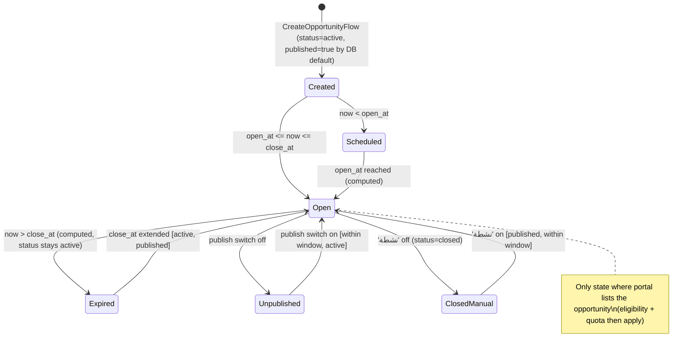
Actors: grants manager/admin (Inferred; no gating in code). Guards: none server-side (BR-PRG-13).

### 6.2 Opportunity creation & configuration
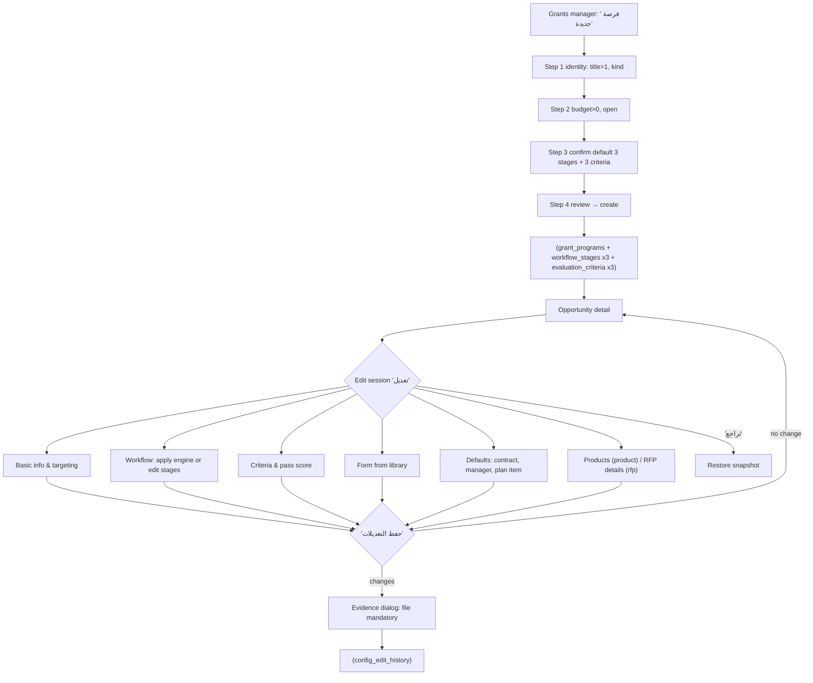

### 6.3 Workflow template (engine) → opportunity copy
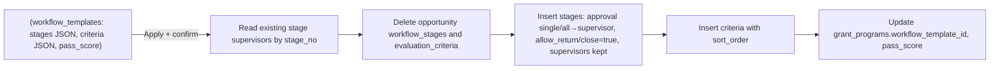
Copy semantics: no link back except `workflow_template_id` used for engine analytics (BR-PRG-19/20). Committee settings and other stage flags are not carried (ISS-PRG-10).

### 6.4 Eligibility decision (portal)
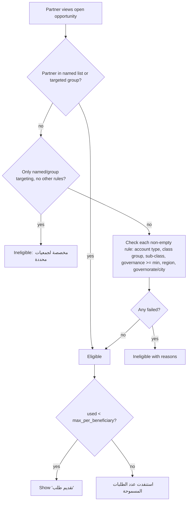

### 6.5 Product stock lifecycle
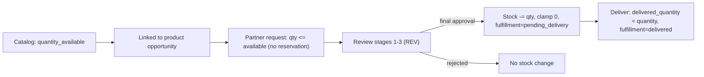

### 6.6 RFP: invitation → offers → award
```mermaid
stateDiagram-v2
    state "Invitation" as INV {
        [*] --> sent: 'إرسال الدعوات'
        sent --> opened: partner opens link
        opened --> applied: offer submitted
        sent --> applied: offer submitted
        opened --> declined: partner declines
        sent --> declined
    }
    state "Offer (application)" as OFF {
        [*] --> pending: submitted (offer <= budget)
        pending --> approved_awarded: 'ترسية' (grants manager)
        pending --> closed_not_awarded: another offer awarded (automatic apology)
        approved_awarded --> transferred: contract (if has_contract) + project + RFP activities/payments
    }
```
Guard: award only if no offer has `award_status='awarded'` and target offer `status='pending'` (RfpTabs.tsx:183). No evaluation or stage guard (ISS-PRG-04).

### 6.7 Configuration edit session
```mermaid
stateDiagram-v2
    [*] --> View
    View --> Editing: 'تعديل' (snapshot before)
    Editing --> Editing: changes written live
    Editing --> View: 'تراجع' (restore snapshot)
    Editing --> View: 'حفظ التعديلات' & no change
    Editing --> Evidence: 'حفظ التعديلات' & changed
    Evidence --> Editing: 'رجوع للتعديل'
    Evidence --> View: 'اعتماد وحفظ' (file uploaded, history logged)
```

## 7. Business Rules

| BR ID | Rule | Evidence label + reference |
|---|---|---|
| BR-PRG-01 | An opportunity has one kind: project (مشروع), product (منتجات) or rfp (مشروع مطروح). The kind is chosen at creation; no control exists to change it afterwards. | [Observed] components/CreateOpportunityFlow.tsx:15-19; lib/data.ts:218-222; programs.$id.tsx InfoTab (no kind field) |
| BR-PRG-02 | An opportunity is open for applications only when status='active' AND published=true AND now >= open_at (if set) AND now <= close_at (if set); otherwise it is shown as closed. | [Observed] lib/data.ts:403-409 isPeriodOpen; programs.index.tsx:114,125; portal.tsx:87 |
| BR-PRG-03 | Creating an opportunity requires a title longer than 1 character, a budget > 0, and both reception dates with close_at strictly after open_at. | [Observed] CreateOpportunityFlow.tsx:39,69,95,103 |
| BR-PRG-04 | New opportunities are created with status='active', target_types=[جمعية أهلية, مؤسسة أهلية], deadline = date part of close_at; DB defaults apply for published (true), max_per_beneficiary (1) and pass_score (80). | [Observed] CreateOpportunityFlow.tsx:45-49; migration 20261004093306:22-29 |
| BR-PRG-05 | Every new opportunity receives a default 3-stage workflow - (1) استقبال الطلبات 3 days, supervisor = first reviewer persona; (2) دراسة الطلبات 5 days, approval_type=criteria, supervisor = first reviewer; (3) اعتماد الطلبات 3 days, supervisor = first grants_manager - and 3 criteria: وضوح الأهداف 30%, الأثر المتوقع 40%, الجدوى المالية 30%. | [Observed] CreateOpportunityFlow.tsx:20-29,51-55 |
| BR-PRG-06 | General opportunity (open_track=true): not tied to one initiative - the applicant must select the annual-plan initiative when applying. Initiative-specific opportunity: the application inherits the opportunity's default plan level (default_plan_level_id). | [Observed] CreateOpportunityFlow.tsx:104-105; portal.tsx:265,300,307 |
| BR-PRG-07 | A partner named explicitly (target_beneficiary_ids) or belonging to a targeted partner group (target_group_ids) is always eligible, bypassing all other targeting rules. | [Observed] lib/eligibility.ts:31-35,40 |
| BR-PRG-08 | If an opportunity targets only named partners/groups and has no other targeting rule, every other partner is ineligible ('هذه الفرصة مخصصة لجمعيات محددة'). | [Observed] lib/eligibility.ts:42-46 |
| BR-PRG-09 | Other targeting rules are combined with AND; an empty list means 'all': account type, NCNP classification group, sub-classification, region, governorate (falls back to the partner's city), minimum governance score. | [Observed] lib/eligibility.ts:47-57; TargetingSection.tsx:64 |
| BR-PRG-10 | A partner without a governance score fails any minimum-governance rule (treated as -1). | [Observed] lib/eligibility.ts:52 |
| BR-PRG-11 | Partner-group membership is resolved at check time, so adding a partner to a targeted group makes it eligible/invitable immediately. | [Observed] lib/eligibility.ts:30-35 |
| BR-PRG-12 | A partner may hold at most max_per_beneficiary non-cancelled applications per opportunity. | [Observed] portal.tsx:162-163,171-174 |
| BR-PRG-13 | Eligibility, reception window and quota are evaluated in the partner portal UI only; no database constraint or server-side check enforces them. | [Inferred] portal.tsx:160-175; RLS 'poc_open_programs' migration 20261004085937:47 |
| BR-PRG-14 | Each stage has an approval type: supervisor (المشرفين), criteria (معايير التقييم) or committee (موافقة لجنة). A committee stage carries a committee name and a secretary; its applications go to the secretary's tasks and are approved with one minute document. | [Observed] programs.$id.tsx:201-227; lib/tasks.ts:102-107; routes/tasks.tsx:312 |
| BR-PRG-15 | Stage permission flags: allow_return (default true), allow_close (true), allow_skip (false), allow_edit (false), allow_request_edit (true), allow_attach (true). The review screen shows Return-for-edit, Reject, Skip and Return-to-previous according to these flags. | [Observed] migration 20261005090659:26-30; programs.$id.tsx:242-247; reviewer.$id.tsx:361-364 |
| BR-PRG-16 | Each stage has an SLA in days; an application is late when days since stage_entered_at exceed the stage's sla_days. | [Observed] lib/stageStats.ts:39; reviewer.$id.tsx:191-192 |
| BR-PRG-17 | Evaluation criteria weights are expected to total 100%; the total is shown green/red but saving is not blocked. | [Observed] programs.$id.tsx:365,379; EngineEditor.tsx:13,38 |
| BR-PRG-18 | Each opportunity has a pass score (%); an evaluation/offer at or above it is shown as passing. | [Observed] programs.$id.tsx:372,378; RfpTabs.tsx:178; programs.engines_.$id.tsx:78 |
| BR-PRG-19 | Applying an engine replaces all stages and criteria of the opportunity with copies from the engine: supervisors are kept per stage_no; engine approval types 'single'/'all' become 'supervisor'; allow_return/allow_close set true (other flags revert to DB defaults; committee name/secretary are lost); pass_score copied; workflow_template_id recorded. | [Observed] programs.$id.tsx:333-347 |
| BR-PRG-20 | Engines are copied, not referenced: later engine edits do not change opportunities that already applied the engine. | [Inferred] programs.$id.tsx:341-346; AGENTS.md ('workflow_templates are copied into stages/criteria') |
| BR-PRG-21 | An engine used by at least one opportunity cannot be deleted. | [Observed] programs.engines_.$id.tsx:64-68 |
| BR-PRG-22 | A new engine is created with pass score 70%, three standard stages (approval 'supervisor', SLA 5 days) and no criteria. | [Observed] programs.engines.tsx:43-49 |
| BR-PRG-23 | Products belong to the organization catalog (grant_products.tenant_id) and are made available to a product opportunity through program_products (unique per opportunity/product). | [Observed] programs.products.tsx:43-46; programs.$id.tsx:267-274; migration 20261005090659:1-17 |
| BR-PRG-24 | A partner cannot request more units of a product than its current quantity_available at submission time. | [Observed] portal.tsx:292,375 |
| BR-PRG-25 | Stock is deducted only at final approval (stage 3) of a product application, clamped at zero; the application then gets fulfillment_status='pending_delivery' (no contract/project). | [Observed] lib/workflow.ts:47-64 |
| BR-PRG-26 | Delivering a product application sets delivered_quantity equal to requested quantity for every item. | [Observed] lib/workflow.ts:208-213 |
| BR-PRG-27 | On transfer of an approved application: contract created only if has_contract (default true; hidden for product opportunities); project manager = default_manager_id, else first project_manager persona; plan level = application's plan level, else default_plan_level_id. | [Observed] programs.$id.tsx:314-321; lib/workflow.ts:141-151 |
| BR-PRG-28 | RFP details can be saved only if activity weights total 100% (when activities exist) and payment percentages total 100% (when payments exist). | [Observed] RfpTabs.tsx:32-36 |
| BR-PRG-29 | The RFP opportunity budget is the financial ceiling: an offer above it is rejected in the portal. | [Observed] RfpTabs.tsx:47; portal.tsx:295 |
| BR-PRG-30 | RFP award is possible only while no offer is awarded and only on a 'pending' offer. Award sets the winner approved/awarded, closes every other pending offer as not_awarded with an automatic apology reason, transfers the winner to contract+project, and copies RFP activities and payments (amount = % x winning amount; due date = award date + due_days). | [Observed] RfpTabs.tsx:149-159,183; lib/rfp.ts:54-73; lib/workflow.ts:196-201 |
| BR-PRG-31 | At most one invitation per opportunity and partner; invitations go only to named or group-targeted partners; email = partner email or invited email; status sent -> opened (first link open) -> applied (on submission) or declined. | [Observed] lib/rfp.ts:26-51; migration 20261006134413:11-24 |
| BR-PRG-32 | Configuration of opportunities, engines and the product catalog is done in an edit session: snapshot on entry, saving requires an evidence document (note optional), cancel restores the snapshot; each commit is logged with before/after in config_edit_history. | [Observed] components/EditSession.tsx:20-66,76-81; lib/configEdits.ts:12-27 |
| BR-PRG-33 | An opportunity uses at most one form from the organization form library (grant_programs.form_id); fields are edited only in the library (see module CFG). | [Observed] programs.$id.tsx:398-425; AGENTS.md |
| BR-PRG-34 | Stage statistics derive from application_status_history: 'submit' enters stage 1; approve_stage/skip leave to the next stage; return goes back one stage; close exits; durations are counted only for the stage the application was in. | [Observed] lib/stageStats.ts:6-31 |
| BR-PRG-35 | Opportunity status 'closed' is set only manually (switch 'نشطة'); reaching close_at does not change status - open/closed is computed per BR-PRG-02. | [Observed] programs.$id.tsx:177; lib/data.ts:403-409 |

## 8. Data Requirements

### 8.1 `grant_programs` (opportunity)
| Field | Type | Required | Meaning |
|---|---|---|---|
| id | uuid | PK | |
| tenant_id | uuid → tenants | Yes | Owning organization |
| kind | text ('project','product','rfp') | Yes (default 'project') | Opportunity type (BR-PRG-01) |
| title | text | Yes | عنوان الفرصة |
| description | text | No | الوصف |
| budget | numeric(14,2) | Yes (default 0) | Opportunity budget; RFP ceiling |
| eligibility | text | No | Free-text eligibility conditions (unused elsewhere) |
| deadline | date | No | Date part of close_at (legacy) |
| status | enum program_status ('active','closed') | Yes (default active) | Manual active/closed |
| announce_date | date | No | Announcement date (informational) |
| open_at / close_at | timestamptz | No (required by creation UI) | Reception window |
| published | boolean | Yes (default **true**) | Visible to partners |
| target_types | text[] | Yes (default '{}') | Allowed account types |
| max_per_beneficiary | int | Yes (default 1) | Quota per partner |
| pass_score | int | Yes (default 80) | Pass threshold % |
| form_id | uuid → application_forms (SET NULL) | No | Linked library form (CFG) |
| has_contract | boolean | Yes (default true) | Contract created on transfer |
| default_manager_id / default_contract_officer_id | uuid → personas (SET NULL) | No | Transfer defaults |
| default_plan_level_id | uuid → plan_levels (SET NULL) | No | Default annual-plan item (PLN) |
| workflow_template_id | uuid (no FK) | No | Last applied engine |
| target_class_groups, target_class_subs, target_regions, target_governorates | text[] | Yes (default '{}') | Targeting lists |
| min_governance | numeric | No | Minimum governance score |
| target_beneficiary_ids, target_group_ids | uuid[] | Yes (default '{}') | Named partners / partner groups |
| open_track | boolean | (types only; no migration) | General opportunity flag |
| rfp_scope, rfp_deliverables | text | No | RFP description |
| rfp_duration_days | int | No | RFP implementation duration |
| rfp_activities | jsonb [{title, weight, is_payment}] | Yes (default []) | RFP activities |
| rfp_payments | jsonb [{title, percent, due_days}] | Yes (default []) | RFP payment plan |
| created_at | timestamptz | Yes | |
Relationships: 1-N workflow_stages, evaluation_criteria, applications (CASCADE), program_products, program_invitations, form_fields (legacy). Lifecycle: see 6.1. RLS: open (POC).

### 8.2 `workflow_stages`
id; program_id → grant_programs (CASCADE); stage_no int (UNIQUE with program_id); name text; approval_type text ('supervisor','criteria','committee'; default supervisor); sla_days int (default 3); supervisor_ids uuid[]; allow_return, allow_close (default true); allow_skip, allow_edit (default false); allow_request_edit, allow_attach (default true); secretary_id → personas (SET NULL); committee_name text. [Observed] migrations 20261004093306:40-50, 20261004132647:34, 20261005090659:26-30.

### 8.3 `evaluation_criteria`
id; program_id → grant_programs (CASCADE); name text (required); weight int (default 25); sort_order int. Referenced indirectly by `evaluations.scores` (jsonb, REV).

### 8.4 `workflow_templates` (engine)
id; tenant_id → tenants; name (required); description; pass_score int (default 70); stages jsonb [{stage_no, name, approval_type ('single','all','supervisor','criteria','committee'), sla_days}]; criteria jsonb [{name, weight}]; created_at. Seeded: 'محرك المشاريع التنموية' (pass 75, committee at stage 3) and 'محرك المنتجات السريع' (pass 60).

### 8.5 `grant_products`
id; tenant_id → tenants (CASCADE); program_id (legacy, nullable); name (required); description; unit text (default 'وحدة'; UI list PRODUCT_UNITS); unit_price numeric (default 0); quantity_available int (default 0); created_at. Referenced by application_items.product_id **ON DELETE CASCADE**.

### 8.6 `program_products`
id; program_id → grant_programs (CASCADE); product_id → grant_products (CASCADE); created_at; UNIQUE(program_id, product_id).

### 8.7 `program_invitations`
id; program_id (CASCADE); beneficiary_id → beneficiaries (CASCADE); token text UNIQUE (random); email; status text ('sent','opened','applied','declined'; default sent); sent_by → personas; sent_at; opened_at; responded_at; created_at; UNIQUE(program_id, beneficiary_id).

### 8.8 Related (owned elsewhere)
- `applications` (REV/PTL): program_id, status ('pending','approved','closed','cancelled','awaiting_apology'), current_stage, stage_entered_at, requested_amount, plan_level_id, technical_offer, award_status ('awarded','not_awarded'), fulfillment_status ('none','pending_delivery','delivered'), close_reason.
- `application_items` (PTL/REV): application_id, product_id, quantity, delivered_quantity.
- `application_status_history` (REV): application_id, stage, action ('submit','approve_stage','skip','return','close','award','transfer',…), created_at — source for stage stats.
- `evaluations` (REV): application_id, reviewer_id, scores, total.
- `config_edit_history`: tenant_id, entity_type ('program','engine','product_catalog'), entity_id, target name, before, after, note, evidence_name, evidence_path, actor_id, created_at.

## 9. Product Structure

- **EP-PRG-01 — Opportunity Lifecycle Management**: Create, list, publish, open/close and maintain grant opportunities (project, product, RFP), including general vs initiative-specific opportunities.
  - FT-PRG-01 — Opportunity List & Portfolio KPIs (Must)
  - FT-PRG-02 — Guided Opportunity Creation (Must)
  - FT-PRG-03 — Opportunity Basic Info, Publication & Reception Window (Must)
  - FT-PRG-04 — General vs Initiative-Specific Opportunity (Should)
- **EP-PRG-02 — Eligibility & Targeting**: Define who may apply to an opportunity (classification, region, governance, named partners/groups, account types, quota) and evaluate partner eligibility.
  - FT-PRG-05 — Eligibility Targeting & Quota (Must)
- **EP-PRG-03 — Opportunity Workflow & Evaluation Configuration**: Per-opportunity stages, approval types, committee, SLA, supervisors, permissions, criteria, pass score, form and post-approval defaults.
  - FT-PRG-06 — Stage Configuration (Must)
  - FT-PRG-07 — Evaluation Criteria & Pass Score (Must)
  - FT-PRG-08 — Application Form Assignment (Must)
  - FT-PRG-09 — Post-Approval Defaults (Must)
- **EP-PRG-04 — Workflow Engine Library**: Reusable workflow templates copied into opportunities, with engine-level performance analytics.
  - FT-PRG-10 — Workflow Engine Library & Editor (Should)
  - FT-PRG-11 — Apply Engine to Opportunity (Should)
  - FT-PRG-12 — Engine Performance Analytics (Could)
- **EP-PRG-05 — Product Grants & Catalog**: Organization product catalog, stock control, linking products to product opportunities, and product movement analytics.
  - FT-PRG-13 — Product Catalog & Stock (Must)
  - FT-PRG-14 — Opportunity Product Linking (Must)
  - FT-PRG-15 — Product Movement Analytics (Could)
- **EP-PRG-06 — RFP (Tendered Projects) & Invitations**: Donor-defined projects, private invitations to partners, offer comparison and award to a single offer.
  - FT-PRG-16 — Targeted Invitations (Should)
  - FT-PRG-17 — RFP Project Definition (Should)
  - FT-PRG-18 — Offer Comparison & Award (Should)
- **EP-PRG-07 — Configuration Governance & Performance Insight**: Evidence-backed edit sessions with rollback/history, and opportunity summary/stage statistics.
  - FT-PRG-19 — Evidence-Backed Configuration Edit Sessions (Should)
  - FT-PRG-20 — Opportunity Summary & Stage Statistics (Should)

## 10. Features

### FT-PRG-01 — Opportunity List & Portfolio KPIs
- **Feature ID:** FT-PRG-01 (Epic EP-PRG-01)
- **Name:** Opportunity List & Portfolio KPIs
- **Description:** List of all grant opportunities with reception status, publication and KPIs.
- **Business Objective:** Give grants staff a single view of all opportunities and their status. [Inferred]
- **Expected Business Value:** [To Confirm]
- **Primary User Roles:** grants_manager, admin, ceo, reviewer, committee_secretary
- **Scope:** List, KPIs, open/closed computation, publish toggle, navigation.
- **Out of Scope:** Filtering/sorting/search on the list (not in prototype); portal listing (PTL).
- **Functional Requirements:** FR-PRG-001, FR-PRG-002, FR-PRG-003, FR-PRG-004
- **User Stories:** US-PRG-001, US-PRG-002
- **Business Rules:** BR-PRG-02, BR-PRG-35
- **Dependencies:** lib/queries.ts usePrograms/useApplications
- **Related Screens:** SCR-PRG-01
- **Acceptance Criteria:**
  - All opportunities are listed with correct open/closed status.
  - Publish switch persists and affects portal visibility.
- **Open Questions:** OQ-PRG-01, OQ-PRG-02
- **Assumptions:** List is not tenant-filtered in prototype; production lists only the current organization's opportunities.
- **Priority Recommendation (MoSCoW):** Must

### FT-PRG-02 — Guided Opportunity Creation
- **Feature ID:** FT-PRG-02 (Epic EP-PRG-01)
- **Name:** Guided Opportunity Creation
- **Description:** Four-step wizard (with optional AI assist) that creates an opportunity with a default workflow and criteria.
- **Business Objective:** Make opportunity setup fast and consistent. [Inferred]
- **Expected Business Value:** [To Confirm]
- **Primary User Roles:** grants_manager, admin
- **Scope:** Wizard steps, validation, AI proposal, default stages/criteria, navigation to detail.
- **Out of Scope:** Choosing an engine during creation (done after, in Workflow tab); targeting at creation.
- **Functional Requirements:** FR-PRG-005, FR-PRG-006, FR-PRG-007, FR-PRG-008, FR-PRG-009
- **User Stories:** US-PRG-003, US-PRG-004
- **Business Rules:** BR-PRG-01, BR-PRG-03, BR-PRG-04, BR-PRG-05
- **Dependencies:** SmartFlow; AiAssist (PLT)
- **Related Screens:** SCR-PRG-02
- **Acceptance Criteria:**
  - An opportunity cannot be created without valid title, budget and window.
  - Created opportunity has default stages and criteria.
- **Open Questions:** OQ-PRG-02, OQ-PRG-03
- **Assumptions:** Default supervisors = first reviewer / grants manager persona is a demo convenience.
- **Priority Recommendation (MoSCoW):** Must

### FT-PRG-03 — Opportunity Basic Info, Publication & Reception Window
- **Feature ID:** FT-PRG-03 (Epic EP-PRG-01)
- **Name:** Opportunity Basic Info, Publication & Reception Window
- **Description:** Detail page shell and Basic Info tab to maintain identity, budget, quota, dates, publication and active status.
- **Business Objective:** Control when and to whom an opportunity is open. [Inferred]
- **Expected Business Value:** [To Confirm]
- **Primary User Roles:** grants_manager, admin
- **Scope:** Tabbed detail; edit and save basic info; manual close/reactivate.
- **Out of Scope:** Automatic closing; budget binding to plan (PLN).
- **Functional Requirements:** FR-PRG-010, FR-PRG-011, FR-PRG-012, FR-PRG-013
- **User Stories:** US-PRG-005, US-PRG-006
- **Business Rules:** BR-PRG-02, BR-PRG-12, BR-PRG-35
- **Dependencies:** FT-PRG-19 edit session
- **Related Screens:** SCR-PRG-03, SCR-PRG-04
- **Acceptance Criteria:**
  - Saved values persist and drive portal visibility.
  - Closing via 'نشطة' removes the opportunity from the portal open list.
- **Open Questions:** OQ-PRG-08, OQ-PRG-09, OQ-PRG-15
- **Assumptions:** announce_date is informational only.
- **Priority Recommendation (MoSCoW):** Must

### FT-PRG-04 — General vs Initiative-Specific Opportunity
- **Feature ID:** FT-PRG-04 (Epic EP-PRG-01)
- **Name:** General vs Initiative-Specific Opportunity
- **Description:** Flag an opportunity as general so the applicant chooses the annual-plan initiative; otherwise the opportunity's default plan item applies.
- **Business Objective:** Correctly attribute applications/projects to annual-plan initiatives. [Inferred]
- **Expected Business Value:** [To Confirm]
- **Primary User Roles:** grants_manager, admin, applicant
- **Scope:** Flag at creation; portal initiative selection; default plan level inheritance.
- **Out of Scope:** Restricting selectable initiatives.
- **Functional Requirements:** FR-PRG-014, FR-PRG-015, FR-PRG-016
- **User Stories:** US-PRG-007
- **Business Rules:** BR-PRG-06, BR-PRG-27
- **Dependencies:** PLN initiatives; PTL portal
- **Related Screens:** SCR-PRG-02, SCR-PRG-08
- **Acceptance Criteria:**
  - A general opportunity forces initiative selection at application.
  - A specific opportunity's applications carry its default plan level.
- **Open Questions:** OQ-PRG-03, OQ-PRG-14
- **Assumptions:** open_track exists in the database although not in migrations.
- **Priority Recommendation (MoSCoW):** Should

### FT-PRG-05 — Eligibility Targeting & Quota
- **Feature ID:** FT-PRG-05 (Epic EP-PRG-02)
- **Name:** Eligibility Targeting & Quota
- **Description:** Targeting rules, eligibility evaluation and per-partner application quota.
- **Business Objective:** Ensure only intended partners apply. [Inferred]
- **Expected Business Value:** [To Confirm]
- **Primary User Roles:** grants_manager, admin, applicant
- **Scope:** Targeting UI, eligibility engine, portal display of reasons and quota, targeted badge.
- **Out of Scope:** Review-time re-check (not observed).
- **Functional Requirements:** FR-PRG-017, FR-PRG-018, FR-PRG-019, FR-PRG-020, FR-PRG-021
- **User Stories:** US-PRG-008, US-PRG-009, US-PRG-010
- **Business Rules:** BR-PRG-07, BR-PRG-08, BR-PRG-09, BR-PRG-10, BR-PRG-11, BR-PRG-12, BR-PRG-13
- **Dependencies:** BEN partner data & groups; PTL portal
- **Related Screens:** SCR-PRG-04
- **Acceptance Criteria:**
  - Ineligible partners see reasons and cannot apply.
  - Named/group partners are always eligible.
- **Open Questions:** OQ-PRG-07, OQ-PRG-13
- **Assumptions:** Partner classification, governance score, region and governorate are maintained in BEN.
- **Priority Recommendation (MoSCoW):** Must

### FT-PRG-06 — Stage Configuration
- **Feature ID:** FT-PRG-06 (Epic EP-PRG-03)
- **Name:** Stage Configuration
- **Description:** Per-opportunity stage settings: approval type, committee, SLA, supervisors, permission flags.
- **Business Objective:** Route applications to the right people within agreed SLAs. [Inferred]
- **Expected Business Value:** [To Confirm]
- **Primary User Roles:** grants_manager, admin
- **Scope:** Edit existing stages and committee details.
- **Out of Scope:** Adding/removing/renaming stages.
- **Functional Requirements:** FR-PRG-022, FR-PRG-023, FR-PRG-024, FR-PRG-025
- **User Stories:** US-PRG-011, US-PRG-012
- **Business Rules:** BR-PRG-14, BR-PRG-15, BR-PRG-16
- **Dependencies:** REV workflow.ts; TSK tasks.ts
- **Related Screens:** SCR-PRG-05
- **Acceptance Criteria:**
  - Stage settings drive the review actions and tasks.
  - Committee stages route to the secretary.
- **Open Questions:** OQ-PRG-05
- **Assumptions:** Exactly three stages per opportunity.
- **Priority Recommendation (MoSCoW):** Must

### FT-PRG-07 — Evaluation Criteria & Pass Score
- **Feature ID:** FT-PRG-07 (Epic EP-PRG-03)
- **Name:** Evaluation Criteria & Pass Score
- **Description:** Weighted criteria and pass score used by reviewers.
- **Business Objective:** Consistent, weighted scoring of applications. [Inferred]
- **Expected Business Value:** [To Confirm]
- **Primary User Roles:** grants_manager, admin
- **Scope:** Add/delete criteria, total indicator, pass score.
- **Out of Scope:** Editing/reordering criteria; criterion descriptions; mandatory criteria flags (AI, REV).
- **Functional Requirements:** FR-PRG-026, FR-PRG-027, FR-PRG-028
- **User Stories:** US-PRG-013
- **Business Rules:** BR-PRG-17, BR-PRG-18
- **Dependencies:** REV evaluation
- **Related Screens:** SCR-PRG-06
- **Acceptance Criteria:**
  - Criteria and pass score are saved and used in evaluation.
  - Weight total is visibly flagged when not 100%.
- **Open Questions:** OQ-PRG-05
- **Assumptions:** Weights are integers in %.
- **Priority Recommendation (MoSCoW):** Must

### FT-PRG-08 — Application Form Assignment
- **Feature ID:** FT-PRG-08 (Epic EP-PRG-03)
- **Name:** Application Form Assignment
- **Description:** Choose an application form from the organization library for the opportunity.
- **Business Objective:** Reuse one form across periods. [Inferred]
- **Expected Business Value:** [To Confirm]
- **Primary User Roles:** grants_manager, admin
- **Scope:** Select form, preview fields.
- **Out of Scope:** Editing form fields (CFG).
- **Functional Requirements:** FR-PRG-029
- **User Stories:** US-PRG-014
- **Business Rules:** BR-PRG-33
- **Dependencies:** CFG form library
- **Related Screens:** SCR-PRG-07
- **Acceptance Criteria:**
  - The selected form's fields appear in the portal application dialog.
- **Open Questions:** None
- **Assumptions:** Legacy program-level fields remain a fallback (AGENTS.md).
- **Priority Recommendation (MoSCoW):** Must

### FT-PRG-09 — Post-Approval Defaults
- **Feature ID:** FT-PRG-09 (Epic EP-PRG-03)
- **Name:** Post-Approval Defaults
- **Description:** Defaults used when transferring approved applications to contracts/projects.
- **Business Objective:** Reduce manual setup after approval. [Inferred]
- **Expected Business Value:** [To Confirm]
- **Primary User Roles:** grants_manager, admin
- **Scope:** Contract required, default manager, contract officer, default plan item.
- **Out of Scope:** Contract drafting (PRJ).
- **Functional Requirements:** FR-PRG-030, FR-PRG-031
- **User Stories:** US-PRG-015
- **Business Rules:** BR-PRG-27
- **Dependencies:** PRJ transferApplication; PLN plan levels
- **Related Screens:** SCR-PRG-08
- **Acceptance Criteria:**
  - Transfer applies the configured defaults.
- **Open Questions:** OQ-PRG-08
- **Assumptions:** Contract officer default is informational in the prototype.
- **Priority Recommendation (MoSCoW):** Must

### FT-PRG-10 — Workflow Engine Library & Editor
- **Feature ID:** FT-PRG-10 (Epic EP-PRG-04)
- **Name:** Workflow Engine Library & Editor
- **Description:** Organization library of reusable workflow templates with a basic editor.
- **Business Objective:** Design a workflow once and reuse it. [Inferred]
- **Expected Business Value:** [To Confirm]
- **Primary User Roles:** grants_manager, admin
- **Scope:** List, create, rename, edit SLA and criteria, delete unused.
- **Out of Scope:** Stage structure editing, versioning.
- **Functional Requirements:** FR-PRG-032, FR-PRG-033, FR-PRG-034, FR-PRG-035, FR-PRG-036
- **User Stories:** US-PRG-016, US-PRG-017
- **Business Rules:** BR-PRG-20, BR-PRG-21, BR-PRG-22
- **Dependencies:** FT-PRG-19 edit session
- **Related Screens:** SCR-PRG-13, SCR-PRG-14
- **Acceptance Criteria:**
  - Engines can be created and edited; used engines cannot be deleted.
- **Open Questions:** OQ-PRG-04, OQ-PRG-12
- **Assumptions:** Engines are tenant-scoped.
- **Priority Recommendation (MoSCoW):** Should

### FT-PRG-11 — Apply Engine to Opportunity
- **Feature ID:** FT-PRG-11 (Epic EP-PRG-04)
- **Name:** Apply Engine to Opportunity
- **Description:** Copy an engine's stages, criteria and pass score into an opportunity.
- **Business Objective:** Standardise opportunity workflows. [Inferred]
- **Expected Business Value:** [To Confirm]
- **Primary User Roles:** grants_manager, admin
- **Scope:** Engine selection, confirmation, copy semantics.
- **Out of Scope:** Live linkage to engine.
- **Functional Requirements:** FR-PRG-037, FR-PRG-038
- **User Stories:** US-PRG-018
- **Business Rules:** BR-PRG-19, BR-PRG-20
- **Dependencies:** FT-PRG-10
- **Related Screens:** SCR-PRG-05
- **Acceptance Criteria:**
  - After applying, opportunity configuration matches the engine.
- **Open Questions:** OQ-PRG-05
- **Assumptions:** None beyond section 14.
- **Priority Recommendation (MoSCoW):** Should

### FT-PRG-12 — Engine Performance Analytics
- **Feature ID:** FT-PRG-12 (Epic EP-PRG-04)
- **Name:** Engine Performance Analytics
- **Description:** Usage and per-stage performance of an engine across opportunities.
- **Business Objective:** Identify bottlenecks and SLA breaches. [Inferred]
- **Expected Business Value:** [To Confirm]
- **Primary User Roles:** grants_manager, admin, ceo
- **Scope:** KPIs, stage table, criteria, using opportunities.
- **Out of Scope:** Export; date filters.
- **Functional Requirements:** FR-PRG-039, FR-PRG-040, FR-PRG-041
- **User Stories:** US-PRG-019
- **Business Rules:** BR-PRG-16, BR-PRG-34
- **Dependencies:** application_status_history (REV)
- **Related Screens:** SCR-PRG-14
- **Acceptance Criteria:**
  - Stage metrics match status history.
- **Open Questions:** OQ-PRG-16
- **Assumptions:** None beyond section 14.
- **Priority Recommendation (MoSCoW):** Could

### FT-PRG-13 — Product Catalog & Stock
- **Feature ID:** FT-PRG-13 (Epic EP-PRG-05)
- **Name:** Product Catalog & Stock
- **Description:** Organization catalog of in-kind products with price, unit and stock, and stock movements on approval/delivery.
- **Business Objective:** Manage in-kind grants and stock. [Inferred]
- **Expected Business Value:** [To Confirm]
- **Primary User Roles:** grants_manager, admin
- **Scope:** Catalog CRUD in edit mode; stock checks/deduction.
- **Out of Scope:** Procurement, warehouses, partial delivery.
- **Functional Requirements:** FR-PRG-042, FR-PRG-043, FR-PRG-044, FR-PRG-045, FR-PRG-046
- **User Stories:** US-PRG-020, US-PRG-021
- **Business Rules:** BR-PRG-23, BR-PRG-24, BR-PRG-25, BR-PRG-26
- **Dependencies:** REV approval/delivery; PTL submission
- **Related Screens:** SCR-PRG-15
- **Acceptance Criteria:**
  - Stock decreases on final approval.
  - Requests above stock are rejected at submission.
- **Open Questions:** OQ-PRG-06
- **Assumptions:** None beyond section 14.
- **Priority Recommendation (MoSCoW):** Must

### FT-PRG-14 — Opportunity Product Linking
- **Feature ID:** FT-PRG-14 (Epic EP-PRG-05)
- **Name:** Opportunity Product Linking
- **Description:** Choose which catalog products a product opportunity offers.
- **Business Objective:** Offer the right products per opportunity. [Inferred]
- **Expected Business Value:** [To Confirm]
- **Primary User Roles:** grants_manager, admin
- **Scope:** Link/unlink products.
- **Out of Scope:** Per-opportunity quotas per product.
- **Functional Requirements:** FR-PRG-047
- **User Stories:** US-PRG-022
- **Business Rules:** BR-PRG-23
- **Dependencies:** FT-PRG-13
- **Related Screens:** SCR-PRG-09
- **Acceptance Criteria:**
  - Only linked products are requestable in the portal.
- **Open Questions:** None
- **Assumptions:** None beyond section 14.
- **Priority Recommendation (MoSCoW):** Must

### FT-PRG-15 — Product Movement Analytics
- **Feature ID:** FT-PRG-15 (Epic EP-PRG-05)
- **Name:** Product Movement Analytics
- **Description:** Historical movement of a product by month, opportunity and region.
- **Business Objective:** Plan stock and evaluate demand. [Inferred]
- **Expected Business Value:** [To Confirm]
- **Primary User Roles:** grants_manager, admin, ceo, finance
- **Scope:** KPIs, monthly chart, comparisons, application list.
- **Out of Scope:** Forecasting.
- **Functional Requirements:** FR-PRG-048, FR-PRG-049
- **User Stories:** US-PRG-023
- **Business Rules:** BR-PRG-25, BR-PRG-26
- **Dependencies:** application_items
- **Related Screens:** SCR-PRG-16
- **Acceptance Criteria:**
  - Figures reconcile with application items.
- **Open Questions:** OQ-PRG-16
- **Assumptions:** None beyond section 14.
- **Priority Recommendation (MoSCoW):** Could

### FT-PRG-16 — Targeted Invitations
- **Feature ID:** FT-PRG-16 (Epic EP-PRG-06)
- **Name:** Targeted Invitations
- **Description:** Private invitations to named/group-targeted partners with status tracking.
- **Business Objective:** Bring specific partners to an opportunity (notably RFP). [Inferred]
- **Expected Business Value:** [To Confirm]
- **Primary User Roles:** grants_manager, admin, applicant
- **Scope:** Send, list, copy/open link, status tracking.
- **Out of Scope:** Email delivery (not in prototype); invite page (PTL).
- **Functional Requirements:** FR-PRG-050, FR-PRG-051, FR-PRG-052, FR-PRG-053
- **User Stories:** US-PRG-024, US-PRG-025
- **Business Rules:** BR-PRG-11, BR-PRG-31
- **Dependencies:** FT-PRG-05 targeting; PTL invite page
- **Related Screens:** SCR-PRG-10
- **Acceptance Criteria:**
  - Each targeted partner receives exactly one invitation.
  - Status reflects partner response.
- **Open Questions:** OQ-PRG-11
- **Assumptions:** None beyond section 14.
- **Priority Recommendation (MoSCoW):** Should

### FT-PRG-17 — RFP Project Definition
- **Feature ID:** FT-PRG-17 (Epic EP-PRG-06)
- **Name:** RFP Project Definition
- **Description:** Donor-defined project specification for RFP opportunities.
- **Business Objective:** Let partners bid on a defined scope. [Inferred]
- **Expected Business Value:** [To Confirm]
- **Primary User Roles:** grants_manager, admin
- **Scope:** Scope, deliverables, duration, activities, payments, ceiling.
- **Out of Scope:** Technical evaluation templates.
- **Functional Requirements:** FR-PRG-054, FR-PRG-055
- **User Stories:** US-PRG-026
- **Business Rules:** BR-PRG-28, BR-PRG-29
- **Dependencies:** PTL offer submission
- **Related Screens:** SCR-PRG-11
- **Acceptance Criteria:**
  - Totals validated; ceiling enforced.
- **Open Questions:** OQ-PRG-10
- **Assumptions:** None beyond section 14.
- **Priority Recommendation (MoSCoW):** Should

### FT-PRG-18 — Offer Comparison & Award
- **Feature ID:** FT-PRG-18 (Epic EP-PRG-06)
- **Name:** Offer Comparison & Award
- **Description:** Compare RFP offers and award one, creating contract/project automatically.
- **Business Objective:** Select the best partner transparently. [Inferred]
- **Expected Business Value:** [To Confirm]
- **Primary User Roles:** grants_manager, admin
- **Scope:** Offer cards, award action, automatic apology, project seeding.
- **Out of Scope:** Multi-winner awards; negotiation.
- **Functional Requirements:** FR-PRG-056, FR-PRG-057, FR-PRG-058
- **User Stories:** US-PRG-027, US-PRG-028
- **Business Rules:** BR-PRG-18, BR-PRG-30
- **Dependencies:** REV evaluations; PRJ transfer
- **Related Screens:** SCR-PRG-12
- **Acceptance Criteria:**
  - Exactly one offer can be awarded.
  - Losing offers are closed with an apology.
- **Open Questions:** OQ-PRG-01, OQ-PRG-10
- **Assumptions:** None beyond section 14.
- **Priority Recommendation (MoSCoW):** Should

### FT-PRG-19 — Evidence-Backed Configuration Edit Sessions
- **Feature ID:** FT-PRG-19 (Epic EP-PRG-07)
- **Name:** Evidence-Backed Configuration Edit Sessions
- **Description:** View-by-default editing of opportunities, engines and product catalog with mandatory evidence, rollback and history.
- **Business Objective:** Auditability of configuration changes. [Inferred]
- **Expected Business Value:** [To Confirm]
- **Primary User Roles:** grants_manager, admin
- **Scope:** Edit/cancel/save, evidence upload, history.
- **Out of Scope:** Approval workflow for configuration changes.
- **Functional Requirements:** FR-PRG-059, FR-PRG-060, FR-PRG-061, FR-PRG-062
- **User Stories:** US-PRG-029, US-PRG-030
- **Business Rules:** BR-PRG-32
- **Dependencies:** attachments storage; DocAiCheck
- **Related Screens:** SCR-PRG-17, SCR-PRG-03, SCR-PRG-14, SCR-PRG-15
- **Acceptance Criteria:**
  - No configuration change is committed without evidence.
  - Cancel restores the previous configuration.
- **Open Questions:** OQ-PRG-01
- **Assumptions:** None beyond section 14.
- **Priority Recommendation (MoSCoW):** Should

### FT-PRG-20 — Opportunity Summary & Stage Statistics
- **Feature ID:** FT-PRG-20 (Epic EP-PRG-07)
- **Name:** Opportunity Summary & Stage Statistics
- **Description:** Opportunity-level performance dashboard.
- **Business Objective:** Monitor demand and processing of an opportunity. [Inferred]
- **Expected Business Value:** [To Confirm]
- **Primary User Roles:** grants_manager, admin, ceo
- **Scope:** KPIs, stage stats, top partners/regions, product movement.
- **Out of Scope:** Cross-opportunity analytics (FIN/analytics).
- **Functional Requirements:** FR-PRG-063, FR-PRG-064, FR-PRG-065
- **User Stories:** US-PRG-031
- **Business Rules:** BR-PRG-16, BR-PRG-34
- **Dependencies:** application_status_history
- **Related Screens:** SCR-PRG-03
- **Acceptance Criteria:**
  - Summary figures reconcile with applications.
- **Open Questions:** OQ-PRG-16
- **Assumptions:** None beyond section 14.
- **Priority Recommendation (MoSCoW):** Should

## 11. Functional Requirements

### FR-PRG-001
- **Statement:** The system shall list all grant opportunities with title, kind badge, targeted badge, reception window, budget, reception status, publish switch, application count and a view action.
- **Description:** Table on the opportunities page. Kind badge from PROGRAM_KIND_LABELS; 'مستهدفة' badge when targeting exists; window shown as open -> close date.
- **Type:** UI
- **Source / Prototype reference:** programs.index.tsx:99-138
- **Related Feature:** FT-PRG-01
- **Related Story:** US-PRG-001
- **Priority:** Must
- **Dependencies:** usePrograms, useApplications (lib/queries.ts)
- **Acceptance Criteria:**
  - Each opportunity row shows the 8 columns described.
  - Clicking the eye icon opens /programs/$id.
- **Validation Rules:** None specific beyond the referenced business rules.
- **Exceptions & Alternative Flows:** Database error: toast with the error message; no change applied.
- **Open Questions:** -
- **Evidence:** [Observed]

### FR-PRG-002
- **Statement:** The system shall display KPI cards: number of opportunities, total applications and total budgets.
- **Description:** Totals computed client-side over loaded opportunities/applications.
- **Type:** Reporting
- **Source / Prototype reference:** programs.index.tsx:94-98
- **Related Feature:** FT-PRG-01
- **Related Story:** US-PRG-001
- **Priority:** Should
- **Dependencies:** -
- **Acceptance Criteria:**
  - KPI 'إجمالي المنح (الميزانيات)' equals the sum of opportunity budgets in SAR format.
- **Validation Rules:** None specific beyond the referenced business rules.
- **Exceptions & Alternative Flows:** Empty data: KPIs show 0.
- **Open Questions:** -
- **Evidence:** [Observed]

### FR-PRG-003
- **Statement:** The system shall compute each opportunity's reception status as open ('مفتوحة') or closed ('مغلقة') per BR-PRG-02.
- **Description:** Computed at render time; not stored.
- **Type:** Functional
- **Source / Prototype reference:** programs.index.tsx:114,125; lib/data.ts:403-409
- **Related Feature:** FT-PRG-01
- **Related Story:** US-PRG-001
- **Priority:** Must
- **Dependencies:** -
- **Acceptance Criteria:**
  - An active, published opportunity within its window shows 'مفتوحة'.
  - An unpublished or closed-status or out-of-window opportunity shows 'مغلقة'.
- **Validation Rules:** None specific beyond the referenced business rules.
- **Exceptions & Alternative Flows:** Database error: toast with the error message; no change applied.
- **Open Questions:** -
- **Evidence:** [Observed]

### FR-PRG-004
- **Statement:** The system shall allow authorised staff to publish or unpublish an opportunity from the list.
- **Description:** Switch writes grant_programs.published immediately (outside the edit session).
- **Type:** Functional
- **Source / Prototype reference:** programs.index.tsx:54-57,126
- **Related Feature:** FT-PRG-01
- **Related Story:** US-PRG-002
- **Priority:** Must
- **Dependencies:** -
- **Acceptance Criteria:**
  - Toggling the switch persists 'published' and the reception status updates.
  - Unpublished opportunities disappear from the partner portal's open list.
- **Validation Rules:** None specific beyond the referenced business rules.
- **Exceptions & Alternative Flows:** Database error: toast with the error message; no change applied.
- **Open Questions:** OQ-PRG-01, OQ-PRG-02
- **Evidence:** [Observed]

### FR-PRG-005
- **Statement:** The system shall provide a four-step guided creation flow: identity (title, kind, description), dates & budget (+general flag), default workflow preview, review & create.
- **Description:** SmartFlow dialog with Back/Next; final 'إنشاء الفرصة'.
- **Type:** UI
- **Source / Prototype reference:** CreateOpportunityFlow.tsx:65-139
- **Related Feature:** FT-PRG-02
- **Related Story:** US-PRG-003
- **Priority:** Must
- **Dependencies:** -
- **Acceptance Criteria:**
  - The flow shows four steps in order with a Back button from step 2.
  - The review step lists title, kind, budget, window, general flag and stage/criteria counts.
- **Validation Rules:** None specific beyond the referenced business rules.
- **Exceptions & Alternative Flows:** Database error: toast with the error message; no change applied.
- **Open Questions:** -
- **Evidence:** [Observed]

### FR-PRG-006
- **Statement:** The system shall prevent progressing past a step until it is valid per BR-PRG-03.
- **Description:** Next disabled; inline message when close is not after open.
- **Type:** Functional
- **Source / Prototype reference:** CreateOpportunityFlow.tsx:39,69,95,103
- **Related Feature:** FT-PRG-02
- **Related Story:** US-PRG-003
- **Priority:** Must
- **Dependencies:** -
- **Acceptance Criteria:**
  - With a 1-character title, Next is disabled.
  - With close_at <= open_at, the message 'نهاية الاستقبال يجب أن تكون بعد البداية' appears and Next is disabled.
- **Validation Rules:** title.trim().length > 1; budget > 0; open_at and close_at present; close_at > open_at.
- **Exceptions & Alternative Flows:** Database error: toast with the error message; no change applied.
- **Open Questions:** -
- **Evidence:** [Observed]

### FR-PRG-007
- **Statement:** The system shall let the user describe the opportunity in free text and receive AI-proposed values for title, kind, description, budget and dates, applied only on user confirmation.
- **Description:** AiAssist component (see module PLT for AI infrastructure). Proposed datetimes trimmed to minutes.
- **Type:** AI
- **Source / Prototype reference:** CreateOpportunityFlow.tsx:72-78
- **Related Feature:** FT-PRG-02
- **Related Story:** US-PRG-004
- **Priority:** Could
- **Dependencies:** AiAssist (PLT)
- **Acceptance Criteria:**
  - Applying the AI proposal fills only the fields returned.
  - Nothing is saved until the user completes the flow.
- **Validation Rules:** None specific beyond the referenced business rules.
- **Exceptions & Alternative Flows:** AI failure: user continues manually.
- **Open Questions:** -
- **Evidence:** [Observed]

### FR-PRG-008
- **Statement:** On completion the system shall create the opportunity with defaults (BR-PRG-04), the default 3-stage workflow and 3 criteria (BR-PRG-05), then open the opportunity detail.
- **Description:** Sequential inserts into grant_programs, workflow_stages, evaluation_criteria.
- **Type:** Data
- **Source / Prototype reference:** CreateOpportunityFlow.tsx:43-61
- **Related Feature:** FT-PRG-02
- **Related Story:** US-PRG-003
- **Priority:** Must
- **Dependencies:** -
- **Acceptance Criteria:**
  - After creation the opportunity has 3 stages and 3 criteria totalling 100%.
  - The user lands on /programs/<new id> with toast 'أُنشئت الفرصة'.
- **Validation Rules:** None specific beyond the referenced business rules.
- **Exceptions & Alternative Flows:** Insert error on opportunity: toast, flow stays open. Errors on stage/criteria inserts are not checked (see ISS-PRG-24 pattern).
- **Open Questions:** -
- **Evidence:** [Observed]

### FR-PRG-009
- **Statement:** The system shall create new opportunities as unpublished drafts and require an explicit publish action.
- **Description:** Recommended to fix ISS-PRG-01.
- **Type:** Functional
- **Source / Prototype reference:** Recommendation (ISS-PRG-01)
- **Related Feature:** FT-PRG-02
- **Related Story:** US-PRG-003
- **Priority:** Should
- **Dependencies:** -
- **Acceptance Criteria:**
  - A newly created opportunity is not visible in the partner portal until published.
- **Validation Rules:** None specific beyond the referenced business rules.
- **Exceptions & Alternative Flows:** Database error: toast with the error message; no change applied.
- **Open Questions:** OQ-PRG-02
- **Evidence:** [Recommended]

### FR-PRG-010
- **Statement:** The system shall present an opportunity detail page with tabs: Summary, Basic Info, Products (product only), Project Details and Offers (RFP only), Invitations, Defaults, Workflow, Criteria, Form, plus configuration history.
- **Description:** Summary, Invitations and Offers are outside the editable fieldset; other tabs are editable only in edit mode.
- **Type:** UI
- **Source / Prototype reference:** programs.$id.tsx:93-128
- **Related Feature:** FT-PRG-03
- **Related Story:** US-PRG-005
- **Priority:** Must
- **Dependencies:** -
- **Acceptance Criteria:**
  - A product opportunity shows the 'المنتجات' tab and no RFP tabs.
  - An RFP opportunity shows 'تفاصيل المشروع' and 'العروض والترسية'.
- **Validation Rules:** None specific beyond the referenced business rules.
- **Exceptions & Alternative Flows:** Loading: skeleton. Opportunity not found: not handled explicitly.
- **Open Questions:** -
- **Evidence:** [Observed]

### FR-PRG-011
- **Statement:** The system shall allow editing basic information: title, description, budget, max applications per partner, announcement date, reception start/end (date-time), target account types, eligibility text, published and active flags; deadline is derived from close_at.
- **Description:** Single save button writes all fields including targeting.
- **Type:** Functional
- **Source / Prototype reference:** programs.$id.tsx:133-182
- **Related Feature:** FT-PRG-03
- **Related Story:** US-PRG-005
- **Priority:** Must
- **Dependencies:** -
- **Acceptance Criteria:**
  - Saving updates the opportunity and shows 'تم حفظ بيانات الفرصة'.
  - deadline equals the date part of the new close_at.
- **Validation Rules:** None in prototype (see FR-PRG-013).
- **Exceptions & Alternative Flows:** Database error: toast with the error message; no change applied.
- **Open Questions:** -
- **Evidence:** [Observed]

### FR-PRG-012
- **Statement:** The system shall allow staff to close or reactivate an opportunity via the 'نشطة' switch (status active/closed).
- **Description:** Manual; no automatic closure at close_at (BR-PRG-35).
- **Type:** Functional
- **Source / Prototype reference:** programs.$id.tsx:177
- **Related Feature:** FT-PRG-03
- **Related Story:** US-PRG-006
- **Priority:** Must
- **Dependencies:** -
- **Acceptance Criteria:**
  - Setting 'نشطة' off and saving sets status 'closed' and the opportunity shows 'مغلقة'.
  - Reactivating within the window and published shows 'مفتوحة'.
- **Validation Rules:** None specific beyond the referenced business rules.
- **Exceptions & Alternative Flows:** Database error: toast with the error message; no change applied.
- **Open Questions:** OQ-PRG-15
- **Evidence:** [Observed]

### FR-PRG-013
- **Statement:** The system shall validate on save that close_at is after open_at, budget > 0 and max applications per partner >= 1.
- **Description:** Recommended (ISS-PRG-08).
- **Type:** Functional
- **Source / Prototype reference:** Recommendation (ISS-PRG-08)
- **Related Feature:** FT-PRG-03
- **Related Story:** US-PRG-005
- **Priority:** Should
- **Dependencies:** -
- **Acceptance Criteria:**
  - Saving with close_at before open_at is rejected with a clear message.
- **Validation Rules:** None specific beyond the referenced business rules.
- **Exceptions & Alternative Flows:** Database error: toast with the error message; no change applied.
- **Open Questions:** -
- **Evidence:** [Recommended]

### FR-PRG-014
- **Statement:** The system shall allow marking an opportunity as general ('فرصة عامة' - not linked to a specific initiative) at creation.
- **Description:** Stored in grant_programs.open_track.
- **Type:** Data
- **Source / Prototype reference:** CreateOpportunityFlow.tsx:36,48,104-105,134
- **Related Feature:** FT-PRG-04
- **Related Story:** US-PRG-007
- **Priority:** Should
- **Dependencies:** -
- **Acceptance Criteria:**
  - Checking 'فرصة عامة' stores open_track=true and the review step shows 'نعم'.
- **Validation Rules:** None specific beyond the referenced business rules.
- **Exceptions & Alternative Flows:** Database error: toast with the error message; no change applied.
- **Open Questions:** -
- **Evidence:** [Observed]

### FR-PRG-015
- **Statement:** For a general opportunity the portal shall require the applicant to choose an annual-plan initiative; for an initiative-specific opportunity the application shall inherit the opportunity's default plan level.
- **Description:** Implemented in the portal application dialog (see module PTL).
- **Type:** Integration
- **Source / Prototype reference:** portal.tsx:265,300,307,322
- **Related Feature:** FT-PRG-04
- **Related Story:** US-PRG-007
- **Priority:** Should
- **Dependencies:** PTL application submission; PLN initiatives
- **Acceptance Criteria:**
  - Submitting to a general opportunity without an initiative shows 'اختر المبادرة التي يندرج تحتها الطلب'.
  - An application to a specific opportunity gets plan_level_id = default_plan_level_id.
- **Validation Rules:** None specific beyond the referenced business rules.
- **Exceptions & Alternative Flows:** Database error: toast with the error message; no change applied.
- **Open Questions:** -
- **Evidence:** [Observed]

### FR-PRG-016
- **Statement:** The system shall display the general/specific flag on the list and detail and allow changing it while no applications exist.
- **Description:** Recommended (ISS-PRG-15); requires a proper migration for open_track.
- **Type:** Functional
- **Source / Prototype reference:** Recommendation (ISS-PRG-15)
- **Related Feature:** FT-PRG-04
- **Related Story:** US-PRG-007
- **Priority:** Should
- **Dependencies:** -
- **Acceptance Criteria:**
  - The detail page shows whether the opportunity is general.
  - Changing the flag is blocked once an application exists.
- **Validation Rules:** None specific beyond the referenced business rules.
- **Exceptions & Alternative Flows:** Database error: toast with the error message; no change applied.
- **Open Questions:** OQ-PRG-03, OQ-PRG-14
- **Evidence:** [Recommended]

### FR-PRG-017
- **Statement:** The system shall let staff define targeting: partner groups, NCNP classification groups, sub-classifications, regions, governorates/cities, minimum governance score and named partners, with a live textual summary.
- **Description:** Sub-class options filtered by selected classifications; governorates filtered by selected regions; empty = all.
- **Type:** UI
- **Source / Prototype reference:** TargetingSection.tsx:38-67
- **Related Feature:** FT-PRG-05
- **Related Story:** US-PRG-008
- **Priority:** Must
- **Dependencies:** -
- **Acceptance Criteria:**
  - Selecting region 'منطقة الرياض' limits governorate options to partners in that region.
  - Clearing all fields shows 'مفتوحة لجميع الجمعيات'.
- **Validation Rules:** Governance input numeric 0-100 (HTML min/max only).
- **Exceptions & Alternative Flows:** Database error: toast with the error message; no change applied.
- **Open Questions:** -
- **Evidence:** [Observed]

### FR-PRG-018
- **Statement:** The system shall evaluate a partner's eligibility for an opportunity per BR-PRG-07 to BR-PRG-11 and return the list of failed-rule reasons.
- **Description:** checkEligibility(program, beneficiary, groups).
- **Type:** Functional
- **Source / Prototype reference:** lib/eligibility.ts:38-58
- **Related Feature:** FT-PRG-05
- **Related Story:** US-PRG-009
- **Priority:** Must
- **Dependencies:** -
- **Acceptance Criteria:**
  - A named partner is eligible regardless of region/classification.
  - A partner outside the targeted region gets reason 'مخصصة لـ: <regions>'.
- **Validation Rules:** None specific beyond the referenced business rules.
- **Exceptions & Alternative Flows:** No beneficiary context: treated as eligible.
- **Open Questions:** -
- **Evidence:** [Observed]

### FR-PRG-019
- **Statement:** The partner portal shall list open opportunities, show quota usage ('قدّمت x من y') and disable application with reasons when ineligible or quota exhausted.
- **Description:** See module PTL for the portal screen.
- **Type:** Integration
- **Source / Prototype reference:** portal.tsx:157-176
- **Related Feature:** FT-PRG-05
- **Related Story:** US-PRG-009
- **Priority:** Must
- **Dependencies:** PTL portal
- **Acceptance Criteria:**
  - An ineligible partner sees the reasons in red and no 'تقديم طلب' button.
  - A partner at quota sees 'استنفدت عدد الطلبات المسموحة'.
- **Validation Rules:** None specific beyond the referenced business rules.
- **Exceptions & Alternative Flows:** Database error: toast with the error message; no change applied.
- **Open Questions:** -
- **Evidence:** [Observed]

### FR-PRG-020
- **Statement:** The system shall flag targeted opportunities in the list with a 'مستهدفة' badge and a summary tooltip.
- **Description:** hasTargeting / targetingSummary.
- **Type:** UI
- **Source / Prototype reference:** programs.index.tsx:120; lib/eligibility.ts:15-26,60-72
- **Related Feature:** FT-PRG-05
- **Related Story:** US-PRG-008
- **Priority:** Could
- **Dependencies:** -
- **Acceptance Criteria:**
  - An opportunity with any targeting rule shows the badge.
- **Validation Rules:** None specific beyond the referenced business rules.
- **Exceptions & Alternative Flows:** Database error: toast with the error message; no change applied.
- **Open Questions:** See ISS-PRG-14
- **Evidence:** [Observed]

### FR-PRG-021
- **Statement:** The system shall enforce open window, eligibility and quota server-side when an application is submitted.
- **Description:** Recommended (BR-PRG-13, ISS-PRG-20).
- **Type:** Security
- **Source / Prototype reference:** Recommendation
- **Related Feature:** FT-PRG-05
- **Related Story:** US-PRG-010
- **Priority:** Must
- **Dependencies:** -
- **Acceptance Criteria:**
  - A submission to a closed or non-eligible opportunity is rejected by the server even if the UI is bypassed.
- **Validation Rules:** None specific beyond the referenced business rules.
- **Exceptions & Alternative Flows:** Database error: toast with the error message; no change applied.
- **Open Questions:** OQ-PRG-07, OQ-PRG-11
- **Evidence:** [Recommended]

### FR-PRG-022
- **Statement:** The system shall show each stage of the opportunity and allow editing approval type, SLA days, supervisors (staff personas) and permission flags (return, close, skip, edit, request edit, attach).
- **Description:** Each change saved immediately (in edit mode) with toast 'تم التحديث'.
- **Type:** Functional
- **Source / Prototype reference:** programs.$id.tsx:184-253
- **Related Feature:** FT-PRG-06
- **Related Story:** US-PRG-011
- **Priority:** Must
- **Dependencies:** -
- **Acceptance Criteria:**
  - Changing SLA to 7 and leaving the field saves sla_days=7.
  - Turning off 'السماح بالإغلاق' hides the Reject action on the review screen for that stage.
- **Validation Rules:** None specific beyond the referenced business rules.
- **Exceptions & Alternative Flows:** Database error: toast with the error message; no change applied.
- **Open Questions:** -
- **Evidence:** [Observed]

### FR-PRG-023
- **Statement:** For committee stages the system shall capture committee name and committee secretary.
- **Description:** Secretary receives the stage's applications as tasks (TSK) and approves with one minute (REV).
- **Type:** Functional
- **Source / Prototype reference:** programs.$id.tsx:210-227
- **Related Feature:** FT-PRG-06
- **Related Story:** US-PRG-012
- **Priority:** Must
- **Dependencies:** TSK tasks.ts; REV minutes
- **Acceptance Criteria:**
  - Selecting 'موافقة لجنة' reveals committee name and secretary fields.
  - Applications in that stage appear in the secretary's tasks.
- **Validation Rules:** None specific beyond the referenced business rules.
- **Exceptions & Alternative Flows:** Database error: toast with the error message; no change applied.
- **Open Questions:** -
- **Evidence:** [Observed]

### FR-PRG-024
- **Statement:** The review workflow shall honour stage flags and SLA (see module REV).
- **Description:** Consumers in reviewer.$id.tsx; allow_edit/allow_attach have no consumer (ISS-PRG-12).
- **Type:** Integration
- **Source / Prototype reference:** reviewer.$id.tsx:146,191,361-364
- **Related Feature:** FT-PRG-06
- **Related Story:** US-PRG-011
- **Priority:** Must
- **Dependencies:** -
- **Acceptance Criteria:**
  - allow_skip=true shows 'تخطي' on the review page.
  - Days in stage above SLA show 'متأخر'.
- **Validation Rules:** None specific beyond the referenced business rules.
- **Exceptions & Alternative Flows:** Database error: toast with the error message; no change applied.
- **Open Questions:** -
- **Evidence:** [Observed]

### FR-PRG-025
- **Statement:** The system shall prevent structural workflow changes (approval type, stage set, criteria) once applications exist, or version them per application.
- **Description:** Recommended (ISS-PRG-11).
- **Type:** Functional
- **Source / Prototype reference:** Recommendation
- **Related Feature:** FT-PRG-06
- **Related Story:** US-PRG-011
- **Priority:** Should
- **Dependencies:** -
- **Acceptance Criteria:**
  - Changing approval type on an opportunity with in-flight applications is blocked or creates a new version.
- **Validation Rules:** None specific beyond the referenced business rules.
- **Exceptions & Alternative Flows:** Database error: toast with the error message; no change applied.
- **Open Questions:** OQ-PRG-05
- **Evidence:** [Recommended]

### FR-PRG-026
- **Statement:** The system shall allow adding (name + weight) and deleting evaluation criteria and show the weight total coloured green at 100% and red otherwise.
- **Description:** Sort order appended; no edit/reorder.
- **Type:** Functional
- **Source / Prototype reference:** programs.$id.tsx:362-396
- **Related Feature:** FT-PRG-07
- **Related Story:** US-PRG-013
- **Priority:** Must
- **Dependencies:** -
- **Acceptance Criteria:**
  - Adding a criterion with empty name does nothing.
  - Total 90% is shown in red.
- **Validation Rules:** None specific beyond the referenced business rules.
- **Exceptions & Alternative Flows:** Database error: toast with the error message; no change applied.
- **Open Questions:** -
- **Evidence:** [Observed]

### FR-PRG-027
- **Statement:** The system shall allow setting the opportunity pass score (%).
- **Description:** Saved on blur when changed.
- **Type:** Functional
- **Source / Prototype reference:** programs.$id.tsx:372,377-378
- **Related Feature:** FT-PRG-07
- **Related Story:** US-PRG-013
- **Priority:** Must
- **Dependencies:** -
- **Acceptance Criteria:**
  - Changing pass score to 75 shows 'تم تحديث نسبة الاجتياز'.
- **Validation Rules:** None specific beyond the referenced business rules.
- **Exceptions & Alternative Flows:** Database error: toast with the error message; no change applied.
- **Open Questions:** -
- **Evidence:** [Observed]

### FR-PRG-028
- **Statement:** The system shall block publishing/committing when criteria weights do not total 100% or the pass score is outside 0-100.
- **Description:** Recommended (ISS-PRG-07).
- **Type:** Functional
- **Source / Prototype reference:** Recommendation
- **Related Feature:** FT-PRG-07
- **Related Story:** US-PRG-013
- **Priority:** Should
- **Dependencies:** -
- **Acceptance Criteria:**
  - Commit with total 90% is rejected with a message.
- **Validation Rules:** None specific beyond the referenced business rules.
- **Exceptions & Alternative Flows:** Database error: toast with the error message; no change applied.
- **Open Questions:** -
- **Evidence:** [Recommended]

### FR-PRG-029
- **Statement:** The system shall let staff choose one application form from the organization's form library (or none) and preview its fields read-only.
- **Description:** Form maintenance is in module CFG.
- **Type:** Functional
- **Source / Prototype reference:** programs.$id.tsx:398-425
- **Related Feature:** FT-PRG-08
- **Related Story:** US-PRG-014
- **Priority:** Must
- **Dependencies:** CFG form library
- **Acceptance Criteria:**
  - Selecting a form saves form_id and shows 'تم ربط النموذج بالفرصة'.
  - The preview lists field labels, type labels and required markers.
- **Validation Rules:** None specific beyond the referenced business rules.
- **Exceptions & Alternative Flows:** Database error: toast with the error message; no change applied.
- **Open Questions:** -
- **Evidence:** [Observed]

### FR-PRG-030
- **Statement:** The system shall let staff configure post-approval defaults: contract required (non-product only), default project manager, contract officer, default annual-plan item.
- **Description:** Persons limited to non-applicant personas of the same tenant; plan item via PlanLevelPicker (PLN).
- **Type:** Functional
- **Source / Prototype reference:** programs.$id.tsx:297-325
- **Related Feature:** FT-PRG-09
- **Related Story:** US-PRG-015
- **Priority:** Must
- **Dependencies:** PLN PlanLevelPicker
- **Acceptance Criteria:**
  - The contract switch is hidden for product opportunities.
  - Selecting 'غير محدد' stores null.
- **Validation Rules:** None specific beyond the referenced business rules.
- **Exceptions & Alternative Flows:** Database error: toast with the error message; no change applied.
- **Open Questions:** -
- **Evidence:** [Observed]

### FR-PRG-031
- **Statement:** When an approved application is transferred, the system shall apply the opportunity defaults per BR-PRG-27 (see module PRJ).
- **Description:** transferApplication.
- **Type:** Integration
- **Source / Prototype reference:** lib/workflow.ts:141-151
- **Related Feature:** FT-PRG-09
- **Related Story:** US-PRG-015
- **Priority:** Must
- **Dependencies:** PRJ transfer
- **Acceptance Criteria:**
  - With has_contract=false the transfer creates a project without a contract.
  - With no default manager the first project_manager persona is assigned.
- **Validation Rules:** None specific beyond the referenced business rules.
- **Exceptions & Alternative Flows:** Database error: toast with the error message; no change applied.
- **Open Questions:** -
- **Evidence:** [Observed]

### FR-PRG-032
- **Statement:** The system shall list the organization's workflow engines with stage count, criteria count, pass score and number of opportunities using each.
- **Description:** Filtered by current persona tenant.
- **Type:** UI
- **Source / Prototype reference:** programs.engines.tsx:33-79
- **Related Feature:** FT-PRG-10
- **Related Story:** US-PRG-016
- **Priority:** Should
- **Dependencies:** -
- **Acceptance Criteria:**
  - Each engine row shows the 5 data columns and a view icon.
  - Empty library shows 'لا توجد محركات بعد.'
- **Validation Rules:** None specific beyond the referenced business rules.
- **Exceptions & Alternative Flows:** Database error: toast with the error message; no change applied.
- **Open Questions:** -
- **Evidence:** [Observed]

### FR-PRG-033
- **Statement:** The system shall create an engine from a name with defaults per BR-PRG-22 and open its detail page.
- **Description:** Inline name input; Enter or 'إنشاء'.
- **Type:** Functional
- **Source / Prototype reference:** programs.engines.tsx:43-52,59
- **Related Feature:** FT-PRG-10
- **Related Story:** US-PRG-016
- **Priority:** Should
- **Dependencies:** -
- **Acceptance Criteria:**
  - Creating 'محرك تجريبي' adds an engine with 3 stages and pass 70%.
  - Blank name does nothing.
- **Validation Rules:** None specific beyond the referenced business rules.
- **Exceptions & Alternative Flows:** Database error: toast with the error message; no change applied.
- **Open Questions:** -
- **Evidence:** [Observed]

### FR-PRG-034
- **Statement:** In edit mode the system shall allow renaming an engine, changing each stage's SLA, and adding/deleting criteria with weight-total indicator.
- **Description:** Engine JSON updated per change.
- **Type:** Functional
- **Source / Prototype reference:** EngineEditor.tsx:10-56; programs.engines_.$id.tsx:59-63,85
- **Related Feature:** FT-PRG-10
- **Related Story:** US-PRG-017
- **Priority:** Should
- **Dependencies:** -
- **Acceptance Criteria:**
  - The editor is visible only in edit mode.
  - Deleting a criterion updates the criteria count.
- **Validation Rules:** None specific beyond the referenced business rules.
- **Exceptions & Alternative Flows:** Database error: toast with the error message; no change applied.
- **Open Questions:** -
- **Evidence:** [Observed]

### FR-PRG-035
- **Statement:** The system shall delete an engine only when no opportunity uses it (BR-PRG-21).
- **Description:** Client-side guard.
- **Type:** Functional
- **Source / Prototype reference:** programs.engines_.$id.tsx:64-68
- **Related Feature:** FT-PRG-10
- **Related Story:** US-PRG-017
- **Priority:** Should
- **Dependencies:** -
- **Acceptance Criteria:**
  - Deleting a used engine shows 'لا يمكن حذف محرك تستخدمه فرص'.
  - Deleting an unused engine returns to the library.
- **Validation Rules:** None specific beyond the referenced business rules.
- **Exceptions & Alternative Flows:** Database error: toast with the error message; no change applied.
- **Open Questions:** -
- **Evidence:** [Observed]

### FR-PRG-036
- **Statement:** The system shall allow editing engine description, pass score, stage names, approval types and number of stages, with versioning.
- **Description:** Recommended (ISS-PRG-09).
- **Type:** Functional
- **Source / Prototype reference:** Recommendation
- **Related Feature:** FT-PRG-10
- **Related Story:** US-PRG-017
- **Priority:** Could
- **Dependencies:** -
- **Acceptance Criteria:**
  - An engine pass score can be edited and saved.
- **Validation Rules:** None specific beyond the referenced business rules.
- **Exceptions & Alternative Flows:** Database error: toast with the error message; no change applied.
- **Open Questions:** OQ-PRG-04
- **Evidence:** [Recommended]

### FR-PRG-037
- **Statement:** The system shall let staff select an engine and apply it to an opportunity after confirmation, replacing stages and criteria per BR-PRG-19.
- **Description:** Available in edit mode in the Workflow tab.
- **Type:** Functional
- **Source / Prototype reference:** programs.$id.tsx:327-360
- **Related Feature:** FT-PRG-11
- **Related Story:** US-PRG-018
- **Priority:** Should
- **Dependencies:** -
- **Acceptance Criteria:**
  - After applying, the opportunity's stages/criteria equal the engine's and pass score equals the engine's.
  - Supervisors of stage n are preserved.
- **Validation Rules:** None specific beyond the referenced business rules.
- **Exceptions & Alternative Flows:** Cancel on confirm: no change. Partial failures not handled (ISS-PRG-24).
- **Open Questions:** -
- **Evidence:** [Observed]

### FR-PRG-038
- **Statement:** The system shall warn or block engine application when applications/evaluations exist and shall preserve committee settings and stage flags.
- **Description:** Recommended (ISS-PRG-10, ISS-PRG-11).
- **Type:** Functional
- **Source / Prototype reference:** Recommendation
- **Related Feature:** FT-PRG-11
- **Related Story:** US-PRG-018
- **Priority:** Should
- **Dependencies:** -
- **Acceptance Criteria:**
  - Applying to an opportunity with evaluations shows a blocking warning.
- **Validation Rules:** None specific beyond the referenced business rules.
- **Exceptions & Alternative Flows:** Database error: toast with the error message; no change applied.
- **Open Questions:** OQ-PRG-05
- **Evidence:** [Recommended]

### FR-PRG-039
- **Statement:** The engine detail shall show KPIs: opportunities using it, applications processed, approval rate, closure rate (closed/cancelled/awaiting apology) and average evaluation with pass rate.
- **Description:** Pass rate uses each opportunity's pass score, falling back to engine's.
- **Type:** Reporting
- **Source / Prototype reference:** programs.engines_.$id.tsx:72-92
- **Related Feature:** FT-PRG-12
- **Related Story:** US-PRG-019
- **Priority:** Could
- **Dependencies:** -
- **Acceptance Criteria:**
  - With 4 applications of which 1 approved, approval rate shows 25%.
  - Without evaluations, average shows '—'.
- **Validation Rules:** None specific beyond the referenced business rules.
- **Exceptions & Alternative Flows:** Database error: toast with the error message; no change applied.
- **Open Questions:** -
- **Evidence:** [Observed]

### FR-PRG-040
- **Statement:** The engine detail shall show per-stage performance: SLA, average actual duration (red when above SLA), current, late (with %), completed, returned and closed counts.
- **Description:** computeStageStats (BR-PRG-34).
- **Type:** Reporting
- **Source / Prototype reference:** programs.engines_.$id.tsx:93-122; lib/stageStats.ts
- **Related Feature:** FT-PRG-12
- **Related Story:** US-PRG-019
- **Priority:** Could
- **Dependencies:** -
- **Acceptance Criteria:**
  - A stage whose average duration exceeds SLA is shown in red.
- **Validation Rules:** None specific beyond the referenced business rules.
- **Exceptions & Alternative Flows:** Database error: toast with the error message; no change applied.
- **Open Questions:** -
- **Evidence:** [Observed]

### FR-PRG-041
- **Statement:** The engine detail shall list its criteria and the opportunities that use it with application counts and links.
- **Description:** -
- **Type:** UI
- **Source / Prototype reference:** programs.engines_.$id.tsx:123-142
- **Related Feature:** FT-PRG-12
- **Related Story:** US-PRG-019
- **Priority:** Could
- **Dependencies:** -
- **Acceptance Criteria:**
  - Clicking an opportunity opens /programs/$id.
- **Validation Rules:** None specific beyond the referenced business rules.
- **Exceptions & Alternative Flows:** Database error: toast with the error message; no change applied.
- **Open Questions:** -
- **Evidence:** [Observed]

### FR-PRG-042
- **Statement:** The system shall list the organization's product catalog with name, description, unit, unit price and stock.
- **Description:** View-only outside edit mode.
- **Type:** UI
- **Source / Prototype reference:** programs.products.tsx:31-117
- **Related Feature:** FT-PRG-13
- **Related Story:** US-PRG-020
- **Priority:** Must
- **Dependencies:** -
- **Acceptance Criteria:**
  - Each product shows unit and price in SAR and stock.
  - Empty catalog shows 'الكتالوج فارغ — أضف أول منتج.'
- **Validation Rules:** None specific beyond the referenced business rules.
- **Exceptions & Alternative Flows:** Database error: toast with the error message; no change applied.
- **Open Questions:** -
- **Evidence:** [Observed]

### FR-PRG-043
- **Statement:** In edit mode the system shall allow adding a product with name (required), description, unit (from a fixed list), unit price and stock quantity.
- **Description:** Units: وحدة، جهاز، سلة، جلسة، شهر، كيلو، كتاب، رخصة.
- **Type:** Functional
- **Source / Prototype reference:** programs.products.tsx:41-51,100-110; lib/data.ts:74
- **Related Feature:** FT-PRG-13
- **Related Story:** US-PRG-020
- **Priority:** Must
- **Dependencies:** -
- **Acceptance Criteria:**
  - Adding without a name shows 'اسم المنتج مطلوب'.
  - A valid add shows 'تمت إضافة المنتج إلى الكتالوج'.
- **Validation Rules:** Name required; price via AmountInput; stock numeric (non-numeric -> 0).
- **Exceptions & Alternative Flows:** Database error: toast with the error message; no change applied.
- **Open Questions:** -
- **Evidence:** [Observed]

### FR-PRG-044
- **Statement:** In edit mode the system shall allow inline editing of unit, unit price and stock, and deleting a product.
- **Description:** Delete has no confirmation and cascades (ISS-PRG-03).
- **Type:** Functional
- **Source / Prototype reference:** programs.products.tsx:52-57,89-96
- **Related Feature:** FT-PRG-13
- **Related Story:** US-PRG-020
- **Priority:** Must
- **Dependencies:** -
- **Acceptance Criteria:**
  - Editing stock and leaving the field updates quantity_available.
- **Validation Rules:** None specific beyond the referenced business rules.
- **Exceptions & Alternative Flows:** Database error: toast with the error message; no change applied.
- **Open Questions:** -
- **Evidence:** [Observed]

### FR-PRG-045
- **Statement:** The system shall limit requested quantities to available stock at submission and deduct stock at final approval per BR-PRG-24/25, tracking delivery per BR-PRG-26.
- **Description:** Cross-module: PTL submission, REV approval/delivery.
- **Type:** Integration
- **Source / Prototype reference:** portal.tsx:292; lib/workflow.ts:47-64,208-213
- **Related Feature:** FT-PRG-13
- **Related Story:** US-PRG-021
- **Priority:** Must
- **Dependencies:** PTL, REV
- **Acceptance Criteria:**
  - Final approval of 10 units reduces stock by 10 (not below 0).
  - The approved product application shows fulfillment 'بانتظار التسليم'.
- **Validation Rules:** None specific beyond the referenced business rules.
- **Exceptions & Alternative Flows:** Database error: toast with the error message; no change applied.
- **Open Questions:** -
- **Evidence:** [Observed]

### FR-PRG-046
- **Statement:** The system shall prevent deleting products referenced by applications (archive instead) and shall block approval when stock is insufficient.
- **Description:** Recommended (ISS-PRG-03, ISS-PRG-05).
- **Type:** Data
- **Source / Prototype reference:** Recommendation
- **Related Feature:** FT-PRG-13
- **Related Story:** US-PRG-020, US-PRG-021
- **Priority:** Must
- **Dependencies:** -
- **Acceptance Criteria:**
  - Deleting a referenced product is refused.
  - Approving beyond stock is blocked with a message.
- **Validation Rules:** None specific beyond the referenced business rules.
- **Exceptions & Alternative Flows:** Database error: toast with the error message; no change applied.
- **Open Questions:** OQ-PRG-06
- **Evidence:** [Recommended]

### FR-PRG-047
- **Statement:** For product opportunities the system shall allow selecting which catalog products are available, showing price/unit and stock for each.
- **Description:** Link table program_products.
- **Type:** Functional
- **Source / Prototype reference:** programs.$id.tsx:255-295
- **Related Feature:** FT-PRG-14
- **Related Story:** US-PRG-022
- **Priority:** Must
- **Dependencies:** PTL portal product selection
- **Acceptance Criteria:**
  - Checking a product creates a link; unchecking removes it.
  - Linked products are the only ones offered in the portal for that opportunity.
- **Validation Rules:** None specific beyond the referenced business rules.
- **Exceptions & Alternative Flows:** Database error: toast with the error message; no change applied.
- **Open Questions:** -
- **Evidence:** [Observed]

### FR-PRG-048
- **Statement:** The product detail shall show current stock, requested, approved and delivered quantities (with SAR value), number of partners and top requesting region.
- **Description:** Approved = items of applications with status approved.
- **Type:** Reporting
- **Source / Prototype reference:** programs.products_.$id.tsx:40-75
- **Related Feature:** FT-PRG-15
- **Related Story:** US-PRG-023
- **Priority:** Could
- **Dependencies:** -
- **Acceptance Criteria:**
  - Requested value = requested quantity x unit price.
- **Validation Rules:** None specific beyond the referenced business rules.
- **Exceptions & Alternative Flows:** Database error: toast with the error message; no change applied.
- **Open Questions:** -
- **Evidence:** [Observed]

### FR-PRG-049
- **Statement:** The product detail shall show a monthly bar chart (requested/approved/delivered), a per-opportunity comparison, linked opportunities and the list of applications containing the product.
- **Description:** Applications link to the review page.
- **Type:** Reporting
- **Source / Prototype reference:** programs.products_.$id.tsx:46-114
- **Related Feature:** FT-PRG-15
- **Related Story:** US-PRG-023
- **Priority:** Could
- **Dependencies:** -
- **Acceptance Criteria:**
  - With no requests the chart area shows 'لا توجد حركة بعد.'
  - Clicking an application opens /reviewer/$id.
- **Validation Rules:** None specific beyond the referenced business rules.
- **Exceptions & Alternative Flows:** Database error: toast with the error message; no change applied.
- **Open Questions:** -
- **Evidence:** [Observed]

### FR-PRG-050
- **Statement:** The system shall send invitations to all named and group-targeted partners not yet invited, showing the pending count, per BR-PRG-31.
- **Description:** Button disabled without targets; hint to set targets in Basic Info.
- **Type:** Functional
- **Source / Prototype reference:** RfpTabs.tsx:83-108; lib/rfp.ts:26-41
- **Related Feature:** FT-PRG-16
- **Related Story:** US-PRG-024
- **Priority:** Should
- **Dependencies:** -
- **Acceptance Criteria:**
  - With 3 targets and 1 already invited the button shows '(2)' and sends 2 invitations.
  - With all targets invited the toast says 'كل الجهات المستهدفة مدعوة مسبقاً'.
- **Validation Rules:** None specific beyond the referenced business rules.
- **Exceptions & Alternative Flows:** Database error: toast with the error message; no change applied.
- **Open Questions:** -
- **Evidence:** [Observed]

### FR-PRG-051
- **Statement:** The system shall list invitations with partner name, email, sent date, partner account activation status, invitation status, copy-link and open actions.
- **Description:** -
- **Type:** UI
- **Source / Prototype reference:** RfpTabs.tsx:110-123
- **Related Feature:** FT-PRG-16
- **Related Story:** US-PRG-025
- **Priority:** Should
- **Dependencies:** -
- **Acceptance Criteria:**
  - 'نسخ الرابط' copies <origin>/invite/<token>.
  - Status pill shows أُرسلت/فُتحت/قُدّم عرض/اعتذرت.
- **Validation Rules:** None specific beyond the referenced business rules.
- **Exceptions & Alternative Flows:** Database error: toast with the error message; no change applied.
- **Open Questions:** -
- **Evidence:** [Observed]

### FR-PRG-052
- **Statement:** The system shall update invitation status to opened on first link open, applied on application submission and declined on partner decline.
- **Description:** markInvitation (see module PTL for the invite page).
- **Type:** Integration
- **Source / Prototype reference:** lib/rfp.ts:43-51; invite.$token.tsx:39,58; portal.tsx:330
- **Related Feature:** FT-PRG-16
- **Related Story:** US-PRG-025
- **Priority:** Should
- **Dependencies:** PTL
- **Acceptance Criteria:**
  - Opening a 'sent' link sets status 'opened' with opened_at.
  - Submitting sets 'applied' with responded_at.
- **Validation Rules:** None specific beyond the referenced business rules.
- **Exceptions & Alternative Flows:** Database error: toast with the error message; no change applied.
- **Open Questions:** -
- **Evidence:** [Observed]

### FR-PRG-053
- **Statement:** The system shall deliver invitations by email using organization templates.
- **Description:** Recommended (ISS-PRG-22).
- **Type:** Integration
- **Source / Prototype reference:** Recommendation (RfpTabs.tsx:124)
- **Related Feature:** FT-PRG-16
- **Related Story:** US-PRG-024
- **Priority:** Should
- **Dependencies:** -
- **Acceptance Criteria:**
  - Sending an invitation emails the partner contact.
- **Validation Rules:** None specific beyond the referenced business rules.
- **Exceptions & Alternative Flows:** Database error: toast with the error message; no change applied.
- **Open Questions:** -
- **Evidence:** [Recommended]

### FR-PRG-054
- **Statement:** For RFP opportunities the system shall capture scope of work, deliverables, implementation duration, weighted activities (optionally payment-linked) and payment milestones (% of winning offer, due after N days), validating totals per BR-PRG-28.
- **Description:** Rows with blank title are dropped on save.
- **Type:** Functional
- **Source / Prototype reference:** RfpTabs.tsx:22-81
- **Related Feature:** FT-PRG-17
- **Related Story:** US-PRG-026
- **Priority:** Should
- **Dependencies:** -
- **Acceptance Criteria:**
  - Saving activities totalling 90% shows 'مجموع أوزان الأنشطة يجب أن يكون 100%'.
  - Valid save shows 'تم حفظ تفاصيل المشروع'.
- **Validation Rules:** Activity weights sum 100 when any; payment percents sum 100 when any.
- **Exceptions & Alternative Flows:** Database error: toast with the error message; no change applied.
- **Open Questions:** -
- **Evidence:** [Observed]

### FR-PRG-055
- **Statement:** The system shall present the opportunity budget as the financial ceiling and reject offers above it in the portal.
- **Description:** -
- **Type:** Functional
- **Source / Prototype reference:** RfpTabs.tsx:47; portal.tsx:295
- **Related Feature:** FT-PRG-17
- **Related Story:** US-PRG-026
- **Priority:** Should
- **Dependencies:** PTL
- **Acceptance Criteria:**
  - An offer of budget+1 is rejected with 'العرض المالي يتجاوز السقف'.
- **Validation Rules:** None specific beyond the referenced business rules.
- **Exceptions & Alternative Flows:** Database error: toast with the error message; no change applied.
- **Open Questions:** -
- **Evidence:** [Observed]

### FR-PRG-056
- **Statement:** The system shall show offer cards with partner, reference, status or winner badge, financial offer (lowest marked), average evaluation score vs pass score, technical offer excerpt and a link to the offer.
- **Description:** Score = average of evaluations.total.
- **Type:** Reporting
- **Source / Prototype reference:** RfpTabs.tsx:132-193
- **Related Feature:** FT-PRG-18
- **Related Story:** US-PRG-027
- **Priority:** Should
- **Dependencies:** -
- **Acceptance Criteria:**
  - With 2+ offers the lowest shows 'الأقل'.
  - Unevaluated offers show 'لم يُقيّم'.
- **Validation Rules:** None specific beyond the referenced business rules.
- **Exceptions & Alternative Flows:** Database error: toast with the error message; no change applied.
- **Open Questions:** -
- **Evidence:** [Observed]

### FR-PRG-057
- **Statement:** The system shall award an RFP to one pending offer after confirmation, per BR-PRG-30, creating the contract/project and seeding activities and payments.
- **Description:** awardOffer + transferApplication + seedRfpPlan.
- **Type:** Functional
- **Source / Prototype reference:** RfpTabs.tsx:150-159,183; lib/rfp.ts:54-73; lib/workflow.ts:196-201
- **Related Feature:** FT-PRG-18
- **Related Story:** US-PRG-028
- **Priority:** Should
- **Dependencies:** -
- **Acceptance Criteria:**
  - After award the winner shows 'فائز' and other pending offers are closed with the apology reason.
  - A project with the RFP activities and payments exists for the winner.
- **Validation Rules:** None specific beyond the referenced business rules.
- **Exceptions & Alternative Flows:** Error: toast with message; earlier writes are not rolled back (ISS-PRG-04).
- **Open Questions:** -
- **Evidence:** [Observed]

### FR-PRG-058
- **Statement:** The system shall allow award only to offers that completed evaluation and passed, by an authorised role, in one atomic server transaction.
- **Description:** Recommended (ISS-PRG-04).
- **Type:** Security
- **Source / Prototype reference:** Recommendation
- **Related Feature:** FT-PRG-18
- **Related Story:** US-PRG-028
- **Priority:** Must
- **Dependencies:** -
- **Acceptance Criteria:**
  - Award of an unevaluated offer is refused.
- **Validation Rules:** None specific beyond the referenced business rules.
- **Exceptions & Alternative Flows:** Database error: toast with the error message; no change applied.
- **Open Questions:** OQ-PRG-10
- **Evidence:** [Recommended]

### FR-PRG-059
- **Statement:** Configuration screens shall be view-only by default; 'تعديل' starts an edit session that snapshots the current configuration and enables controls.
- **Description:** Editable = disabled fieldset outside edit mode.
- **Type:** UI
- **Source / Prototype reference:** EditSession.tsx:20-27,51-61,89-91
- **Related Feature:** FT-PRG-19
- **Related Story:** US-PRG-029
- **Priority:** Should
- **Dependencies:** -
- **Acceptance Criteria:**
  - Without edit mode, basic-info inputs are disabled.
  - Clicking 'تعديل' shows the amber edit bar.
- **Validation Rules:** None specific beyond the referenced business rules.
- **Exceptions & Alternative Flows:** Database error: toast with the error message; no change applied.
- **Open Questions:** -
- **Evidence:** [Observed]

### FR-PRG-060
- **Statement:** Saving an edit session shall require an evidence document (note optional), detect no-change sessions, and log before/after snapshots with actor and evidence in config_edit_history.
- **Description:** AI document check is advisory (see REV/PLT).
- **Type:** Security
- **Source / Prototype reference:** EditSession.tsx:34-50,68-86; lib/configEdits.ts:12-27
- **Related Feature:** FT-PRG-19
- **Related Story:** US-PRG-029
- **Priority:** Should
- **Dependencies:** -
- **Acceptance Criteria:**
  - 'اعتماد وحفظ' is disabled until a file is attached.
  - Saving with no changes shows 'لا توجد تغييرات'.
- **Validation Rules:** None specific beyond the referenced business rules.
- **Exceptions & Alternative Flows:** Upload error: toast; session stays open.
- **Open Questions:** -
- **Evidence:** [Observed]

### FR-PRG-061
- **Statement:** Cancelling an edit session shall restore the pre-edit snapshot of the entity (opportunity incl. stages/criteria/product links; engine; product catalog).
- **Description:** -
- **Type:** Functional
- **Source / Prototype reference:** EditSession.tsx:28-33; programs.$id.tsx:81-89; programs.engines_.$id.tsx:57; programs.products.tsx:62-68
- **Related Feature:** FT-PRG-19
- **Related Story:** US-PRG-030
- **Priority:** Should
- **Dependencies:** -
- **Acceptance Criteria:**
  - After 'تراجع' the stages and criteria equal the state before 'تعديل'.
- **Validation Rules:** None specific beyond the referenced business rules.
- **Exceptions & Alternative Flows:** Restore error: toast 'تعذر التراجع'.
- **Open Questions:** -
- **Evidence:** [Observed]

### FR-PRG-062
- **Statement:** The system shall show the configuration change history of the entity with date, actor, note and evidence file link.
- **Description:** -
- **Type:** UI
- **Source / Prototype reference:** EditSession.tsx:93-119
- **Related Feature:** FT-PRG-19
- **Related Story:** US-PRG-030
- **Priority:** Should
- **Dependencies:** -
- **Acceptance Criteria:**
  - Each committed session appears with its evidence file name.
- **Validation Rules:** None specific beyond the referenced business rules.
- **Exceptions & Alternative Flows:** Database error: toast with the error message; no change applied.
- **Open Questions:** -
- **Evidence:** [Observed]

### FR-PRG-063
- **Statement:** The opportunity summary shall show applications, approved, closed, approved vs requested amount vs budget, and days remaining until close.
- **Description:** -
- **Type:** Reporting
- **Source / Prototype reference:** PeriodSummary.tsx:26-51
- **Related Feature:** FT-PRG-20
- **Related Story:** US-PRG-031
- **Priority:** Should
- **Dependencies:** -
- **Acceptance Criteria:**
  - After close_at the remaining card shows 'مغلقة'.
- **Validation Rules:** None specific beyond the referenced business rules.
- **Exceptions & Alternative Flows:** Database error: toast with the error message; no change applied.
- **Open Questions:** -
- **Evidence:** [Observed]

### FR-PRG-064
- **Statement:** The opportunity summary shall show applications per stage: current, late and average duration.
- **Description:** Uses STAGE_NAMES labels (ISS-PRG-17).
- **Type:** Reporting
- **Source / Prototype reference:** PeriodSummary.tsx:31,53-67; lib/stageStats.ts
- **Related Feature:** FT-PRG-20
- **Related Story:** US-PRG-031
- **Priority:** Should
- **Dependencies:** -
- **Acceptance Criteria:**
  - Late count is shown in red when > 0.
- **Validation Rules:** None specific beyond the referenced business rules.
- **Exceptions & Alternative Flows:** Database error: toast with the error message; no change applied.
- **Open Questions:** -
- **Evidence:** [Observed]

### FR-PRG-065
- **Statement:** The opportunity summary shall show top 5 applicant partners, top 5 regions and, for product opportunities, requested vs delivered quantity per product.
- **Description:** -
- **Type:** Reporting
- **Source / Prototype reference:** PeriodSummary.tsx:32-36,69-84
- **Related Feature:** FT-PRG-20
- **Related Story:** US-PRG-031
- **Priority:** Could
- **Dependencies:** -
- **Acceptance Criteria:**
  - A product opportunity shows the products card.
- **Validation Rules:** None specific beyond the referenced business rules.
- **Exceptions & Alternative Flows:** Database error: toast with the error message; no change applied.
- **Open Questions:** -
- **Evidence:** [Observed]

## 12. User Stories

### US-PRG-001
- **Parent Epic:** EP-PRG-01 · **Parent Feature:** FT-PRG-01 · **User Role:** grants_manager
- **Story:** As a grants manager I want to see all grant opportunities with their reception status, budget and application count so that I can monitor the portfolio.
- **Related FRs:** FR-PRG-001, FR-PRG-002, FR-PRG-003
- **Preconditions:** User is on a staff persona with access to the Grants section.
- **Main Flow:**
  1. Open /programs.
  2. System loads opportunities and applications.
  3. System shows KPI cards and the table with computed open/closed status.
- **Alternative Flows:** User switches to Products or Engines via section tabs.
- **Exception Flows:** Data load failure: table empty (no explicit error state).
- **Business Rules:** BR-PRG-02
- **Acceptance Criteria:**
  - Given an active published opportunity whose window includes today, When I open the list, Then its status shows 'مفتوحة'.
  - Given an opportunity whose close_at has passed, When I open the list, Then its status shows 'مغلقة'.
  - Given 3 opportunities with budgets 1, 2, 3 M SAR, When I open the list, Then 'إجمالي المنح' shows 6,000,000 SAR.
- **Required Data:** grant_programs (title, kind, open_at, close_at, budget, status, published, target_*); applications.program_id
- **Field Validations:** -
- **Permissions:** UI: reachable by grants_manager/admin and any staff persona with the Grant Applications nav (reviewer, committee_secretary, ceo); no role check in code and open RLS [Observed]. Target: restrict to grants_manager/admin [To Confirm].
- **Error Handling:** Errors surface as toast messages carrying the database/validation message; no retry logic [Observed pattern].
- **Dependencies:** FT-PRG-19 (none); lib/queries.ts
- **Definition of Ready:**
  - [x] Story follows role/goal/benefit format
  - [x] Acceptance criteria defined (Given/When/Then)
  - [x] Prototype reference available
  - [x] Data entities identified
  - [x] Business rules linked
  - [x] Dependencies identified
  - [ ] Roles & permissions confirmed by stakeholders
  - [ ] Business value confirmed
  - [ ] Open questions resolved
- **Suggested Priority:** Must
- **Open Questions:** OQ-PRG-01

### US-PRG-002
- **Parent Epic:** EP-PRG-01 · **Parent Feature:** FT-PRG-01 · **User Role:** grants_manager
- **Story:** As a grants manager I want to publish or unpublish an opportunity from the list so that I control its visibility to partners.
- **Related FRs:** FR-PRG-004
- **Preconditions:** Opportunity exists.
- **Main Flow:**
  1. Toggle the 'النشر' switch.
  2. System saves published flag.
  3. Status pill recalculates.
- **Alternative Flows:** Publish through Basic Info tab (FR-PRG-011).
- **Exception Flows:** Save fails: switch reverts on refresh (no error toast in prototype).
- **Business Rules:** BR-PRG-02
- **Acceptance Criteria:**
  - Given a published open opportunity, When I switch publishing off, Then it shows 'مغلقة' and is not listed in the partner portal.
  - Given an unpublished opportunity within its window and active, When I switch publishing on, Then it shows 'مفتوحة'.
- **Required Data:** grant_programs.published
- **Field Validations:** -
- **Permissions:** UI: reachable by grants_manager/admin and any staff persona with the Grant Applications nav (reviewer, committee_secretary, ceo); no role check in code and open RLS [Observed]. Target: restrict to grants_manager/admin [To Confirm].
- **Error Handling:** Errors surface as toast messages carrying the database/validation message; no retry logic [Observed pattern].
- **Dependencies:** PTL portal
- **Definition of Ready:**
  - [x] Story follows role/goal/benefit format
  - [x] Acceptance criteria defined (Given/When/Then)
  - [x] Prototype reference available
  - [x] Data entities identified
  - [x] Business rules linked
  - [x] Dependencies identified
  - [ ] Roles & permissions confirmed by stakeholders
  - [ ] Business value confirmed
  - [ ] Open questions resolved
- **Suggested Priority:** Must
- **Open Questions:** OQ-PRG-02

### US-PRG-003
- **Parent Epic:** EP-PRG-01 · **Parent Feature:** FT-PRG-02 · **User Role:** grants_manager
- **Story:** As a grants manager I want a guided flow to create an opportunity with its kind, budget, reception window and a default workflow so that it is ready to configure in minutes.
- **Related FRs:** FR-PRG-005, FR-PRG-006, FR-PRG-008, FR-PRG-009
- **Preconditions:** User on /programs.
- **Main Flow:**
  1. Click 'فرصة جديدة'.
  2. Enter title, choose kind, optional description.
  3. Enter budget and reception start/end; optionally tick 'فرصة عامة'.
  4. Review default stages and criteria and confirm.
  5. Review summary and click 'إنشاء الفرصة'.
  6. System creates the opportunity, 3 stages and 3 criteria and opens its detail page.
- **Alternative Flows:** User goes back to previous steps to change values.; [Recommended] Opportunity is created unpublished (FR-PRG-009).
- **Exception Flows:** Insert error: toast with message; dialog stays open.
- **Business Rules:** BR-PRG-01, BR-PRG-03, BR-PRG-04, BR-PRG-05
- **Acceptance Criteria:**
  - Given a title of one character, When I am on step 1, Then 'التالي' is disabled.
  - Given close_at earlier than open_at, When I am on step 2, Then an error message shows and 'التالي' is disabled.
  - Given valid inputs, When I click 'إنشاء الفرصة', Then I land on the new opportunity page and it has 3 stages and 3 criteria totalling 100%.
- **Required Data:** title, kind, description, budget, open_at, close_at, open_track
- **Field Validations:** title >1 char; budget >0; close_at > open_at
- **Permissions:** UI: reachable by grants_manager/admin and any staff persona with the Grant Applications nav (reviewer, committee_secretary, ceo); no role check in code and open RLS [Observed]. Target: restrict to grants_manager/admin [To Confirm].
- **Error Handling:** Errors surface as toast messages carrying the database/validation message; no retry logic [Observed pattern].
- **Dependencies:** SmartFlow
- **Definition of Ready:**
  - [x] Story follows role/goal/benefit format
  - [x] Acceptance criteria defined (Given/When/Then)
  - [x] Prototype reference available
  - [x] Data entities identified
  - [x] Business rules linked
  - [x] Dependencies identified
  - [ ] Roles & permissions confirmed by stakeholders
  - [ ] Business value confirmed
  - [ ] Open questions resolved
- **Suggested Priority:** Must
- **Open Questions:** OQ-PRG-02, OQ-PRG-03

### US-PRG-004
- **Parent Epic:** EP-PRG-01 · **Parent Feature:** FT-PRG-02 · **User Role:** grants_manager
- **Story:** As a grants manager I want to describe a new opportunity in plain Arabic and get the fields proposed by AI so that I fill the form faster.
- **Related FRs:** FR-PRG-007
- **Preconditions:** Creation flow open on step 1.
- **Main Flow:**
  1. Type a description in the AI box.
  2. System proposes values.
  3. User applies the proposal; fields are filled.
  4. User continues the flow.
- **Alternative Flows:** User ignores the proposal.
- **Exception Flows:** AI service unavailable: user fills manually.
- **Business Rules:** BR-PRG-03
- **Acceptance Criteria:**
  - Given an AI proposal containing budget 2,000,000, When I apply it, Then the budget field shows 2,000,000.
  - Given an applied proposal, When I close the dialog without finishing, Then no opportunity is created.
- **Required Data:** Proposed: title, kind, description, budget, open_at, close_at
- **Field Validations:** Same as US-PRG-003
- **Permissions:** UI: reachable by grants_manager/admin and any staff persona with the Grant Applications nav (reviewer, committee_secretary, ceo); no role check in code and open RLS [Observed]. Target: restrict to grants_manager/admin [To Confirm].
- **Error Handling:** Errors surface as toast messages carrying the database/validation message; no retry logic [Observed pattern].
- **Dependencies:** AiAssist (PLT)
- **Definition of Ready:**
  - [x] Story follows role/goal/benefit format
  - [x] Acceptance criteria defined (Given/When/Then)
  - [x] Prototype reference available
  - [x] Data entities identified
  - [x] Business rules linked
  - [x] Dependencies identified
  - [ ] Roles & permissions confirmed by stakeholders
  - [ ] Business value confirmed
  - [x] Open questions resolved
- **Suggested Priority:** Could
- **Open Questions:** None

### US-PRG-005
- **Parent Epic:** EP-PRG-01 · **Parent Feature:** FT-PRG-03 · **User Role:** grants_manager
- **Story:** As a grants manager I want to edit an opportunity's basic information, quota and reception window so that it reflects the approved announcement.
- **Related FRs:** FR-PRG-010, FR-PRG-011, FR-PRG-013
- **Preconditions:** Opportunity exists; edit session started.
- **Main Flow:**
  1. Open detail, click 'تعديل'.
  2. Open 'المعلومات الأساسية'.
  3. Edit fields and click 'حفظ'.
  4. Click 'حفظ التعديلات', attach evidence, confirm.
- **Alternative Flows:** User cancels with 'تراجع' and changes are restored.
- **Exception Flows:** Save error: toast with message.
- **Business Rules:** BR-PRG-02, BR-PRG-12, BR-PRG-32
- **Acceptance Criteria:**
  - Given edit mode, When I change close_at and save, Then deadline equals the new close date.
  - Given view mode, When I open Basic Info, Then inputs are disabled.
  - Given [Recommended] close_at before open_at, When I save, Then the save is rejected.
- **Required Data:** grant_programs fields per FR-PRG-011
- **Field Validations:** [Recommended] close_at > open_at, budget > 0, max_per_beneficiary >= 1
- **Permissions:** UI: reachable by grants_manager/admin and any staff persona with the Grant Applications nav (reviewer, committee_secretary, ceo); no role check in code and open RLS [Observed]. Target: restrict to grants_manager/admin [To Confirm].
- **Error Handling:** Errors surface as toast messages carrying the database/validation message; no retry logic [Observed pattern].
- **Dependencies:** FT-PRG-19
- **Definition of Ready:**
  - [x] Story follows role/goal/benefit format
  - [x] Acceptance criteria defined (Given/When/Then)
  - [x] Prototype reference available
  - [x] Data entities identified
  - [x] Business rules linked
  - [x] Dependencies identified
  - [ ] Roles & permissions confirmed by stakeholders
  - [ ] Business value confirmed
  - [ ] Open questions resolved
- **Suggested Priority:** Must
- **Open Questions:** OQ-PRG-08, OQ-PRG-09

### US-PRG-006
- **Parent Epic:** EP-PRG-01 · **Parent Feature:** FT-PRG-03 · **User Role:** grants_manager
- **Story:** As a grants manager I want to close an opportunity early or reactivate it so that I can stop or resume intake when needed.
- **Related FRs:** FR-PRG-012
- **Preconditions:** Edit session active.
- **Main Flow:**
  1. Toggle 'نشطة'.
  2. Save Basic Info.
  3. Commit edit session with evidence.
- **Alternative Flows:** Unpublish instead (US-PRG-002).
- **Exception Flows:** Save error: toast.
- **Business Rules:** BR-PRG-35, BR-PRG-02
- **Acceptance Criteria:**
  - Given an open opportunity, When I set 'نشطة' off and save, Then status becomes 'closed' and the portal no longer lists it.
  - Given a closed opportunity within its window and published, When I set 'نشطة' on and save, Then it is open again.
- **Required Data:** grant_programs.status
- **Field Validations:** -
- **Permissions:** UI: reachable by grants_manager/admin and any staff persona with the Grant Applications nav (reviewer, committee_secretary, ceo); no role check in code and open RLS [Observed]. Target: restrict to grants_manager/admin [To Confirm].
- **Error Handling:** Errors surface as toast messages carrying the database/validation message; no retry logic [Observed pattern].
- **Dependencies:** FT-PRG-19
- **Definition of Ready:**
  - [x] Story follows role/goal/benefit format
  - [x] Acceptance criteria defined (Given/When/Then)
  - [x] Prototype reference available
  - [x] Data entities identified
  - [x] Business rules linked
  - [x] Dependencies identified
  - [ ] Roles & permissions confirmed by stakeholders
  - [ ] Business value confirmed
  - [ ] Open questions resolved
- **Suggested Priority:** Must
- **Open Questions:** OQ-PRG-15

### US-PRG-007
- **Parent Epic:** EP-PRG-01 · **Parent Feature:** FT-PRG-04 · **User Role:** grants_manager
- **Story:** As a grants manager I want to mark an opportunity as general so that partners pick the initiative their request belongs to, while specific opportunities feed a fixed initiative.
- **Related FRs:** FR-PRG-014, FR-PRG-015, FR-PRG-016
- **Preconditions:** Creating an opportunity; annual plan initiatives exist (PLN).
- **Main Flow:**
  1. Tick 'فرصة عامة' at step 2.
  2. Create the opportunity.
  3. Partner applies and selects an initiative (PTL).
- **Alternative Flows:** Specific opportunity: set default plan item in Defaults tab; applications inherit it.
- **Exception Flows:** Partner submits without initiative: 'اختر المبادرة التي يندرج تحتها الطلب'.
- **Business Rules:** BR-PRG-06, BR-PRG-27
- **Acceptance Criteria:**
  - Given a general opportunity, When a partner submits without choosing an initiative, Then submission is refused with the initiative message.
  - Given a specific opportunity with default plan item X, When a partner submits, Then the application's plan_level_id is X.
  - Given [Recommended] an opportunity with applications, When I try to change the general flag, Then it is blocked.
- **Required Data:** grant_programs.open_track, default_plan_level_id; applications.plan_level_id
- **Field Validations:** Initiative required when general
- **Permissions:** UI: reachable by grants_manager/admin and any staff persona with the Grant Applications nav (reviewer, committee_secretary, ceo); no role check in code and open RLS [Observed]. Target: restrict to grants_manager/admin [To Confirm].
- **Error Handling:** Errors surface as toast messages carrying the database/validation message; no retry logic [Observed pattern].
- **Dependencies:** PLN; PTL
- **Definition of Ready:**
  - [x] Story follows role/goal/benefit format
  - [x] Acceptance criteria defined (Given/When/Then)
  - [x] Prototype reference available
  - [x] Data entities identified
  - [x] Business rules linked
  - [x] Dependencies identified
  - [ ] Roles & permissions confirmed by stakeholders
  - [ ] Business value confirmed
  - [ ] Open questions resolved
- **Suggested Priority:** Should
- **Open Questions:** OQ-PRG-03, OQ-PRG-14

### US-PRG-008
- **Parent Epic:** EP-PRG-02 · **Parent Feature:** FT-PRG-05 · **User Role:** grants_manager
- **Story:** As a grants manager I want to target an opportunity by classification, region, governorate, governance score, partner groups or named partners so that only intended partners can apply.
- **Related FRs:** FR-PRG-017, FR-PRG-020
- **Preconditions:** Edit session active on Basic Info.
- **Main Flow:**
  1. Pick values in the targeting multi-selects.
  2. Review live summary.
  3. Save and commit.
- **Alternative Flows:** Leave all empty to open to all.
- **Exception Flows:** Save error: toast.
- **Business Rules:** BR-PRG-07, BR-PRG-08, BR-PRG-09, BR-PRG-10, BR-PRG-11
- **Acceptance Criteria:**
  - Given I select classification 'التعليم والبحث', When I open sub-classification, Then only sub-classes of partners in that classification are offered.
  - Given no targeting values, When I view the summary, Then it reads 'مفتوحة لجميع الجمعيات'.
  - Given saved targeting, When I view the list, Then the opportunity shows the 'مستهدفة' badge.
- **Required Data:** grant_programs.target_group_ids, target_class_groups, target_class_subs, target_regions, target_governorates, min_governance, target_beneficiary_ids, target_types
- **Field Validations:** Governance 0-100
- **Permissions:** UI: reachable by grants_manager/admin and any staff persona with the Grant Applications nav (reviewer, committee_secretary, ceo); no role check in code and open RLS [Observed]. Target: restrict to grants_manager/admin [To Confirm].
- **Error Handling:** Errors surface as toast messages carrying the database/validation message; no retry logic [Observed pattern].
- **Dependencies:** BEN groups/partners
- **Definition of Ready:**
  - [x] Story follows role/goal/benefit format
  - [x] Acceptance criteria defined (Given/When/Then)
  - [x] Prototype reference available
  - [x] Data entities identified
  - [x] Business rules linked
  - [x] Dependencies identified
  - [ ] Roles & permissions confirmed by stakeholders
  - [ ] Business value confirmed
  - [ ] Open questions resolved
- **Suggested Priority:** Must
- **Open Questions:** OQ-PRG-07

### US-PRG-009
- **Parent Epic:** EP-PRG-02 · **Parent Feature:** FT-PRG-05 · **User Role:** applicant
- **Story:** As a partner user I want to see which open opportunities I am eligible for and why not otherwise, and how many applications I have left, so that I apply only where I qualify.
- **Related FRs:** FR-PRG-018, FR-PRG-019
- **Preconditions:** Applicant persona linked to a partner; open opportunities exist.
- **Main Flow:**
  1. Open portal.
  2. System evaluates eligibility and quota per opportunity.
  3. Eligible ones show 'تقديم طلب'; others show reasons.
- **Alternative Flows:** Named/group-targeted partner is eligible regardless of other rules.
- **Exception Flows:** Partner record missing: treated as eligible (prototype).
- **Business Rules:** BR-PRG-07, BR-PRG-08, BR-PRG-09, BR-PRG-10, BR-PRG-12
- **Acceptance Criteria:**
  - Given an opportunity targeting 'منطقة الرياض' and my partner in 'منطقة مكة المكرمة', When I view it, Then I see 'مخصصة لـ: منطقة الرياض' and no apply button.
  - Given max 1 application and one non-cancelled application already, When I view it, Then I see 'استنفدت عدد الطلبات المسموحة'.
  - Given my partner is named in the targeting, When I view it, Then I can apply.
- **Required Data:** beneficiaries (account_type, classification_group/sub, governance_score, region, governorate, city); partner_groups.member_ids
- **Field Validations:** -
- **Permissions:** Applicant persona only (portal); data visibility not enforced by RLS in prototype [Observed].
- **Error Handling:** Errors surface as toast messages carrying the database/validation message; no retry logic [Observed pattern].
- **Dependencies:** PTL portal; BEN
- **Definition of Ready:**
  - [x] Story follows role/goal/benefit format
  - [x] Acceptance criteria defined (Given/When/Then)
  - [x] Prototype reference available
  - [x] Data entities identified
  - [x] Business rules linked
  - [x] Dependencies identified
  - [ ] Roles & permissions confirmed by stakeholders
  - [ ] Business value confirmed
  - [ ] Open questions resolved
- **Suggested Priority:** Must
- **Open Questions:** OQ-PRG-13

### US-PRG-010
- **Parent Epic:** EP-PRG-02 · **Parent Feature:** FT-PRG-05 · **User Role:** grants_manager
- **Story:** As a grants manager I want eligibility, reception window and quota enforced by the server so that no submission bypasses the rules.
- **Related FRs:** FR-PRG-021
- **Preconditions:** [Recommended] Server-side submission endpoint exists.
- **Main Flow:**
  1. Partner submits.
  2. Server re-validates window, eligibility and quota.
  3. Server accepts or rejects with reasons.
- **Alternative Flows:** Invited partner deep link (?apply=) - same validation (confirm bypass policy).
- **Exception Flows:** Validation fails: submission rejected with reasons.
- **Business Rules:** BR-PRG-02, BR-PRG-12, BR-PRG-13
- **Acceptance Criteria:**
  - Given a closed opportunity, When a crafted request submits an application, Then the server rejects it.
  - Given an ineligible partner, When it opens /portal?apply=<id> and submits, Then the submission is rejected.
- **Required Data:** Same as US-PRG-009
- **Field Validations:** Same rules server-side
- **Permissions:** UI: reachable by grants_manager/admin and any staff persona with the Grant Applications nav (reviewer, committee_secretary, ceo); no role check in code and open RLS [Observed]. Target: restrict to grants_manager/admin [To Confirm].
- **Error Handling:** Errors surface as toast messages carrying the database/validation message; no retry logic [Observed pattern].
- **Dependencies:** PTL; Backend
- **Definition of Ready:**
  - [x] Story follows role/goal/benefit format
  - [x] Acceptance criteria defined (Given/When/Then)
  - [ ] Prototype reference available
  - [x] Data entities identified
  - [x] Business rules linked
  - [x] Dependencies identified
  - [ ] Roles & permissions confirmed by stakeholders
  - [ ] Business value confirmed
  - [ ] Open questions resolved
- **Suggested Priority:** Must
- **Open Questions:** OQ-PRG-07, OQ-PRG-11

### US-PRG-011
- **Parent Epic:** EP-PRG-03 · **Parent Feature:** FT-PRG-06 · **User Role:** grants_manager
- **Story:** As a grants manager I want to set each stage's approval type, SLA, supervisors and allowed actions so that reviewers act within the agreed process.
- **Related FRs:** FR-PRG-022, FR-PRG-024, FR-PRG-025
- **Preconditions:** Edit session active; Workflow tab.
- **Main Flow:**
  1. Change approval type / SLA / supervisors / switches per stage.
  2. System saves each change and shows 'تم التحديث'.
  3. Commit edit session with evidence.
- **Alternative Flows:** Apply an engine instead (US-PRG-018).
- **Exception Flows:** Save error: toast.
- **Business Rules:** BR-PRG-14, BR-PRG-15, BR-PRG-16
- **Acceptance Criteria:**
  - Given stage 2 with 'السماح بتخطي المرحلة' on, When a reviewer opens an application at stage 2, Then 'تخطي' is available.
  - Given SLA 5 days, When an application stays 6 days in the stage, Then it is shown late.
  - Given [Recommended] in-flight applications, When I change the approval type, Then the change is blocked or versioned.
- **Required Data:** workflow_stages (approval_type, sla_days, supervisor_ids, allow_*)
- **Field Validations:** SLA numeric
- **Permissions:** UI: reachable by grants_manager/admin and any staff persona with the Grant Applications nav (reviewer, committee_secretary, ceo); no role check in code and open RLS [Observed]. Target: restrict to grants_manager/admin [To Confirm].
- **Error Handling:** Errors surface as toast messages carrying the database/validation message; no retry logic [Observed pattern].
- **Dependencies:** REV; TSK
- **Definition of Ready:**
  - [x] Story follows role/goal/benefit format
  - [x] Acceptance criteria defined (Given/When/Then)
  - [x] Prototype reference available
  - [x] Data entities identified
  - [x] Business rules linked
  - [x] Dependencies identified
  - [ ] Roles & permissions confirmed by stakeholders
  - [ ] Business value confirmed
  - [ ] Open questions resolved
- **Suggested Priority:** Must
- **Open Questions:** OQ-PRG-05

### US-PRG-012
- **Parent Epic:** EP-PRG-03 · **Parent Feature:** FT-PRG-06 · **User Role:** grants_manager
- **Story:** As a grants manager I want to make a stage a committee approval with a named committee and secretary so that the committee decides via one minute.
- **Related FRs:** FR-PRG-023
- **Preconditions:** Edit session active; Workflow tab.
- **Main Flow:**
  1. Choose 'موافقة لجنة'.
  2. Enter committee name and pick secretary.
  3. Commit.
- **Alternative Flows:** Revert to supervisor approval.
- **Exception Flows:** Save error: toast.
- **Business Rules:** BR-PRG-14
- **Acceptance Criteria:**
  - Given a committee stage with secretary S, When an application reaches the stage, Then it appears in S's tasks.
  - Given approval type 'موافقة لجنة', When I view the stage card, Then committee name and secretary fields are shown.
- **Required Data:** workflow_stages.committee_name, secretary_id
- **Field Validations:** -
- **Permissions:** UI: reachable by grants_manager/admin and any staff persona with the Grant Applications nav (reviewer, committee_secretary, ceo); no role check in code and open RLS [Observed]. Target: restrict to grants_manager/admin [To Confirm].
- **Error Handling:** Errors surface as toast messages carrying the database/validation message; no retry logic [Observed pattern].
- **Dependencies:** TSK; REV minutes
- **Definition of Ready:**
  - [x] Story follows role/goal/benefit format
  - [x] Acceptance criteria defined (Given/When/Then)
  - [x] Prototype reference available
  - [x] Data entities identified
  - [x] Business rules linked
  - [x] Dependencies identified
  - [ ] Roles & permissions confirmed by stakeholders
  - [ ] Business value confirmed
  - [x] Open questions resolved
- **Suggested Priority:** Must
- **Open Questions:** None

### US-PRG-013
- **Parent Epic:** EP-PRG-03 · **Parent Feature:** FT-PRG-07 · **User Role:** grants_manager
- **Story:** As a grants manager I want to maintain weighted evaluation criteria and a pass score so that applications are scored consistently.
- **Related FRs:** FR-PRG-026, FR-PRG-027, FR-PRG-028
- **Preconditions:** Edit session active; Criteria tab.
- **Main Flow:**
  1. Add criteria with weights; delete unwanted ones.
  2. Check the total indicator.
  3. Set pass score.
  4. Commit.
- **Alternative Flows:** Apply engine criteria (US-PRG-018).
- **Exception Flows:** Empty name: nothing added.
- **Business Rules:** BR-PRG-17, BR-PRG-18
- **Acceptance Criteria:**
  - Given criteria totalling 100%, When I view the tab, Then the total is green.
  - Given pass score 75, When an evaluation totals 80, Then it is shown as passing.
  - Given [Recommended] total 90%, When I commit, Then commit is refused.
- **Required Data:** evaluation_criteria (name, weight, sort_order); grant_programs.pass_score
- **Field Validations:** Name required; [Recommended] sum = 100; pass 0-100
- **Permissions:** UI: reachable by grants_manager/admin and any staff persona with the Grant Applications nav (reviewer, committee_secretary, ceo); no role check in code and open RLS [Observed]. Target: restrict to grants_manager/admin [To Confirm].
- **Error Handling:** Errors surface as toast messages carrying the database/validation message; no retry logic [Observed pattern].
- **Dependencies:** REV evaluation
- **Definition of Ready:**
  - [x] Story follows role/goal/benefit format
  - [x] Acceptance criteria defined (Given/When/Then)
  - [x] Prototype reference available
  - [x] Data entities identified
  - [x] Business rules linked
  - [x] Dependencies identified
  - [ ] Roles & permissions confirmed by stakeholders
  - [ ] Business value confirmed
  - [ ] Open questions resolved
- **Suggested Priority:** Must
- **Open Questions:** OQ-PRG-05

### US-PRG-014
- **Parent Epic:** EP-PRG-03 · **Parent Feature:** FT-PRG-08 · **User Role:** grants_manager
- **Story:** As a grants manager I want to attach a form from the organization library to the opportunity so that partners answer the right questions.
- **Related FRs:** FR-PRG-029
- **Preconditions:** Forms exist in library (CFG); edit session active.
- **Main Flow:**
  1. Open Form tab.
  2. Select a form.
  3. Preview fields.
  4. Commit.
- **Alternative Flows:** Choose 'بدون نموذج إضافي'.
- **Exception Flows:** Save error: toast.
- **Business Rules:** BR-PRG-33
- **Acceptance Criteria:**
  - Given I select form F, When a partner opens the application dialog, Then F's fields are shown.
  - Given a form with no fields, When I preview, Then 'النموذج لا يحتوي حقولاً بعد.' is shown.
- **Required Data:** grant_programs.form_id; form_fields
- **Field Validations:** -
- **Permissions:** UI: reachable by grants_manager/admin and any staff persona with the Grant Applications nav (reviewer, committee_secretary, ceo); no role check in code and open RLS [Observed]. Target: restrict to grants_manager/admin [To Confirm].
- **Error Handling:** Errors surface as toast messages carrying the database/validation message; no retry logic [Observed pattern].
- **Dependencies:** CFG
- **Definition of Ready:**
  - [x] Story follows role/goal/benefit format
  - [x] Acceptance criteria defined (Given/When/Then)
  - [x] Prototype reference available
  - [x] Data entities identified
  - [x] Business rules linked
  - [x] Dependencies identified
  - [ ] Roles & permissions confirmed by stakeholders
  - [ ] Business value confirmed
  - [x] Open questions resolved
- **Suggested Priority:** Must
- **Open Questions:** None

### US-PRG-015
- **Parent Epic:** EP-PRG-03 · **Parent Feature:** FT-PRG-09 · **User Role:** grants_manager
- **Story:** As a grants manager I want to preset contract requirement, project manager, contract officer and plan item for an opportunity so that approved applications transfer without manual setup.
- **Related FRs:** FR-PRG-030, FR-PRG-031
- **Preconditions:** Edit session active; Defaults tab.
- **Main Flow:**
  1. Set switches/selects.
  2. System saves each change.
  3. Commit.
  4. Later, approved application is transferred (PRJ).
- **Alternative Flows:** Override at transfer time (PRJ).
- **Exception Flows:** Save error: toast.
- **Business Rules:** BR-PRG-27
- **Acceptance Criteria:**
  - Given has_contract off, When an approved application is transferred, Then no contract is created.
  - Given default manager M, When transferred, Then the project manager is M.
  - Given a product opportunity, When I open Defaults, Then the contract switch is hidden.
- **Required Data:** grant_programs.has_contract, default_manager_id, default_contract_officer_id, default_plan_level_id
- **Field Validations:** -
- **Permissions:** UI: reachable by grants_manager/admin and any staff persona with the Grant Applications nav (reviewer, committee_secretary, ceo); no role check in code and open RLS [Observed]. Target: restrict to grants_manager/admin [To Confirm].
- **Error Handling:** Errors surface as toast messages carrying the database/validation message; no retry logic [Observed pattern].
- **Dependencies:** PRJ; PLN
- **Definition of Ready:**
  - [x] Story follows role/goal/benefit format
  - [x] Acceptance criteria defined (Given/When/Then)
  - [x] Prototype reference available
  - [x] Data entities identified
  - [x] Business rules linked
  - [x] Dependencies identified
  - [ ] Roles & permissions confirmed by stakeholders
  - [ ] Business value confirmed
  - [ ] Open questions resolved
- **Suggested Priority:** Must
- **Open Questions:** OQ-PRG-08

### US-PRG-016
- **Parent Epic:** EP-PRG-04 · **Parent Feature:** FT-PRG-10 · **User Role:** grants_manager
- **Story:** As a grants manager I want to browse and create workflow engines so that I have reusable process templates.
- **Related FRs:** FR-PRG-032, FR-PRG-033
- **Preconditions:** On /programs/engines.
- **Main Flow:**
  1. Click 'محرك جديد', enter name, 'إنشاء'.
  2. System creates the engine with defaults and opens it.
- **Alternative Flows:** Open an existing engine.
- **Exception Flows:** Blank name: nothing happens.
- **Business Rules:** BR-PRG-22
- **Acceptance Criteria:**
  - Given name 'محرك المنح الصغيرة', When I create it, Then it has 3 stages, 0 criteria and pass 70%.
  - Given engines used by 2 opportunities, When I view the library, Then 'الفرص المستخدمة' shows 2.
- **Required Data:** workflow_templates
- **Field Validations:** Name required
- **Permissions:** UI: reachable by grants_manager/admin and any staff persona with the Grant Applications nav (reviewer, committee_secretary, ceo); no role check in code and open RLS [Observed]. Target: restrict to grants_manager/admin [To Confirm].
- **Error Handling:** Errors surface as toast messages carrying the database/validation message; no retry logic [Observed pattern].
- **Dependencies:** -
- **Definition of Ready:**
  - [x] Story follows role/goal/benefit format
  - [x] Acceptance criteria defined (Given/When/Then)
  - [x] Prototype reference available
  - [x] Data entities identified
  - [x] Business rules linked
  - [x] Dependencies identified
  - [ ] Roles & permissions confirmed by stakeholders
  - [ ] Business value confirmed
  - [ ] Open questions resolved
- **Suggested Priority:** Should
- **Open Questions:** OQ-PRG-04

### US-PRG-017
- **Parent Epic:** EP-PRG-04 · **Parent Feature:** FT-PRG-10 · **User Role:** grants_manager
- **Story:** As a grants manager I want to edit or delete an engine so that the library stays accurate.
- **Related FRs:** FR-PRG-034, FR-PRG-035, FR-PRG-036
- **Preconditions:** Engine detail open; edit session started.
- **Main Flow:**
  1. Rename, change SLAs, add/delete criteria.
  2. Commit with evidence.
  3. Or delete an unused engine.
- **Alternative Flows:** Cancel restores the engine.
- **Exception Flows:** Delete a used engine: 'لا يمكن حذف محرك تستخدمه فرص'.
- **Business Rules:** BR-PRG-20, BR-PRG-21
- **Acceptance Criteria:**
  - Given an engine used by an opportunity, When I delete it, Then deletion is refused.
  - Given edit mode, When I change stage 2 SLA to 10, Then the engine stores 10 and existing opportunities keep their own SLA.
- **Required Data:** workflow_templates (name, stages, criteria)
- **Field Validations:** [Recommended] pass 0-100; criteria sum 100
- **Permissions:** UI: reachable by grants_manager/admin and any staff persona with the Grant Applications nav (reviewer, committee_secretary, ceo); no role check in code and open RLS [Observed]. Target: restrict to grants_manager/admin [To Confirm].
- **Error Handling:** Errors surface as toast messages carrying the database/validation message; no retry logic [Observed pattern].
- **Dependencies:** FT-PRG-19
- **Definition of Ready:**
  - [x] Story follows role/goal/benefit format
  - [x] Acceptance criteria defined (Given/When/Then)
  - [x] Prototype reference available
  - [x] Data entities identified
  - [x] Business rules linked
  - [x] Dependencies identified
  - [ ] Roles & permissions confirmed by stakeholders
  - [ ] Business value confirmed
  - [ ] Open questions resolved
- **Suggested Priority:** Should
- **Open Questions:** OQ-PRG-04

### US-PRG-018
- **Parent Epic:** EP-PRG-04 · **Parent Feature:** FT-PRG-11 · **User Role:** grants_manager
- **Story:** As a grants manager I want to apply an engine to an opportunity so that it gets a standard workflow and criteria in one step.
- **Related FRs:** FR-PRG-037, FR-PRG-038
- **Preconditions:** Edit session active; Workflow tab; engines exist.
- **Main Flow:**
  1. Pick engine; click 'تطبيق'.
  2. Confirm replacement.
  3. System replaces stages/criteria, keeps supervisors per stage number, copies pass score.
- **Alternative Flows:** Cancel confirmation: nothing changes.
- **Exception Flows:** Partial failure: inconsistent stages (prototype).
- **Business Rules:** BR-PRG-19, BR-PRG-20
- **Acceptance Criteria:**
  - Given engine E with 4 criteria and pass 75, When I apply it, Then the opportunity has E's 4 criteria and pass 75.
  - Given stage 1 supervisor R before applying, When I apply, Then stage 1 supervisor is still R.
  - Given [Recommended] existing evaluations, When I apply, Then I get a blocking warning.
- **Required Data:** workflow_stages, evaluation_criteria, grant_programs.workflow_template_id, pass_score
- **Field Validations:** -
- **Permissions:** UI: reachable by grants_manager/admin and any staff persona with the Grant Applications nav (reviewer, committee_secretary, ceo); no role check in code and open RLS [Observed]. Target: restrict to grants_manager/admin [To Confirm].
- **Error Handling:** Errors surface as toast messages carrying the database/validation message; no retry logic [Observed pattern].
- **Dependencies:** FT-PRG-10
- **Definition of Ready:**
  - [x] Story follows role/goal/benefit format
  - [x] Acceptance criteria defined (Given/When/Then)
  - [x] Prototype reference available
  - [x] Data entities identified
  - [x] Business rules linked
  - [x] Dependencies identified
  - [ ] Roles & permissions confirmed by stakeholders
  - [ ] Business value confirmed
  - [ ] Open questions resolved
- **Suggested Priority:** Should
- **Open Questions:** OQ-PRG-05, OQ-PRG-12

### US-PRG-019
- **Parent Epic:** EP-PRG-04 · **Parent Feature:** FT-PRG-12 · **User Role:** grants_manager
- **Story:** As a grants manager I want to see how an engine performs across opportunities and stages so that I can fix bottlenecks and SLAs.
- **Related FRs:** FR-PRG-039, FR-PRG-040, FR-PRG-041
- **Preconditions:** Engine has been applied to opportunities with applications.
- **Main Flow:**
  1. Open engine detail.
  2. Review KPIs, stage table, criteria and opportunities.
- **Alternative Flows:** No usage: empty states.
- **Exception Flows:** -
- **Business Rules:** BR-PRG-16, BR-PRG-34
- **Acceptance Criteria:**
  - Given stage 2 average 8 days and SLA 5, When I view the table, Then the average is red.
  - Given no opportunities use the engine, When I view it, Then 'لم تُطبّق أي فرصة هذا المحرك بعد.' is shown.
- **Required Data:** workflow_templates; grant_programs; applications; application_status_history; evaluations
- **Field Validations:** -
- **Permissions:** UI: reachable by grants_manager/admin and any staff persona with the Grant Applications nav (reviewer, committee_secretary, ceo); no role check in code and open RLS [Observed]. Target: restrict to grants_manager/admin [To Confirm].
- **Error Handling:** Errors surface as toast messages carrying the database/validation message; no retry logic [Observed pattern].
- **Dependencies:** REV status history
- **Definition of Ready:**
  - [x] Story follows role/goal/benefit format
  - [x] Acceptance criteria defined (Given/When/Then)
  - [x] Prototype reference available
  - [x] Data entities identified
  - [x] Business rules linked
  - [x] Dependencies identified
  - [ ] Roles & permissions confirmed by stakeholders
  - [ ] Business value confirmed
  - [ ] Open questions resolved
- **Suggested Priority:** Could
- **Open Questions:** OQ-PRG-16

### US-PRG-020
- **Parent Epic:** EP-PRG-05 · **Parent Feature:** FT-PRG-13 · **User Role:** grants_manager
- **Story:** As a grants manager I want to maintain the product catalog (name, unit, price, stock) so that product opportunities offer accurate items.
- **Related FRs:** FR-PRG-042, FR-PRG-043, FR-PRG-044, FR-PRG-046
- **Preconditions:** On /programs/products; edit session started.
- **Main Flow:**
  1. Add products; edit unit/price/stock inline; delete obsolete ones.
  2. Commit with evidence.
- **Alternative Flows:** Cancel restores the catalog.
- **Exception Flows:** Missing name: 'اسم المنتج مطلوب'.
- **Business Rules:** BR-PRG-23
- **Acceptance Criteria:**
  - Given edit mode, When I add 'سلة غذائية' with stock 100, Then it appears with stock 100.
  - Given view mode, When I view the catalog, Then no inputs or delete buttons are active.
  - Given [Recommended] a product referenced by applications, When I delete it, Then deletion is refused.
- **Required Data:** grant_products (name, description, unit, unit_price, quantity_available, tenant_id)
- **Field Validations:** Name required; unit from list
- **Permissions:** UI: reachable by grants_manager/admin and any staff persona with the Grant Applications nav (reviewer, committee_secretary, ceo); no role check in code and open RLS [Observed]. Target: restrict to grants_manager/admin [To Confirm].
- **Error Handling:** Errors surface as toast messages carrying the database/validation message; no retry logic [Observed pattern].
- **Dependencies:** FT-PRG-19
- **Definition of Ready:**
  - [x] Story follows role/goal/benefit format
  - [x] Acceptance criteria defined (Given/When/Then)
  - [x] Prototype reference available
  - [x] Data entities identified
  - [x] Business rules linked
  - [x] Dependencies identified
  - [ ] Roles & permissions confirmed by stakeholders
  - [ ] Business value confirmed
  - [ ] Open questions resolved
- **Suggested Priority:** Must
- **Open Questions:** OQ-PRG-06

### US-PRG-021
- **Parent Epic:** EP-PRG-05 · **Parent Feature:** FT-PRG-13 · **User Role:** grants_manager
- **Story:** As a grants manager I want stock checked at request and deducted at final approval so that we never promise more than we have.
- **Related FRs:** FR-PRG-045, FR-PRG-046
- **Preconditions:** Product opportunity with linked products.
- **Main Flow:**
  1. Partner requests quantities (<= stock).
  2. Application approved at final stage.
  3. System deducts stock and marks pending delivery.
  4. Delivery records delivered quantities.
- **Alternative Flows:** [Recommended] Approval blocked when stock insufficient.
- **Exception Flows:** Request above stock: 'الكمية المطلوبة ... تتجاوز المتاح'.
- **Business Rules:** BR-PRG-24, BR-PRG-25, BR-PRG-26
- **Acceptance Criteria:**
  - Given stock 50, When a partner requests 60, Then submission is refused.
  - Given stock 50 and approved request of 20, When final approval completes, Then stock is 30 and fulfillment is 'بانتظار التسليم'.
- **Required Data:** grant_products.quantity_available; application_items; applications.fulfillment_status
- **Field Validations:** Quantity <= stock
- **Permissions:** UI: reachable by grants_manager/admin and any staff persona with the Grant Applications nav (reviewer, committee_secretary, ceo); no role check in code and open RLS [Observed]. Target: restrict to grants_manager/admin [To Confirm].
- **Error Handling:** Errors surface as toast messages carrying the database/validation message; no retry logic [Observed pattern].
- **Dependencies:** PTL; REV
- **Definition of Ready:**
  - [x] Story follows role/goal/benefit format
  - [x] Acceptance criteria defined (Given/When/Then)
  - [x] Prototype reference available
  - [x] Data entities identified
  - [x] Business rules linked
  - [x] Dependencies identified
  - [ ] Roles & permissions confirmed by stakeholders
  - [ ] Business value confirmed
  - [ ] Open questions resolved
- **Suggested Priority:** Must
- **Open Questions:** OQ-PRG-06

### US-PRG-022
- **Parent Epic:** EP-PRG-05 · **Parent Feature:** FT-PRG-14 · **User Role:** grants_manager
- **Story:** As a grants manager I want to choose which catalog products a product opportunity offers so that partners request only relevant items.
- **Related FRs:** FR-PRG-047
- **Preconditions:** Product opportunity; edit session; catalog not empty.
- **Main Flow:**
  1. Open Products tab.
  2. Tick/untick products.
  3. Commit.
- **Alternative Flows:** Empty catalog: link to catalog.
- **Exception Flows:** Save error: toast.
- **Business Rules:** BR-PRG-23
- **Acceptance Criteria:**
  - Given I tick product P, When a partner applies, Then P is offered.
  - Given an empty catalog, When I open the tab, Then 'الكتالوج فارغ' with guidance is shown.
- **Required Data:** program_products
- **Field Validations:** Unique (program, product)
- **Permissions:** UI: reachable by grants_manager/admin and any staff persona with the Grant Applications nav (reviewer, committee_secretary, ceo); no role check in code and open RLS [Observed]. Target: restrict to grants_manager/admin [To Confirm].
- **Error Handling:** Errors surface as toast messages carrying the database/validation message; no retry logic [Observed pattern].
- **Dependencies:** PTL
- **Definition of Ready:**
  - [x] Story follows role/goal/benefit format
  - [x] Acceptance criteria defined (Given/When/Then)
  - [x] Prototype reference available
  - [x] Data entities identified
  - [x] Business rules linked
  - [x] Dependencies identified
  - [ ] Roles & permissions confirmed by stakeholders
  - [ ] Business value confirmed
  - [x] Open questions resolved
- **Suggested Priority:** Must
- **Open Questions:** None

### US-PRG-023
- **Parent Epic:** EP-PRG-05 · **Parent Feature:** FT-PRG-15 · **User Role:** grants_manager
- **Story:** As a grants manager I want a product's historical movement by month, opportunity and region so that I can plan stock.
- **Related FRs:** FR-PRG-048, FR-PRG-049
- **Preconditions:** Product exists.
- **Main Flow:**
  1. Open product detail.
  2. Review KPIs, chart and lists.
- **Alternative Flows:** No movement: empty state.
- **Exception Flows:** Product not found: 'المنتج غير موجود.'
- **Business Rules:** BR-PRG-25, BR-PRG-26
- **Acceptance Criteria:**
  - Given requests in two months, When I open the chart, Then both months show requested bars.
  - Given an approved application of 10 units at 100 SAR, When I view KPIs, Then 'المعتمد' shows 10 and 1,000 SAR.
- **Required Data:** grant_products; application_items; applications; program_products
- **Field Validations:** -
- **Permissions:** UI: reachable by grants_manager/admin and any staff persona with the Grant Applications nav (reviewer, committee_secretary, ceo); no role check in code and open RLS [Observed]. Target: restrict to grants_manager/admin [To Confirm].
- **Error Handling:** Errors surface as toast messages carrying the database/validation message; no retry logic [Observed pattern].
- **Dependencies:** -
- **Definition of Ready:**
  - [x] Story follows role/goal/benefit format
  - [x] Acceptance criteria defined (Given/When/Then)
  - [x] Prototype reference available
  - [x] Data entities identified
  - [x] Business rules linked
  - [x] Dependencies identified
  - [ ] Roles & permissions confirmed by stakeholders
  - [ ] Business value confirmed
  - [ ] Open questions resolved
- **Suggested Priority:** Could
- **Open Questions:** OQ-PRG-16

### US-PRG-024
- **Parent Epic:** EP-PRG-06 · **Parent Feature:** FT-PRG-16 · **User Role:** grants_manager
- **Story:** As a grants manager I want to send private invitations to the targeted partners so that they can respond to the opportunity.
- **Related FRs:** FR-PRG-050, FR-PRG-053
- **Preconditions:** Named partners or groups set in targeting.
- **Main Flow:**
  1. Open Invitations tab.
  2. Click 'إرسال الدعوات (n)'.
  3. System creates invitations for not-yet-invited targets.
- **Alternative Flows:** All already invited: info toast.
- **Exception Flows:** No targets: button disabled and hint shown.
- **Business Rules:** BR-PRG-11, BR-PRG-31
- **Acceptance Criteria:**
  - Given 3 targets and none invited, When I send, Then 3 invitations with status 'أُرسلت' appear.
  - Given a partner added later to a targeted group, When I send again, Then only that partner is invited.
  - Given [Recommended] email integration, When invitations are sent, Then each partner receives an email with its link.
- **Required Data:** program_invitations (program_id, beneficiary_id, token, email, status, sent_by, sent_at)
- **Field Validations:** One per partner per opportunity
- **Permissions:** UI: reachable by grants_manager/admin and any staff persona with the Grant Applications nav (reviewer, committee_secretary, ceo); no role check in code and open RLS [Observed]. Target: restrict to grants_manager/admin [To Confirm].
- **Error Handling:** Errors surface as toast messages carrying the database/validation message; no retry logic [Observed pattern].
- **Dependencies:** FT-PRG-05; PTL
- **Definition of Ready:**
  - [x] Story follows role/goal/benefit format
  - [x] Acceptance criteria defined (Given/When/Then)
  - [x] Prototype reference available
  - [x] Data entities identified
  - [x] Business rules linked
  - [x] Dependencies identified
  - [ ] Roles & permissions confirmed by stakeholders
  - [ ] Business value confirmed
  - [ ] Open questions resolved
- **Suggested Priority:** Should
- **Open Questions:** OQ-PRG-11

### US-PRG-025
- **Parent Epic:** EP-PRG-06 · **Parent Feature:** FT-PRG-16 · **User Role:** grants_manager
- **Story:** As a grants manager I want to track each invitation's status and partner activation so that I can follow up.
- **Related FRs:** FR-PRG-051, FR-PRG-052
- **Preconditions:** Invitations sent.
- **Main Flow:**
  1. View invitations list.
  2. Copy or open a link.
  3. Statuses update as partners open, apply or decline.
- **Alternative Flows:** -
- **Exception Flows:** Clipboard unavailable: copy fails silently.
- **Business Rules:** BR-PRG-31
- **Acceptance Criteria:**
  - Given a partner opened the link, When I view the list, Then status shows 'فُتحت'.
  - Given a partner submitted, When I view the list, Then status shows 'قُدّم عرض'.
- **Required Data:** program_invitations; beneficiaries.account_status
- **Field Validations:** -
- **Permissions:** UI: reachable by grants_manager/admin and any staff persona with the Grant Applications nav (reviewer, committee_secretary, ceo); no role check in code and open RLS [Observed]. Target: restrict to grants_manager/admin [To Confirm].
- **Error Handling:** Errors surface as toast messages carrying the database/validation message; no retry logic [Observed pattern].
- **Dependencies:** PTL invite page
- **Definition of Ready:**
  - [x] Story follows role/goal/benefit format
  - [x] Acceptance criteria defined (Given/When/Then)
  - [x] Prototype reference available
  - [x] Data entities identified
  - [x] Business rules linked
  - [x] Dependencies identified
  - [ ] Roles & permissions confirmed by stakeholders
  - [ ] Business value confirmed
  - [x] Open questions resolved
- **Suggested Priority:** Should
- **Open Questions:** None

### US-PRG-026
- **Parent Epic:** EP-PRG-06 · **Parent Feature:** FT-PRG-17 · **User Role:** grants_manager
- **Story:** As a grants manager I want to specify an RFP's scope, deliverables, duration, activities and payment plan so that partners bid on a clear project and the awarded project is pre-planned.
- **Related FRs:** FR-PRG-054, FR-PRG-055
- **Preconditions:** RFP opportunity; edit session active.
- **Main Flow:**
  1. Fill scope, deliverables, duration.
  2. Add activities with weights and payments with % and due days.
  3. Click 'حفظ تفاصيل المشروع'.
- **Alternative Flows:** No activities/payments: save allowed.
- **Exception Flows:** Totals not 100%: error toast.
- **Business Rules:** BR-PRG-28, BR-PRG-29
- **Acceptance Criteria:**
  - Given activities totalling 100% and payments totalling 100%, When I save, Then 'تم حفظ تفاصيل المشروع' shows.
  - Given payments totalling 80%, When I save, Then 'مجموع نسب الدفعات يجب أن يكون 100%' shows.
  - Given budget 500,000, When a partner offers 600,000, Then the portal rejects the offer.
- **Required Data:** grant_programs.rfp_scope, rfp_deliverables, rfp_duration_days, rfp_activities, rfp_payments
- **Field Validations:** Weights/percents sum 100
- **Permissions:** UI: reachable by grants_manager/admin and any staff persona with the Grant Applications nav (reviewer, committee_secretary, ceo); no role check in code and open RLS [Observed]. Target: restrict to grants_manager/admin [To Confirm].
- **Error Handling:** Errors surface as toast messages carrying the database/validation message; no retry logic [Observed pattern].
- **Dependencies:** PTL
- **Definition of Ready:**
  - [x] Story follows role/goal/benefit format
  - [x] Acceptance criteria defined (Given/When/Then)
  - [x] Prototype reference available
  - [x] Data entities identified
  - [x] Business rules linked
  - [x] Dependencies identified
  - [ ] Roles & permissions confirmed by stakeholders
  - [ ] Business value confirmed
  - [ ] Open questions resolved
- **Suggested Priority:** Should
- **Open Questions:** OQ-PRG-10

### US-PRG-027
- **Parent Epic:** EP-PRG-06 · **Parent Feature:** FT-PRG-18 · **User Role:** grants_manager
- **Story:** As a grants manager I want to compare RFP offers by price and evaluation score so that I choose the best offer.
- **Related FRs:** FR-PRG-056
- **Preconditions:** Offers submitted.
- **Main Flow:**
  1. Open Offers tab.
  2. Compare cards.
  3. Open an offer for detail.
- **Alternative Flows:** No offers: 'لا توجد عروض بعد'.
- **Exception Flows:** -
- **Business Rules:** BR-PRG-18
- **Acceptance Criteria:**
  - Given offers 300k and 400k, When I view the tab, Then the 300k card shows 'الأقل'.
  - Given an offer with evaluations 70 and 80, When I view it, Then its score shows 75%.
- **Required Data:** applications (requested_amount, technical_offer, status, award_status); evaluations.total
- **Field Validations:** -
- **Permissions:** UI: reachable by grants_manager/admin and any staff persona with the Grant Applications nav (reviewer, committee_secretary, ceo); no role check in code and open RLS [Observed]. Target: restrict to grants_manager/admin [To Confirm].
- **Error Handling:** Errors surface as toast messages carrying the database/validation message; no retry logic [Observed pattern].
- **Dependencies:** REV evaluations
- **Definition of Ready:**
  - [x] Story follows role/goal/benefit format
  - [x] Acceptance criteria defined (Given/When/Then)
  - [x] Prototype reference available
  - [x] Data entities identified
  - [x] Business rules linked
  - [x] Dependencies identified
  - [ ] Roles & permissions confirmed by stakeholders
  - [ ] Business value confirmed
  - [ ] Open questions resolved
- **Suggested Priority:** Should
- **Open Questions:** OQ-PRG-10

### US-PRG-028
- **Parent Epic:** EP-PRG-06 · **Parent Feature:** FT-PRG-18 · **User Role:** grants_manager
- **Story:** As a grants manager I want to award the RFP to one offer so that the contract and project are created and other bidders are notified.
- **Related FRs:** FR-PRG-057, FR-PRG-058
- **Preconditions:** At least one pending offer; no award yet.
- **Main Flow:**
  1. Click 'ترسية' on an offer.
  2. Confirm.
  3. System awards, closes others with apology, transfers winner to contract/project and seeds activities/payments.
- **Alternative Flows:** Cancel confirmation.
- **Exception Flows:** Error: toast; partial writes possible (prototype).
- **Business Rules:** BR-PRG-30
- **Acceptance Criteria:**
  - Given offers A and B pending, When I award A, Then A is 'فائز' and B is closed with reason 'نشكر اهتمامكم، تمت ترسية المشروع على عرض آخر'.
  - Given an award exists, When I view the tab, Then no 'ترسية' buttons remain.
  - Given [Recommended] offer A not evaluated, When I try to award it, Then award is refused.
- **Required Data:** applications; application_status_history; contracts; projects; project_activities; payments
- **Field Validations:** Pending offer; no prior award
- **Permissions:** UI: reachable by grants_manager/admin and any staff persona with the Grant Applications nav (reviewer, committee_secretary, ceo); no role check in code and open RLS [Observed]. Target: restrict to grants_manager/admin [To Confirm].
- **Error Handling:** Errors surface as toast messages carrying the database/validation message; no retry logic [Observed pattern].
- **Dependencies:** PRJ transferApplication
- **Definition of Ready:**
  - [x] Story follows role/goal/benefit format
  - [x] Acceptance criteria defined (Given/When/Then)
  - [x] Prototype reference available
  - [x] Data entities identified
  - [x] Business rules linked
  - [x] Dependencies identified
  - [ ] Roles & permissions confirmed by stakeholders
  - [ ] Business value confirmed
  - [ ] Open questions resolved
- **Suggested Priority:** Should
- **Open Questions:** OQ-PRG-01, OQ-PRG-10

### US-PRG-029
- **Parent Epic:** EP-PRG-07 · **Parent Feature:** FT-PRG-19 · **User Role:** grants_manager
- **Story:** As a grants manager I want configuration changes to require an evidence document so that every change is justified and auditable.
- **Related FRs:** FR-PRG-059, FR-PRG-060
- **Preconditions:** On an opportunity, engine or catalog page.
- **Main Flow:**
  1. Click 'تعديل'.
  2. Make changes.
  3. Click 'حفظ التعديلات'.
  4. Attach evidence, optional note; 'اعتماد وحفظ'.
- **Alternative Flows:** No changes: 'لا توجد تغييرات'.
- **Exception Flows:** Upload error: toast; session stays.
- **Business Rules:** BR-PRG-32
- **Acceptance Criteria:**
  - Given changes made, When I open the evidence dialog without a file, Then 'اعتماد وحفظ' is disabled.
  - Given a file attached, When I confirm, Then a history entry with before/after and the file is recorded.
- **Required Data:** config_edit_history (entity_type, entity_id, before, after, note, evidence_name, evidence_path, actor_id)
- **Field Validations:** Evidence file required
- **Permissions:** UI: reachable by grants_manager/admin and any staff persona with the Grant Applications nav (reviewer, committee_secretary, ceo); no role check in code and open RLS [Observed]. Target: restrict to grants_manager/admin [To Confirm].
- **Error Handling:** Errors surface as toast messages carrying the database/validation message; no retry logic [Observed pattern].
- **Dependencies:** attachments storage
- **Definition of Ready:**
  - [x] Story follows role/goal/benefit format
  - [x] Acceptance criteria defined (Given/When/Then)
  - [x] Prototype reference available
  - [x] Data entities identified
  - [x] Business rules linked
  - [x] Dependencies identified
  - [ ] Roles & permissions confirmed by stakeholders
  - [ ] Business value confirmed
  - [ ] Open questions resolved
- **Suggested Priority:** Should
- **Open Questions:** OQ-PRG-01

### US-PRG-030
- **Parent Epic:** EP-PRG-07 · **Parent Feature:** FT-PRG-19 · **User Role:** grants_manager
- **Story:** As a grants manager I want to discard my configuration edits and to view past changes so that mistakes are reversible and traceable.
- **Related FRs:** FR-PRG-061, FR-PRG-062
- **Preconditions:** Edit session active / history exists.
- **Main Flow:**
  1. Click 'تراجع' to restore the snapshot.
  2. Scroll to history and open an evidence file.
- **Alternative Flows:** -
- **Exception Flows:** Restore error: 'تعذر التراجع'.
- **Business Rules:** BR-PRG-32
- **Acceptance Criteria:**
  - Given I deleted a criterion in edit mode, When I click 'تراجع', Then the criterion is back.
  - Given two committed sessions, When I view history, Then both appear newest first with evidence links.
- **Required Data:** config_edit_history; entity tables
- **Field Validations:** -
- **Permissions:** UI: reachable by grants_manager/admin and any staff persona with the Grant Applications nav (reviewer, committee_secretary, ceo); no role check in code and open RLS [Observed]. Target: restrict to grants_manager/admin [To Confirm].
- **Error Handling:** Errors surface as toast messages carrying the database/validation message; no retry logic [Observed pattern].
- **Dependencies:** -
- **Definition of Ready:**
  - [x] Story follows role/goal/benefit format
  - [x] Acceptance criteria defined (Given/When/Then)
  - [x] Prototype reference available
  - [x] Data entities identified
  - [x] Business rules linked
  - [x] Dependencies identified
  - [ ] Roles & permissions confirmed by stakeholders
  - [ ] Business value confirmed
  - [x] Open questions resolved
- **Suggested Priority:** Should
- **Open Questions:** None

### US-PRG-031
- **Parent Epic:** EP-PRG-07 · **Parent Feature:** FT-PRG-20 · **User Role:** grants_manager
- **Story:** As a grants manager I want an opportunity summary with application counts, amounts, stage delays and top partners/regions so that I can manage intake.
- **Related FRs:** FR-PRG-063, FR-PRG-064, FR-PRG-065
- **Preconditions:** Opportunity with applications.
- **Main Flow:**
  1. Open opportunity detail (Summary tab default).
  2. Review KPIs, per-stage stats, top lists, product card (product kind).
- **Alternative Flows:** No applications: empty states.
- **Exception Flows:** -
- **Business Rules:** BR-PRG-16, BR-PRG-34
- **Acceptance Criteria:**
  - Given 10 applications of which 4 approved, When I view the summary, Then 'الطلبات' = 10 and 'المعتمدة' = 4.
  - Given 2 applications beyond SLA at stage 2, When I view stage stats, Then stage 2 shows 'متأخر 2' in red.
- **Required Data:** applications; application_status_history; application_items; grant_products
- **Field Validations:** -
- **Permissions:** UI: reachable by grants_manager/admin and any staff persona with the Grant Applications nav (reviewer, committee_secretary, ceo); no role check in code and open RLS [Observed]. Target: restrict to grants_manager/admin [To Confirm].
- **Error Handling:** Errors surface as toast messages carrying the database/validation message; no retry logic [Observed pattern].
- **Dependencies:** -
- **Definition of Ready:**
  - [x] Story follows role/goal/benefit format
  - [x] Acceptance criteria defined (Given/When/Then)
  - [x] Prototype reference available
  - [x] Data entities identified
  - [x] Business rules linked
  - [x] Dependencies identified
  - [ ] Roles & permissions confirmed by stakeholders
  - [ ] Business value confirmed
  - [ ] Open questions resolved
- **Suggested Priority:** Should
- **Open Questions:** OQ-PRG-16

## 13. Issues, Inconsistencies & Prototype Gaps

| ISS ID | Description | Location | Severity (High/Med/Low) | Recommendation |
|---|---|---|---|---|
| ISS-PRG-01 | New opportunities are published immediately: the create flow does not set 'published' and the DB default is true, so an opportunity whose open_at has passed is instantly open to partners. There is no draft state. | CreateOpportunityFlow.tsx:45-49; migration 20261004093306:28 | High | Create as unpublished draft; add explicit publish step/checklist (form, criteria, targeting complete). |
| ISS-PRG-02 | No role-based permission on any PRG screen or action. Any staff persona reaching /programs (reviewer, committee_secretary, ceo) can create/edit opportunities, engines and products, publish, and award RFPs; RLS is open (shared demo account). | AppShell.tsx:43,53-62; SectionTabs.tsx:22; RLS migrations | High | Restrict configuration and award to grants_manager/admin (confirm); enforce server-side. |
| ISS-PRG-03 | Deleting a catalog product is immediate (no confirmation) and cascades to application_items (FK ON DELETE CASCADE), erasing historical requests/deliveries. | programs.products.tsx:57,96; migration 20261005063115:22 | High | Block delete when referenced; use archive/inactive flag; confirmation dialog. |
| ISS-PRG-04 | RFP award bypasses the workflow: an offer can be awarded at any stage without evaluation, pass score or committee; award runs as several non-atomic client writes (partial failure leaves inconsistent state). | RfpTabs.tsx:150-159,183; lib/rfp.ts:54-62 | High | Gate award on completed evaluation/approval authority; run as a single server-side transaction. |
| ISS-PRG-05 | Stock is not reserved: availability is checked only at submission and deducted at final approval with clamp to zero, so concurrent approvals can over-allocate and the shortage is silently hidden. | portal.tsx:292; lib/workflow.ts:55-61 | Medium | Check stock at approval and block/flag shortage; consider reservation at approval and release on rejection. |
| ISS-PRG-06 | Edit sessions write to live tables during editing; 'cancel' restores the snapshot (delete + reinsert / upsert). Operational changes made meanwhile (e.g., stock deduction during a catalog edit, stage changes) are overwritten; stage/criteria rows are re-created on rollback. | EditSession.tsx:27-33; programs.$id.tsx:81-89; programs.products.tsx:62-68 | Medium | Use draft/staging copies and apply on commit, or restrict rollback to configuration columns. |
| ISS-PRG-07 | Criteria weights not totalling 100% and pass scores outside 0-100 can be saved (opportunity and engine). | programs.$id.tsx:362-379; EngineEditor.tsx:36-51 | Medium | Enforce total = 100% before publish/commit; validate pass score range. |
| ISS-PRG-08 | Basic-info save has no validation: close_at may precede open_at, budget may be 0, max per beneficiary may be 0/negative (creation flow validates dates/budget). | programs.$id.tsx:136-161 | Medium | Reuse creation validation on save. |
| ISS-PRG-09 | Workflow structure is fixed at three stages: the engine editor only edits SLA (no add/remove/rename stage, approval type, pass score or description), the opportunity workflow tab cannot add/remove/rename stages, and lib/workflow.ts treats stage 3 as final. | EngineEditor.tsx:25-33; programs.$id.tsx:184-253; lib/workflow.ts:47,86 | Medium | Confirm whether variable stage counts are required; if so make final-stage detection data-driven. |
| ISS-PRG-10 | Applying an engine silently drops committee name/secretary and the allow_skip/edit/request_edit/attach settings, maps 'single'/'all' to 'supervisor' (distinction lost), and deletes criteria that existing evaluations may reference. | programs.$id.tsx:337-346 | Medium | Copy all stage attributes; warn/block when evaluations exist; keep single vs all semantics or remove them from engines. |
| ISS-PRG-11 | Stages, criteria and engines can be changed while applications are in flight; there is no guard or versioning, so in-progress applications may change workflow mid-way. | programs.$id.tsx:187-192,333-347,366-371 | Medium | Lock structural changes once applications exist, or version the workflow per application. |
| ISS-PRG-12 | Stage switches 'السماح بتعديل الطلب' (allow_edit) and 'السماح بإرفاق ملف' (allow_attach) have no observed consumer in review logic. | programs.$id.tsx:245,247; no usage found in lib/ or reviewer.$id.tsx | Medium | Confirm intended behaviour and implement, or remove the switches. |
| ISS-PRG-13 | Multi-tenant inconsistency: the create flow inserts the constant TENANT_ID; usePrograms lists all tenants' opportunities; default stage supervisors and the Workflow-tab staff list are not tenant-filtered (Defaults tab, engines and products are). | CreateOpportunityFlow.tsx:40-46; lib/queries.ts:20-29; programs.$id.tsx:186 | Medium | Use the current persona's tenant consistently and filter lists by tenant. |
| ISS-PRG-14 | 'مستهدفة' (targeted) badge appears on almost every opportunity because hasTargeting counts target_types, which creation always sets; the tooltip summary ignores target_types and may read 'open to all'. | lib/eligibility.ts:15-26,60-72; programs.index.tsx:120; CreateOpportunityFlow.tsx:48 | Low | Align badge and summary logic; include account types in the summary. |
| ISS-PRG-15 | The general-opportunity flag (open_track) is set only at creation and is neither displayed nor editable later; the column is absent from the migrations (only in generated types) and from the Program interface. | CreateOpportunityFlow.tsx:104-105; lib/data.ts:25-61; integrations/supabase/types.ts:1512 | Medium | Add migration, show flag on list/detail, allow edit while no applications exist. |
| ISS-PRG-16 | Dead code in the list page: an unused create() with legacy defaults plus unused state/imports (Dialog, AiAssist, kind, formRef). | programs.index.tsx:1-28,50-87 | Low | Remove to avoid divergence from CreateOpportunityFlow. |
| ISS-PRG-17 | Summary tab labels stages with global STAGE_NAMES instead of the opportunity's own stage names; engine analytics compare against engine SLA, not each opportunity's (possibly edited) SLA; stage stats ignore 'award'/'merge' events. | PeriodSummary.tsx:58; programs.engines_.$id.tsx:72,105; stageStats.ts:6 | Low | Use actual stage rows; compute lateness per opportunity SLA; handle award/merge events. |
| ISS-PRG-18 | The publish switch on the list writes immediately, bypassing the edit-session evidence required elsewhere for opportunity changes. | programs.index.tsx:54-57,126 | Low | Route publication through the same governance (or explicitly exempt it - confirm). |
| ISS-PRG-19 | announce_date, the free-text eligibility field and default_contract_officer_id are stored but not used by any other screen or logic found. | programs.$id.tsx:158,175,319 | Low | Confirm purpose (e.g., portal display, contract task assignment) or remove. |
| ISS-PRG-20 | The portal deep link ?apply=<id> (used after invitation acceptance) opens the application dialog without checking open window, eligibility or quota (see module PTL). | portal.tsx:50,63-64; invite.$token.tsx:52 | Medium | Re-validate on open and on submit; define whether invited partners may bypass the window. |
| ISS-PRG-21 | Opportunity budget is a free amount not validated against the annual plan / initiative ceiling (see module PLN). | programs.$id.tsx:156; CreateOpportunityFlow.tsx:98 | Low | Confirm if budget must be bound to plan availability. |
| ISS-PRG-22 | Invitations are not emailed - the demo shows an in-system copyable link only. | RfpTabs.tsx:124 | Low | Integrate email/SMS delivery with templates (see CFG templates). |
| ISS-PRG-23 | Criteria and catalog rows are deleted without confirmation; existing criteria cannot be edited or reordered (only add/delete). | programs.$id.tsx:371,385; programs.products.tsx:96 | Low | Add confirmation, inline edit and ordering. |
| ISS-PRG-24 | Engine apply uses a native browser confirm(); errors from delete/insert calls are not checked (partial copy possible). | programs.$id.tsx:336-346 | Low | Use app dialog and transactional server function. |

## 14. Open Questions & Assumptions

### Open Questions

| OQ ID | Question | Related |
|---|---|---|
| OQ-PRG-01 | Which roles may create, edit, publish and close opportunities, maintain engines/products, send invitations and award RFPs? | FT-PRG-02, FT-PRG-03, FT-PRG-18, ISS-PRG-02 |
| OQ-PRG-02 | Should new opportunities start as unpublished drafts, and is an approval required before publishing? | FT-PRG-02, ISS-PRG-01 |
| OQ-PRG-03 | May the opportunity kind (project/product/RFP) or the general flag change after creation, and under what conditions? | FT-PRG-03, FT-PRG-04 |
| OQ-PRG-04 | Must engines support a variable number of stages and editable approval types; should engine changes propagate to opportunities (versioning)? | FT-PRG-10, FT-PRG-11, ISS-PRG-09 |
| OQ-PRG-05 | What happens when an engine is applied, or stages/criteria edited, while applications or evaluations exist? | FT-PRG-06, FT-PRG-11, ISS-PRG-11 |
| OQ-PRG-06 | When should product stock be reserved/deducted (submission, approval, delivery)? Are partial deliveries allowed? | FT-PRG-13, ISS-PRG-05 |
| OQ-PRG-07 | Must eligibility be re-checked at review time (AGENTS.md states portal+review; only portal use was found)? | FT-PRG-05, BR-PRG-13 |
| OQ-PRG-08 | What are announce_date, the free-text eligibility conditions and the default contract officer used for? | FT-PRG-03, FT-PRG-09, ISS-PRG-19 |
| OQ-PRG-09 | Must an opportunity budget be bound to annual-plan availability of its initiative (see module PLN)? | FT-PRG-03, ISS-PRG-21 |
| OQ-PRG-10 | RFP award policy: is evaluation/committee approval mandatory, is a minimum pass score required, and how are price vs score trade-offs decided? | FT-PRG-18, ISS-PRG-04 |
| OQ-PRG-11 | Are invitations meant for all opportunity kinds or only RFP? May invited partners apply outside the open window or when unpublished? | FT-PRG-16, ISS-PRG-20 |
| OQ-PRG-12 | Is the distinction between 'single supervisor' and 'all supervisors' approval required? | FT-PRG-10, ISS-PRG-10 |
| OQ-PRG-13 | Should the quota per partner be set at creation, and which application statuses count towards it (currently all except cancelled)? | FT-PRG-05, BR-PRG-12 |
| OQ-PRG-14 | For general opportunities, may the selectable initiatives be restricted to a subset of the plan? | FT-PRG-04 |
| OQ-PRG-15 | Should status switch automatically to closed at close_at, and what are the rules to extend or reopen an opportunity? | FT-PRG-03, BR-PRG-35 |
| OQ-PRG-16 | What business value / KPIs justify engine and product analytics (e.g., SLA compliance targets)? | FT-PRG-12, FT-PRG-15 |

### Assumptions
- A1 [Inferred] The primary owners of PRG configuration are grants_manager and admin; other staff roles reach the screens only because the Grants section tabs are shared with the applications list.
- A2 [Inferred] All workflows have exactly three stages (stage 3 = final approval) as hard-coded in lib/workflow.ts; engines and opportunities follow this structure.
- A3 [Inferred] `workflow_template_id` serves analytics/traceability only; engine edits never propagate.
- A4 [Inferred] Product opportunities never produce contracts/projects; their outcome is delivery (fulfillment_status).
- A5 [Inferred] Partner attributes used for eligibility (classification, governance score, region, governorate) are maintained and kept current in BEN (e.g., via NCNP hub sync).
- A6 [To Confirm] Monetary values are SAR; budgets are not tied to plan availability.
- A7 [To Confirm] Business value of every feature is to be confirmed with stakeholders; it is not evident from the prototype.


---

# PTL — Partner Portal (Applicant Side)

## 1. Scope & Coverage

**Files analysed (source: `/home/user/manih/src`)**

| Area | Files |
|---|---|
| Portal route | `routes/portal.tsx` (Portal, ApplyDialog, ProposalBanner) |
| Partner registration | `routes/register-tenant.tsx` (RegisterPage, RegisteredCard), `lib/registrations.ts`, `lib/applicantTypes.ts` (ENTITY_TYPES, closed types) |
| OTP | `components/OtpVerifiedInput.tsx` |
| AI form assist | `components/AiAssist.tsx`, `lib/prefill.functions.ts`, `lib/prefill.server.ts` |
| Entity profile self-service | `components/EntityProfile.tsx`, `components/LicenseUpdate.tsx` (LicenseUpdateDialog), `lib/entityUpdates.ts`, `lib/entityUpdates.functions.ts`, `lib/projectAi.server.ts` (checkLicenseDoc), `lib/beneficiaryActions.ts` (updateBankDetails, logEvent) |
| Eligibility & helpers | `lib/eligibility.ts`, `lib/data.ts` (isPeriodOpen, stageLabel, labels, REGIONS), `lib/queries.ts`, `lib/memberships.ts`, `lib/rfp.ts` (markInvitation) |
| Workflow (applicant-facing calls) | `lib/workflow.ts` (buildSnapshot, resubmitEdit, ProposedChanges, respondToProposal) |
| Invitation landing | `routes/invite.$token.tsx` |
| Applicant use of shared components | `components/FileSlots.tsx`, `components/ProjectTree.tsx` (partner branches), `components/PaymentActions.tsx` (partner branch), `components/Indicators.tsx`, `components/CoFunding.tsx`, `components/ApplicationEdits.tsx` (staff side of proposals), `routes/projects.$id.tsx` (isStaff=false) |
| Public API | `routes/api/public/ai-report.ts` |
| Data | `integrations/supabase/types.ts` (applications, entity_registrations, entity_update_requests, program_invitations, attachments, application_items, application_status_history, beneficiary_memberships), `supabase/migrations/*.sql` (ref_no trigger, defaults, POC RLS) |

**Coverage notes and limitations**

- Analysis is from source code only; the live demo was not inspected. [Observed]
- The prototype uses a demo persona switcher on one shared account; RLS is open to `anon` and `authenticated`. All applicant restrictions described below are UI-level only unless stated. [Observed — AGENTS.md, migrations `poc_open_*`]
- `/register-tenant` is, despite its name, the **partner (beneficiary) self-registration** page; it is documented here (request side). Admin field-by-field review and activation belong to module BEN. Tenant (grantor organisation) registration, login and persona switching belong to module PLT.
- Post-award screens (project detail, project tree, payments) are owned by modules PRJ and FIN. Only the **partner-mode behaviour** (`isStaff=false`, `isPartner`) is documented here to complete the applicant journey; staff behaviour is not repeated.
- Staff proposal of numeric changes (`ApplicationEdits.ProposeNumbersButton`) and edit requests are owned by module REV; only the partner response is documented here.
- `/invite/$token` is the opportunity-invitation landing (invitations are sent from module PRG); its partner-facing response is documented here.
- Not found in code: application drafts, partner application detail view, withdrawal, partner notifications/inbox, contract signature by partner. These are flagged as gaps.

## 2. Screen Inventory

| Screen ID | Name (EN + Arabic label) | Route / Component | Roles | Purpose | Entry points | Exits / Navigates to |
|---|---|---|---|---|---|---|
| SCR-PTL-01 | Partner Registration (تسجيل جهة شريكة / سجّل جهتك) | /register-tenant (routes/register-tenant.tsx RegisterPage) | anonymous visitor | Check an identifier (license / CR / national ID) and, if new, submit a registration request prefilled from the (simulated) official registry. | Landing page '/' link; login page link; public header button 'سجّل جهتك' (AppShell.tsx:184) | Success card → '/' ; registered → SCR-PTL-02; pending → info message |
| SCR-PTL-02 | Existing Entity Panel — Join / Delegate Change («…» مسجلة مسبقاً) | /register-tenant (RegisteredCard) | anonymous visitor | For an already-registered identifier: prove relation via OTP to the current delegate, or request a delegate change. | License lookup returns kind=registered | /login after verification; request-sent confirmation |
| SCR-PTL-03 | Applicant Portal Home — Applications & Projects (بوابة المتقدم — الطلبات والمشاريع) | /portal (routes/portal.tsx Portal, tab 'work') | applicant | Single home for the partner user: represented entity, my applications with status and required action, open opportunities with eligibility, my projects. | Login/persona switch (ROLE_HOME applicant → /portal); landing page; invitation landing (?apply=) | SCR-PTL-04 (apply); SCR-PTL-06 panels; SCR-PTL-07 (profile tab); SCR-PTL-11 (project) |
| SCR-PTL-04 | Application Submission Dialog (طلب منحة — <opportunity>) | /portal ApplyDialog (portal.tsx:244-440) | applicant | Dynamic application form with three variants: project grant, product request, RFP offer; plus opportunity-specific form fields and file fields. | 'تقديم طلب' button on an eligible opportunity card; /portal?apply=<programId> | Closes on submit/cancel; toast with reference number |
| SCR-PTL-05 | AI Form Assist Panel (تعبئة بالذكاء الاصطناعي) | components/AiAssist.tsx embedded in SCR-PTL-04 | applicant | Let the applicant describe the project in free text or attach a document; AI proposes field values and asks up to 4 follow-up questions. | 'تعبئة بالذكاء الاصطناعي' button inside SCR-PTL-04 (project and RFP variants) | Values written into SCR-PTL-04 fields; panel closes |
| SCR-PTL-06 | Application Action Panels — Edit Request & Proposed Changes (مطلوب تعديل / اقترح مسؤول المنح تعديلاً) | /portal application card (portal.tsx:139-147, ProposalBanner 442-469) | applicant | Respond to a staff edit request (resubmit) or accept/object to staff-proposed numeric changes. | Application card when stage_status=needs_edit or proposed_changes is set | Card refresh |
| SCR-PTL-07 | Entity Profile Tab (ملف الجهة) | /portal tab 'profile' → components/EntityProfile.tsx | applicant (primary delegate for edits) | Show official data, contact data, bank account and team; entry to self-service updates. | 'ملف الجهة' tab on SCR-PTL-03 (only when an entity is resolved) | SCR-PTL-08, SCR-PTL-09; team management (see module BEN) |
| SCR-PTL-08 | Bank Account Dialog (الحساب البنكي للجمعية) | /portal bank Dialog (portal.tsx:214-237) | applicant (primary delegate) | Update bank name, IBAN and IBAN certificate. | 'تحديث الحساب / شهادة الآيبان' on SCR-PTL-07 | Closes; profile refresh |
| SCR-PTL-09 | License Update Dialog (تحديث الترخيص والبيانات الرسمية) | components/LicenseUpdate.tsx LicenseUpdateDialog | applicant (primary delegate) | Submit new official name / license number / expiry with the license document for AI auto-verification or manual review. | 'تحديث الترخيص' on SCR-PTL-07 | Closes; toast with outcome |
| SCR-PTL-10 | Opportunity Invitation Landing (دعوة خاصة لـ …) | /invite/$token (routes/invite.$token.tsx) | invited partner (anonymous/any persona) | Respond to a private invitation to an opportunity (typically RFP): activate entity account, go to apply, or decline. | Invitation link sent by staff (see module PRG) | /portal?apply=<programId>; decline confirmation |
| SCR-PTL-11 | Partner Project View (applicant mode of project detail) | /projects/$id with role=applicant (routes/projects.$id.tsx, ProjectTree.tsx) | applicant | Follow the awarded project: contract, progress, finance breakdown, indicators (read-only); submit task completion, evidence files and phase reports. | 'مشاريعي' cards on SCR-PTL-03 | Contract document view; application detail link (/reviewer/$id) |
| SCR-PTL-12 | Partner Payment Receipt Panel (تأكيد الاستلام وإغلاق الدفعة) | components/PaymentActions.tsx partner branch inside SCR-PTL-11 | applicant | View the bank transfer notice and upload the receipt voucher, then confirm receipt to close the payment. | Payment row in project tree when status awaiting_receipt or paid | Payment closed (paid) |

## 3. Screen Details

### SCR-PTL-01 — Partner Registration (`/register-tenant`)
- **Header:** "سجّل جهتك" / "سجّل حسابك" (individual) with subtitle "اختر نوع المستفيد ثم أدخل رقم التحقق…". [Observed register-tenant.tsx:83-84]
- **Type selector:** buttons for each type in `ENTITY_TYPES` with `portal=true` and not in tenant `closed` set (جمعية أهلية، مؤسسة غير ربحية، شركة، فرد، وقف، أخرى). Changing type clears the lookup result. [Observed register-tenant.tsx:33-36,87-92; applicantTypes.ts:7-14]
- **Identifier lookup form:** single LTR input whose placeholder is the type's `idLabel` (e.g., "رقم الترخيص (المركز الوطني)", "رقم السجل التجاري", "رقم الهوية الوطنية / الإقامة"); button "تحقق". Demo shortcuts: registered 1234, new 7781 / 8890. [Observed :93-97]
- **Result states:**
  - *registered* → SCR-PTL-02 panel. [Observed :99]
  - *pending* → info box "يوجد طلب تسجيل لهذا الترخيص قيد التدقيق — قدمه <masked name> وجواله ينتهي بـ <masked mobile>". [Observed :100-105]
  - *new* → registration form with notice "جلبنا البيانات من السجل الرسمي…" or "لم نجد الرقم في السجل — أدخل البيانات يدوياً". [Observed :107-112]
- **Registration form fields** (REG_FIELDS; * = required): اسم الجهة*, نوع الكيان*, الرقم الموحد, المنطقة*, المدينة*, التصنيف, البريد الرسمي* (OTP), هاتف الجهة* (OTP), اسم المفوض*, هوية المفوض*, جوال المفوض* (OTP), البنك, الآيبان. For "فرد": type, entity number, classification, phone, delegate name and ID are hidden; labels become الاسم الكامل / الجوال / البريد الإلكتروني. Each registry-sourced field shows a badge "من السجل" (green) or "معدّل عن السجل" (amber). All inputs are free text (region/city not lists). [Observed registrations.ts:11-25; register-tenant.tsx:56-57,114-135]
- **Action:** "تأكيد البيانات وإرسالها للتدقيق". Validation: HTML `required`; toast "تحقق أولاً من: …" listing unverified OTP fields. [Observed :58-66,137]
- **Confirmation state:** card "أُرسل الطلب للتدقيق — تدقق إدارة المنصة الحقول المؤكدة والمدخلة، وتُفعَّل الجهة بعد اعتمادها." with "العودة للرئيسية". [Observed :68-76]
- **Loading:** lookup/submit buttons disabled while busy. **Error:** toast with error message on submit. [Observed]

### SCR-PTL-02 — Existing Entity Panel (RegisteredCard)
- Shows "«<name>» مسجلة مسبقاً", guidance "للانضمام لفريق الجهة، تحقق عبر المفوض الحالي أو اطلب تغييره", list of delegates (masked name, masked mobile, "(المفوض الرئيسي)") or "لا يوجد مفوض مسجل". [Observed register-tenant.tsx:174-177]
- **Mode none:** buttons "إرسال رمز تحقق للمفوض" (disabled without delegates) and "طلب تغيير المفوض". [Observed :179-184]
- **Mode otp:** code input (max 6, numeric), "تحقق", "رجوع"; demo shows the code. Error toast "الرمز غير صحيح — تأكد وأعد المحاولة". [Observed :186-196]
- **Mode verified:** success box "تم التحقق من صلتك بالجهة — سجّل دخولك وسيضيفك المفوض لفريق الجهة" + "تسجيل الدخول" → /login. Nothing is persisted. [Observed :198-204]
- **Mode change:** form اسم المفوض الجديد*, رقم الهوية*, جوال المفوض الجديد*, سبب التغيير*; "إرسال الطلب", "رجوع". [Observed :206-220]
- **Mode requested:** "أُرسل طلب تغيير المفوض — تدقق إدارة المنصة الطلب وتتواصل معك بعد الاعتماد." [Observed :222-227]

### SCR-PTL-03 — Applicant Portal Home (`/portal`)
- **Guard:** non-applicant → "هذه البوابة للمتقدمين — بدّل الشخصية من الأعلى." [Observed portal.tsx:82-83]
- **Header:** "مرحباً <persona name>", description "<entity name> — <account_type>". [Observed :91]
- **Entity switcher:** shown when >1 membership: "تمثّل حالياً:" + buttons "<entity> · <role label>" (مفوض رئيسي، مدير مشاريع، مسؤول مالي، عضو). Line "صفتك في <entity>: <role> — طلباتك تُسجّل باسمك الشخصي وباسم الجهة." [Observed :93-105; memberships.ts:6-11]
- **Tabs:** "الطلبات والمشاريع" (default) and "ملف الجهة" (only when entity resolved). [Observed :106-115]
- **Section "طلباتي":** card per own application: project_title; "ref_no · program title · amount"; stage label; status pill (قيد الانتظار / معتمد / مغلق / ملغي / بانتظار الاعتذار); "المطلوب منك: …"; "الرد المتوقع: <date | قريباً>"; embedded SCR-PTL-06 panels; "السبب: <close_reason>" for non-pending/non-approved. Empty: "لم تقدّم أي طلب بعد". No click-through to details. [Observed :117-155; data.ts:230-236,397-401]
- **Section "فرص المنح المفتوحة":** grid of cards for open programs: title, description, "يغلق الاستقبال <close_at>", "قدّمت x من max", footer = eligibility reasons (red) / "استنفدت عدد الطلبات المسموحة" / button "تقديم طلب". Available first; unavailable inside collapsible "فرص غير متاحة لك (n)" (dimmed). Empty: "لا توجد فرص متاحة لك حالياً". [Observed :158-189]
- **Section "مشاريعي":** (only if any) linked cards: title, "ref · status · إنجاز n%" → /projects/$id. [Observed :191-210]
- **Deep link:** `?apply=<programId>` auto-opens the apply dialog for that program (no eligibility re-check on this path). [Observed :50,63-64] [Inferred: bypass of eligibility check]
- **Loading:** returns nothing until persona resolved; lists render empty while queries load (no skeleton). [Observed :81]

### SCR-PTL-04 — Application Submission Dialog (ApplyDialog)
- **Title:** "طلب منحة — <program title>"; scrollable (max 90vh). [Observed portal.tsx:339-341]
- **Initiative block (open track only):** "المبادرة *" InitiativeSelect + hint "فرصة عامة: اختر المبادرة الأقرب لطلبك من الخطة السنوية." [Observed :343]
- **Variant A — project (default):** AI assist (SCR-PTL-05); "معلومات المشروع": عنوان المشروع*, وصف المشروع, القيمة المطلوبة (ر.س)* (AmountInput), مدة المشروع (أيام), مكان التنفيذ (select of 13 regions, default first), "الفئات المستهدفة وعدد المستفيدين" repeatable rows (الفئة, العدد) with add "فئة" / delete. [Observed :361,390-414]
- **Variant B — product (`kind=product`):** "المنتجات المطلوبة": per product name, "<unit price> / <unit> · المتاح <qty>", quantity input (0..available), line total; "القيمة الإجمالية التقديرية"; "ملاحظات (اختياري)". Empty: "لا توجد منتجات معرفة في هذه الفرصة بعد." No AI assist. [Observed :362-389]
- **Variant C — RFP (`kind=rfp`):** details box "تفاصيل المشروع المطروح" (scope, المخرجات, السقف, مدة التنفيذ, الأنشطة with weights, الدفعات with %); AI assist for offer/amount; "العرض الفني (المنهجية، الفريق، الخبرات السابقة) *" textarea; "العرض المالي (ر.س) *". [Observed :344-360]
- **Additional fields "البيانات الإضافية":** dynamic fields by type: textarea, select (options, placeholder "اختر"), file (single file input), number/date/email/phone(tel)/text. Required marked "*". [Observed :417-431]
- **Footer:** "إلغاء", "إرسال الطلب" (shows "جارٍ الإرسال…" and disabled while busy). [Observed :433-436]
- **Validation messages:** see BR-PTL-07..10. **Success:** toast "تم تقديم الطلب برقم <ref>". **Error:** toast with DB error message. [Observed :289-336]
- **Not present:** draft save, review/summary step, consent/declaration checkbox, attachment size/type limits. [Observed absence]

### SCR-PTL-05 — AI Form Assist Panel
- Collapsed: dashed button "تعبئة بالذكاء الاصطناعي". Expanded: title "صف ما تريد أو أرفق مستنداً", close (X), textarea with context placeholder, buttons "عبّئ الحقول", "إرفاق مستند" (accept .pdf,.txt,.csv,.md,image/*), remove-file (X); disclaimer "القيم مقترحة فقط — راجعها قبل الحفظ." [Observed AiAssist.tsx:82-121]
- **Questions state:** "بقيت معلومات مهمة لم تذكرها:" + one input per question; "إرسال الإجابات", "تخطي". [Observed :95-109]
- **States:** busy spinner; toasts "عُبّئ n حقل — راجعها قبل الحفظ" / "لم أجد قيماً كافية" / errors ("اكتب وصفاً أو أرفق مستنداً", "حجم الملف يتجاوز 10 ميجابايت", "تعذرت التعبئة", server "خدمة الذكاء الاصطناعي غير مهيأة", "تعذر قراءة نتيجة التعبئة"). Panel auto-closes when no questions remain. [Observed AiAssist.tsx:46-74; prefill.server.ts:15,54]

### SCR-PTL-06 — Application Action Panels
- **Edit request (amber):** "مطلوب تعديل: <reviewer_note>" + "تم التعديل — إعادة الإرسال"; success toast "تمت إعادة الإرسال". Visible when stage_status=needs_edit and status=pending. [Observed portal.tsx:140-147]
- **Proposed changes (ProposalBanner):** "اقترح مسؤول المنح تعديلاً على أرقام الطلب — بانتظار موافقتكم"; list: القيمة <old struck> ← <new>; المدة (أيام) <old> ← <new>; "تعديل كميات n من المنتجات"; "ملاحظة: …"; textarea "ملاحظة (إلزامية عند الاعتراض)"; buttons "الموافقة على التعديل", "اعتراض". Toasts "تمت الموافقة على التعديل" / "تم إرسال الاعتراض" / "اكتب سبب الاعتراض". Buttons disabled while busy. [Observed :442-469]

### SCR-PTL-07 — Entity Profile Tab (EntityProfile)
- **Card "البيانات الرسمية":** الاسم الرسمي, النوع, رقم الترخيص / السجل, تاريخ انتهاء الترخيص, رقم الكيان, التصنيف (group / sub), حالة الجهة (pill), الحوكمة; note that changes go through AI-checked update requests; button "تحديث الترخيص" (primary delegate only). [Observed EntityProfile.tsx:42-58]
- **Card "بيانات التواصل والمقر":** view: الجوال, البريد, المنطقة, المحافظة, المدينة; "تعديل" (primary only) → edit mode with OTP inputs for phone/email, region select, governorate/city inputs; note "تُحفظ مباشرة دون موافقة، ويُسجَّل التغيير في سجل الجهة باسمك."; "حفظ", "إلغاء". [Observed :60-94]
- **Card "الحساب البنكي":** البنك, IBAN, الحالة (قيد التحقق / موثّق / مرفوض), شهادة الآيبان (or "لم تُرفع"); button "تحديث الحساب / شهادة الآيبان" (primary only). [Observed :96-107]
- **Team:** `BeneficiaryTeam mode="self"`, manageable by primary delegate (see module BEN). [Observed :109]

### SCR-PTL-08 — Bank Account Dialog
- Title "الحساب البنكي للجمعية"; fields البنك* (prefilled), IBAN* (LTR, pattern `SA[0-9]{22}`), شهادة الآيبان (PDF أو صورة); note "أي تغيير يعيد حالة الحساب إلى «قيد التحقق» حتى يوثقه المانح."; "حفظ". Success toast "حُفظ — بانتظار توثيق المانح"; error toast. [Observed portal.tsx:214-237]

### SCR-PTL-09 — License Update Dialog
- Title "تحديث الترخيص والبيانات الرسمية"; last request box: "آخر طلب (<date>): <status pill>" (جارٍ الفحص الآلي / اعتُمد آلياً / بانتظار التدقيق اليدوي / اعتُمد / رُفض) + "ملاحظة المراجع". [Observed LicenseUpdate.tsx:26-35; entityUpdates.ts:12-18]
- Fields: اسم الجهة كما في الترخيص*, رقم الترخيص*, تاريخ الانتهاء* (date), وثيقة الترخيص* (PDF/image); explainer on AI 100% rule; submit "إرسال للتحقق" / "جارٍ الفحص…". Toasts: auto-approved / "نسبة المطابقة n% — أُحيل لموظف المانح للتدقيق" / error. [Observed :36-58]

### SCR-PTL-10 — Opportunity Invitation Landing (`/invite/$token`)
- "دعوة خاصة لـ <entity>"; opportunity card: kind pill, السقف, آخر موعد, مدة التنفيذ, description, نطاق العمل, المخرجات. [Observed invite.$token.tsx:62-80]
- States: loading skeleton; invalid "رابط الدعوة غير صالح"; declined "سجّلتم اعتذاركم…"; applied "قدّمتم عرضكم…"; active → "الانتقال للتقديم" + "اعتذار"; inactive → activation form (الاسم, رقم الهوية, البريد الرسمي, كلمة المرور — demo-prefilled) "تفعيل والانتقال للتقديم" + "اعتذار". [Observed :40-100]

### SCR-PTL-11 — Partner Project View (applicant mode of `/projects/$id`)
- Same layout as staff (see module PRJ) with staff actions hidden: no back link to /projects, no StartExecution, no ContractAdvance; contract viewable/printable ("عرض العقد", "طباعة / PDF"); finance breakdown with `hidePending`; allocations, co-funding and indicators read-only; link "طلب المنحة" to /reviewer/$id. [Observed projects.$id.tsx:102,115-172; ContractDocument.tsx:31-37]
- **Partner actions in ProjectTree:** per task: "إكمال المهمة ورفعها لاعتماد المانح"; evidence FileSlots per required document ("الشواهد المطلوبة", slot "ما يثبت الإنجاز" by default) with per-file advisory AI badge; dependency hint "بعد: …"; returned feedback "ملاحظات المانح: …"; indicator contribution chip "مؤشر: +n". Per phase: "رفع تقرير المرحلة" / "تعديل التقرير وإعادة رفعه" with textarea "ملخص الإنجاز في هذه المرحلة" and "إرسال". [Observed ProjectTree.tsx:288-444]

### SCR-PTL-12 — Partner Payment Receipt Panel
- Visible only for payments `awaiting_receipt` or `paid`: FileSlots "إشعار الحوالة البنكية" (view-only), "سند القبض" (upload only while awaiting_receipt); input "رقم سند القبض (اختياري)"; button "تأكيد الاستلام وإغلاق الدفعة" (with advisory confirm if AI flagged files). Toast "أُغلقت الدفعة". [Observed PaymentActions.tsx:28-52; payments.ts:43-49]

## 4. Interaction Inventory

| INT ID | Screen | Trigger (control) | System response | Data written | Evidence |
|---|---|---|---|---|---|
| INT-PTL-001 | SCR-PTL-01 | Type button | Sets type, clears result, updates identifier label | — | Observed register-tenant.tsx:89-90 |
| INT-PTL-002 | SCR-PTL-01 | "تحقق" / Enter | lookupLicense → registered / pending / new (+registry prefill) | — (reads beneficiaries, memberships, entity_registrations) | Observed :46-55; registrations.ts:48-67 |
| INT-PTL-003 | SCR-PTL-01 | Demo license links | Fill identifier and run lookup | — | Observed :97 |
| INT-PTL-004 | SCR-PTL-01/07 | OTP shield icon → code → "تأكيد" | Generates 4-digit code (shown), verifies, shows badge | — (client state) | Observed OtpVerifiedInput.tsx:14-15 |
| INT-PTL-005 | SCR-PTL-01 | "تأكيد البيانات وإرسالها للتدقيق" | Checks OTP; inserts request; success card | entity_registrations (license_no, fields, status=pending) | Observed :58-66; registrations.ts:69-77 |
| INT-PTL-006 | SCR-PTL-02 | "إرسال رمز تحقق للمفوض" → code → "تحقق" | Demo 6-digit code; on match shows verified + login link | — | Observed :155-163 |
| INT-PTL-007 | SCR-PTL-02 | "طلب تغيير المفوض" → "إرسال الطلب" | Stores delegate-change request | entity_registrations (fields, note) | Observed :164-171; registrations.ts:85-97 |
| INT-PTL-008 | SCR-PTL-03 | Entity chip | Switch represented entity; refresh profile, lists | — | Observed portal.tsx:97 |
| INT-PTL-009 | SCR-PTL-03 | Tab "ملف الجهة" | Shows SCR-PTL-07 | — | Observed :106-115 |
| INT-PTL-010 | SCR-PTL-03 | "تقديم طلب" | Opens SCR-PTL-04 | — | Observed :175 |
| INT-PTL-011 | SCR-PTL-03 | URL `?apply=<id>` | Opens SCR-PTL-04 for program | — | Observed :50,63-64 |
| INT-PTL-012 | SCR-PTL-03 | "فرص غير متاحة لك (n)" | Expands ineligible list | — | Observed :184-187 |
| INT-PTL-013 | SCR-PTL-03 | Project card | Navigate /projects/$id (partner mode) | — | Observed :196 |
| INT-PTL-014 | SCR-PTL-04 | "+ فئة" / trash | Add/remove target-group row | — | Observed :409-412 |
| INT-PTL-015 | SCR-PTL-04 | Product quantity input | Updates line and grand total | — | Observed :375-385 |
| INT-PTL-016 | SCR-PTL-04 | InitiativeSelect | Sets plan level for open track | — | Observed :343 |
| INT-PTL-017 | SCR-PTL-04 | "إرسال الطلب" | Validate → insert application → items → upload files → history → mark invitation → toast | applications, application_items, storage, attachments, application_status_history, program_invitations | Observed :289-336 |
| INT-PTL-018 | SCR-PTL-04 | "إلغاء" / close | Closes dialog, input discarded | — | Observed :339,434 |
| INT-PTL-019 | SCR-PTL-05 | "تعبئة بالذكاء الاصطناعي" / X | Expand / collapse panel | — | Observed AiAssist.tsx:82-93 |
| INT-PTL-020 | SCR-PTL-05 | "إرفاق مستند" | Selects one file; shows name | — | Observed :113-115 |
| INT-PTL-021 | SCR-PTL-05 | "عبّئ الحقول" | Server fn prefillFromDocument → LLM → values applied, questions shown | — (form state only) | Observed :46-74; prefill.functions.ts |
| INT-PTL-022 | SCR-PTL-05 | "إرسال الإجابات" / "تخطي" | Re-runs with answers appended / closes | — | Observed :76-81,105-106 |
| INT-PTL-023 | SCR-PTL-06 | "تم التعديل — إعادة الإرسال" | resubmitEdit; toast | applications.stage_status=received, updated_at; history action=resubmit | Observed portal.tsx:143; workflow.ts:130-133 |
| INT-PTL-024 | SCR-PTL-06 | "الموافقة على التعديل" | respondToProposal(accept) | application_items.quantity; applications requested_amount/duration_days, proposed_changes=null; history accept_changes | Observed :446-451; workflow.ts:254-268 |
| INT-PTL-025 | SCR-PTL-06 | "اعتراض" (+note) | Requires note; respondToProposal(reject) | applications.proposed_changes=null; history reject_changes | Observed same |
| INT-PTL-026 | SCR-PTL-07 | "تعديل" → "حفظ" / "إلغاء" | OTP check; update contact; log event | beneficiaries (phone, email, region, city, governorate); beneficiary_events contact_updated | Observed EntityProfile.tsx:23-38 |
| INT-PTL-027 | SCR-PTL-07 | "تحديث الحساب / شهادة الآيبان" | Opens SCR-PTL-08 | — | Observed :99 |
| INT-PTL-028 | SCR-PTL-08 | "حفظ" | updateBankDetails; status reset; events | storage (beneficiaries/<id>/iban-…); beneficiaries bank fields, bank_status=pending; beneficiary_events iban_changed / iban_doc | Observed portal.tsx:218-228; beneficiaryActions.ts:56-71 |
| INT-PTL-029 | SCR-PTL-07 | "تحديث الترخيص" | Opens SCR-PTL-09 | — | Observed EntityProfile.tsx:45 |
| INT-PTL-030 | SCR-PTL-09 | "إرسال للتحقق" | Upload + insert request; server AI check; auto-approve or review + task | storage; entity_update_requests; beneficiaries (if 100%); beneficiary_events license_auto; manual_tasks | Observed LicenseUpdate.tsx:36-48; entityUpdates.functions.ts |
| INT-PTL-031 | SCR-PTL-10 | Page open | Marks invitation opened if sent | program_invitations status=opened, opened_at | Observed invite.$token.tsx:39 |
| INT-PTL-032 | SCR-PTL-10 | "الانتقال للتقديم" / "تفعيل والانتقال للتقديم" | Activates entity if inactive; selects delegate persona; navigates /portal?apply= | beneficiaries account_status=active, activated_at | Observed :46-56 |
| INT-PTL-033 | SCR-PTL-10 | "اعتذار" | Marks declined | program_invitations status=declined, responded_at | Observed :57-60 |
| INT-PTL-034 | SCR-PTL-11 | "إكمال المهمة ورفعها لاعتماد المانح" | Task submitted | project_activities.task_status=submitted | Observed ProjectTree.tsx:337-339 |
| INT-PTL-035 | SCR-PTL-11 | Evidence slot "إرفاق" / delete | Upload multi-file (≤10 MB each), AI check per file; mark evidence submitted | storage; attachment_files (+ai_check); project_activities evidence_* | Observed FileSlots.tsx:165-190; ProjectTree.tsx:307-313 |
| INT-PTL-036 | SCR-PTL-11 | "رفع تقرير المرحلة" → "إرسال" | Create or resubmit report | project_reports (insert or body+status=pending) | Observed ProjectTree.tsx:427-441 |
| INT-PTL-037 | SCR-PTL-11 | "عرض العقد" / "طباعة / PDF" | Shows contract document, browser print | — | Observed ContractDocument.tsx:31-37 |
| INT-PTL-038 | SCR-PTL-12 | Receipt slot "إرفاق" | Upload receipt voucher | storage; attachment_files (slot سند القبض) | Observed PaymentActions.tsx:44 |
| INT-PTL-039 | SCR-PTL-12 | "تأكيد الاستلام وإغلاق الدفعة" | Advisory confirm if AI-flagged; requires receipt; closes payment | payments status=paid, receipt_ref, received_at | Observed PaymentActions.tsx:45-48; payments.ts:43-46 |
| INT-PTL-040 | API | POST /api/public/ai-report | Token check, validate, update application, JSON response | applications.external_ai_* | Observed ai-report.ts |

## 5. Shared Components & Dependencies

| Component / library | Used for | Owner module |
|---|---|---|
| `AiAssist` + `prefillFromDocument` (server fn) + `extractPrefill` (Lovable AI gateway, model `openai/gpt-6-astra`, `LOVABLE_API_KEY`) | Free-text/document prefill of application and RFP offer (also reused by staff forms) | PTL (shared) |
| `OtpVerifiedInput` | Mobile/email verification in registration and contact edit | PTL (shared) |
| `checkEligibility`, `namedTargets` (`lib/eligibility.ts`) | Opportunity eligibility in portal and review | PRG / PTL |
| `isPeriodOpen`, `stageLabel`, label maps, `REGIONS` (`lib/data.ts`) | Opportunity window, status rendering | PLT |
| `buildSnapshot`, `resubmitEdit`, `respondToProposal` (`lib/workflow.ts`) | Submission snapshot, resubmission, proposal response | REV |
| `markInvitation` (`lib/rfp.ts`) | Invitation status tracking | PRG |
| `fetchMembershipsForPersona`, `MEMBER_ROLE_LABELS` (`lib/memberships.ts`) | Represented-entity resolution | BEN / PLT |
| `EntityProfile`, `BeneficiaryTeam` | Partner profile and team | BEN (partner-side view in PTL) |
| `updateBankDetails`, `logEvent`, `openDoc` (`lib/beneficiaryActions.ts`) | Bank change and audit events | BEN |
| `LicenseUpdateDialog` / `processEntityUpdate` / `checkLicenseDoc` | License update with AI check | PTL (request) / BEN (review) |
| `InitiativeSelect` (`PlanLevelPicker`) | Initiative selection on open tracks | PLN |
| `AmountInput` | Money inputs | PLT |
| `FileSlots` (+ `attachmentAi.functions`) | Evidence and receipt files with advisory AI check | REV / PRJ / FIN |
| `ProjectTree`, `ProjectIndicators`, `CoFundingPanel`, `ProjectAllocations`, `ContractDocument`, `FinanceBreakdown` | Partner project view (read-only parts) | PRJ / FIN |
| `PaymentActions` (partner branch), `recordReceipt` | Receipt confirmation | FIN |
| `ProposeNumbersButton` (`ApplicationEdits`) | Staff side that creates proposals the partner answers | REV |
| Supabase storage bucket `attachments` (private, signed URLs 300 s) | All uploaded documents | PLT |
| `AI_AGENT_TOKEN` secret, `supabaseAdmin` | External AI report endpoint | PTL / REV |

### External AI agent report endpoint — integration requirement
- **Direction:** inbound (client's external grant-evaluation agent → platform). **Endpoint:** `POST /api/public/ai-report`. **Auth:** `Authorization: Bearer <AI_AGENT_TOKEN>`; constant-time comparison; 503 if the secret is not configured, 401 on mismatch. [Observed ai-report.ts:26-30]
- **Payload (JSON):** `application_id` (uuid) or `ref_no` (≤40) — one required; `score` 0–100 (required); `color` `#RRGGBB`; `label` ≤80; `summary` ≤2000; `report` ≤100,000 (Markdown in seed data); `recommendation` ≤200; `criteria[]` ≤50 of `{criterion_id?: uuid, name? ≤200, score 0–10, note? ≤500}`; `details` free object. [Observed :5-21]
- **Effect:** overwrites `external_ai_score/color/label/summary/report/recommendation/criteria/details` and sets `external_ai_at=now()` on the matched application. [Observed :35-40]
- **Responses:** 200 `{ok:true}`; 400 `{error: flattened zod}`; 404 `{error:"application not found"}`; 500 `{error:"update failed"}`. [Observed :31-44]
- **Business intent:** colour/label come from the agent because thresholds vary by organisation and track. Results are displayed to staff only (module REV); the applicant portal does not show them. [Observed AGENTS.md; portal.tsx]
- **Gaps:** no tenant binding, no history, no outbound trigger to the agent, no idempotency key. [Recommended — see FR-PTL-054, ISS-PTL-17, OQ-PTL-18]

## 6. Business Process Workflows

### 6.1 End-to-end applicant journey

```mermaid
flowchart TD
  A[Visitor opens /register-tenant] --> B{Identifier lookup}
  B -- new --> C[Fill / correct registry-prefilled form + OTP]
  C --> D[entity_registrations: pending]
  D -->|Admin field review - BEN| E{All fields accepted?}
  E -- yes --> F[beneficiaries created - active]
  E -- no --> G[Request returned]
  B -- registered --> H[OTP to delegate or delegate-change request]
  B -- pending --> I[Info: masked requester]
  F --> J[Applicant persona / membership - PLT/BEN]
  INV[/invite/token/] --> K
  J --> K[Portal: open opportunities + eligibility + quota]
  K -->|eligible and quota left| L[Apply dialog: project / product / RFP]
  L -->|optional| AI[AI assist proposes values]
  L --> M[Submit: application pending, stage 1, received]
  M --> N[Track: stage, status, required action, ETA]
  N -->|needs_edit| O[Resubmit]
  O --> N
  N -->|proposed_changes| P{Accept or object}
  P --> N
  N -->|approved and transferred - REV/PRJ| Q[Project in 'مشاريعي']
  Q --> R[Upload evidence, submit tasks and phase reports]
  Q --> S[Payment awaiting receipt: upload receipt, confirm]
  N -->|closed / cancelled / awaiting_apology| T[See closing reason]
```

### 6.2 Application status as seen by the applicant

```mermaid
stateDiagram-v2
  [*] --> Pending_Received: submit (applicant) / stage 1
  Pending_Received --> Pending_InReview: staff actions (REV)
  Pending_InReview --> Pending_NeedsEdit: requestEdit (staff, note)
  Pending_NeedsEdit --> Pending_Received: resubmitEdit (applicant)
  Pending_InReview --> Pending_InReview: proposeChanges (staff) / accept or object (applicant)
  Pending_InReview --> Approved: final approval stage 3 (REV)
  Pending_InReview --> Closed: reject / close (REV) [close_reason shown]
  Pending_InReview --> AwaitingApology: (REV)
  Pending_InReview --> Cancelled: (REV)
  Approved --> [*]: transfer to contract + project (PRJ)
```
Notes: `stage_status` values: waiting, received, in_progress, in_approval, needs_edit, approved, closed. A pending `proposed_changes` overlays any pending state and does not change status. [Observed data.ts:252-260; workflow.ts]

### 6.3 Staff-proposed numeric change (consent loop)

```mermaid
sequenceDiagram
  participant GM as Grants staff (REV)
  participant SYS as System
  participant P as Partner (applicant)
  GM->>SYS: proposeChanges(amount/duration/items, note)
  SYS->>SYS: applications.proposed_changes = {...before, new, by, at}, history propose_changes
  P->>SYS: Accept
  SYS->>SYS: apply values + item quantities, proposed_changes = null, history accept_changes
  P-->>SYS: Object (note mandatory)
  SYS-->>SYS: proposed_changes = null, history reject_changes (note)
```

### 6.4 Partner registration request

```mermaid
stateDiagram-v2
  [*] --> pending: submitRegistration / submitDelegateChangeRequest
  pending --> approved: finalizeRegistration - all fields accepted (BEN) -> beneficiary created
  pending --> returned: any field rejected (BEN)
  returned --> [*]: no applicant path (ISS-PTL-21)
```

### 6.5 License update request

```mermaid
stateDiagram-v2
  [*] --> checking: submitLicenseUpdate (primary delegate)
  checking --> auto_approved: AI score = 100 -> beneficiary updated, event license_auto
  checking --> review: AI score < 100 or error -> manual task to tenant admin (due +2 days)
  review --> approved: decideUpdate approve (BEN)
  review --> rejected: decideUpdate reject with note (BEN)
```

### 6.6 Bank account status (partner-triggered part)

```mermaid
stateDiagram-v2
  verified --> pending: partner changes bank/IBAN or uploads certificate
  rejected --> pending: partner changes bank/IBAN or uploads certificate
  pending --> verified: grantor verification (BEN)
  pending --> rejected: grantor rejection (BEN)
```

### 6.7 Invitation status

```mermaid
stateDiagram-v2
  [*] --> sent: invitation sent (PRG)
  sent --> opened: partner opens link
  sent --> applied: partner submits application
  opened --> applied: partner submits application
  sent --> declined: partner declines
  opened --> declined: partner declines
```

## 7. Business Rules

| BR ID | Rule | Evidence label + reference |
|---|---|---|
| BR-PTL-01 | The applicant portal is shown only to the 'applicant' role; other roles see a switch-persona message. Applicants have no sidebar. | [Observed] portal.tsx:81-83; AppShell.tsx:54,86 |
| BR-PTL-02 | Represented entity = explicitly picked membership, else first active membership (primary first), else persona.beneficiary_id. Applications are recorded under both the person (applicant_id) and the entity (beneficiary_id). | [Observed] portal.tsx:73,104,305-306; memberships.ts:40-45 |
| BR-PTL-03 | An opportunity is open only if status='active', published=true and now is within open_at..close_at (when set). | [Observed] data.ts:403-409 |
| BR-PTL-04 | Eligibility: an entity named directly or via a targeted partner group is always eligible; a program targeting only named entities/groups excludes everyone else; otherwise all configured criteria must match (types, classification group, sub-classification, minimum governance score, regions, governorates with city fallback). | [Observed] eligibility.ts:38-58 |
| BR-PTL-05 | If no entity is resolved for the applicant, every open opportunity is treated as eligible. | [Observed] eligibility.ts:39 |
| BR-PTL-06 | Per-entity quota: number of own non-cancelled applications to the program must be below max_per_beneficiary (DB default 1). | [Observed] portal.tsx:161-163; migration 20261004093306 line 27 |
| BR-PTL-07 | Project applications require title and requested amount; any form field flagged required must be answered (file fields need a file). | [Observed] portal.tsx:296-299 |
| BR-PTL-08 | Product requests need ≥1 product with quantity >0, each ≤ quantity_available; requested amount = Σ quantity × unit price. | [Observed] portal.tsx:267-268,290-292,311 |
| BR-PTL-09 | RFP offers require technical and financial offers; financial offer ≤ program budget; title = program title; duration = rfp_duration_days. | [Observed] portal.tsx:293-295,308,312 |
| BR-PTL-10 | Open-track opportunities require the applicant to choose an initiative (plan level); otherwise the program default plan level is used. | [Observed] portal.tsx:300,307 |
| BR-PTL-11 | A new application starts as status=pending, current_stage=1, stage_status=received with a 'submit' history row and a frozen submission snapshot. | [Observed] portal.tsx:314-315,329; workflow.ts:4-10 |
| BR-PTL-12 | Application reference numbers are generated by DB trigger as REQ + YYMM + 5-digit sequence. | [Observed] migration 20261004093306 set_ref_no / applications_ref |
| BR-PTL-13 | Submitting an application marks the entity's invitation to that program as 'applied'; viewing a 'sent' invitation marks it 'opened'; declining marks 'declined'. | [Observed] rfp.ts:43-51; portal.tsx:330; invite.$token.tsx:39,58 |
| BR-PTL-14 | Required applicant action: proposal pending → review proposed change; needs_edit & pending → edit and resubmit; otherwise none. | [Observed] portal.tsx:129-135 |
| BR-PTL-15 | Expected response = stage_entered_at + current stage SLA days (default 3), shown only for pending applications with no required action; shows 'soon' when overdue. | [Observed] portal.tsx:131-136 |
| BR-PTL-16 | Resubmitting after an edit request sets stage_status=received in the same stage and logs action 'resubmit'. | [Observed] workflow.ts:130-133 |
| BR-PTL-17 | Staff numeric changes (amount, duration, product quantities) wait in proposed_changes and apply only after partner acceptance; objection requires a note; both responses clear the proposal and are logged. | [Observed] workflow.ts:238-268; portal.tsx:447 |
| BR-PTL-18 | The closing reason is shown to the applicant for applications that are neither pending nor approved. | [Observed] portal.tsx:148 |
| BR-PTL-19 | AI form assist only proposes values: option fields must match an option exactly; up to 4 follow-up questions; file ≤10 MB; text ≤20,000 chars; values must be reviewed by the user. | [Observed] AiAssist.tsx:33,47-48,59-64,118; prefill.server.ts:30,53; prefill.functions.ts:6-7 |
| BR-PTL-20 | Registration offers only beneficiary types that are portal-enabled and not closed by the tenant; government entities are internal-only. | [Observed] register-tenant.tsx:33-34; applicantTypes.ts:7-14 |
| BR-PTL-21 | Identifier lookup: existing beneficiary → registered; pending entity_registrations → pending; else new (with registry data if found). | [Observed] registrations.ts:48-67 |
| BR-PTL-22 | Each registration field records value, registry value, source (registry / registry_edited / manual) and decision=pending; empty fields are not stored. | [Observed] registrations.ts:69-77 |
| BR-PTL-23 | Filled mobile/email fields must be OTP-verified before submission; editing a value resets its verification. | [Observed] register-tenant.tsx:30,61-62; OtpVerifiedInput.tsx:20 |
| BR-PTL-24 | A partner (beneficiary) record is created only when an admin accepts all registration fields; any rejected field returns the request. | [Observed] registrations.ts:104-122 (see module BEN) |
| BR-PTL-25 | Lookup results expose delegate and requester identity only masked (initials + 3 letters; last 4 mobile digits). | [Observed] registrations.ts:34-46,56,64 |
| BR-PTL-26 | Only the primary delegate can edit contact data, bank account and request license updates (UI-level). | [Observed] EntityProfile.tsx:45,63,99 |
| BR-PTL-27 | Contact data changes are saved without approval but logged as beneficiary_events (contact_updated) attributed to the actor; changed phone/email need OTP. | [Observed] EntityProfile.tsx:27-38,89 |
| BR-PTL-28 | Any bank name/IBAN change or new IBAN certificate resets bank_status to pending and clears verification; IBAN must match SA + 22 digits. | [Observed] beneficiaryActions.ts:56-71; portal.tsx:230 |
| BR-PTL-29 | License updates: document mandatory; AI scores four equal criteria (license number, name, validity, issuer); only 100% auto-applies; otherwise a manual-review task is assigned to a tenant admin with a 2-day due date; unsupported files or AI errors score 0. | [Observed] entityUpdates.ts:26-38; entityUpdates.functions.ts:9-43; projectAi.server.ts:140-164 |
| BR-PTL-30 | Partners can upload task evidence / submit completion only when the task is unlocked, dependencies are approved and the task/evidence is not approved. | [Observed] ProjectTree.tsx:316,337,362 |
| BR-PTL-31 | Partners can upload a receipt and confirm receipt only for payments in awaiting_receipt; the receipt-voucher slot must contain a file. | [Observed] PaymentActions.tsx:39-50; payments.ts:43-46 |
| BR-PTL-32 | AI checks on uploaded files are advisory and never block upload or workflow. | [Observed] FileSlots.tsx:176,196; AGENTS.md |
| BR-PTL-33 | External AI reports require a bearer token equal to AI_AGENT_TOKEN; identify the application by id or ref_no; score 0–100, criteria 0–10; results overwrite external_ai_* fields; colour/label come from the agent. | [Observed] ai-report.ts:5-44; AGENTS.md |
| BR-PTL-34 | Partners can submit a phase report when the phase is unlocked and no report exists or it was returned; resubmission resets status to pending. | [Observed] ProjectTree.tsx:427-441 |

## 8. Data Requirements

### applications (written by applicant at submission; partially updated by applicant responses)
| Field | Type | Required | Meaning |
|---|---|---|---|
| id | uuid | yes | PK |
| tenant_id | uuid | yes | Grantor organisation (POC constant TENANT_ID) |
| program_id | uuid → grant_programs | yes | Opportunity applied to |
| applicant_id | uuid → personas | yes | Person who submitted |
| beneficiary_id | uuid → beneficiaries | no | Represented entity (null if none resolved) |
| plan_level_id | uuid → plan_levels | no | Initiative (chosen on open track, else program default) |
| ref_no | text unique | auto | REQ+YYMM+00000 via trigger |
| project_title | text | yes | Title (product default "طلب منتجات — …"; RFP = program title) |
| project_description | text | no | Description / product notes |
| technical_offer | text | RFP | Technical offer |
| requested_amount | numeric | yes | Amount / product total / financial offer |
| duration_days | int | no | Duration (RFP = rfp_duration_days; product null) |
| region | text | no | Implementation region (REGIONS) |
| target_groups | jsonb [{group, count}] | no | Target groups and beneficiaries count |
| answers | jsonb {fieldId: value / file name} | no | Dynamic form answers |
| status | text | yes | pending / approved / closed / cancelled / awaiting_apology |
| current_stage | int | yes | 1 at submission (1 استقبال، 2 دراسة، 3 اعتماد) |
| stage_status | text | yes | received at submission; needs_edit; … |
| stage_entered_at | timestamptz | yes | Basis for expected-response date |
| reviewer_note | text | no | Edit request note shown to applicant |
| proposed_changes | jsonb | no | ProposedChanges {requested_amount?, duration_days?, items?, before, note?, by, at} |
| close_reason | text | no | Shown when not pending/approved |
| snapshot | jsonb {submitted: AppSnapshot} | yes | Frozen beneficiary/program data at submission |
| external_ai_score / _color / _label / _summary / _report / _recommendation / _criteria / _details / _at | numeric/text/jsonb/timestamptz | no | Written by external AI agent API (staff-only display) |
| transferred, boq, payment_schedule, merge_parts, award_status, fulfillment_status | various | — | Downstream (REV/PRJ) |

### application_items
| Field | Type | Required | Meaning |
|---|---|---|---|
| application_id | uuid | yes | Parent application |
| product_id | uuid → grant_products | yes | Requested product |
| quantity | int | yes | Requested (updated on accepted proposal) |
| delivered_quantity | int | default 0 | Fulfilment (REV) |

### attachments (legacy, used at submission)
| Field | Type | Required | Meaning |
|---|---|---|---|
| application_id | uuid | yes (here) | Application |
| name, path | text | yes | Original file name; storage path `<appId>/<ts>-<name>` |
| stage | int | no | 1 at submission |
| uploaded_by | uuid | no | Persona |

### application_status_history
action values written by applicant flows: `submit`, `resubmit`, `accept_changes`, `reject_changes`; fields: application_id, status, stage, action, note, changed_by, minute_id, created_at. [Observed]

### entity_registrations
| Field | Type | Required | Meaning |
|---|---|---|---|
| tenant_id | uuid | yes | Grantor |
| license_no | text | yes | Identifier entered |
| fields | jsonb RegField[] {key, label, value, registry_value, source: registry/registry_edited/manual, decision: pending/accepted/rejected} | yes | Submitted data with provenance |
| status | text | yes | pending → approved / returned |
| note | text | no | Delegate-change reason / decision note |
| beneficiary_id, decided_by, decided_at | — | no | Set on decision (BEN) |

### entity_update_requests
| Field | Type | Required | Meaning |
|---|---|---|---|
| beneficiary_id, tenant_id | uuid | yes | Entity |
| kind | text | yes (DB default) | Request kind (license) [Inferred] |
| doc_name, doc_path | text | yes | License document |
| before_values / new_values | jsonb {name, license_no, license_expiry} | yes | Comparison |
| ai_check | jsonb {score, summary, criteria[{key,label,ok,found,note}], checked_at} | no | AI result |
| status | text | yes | checking / auto_approved / review / approved / rejected |
| task_id | uuid → manual_tasks | no | Review task |
| requested_by, decided_by, decided_at, decision_note | — | — | Audit |

### beneficiaries (fields maintained by partner)
phone, email, region, governorate, city (direct edit); bank_name, iban, iban_doc_path, iban_doc_name, bank_status (pending/verified/rejected), bank_verified_at/by (reset on change); name, license_no, license_expiry (via update request); account_status / activated_at (invitation activation). Status values: pending, active, confirmed, blocked, rejected. [Observed data.ts:290-302; EntityProfile.tsx; beneficiaryActions.ts]

### beneficiary_events (audit written by partner flows)
kinds: contact_updated, iban_changed, iban_doc, license_auto (and license_approved/rejected by staff); fields: beneficiary_id, kind, before_value, after_value, note, actor_id, doc_path. [Observed]

### beneficiary_memberships (read)
persona_id, beneficiary_id, role (primary_delegate, delegate, project_manager, finance, member), is_primary, active, mobile, national_id, verified_via, start_at/end_at. [Observed types.ts; memberships.ts]

### program_invitations
program_id, beneficiary_id, token, email, status (sent/opened/applied/declined), sent_at, opened_at, responded_at, sent_by. [Observed types.ts; rfp.ts]

### Read-only references
grant_programs (status, published, open_at, close_at, kind project/product/rfp, open_track, form_id, default_plan_level_id, max_per_beneficiary default 1, budget, rfp_* fields, targeting fields), form_fields (form_id/program_id, label, field_type, options, required, sort_order), program_products / grant_products (name, unit, unit_price, quantity_available), workflow stages (sla_days), projects, project_activities, project_reports, payments, attachment_files. Relationships: application N–1 program, N–1 beneficiary, N–1 persona; application 1–N items, attachments, history. [Observed]


## 9. Product Structure

- **EP-PTL-01 — Partner Onboarding & Identity**: Self-registration of partner entities with registry prefill, detection of existing entities, delegate verification / change, OTP-verified contact fields.
  - FT-PTL-01 — Partner self-registration with registry prefill
  - FT-PTL-02 — Existing-entity detection, delegate verification and delegate-change request
  - FT-PTL-03 — OTP verification of mobile and email fields
- **EP-PTL-02 — Opportunity Discovery & Eligibility**: Applicant home context, open opportunity listing with eligibility and per-entity quota, and invitation responses.
  - FT-PTL-04 — Applicant context and represented-entity switching
  - FT-PTL-05 — Open opportunity listing with eligibility and quota
  - FT-PTL-06 — Opportunity invitation response
- **EP-PTL-03 — Application Submission**: Dynamic application forms for project grants, product requests and RFP offers, attachments, and AI form assist.
  - FT-PTL-07 — Project grant application with dynamic form
  - FT-PTL-08 — Product request application
  - FT-PTL-09 — RFP offer submission
  - FT-PTL-10 — Application attachments at submission
  - FT-PTL-11 — AI form assist (describe or attach to prefill)
- **EP-PTL-04 — Application Tracking & Change Responses**: Tracking status/stage/expected response and responding to edit requests and staff-proposed numeric changes.
  - FT-PTL-12 — Application status tracking and required action
  - FT-PTL-13 — Respond to edit request (resubmit)
  - FT-PTL-14 — Accept or object to staff-proposed numeric changes
- **EP-PTL-05 — Entity Profile Self-Service**: Partner maintenance of contact data, bank account and license/official data.
  - FT-PTL-15 — Contact data self-edit
  - FT-PTL-16 — Bank account update
  - FT-PTL-17 — License update with AI auto-verification
- **EP-PTL-06 — Post-Award Partner Participation**: Partner-side participation in project execution (evidence, reports) and payment receipt confirmation.
  - FT-PTL-18 — Partner project execution participation
  - FT-PTL-19 — Payment receipt confirmation
- **EP-PTL-07 — External Integrations (Applicant Data)**: Inbound API for the client's external AI grant-evaluation agent.
  - FT-PTL-20 — External AI evaluation report intake API

## 10. Features

### FT-PTL-01 — Partner self-registration with registry prefill
| Attribute | Value |
|---|---|
| Feature ID | FT-PTL-01 |
| Name | Partner self-registration with registry prefill |
| Epic | EP-PTL-01 |
| Description | A visitor selects the beneficiary type, enters the identifier, and if it is new submits a registration request whose fields are prefilled from the official (NCNP) registry and tagged by source for admin field-by-field verification. |
| Business Objective | Onboard partner entities with verified data while minimising manual data entry. [Inferred] |
| Expected Business Value | [To Confirm] — reduced onboarding effort and data errors are implied by registry prefill but not quantified. |
| Primary User Roles | anonymous visitor |
| Scope | Type selection (portal-enabled, not closed per tenant), identifier lookup, registry prefill, manual completion, OTP on contact fields, submission into entity_registrations (status pending). |
| Out of Scope | Admin field review and activation (see module BEN); real registry integration; account/password creation. |
| Functional Requirements | FR-PTL-001, FR-PTL-002, FR-PTL-003, FR-PTL-004, FR-PTL-005 |
| User Stories | US-PTL-001, US-PTL-002 |
| Business Rules | BR-PTL-20, BR-PTL-21, BR-PTL-22, BR-PTL-23, BR-PTL-24 |
| Dependencies | CFG applicant types open/closed switch (applicantTypes.ts); BEN registration review (RegistrationReview.tsx); FT-PTL-03 |
| Related Screens | SCR-PTL-01 |
| Open Questions | OQ-PTL-01, OQ-PTL-02 |
| Assumptions | The registry will be a real NCNP / MoC integration in production. |
| Priority Recommendation (MoSCoW) | Must |

**Acceptance Criteria**
- Only portal-enabled, tenant-open entity types are offered.
- A new identifier found in the registry pre-populates fields and labels them 'من السجل'; edited values are labelled 'معدّل عن السجل'.
- Submission is blocked until every non-empty mobile/email field is OTP-verified.
- On submit a pending entity_registrations row is created with per-field source and decision=pending and a confirmation card is shown.

### FT-PTL-02 — Existing-entity detection, delegate verification and delegate-change request
| Attribute | Value |
|---|---|
| Feature ID | FT-PTL-02 |
| Name | Existing-entity detection, delegate verification and delegate-change request |
| Epic | EP-PTL-01 |
| Description | If the identifier is already registered, the visitor sees the masked delegates and can verify a relation via an OTP to the delegate, or file a delegate-change request; if a registration is pending, the masked requester is shown. |
| Business Objective | Prevent duplicate entity registrations and route new users through the entity's delegate. [Inferred] |
| Expected Business Value | [To Confirm] |
| Primary User Roles | anonymous visitor |
| Scope | Lookup outcomes registered/pending; masking; demo OTP to delegate; delegate-change form (name, national ID, mobile, reason) stored for admin review. |
| Out of Scope | Adding the user to the team (done by the delegate, see module BEN); real SMS delivery. |
| Functional Requirements | FR-PTL-006, FR-PTL-007, FR-PTL-008 |
| User Stories | US-PTL-003, US-PTL-004 |
| Business Rules | BR-PTL-21, BR-PTL-25 |
| Dependencies | BEN registration review; beneficiary_memberships |
| Related Screens | SCR-PTL-02, SCR-PTL-01 |
| Open Questions | OQ-PTL-03 |
| Assumptions | None beyond module assumptions (section 14) |
| Priority Recommendation (MoSCoW) | Should |

**Acceptance Criteria**
- A registered identifier shows the entity name and delegates with masked name and mobile.
- A pending identifier shows the masked requester name and mobile and offers no form.
- A delegate-change request requires name, national ID, mobile and reason and is stored as a pending entity_registrations row with a note.

### FT-PTL-03 — OTP verification of mobile and email fields
| Attribute | Value |
|---|---|
| Feature ID | FT-PTL-03 |
| Name | OTP verification of mobile and email fields |
| Epic | EP-PTL-01 |
| Description | Reusable input requiring a one-time code before a mobile or email value is accepted; used in registration and contact edits. |
| Business Objective | Ensure contact channels belong to the registering party. [Inferred] |
| Expected Business Value | [To Confirm] |
| Primary User Roles | anonymous visitor, applicant |
| Scope | Send code, enter code, verified badge, reset on change. |
| Out of Scope | SMS/email gateway (POC shows code on screen). |
| Functional Requirements | FR-PTL-009 |
| User Stories | US-PTL-001, US-PTL-017 |
| Business Rules | BR-PTL-23 |
| Dependencies | SMS/email provider [Recommended] |
| Related Screens | SCR-PTL-01, SCR-PTL-07 |
| Open Questions | OQ-PTL-04 |
| Assumptions | Production sends real SMS/email codes with expiry and retry limits. |
| Priority Recommendation (MoSCoW) | Must |

**Acceptance Criteria**
- A code can only be requested when the field has a value.
- An incorrect code shows 'الرمز غير صحيح'; a correct code shows the verified badge.
- Changing the value after verification resets verification.

### FT-PTL-04 — Applicant context and represented-entity switching
| Attribute | Value |
|---|---|
| Feature ID | FT-PTL-04 |
| Name | Applicant context and represented-entity switching |
| Epic | EP-PTL-02 |
| Description | The portal resolves which entity the user represents (selected membership, else first active membership, else persona.beneficiary_id), shows the user's role in it, and lets multi-entity users switch. |
| Business Objective | Applications are recorded under both the person and the entity. [Observed portal.tsx:104] |
| Expected Business Value | [To Confirm] |
| Primary User Roles | applicant |
| Scope | Role guard, membership list, entity switch chips, role label, header with entity name/type. |
| Out of Scope | Membership administration (see module BEN / PLT). |
| Functional Requirements | FR-PTL-010, FR-PTL-011 |
| User Stories | US-PTL-005 |
| Business Rules | BR-PTL-01, BR-PTL-02 |
| Dependencies | memberships.ts; persona.tsx |
| Related Screens | SCR-PTL-03 |
| Open Questions | None |
| Assumptions | None beyond module assumptions (section 14) |
| Priority Recommendation (MoSCoW) | Must |

**Acceptance Criteria**
- Non-applicant personas see 'هذه البوابة للمتقدمين' instead of portal content.
- A user with more than one active membership sees switch buttons and data refreshes for the chosen entity.

### FT-PTL-05 — Open opportunity listing with eligibility and quota
| Attribute | Value |
|---|---|
| Feature ID | FT-PTL-05 |
| Name | Open opportunity listing with eligibility and quota |
| Epic | EP-PTL-02 |
| Description | Lists opportunities whose period is open, evaluates eligibility for the represented entity and the per-entity application quota, and separates available from unavailable opportunities with reasons. |
| Business Objective | Show partners only what they can apply for and explain why not otherwise. [Inferred] |
| Expected Business Value | [To Confirm] |
| Primary User Roles | applicant |
| Scope | Open-period filter, eligibility reasons, quota counter, apply button. |
| Out of Scope | Opportunity configuration and targeting (see module PRG). |
| Functional Requirements | FR-PTL-012, FR-PTL-013, FR-PTL-014 |
| User Stories | US-PTL-006 |
| Business Rules | BR-PTL-03, BR-PTL-04, BR-PTL-05, BR-PTL-06 |
| Dependencies | eligibility.ts; PRG programs |
| Related Screens | SCR-PTL-03 |
| Open Questions | OQ-PTL-05 |
| Assumptions | None beyond module assumptions (section 14) |
| Priority Recommendation (MoSCoW) | Must |

**Acceptance Criteria**
- Only active, published programs inside open_at..close_at are listed.
- Ineligible cards are dimmed and show the joined reasons; quota-exhausted cards show 'استنفدت عدد الطلبات المسموحة'.
- Unavailable opportunities are grouped in a collapsible 'فرص غير متاحة لك (n)' section.

### FT-PTL-06 — Opportunity invitation response
| Attribute | Value |
|---|---|
| Feature ID | FT-PTL-06 |
| Name | Opportunity invitation response |
| Epic | EP-PTL-02 |
| Description | An invited partner opens a tokenised link, sees the opportunity details, activates the entity account if not active, then proceeds to apply or declines; invitation status is tracked (opened/applied/declined). |
| Business Objective | Support targeted invitations (e.g., RFP) with response tracking. [Inferred] |
| Expected Business Value | [To Confirm] |
| Primary User Roles | invited partner |
| Scope | Token lookup, opened tracking, activation form, proceed/decline. |
| Out of Scope | Sending invitations (see module PRG). |
| Functional Requirements | FR-PTL-015, FR-PTL-016 |
| User Stories | US-PTL-007 |
| Business Rules | BR-PTL-13 |
| Dependencies | program_invitations; rfp.ts markInvitation |
| Related Screens | SCR-PTL-10, SCR-PTL-03 |
| Open Questions | OQ-PTL-06 |
| Assumptions | None beyond module assumptions (section 14) |
| Priority Recommendation (MoSCoW) | Should |

**Acceptance Criteria**
- Opening a 'sent' invitation marks it 'opened' with opened_at.
- Proceed navigates to /portal?apply=<programId> and opens the application dialog.
- Decline marks the invitation 'declined' with responded_at and shows a thank-you.

### FT-PTL-07 — Project grant application with dynamic form
| Attribute | Value |
|---|---|
| Feature ID | FT-PTL-07 |
| Name | Project grant application with dynamic form |
| Epic | EP-PTL-03 |
| Description | Applicant fills core project data (title, description, amount, duration, region, target groups) plus opportunity-specific fields from the form library and submits; system creates the application at stage 1 with a frozen snapshot and history. |
| Business Objective | Capture complete, comparable applications. [Inferred] |
| Expected Business Value | [To Confirm] |
| Primary User Roles | applicant |
| Scope | Core fields, dynamic fields (text, textarea, number, date, email, phone, select, file), initiative selection on open tracks, validation, submission, snapshot, history, reference number. |
| Out of Scope | Form design (see module CFG/PRG); review workflow (see module REV). |
| Functional Requirements | FR-PTL-017, FR-PTL-018, FR-PTL-019, FR-PTL-020, FR-PTL-021 |
| User Stories | US-PTL-008, US-PTL-009 |
| Business Rules | BR-PTL-07, BR-PTL-10, BR-PTL-11, BR-PTL-12 |
| Dependencies | application_forms / form_fields; PlanLevelPicker InitiativeSelect; workflow.buildSnapshot |
| Related Screens | SCR-PTL-04 |
| Open Questions | OQ-PTL-07, OQ-PTL-08 |
| Assumptions | None beyond module assumptions (section 14) |
| Priority Recommendation (MoSCoW) | Must |

**Acceptance Criteria**
- Missing title or amount shows 'أكمل الحقول الإلزامية'.
- Missing required dynamic field shows 'الحقل «…» إلزامي'.
- Open-track opportunities require an initiative.
- Successful submission shows 'تم تقديم الطلب برقم REQ…' and the application appears under 'طلباتي' with status pending, stage 1.

### FT-PTL-08 — Product request application
| Attribute | Value |
|---|---|
| Feature ID | FT-PTL-08 |
| Name | Product request application |
| Epic | EP-PTL-03 |
| Description | For product-kind opportunities the applicant selects quantities of linked grant products (bounded by available stock); total is computed from unit prices and stored with application_items. |
| Business Objective | Support in-kind grants. [Inferred from program kind 'product'] |
| Expected Business Value | [To Confirm] |
| Primary User Roles | applicant |
| Scope | Product list, quantity entry, total, notes, stock validation, items insert. |
| Out of Scope | Stock deduction/fulfilment (see module REV/PRG). |
| Functional Requirements | FR-PTL-022, FR-PTL-023 |
| User Stories | US-PTL-010 |
| Business Rules | BR-PTL-08 |
| Dependencies | program_products / grant_products |
| Related Screens | SCR-PTL-04 |
| Open Questions | OQ-PTL-09 |
| Assumptions | None beyond module assumptions (section 14) |
| Priority Recommendation (MoSCoW) | Should |

**Acceptance Criteria**
- Submitting with no quantities shows 'اختر منتجاً واحداً على الأقل وحدد الكمية'.
- Quantity above quantity_available is rejected naming the product and available amount.
- requested_amount equals Σ quantity × unit_price and one application_items row is created per chosen product.

### FT-PTL-09 — RFP offer submission
| Attribute | Value |
|---|---|
| Feature ID | FT-PTL-09 |
| Name | RFP offer submission |
| Epic | EP-PTL-03 |
| Description | For RFP opportunities the applicant sees scope, deliverables, ceiling, duration, activities and payment split, and submits a technical and a financial offer. |
| Business Objective | Competitive offers on pre-defined projects. [Inferred] |
| Expected Business Value | [To Confirm] |
| Primary User Roles | applicant |
| Scope | RFP details panel, technical offer, financial offer ≤ ceiling, AI assist. |
| Out of Scope | Award decision (see module PRG/REV). |
| Functional Requirements | FR-PTL-024, FR-PTL-025 |
| User Stories | US-PTL-011 |
| Business Rules | BR-PTL-09 |
| Dependencies | rfp.ts |
| Related Screens | SCR-PTL-04 |
| Open Questions | None |
| Assumptions | None beyond module assumptions (section 14) |
| Priority Recommendation (MoSCoW) | Should |

**Acceptance Criteria**
- Missing technical or financial offer shows 'أكمل العرض الفني والعرض المالي'.
- A financial offer above program budget is rejected with the ceiling shown.
- The application title equals the program title and duration equals rfp_duration_days.

### FT-PTL-10 — Application attachments at submission
| Attribute | Value |
|---|---|
| Feature ID | FT-PTL-10 |
| Name | Application attachments at submission |
| Epic | EP-PTL-03 |
| Description | File-type form fields are uploaded to the private attachments bucket and recorded as stage-1 attachments; file names are kept in answers. |
| Business Objective | Collect required supporting documents with the application. [Inferred] |
| Expected Business Value | [To Confirm] |
| Primary User Roles | applicant |
| Scope | One file per file field; required check; upload; attachments row. |
| Out of Scope | Multi-file slots and AI doc check at submission (not implemented here). |
| Functional Requirements | FR-PTL-026, FR-PTL-027 |
| User Stories | US-PTL-012 |
| Business Rules | BR-PTL-07, BR-PTL-32 |
| Dependencies | storage bucket 'attachments' |
| Related Screens | SCR-PTL-04 |
| Open Questions | OQ-PTL-10 |
| Assumptions | None beyond module assumptions (section 14) |
| Priority Recommendation (MoSCoW) | Must |

**Acceptance Criteria**
- A required file field without a file blocks submission.
- Each uploaded file has an attachments row with application_id, stage=1, uploaded_by.

### FT-PTL-11 — AI form assist (describe or attach to prefill)
| Attribute | Value |
|---|---|
| Feature ID | FT-PTL-11 |
| Name | AI form assist (describe or attach to prefill) |
| Epic | EP-PTL-03 |
| Description | Applicant describes the project or attaches a proposal (PDF, text, image); an LLM proposes values for core and dynamic fields and asks up to 4 questions about missing important fields; values are proposals only. |
| Business Objective | Reduce form-filling effort. [Inferred] |
| Expected Business Value | [To Confirm] |
| Primary User Roles | applicant |
| Scope | Free text ≤20k chars, one file ≤10 MB, follow-up questions, option validation, apply into form. |
| Out of Scope | Auto-submission; file-type fields. |
| Functional Requirements | FR-PTL-028, FR-PTL-029, FR-PTL-030 |
| User Stories | US-PTL-013 |
| Business Rules | BR-PTL-19 |
| Dependencies | Lovable AI gateway (LOVABLE_API_KEY); prefill.server.ts |
| Related Screens | SCR-PTL-05, SCR-PTL-04 |
| Open Questions | OQ-PTL-11 |
| Assumptions | None beyond module assumptions (section 14) |
| Priority Recommendation (MoSCoW) | Could |

**Acceptance Criteria**
- With neither text nor file, 'اكتب وصفاً أو أرفق مستنداً' is shown.
- Returned values for option fields that are not in the option list are discarded.
- The toast reports the number of filled fields and reminds the user to review them.
- If questions are returned, they are displayed and answers can be sent for another pass or skipped.

### FT-PTL-12 — Application status tracking and required action
| Attribute | Value |
|---|---|
| Feature ID | FT-PTL-12 |
| Name | Application status tracking and required action |
| Epic | EP-PTL-04 |
| Description | Each own application card shows title, reference, opportunity, amount, stage label, status pill, 'what is required from you', expected response date and closing reason. |
| Business Objective | Transparency for applicants, fewer status inquiries. [Inferred] |
| Expected Business Value | [To Confirm] |
| Primary User Roles | applicant |
| Scope | My applications list, derived required action, SLA-based ETA, close reason. |
| Out of Scope | Detailed history timeline (not in portal). |
| Functional Requirements | FR-PTL-031, FR-PTL-032, FR-PTL-033 |
| User Stories | US-PTL-014 |
| Business Rules | BR-PTL-14, BR-PTL-15, BR-PTL-18 |
| Dependencies | workflow stages (useStages) |
| Related Screens | SCR-PTL-03 |
| Open Questions | OQ-PTL-12 |
| Assumptions | None beyond module assumptions (section 14) |
| Priority Recommendation (MoSCoW) | Must |

**Acceptance Criteria**
- Pending application with no action shows 'لا شيء — طلبك قيد الدراسة' and an expected reply date = stage_entered_at + stage SLA (default 3 days).
- If ETA is past, 'قريباً' is shown.
- Closed/cancelled/awaiting-apology applications show 'السبب: <close_reason>'.
- Empty list shows 'لم تقدّم أي طلب بعد'.

### FT-PTL-13 — Respond to edit request (resubmit)
| Attribute | Value |
|---|---|
| Feature ID | FT-PTL-13 |
| Name | Respond to edit request (resubmit) |
| Epic | EP-PTL-04 |
| Description | When staff request an edit, the card shows the reviewer note and a 'تم التعديل — إعادة الإرسال' button that returns the stage status to received and logs a resubmit. |
| Business Objective | Close the loop on incomplete applications. [Inferred] |
| Expected Business Value | [To Confirm] |
| Primary User Roles | applicant |
| Scope | Edit-request banner, resubmit action, history entry. |
| Out of Scope | Editing application content (not supported — see ISS-PTL-05). |
| Functional Requirements | FR-PTL-034, FR-PTL-035 |
| User Stories | US-PTL-015 |
| Business Rules | BR-PTL-16 |
| Dependencies | REV requestEdit |
| Related Screens | SCR-PTL-06 |
| Open Questions | OQ-PTL-13 |
| Assumptions | None beyond module assumptions (section 14) |
| Priority Recommendation (MoSCoW) | Must |

**Acceptance Criteria**
- Banner appears only when stage_status=needs_edit and status=pending.
- Resubmit sets stage_status=received and adds a 'resubmit' history row.

### FT-PTL-14 — Accept or object to staff-proposed numeric changes
| Attribute | Value |
|---|---|
| Feature ID | FT-PTL-14 |
| Name | Accept or object to staff-proposed numeric changes |
| Epic | EP-PTL-04 |
| Description | Grants staff may propose new amount, duration or product quantities; the partner sees before/after and accepts (values applied) or objects with a mandatory note (proposal cleared). |
| Business Objective | Staff changes to requested numbers require partner consent. [Observed AGENTS.md, workflow.ts:238] |
| Expected Business Value | [To Confirm] |
| Primary User Roles | applicant |
| Scope | Proposal banner, accept, object with note, history logging. |
| Out of Scope | Proposing changes (see module REV). |
| Functional Requirements | FR-PTL-036, FR-PTL-037 |
| User Stories | US-PTL-016 |
| Business Rules | BR-PTL-17 |
| Dependencies | ApplicationEdits ProposeNumbersButton (REV) |
| Related Screens | SCR-PTL-06 |
| Open Questions | OQ-PTL-14 |
| Assumptions | None beyond module assumptions (section 14) |
| Priority Recommendation (MoSCoW) | Must |

**Acceptance Criteria**
- Banner lists old (struck) and new amount/duration, count of changed products and staff note.
- Accept applies the values, updates application_items quantities, clears proposed_changes and logs accept_changes.
- Object without a note shows 'اكتب سبب الاعتراض'; with a note it clears the proposal and logs reject_changes with the note.

### FT-PTL-15 — Contact data self-edit
| Attribute | Value |
|---|---|
| Feature ID | FT-PTL-15 |
| Name | Contact data self-edit |
| Epic | EP-PTL-05 |
| Description | Primary delegate edits phone, email, region, governorate and city directly; changed phone/email must be OTP-verified; change is logged in beneficiary_events. |
| Business Objective | Keep contact data current without staff effort while staying auditable. [Inferred] |
| Expected Business Value | [To Confirm] |
| Primary User Roles | applicant (primary delegate) |
| Scope | Edit/save/cancel, OTP on changed channels, event log. |
| Out of Scope | Official data (FT-PTL-17). |
| Functional Requirements | FR-PTL-038, FR-PTL-039 |
| User Stories | US-PTL-017 |
| Business Rules | BR-PTL-26, BR-PTL-27 |
| Dependencies | FT-PTL-03; beneficiaryActions.logEvent |
| Related Screens | SCR-PTL-07 |
| Open Questions | None |
| Assumptions | None beyond module assumptions (section 14) |
| Priority Recommendation (MoSCoW) | Should |

**Acceptance Criteria**
- Only primary delegates see 'تعديل'.
- Saving with an unverified changed phone/email shows 'وثّق الجوال والبريد برمز التحقق قبل الحفظ'.
- Saved changes create a contact_updated event with before/after values.

### FT-PTL-16 — Bank account update
| Attribute | Value |
|---|---|
| Feature ID | FT-PTL-16 |
| Name | Bank account update |
| Epic | EP-PTL-05 |
| Description | Primary delegate updates bank name, IBAN (SA + 22 digits) and optionally an IBAN certificate; any change resets bank verification to pending. |
| Business Objective | Payments go to a verified account. [Inferred] |
| Expected Business Value | [To Confirm] |
| Primary User Roles | applicant (primary delegate) |
| Scope | Bank dialog, IBAN pattern, certificate upload, status reset, events. |
| Out of Scope | Bank verification decision (see module BEN). |
| Functional Requirements | FR-PTL-040, FR-PTL-041 |
| User Stories | US-PTL-018 |
| Business Rules | BR-PTL-26, BR-PTL-28 |
| Dependencies | beneficiaryActions.updateBankDetails |
| Related Screens | SCR-PTL-08, SCR-PTL-07 |
| Open Questions | OQ-PTL-15 |
| Assumptions | None beyond module assumptions (section 14) |
| Priority Recommendation (MoSCoW) | Must |

**Acceptance Criteria**
- IBAN not matching SA[0-9]{22} cannot be submitted.
- Any IBAN/bank change or new certificate sets bank_status=pending and clears verified_at/by.
- iban_changed and/or iban_doc events are logged; toast 'حُفظ — بانتظار توثيق المانح'.

### FT-PTL-17 — License update with AI auto-verification
| Attribute | Value |
|---|---|
| Feature ID | FT-PTL-17 |
| Name | License update with AI auto-verification |
| Epic | EP-PTL-05 |
| Description | Primary delegate submits official name, license number, expiry and document; AI checks four criteria (number, name, validity, issuer); 100% match auto-applies, otherwise a manual review task is created for the tenant admin. |
| Business Objective | Fast, auditable official-data updates; humans decide uncertain cases. [Observed AGENTS.md] |
| Expected Business Value | [To Confirm] |
| Primary User Roles | applicant (primary delegate) |
| Scope | Dialog, last request status, upload, AI check, auto-approve or review routing. |
| Out of Scope | Manual review UI (see module BEN, LicenseReviewCard). |
| Functional Requirements | FR-PTL-042, FR-PTL-043, FR-PTL-044 |
| User Stories | US-PTL-019 |
| Business Rules | BR-PTL-26, BR-PTL-29 |
| Dependencies | entityUpdates.functions.ts; projectAi.server.checkLicenseDoc; manual_tasks |
| Related Screens | SCR-PTL-09, SCR-PTL-07 |
| Open Questions | OQ-PTL-16 |
| Assumptions | None beyond module assumptions (section 14) |
| Priority Recommendation (MoSCoW) | Should |

**Acceptance Criteria**
- Last request date, status and reviewer note are displayed.
- With score 100 the beneficiary record is updated, a license_auto event is logged and status=auto_approved.
- With score <100 status=review and a 'تدقيق تحديث ترخيص' task due in 2 days is assigned to a tenant admin.
- Unsupported file type or AI failure yields score 0 and manual review.

### FT-PTL-18 — Partner project execution participation
| Attribute | Value |
|---|---|
| Feature ID | FT-PTL-18 |
| Name | Partner project execution participation |
| Epic | EP-PTL-06 |
| Description | Partner opens own projects, sees contract, progress, finance breakdown, allocations, co-funding and indicators read-only, and performs partner actions: submit task completion, upload evidence per required-document slot, submit or revise phase reports, read grantor feedback. |
| Business Objective | Partner-reported execution progress with evidence. [Inferred] |
| Expected Business Value | [To Confirm] |
| Primary User Roles | applicant |
| Scope | Partner-mode behaviour only (isStaff=false). |
| Out of Scope | Grantor approvals, start execution, replanning, indicators setup (see module PRJ). |
| Functional Requirements | FR-PTL-045, FR-PTL-046, FR-PTL-047, FR-PTL-048 |
| User Stories | US-PTL-020, US-PTL-021 |
| Business Rules | BR-PTL-30, BR-PTL-32, BR-PTL-34 |
| Dependencies | PRJ ProjectTree, Indicators, CoFunding; FileSlots |
| Related Screens | SCR-PTL-11 |
| Open Questions | OQ-PTL-17 |
| Assumptions | None beyond module assumptions (section 14) |
| Priority Recommendation (MoSCoW) | Should |

**Acceptance Criteria**
- Only projects whose beneficiary_id equals the represented entity appear under 'مشاريعي'.
- Evidence upload is available only for unlocked tasks whose dependencies are approved and that are not yet approved.
- Partner can submit a phase report when the phase is unlocked and the report is missing or returned.
- Grantor feedback on returned tasks is shown as 'ملاحظات المانح'.

### FT-PTL-19 — Payment receipt confirmation
| Attribute | Value |
|---|---|
| Feature ID | FT-PTL-19 |
| Name | Payment receipt confirmation |
| Epic | EP-PTL-06 |
| Description | When a payment is awaiting receipt the partner views the transfer notice, uploads the receipt voucher and confirms receipt with an optional voucher number, closing the payment. |
| Business Objective | Close the disbursement loop with partner-side proof. [Inferred] |
| Expected Business Value | [To Confirm] |
| Primary User Roles | applicant |
| Scope | Partner payment panel. |
| Out of Scope | Approval chain, disbursement order, transfer (see module FIN). |
| Functional Requirements | FR-PTL-049, FR-PTL-050 |
| User Stories | US-PTL-022 |
| Business Rules | BR-PTL-31, BR-PTL-32 |
| Dependencies | payments.ts recordReceipt; FileSlots |
| Related Screens | SCR-PTL-12 |
| Open Questions | None |
| Assumptions | None beyond module assumptions (section 14) |
| Priority Recommendation (MoSCoW) | Must |

**Acceptance Criteria**
- Panel is shown only for payments in awaiting_receipt or paid.
- Receipt upload allowed only in awaiting_receipt.
- Confirm without a receipt file fails (requireSlot); with file, status=paid, receipt_ref and received_at are set.

### FT-PTL-20 — External AI evaluation report intake API
| Attribute | Value |
|---|---|
| Feature ID | FT-PTL-20 |
| Name | External AI evaluation report intake API |
| Epic | EP-PTL-07 |
| Description | Public POST endpoint /api/public/ai-report authenticated by a bearer token through which the client's external grant-evaluation agent writes score, color, label, summary, report, recommendation, per-criterion scores and details onto an application. |
| Business Objective | Integrate the organisation's own evaluation agent; thresholds/colours come from the agent because they vary by organisation and track. [Observed AGENTS.md] |
| Expected Business Value | [To Confirm] |
| Primary User Roles | external system (AI agent) |
| Scope | Auth, validation, lookup by id or ref_no, overwrite external_ai_* fields, status codes. |
| Out of Scope | Display of results to staff (see module REV); applicant does not see these results. |
| Functional Requirements | FR-PTL-051, FR-PTL-052, FR-PTL-053, FR-PTL-054 |
| User Stories | US-PTL-023 |
| Business Rules | BR-PTL-33 |
| Dependencies | AI_AGENT_TOKEN secret; supabaseAdmin service client |
| Related Screens | — (API) |
| Open Questions | OQ-PTL-18, OQ-PTL-19 |
| Assumptions | The external agent is operated by the client organisation. |
| Priority Recommendation (MoSCoW) | Should |

**Acceptance Criteria**
- Without configured token → 503; wrong/missing token → 401 (constant-time compare).
- Invalid body → 400 with flattened zod errors; neither application_id nor ref_no → 400.
- Unknown application → 404; success → 200 {ok:true} and external_ai_at set to now.


## 11. Functional Requirements

### FR-PTL-001
| Attribute | Value |
|---|---|
| Statement | The system shall let a visitor choose a beneficiary type from types that are portal-enabled and not closed for the tenant. |
| Description | Types come from ENTITY_TYPES filtered by portal flag and tenant closed set; government is portal=false. Choosing a type resets the lookup and changes the identifier label (idLabel). |
| Type | UI |
| Source / Prototype reference | register-tenant.tsx:33-36,87-94; applicantTypes.ts:7-14 |
| Related Feature | FT-PTL-01 |
| Related Story | US-PTL-001 |
| Priority | Must |
| Dependencies | — |
| Validation Rules | Default selection 'association' falls back to the first available type. |
| Exceptions & Alternative Flows | — |
| Open Questions | — |
| Evidence label | [Observed] |

**Acceptance Criteria**
- Given government is portal=false When the page loads Then it is not offered.
- Given the tenant closed 'company' When the page loads Then 'شركة' is not offered.

### FR-PTL-002
| Attribute | Value |
|---|---|
| Statement | The system shall look up the entered identifier and classify it as registered, pending registration, or new. |
| Description | registered = beneficiaries.license_no match; pending = entity_registrations with status pending; else new with optional registry record. |
| Type | Functional |
| Source / Prototype reference | registrations.ts:48-67; register-tenant.tsx:46-55 |
| Related Feature | FT-PTL-01 |
| Related Story | US-PTL-001 |
| Priority | Must |
| Dependencies | — |
| Validation Rules | Empty identifier: lookup is not run. |
| Exceptions & Alternative Flows | — |
| Open Questions | — |
| Evidence label | [Observed] |

**Acceptance Criteria**
- Given license 1234 exists When 'تحقق' is pressed Then the registered panel is shown.
- Given no beneficiary and no pending request When checked Then the registration form is shown.

### FR-PTL-003
| Attribute | Value |
|---|---|
| Statement | The system shall prefill registration fields from the official registry when the identifier is found there and label each field as from-registry or edited. |
| Description | Simulated NCNP registry (2 demo licenses). Unedited registry fields are greyed. |
| Type | Integration |
| Source / Prototype reference | registrations.ts:27-32; register-tenant.tsx:53,111,116-131 |
| Related Feature | FT-PTL-01 |
| Related Story | US-PTL-001 |
| Priority | Must |
| Dependencies | — |
| Validation Rules | — |
| Exceptions & Alternative Flows | Not found in registry: message 'لم نجد الرقم في السجل — أدخل البيانات يدوياً'. |
| Open Questions | OQ-PTL-01 |
| Evidence label | [Observed] |

**Acceptance Criteria**
- Given license 7781 When checked Then name/type/entity number/region/city/class/phone/delegate are prefilled and labelled 'من السجل'.
- Given a prefilled value is changed When displayed Then the label becomes 'معدّل عن السجل'.

### FR-PTL-004
| Attribute | Value |
|---|---|
| Statement | The system shall capture registration fields (entity name, type, unified number, region, city, classification, official email, phone, delegate name/ID/mobile, bank, IBAN), hiding organisation-only fields for individuals. |
| Description | Required: name, type, region, city, email, phone, delegate name/ID/mobile. For 'individual': account_type, entity_number, classification_group, phone, delegate_name, delegate_id hidden and labels renamed. |
| Type | Data |
| Source / Prototype reference | registrations.ts:11-25; register-tenant.tsx:56-57 |
| Related Feature | FT-PTL-01 |
| Related Story | US-PTL-001, US-PTL-002 |
| Priority | Must |
| Dependencies | — |
| Validation Rules | HTML required only; no format validation for IBAN/ID at registration [Observed]. |
| Exceptions & Alternative Flows | — |
| Open Questions | — |
| Evidence label | [Observed] |

**Acceptance Criteria**
- Given type individual When the form shows Then labels are 'الاسم الكامل', 'الجوال', 'البريد الإلكتروني' and organisation fields are hidden.
- Given a required field is empty When submitting Then the browser blocks submission.

### FR-PTL-005
| Attribute | Value |
|---|---|
| Statement | The system shall submit a registration request storing each non-empty field with its value, registry value, source and decision=pending, and show a confirmation. |
| Description | Inserted into entity_registrations(status default pending). Partner record is created only on admin approval (see module BEN). |
| Type | Data |
| Source / Prototype reference | registrations.ts:69-77; register-tenant.tsx:58-76 |
| Related Feature | FT-PTL-01 |
| Related Story | US-PTL-002 |
| Priority | Must |
| Dependencies | — |
| Validation Rules | — |
| Exceptions & Alternative Flows | Duplicate concurrent submissions are not prevented server-side (see ISS-PTL-03 pattern). |
| Open Questions | — |
| Evidence label | [Observed] |

**Acceptance Criteria**
- Given all OTP fields verified When submitting Then an entity_registrations row is created and 'أُرسل الطلب للتدقيق' is shown.
- Given an insert error When submitting Then the error is shown in a toast.

### FR-PTL-006
| Attribute | Value |
|---|---|
| Statement | The system shall show, for a registered identifier, the entity name and its active delegates with masked names and mobiles. |
| Description | Name mask: initials + first 3 letters of last name + stars; mobile mask: last 4 digits. |
| Type | Security |
| Source / Prototype reference | registrations.ts:34-58; register-tenant.tsx:174-177 |
| Related Feature | FT-PTL-02 |
| Related Story | US-PTL-003 |
| Priority | Should |
| Dependencies | — |
| Validation Rules | — |
| Exceptions & Alternative Flows | — |
| Open Questions | — |
| Evidence label | [Observed] |

**Acceptance Criteria**
- Given entity with primary delegate When looked up Then the delegate appears masked with '(المفوض الرئيسي)'.
- Given no delegate When looked up Then 'لا يوجد مفوض مسجل' is shown and the OTP button is disabled.

### FR-PTL-007
| Attribute | Value |
|---|---|
| Statement | The system shall allow a visitor to prove relation to a registered entity by entering a one-time code sent to the delegate's mobile. |
| Description | POC generates a 6-digit code client-side and shows it on screen; success prompts login so the delegate can add the user to the team. |
| Type | Security |
| Source / Prototype reference | registrations.ts:79-82; register-tenant.tsx:155-163,186-204 |
| Related Feature | FT-PTL-02 |
| Related Story | US-PTL-003 |
| Priority | Should |
| Dependencies | — |
| Validation Rules | — |
| Exceptions & Alternative Flows | — |
| Open Questions | OQ-PTL-03 |
| Evidence label | [Observed] |

**Acceptance Criteria**
- Given the code is entered correctly When 'تحقق' Then 'تم التحقق من صلتك بالجهة' with a login link is shown.
- Given a wrong code Then 'الرمز غير صحيح — تأكد وأعد المحاولة'.

### FR-PTL-008
| Attribute | Value |
|---|---|
| Statement | The system shall accept a delegate-change request (new delegate name, national ID, mobile, reason) for a registered entity and queue it for admin review. |
| Description | Stored in entity_registrations with entity name pre-accepted, delegate fields pending and note 'طلب تغيير مفوض — السبب: …'. |
| Type | Functional |
| Source / Prototype reference | registrations.ts:84-97; register-tenant.tsx:164-171,206-227 |
| Related Feature | FT-PTL-02 |
| Related Story | US-PTL-004 |
| Priority | Should |
| Dependencies | — |
| Validation Rules | — |
| Exceptions & Alternative Flows | Approval path currently reuses finalizeRegistration (see ISS-PTL-06). |
| Open Questions | — |
| Evidence label | [Observed] |

**Acceptance Criteria**
- Given all four fields When 'إرسال الطلب' Then a pending request is stored and 'أُرسل طلب تغيير المفوض' is shown.
- Given a missing field Then the browser blocks submission.

### FR-PTL-009
| Attribute | Value |
|---|---|
| Statement | The system shall require a one-time code to verify mobile and email inputs, show a verified badge on success, and reset verification when the value changes. |
| Description | 4-digit code; POC shows the code inline. |
| Type | Security |
| Source / Prototype reference | OtpVerifiedInput.tsx:7-39 |
| Related Feature | FT-PTL-03 |
| Related Story | US-PTL-001, US-PTL-017 |
| Priority | Must |
| Dependencies | — |
| Validation Rules | — |
| Exceptions & Alternative Flows | — |
| Open Questions | OQ-PTL-04 |
| Evidence label | [Observed] |

**Acceptance Criteria**
- Given a value When the shield icon is pressed Then a code entry box appears.
- Given verified When the value is edited Then the badge disappears and verification is required again.

### FR-PTL-010
| Attribute | Value |
|---|---|
| Statement | The system shall restrict the portal to the applicant role and show other roles a message to switch persona. |
| Description | UI-level only; persona switcher on shared demo account. |
| Type | Security |
| Source / Prototype reference | portal.tsx:81-83; AppShell.tsx:54,86 |
| Related Feature | FT-PTL-04 |
| Related Story | US-PTL-005 |
| Priority | Must |
| Dependencies | — |
| Validation Rules | — |
| Exceptions & Alternative Flows | — |
| Open Questions | — |
| Evidence label | [Observed] |

**Acceptance Criteria**
- Given role reviewer When opening /portal Then 'هذه البوابة للمتقدمين — بدّل الشخصية من الأعلى.' is shown.
- Given role applicant Then the portal with no sidebar is shown.

### FR-PTL-011
| Attribute | Value |
|---|---|
| Statement | The system shall resolve the represented entity from the selected membership, else the first active membership (primary first), else the persona's beneficiary, and allow switching when the user has several memberships. |
| Description | Shows 'تمثّل حالياً' chips with entity name and member role; shows 'صفتك في …' with role; header shows entity name and type. |
| Type | Functional |
| Source / Prototype reference | portal.tsx:65-74,91-105; memberships.ts:40-45 |
| Related Feature | FT-PTL-04 |
| Related Story | US-PTL-005 |
| Priority | Must |
| Dependencies | — |
| Validation Rules | — |
| Exceptions & Alternative Flows | — |
| Open Questions | — |
| Evidence label | [Observed] |

**Acceptance Criteria**
- Given 2 active memberships When the portal loads Then two chips are shown and the primary one is selected.
- Given the user picks another chip Then applications, opportunities' eligibility and projects reflect that entity.

### FR-PTL-012
| Attribute | Value |
|---|---|
| Statement | The system shall list only opportunities that are active, published and within their open/close window. |
| Description | isPeriodOpen. |
| Type | Functional |
| Source / Prototype reference | data.ts:403-409; portal.tsx:87 |
| Related Feature | FT-PTL-05 |
| Related Story | US-PTL-006 |
| Priority | Must |
| Dependencies | — |
| Validation Rules | — |
| Exceptions & Alternative Flows | — |
| Open Questions | — |
| Evidence label | [Observed] |

**Acceptance Criteria**
- Given a program with close_at in the past Then it is not listed.
- Given an unpublished active program Then it is not listed.

### FR-PTL-013
| Attribute | Value |
|---|---|
| Statement | The system shall evaluate each opportunity's eligibility for the represented entity and show the reasons when ineligible. |
| Description | Named targets (beneficiaries or group members) bypass; named-only programs exclude others; checks types, classification group/sub, governance minimum, region, governorate (city fallback). |
| Type | Functional |
| Source / Prototype reference | eligibility.ts:38-58; portal.tsx:162,173 |
| Related Feature | FT-PTL-05 |
| Related Story | US-PTL-006 |
| Priority | Must |
| Dependencies | — |
| Validation Rules | — |
| Exceptions & Alternative Flows | — |
| Open Questions | OQ-PTL-05 |
| Evidence label | [Observed] |

**Acceptance Criteria**
- Given program target_types excludes the entity type Then the card shows 'مخصصة لـ: …'.
- Given entity is a named target Then it is eligible regardless of other rules.

### FR-PTL-014
| Attribute | Value |
|---|---|
| Statement | The system shall show the number of applications already made versus the per-entity maximum and disable applying when the quota is reached. |
| Description | Counts own applications for the program excluding cancelled. |
| Type | Functional |
| Source / Prototype reference | portal.tsx:161-175 |
| Related Feature | FT-PTL-05 |
| Related Story | US-PTL-006 |
| Priority | Must |
| Dependencies | — |
| Validation Rules | Client-side only (ISS-PTL-03). |
| Exceptions & Alternative Flows | — |
| Open Questions | — |
| Evidence label | [Observed] |

**Acceptance Criteria**
- Given max_per_beneficiary=1 and one pending application Then 'استنفدت عدد الطلبات المسموحة' replaces the button.
- Given a cancelled application Then it is not counted.

### FR-PTL-015
| Attribute | Value |
|---|---|
| Statement | The system shall display a tokenised invitation with opportunity kind, ceiling, deadline, duration, description, scope and deliverables and mark it opened on first view. |
| Description | — |
| Type | Functional |
| Source / Prototype reference | invite.$token.tsx:30-80; rfp.ts:43-51 |
| Related Feature | FT-PTL-06 |
| Related Story | US-PTL-007 |
| Priority | Should |
| Dependencies | — |
| Validation Rules | — |
| Exceptions & Alternative Flows | — |
| Open Questions | — |
| Evidence label | [Observed] |

**Acceptance Criteria**
- Given status sent When opened Then status=opened and opened_at set.
- Given an unknown token Then 'رابط الدعوة غير صالح'.

### FR-PTL-016
| Attribute | Value |
|---|---|
| Statement | The system shall let the invited partner activate an inactive entity account, proceed to the application dialog, or decline the invitation. |
| Description | Activation sets beneficiaries.account_status=active and activated_at; proceed selects the entity's applicant persona and navigates to /portal?apply=<id>. |
| Type | Functional |
| Source / Prototype reference | invite.$token.tsx:46-60,81-100; portal.tsx:50,63-64 |
| Related Feature | FT-PTL-06 |
| Related Story | US-PTL-007 |
| Priority | Should |
| Dependencies | — |
| Validation Rules | — |
| Exceptions & Alternative Flows | Already applied/declined invitations show a status message only. |
| Open Questions | — |
| Evidence label | [Observed] |

**Acceptance Criteria**
- Given active entity When 'الانتقال للتقديم' Then the portal opens with the apply dialog for that program.
- Given 'اعتذار' Then status=declined and responded_at set.

### FR-PTL-017
| Attribute | Value |
|---|---|
| Statement | The system shall render the application form for the opportunity using its form-library form (form_id) or, as fallback, legacy program-level fields, ordered by sort_order. |
| Description | Supported types: text, textarea, number, date, email, phone (tel), select (options), file. |
| Type | UI |
| Source / Prototype reference | portal.tsx:250-253,417-431 |
| Related Feature | FT-PTL-07 |
| Related Story | US-PTL-008 |
| Priority | Must |
| Dependencies | — |
| Validation Rules | — |
| Exceptions & Alternative Flows | — |
| Open Questions | — |
| Evidence label | [Observed] |

**Acceptance Criteria**
- Given program.form_id set Then fields of that form are shown under 'البيانات الإضافية'.
- Given no form_id Then fields with program_id are shown.

### FR-PTL-018
| Attribute | Value |
|---|---|
| Statement | The system shall capture project title (required), description, requested amount in SAR (required), duration in days, implementation region (list) and target groups with beneficiary counts (repeatable rows). |
| Description | — |
| Type | Data |
| Source / Prototype reference | portal.tsx:260-261,390-414 |
| Related Feature | FT-PTL-07 |
| Related Story | US-PTL-008 |
| Priority | Must |
| Dependencies | — |
| Validation Rules | — |
| Exceptions & Alternative Flows | — |
| Open Questions | — |
| Evidence label | [Observed] |

**Acceptance Criteria**
- Given title or amount empty When 'إرسال الطلب' Then 'أكمل الحقول الإلزامية'.
- Given multiple target group rows Then only rows with a group name are saved with numeric counts.

### FR-PTL-019
| Attribute | Value |
|---|---|
| Statement | The system shall require the applicant to choose an annual-plan initiative for open-track opportunities, otherwise use the opportunity's default plan level. |
| Description | — |
| Type | Functional |
| Source / Prototype reference | portal.tsx:265,300,307,343 |
| Related Feature | FT-PTL-07 |
| Related Story | US-PTL-008 |
| Priority | Must |
| Dependencies | — |
| Validation Rules | — |
| Exceptions & Alternative Flows | — |
| Open Questions | — |
| Evidence label | [Observed] |

**Acceptance Criteria**
- Given open_track When submitting without initiative Then 'اختر المبادرة التي يندرج تحتها الطلب'.
- Given not open_track Then plan_level_id = default_plan_level_id.

### FR-PTL-020
| Attribute | Value |
|---|---|
| Statement | The system shall validate required dynamic fields before submission. |
| Description | File fields require a selected file; other fields require a non-empty answer. |
| Type | Functional |
| Source / Prototype reference | portal.tsx:297-299 |
| Related Feature | FT-PTL-07 |
| Related Story | US-PTL-008, US-PTL-009 |
| Priority | Must |
| Dependencies | — |
| Validation Rules | No type/format validation beyond the HTML input type [Observed]. |
| Exceptions & Alternative Flows | — |
| Open Questions | — |
| Evidence label | [Observed] |

**Acceptance Criteria**
- Given required select empty Then 'الحقل «label» إلزامي'.
- Given all required fields filled Then submission proceeds.

### FR-PTL-021
| Attribute | Value |
|---|---|
| Statement | The system shall create the application with status pending, stage 1, stage status received, a submission snapshot, an auto reference number and a 'submit' history entry, and confirm with the reference number. |
| Description | Snapshot freezes beneficiary (name, type, license, region, city, status, bank) and program (title, pass_score, has_contract) and requested amount. |
| Type | Data |
| Source / Prototype reference | portal.tsx:301-335; workflow.ts:4-10; migration 20261004093306 set_ref_no |
| Related Feature | FT-PTL-07 |
| Related Story | US-PTL-009 |
| Priority | Must |
| Dependencies | — |
| Validation Rules | — |
| Exceptions & Alternative Flows | Partial failure after insert leaves an application without items/attachments/history (ISS-PTL-04). |
| Open Questions | — |
| Evidence label | [Observed] |

**Acceptance Criteria**
- Given valid data When submitted Then toast 'تم تقديم الطلب برقم REQyymm#####' and the list refreshes.
- Given an insert error Then the message is shown and the dialog stays open.

### FR-PTL-022
| Attribute | Value |
|---|---|
| Statement | The system shall list the opportunity's linked products with unit price, unit and available quantity and allow entering quantities with live line and grand totals. |
| Description | — |
| Type | UI |
| Source / Prototype reference | portal.tsx:254-258,362-389 |
| Related Feature | FT-PTL-08 |
| Related Story | US-PTL-010 |
| Priority | Should |
| Dependencies | — |
| Validation Rules | — |
| Exceptions & Alternative Flows | — |
| Open Questions | — |
| Evidence label | [Observed] |

**Acceptance Criteria**
- Given quantity 3 at 100 SAR Then the line shows 300 SAR and total updates.
- Given no products linked Then 'لا توجد منتجات معرفة في هذه الفرصة بعد.'

### FR-PTL-023
| Attribute | Value |
|---|---|
| Statement | The system shall validate at least one product and quantities not exceeding available stock, set the requested amount to the computed total and store one application item per chosen product. |
| Description | Title defaults to 'طلب منتجات — <program>'. |
| Type | Functional |
| Source / Prototype reference | portal.tsx:267-268,290-292,308,311,318-323 |
| Related Feature | FT-PTL-08 |
| Related Story | US-PTL-010 |
| Priority | Should |
| Dependencies | — |
| Validation Rules | — |
| Exceptions & Alternative Flows | — |
| Open Questions | — |
| Evidence label | [Observed] |

**Acceptance Criteria**
- Given quantity > available Then the error names the product and available stock.
- Given valid selection Then application_items rows are inserted with quantities.

### FR-PTL-024
| Attribute | Value |
|---|---|
| Statement | The system shall display RFP details (scope, deliverables, ceiling, duration, weighted activities, payment percentages) in the offer dialog. |
| Description | — |
| Type | UI |
| Source / Prototype reference | portal.tsx:344-353 |
| Related Feature | FT-PTL-09 |
| Related Story | US-PTL-011 |
| Priority | Should |
| Dependencies | — |
| Validation Rules | — |
| Exceptions & Alternative Flows | — |
| Open Questions | — |
| Evidence label | [Observed] |

**Acceptance Criteria**
- Given rfp_activities Then they show as 'title (weight%)'.
- Given rfp_payments Then they show as 'title percent%'.

### FR-PTL-025
| Attribute | Value |
|---|---|
| Statement | The system shall require a technical offer and a financial offer not exceeding the opportunity budget and save them as technical_offer and requested_amount. |
| Description | — |
| Type | Functional |
| Source / Prototype reference | portal.tsx:293-295,308-312,357-358 |
| Related Feature | FT-PTL-09 |
| Related Story | US-PTL-011 |
| Priority | Should |
| Dependencies | — |
| Validation Rules | — |
| Exceptions & Alternative Flows | — |
| Open Questions | — |
| Evidence label | [Observed] |

**Acceptance Criteria**
- Given offer > budget Then 'العرض المالي يتجاوز السقف …'.
- Given valid offer Then technical_offer saved and duration_days = rfp_duration_days.

### FR-PTL-026
| Attribute | Value |
|---|---|
| Statement | The system shall upload each file selected in a file-type form field to the private attachments storage and register it as a stage-1 attachment of the application. |
| Description | Path <applicationId>/<timestamp>-<filename>; answers store the file name for the field. |
| Type | Data |
| Source / Prototype reference | portal.tsx:303,324-328 |
| Related Feature | FT-PTL-10 |
| Related Story | US-PTL-012 |
| Priority | Must |
| Dependencies | — |
| Validation Rules | — |
| Exceptions & Alternative Flows | Silent skip on upload error (ISS-PTL-04). |
| Open Questions | — |
| Evidence label | [Observed] |

**Acceptance Criteria**
- Given a file field with a file When submitted Then an attachments row exists with stage=1 and uploaded_by.
- Given the upload fails Then (current behaviour) the row is skipped silently.

### FR-PTL-027
| Attribute | Value |
|---|---|
| Statement | The system should collect application attachments through per-requirement multi-file slots with an advisory AI pre-check, consistent with other evidence in the platform. |
| Description | AGENTS.md states multi-file evidence uses attachment_files via FileSlots; submission currently uses single-file inputs. |
| Type | Functional |
| Source / Prototype reference | AGENTS.md; FileSlots.tsx:121-238 |
| Related Feature | FT-PTL-10 |
| Related Story | US-PTL-012 |
| Priority | Should |
| Dependencies | — |
| Validation Rules | — |
| Exceptions & Alternative Flows | — |
| Open Questions | OQ-PTL-10 |
| Evidence label | [Recommended] |

**Acceptance Criteria**
- Given a required document slot When files are added Then each file is AI-checked and the result is advisory.
- Given an AI 'fail' verdict Then submission is not blocked.

### FR-PTL-028
| Attribute | Value |
|---|---|
| Statement | The system shall let the applicant open an AI assist panel, enter a free-text description and/or attach one document (pdf, txt, csv, md, image) to prefill the form. |
| Description | Client limits: file ≤10 MB; server: text ≤20,000 chars, base64 ≤14 MB, ≤80 fields, context ≤200. |
| Type | AI |
| Source / Prototype reference | AiAssist.tsx:34-121; prefill.functions.ts:5-10 |
| Related Feature | FT-PTL-11 |
| Related Story | US-PTL-013 |
| Priority | Could |
| Dependencies | — |
| Validation Rules | — |
| Exceptions & Alternative Flows | — |
| Open Questions | — |
| Evidence label | [Observed] |

**Acceptance Criteria**
- Given neither text nor file Then 'اكتب وصفاً أو أرفق مستنداً'.
- Given a 12 MB file Then 'حجم الملف يتجاوز 10 ميجابايت'.

### FR-PTL-029
| Attribute | Value |
|---|---|
| Statement | The system shall send the field specification and inputs to the LLM and apply only returned values that are non-empty and, for option fields, exactly match an option. |
| Description | Prompt forbids inventing data, normalises numbers/dates, target_groups as array. Portal mapping strips non-digits from amount/duration and only accepts listed regions. |
| Type | AI |
| Source / Prototype reference | prefill.server.ts:13-55; AiAssist.tsx:57-66; portal.tsx:270-287 |
| Related Feature | FT-PTL-11 |
| Related Story | US-PTL-013 |
| Priority | Could |
| Dependencies | — |
| Validation Rules | — |
| Exceptions & Alternative Flows | Unparseable AI output → 'تعذر قراءة نتيجة التعبئة'; missing key → 'خدمة الذكاء الاصطناعي غير مهيأة'. |
| Open Questions | — |
| Evidence label | [Observed] |

**Acceptance Criteria**
- Given AI returns region not in REGIONS Then region is unchanged.
- Given AI returns target_groups Then the groups rows are replaced.

### FR-PTL-030
| Attribute | Value |
|---|---|
| Statement | The system shall display up to four AI follow-up questions about missing important fields and re-run prefill with the applicant's answers or allow skipping. |
| Description | — |
| Type | AI |
| Source / Prototype reference | AiAssist.tsx:76-81,95-109; prefill.server.ts:30,53 |
| Related Feature | FT-PTL-11 |
| Related Story | US-PTL-013 |
| Priority | Could |
| Dependencies | — |
| Validation Rules | — |
| Exceptions & Alternative Flows | — |
| Open Questions | — |
| Evidence label | [Observed] |

**Acceptance Criteria**
- Given questions returned Then they are shown with inputs and 'إرسال الإجابات'.
- Given no answer entered Then 'أجب على سؤال واحد على الأقل'.

### FR-PTL-031
| Attribute | Value |
|---|---|
| Statement | The system shall list the applicant's applications (by represented entity, or by applicant when no entity) with title, reference, opportunity, amount, stage label and status pill. |
| Description | Stage label: 'المرحلة n — name' for pending, else status label. |
| Type | UI |
| Source / Prototype reference | portal.tsx:85,117-155; data.ts:397-401 |
| Related Feature | FT-PTL-12 |
| Related Story | US-PTL-014 |
| Priority | Must |
| Dependencies | — |
| Validation Rules | — |
| Exceptions & Alternative Flows | — |
| Open Questions | — |
| Evidence label | [Observed] |

**Acceptance Criteria**
- Given a pending stage-2 application Then 'المرحلة 2 — دراسة الطلبات' is shown.
- Given none Then 'لم تقدّم أي طلب بعد'.

### FR-PTL-032
| Attribute | Value |
|---|---|
| Statement | The system shall derive and show the action required from the applicant and, when none, an expected response date based on the current stage SLA. |
| Description | — |
| Type | Functional |
| Source / Prototype reference | portal.tsx:128-138 |
| Related Feature | FT-PTL-12 |
| Related Story | US-PTL-014 |
| Priority | Must |
| Dependencies | — |
| Validation Rules | — |
| Exceptions & Alternative Flows | — |
| Open Questions | OQ-PTL-12 |
| Evidence label | [Observed] |

**Acceptance Criteria**
- Given proposed_changes Then 'مراجعة التعديل المقترح والموافقة عليه'.
- Given pending with no action and stage SLA 5 days Then expected date = stage_entered_at + 5 days.

### FR-PTL-033
| Attribute | Value |
|---|---|
| Statement | The system shall show the closing reason for applications that are not pending or approved. |
| Description | — |
| Type | UI |
| Source / Prototype reference | portal.tsx:148-150 |
| Related Feature | FT-PTL-12 |
| Related Story | US-PTL-014 |
| Priority | Must |
| Dependencies | — |
| Validation Rules | — |
| Exceptions & Alternative Flows | — |
| Open Questions | — |
| Evidence label | [Observed] |

**Acceptance Criteria**
- Given status closed with close_reason Then 'السبب: …' is shown.
- Given status approved Then no reason is shown.

### FR-PTL-034
| Attribute | Value |
|---|---|
| Statement | The system shall display the reviewer's edit-request note on applications awaiting applicant edits. |
| Description | — |
| Type | UI |
| Source / Prototype reference | portal.tsx:140-142 |
| Related Feature | FT-PTL-13 |
| Related Story | US-PTL-015 |
| Priority | Must |
| Dependencies | — |
| Validation Rules | — |
| Exceptions & Alternative Flows | — |
| Open Questions | — |
| Evidence label | [Observed] |

**Acceptance Criteria**
- Given stage_status needs_edit and status pending Then 'مطلوب تعديل: <reviewer_note>' is shown.
- Given status not pending Then the banner is hidden.

### FR-PTL-035
| Attribute | Value |
|---|---|
| Statement | The system shall let the applicant resubmit an application after an edit request, returning it to 'received' in the current stage and logging the resubmission. |
| Description | — |
| Type | Functional |
| Source / Prototype reference | portal.tsx:143-145; workflow.ts:130-133 |
| Related Feature | FT-PTL-13 |
| Related Story | US-PTL-015 |
| Priority | Must |
| Dependencies | — |
| Validation Rules | — |
| Exceptions & Alternative Flows | No ability to edit the application data (ISS-PTL-05). |
| Open Questions | OQ-PTL-13 |
| Evidence label | [Observed] |

**Acceptance Criteria**
- Given needs_edit When 'تم التعديل — إعادة الإرسال' Then stage_status=received and history action=resubmit.
- Given success Then toast 'تمت إعادة الإرسال'.

### FR-PTL-036
| Attribute | Value |
|---|---|
| Statement | The system shall show pending staff-proposed changes with before/after amount and duration, the number of changed product quantities and the staff note. |
| Description | — |
| Type | UI |
| Source / Prototype reference | portal.tsx:442-461 |
| Related Feature | FT-PTL-14 |
| Related Story | US-PTL-016 |
| Priority | Must |
| Dependencies | — |
| Validation Rules | — |
| Exceptions & Alternative Flows | — |
| Open Questions | — |
| Evidence label | [Observed] |

**Acceptance Criteria**
- Given proposed amount Then old amount is struck through and new amount bold.
- Given items changed Then 'تعديل كميات n من المنتجات'.

### FR-PTL-037
| Attribute | Value |
|---|---|
| Statement | The system shall apply proposed changes on acceptance (amount, duration, item quantities) or discard them on objection with a mandatory note, clearing the proposal and logging the response in either case. |
| Description | — |
| Type | Functional |
| Source / Prototype reference | portal.tsx:446-451; workflow.ts:254-268 |
| Related Feature | FT-PTL-14 |
| Related Story | US-PTL-016 |
| Priority | Must |
| Dependencies | — |
| Validation Rules | — |
| Exceptions & Alternative Flows | — |
| Open Questions | OQ-PTL-14 |
| Evidence label | [Observed] |

**Acceptance Criteria**
- Given accept Then requested_amount/duration/items updated, proposed_changes=null, history accept_changes.
- Given object with empty note Then 'اكتب سبب الاعتراض'; with note Then proposed_changes=null and history reject_changes includes the note.

### FR-PTL-038
| Attribute | Value |
|---|---|
| Statement | The system shall display the entity's official data (name, type, license no., license expiry, entity number, classification, status, governance) read-only with an explanation that changes go through an update request. |
| Description | — |
| Type | UI |
| Source / Prototype reference | EntityProfile.tsx:42-58 |
| Related Feature | FT-PTL-15 |
| Related Story | US-PTL-017 |
| Priority | Should |
| Dependencies | — |
| Validation Rules | — |
| Exceptions & Alternative Flows | — |
| Open Questions | — |
| Evidence label | [Observed] |

**Acceptance Criteria**
- Given the profile tab Then the official data card is shown.
- Given primary delegate Then 'تحديث الترخيص' is available.

### FR-PTL-039
| Attribute | Value |
|---|---|
| Statement | The system shall let the primary delegate edit phone, email, region, governorate and city, requiring OTP verification for changed phone/email, save directly and log a contact_updated event with before/after. |
| Description | — |
| Type | Functional |
| Source / Prototype reference | EntityProfile.tsx:16-38,60-94 |
| Related Feature | FT-PTL-15 |
| Related Story | US-PTL-017 |
| Priority | Should |
| Dependencies | — |
| Validation Rules | — |
| Exceptions & Alternative Flows | — |
| Open Questions | — |
| Evidence label | [Observed] |

**Acceptance Criteria**
- Given changed email not verified When 'حفظ' Then 'وثّق الجوال والبريد برمز التحقق قبل الحفظ'.
- Given no field changed Then edit mode closes without writing.

### FR-PTL-040
| Attribute | Value |
|---|---|
| Statement | The system shall display the bank name, IBAN, bank verification status and IBAN certificate name on the profile. |
| Description | — |
| Type | UI |
| Source / Prototype reference | EntityProfile.tsx:96-107 |
| Related Feature | FT-PTL-16 |
| Related Story | US-PTL-018 |
| Priority | Must |
| Dependencies | — |
| Validation Rules | — |
| Exceptions & Alternative Flows | — |
| Open Questions | — |
| Evidence label | [Observed] |

**Acceptance Criteria**
- Given bank_status pending Then pill 'قيد التحقق'.
- Given no certificate Then 'لم تُرفع'.

### FR-PTL-041
| Attribute | Value |
|---|---|
| Statement | The system shall let the primary delegate update bank name, IBAN (pattern SA + 22 digits) and IBAN certificate (PDF/image), resetting verification to pending on any change and logging events. |
| Description | — |
| Type | Functional |
| Source / Prototype reference | portal.tsx:214-237; beneficiaryActions.ts:56-71 |
| Related Feature | FT-PTL-16 |
| Related Story | US-PTL-018 |
| Priority | Must |
| Dependencies | — |
| Validation Rules | IBAN regex SA[0-9]{22}; bank required. |
| Exceptions & Alternative Flows | — |
| Open Questions | — |
| Evidence label | [Observed] |

**Acceptance Criteria**
- Given IBAN changed Then bank_status=pending, verified fields cleared, iban_changed event logged.
- Given only a new certificate Then status=pending and iban_doc event logged.

### FR-PTL-042
| Attribute | Value |
|---|---|
| Statement | The system shall let the primary delegate submit a license update (official name, license number, expiry date, license document) and show the status and reviewer note of the latest request. |
| Description | Document stored at beneficiaries/<id>/license-<ts>-<name>; before/new values captured. |
| Type | Functional |
| Source / Prototype reference | LicenseUpdate.tsx:20-61; entityUpdates.ts:21-38 |
| Related Feature | FT-PTL-17 |
| Related Story | US-PTL-019 |
| Priority | Should |
| Dependencies | — |
| Validation Rules | — |
| Exceptions & Alternative Flows | — |
| Open Questions | — |
| Evidence label | [Observed] |

**Acceptance Criteria**
- Given no document Then 'أرفق وثيقة الترخيص'.
- Given a previous rejected request Then its status 'رُفض' and note are shown.

### FR-PTL-043
| Attribute | Value |
|---|---|
| Statement | The system shall AI-check the license document against the entered values on four equally-weighted criteria (license number, name, validity, issuer) and auto-apply the update only on a 100% match. |
| Description | Auto-apply updates beneficiaries name/license_no/license_expiry and logs license_auto event. |
| Type | AI |
| Source / Prototype reference | entityUpdates.functions.ts:9-33; projectAi.server.ts:140-164 |
| Related Feature | FT-PTL-17 |
| Related Story | US-PTL-019 |
| Priority | Should |
| Dependencies | — |
| Validation Rules | — |
| Exceptions & Alternative Flows | — |
| Open Questions | — |
| Evidence label | [Observed] |

**Acceptance Criteria**
- Given all four criteria ok Then status auto_approved and toast 'طابق المستند 100% — اعتُمد التحديث مباشرة'.
- Given 3 of 4 Then score 75 and manual review.

### FR-PTL-044
| Attribute | Value |
|---|---|
| Statement | The system shall route non-100% license checks to manual review by creating a review task for a tenant admin due in two days. |
| Description | Admin from persona_memberships role admin, fallback personas role admin. |
| Type | Functional |
| Source / Prototype reference | entityUpdates.functions.ts:34-43 |
| Related Feature | FT-PTL-17 |
| Related Story | US-PTL-019 |
| Priority | Should |
| Dependencies | — |
| Validation Rules | — |
| Exceptions & Alternative Flows | If the AI server call fails entirely the request remains 'checking' (ISS-PTL-15). |
| Open Questions | — |
| Evidence label | [Observed] |

**Acceptance Criteria**
- Given score <100 Then status review and manual_tasks row titled 'تدقيق تحديث ترخيص: …'.
- Given unsupported file type Then score 0 with summary 'تعذر الفحص الآلي: …'.

### FR-PTL-045
| Attribute | Value |
|---|---|
| Statement | The system shall list the represented entity's projects with reference, status and progress and open the project in partner mode. |
| Description | — |
| Type | UI |
| Source / Prototype reference | portal.tsx:86,191-210 |
| Related Feature | FT-PTL-18 |
| Related Story | US-PTL-020 |
| Priority | Should |
| Dependencies | — |
| Validation Rules | — |
| Exceptions & Alternative Flows | — |
| Open Questions | — |
| Evidence label | [Observed] |

**Acceptance Criteria**
- Given a project for the entity Then it appears under 'مشاريعي' with 'إنجاز n%'.
- Given no projects Then the section is hidden.

### FR-PTL-046
| Attribute | Value |
|---|---|
| Statement | The system shall present project contract, finance breakdown, allocations, co-funding and indicators to the partner read-only. |
| Description | isStaff=false hides staff actions (start execution, contract advance, indicator setup). |
| Type | Security |
| Source / Prototype reference | projects.$id.tsx:102,128-160,172; Indicators.tsx:144-245 |
| Related Feature | FT-PTL-18 |
| Related Story | US-PTL-020 |
| Priority | Should |
| Dependencies | — |
| Validation Rules | — |
| Exceptions & Alternative Flows | — |
| Open Questions | — |
| Evidence label | [Observed] |

**Acceptance Criteria**
- Given role applicant Then 'StartExecution' and 'ContractAdvance' are not shown.
- Given role applicant Then CoFundingPanel canEdit=false.

### FR-PTL-047
| Attribute | Value |
|---|---|
| Statement | The system shall let the partner submit a task as completed and upload evidence files per required-document slot when the task is unlocked, its dependencies are approved and it is not yet approved. |
| Description | Evidence upload sets evidence_status=submitted; partner sees grantor feedback when returned. |
| Type | Functional |
| Source / Prototype reference | ProjectTree.tsx:288-405 |
| Related Feature | FT-PTL-18 |
| Related Story | US-PTL-020 |
| Priority | Should |
| Dependencies | — |
| Validation Rules | — |
| Exceptions & Alternative Flows | — |
| Open Questions | — |
| Evidence label | [Observed] |

**Acceptance Criteria**
- Given a blocked task Then 'بعد: …' shows and upload is disabled.
- Given a returned task Then 'ملاحظات المانح: …' is shown and re-upload is allowed.

### FR-PTL-048
| Attribute | Value |
|---|---|
| Statement | The system shall let the partner submit or revise a phase report when the phase is unlocked and the report is missing or returned. |
| Description | — |
| Type | Functional |
| Source / Prototype reference | ProjectTree.tsx:409-444 |
| Related Feature | FT-PTL-18 |
| Related Story | US-PTL-021 |
| Priority | Should |
| Dependencies | — |
| Validation Rules | — |
| Exceptions & Alternative Flows | — |
| Open Questions | — |
| Evidence label | [Observed] |

**Acceptance Criteria**
- Given no report When 'رفع تقرير المرحلة' and body entered Then project_reports row created pending.
- Given returned report When edited Then status reset to pending.

### FR-PTL-049
| Attribute | Value |
|---|---|
| Statement | The system shall show the partner the bank transfer notice and a receipt-voucher slot for payments awaiting receipt or paid. |
| Description | — |
| Type | UI |
| Source / Prototype reference | PaymentActions.tsx:34-44 |
| Related Feature | FT-PTL-19 |
| Related Story | US-PTL-022 |
| Priority | Must |
| Dependencies | — |
| Validation Rules | — |
| Exceptions & Alternative Flows | — |
| Open Questions | — |
| Evidence label | [Observed] |

**Acceptance Criteria**
- Given status awaiting_receipt Then receipt upload is enabled.
- Given status paid Then both files are view-only.

### FR-PTL-050
| Attribute | Value |
|---|---|
| Statement | The system shall close a payment as paid when the partner confirms receipt with an uploaded receipt voucher and optional voucher number. |
| Description | — |
| Type | Functional |
| Source / Prototype reference | PaymentActions.tsx:45-50; payments.ts:43-46 |
| Related Feature | FT-PTL-19 |
| Related Story | US-PTL-022 |
| Priority | Must |
| Dependencies | — |
| Validation Rules | — |
| Exceptions & Alternative Flows | — |
| Open Questions | — |
| Evidence label | [Observed] |

**Acceptance Criteria**
- Given no receipt file Then the action fails with the slot-required error.
- Given file uploaded Then status=paid, receipt_ref, received_at set.

### FR-PTL-051
| Attribute | Value |
|---|---|
| Statement | The system shall expose POST /api/public/ai-report authenticated by a bearer token compared in constant time against the AI_AGENT_TOKEN secret. |
| Description | — |
| Type | Integration |
| Source / Prototype reference | ai-report.ts:24-30 |
| Related Feature | FT-PTL-20 |
| Related Story | US-PTL-023 |
| Priority | Should |
| Dependencies | — |
| Validation Rules | — |
| Exceptions & Alternative Flows | — |
| Open Questions | — |
| Evidence label | [Observed] |

**Acceptance Criteria**
- Given no secret configured Then 503 'Agent integration not configured'.
- Given a wrong token Then 401.

### FR-PTL-052
| Attribute | Value |
|---|---|
| Statement | The system shall validate the report payload: application_id (uuid) or ref_no (≤40) required; score 0–100; color #RRGGBB; label ≤80; summary ≤2000; report ≤100,000; recommendation ≤200; criteria ≤50 items each with optional criterion_id/name, score 0–10, note ≤500; details object. |
| Description | — |
| Type | Integration |
| Source / Prototype reference | ai-report.ts:5-21,31-32 |
| Related Feature | FT-PTL-20 |
| Related Story | US-PTL-023 |
| Priority | Should |
| Dependencies | — |
| Validation Rules | — |
| Exceptions & Alternative Flows | — |
| Open Questions | — |
| Evidence label | [Observed] |

**Acceptance Criteria**
- Given score 120 Then 400 with flattened errors.
- Given neither id nor ref_no Then 400.

### FR-PTL-053
| Attribute | Value |
|---|---|
| Statement | The system shall store the agent results on the matched application (external_ai_score, color, label, summary, report, recommendation, criteria, details, external_ai_at=now) overwriting previous values. |
| Description | Colour/label come from the agent since thresholds vary by organisation and track. |
| Type | Integration |
| Source / Prototype reference | ai-report.ts:33-44; AGENTS.md |
| Related Feature | FT-PTL-20 |
| Related Story | US-PTL-023 |
| Priority | Should |
| Dependencies | — |
| Validation Rules | — |
| Exceptions & Alternative Flows | DB error → 500 'update failed'. |
| Open Questions | — |
| Evidence label | [Observed] |

**Acceptance Criteria**
- Given valid payload for existing ref_no Then 200 {ok:true} and fields updated.
- Given unknown application Then 404 'application not found'.

### FR-PTL-054
| Attribute | Value |
|---|---|
| Statement | The system should scope agent updates to the caller's tenant, keep a history of each received report and log an application history entry. |
| Description | — |
| Type | Integration |
| Source / Prototype reference | ai-report.ts (absent) |
| Related Feature | FT-PTL-20 |
| Related Story | US-PTL-023 |
| Priority | Should |
| Dependencies | — |
| Validation Rules | — |
| Exceptions & Alternative Flows | — |
| Open Questions | OQ-PTL-19 |
| Evidence label | [Recommended] |

**Acceptance Criteria**
- Given two tenants with the same ref_no pattern Then only the token's tenant application is updated.
- Given a second report Then the earlier one remains retrievable.


## 12. User Stories

### US-PTL-001 — check my identifier and get my registration form prefilled from the official registry
- **Parent Epic:** EP-PTL-01 · **Parent Feature:** FT-PTL-01 · **User Role:** Anonymous visitor (prospective partner) · **Suggested Priority:** Must
- **Story:** As a prospective partner I want to check my identifier and get my registration form prefilled from the official registry so that I can register my entity quickly and accurately.
- **Preconditions:** Registration page reachable; entity type open for the tenant.
- **Main Flow:** 1) Select beneficiary type. 2) Enter identifier and press 'تحقق'. 3) System returns 'new' and prefills registry values. 4) Complete missing fields, OTP-verify email/phone/delegate mobile.
- **Alternative Flows:** Identifier not in registry → manual entry.; Type 'individual' → reduced field set.
- **Exception Flows:** Lookup returns registered → US-PTL-003.; Lookup returns pending → masked requester shown, no form.
- **Business Rules:** BR-PTL-20, BR-PTL-21, BR-PTL-23
- **Functional Requirements:** FR-PTL-001, FR-PTL-002, FR-PTL-003, FR-PTL-004, FR-PTL-009
- **Acceptance Criteria:**
  - Given license 7781 is new and in the registry When I press 'تحقق' Then the form is prefilled and each prefilled field is labelled 'من السجل'.
  - Given I change a prefilled value When I look at its label Then it reads 'معدّل عن السجل'.
  - Given my email is not verified When I submit Then I see 'تحقق أولاً من: البريد الرسمي'.
- **Required Data:** Identifier, entity type, REG_FIELDS values.
- **Field Validations:** Required fields per REG_FIELDS; OTP for email/phone/delegate_mobile when filled.
- **Permissions:** Public (no login).
- **Error Handling:** Lookup errors not surfaced explicitly (busy resets).
- **Dependencies:** FT-PTL-03
- **Definition of Ready:**
  - [ ] Business value confirmed
  - [x] Acceptance criteria defined
  - [x] Prototype reference identified
  - [x] Data entities identified
  - [x] Dependencies identified
  - [ ] Permissions/security rules defined
  - [ ] Open questions resolved
- **Open Questions:** OQ-PTL-01

### US-PTL-002 — submit my registration for platform review
- **Parent Epic:** EP-PTL-01 · **Parent Feature:** FT-PTL-01 · **User Role:** Anonymous visitor (prospective partner) · **Suggested Priority:** Must
- **Story:** As a prospective partner I want to submit my registration for platform review so that my entity can be activated and apply for grants.
- **Preconditions:** US-PTL-001 completed; all OTP fields verified.
- **Main Flow:** 1) Press 'تأكيد البيانات وإرسالها للتدقيق'. 2) System stores request with per-field source and pending decisions. 3) Confirmation card shown with link home.
- **Alternative Flows:** —
- **Exception Flows:** Insert error → toast with message.
- **Business Rules:** BR-PTL-22, BR-PTL-24
- **Functional Requirements:** FR-PTL-004, FR-PTL-005
- **Acceptance Criteria:**
  - Given all required fields are filled and verified When I submit Then an entity_registrations row with status pending is created.
  - Given submission succeeds Then I see 'أُرسل الطلب للتدقيق' and that activation follows admin approval.
- **Required Data:** entity_registrations(license_no, fields[], status).
- **Field Validations:** Empty fields are not stored.
- **Permissions:** Public.
- **Error Handling:** Toast on error.
- **Dependencies:** BEN registration review
- **Definition of Ready:**
  - [ ] Business value confirmed
  - [x] Acceptance criteria defined
  - [x] Prototype reference identified
  - [x] Data entities identified
  - [x] Dependencies identified
  - [ ] Permissions/security rules defined
  - [ ] Open questions resolved
- **Open Questions:** OQ-PTL-02

### US-PTL-003 — verify my relation via a code sent to the entity's delegate
- **Parent Epic:** EP-PTL-01 · **Parent Feature:** FT-PTL-02 · **User Role:** Anonymous visitor (staff member of an existing partner) · **Suggested Priority:** Should
- **Story:** As a person working for an already-registered entity I want to verify my relation via a code sent to the entity's delegate so that I can be added to the entity's team.
- **Preconditions:** Identifier belongs to a registered beneficiary with at least one active delegate.
- **Main Flow:** 1) Lookup shows entity name and masked delegates. 2) Press 'إرسال رمز تحقق للمفوض'. 3) Enter the code. 4) System confirms and offers login.
- **Alternative Flows:** No delegate → button disabled, use delegate change.
- **Exception Flows:** Wrong code → error toast.
- **Business Rules:** BR-PTL-21, BR-PTL-25
- **Functional Requirements:** FR-PTL-006, FR-PTL-007
- **Acceptance Criteria:**
  - Given a registered license When looked up Then delegates are listed with masked names and last-4 mobile digits.
  - Given I enter the correct code When I press 'تحقق' Then I see 'تم التحقق من صلتك بالجهة' and a login button.
- **Required Data:** beneficiaries, beneficiary_memberships (role, mobile, is_primary).
- **Field Validations:** Code 6 digits.
- **Permissions:** Public.
- **Error Handling:** Toast 'الرمز غير صحيح — تأكد وأعد المحاولة'.
- **Dependencies:** BEN team management
- **Definition of Ready:**
  - [ ] Business value confirmed
  - [x] Acceptance criteria defined
  - [x] Prototype reference identified
  - [x] Data entities identified
  - [x] Dependencies identified
  - [ ] Permissions/security rules defined
  - [ ] Open questions resolved
- **Open Questions:** OQ-PTL-03

### US-PTL-004 — request a delegate change for my registered entity
- **Parent Epic:** EP-PTL-01 · **Parent Feature:** FT-PTL-02 · **User Role:** Anonymous visitor (new delegate) · **Suggested Priority:** Should
- **Story:** As a new authorised delegate I want to request a delegate change for my registered entity so that platform administration can transfer delegation to me.
- **Preconditions:** Identifier belongs to a registered beneficiary.
- **Main Flow:** 1) Press 'طلب تغيير المفوض'. 2) Enter new delegate name, national ID, mobile and reason. 3) Submit; confirmation shown.
- **Alternative Flows:** Back returns to options.
- **Exception Flows:** Insert error → toast.
- **Business Rules:** BR-PTL-24
- **Functional Requirements:** FR-PTL-008
- **Acceptance Criteria:**
  - Given all four fields When I press 'إرسال الطلب' Then a pending request with note 'طلب تغيير مفوض — السبب: …' is stored.
  - Given success Then 'أُرسل طلب تغيير المفوض' is shown.
- **Required Data:** entity_registrations(fields, note).
- **Field Validations:** All four fields required.
- **Permissions:** Public.
- **Error Handling:** Toast on error.
- **Dependencies:** BEN registration review
- **Definition of Ready:**
  - [ ] Business value confirmed
  - [x] Acceptance criteria defined
  - [x] Prototype reference identified
  - [x] Data entities identified
  - [x] Dependencies identified
  - [ ] Permissions/security rules defined
  - [ ] Open questions resolved
- **Open Questions:** OQ-PTL-03

### US-PTL-005 — choose which entity I am acting for
- **Parent Epic:** EP-PTL-02 · **Parent Feature:** FT-PTL-04 · **User Role:** Applicant · **Suggested Priority:** Must
- **Story:** As an applicant who represents more than one entity I want to choose which entity I am acting for so that my applications and eligibility are evaluated for the right entity.
- **Preconditions:** Applicant persona selected; ≥1 active membership.
- **Main Flow:** 1) Portal resolves entity and shows role. 2) User selects another entity chip. 3) Lists and eligibility refresh.
- **Alternative Flows:** Single membership → no chips.
- **Exception Flows:** Non-applicant persona → guard message.
- **Business Rules:** BR-PTL-01, BR-PTL-02
- **Functional Requirements:** FR-PTL-010, FR-PTL-011
- **Acceptance Criteria:**
  - Given two active memberships When the portal loads Then I see 'تمثّل حالياً' with both entities and the primary selected.
  - Given I pick the second entity Then 'طلباتي' shows only that entity's applications.
- **Required Data:** beneficiary_memberships, beneficiaries.
- **Field Validations:** —
- **Permissions:** Applicant persona only (UI-level check; no server-side authorisation in POC).
- **Error Handling:** —
- **Dependencies:** memberships.ts
- **Definition of Ready:**
  - [ ] Business value confirmed
  - [x] Acceptance criteria defined
  - [x] Prototype reference identified
  - [x] Data entities identified
  - [x] Dependencies identified
  - [ ] Permissions/security rules defined
  - [x] Open questions resolved
- **Open Questions:** None

### US-PTL-006 — see open opportunities with clear eligibility and remaining quota
- **Parent Epic:** EP-PTL-02 · **Parent Feature:** FT-PTL-05 · **User Role:** Applicant · **Suggested Priority:** Must
- **Story:** As an applicant I want to see open opportunities with clear eligibility and remaining quota so that I apply only where I qualify.
- **Preconditions:** Applicant context resolved.
- **Main Flow:** 1) System lists open opportunities. 2) Eligible cards show 'تقديم طلب'. 3) Ineligible ones are grouped with reasons.
- **Alternative Flows:** No eligible opportunities → 'لا توجد فرص متاحة لك حالياً'.
- **Exception Flows:** —
- **Business Rules:** BR-PTL-03, BR-PTL-04, BR-PTL-05, BR-PTL-06
- **Functional Requirements:** FR-PTL-012, FR-PTL-013, FR-PTL-014
- **Acceptance Criteria:**
  - Given a program targeting only 'وقف' and my entity is 'جمعية أهلية' When listed Then the card is dimmed with 'مخصصة لـ: وقف'.
  - Given I already have 2 of 2 applications When listed Then 'استنفدت عدد الطلبات المسموحة' replaces the button.
  - Given a closed period When listed Then the program is not shown.
- **Required Data:** grant_programs targeting fields, partner_groups, beneficiaries.
- **Field Validations:** —
- **Permissions:** Applicant persona only (UI-level check; no server-side authorisation in POC).
- **Error Handling:** —
- **Dependencies:** PRG targeting
- **Definition of Ready:**
  - [ ] Business value confirmed
  - [x] Acceptance criteria defined
  - [x] Prototype reference identified
  - [x] Data entities identified
  - [x] Dependencies identified
  - [ ] Permissions/security rules defined
  - [ ] Open questions resolved
- **Open Questions:** OQ-PTL-05

### US-PTL-007 — open my invitation, activate my entity account if needed and go straight to applying (or d
- **Parent Epic:** EP-PTL-02 · **Parent Feature:** FT-PTL-06 · **User Role:** Invited partner · **Suggested Priority:** Should
- **Story:** As an invited partner I want to open my invitation, activate my entity account if needed and go straight to applying (or decline) so that I can respond quickly.
- **Preconditions:** Valid invitation token.
- **Main Flow:** 1) Open link; invitation marked opened. 2) If inactive, fill activation form. 3) Press proceed; portal opens apply dialog.
- **Alternative Flows:** Decline → status declined.
- **Exception Flows:** Invalid token → 'رابط الدعوة غير صالح'.
- **Business Rules:** BR-PTL-13
- **Functional Requirements:** FR-PTL-015, FR-PTL-016
- **Acceptance Criteria:**
  - Given a sent invitation When I open it Then its status becomes opened.
  - Given my entity is active When I press 'الانتقال للتقديم' Then /portal opens with the application dialog for that opportunity.
  - Given I press 'اعتذار' Then the invitation is declined.
- **Required Data:** program_invitations, beneficiaries.account_status.
- **Field Validations:** Activation form fields required (demo).
- **Permissions:** Public link (token).
- **Error Handling:** —
- **Dependencies:** PRG invitations
- **Definition of Ready:**
  - [ ] Business value confirmed
  - [x] Acceptance criteria defined
  - [x] Prototype reference identified
  - [x] Data entities identified
  - [x] Dependencies identified
  - [ ] Permissions/security rules defined
  - [ ] Open questions resolved
- **Open Questions:** OQ-PTL-06

### US-PTL-008 — fill the opportunity's application form (core project data plus opportunity-specific quest
- **Parent Epic:** EP-PTL-03 · **Parent Feature:** FT-PTL-07 · **User Role:** Applicant · **Suggested Priority:** Must
- **Story:** As an applicant I want to fill the opportunity's application form (core project data plus opportunity-specific questions) so that my request is complete.
- **Preconditions:** Opportunity eligible and within quota.
- **Main Flow:** 1) Open dialog from 'تقديم طلب'. 2) Fill title, description, amount, duration, region, target groups. 3) Choose initiative if open track. 4) Answer additional fields.
- **Alternative Flows:** Use AI assist (US-PTL-013).
- **Exception Flows:** Required missing → error toast; dialog stays.
- **Business Rules:** BR-PTL-07, BR-PTL-10
- **Functional Requirements:** FR-PTL-017, FR-PTL-018, FR-PTL-019, FR-PTL-020
- **Acceptance Criteria:**
  - Given the opportunity uses library form X When I open the dialog Then X's fields appear under 'البيانات الإضافية' in sort order.
  - Given an open-track opportunity When I submit without initiative Then I see 'اختر المبادرة التي يندرج تحتها الطلب'.
- **Required Data:** form_fields, plan_levels.
- **Field Validations:** Title, amount required; required dynamic fields.
- **Permissions:** Applicant persona only (UI-level check; no server-side authorisation in POC).
- **Error Handling:** Toasts.
- **Dependencies:** CFG form library
- **Definition of Ready:**
  - [ ] Business value confirmed
  - [x] Acceptance criteria defined
  - [x] Prototype reference identified
  - [x] Data entities identified
  - [x] Dependencies identified
  - [ ] Permissions/security rules defined
  - [ ] Open questions resolved
- **Open Questions:** OQ-PTL-07

### US-PTL-009 — submit my application and receive a reference number
- **Parent Epic:** EP-PTL-03 · **Parent Feature:** FT-PTL-07 · **User Role:** Applicant · **Suggested Priority:** Must
- **Story:** As an applicant I want to submit my application and receive a reference number so that I can track it.
- **Preconditions:** US-PTL-008 valid.
- **Main Flow:** 1) Press 'إرسال الطلب'. 2) System inserts application (pending, stage 1, received) with snapshot. 3) Uploads files; logs history; marks invitation applied. 4) Toast with reference; dialog closes.
- **Alternative Flows:** —
- **Exception Flows:** Insert error → toast, dialog stays.
- **Business Rules:** BR-PTL-11, BR-PTL-12, BR-PTL-13
- **Functional Requirements:** FR-PTL-020, FR-PTL-021
- **Acceptance Criteria:**
  - Given valid data When I submit Then I see 'تم تقديم الطلب برقم REQ…' and the application appears in 'طلباتي' as 'قيد الانتظار'.
  - Given I was invited When I submit Then my invitation is marked applied.
- **Required Data:** applications, application_status_history, program_invitations.
- **Field Validations:** Button disabled while busy.
- **Permissions:** Applicant persona only (UI-level check; no server-side authorisation in POC).
- **Error Handling:** Toast with DB error.
- **Dependencies:** workflow.buildSnapshot
- **Definition of Ready:**
  - [ ] Business value confirmed
  - [x] Acceptance criteria defined
  - [x] Prototype reference identified
  - [x] Data entities identified
  - [x] Dependencies identified
  - [ ] Permissions/security rules defined
  - [ ] Open questions resolved
- **Open Questions:** OQ-PTL-08

### US-PTL-010 — request quantities of in-kind products within available stock
- **Parent Epic:** EP-PTL-03 · **Parent Feature:** FT-PTL-08 · **User Role:** Applicant · **Suggested Priority:** Should
- **Story:** As an applicant I want to request quantities of in-kind products within available stock so that I receive the goods I need.
- **Preconditions:** Product-kind opportunity with linked products.
- **Main Flow:** 1) Enter quantities. 2) Review totals. 3) Add optional notes. 4) Submit.
- **Alternative Flows:** No products defined → info message.
- **Exception Flows:** Exceeds stock → error naming product.
- **Business Rules:** BR-PTL-08
- **Functional Requirements:** FR-PTL-022, FR-PTL-023
- **Acceptance Criteria:**
  - Given quantity above available When I submit Then I see 'الكمية المطلوبة من «…» تتجاوز المتاح (n)'.
  - Given valid quantities When I submit Then requested_amount equals the computed total and items are stored.
- **Required Data:** program_products, grant_products, application_items.
- **Field Validations:** Quantity ≥0, ≤ available.
- **Permissions:** Applicant persona only (UI-level check; no server-side authorisation in POC).
- **Error Handling:** Toasts.
- **Dependencies:** PRG products
- **Definition of Ready:**
  - [ ] Business value confirmed
  - [x] Acceptance criteria defined
  - [x] Prototype reference identified
  - [x] Data entities identified
  - [x] Dependencies identified
  - [ ] Permissions/security rules defined
  - [ ] Open questions resolved
- **Open Questions:** OQ-PTL-09

### US-PTL-011 — review the RFP terms and submit technical and financial offers
- **Parent Epic:** EP-PTL-03 · **Parent Feature:** FT-PTL-09 · **User Role:** Applicant (bidder) · **Suggested Priority:** Should
- **Story:** As a bidder I want to review the RFP terms and submit technical and financial offers so that I can compete for the project.
- **Preconditions:** RFP-kind opportunity open.
- **Main Flow:** 1) Review scope, deliverables, ceiling, activities, payments. 2) Write technical offer (or AI assist). 3) Enter financial offer. 4) Submit.
- **Alternative Flows:** —
- **Exception Flows:** Offer above ceiling → error.
- **Business Rules:** BR-PTL-09
- **Functional Requirements:** FR-PTL-024, FR-PTL-025
- **Acceptance Criteria:**
  - Given financial offer above the ceiling When I submit Then I see 'العرض المالي يتجاوز السقف …'.
  - Given both offers When I submit Then technical_offer and requested_amount are saved and the title equals the RFP title.
- **Required Data:** grant_programs rfp_* fields.
- **Field Validations:** Both offers required.
- **Permissions:** Applicant persona only (UI-level check; no server-side authorisation in POC).
- **Error Handling:** Toasts.
- **Dependencies:** PRG RFP
- **Definition of Ready:**
  - [ ] Business value confirmed
  - [x] Acceptance criteria defined
  - [x] Prototype reference identified
  - [x] Data entities identified
  - [x] Dependencies identified
  - [ ] Permissions/security rules defined
  - [x] Open questions resolved
- **Open Questions:** None

### US-PTL-012 — attach required documents to my application
- **Parent Epic:** EP-PTL-03 · **Parent Feature:** FT-PTL-10 · **User Role:** Applicant · **Suggested Priority:** Must
- **Story:** As an applicant I want to attach required documents to my application so that reviewers have the supporting evidence.
- **Preconditions:** Form contains file fields.
- **Main Flow:** 1) Select file per file field. 2) Submit; files uploaded and registered as stage-1 attachments.
- **Alternative Flows:** Optional file fields may be left empty.
- **Exception Flows:** Required file missing → error.; Upload failure → currently skipped silently.
- **Business Rules:** BR-PTL-07, BR-PTL-32
- **Functional Requirements:** FR-PTL-026, FR-PTL-027
- **Acceptance Criteria:**
  - Given a required file field without a file When I submit Then I see 'الحقل «…» إلزامي'.
  - Given a file When I submit Then an attachments row with stage 1 exists for my application.
- **Required Data:** attachments, storage bucket attachments.
- **Field Validations:** One file per field.
- **Permissions:** Applicant persona only (UI-level check; no server-side authorisation in POC).
- **Error Handling:** See ISS-PTL-04.
- **Dependencies:** Storage
- **Definition of Ready:**
  - [ ] Business value confirmed
  - [x] Acceptance criteria defined
  - [x] Prototype reference identified
  - [x] Data entities identified
  - [x] Dependencies identified
  - [ ] Permissions/security rules defined
  - [ ] Open questions resolved
- **Open Questions:** OQ-PTL-10

### US-PTL-013 — describe my project in my own words or attach my proposal and have the form prefilled
- **Parent Epic:** EP-PTL-03 · **Parent Feature:** FT-PTL-11 · **User Role:** Applicant · **Suggested Priority:** Could
- **Story:** As an applicant I want to describe my project in my own words or attach my proposal and have the form prefilled so that I spend less time on data entry.
- **Preconditions:** AI service configured (LOVABLE_API_KEY).
- **Main Flow:** 1) Open 'تعبئة بالذكاء الاصطناعي'. 2) Type description and/or attach file. 3) Press 'عبّئ الحقول'. 4) Review filled values; answer follow-up questions or skip.
- **Alternative Flows:** Questions returned → answer and resend.
- **Exception Flows:** Service not configured / unreadable result → error toast.
- **Business Rules:** BR-PTL-19
- **Functional Requirements:** FR-PTL-028, FR-PTL-029, FR-PTL-030
- **Acceptance Criteria:**
  - Given a description mentioning amount and region When I run assist Then amount and region fields are filled and the toast says 'عُبّئ n حقل — راجعها قبل الحفظ'.
  - Given the AI returns a region not in the list When applied Then region stays unchanged.
  - Given I attach a 12 MB file When I run assist Then I see 'حجم الملف يتجاوز 10 ميجابايت'.
- **Required Data:** Field spec, text, file (base64).
- **Field Validations:** Text ≤20k; file ≤10 MB; ≤4 questions.
- **Permissions:** Applicant persona only (UI-level check; no server-side authorisation in POC). Server function has no auth (ISS-PTL-12).
- **Error Handling:** Toasts.
- **Dependencies:** Lovable AI gateway
- **Definition of Ready:**
  - [ ] Business value confirmed
  - [x] Acceptance criteria defined
  - [x] Prototype reference identified
  - [x] Data entities identified
  - [x] Dependencies identified
  - [ ] Permissions/security rules defined
  - [ ] Open questions resolved
- **Open Questions:** OQ-PTL-11

### US-PTL-014 — see each application's stage, status, what is required from me and when to expect a reply
- **Parent Epic:** EP-PTL-04 · **Parent Feature:** FT-PTL-12 · **User Role:** Applicant · **Suggested Priority:** Must
- **Story:** As an applicant I want to see each application's stage, status, what is required from me and when to expect a reply so that I know where I stand.
- **Preconditions:** Applicant has applications.
- **Main Flow:** 1) Open portal. 2) Read cards: stage, status, required action, ETA, close reason.
- **Alternative Flows:** No applications → empty message.
- **Exception Flows:** —
- **Business Rules:** BR-PTL-14, BR-PTL-15, BR-PTL-18
- **Functional Requirements:** FR-PTL-031, FR-PTL-032, FR-PTL-033
- **Acceptance Criteria:**
  - Given a pending application with no required action When displayed Then 'لا شيء — طلبك قيد الدراسة' and 'الرد المتوقع: <date>' are shown.
  - Given a closed application with a reason Then 'السبب: …' is shown.
  - Given the ETA has passed Then 'قريباً' is shown.
- **Required Data:** applications, workflow stages (sla_days).
- **Field Validations:** —
- **Permissions:** Applicant persona only (UI-level check; no server-side authorisation in POC).
- **Error Handling:** —
- **Dependencies:** REV workflow
- **Definition of Ready:**
  - [ ] Business value confirmed
  - [x] Acceptance criteria defined
  - [x] Prototype reference identified
  - [x] Data entities identified
  - [x] Dependencies identified
  - [ ] Permissions/security rules defined
  - [ ] Open questions resolved
- **Open Questions:** OQ-PTL-12

### US-PTL-015 — see what the reviewer asked me to change and resubmit my application
- **Parent Epic:** EP-PTL-04 · **Parent Feature:** FT-PTL-13 · **User Role:** Applicant · **Suggested Priority:** Must
- **Story:** As an applicant I want to see what the reviewer asked me to change and resubmit my application so that review continues.
- **Preconditions:** Application pending with stage_status needs_edit.
- **Main Flow:** 1) Read 'مطلوب تعديل: <note>'. 2) Press 'تم التعديل — إعادة الإرسال'. 3) System sets received and logs.
- **Alternative Flows:** —
- **Exception Flows:** Update error → unhandled (no catch) [Observed portal.tsx:143].
- **Business Rules:** BR-PTL-16
- **Functional Requirements:** FR-PTL-034, FR-PTL-035
- **Acceptance Criteria:**
  - Given needs_edit When I press resubmit Then stage_status becomes received and a 'resubmit' history entry is logged.
  - Given success Then toast 'تمت إعادة الإرسال' and the banner disappears.
- **Required Data:** applications.reviewer_note, stage_status; application_status_history.
- **Field Validations:** —
- **Permissions:** Applicant persona only (UI-level check; no server-side authorisation in POC).
- **Error Handling:** No error handling on resubmit.
- **Dependencies:** REV requestEdit
- **Definition of Ready:**
  - [ ] Business value confirmed
  - [x] Acceptance criteria defined
  - [x] Prototype reference identified
  - [x] Data entities identified
  - [x] Dependencies identified
  - [ ] Permissions/security rules defined
  - [ ] Open questions resolved
- **Open Questions:** OQ-PTL-13

### US-PTL-016 — review numeric changes proposed by grants staff and accept or object with a reason
- **Parent Epic:** EP-PTL-04 · **Parent Feature:** FT-PTL-14 · **User Role:** Applicant · **Suggested Priority:** Must
- **Story:** As an applicant I want to review numeric changes proposed by grants staff and accept or object with a reason so that no change to my request happens without my consent.
- **Preconditions:** applications.proposed_changes set by staff.
- **Main Flow:** 1) Read before/after values and note. 2) Accept, or enter note and object.
- **Alternative Flows:** Object → proposal discarded, staff see history note.
- **Exception Flows:** Object without note → error.; Server error → toast.
- **Business Rules:** BR-PTL-17
- **Functional Requirements:** FR-PTL-036, FR-PTL-037
- **Acceptance Criteria:**
  - Given a proposal lowering the amount When I accept Then requested_amount is updated and the banner disappears.
  - Given I press 'اعتراض' with no note Then I see 'اكتب سبب الاعتراض'.
  - Given I object with a note Then the proposal is cleared and history shows 'اعترضت الجهة على التعديل المقترح: <note>'.
- **Required Data:** applications.proposed_changes, application_items, application_status_history.
- **Field Validations:** Note mandatory on objection.
- **Permissions:** Applicant persona only (UI-level check; no server-side authorisation in POC).
- **Error Handling:** Toasts.
- **Dependencies:** REV ProposeNumbersButton
- **Definition of Ready:**
  - [ ] Business value confirmed
  - [x] Acceptance criteria defined
  - [x] Prototype reference identified
  - [x] Data entities identified
  - [x] Dependencies identified
  - [ ] Permissions/security rules defined
  - [ ] Open questions resolved
- **Open Questions:** OQ-PTL-14

### US-PTL-017 — update our contact and location data directly, verifying any new phone or email,
- **Parent Epic:** EP-PTL-05 · **Parent Feature:** FT-PTL-15 · **User Role:** Applicant (primary delegate) · **Suggested Priority:** Should
- **Story:** As the entity's primary delegate I want to update our contact and location data directly, verifying any new phone or email, so that the grantor can reach us.
- **Preconditions:** Primary delegate membership.
- **Main Flow:** 1) Open 'ملف الجهة'. 2) Press 'تعديل'. 3) Change fields; OTP-verify changed phone/email. 4) Save.
- **Alternative Flows:** No change → closes.
- **Exception Flows:** Unverified channel → error.; DB error → toast.
- **Business Rules:** BR-PTL-26, BR-PTL-27
- **Functional Requirements:** FR-PTL-038, FR-PTL-039, FR-PTL-009
- **Acceptance Criteria:**
  - Given I changed the email and did not verify When I save Then I see 'وثّق الجوال والبريد برمز التحقق قبل الحفظ'.
  - Given verified changes When I save Then the profile updates and a contact_updated event is logged.
- **Required Data:** beneficiaries phone/email/region/city/governorate; beneficiary_events.
- **Field Validations:** OTP on changed phone/email.
- **Permissions:** Primary delegate only (UI).
- **Error Handling:** Toasts.
- **Dependencies:** FT-PTL-03
- **Definition of Ready:**
  - [ ] Business value confirmed
  - [x] Acceptance criteria defined
  - [x] Prototype reference identified
  - [x] Data entities identified
  - [x] Dependencies identified
  - [ ] Permissions/security rules defined
  - [x] Open questions resolved
- **Open Questions:** None

### US-PTL-018 — update our bank account and IBAN certificate
- **Parent Epic:** EP-PTL-05 · **Parent Feature:** FT-PTL-16 · **User Role:** Applicant (primary delegate) · **Suggested Priority:** Must
- **Story:** As the primary delegate I want to update our bank account and IBAN certificate so that grant payments go to the correct verified account.
- **Preconditions:** Primary delegate membership.
- **Main Flow:** 1) Open bank dialog. 2) Edit bank/IBAN, attach certificate. 3) Save; status becomes pending verification.
- **Alternative Flows:** Certificate only → status pending.
- **Exception Flows:** Invalid IBAN → browser blocks.; Upload/DB error → toast.
- **Business Rules:** BR-PTL-26, BR-PTL-28
- **Functional Requirements:** FR-PTL-040, FR-PTL-041
- **Acceptance Criteria:**
  - Given IBAN 'SA03…' with 22 digits When I save Then bank_status becomes 'قيد التحقق' and an iban_changed event is logged.
  - Given an IBAN without the SA prefix When I save Then the form does not submit.
- **Required Data:** beneficiaries bank fields; storage; beneficiary_events.
- **Field Validations:** IBAN SA[0-9]{22}; bank required.
- **Permissions:** Primary delegate only (UI).
- **Error Handling:** Toast with error.
- **Dependencies:** BEN bank verification
- **Definition of Ready:**
  - [ ] Business value confirmed
  - [x] Acceptance criteria defined
  - [x] Prototype reference identified
  - [x] Data entities identified
  - [x] Dependencies identified
  - [ ] Permissions/security rules defined
  - [ ] Open questions resolved
- **Open Questions:** OQ-PTL-15

### US-PTL-019 — submit our renewed license with its document and have it verified automatically
- **Parent Epic:** EP-PTL-05 · **Parent Feature:** FT-PTL-17 · **User Role:** Applicant (primary delegate) · **Suggested Priority:** Should
- **Story:** As the primary delegate I want to submit our renewed license with its document and have it verified automatically so that our official data is updated without delay when it matches.
- **Preconditions:** Primary delegate membership.
- **Main Flow:** 1) Open 'تحديث الترخيص'. 2) Enter name, license number, expiry; attach document. 3) Submit; AI check runs. 4) Auto-approved or routed to manual review.
- **Alternative Flows:** Score <100 → manual review task.
- **Exception Flows:** No document → error.; AI failure → score 0 → review.
- **Business Rules:** BR-PTL-29
- **Functional Requirements:** FR-PTL-042, FR-PTL-043, FR-PTL-044
- **Acceptance Criteria:**
  - Given the document matches all four criteria When I submit Then the official data updates and I see 'طابق المستند 100% — اعتُمد التحديث مباشرة'.
  - Given a partial match When I submit Then I see 'نسبة المطابقة n% — أُحيل لموظف المانح للتدقيق' and a task is created for an admin.
- **Required Data:** entity_update_requests, beneficiaries, manual_tasks, beneficiary_events.
- **Field Validations:** All three fields and document required.
- **Permissions:** Primary delegate only (UI); server fn requires auth.
- **Error Handling:** Toasts.
- **Dependencies:** BEN LicenseReviewCard
- **Definition of Ready:**
  - [ ] Business value confirmed
  - [x] Acceptance criteria defined
  - [x] Prototype reference identified
  - [x] Data entities identified
  - [x] Dependencies identified
  - [ ] Permissions/security rules defined
  - [ ] Open questions resolved
- **Open Questions:** OQ-PTL-16

### US-PTL-020 — mark tasks complete and upload the required evidence
- **Parent Epic:** EP-PTL-06 · **Parent Feature:** FT-PTL-18 · **User Role:** Applicant · **Suggested Priority:** Should
- **Story:** As a partner executing a project I want to mark tasks complete and upload the required evidence so that the grantor can approve progress.
- **Preconditions:** Project exists for the represented entity.
- **Main Flow:** 1) Open project from 'مشاريعي'. 2) For an unlocked task upload evidence per slot. 3) Submit task completion. 4) Read feedback if returned and re-upload.
- **Alternative Flows:** Task blocked by dependency → wait.
- **Exception Flows:** Upload > 10 MB → error per file.
- **Business Rules:** BR-PTL-30, BR-PTL-32
- **Functional Requirements:** FR-PTL-045, FR-PTL-046, FR-PTL-047
- **Acceptance Criteria:**
  - Given an unlocked open task When I upload evidence Then evidence_status becomes submitted.
  - Given a task returned with feedback Then I see 'ملاحظات المانح: …' and can upload again.
  - Given a task depending on an unapproved task Then upload is disabled and 'بعد: …' is shown.
- **Required Data:** project_activities, attachment_files.
- **Field Validations:** File ≤10 MB.
- **Permissions:** Partner mode (isStaff=false).
- **Error Handling:** Toasts.
- **Dependencies:** PRJ ProjectTree
- **Definition of Ready:**
  - [ ] Business value confirmed
  - [x] Acceptance criteria defined
  - [x] Prototype reference identified
  - [x] Data entities identified
  - [x] Dependencies identified
  - [ ] Permissions/security rules defined
  - [ ] Open questions resolved
- **Open Questions:** OQ-PTL-17

### US-PTL-021 — submit a phase report and revise it if returned
- **Parent Epic:** EP-PTL-06 · **Parent Feature:** FT-PTL-18 · **User Role:** Applicant · **Suggested Priority:** Should
- **Story:** As a partner I want to submit a phase report and revise it if returned so that the phase can be approved and paid.
- **Preconditions:** Phase unlocked.
- **Main Flow:** 1) Press 'رفع تقرير المرحلة'. 2) Write summary. 3) Send.
- **Alternative Flows:** Returned report → edit and resend.
- **Exception Flows:** Empty body → send disabled.
- **Business Rules:** BR-PTL-34
- **Functional Requirements:** FR-PTL-048
- **Acceptance Criteria:**
  - Given no report When I send a summary Then a pending project_reports row is created.
  - Given a returned report When I edit and send Then its status returns to pending.
- **Required Data:** project_reports.
- **Field Validations:** Body required.
- **Permissions:** Partner mode.
- **Error Handling:** —
- **Dependencies:** PRJ
- **Definition of Ready:**
  - [ ] Business value confirmed
  - [x] Acceptance criteria defined
  - [x] Prototype reference identified
  - [x] Data entities identified
  - [x] Dependencies identified
  - [ ] Permissions/security rules defined
  - [x] Open questions resolved
- **Open Questions:** None

### US-PTL-022 — upload the receipt voucher and confirm receipt of a transferred payment
- **Parent Epic:** EP-PTL-06 · **Parent Feature:** FT-PTL-19 · **User Role:** Applicant · **Suggested Priority:** Must
- **Story:** As a partner I want to upload the receipt voucher and confirm receipt of a transferred payment so that the payment is closed.
- **Preconditions:** Payment status awaiting_receipt.
- **Main Flow:** 1) View transfer notice. 2) Upload receipt voucher. 3) Optionally enter voucher number. 4) Confirm.
- **Alternative Flows:** AI pre-check flagged files → confirm dialog.
- **Exception Flows:** No receipt file → error.
- **Business Rules:** BR-PTL-31, BR-PTL-32
- **Functional Requirements:** FR-PTL-049, FR-PTL-050
- **Acceptance Criteria:**
  - Given no receipt uploaded When I confirm Then the action fails.
  - Given a receipt uploaded When I confirm Then the payment becomes paid with received_at set.
- **Required Data:** payments, attachment_files.
- **Field Validations:** Receipt slot mandatory.
- **Permissions:** Partner mode.
- **Error Handling:** Toast error.
- **Dependencies:** FIN payments
- **Definition of Ready:**
  - [ ] Business value confirmed
  - [x] Acceptance criteria defined
  - [x] Prototype reference identified
  - [x] Data entities identified
  - [x] Dependencies identified
  - [ ] Permissions/security rules defined
  - [x] Open questions resolved
- **Open Questions:** None

### US-PTL-023 — post my evaluation for an application
- **Parent Epic:** EP-PTL-07 · **Parent Feature:** FT-PTL-20 · **User Role:** External AI evaluation agent (system) · **Suggested Priority:** Should
- **Story:** As the client's external evaluation agent I want to post my evaluation for an application so that reviewers see my score, label and report in the platform.
- **Preconditions:** AI_AGENT_TOKEN configured and shared with the agent.
- **Main Flow:** 1) POST JSON with bearer token. 2) System validates and locates application. 3) System overwrites external_ai_* fields; returns ok.
- **Alternative Flows:** Identify by ref_no instead of id.
- **Exception Flows:** 503 not configured; 401 token; 400 validation; 404 not found; 500 update failed.
- **Business Rules:** BR-PTL-33
- **Functional Requirements:** FR-PTL-051, FR-PTL-052, FR-PTL-053, FR-PTL-054
- **Acceptance Criteria:**
  - Given a valid token and payload When posted Then 200 {ok:true} and external_ai_at is now.
  - Given a wrong token When posted Then 401.
  - Given score 150 When posted Then 400.
- **Required Data:** applications.external_ai_*.
- **Field Validations:** See FR-PTL-052.
- **Permissions:** Bearer token; service-role DB write.
- **Error Handling:** HTTP codes.
- **Dependencies:** REV AI score display
- **Definition of Ready:**
  - [ ] Business value confirmed
  - [x] Acceptance criteria defined
  - [x] Prototype reference identified
  - [x] Data entities identified
  - [x] Dependencies identified
  - [ ] Permissions/security rules defined
  - [ ] Open questions resolved
- **Open Questions:** OQ-PTL-18, OQ-PTL-19


## 13. Issues, Inconsistencies & Prototype Gaps

| ISS ID | Description | Location | Severity | Recommendation |
|---|---|---|---|---|
| ISS-PTL-01 | No per-user authentication: personas are switched on one shared demo account and RLS policies allow anon/authenticated full access; all portal permission checks are UI-only. | AGENTS.md; supabase/migrations (poc_open_* policies); portal.tsx:82 | High | Implement real partner identity (Nafath/OTP login), tenant- and entity-scoped RLS, and server-side authorisation for every write. |
| ISS-PTL-02 | Portal loads all applications (select *, including external_ai_* evaluation data and other partners' applications) and all projects, then filters client-side. | queries.ts:4-18,66-75; portal.tsx:85-86 | High | Query only the represented entity's records server-side; exclude internal evaluation fields from partner queries. |
| ISS-PTL-03 | Open-period, eligibility, quota and product-stock rules are enforced only in the browser; the application insert is a direct client write. | portal.tsx:160-163,289-300 | High | Move submission to a server function / DB constraint that re-validates period, eligibility, quota and stock. |
| ISS-PTL-04 | Submission is a non-transactional multi-step client sequence (application, items, uploads, attachments, history, invitation); upload failures are silently skipped even for required files. | portal.tsx:304-330 (if (!up.error)) | High | Wrap in a server transaction; upload files first (or to a draft) and fail the submission if a required file upload fails. |
| ISS-PTL-05 | Edit-request flow lets the applicant only click 'edited — resubmit'; there is no way to change application data or attachments. | portal.tsx:140-146 | High | Provide an edit form (scoped to fields the reviewer flagged) and attachment replacement before resubmission. |
| ISS-PTL-06 | Delegate-change requests are stored as entity_registrations rows; approving them via finalizeRegistration would insert a new duplicate beneficiary with the same license instead of changing the delegate. | registrations.ts:84-97,104-122; RegistrationReview.tsx:41 | High | Add a request type and a dedicated approval path that updates beneficiary_memberships (see module BEN). |
| ISS-PTL-07 | OTP codes are generated in the browser, shown on screen and verified client-side only; no expiry, retry limit or server record. | OtpVerifiedInput.tsx:14-15; registrations.ts:80-82 | Medium | Server-generated codes via SMS/email gateway with expiry, throttling and audit. |
| ISS-PTL-08 | Successful delegate OTP verification is not persisted; no join request is created — the user is told the delegate will add them. | register-tenant.tsx:198-204 | Medium | Create a join request linked to the verified identity for the delegate to approve. |
| ISS-PTL-09 | The official registry is simulated with two hard-coded licenses. | registrations.ts:27-32 | Medium | Integrate NCNP / Ministry of Commerce / Absher registries per entity type. |
| ISS-PTL-10 | Submission attachments use the legacy attachments table with one file per field and no AI pre-check or size limit, unlike FileSlots/attachment_files used elsewhere. | portal.tsx:324-328; FileSlots.tsx | Medium | Use FileSlots (slot per required doc + other, 10 MB limit, advisory AI check). |
| ISS-PTL-11 | Applicants cannot save drafts, view a submitted application's details/attachments/history, or withdraw an application; closing the dialog discards input. | portal.tsx:244-440 | Medium | Add draft status, application detail page for partners, and withdraw/cancel action. |
| ISS-PTL-12 | prefillFromDocument server function has no auth middleware (unlike processEntityUpdate), so the LLM endpoint is callable without a session. | prefill.functions.ts:12-17 vs entityUpdates.functions.ts:10 | Medium | Add requireSupabaseAuth and rate limiting. |
| ISS-PTL-13 | Eligibility ignores entity status (pending/blocked/rejected), license expiry and bank verification. | eligibility.ts:38-58; data.ts:290-296 | Medium | Confirm and add status/licence/bank prerequisites to eligibility. |
| ISS-PTL-14 | Region vocabularies differ: registry demo uses 'الرياض' while REGIONS uses 'منطقة الرياض'; registration region is free text — region-targeted eligibility may fail. | registrations.ts:29-30; data.ts:274-288; register-tenant.tsx:130 | Medium | Use controlled region/governorate lists in registration and map registry values. |
| ISS-PTL-15 | License update is client-orchestrated in two calls; if the AI server call fails after insert, the request stays in 'checking' with no task. | LicenseUpdate.tsx:41-42; entityUpdates.ts:31-37 | Medium | Run insert + check in one server function or a background job with retry. |
| ISS-PTL-16 | Expected-response date uses a 3-day default when stage SLA is missing and calendar days rather than working days. | portal.tsx:131-132 | Low | Confirm SLA calendar (working days, holidays). |
| ISS-PTL-17 | External AI report endpoint is not tenant-scoped, matches by ref_no globally, overwrites prior results and writes no history/audit row. | ai-report.ts:35-43 | Medium | Bind tokens to tenants, keep report history, log application_status_history entry. |
| ISS-PTL-18 | Applicants can reach staff route /reviewer/$id via the project page link; the page relies on isStaff flags only. | projects.$id.tsx:136-145; reviewer.$id.tsx:124 | Low | Provide a partner-specific application view and guard staff routes. |
| ISS-PTL-19 | Objection to proposed changes just clears the proposal; there is no negotiation state, staff notification or task. | workflow.ts:254-268 | Low | Create a staff task/notification on objection; define next step. |
| ISS-PTL-20 | Applications from personas without a resolved entity are saved with beneficiary_id=null and pass all eligibility checks. | eligibility.ts:39; portal.tsx:85,306 | Low | Require an active entity membership to apply (or define individual-applicant rules). |
| ISS-PTL-21 | Registrations returned by admin have no applicant-facing follow-up (no notification, no resume); a new lookup treats the identifier as new. | registrations.ts:59,108-111 | Low | Notify registrant and allow correcting rejected fields on the same request. |
| ISS-PTL-22 | Invitation activation form is pre-filled with demo values (name, ID, password 'demo1234') and does not create credentials. | invite.$token.tsx:88-91 | Low | Replace with real account activation. |
| ISS-PTL-23 | AI-filled amount/duration are normalised by stripping non-digits, so values like '1.5 مليون' become 1.5. | portal.tsx:280-281 | Low | Parse magnitude words or let the model return numbers only and validate ranges. |
| ISS-PTL-24 | Resubmit action has no error handling (no try/catch) and no busy state. | portal.tsx:143 | Low | Add error handling and disable during request. |

## 14. Open Questions & Assumptions

### Open Questions

| OQ ID | Question | Related |
|---|---|---|
| OQ-PTL-01 | Which official registries (NCNP, Ministry of Commerce CR, Absher for individuals, endowments authority) must be integrated per entity type, and which fields may the registrant override? | FT-PTL-01, FR-PTL-003 |
| OQ-PTL-02 | How should the registrant be notified of approval/return, and how are login credentials created after approval? | FT-PTL-01, ISS-PTL-21 |
| OQ-PTL-03 | After OTP verification with the delegate, should a pending team-join request be created automatically, and what proof is required for delegate change (e.g., board authorisation letter)? | FT-PTL-02, ISS-PTL-06, ISS-PTL-08 |
| OQ-PTL-04 | Required OTP channel(s), code length, expiry and retry limits? | FT-PTL-03 |
| OQ-PTL-05 | Should entity status, license validity and verified bank account be eligibility prerequisites? | FT-PTL-05, ISS-PTL-13 |
| OQ-PTL-06 | What should account activation from an invitation involve (identity verification, password/Nafath)? | FT-PTL-06, ISS-PTL-22 |
| OQ-PTL-07 | Are draft applications and partial save required? Can applicants withdraw a submitted application? | FT-PTL-07, ISS-PTL-11 |
| OQ-PTL-08 | Should partners see a full detail/history view of their submitted applications, and which internal fields must be hidden? | FT-PTL-07, ISS-PTL-02 |
| OQ-PTL-09 | Are product quantities reserved at submission or only deducted at final approval? | FT-PTL-08 |
| OQ-PTL-10 | Which documents are mandatory per opportunity/entity type, accepted formats and size limits, and should AI pre-check run at submission? | FT-PTL-10, FR-PTL-027 |
| OQ-PTL-11 | Is sending applicant documents to the external LLM gateway acceptable under the client's data-residency/PDPL policy? | FT-PTL-11 |
| OQ-PTL-12 | Are SLA-based expected-response dates to be shown to partners, and in working days? | FT-PTL-12, ISS-PTL-16 |
| OQ-PTL-13 | During 'needs edit', which fields/attachments may the partner change, and is there a response deadline after which the application closes? | FT-PTL-13, ISS-PTL-05 |
| OQ-PTL-14 | What happens after a partner objects to proposed changes (negotiation, staff decision, closure)? | FT-PTL-14, ISS-PTL-19 |
| OQ-PTL-15 | Can payments be scheduled while bank status is pending after a partner bank change? | FT-PTL-16 |
| OQ-PTL-16 | Is auto-approval at 100% AI match acceptable to compliance, and who reviews (admin vs. grants manager)? | FT-PTL-17 |
| OQ-PTL-17 | Which partner member roles (project manager, finance) may upload evidence, reports and receipts versus only the primary delegate? | FT-PTL-18, FT-PTL-19 |
| OQ-PTL-18 | What is the external agent's trigger (on submission, on stage entry) — should the platform push applications to the agent (outbound webhook) in addition to the inbound report endpoint? | FT-PTL-20 |
| OQ-PTL-19 | Should multiple agent reports per application be retained (versioning) and should partners ever see the agent's result? | FT-PTL-20, FR-PTL-054 |

### Assumptions
- A1 — The applicant persona represents a real authenticated partner user in production; persona switching is a demo artefact only. [Inferred]
- A2 — Partner registration approval, bank verification and license manual review are performed by grantor staff in module BEN. [Observed]
- A3 — Product stock is deducted at final approval, not at submission (AGENTS.md "final approval deducts stock"). [Observed]
- A4 — Application review stages (1 استقبال، 2 دراسة، 3 اعتماد) and SLA days are configured per program in module PRG and executed in module REV. [Observed]
- A5 — The external AI evaluation agent is operated by the client organisation and pushes results asynchronously; how it obtains application data is not in the prototype. [To Confirm]
- A6 — All money is in SAR; numbers are displayed with Western digits. [Observed AGENTS.md]


---

# BEN — Partner Organizations Management (Beneficiaries)

## 1. Scope & Coverage

Staff-side management of partner organizations ("الجهات الشريكة" / beneficiaries): directory, 360 profile, entity and bank decisions, license-update review, registration approval, account invitation, team & delegation, partner groups and the `beneficiary_events` audit log. Partner-side self-service profile component is included because it is part of this module's code scope.

**Files analyzed (all under `/home/user/manih`):**

- `src/routes/beneficiaries.tsx (layout outlet only)`
- `src/routes/beneficiaries.index.tsx`
- `src/routes/beneficiaries.$id.tsx`
- `src/components/EntityProfile.tsx`
- `src/components/BeneficiaryTeam.tsx`
- `src/components/PartnerGroups.tsx`
- `src/components/RegistrationReview.tsx`
- `src/components/LicenseUpdate.tsx (LicenseReviewCard staff side; LicenseUpdateDialog partner side — referenced)`
- `src/components/DocAiCheck.tsx (checked — not used by any BEN screen; used by PLN/CFG/REV dialogs)`
- `src/lib/beneficiaryActions.ts`
- `src/lib/registrations.ts`
- `src/lib/entityUpdates.ts`
- `src/lib/entityUpdates.functions.ts`
- `src/lib/memberships.ts (team, delegate transfer, invite)`
- `src/lib/queries.ts (useBeneficiaries, usePartnerGroups)`
- `src/lib/data.ts (Beneficiary type, ACCOUNT_TYPES, REGIONS, status labels)`
- `src/lib/eligibility.ts (group resolution — read only)`
- `src/routes/admin.tsx (AdminGate + registrations tab)`
- `src/routes/invite.$token.tsx (account activation — read only)`
- `src/routes/portal.tsx (EntityProfile host, bank update call — read only)`
- `src/components/DataTable.tsx, OtpVerifiedInput.tsx, AppShell.tsx, DemoGuide.tsx (supporting)`
- `src/integrations/supabase/types.ts (beneficiaries, beneficiary_events, entity_registrations, entity_update_requests)`
- `supabase/migrations: 20261004093306, 20261004104437, 20261005111034, 20261005115630, 20261005120658, 20261006060307, 20261006140739`

**Coverage notes and limitations**

- Analysis is from source code only; the live demo was not inspected. [Observed]
- Personas are switched on one shared demo account; all permission differences in this module are UI-level only (sidebar visibility, `AdminGate`, `isPrimary`). RLS (migration 20261006140739) allows any signed-in user to read/write, except `beneficiary_events` and `delegate_transfers` which are insert/select-only. [Observed]
- `entity_registrations` and `entity_update_requests` have no migration file in the repository; their structure is taken from generated types only (ISS-BEN-20). [Observed]
- Partner self-registration, license-update submission, bank-update dialog and the portal are owned by module PTL; program targeting by PRG; manual tasks by TSK; payments/commitments chart by FIN; projects by PRJ; application review by REV; personas/invitations landing/global search by PLT. They are referenced, not duplicated.
- The National Center (NCNP) registry is simulated with two demo licenses (`7781`, `8890`) in `registrations.ts:28-31`. Identity verification (Nafath) and OTP delivery are simulated.

## 2. Screen Inventory

| Screen ID | Name (EN + Arabic label) | Route / Component | Roles | Purpose | Entry points | Exits / Navigates to |
|---|---|---|---|---|---|---|
| SCR-BEN-01 | Partner Directory — «الجهات الشريكة — دليل الجهات» | /beneficiaries (tab "list") — routes/beneficiaries.index.tsx | admin, grants_manager, reviewer | List all partner organizations of the tenant with status KPIs, filters, export, and entry to profile, invite and team actions. | Sidebar "الجهات الشريكة" (AppShell NAV `bens`); Global search "الشركاء"; WorkshopDeck link; back link from SCR-BEN-03 | SCR-BEN-03 (row click / name link); Add-partner dialog; Invite dialog; Team dialog (SCR-BEN-05); SCR-BEN-02 (tab) |
| SCR-BEN-02 | Partner Groups — «المجموعات» | /beneficiaries (tab "groups") — components/PartnerGroups.tsx | admin, grants_manager, reviewer | Maintain reusable named groups of partner organizations used for opportunity targeting. | Tab "المجموعات" on /beneficiaries | Group create/edit dialog; consumed by program targeting (see module PRG) |
| SCR-BEN-03 | Partner Organization Profile (staff 360) — «ملف الجهة الشريكة» | /beneficiaries/$id — routes/beneficiaries.$id.tsx | admin, grants_manager, reviewer | Single view of a partner: statuses, KPIs, pending license reviews, projects/payments, applications, bank account verification, entity data, team and audit timeline; hosts staff decisions. | SCR-BEN-01 row/name; links from /projects/$id, /reviewer, /reviewer/$id, /reports (bens), global search, license-review manual task description | /projects/$id; /reviewer/$id; back to SCR-BEN-01; signed URL of IBAN certificate / license document (new tab) |
| SCR-BEN-04 | Registration Requests Review — «طلبات تسجيل الجهات» | /admin (tab "registrations") — components/RegistrationReview.tsx | admin | Field-by-field verification of partner self-registration and delegate-change requests; final decision creates the partner or returns the request. | Settings → /admin, tab "طلبات تسجيل الجهات" (AdminGate: persona role admin only) | Stays on page; approved partner appears in SCR-BEN-01 |
| SCR-BEN-05 | Partner Team & Delegate Panel — «فريق عمل الجمعية» | components/BeneficiaryTeam.tsx — embedded in SCR-BEN-03, in the Team dialog of SCR-BEN-01 (mode donor) and in SCR-BEN-06 (mode self) | admin, grants_manager, reviewer, applicant | Show partner team members and primary delegate; add members, deactivate members, transfer the primary delegation, and show transfer history. | SCR-BEN-03 sidebar card; SCR-BEN-01 column "حساب الجمعية" → "الفريق والمفوض"; SCR-BEN-06 | Add-member dialog; Transfer dialog |
| SCR-BEN-06 | Entity Profile (partner self-service) — «البيانات الرسمية / بيانات التواصل والمقر / الحساب البنكي» | components/EntityProfile.tsx — rendered inside /portal (see module PTL) | applicant | Partner-side view of official data (changed only through license update), directly editable contact data (OTP-verified), bank data and team. | Partner portal profile tab (routes/portal.tsx:113, see module PTL) | License update dialog and bank update dialog (owned by PTL); SCR-BEN-05 (self mode) |

## 3. Screen Details

### SCR-BEN-01 — Partner Directory («الجهات الشريكة», tab «دليل الجهات»)
- **Header:** title «الجهات الشريكة», description «الجهات المسجلة وملفاتها», primary action «إضافة جهة». [Observed] beneficiaries.index.tsx:119-120
- **KPI cards (clickable filters):** «إجمالي الجهات» (all), «مؤكدة» (status=confirmed), «قيد الانتظار» (status=pending), «حسابات غير مفعّلة» (account_status≠active). Active card highlighted. [Observed] :121-126
- **Tabs:** «دليل الجهات» (list) and «المجموعات» (SCR-BEN-02). [Observed] :127-133
- **Table columns (DataTable `partners`):** الجهة (name link + license no.), نوع الحساب, المنطقة (+governorate/city), الطلبات (count of applications), الحساب البنكي (pill), حالة الجهة (pill); hidden by default: حساب الجمعية (account status pill + action link), تصنيف المركز الوطني, الحوكمة, التواصل. [Observed] :96-115
- **Filters:** select «نوع الحساب» (ACCOUNT_TYPES); «المزيد» panel with «المنطقة» (REGIONS) and «الحساب البنكي» (pending/verified/rejected); chips with clear. Free-text search, column chooser, saved view, page size, XLSX/CSV export come from DataTable. [Observed] :135-144; DataTable.tsx
- **Row actions:** row click → profile; in «حساب الجمعية»: «الفريق والمفوض» (when active) opens team dialog (SCR-BEN-05, donor mode, canManage), otherwise «دعوة للتفعيل» / «إعادة الدعوة». [Observed] :105-111
- **Dialog «إضافة جهة مستفيدة»:** AI assist block; fields اسم الجهة * (required), نوع الحساب (select, default first type), رقم الترخيص, المنطقة (select), المدينة, الجوال, البريد (email), البنك, رقم الـIBAN (placeholder SA...). Button حفظ. [Observed] :148-175
- **Dialog «دعوة <name> لتفعيل حسابها»:** explanatory text (representative verifies identity — Nafath later — then becomes primary delegate); field «البريد الرسمي الموثّق للجمعية» (required, prefilled invited_email or email); button «إرسال الدعوة». [Observed] :182-191
- **States:** success toasts «تمت إضافة الجهة», «سُجّلت الدعوة (تجريبي — لا يُرسل بريد فعلي)»; DB errors as toast; empty table state from DataTable «لا توجد بيانات». No explicit loading state (list renders empty until loaded). [Observed]/[Inferred]

### SCR-BEN-02 — Partner Groups («المجموعات»)
- **Intro text:** groups are selected directly when targeting a grant opportunity; editing members affects all linked opportunities. Button «مجموعة جديدة». [Observed] PartnerGroups.tsx:44-47
- **Cards:** name, description, up to 6 member-name chips + «+n», «<n> جهة», «مستخدمة في <n> فرصة» (count of programs whose target_group_ids include the group); edit and delete icons. [Observed] :49-75
- **Dialog «مجموعة جديدة» / «تعديل المجموعة»:** اسم المجموعة * ; الوصف (textarea); «الجهات الأعضاء (n)» chips with remove ×, and «إضافة جهة» select listing partners not yet chosen (all partners, any status). Button حفظ. [Observed] :77-105
- **States:** empty «لا توجد مجموعات بعد.»; validation «اسم المجموعة مطلوب»; success «تم حفظ المجموعة»; delete uses browser `confirm()` «حذف مجموعة «…»؟» (no success toast). [Observed]

### SCR-BEN-03 — Partner Organization Profile («ملف الجهة الشريكة»)
- **Back link** «الجهات الشريكة». **Header:** name, account type, pills: account status (unclaimed/invited/active), entity status, «البنك: <status>». [Observed] beneficiaries.$id.tsx:84-94
- **Header actions:** «دعوة للتفعيل» (account_status≠active), «تأكيد الجهة» (status≠confirmed), «حظر» (status≠blocked). No confirmation dialogs for status actions. [Observed] :95-99
- **KPI cards:** الطلبات, المعتمدة, المبالغ المعتمدة (sum requested_amount of approved), المصروف (sum of paid payments on partner projects), مشاريع جارية (in_progress). [Observed] :102-108
- **Main column:** (1) License review card «طلبات تحديث بانتظار تدقيقك (n)» — only when requests in `review`: AI score, document button, AI summary, comparison table الحقل / الحالي / المطلوب / في المستند with green/red row marks, criteria list, note textarea «ملاحظة للجهة (مطلوبة عند الرفض)», buttons «اعتماد التحديث» and «رفض». [Observed] LicenseUpdate.tsx:64-125. (2) Commitments chart (see module FIN). (3) «المشاريع والدفعات (n)» table: المشروع (link + ref), الميزانية, الإنجاز %, الدفعات (pills amount · status), الحالة; empty «لا توجد مشاريع». (4) «الطلبات (n)» table: الرقم (link to /reviewer/$id), المشروع, الفترة, المبلغ, المرحلة, الحالة; empty «لا توجد طلبات». [Observed] :112-153
- **Side column:** (1) «الحساب البنكي» card: البنك, آخر توثيق (date — verifier), IBAN, certificate link or «لم تُرفع شهادة الآيبان بعد», buttons «توثيق» (disabled if verified or no IBAN) and «رفض» (disabled if rejected). (2) «بيانات الجهة» card: رقم الترخيص, رقم الكيان, المنطقة, المحافظة / المدينة, التصنيف النوعي, التصنيف الفرعي, درجة الحوكمة, التواصل. (3) Team panel (SCR-BEN-05, donor mode, canManage always true). (4) «السجل» timeline (events + application submissions, newest first; label, before ← after, «السبب: …», actor; empty «لا توجد أحداث»). [Observed] :156-216
- **Dialogs:** «رفض الحساب البنكي» (السبب textarea required, «تأكيد الرفض»); «دعوة <name> للتفعيل» (email required, «إرسال»). [Observed] :219-237
- **States:** loading skeleton; not found «الجهة غير موجودة»; error component shows message; toasts for each action success/failure. [Observed] :44-45,64,71-73

### SCR-BEN-04 — Registration Requests Review («طلبات تسجيل الجهات»)
- **Access:** /admin is wrapped by AdminGate — non-admin personas see «هذه الصفحة خاصة بإدارة المنصة» with a link to Settings → team. [Observed] admin.tsx:58-71
- **List:** one card per entity_registrations row (all statuses, newest first). Card title: entity name · «ترخيص <license>» · date; status badge «بانتظار التدقيق» / «معتمد» / «أعيد للمسجّل». [Observed] RegistrationReview.tsx:17-27,48-56
- **Field rows:** label, value (registry value struck through when edited), provenance badge «من السجل — أكّده المسجّل» / «عدّله المسجّل عن السجل» / «أدخله المسجّل»; for pending requests ✓ / ✗ toggle buttons, otherwise text «مقبول» / «مرفوض». Request note shown below. [Observed] :57-74
- **Actions (pending only):** «قبول جماعي» (disabled when nothing pending), «اعتماد القرار» (disabled while busy or pending>0). [Observed] :53-54
- **States:** empty «لا توجد طلبات تسجيل بعد — جرّب التسجيل من صفحة «سجّل جهتك».»; toasts «اعتُمدت الجهة وأُضيفت للشركاء» / «أعيد الطلب للمسجّل لتصحيح الحقول المرفوضة» / error. [Observed]
- **Registration fields (REG_FIELDS):** اسم الجهة*, نوع الكيان*, الرقم الموحد, المنطقة*, المدينة*, التصنيف, البريد الرسمي*, هاتف الجهة*, اسم المفوض*, هوية المفوض*, جوال المفوض*, البنك, الآيبان (required flags apply on the partner form — see module PTL). Delegate-change requests contain اسم الجهة (pre-accepted) and the new delegate's name, ID and mobile. [Observed] registrations.ts:11-25,84-97

### SCR-BEN-05 — Partner Team & Delegate Panel («فريق عمل الجمعية»)
- **Header actions (canManage):** «إضافة عضو», «نقل التفويض» (disabled with no active non-primary member). [Observed] BeneficiaryTeam.tsx:63-71
- **Member rows:** crown for primary, name, email, role pill (مفوض رئيسي / مدير مشاريع / مسؤول مالي / عضو), badge «هوية موثقة (تجريبي)», inactive rows dimmed with «موقوف <date>», deactivate icon for active non-primary members. Empty «لا يوجد أعضاء — الجمعية لم تفعّل حسابها بعد». [Observed] :73-93
- **Transfer history «سجل نقل التفويض»:** date — من X إلى **Y** (بقرار من المانح / من الجمعية) · reason. [Observed] :95-104
- **Dialog «إضافة عضو لفريق الجمعية»:** AI assist; الاسم, البريد (email), رقم الهوية (10 digits pattern), الدور (project_manager / finance / member). [Observed] :107-126
- **Dialog «نقل التفويض الرئيسي»:** current delegate shown; المفوض الجديد (select from active non-primary members); السبب / المستند (required; placeholder differs for donor vs self). [Observed] :128-143
- **Modes:** `donor` (staff pages, canManage=true) and `self` (portal, canManage = isPrimary). Mode is stored as transfer method. [Observed]

### SCR-BEN-06 — Entity Profile, partner self-service (rendered in /portal — see module PTL)
- **«البيانات الرسمية» card:** الاسم الرسمي, النوع, رقم الترخيص / السجل, تاريخ انتهاء الترخيص, رقم الكيان, التصنيف, حالة الجهة, الحوكمة; note that changes go through AI-checked update requests; button «تحديث الترخيص» (primary only). [Observed] EntityProfile.tsx:42-58
- **«بيانات التواصل والمقر» card:** view الجوال, البريد, المنطقة, المحافظة, المدينة; «تعديل» (primary only) switches to edit with OTP-verified phone/email inputs, region select, governorate, city; note «تُحفظ مباشرة دون موافقة، ويُسجَّل التغيير في سجل الجهة باسمك»; حفظ / إلغاء. [Observed] :60-94
- **«الحساب البنكي» card:** البنك, IBAN, الحالة, شهادة الآيبان; «تحديث الحساب / شهادة الآيبان» (primary only). [Observed] :96-107
- **Team panel** in self mode (SCR-BEN-05). [Observed] :109
- **States:** validation «وثّق الجوال والبريد برمز التحقق قبل الحفظ»; success «حُفظت بيانات التواصل»; DB error toast. [Observed]

## 4. Interaction Inventory

| INT ID | Screen | Trigger (control) | System response | Data written | Evidence |
|---|---|---|---|---|---|
| INT-BEN-001 | SCR-BEN-01 | KPI card "إجمالي الجهات" / "مؤكدة" / "قيد الانتظار" / "حسابات غير مفعّلة" | Sets status filter (all / confirmed / pending / inactive) and highlights the active card | None (UI state) | [Observed] beneficiaries.index.tsx:122-125 |
| INT-BEN-002 | SCR-BEN-01 | Select "نوع الحساب"; More filters: "المنطقة", "الحساب البنكي" | Filters rows client-side; shows removable filter chips | None | [Observed] beneficiaries.index.tsx:86-94,136-143 |
| INT-BEN-003 | SCR-BEN-01 | Search box "بحث…" | Free-text match across column values; resets to page 1 | None | [Observed] DataTable.tsx:51-57,84 |
| INT-BEN-004 | SCR-BEN-01 | "الأعمدة" menu / Save view | Shows/hides columns (4 hidden by default); saves per-user view | user_view_prefs (see module PLT) | [Observed] beneficiaries.index.tsx:105-114; DataTable.tsx:43,89 |
| INT-BEN-005 | SCR-BEN-01 | Export menu XLSX / CSV | Downloads visible columns of filtered rows as partners.xlsx / partners.csv | None (file download) | [Observed] DataTable.tsx:64-77,116-117 |
| INT-BEN-006 | SCR-BEN-01 | Row click or partner name link | Navigates to /beneficiaries/$id | None | [Observed] beneficiaries.index.tsx:98,134 |
| INT-BEN-007 | SCR-BEN-01 | Button "إضافة جهة" → form → "حفظ" | Opens dialog; inserts partner; toast "تمت إضافة الجهة"; refreshes list; on DB error shows message | beneficiaries (insert) | [Observed] beneficiaries.index.tsx:55-67,120,148-175 |
| INT-BEN-008 | SCR-BEN-01 | AI assist inside Add dialog (paste text / attach certificate) | AI proposes field values; user applies them into the form (no auto-save) | None until save | [Observed] beneficiaries.index.tsx:152-156; AGENTS.md (AiAssist only proposes) |
| INT-BEN-009 | SCR-BEN-01 | Column "حساب الجمعية" link "دعوة للتفعيل" / "إعادة الدعوة" → email → "إرسال الدعوة" | Records invitation (demo — no email sent); toast; refreshes | beneficiaries.account_status='invited', invited_email, invited_at; beneficiary_events kind 'invited' | [Observed] beneficiaries.index.tsx:69-78,110,182-191; memberships.ts:103-107 |
| INT-BEN-010 | SCR-BEN-01 | Column "حساب الجمعية" link "الفريق والمفوض" (only when account active) | Opens dialog with SCR-BEN-05 in donor mode | None | [Observed] beneficiaries.index.tsx:108-109,176-181 |
| INT-BEN-011 | SCR-BEN-02 | Button "مجموعة جديدة" / pencil icon | Opens create/edit dialog pre-filled for edit | None | [Observed] PartnerGroups.tsx:46,60 |
| INT-BEN-012 | SCR-BEN-02 | Dialog: "إضافة جهة" select / chip × ; "حفظ" | Adds/removes member partners; saves; name required error "اسم المجموعة مطلوب" | partner_groups (insert/update: name, description, member_ids) | [Observed] PartnerGroups.tsx:25-33,82-103 |
| INT-BEN-013 | SCR-BEN-02 | Trash icon | Browser confirm "حذف مجموعة «…»؟" then deletes | partner_groups (delete) | [Observed] PartnerGroups.tsx:34-39,61 |
| INT-BEN-014 | SCR-BEN-03 | Button "تأكيد الجهة" (shown when status ≠ confirmed) | Sets status confirmed; toast "تم تأكيد الجهة"; refreshes profile, events, list | beneficiaries.status; beneficiary_events kind 'status' | [Observed] beneficiaries.$id.tsx:97; beneficiaryActions.ts:36-40 |
| INT-BEN-015 | SCR-BEN-03 | Button "حظر" (shown when status ≠ blocked) | Sets status blocked immediately (no confirmation, no reason); toast "تم حظر الجهة" | beneficiaries.status; beneficiary_events kind 'status' | [Observed] beneficiaries.$id.tsx:98 |
| INT-BEN-016 | SCR-BEN-03 | Button "دعوة للتفعيل" (account_status ≠ active) → email → "إرسال" | Same as INT-BEN-009 | As INT-BEN-009 | [Observed] beneficiaries.$id.tsx:96,229-237 |
| INT-BEN-017 | SCR-BEN-03 | IBAN certificate link | Opens a 300-second signed URL in a new tab; error toast on failure | None | [Observed] beneficiaries.$id.tsx:167-169; beneficiaryActions.ts:73-77 |
| INT-BEN-018 | SCR-BEN-03 | Button "توثيق" (disabled if already verified or no IBAN) | Verifies bank account; toast "تم توثيق الحساب البنكي" | beneficiaries.bank_status='verified', bank_verified_at, bank_verified_by; beneficiary_events 'bank_verified' | [Observed] beneficiaries.$id.tsx:172; beneficiaryActions.ts:42-46 |
| INT-BEN-019 | SCR-BEN-03 | Button "رفض" (disabled if already rejected) → reason → "تأكيد الرفض" | Rejects bank account with mandatory reason; closes dialog | beneficiaries.bank_status='rejected', clears verified_at/by; beneficiary_events 'bank_rejected' with note | [Observed] beneficiaries.$id.tsx:173,219-227; beneficiaryActions.ts:48-53 |
| INT-BEN-020 | SCR-BEN-03 | License review card: document button | Opens license document via signed URL | None | [Observed] LicenseUpdate.tsx:94 |
| INT-BEN-021 | SCR-BEN-03 | License review card: "اعتماد التحديث" | Applies new name/license/expiry; marks request approved; logs event; closes linked task; toast "اعتُمد التحديث" | beneficiaries (name, license_no, license_expiry); entity_update_requests (status, decided_by/at, decision_note); beneficiary_events 'license_approved'; manual_tasks.status='done' | [Observed] LicenseUpdate.tsx:85-89,120; entityUpdates.ts:40-50 |
| INT-BEN-022 | SCR-BEN-03 | License review card: note + "رفض" | Requires note ("اكتب سبب الرفض ليصل للجهة"); marks rejected; logs event; closes task | entity_update_requests; beneficiary_events 'license_rejected'; manual_tasks | [Observed] LicenseUpdate.tsx:118-121; entityUpdates.ts:41,47-49 |
| INT-BEN-023 | SCR-BEN-03 | Project title / application ref links | Navigate to /projects/$id or /reviewer/$id | None | [Observed] beneficiaries.$id.tsx:123,142 |
| INT-BEN-024 | SCR-BEN-04 | Per-field ✓ / ✗ buttons | Sets field decision accepted/rejected and persists immediately | entity_registrations.fields (JSON) | [Observed] RegistrationReview.tsx:35-36,65-69; registrations.ts:99-102 |
| INT-BEN-025 | SCR-BEN-04 | Button "قبول جماعي" (enabled while pending fields exist) | Marks all pending fields accepted and persists | entity_registrations.fields | [Observed] RegistrationReview.tsx:37,53 |
| INT-BEN-026 | SCR-BEN-04 | Button "اعتماد القرار" (enabled when no pending fields) | If any field rejected → request 'returned' with note listing rejected labels; else creates partner, marks 'approved', logs event. Toasts accordingly | entity_registrations (status, decided_by, decided_at, note, beneficiary_id); beneficiaries (insert); beneficiary_events 'status' | [Observed] RegistrationReview.tsx:38-45,54; registrations.ts:104-123 |
| INT-BEN-027 | SCR-BEN-05 | Button "إضافة عضو" → name/email/national ID/role (+AI assist) → "إضافة" | Creates persona if email new, upserts membership; toast notes identity check is a demo (Nafath later) | personas (insert when new); beneficiary_memberships (upsert) | [Observed] BeneficiaryTeam.tsx:39-47,107-126; memberships.ts:61-78 |
| INT-BEN-028 | SCR-BEN-05 | UserX icon on an active non-primary member | Deactivates membership (no confirmation) | beneficiary_memberships.active=false, end_at | [Observed] BeneficiaryTeam.tsx:84-89; memberships.ts:80-84 |
| INT-BEN-029 | SCR-BEN-05 | Button "نقل التفويض" (disabled with no candidates) → new delegate + reason → "تأكيد النقل" | Demotes current primary to 'member', promotes target to primary_delegate, records transfer; toast "تم نقل التفويض الرئيسي" | beneficiary_memberships (2 updates); delegate_transfers (insert, method donor/self); beneficiary_events 'delegate_transfer' | [Observed] BeneficiaryTeam.tsx:49-59,128-143; memberships.ts:86-101 |
| INT-BEN-030 | SCR-BEN-06 | Button "تعديل" on contact card (primary delegate only) → edit → "حفظ" | Requires OTP verification for changed phone/email; saves only if something changed; logs changed fields | beneficiaries (phone, email, region, city, governorate); beneficiary_events 'contact_updated' | [Observed] EntityProfile.tsx:23-38,63,76-91 |
| INT-BEN-031 | SCR-BEN-06 | Button "تحديث الترخيص" (primary only) | Opens license update dialog (see module PTL); AI processing per BR-BEN-14 | entity_update_requests (via PTL) | [Observed] EntityProfile.tsx:45; LicenseUpdate.tsx:20-62 |
| INT-BEN-032 | SCR-BEN-06 | Button "تحديث الحساب / شهادة الآيبان" (primary only) | Opens bank update dialog (see module PTL); change resets bank verification | beneficiaries bank fields; beneficiary_events 'iban_changed' / 'iban_doc' | [Observed] EntityProfile.tsx:99; portal.tsx:223; beneficiaryActions.ts:55-71 |

## 5. Shared Components & Dependencies

| Component / lib | Used for | Owner / note |
|---|---|---|
| `lib/beneficiaryActions.ts` | `logEvent`, `fetchEvents`, `setEntityStatus`, `verifyBank`, `rejectBank`, `updateBankDetails`, `openDoc`, color maps, `EVENT_LABELS` | BEN (central audit + decision API) [Observed] |
| `lib/memberships.ts` | Team fetch/add/deactivate, delegate transfer, `inviteEntity`, account status labels | BEN (shared with PLT memberships for staff) [Observed] |
| `lib/registrations.ts` | Registry lookup, submission (PTL), field decisions & finalize (BEN) | Shared PTL/BEN [Observed] |
| `lib/entityUpdates.ts` / `entityUpdates.functions.ts` | License update submit (PTL), AI processing + auto-approval + task creation, manual decision (BEN) | Shared PTL/BEN; AI via `projectAi.server.checkLicenseDoc` [Observed] |
| `components/LicenseUpdate.tsx` | `LicenseReviewCard` (staff, SCR-BEN-03), `LicenseUpdateDialog` (partner, PTL) | [Observed] |
| `components/BeneficiaryTeam.tsx` | Team panel in staff and partner contexts | [Observed] |
| `components/DataTable.tsx`, `FilterBar`, `viewPrefs` | Directory table, filters, saved views, export | PLT [Observed] |
| `components/AiAssist.tsx` | Prefill add-partner and add-member forms (proposal only) | PLT/PTL [Observed] |
| `components/OtpVerifiedInput.tsx` | Demo OTP for phone/email changes (code shown on screen) | PTL [Observed] |
| `components/CommitmentsChart.tsx` | Partner payment commitments chart on profile | FIN [Observed] |
| `lib/eligibility.ts`, `TargetingSection.tsx`, `RfpTabs.tsx` | Consume `partner_groups` for opportunity targeting | PRG [Observed] |
| `manual_tasks` | License review task for admin | TSK [Observed] |
| Storage bucket `attachments` | IBAN certificates (`beneficiaries/<id>/iban-*`), license documents (`beneficiaries/<id>/license-*`); viewed via 300 s signed URLs | [Observed] |
| `components/DocAiCheck.tsx` | Not used in BEN screens (used in MinuteDialog, PlanEditors, AdjustmentDialog, EditSession) | Listed for completeness [Observed] |
| `routes/invite.$token.tsx` | Sets account_status=active on program-invitation acceptance | PLT/PRG [Observed] |

## 6. Business Process Workflows

### 6.1 Registration approval (admin)
Actors: partner applicant (PTL), platform admin (persona role admin).
```mermaid
stateDiagram-v2
    [*] --> pending: Partner submits registration / delegate-change request (PTL)
    pending --> pending: Admin accepts/rejects fields (persisted per click) / bulk accept
    pending --> returned: Finalize [no pending fields AND >=1 rejected] — note lists rejected labels
    pending --> approved: Finalize [all fields accepted] — beneficiaries row created, event logged
    returned --> [*]
    approved --> [*]
```
Guards: finalize requires zero `pending` decisions (BR-BEN-08). Gaps: delegate-change requests follow the same path and create a duplicate partner (ISS-BEN-03); delegate data not used (ISS-BEN-04). Resubmission of `returned` requests is not visible in BEN (ISS-BEN-21). [Observed]

### 6.2 Entity status (staff)
```mermaid
stateDiagram-v2
    [*] --> pending: Created (DB default) — direct add or registration approval
    pending --> confirmed: «تأكيد الجهة»
    active --> confirmed: «تأكيد الجهة»
    pending --> blocked: «حظر»
    active --> blocked: «حظر»
    confirmed --> blocked: «حظر»
    blocked --> confirmed: «تأكيد الجهة»
    rejected --> confirmed: «تأكيد الجهة»
```
`active` and `rejected` exist as labels/seed values but no BEN action sets them (except the approval event text, ISS-BEN-05). No reason or confirmation required (ISS-BEN-08). Every transition logs a `status` event. [Observed]

### 6.3 Bank account verification
```mermaid
stateDiagram-v2
    [*] --> pending: Default
    pending --> verified: Staff «توثيق» [IBAN present]
    rejected --> verified: Staff «توثيق» [IBAN present]
    pending --> rejected: Staff «رفض» [reason]
    verified --> rejected: Staff «رفض» [reason]
    verified --> pending: Partner changes IBAN/bank or uploads certificate
    rejected --> pending: Partner changes IBAN/bank or uploads certificate
```
Events: bank_verified, bank_rejected (note), iban_changed, iban_doc. [Observed] beneficiaryActions.ts

### 6.4 Partner account status
```mermaid
stateDiagram-v2
    [*] --> unclaimed: Partner record created (DB default)
    unclaimed --> invited: Staff «دعوة للتفعيل» (flag only, no email)
    invited --> invited: «إعادة الدعوة»
    unclaimed --> active: Accept program invitation (/invite/$token)
    invited --> active: Accept program invitation (/invite/$token)
```
[Observed] memberships.ts:103-107; invite.$token.tsx:50. The intended activation (identity verification → primary delegate) is described in the invite dialog text but not implemented (ISS-BEN-15).

### 6.5 License / official data update
```mermaid
stateDiagram-v2
    [*] --> checking: Partner submits update + document (PTL) [Inferred initial status]
    checking --> auto_approved: AI score == 100 → apply data, event license_auto
    checking --> review: AI score < 100 or check failed → manual task to first admin (due +2 days)
    review --> approved: Staff «اعتماد التحديث» → apply data, event license_approved, task done
    review --> rejected: Staff «رفض» [note] → event license_rejected, task done
```
[Observed] entityUpdates.functions.ts; entityUpdates.ts. Initial `checking` value is inferred from UPDATE_STATUS (migration not in repo).

### 6.6 Team & delegation
```mermaid
flowchart TD
    A[Staff or primary delegate opens team panel] --> B{Action}
    B -->|Add member| C[Name, email, 10-digit ID, role] --> D{Persona with email exists?}
    D -->|Yes| E[Reuse persona] --> F[Upsert membership active]
    D -->|No| G[Create applicant persona] --> F
    B -->|Deactivate| H{Is primary?}
    H -->|Yes| I[Refused: transfer first]
    H -->|No| J[active=false, end_at=now]
    B -->|Transfer| K[Choose active non-primary member + reason] --> L[Old primary → member] --> M[Target → primary_delegate] --> N[delegate_transfers row method donor/self] --> O[beneficiary_events delegate_transfer]
```
[Observed] memberships.ts; BeneficiaryTeam.tsx. Steps are separate writes (ISS-BEN-09).

### 6.7 Partner groups
Staff create/edit groups (name required, member_ids array) → opportunities reference groups via `grant_programs.target_group_ids` → eligibility resolves group members at evaluation time, so membership edits propagate (BR-BEN-23). Delete is unconditional after confirm (ISS-BEN-13). [Observed]

## 7. Business Rules

| BR ID | Rule | Evidence label + reference |
|---|---|---|
| BR-BEN-01 | Every sensitive partner decision (entity status, bank verification/rejection, IBAN change, IBAN certificate upload, invitation, delegate transfer, license decision, contact update, registration approval) writes an append-only row to beneficiary_events with kind, before/after values, note, actor and optional document path. | [Observed] beneficiaryActions.ts:1-2,24-29; AGENTS.md; migration 20261006140739 (SELECT/INSERT-only policy on beneficiary_events) |
| BR-BEN-02 | Rejecting a partner bank account requires a non-empty reason. | [Observed] beneficiaryActions.ts:49; beneficiaries.$id.tsx:223 (required textarea) |
| BR-BEN-03 | A bank account can be verified only when an IBAN exists and it is not already verified; rejection is unavailable when already rejected. | [Observed] beneficiaries.$id.tsx:172-173 (UI disabling only) |
| BR-BEN-04 | Verification stamps bank_verified_at and bank_verified_by (actor); rejection clears both. | [Observed] beneficiaryActions.ts:43,50 |
| BR-BEN-05 | Any partner change to IBAN or bank name, or upload of a new IBAN certificate, resets bank_status to 'pending' and clears verification stamps. | [Observed] beneficiaryActions.ts:55-71 |
| BR-BEN-06 | Staff may set entity status to 'confirmed' (when not confirmed) or 'blocked' (when not blocked); no reason or confirmation is required in the prototype. | [Observed] beneficiaries.$id.tsx:97-98; beneficiaryActions.ts:36-40 |
| BR-BEN-07 | Partner organizations are to be created only on admin approval of a registration request. The prototype also allows direct staff creation from the directory, contradicting this rule. | [Observed] AGENTS.md (Registration line); registrations.ts:104-123; beneficiaries.index.tsx:55-67 |
| BR-BEN-08 | A registration can be finalized only when every field has a decision (no 'pending'). | [Observed] registrations.ts:107; RegistrationReview.tsx:54 |
| BR-BEN-09 | If any registration field is rejected, the request becomes 'returned' with a note listing rejected field labels (unless a note is supplied) and no partner is created. | [Observed] registrations.ts:106-111 |
| BR-BEN-10 | If all fields are accepted, a partner is created from the field values (account_type defaults to 'جمعية أهلية'), the request becomes 'approved' and is linked to the new partner, and a 'status' event is logged. | [Observed] registrations.ts:113-122 |
| BR-BEN-11 | Each registration field carries a provenance: 'registry' (equals registry value), 'registry_edited' (differs from registry; registry value shown struck through) or 'manual' (no registry value). | [Observed] registrations.ts:4,70-74; RegistrationReview.tsx:12-16,62-64 |
| BR-BEN-12 | Registration review is accessible only to personas with role 'admin' (UI gate). | [Observed] admin.tsx:58-71 |
| BR-BEN-13 | Official data (name, license number, license expiry) changes only through a license update request; partners cannot edit it directly. | [Observed] EntityProfile.tsx:56; entityUpdates.ts:26-38 |
| BR-BEN-14 | A license update is auto-approved and applied only when the AI match score is exactly 100%; otherwise the request goes to 'review' and a manual task (due in 2 days) is assigned to the tenant's first active admin (persona_memberships role admin, fallback personas role admin). | [Observed] entityUpdates.functions.ts:28-43; AGENTS.md |
| BR-BEN-15 | If the AI check cannot run (unsupported file type, unreadable document, error), the score is 0 and the request goes to manual review. | [Observed] entityUpdates.functions.ts:18-27 |
| BR-BEN-16 | Rejecting a license update requires a note, which is shown to the partner. | [Observed] entityUpdates.ts:41; LicenseUpdate.tsx:33,118 |
| BR-BEN-17 | Approving a license update overwrites name, license_no and license_expiry; both decisions log a beneficiary event with the document path and close the linked manual task. | [Observed] entityUpdates.ts:42-49 |
| BR-BEN-18 | Each partner has exactly one active primary delegate; the primary delegate cannot be deactivated before the delegation is transferred. | [Observed] memberships.ts:1-2,80-84; BeneficiaryTeam.tsx:84 |
| BR-BEN-19 | A delegate transfer requires a target chosen among active non-primary members and a reason; the previous primary becomes role 'member'; the transfer is recorded with method 'donor' (staff) or 'self' (partner). | [Observed] BeneficiaryTeam.tsx:37,49-59; memberships.ts:86-101 |
| BR-BEN-20 | Team members are added with name, email, 10-digit national ID and a role among project_manager, finance, member; an existing persona with the same email is reused; one membership per persona and partner. | [Observed] BeneficiaryTeam.tsx:114-121; memberships.ts:61-78; migration 20261005115630 (UNIQUE persona_id, beneficiary_id) |
| BR-BEN-21 | Staff invitation marks the partner account 'invited' with invited_email and invited_at; no email is actually sent in the prototype. | [Observed] memberships.ts:103-107; beneficiaries.index.tsx:74 |
| BR-BEN-22 | Partner account status values: unclaimed (approved record, not activated) → invited → active (activated and verified). Activation is performed on the invitation landing page. | [Observed] memberships.ts:13-17; migration 20261005115630; invite.$token.tsx:50 |
| BR-BEN-23 | A partner group requires a name; group membership changes take effect for every opportunity that targets the group (resolved at eligibility time). | [Observed] PartnerGroups.tsx:26,45; eligibility.ts:33 |
| BR-BEN-24 | Contact data (phone, email, region, city, governorate) is edited directly by the primary delegate without approval; changed phone/email must be OTP-verified; changes are logged under the editor's name. | [Observed] EntityProfile.tsx:27-38,89 |
| BR-BEN-25 | On the partner side only the primary delegate can edit contact data, request license or bank updates, and manage the team. | [Observed] EntityProfile.tsx:45,63,99,109 |
| BR-BEN-26 | "Inactive accounts" means account_status ≠ 'active'. | [Observed] beneficiaries.index.tsx:87,125 |
| BR-BEN-27 | Staff decisions on partners must be restricted by role and tenant (not only by sidebar visibility). | [Recommended] Gap: no enforcement in beneficiaries.$id.tsx / beneficiaryActions.ts; AGENTS.md (RLS any signed-in user) |

## 8. Data Requirements

### beneficiaries (partner organization)
| Field | Type | Required | Meaning |
|---|---|---|---|
| id | uuid | PK | Partner identifier |
| tenant_id | uuid → tenants | Yes | Owning donor organization |
| name | text | Yes | Official name (changes via license update) |
| account_type | text | Yes | Entity type (ACCOUNT_TYPES list / taxonomies) |
| license_no | text | No | License / registration number (no uniqueness constraint found) |
| license_expiry | date | No | License expiry |
| entity_number | text | No | Unified entity number |
| region, governorate, city | text | No | Location (region values inconsistent — ISS-BEN-11) |
| classification_group, classification_sub | text | No | NCNP classification |
| governance_score | numeric | No | Governance score (used by eligibility min_governance) |
| phone, email | text | No | Official contacts (OTP-verified on partner edits) |
| bank_name, iban | text | No | Bank account |
| iban_doc_path, iban_doc_name | text | No | IBAN certificate in storage |
| bank_status | text | Yes, default 'pending' | pending / verified / rejected |
| bank_verified_at, bank_verified_by (→ personas) | timestamptz, uuid | No | Verification stamp |
| status | text | Yes, default 'pending' | pending / active / confirmed / blocked / rejected |
| account_status | text | Yes, default 'unclaimed' | unclaimed / invited / active |
| invited_email, invited_at, activated_at | text, timestamptz | No | Invitation & activation |
| hub_synced_at | timestamptz | No | [Inferred] last sync with an external hub — not used in BEN UI |
| created_at | timestamptz | Yes | Creation time |

### beneficiary_events (audit log — insert/select only)
| Field | Type | Required | Meaning |
|---|---|---|---|
| id | uuid | PK | |
| beneficiary_id | uuid → beneficiaries (cascade) | Yes | Partner |
| kind | text | Yes | status, bank_verified, bank_rejected, iban_changed, iban_doc, invited, delegate_transfer, license_auto, license_approved, license_rejected, contact_updated |
| before_value, after_value | text | No | Values before/after |
| note | text | No | Reason / comment |
| actor_id | uuid → personas | No (should be Yes — FR-BEN-024) | Who acted |
| doc_path | text | No | Supporting document in storage |
| created_at | timestamptz | Yes | |

### entity_registrations (from generated types; no migration in repo)
| Field | Type | Required | Meaning |
|---|---|---|---|
| id | uuid | PK | |
| tenant_id | uuid | Yes | Target tenant (ignored at approval — uses TENANT_ID constant) |
| license_no | text | Yes | License looked up |
| fields | json array of RegField {key, label, value, registry_value, source: registry/registry_edited/manual, decision: pending/accepted/rejected} | Yes | Field values and admin decisions |
| status | text | Yes | pending / approved / returned |
| note | text | No | Return reason, or «طلب تغيير مفوض — السبب: …» for delegate-change requests |
| beneficiary_id | uuid | No | Partner created on approval |
| decided_by, decided_at | uuid, timestamptz | No | Decision stamp |
| created_at | timestamptz | Yes | |

### entity_update_requests (from generated types; no migration in repo)
| Field | Type | Required | Meaning |
|---|---|---|---|
| id, tenant_id, beneficiary_id | uuid | Yes | |
| kind | text | Yes | [Inferred] request type (not set by code) |
| status | text | Yes | checking / auto_approved / review / approved / rejected |
| before_values, new_values | json {name, license_no, license_expiry} | Yes | Current vs requested official data |
| doc_name, doc_path | text | Yes | License document |
| ai_check | json {score, summary, criteria[{key,label,ok,found,note}], checked_at} | No | AI result |
| task_id | uuid → manual_tasks | No | Manual review task |
| requested_by, decided_by, decided_at, decision_note | | No | Request/decision stamps; note shown to partner |

### beneficiary_memberships
| Field | Type | Required | Meaning |
|---|---|---|---|
| id | uuid | PK | |
| persona_id | uuid → personas (cascade) | Yes | Person |
| beneficiary_id | uuid → beneficiaries (cascade) | Yes | Partner; UNIQUE(persona_id, beneficiary_id) |
| role | text | Yes, default 'member' | primary_delegate / project_manager / finance / member |
| is_primary | boolean | Yes | One active primary per partner (enforced in code only) |
| active | boolean | Yes | Membership active |
| national_id | text | No | 10-digit national ID |
| verified_via | text | Yes | [Inferred] identity verification method (not displayed) |
| start_at, end_at | timestamptz | | Period |

### delegate_transfers (insert/select only)
id, beneficiary_id, from_persona_id (nullable), to_persona_id (required), reason (required), method ('self' default / 'donor'), created_at. [Observed] migration 20261005115630

### partner_groups
id, tenant_id (required), name (required), description, member_ids uuid[] (default {}), created_at. Referenced by grant_programs.target_group_ids uuid[] (no FK — arrays). [Observed] migration 20261006060307

**Relationships:** tenants 1—* beneficiaries; beneficiaries 1—* beneficiary_events / beneficiary_memberships / delegate_transfers / entity_update_requests / applications / projects (beneficiary_id, executor_beneficiary_id); entity_registrations 0..1—1 beneficiaries; personas *—* beneficiaries via beneficiary_memberships; partner_groups *—* beneficiaries via member_ids; grant_programs *—* partner_groups via target_group_ids.

## 9. Product Structure

- **EP-BEN-01 — Partner Directory & 360 Profile**: Find, list, export and inspect partner organizations with their applications, projects, payments and statuses.
  - FT-BEN-01 — Partner directory with KPIs, filters and export
  - FT-BEN-02 — Manual partner creation (staff)
  - FT-BEN-03 — Partner 360 profile
- **EP-BEN-02 — Partner Verification & Governance Decisions**: Staff decisions on entity status, bank account and official (license) data, all recorded in an attributable audit log.
  - FT-BEN-04 — Entity status decisions
  - FT-BEN-05 — Bank account verification
  - FT-BEN-06 — License / official data update review
  - FT-BEN-07 — Partner audit log (beneficiary_events)
- **EP-BEN-03 — Partner Onboarding**: Admin field-by-field approval of registration requests and invitation of approved partners to activate their accounts.
  - FT-BEN-08 — Registration request review & approval
  - FT-BEN-09 — Partner account activation invitation
- **EP-BEN-04 — Partner Team & Delegation**: Management of a partner's team memberships and the single primary delegate, including transfer history.
  - FT-BEN-10 — Team membership management
  - FT-BEN-11 — Primary delegate transfer
- **EP-BEN-05 — Partner Segmentation**: Reusable partner groups for targeting grant opportunities.
  - FT-BEN-12 — Partner groups
- **EP-BEN-06 — Partner Self-Service Profile**: Partner-side view and maintenance of its own profile (contact data, official data and bank entry points).
  - FT-BEN-13 — Partner self-service profile

## 10. Features

### FT-BEN-01 — Partner directory with KPIs, filters and export
- **Feature ID:** FT-BEN-01 (Epic EP-BEN-01)
- **Name:** Partner directory with KPIs, filters and export
- **Description:** Tenant-wide list of partner organizations with status KPI cards, type/region/bank filters, free-text search, configurable columns, saved views and XLSX/CSV export.
- **Business Objective:** Give staff a single searchable register of partner organizations and their verification state.
- **Expected Business Value:** [To Confirm] Faster identification of partners needing action (pending, unverified bank, inactive account).
- **Primary User Roles:** admin, grants_manager, reviewer
- **Scope:** List, KPI cards, filters, chips, search, column visibility, saved view, export, navigation to profile.
- **Out of Scope:** Server-side paging; cross-tenant lists; partner-side views.
- **Functional Requirements:** FR-BEN-001, FR-BEN-002, FR-BEN-003, FR-BEN-004
- **Business Rules:** BR-BEN-26
- **Dependencies:** DataTable / viewPrefs (see module PLT); useBeneficiaries, useApplications (lib/queries.ts)
- **Related Screens:** SCR-BEN-01
- **Acceptance Criteria:**
  - KPI cards show total, confirmed, pending and inactive-account counts and filter the list on click.
  - Type, region and bank-status filters combine and each shows a removable chip.
  - Export produces XLSX/CSV of visible columns of the filtered rows.
- **Open Questions:** OQ-BEN-03
- **Assumptions:** Applications count per partner is computed from all applications loaded client-side.
- **Priority Recommendation (MoSCoW):** Must

### FT-BEN-02 — Manual partner creation (staff)
- **Feature ID:** FT-BEN-02 (Epic EP-BEN-01)
- **Name:** Manual partner creation (staff)
- **Description:** Staff dialog to add a partner organization directly with optional AI-assisted prefill from pasted text or an attached certificate.
- **Business Objective:** [To Confirm] Allow staff to register partners that do not self-register (e.g. legacy or government partners).
- **Expected Business Value:** [To Confirm]
- **Primary User Roles:** admin, grants_manager, reviewer
- **Scope:** Add dialog with name (required), account type, license no., region, city, phone, email, bank, IBAN; AI assist prefill.
- **Out of Scope:** Duplicate detection, registry lookup, approval workflow (not in prototype).
- **Functional Requirements:** FR-BEN-005, FR-BEN-006
- **Business Rules:** BR-BEN-07
- **Dependencies:** AiAssist (see module PTL / PLT); ACCOUNT_TYPES, REGIONS (lib/data.ts)
- **Related Screens:** SCR-BEN-01
- **Acceptance Criteria:**
  - A partner can be saved with only a name; it appears in the directory immediately.
  - AI assist only fills the form; nothing is saved until the user presses حفظ.
- **Open Questions:** OQ-BEN-02
- **Assumptions:** Direct creation conflicts with BR-BEN-07; kept as documented prototype behaviour.
- **Priority Recommendation (MoSCoW):** Could

### FT-BEN-03 — Partner 360 profile
- **Feature ID:** FT-BEN-03 (Epic EP-BEN-01)
- **Name:** Partner 360 profile
- **Description:** Profile page combining header statuses, KPIs (applications, approved, approved amounts, paid, running projects), commitments chart, projects & payments table, applications table, entity data and bank card.
- **Business Objective:** Give staff the full relationship history of a partner in one place.
- **Expected Business Value:** [To Confirm] Reduced time to assess a partner before decisions.
- **Primary User Roles:** admin, grants_manager, reviewer
- **Scope:** Header, KPIs, projects (as beneficiary or executor) with payments, applications, entity data, links to projects and applications.
- **Out of Scope:** Editing entity master data by staff (not in prototype).
- **Functional Requirements:** FR-BEN-007, FR-BEN-008, FR-BEN-009
- **Business Rules:** —
- **Dependencies:** FIN CommitmentsChart (see module FIN); PRJ initiativeProgress (see module PRJ); REV application list (see module REV)
- **Related Screens:** SCR-BEN-03
- **Acceptance Criteria:**
  - Profile shows the 5 KPIs computed from the partner's applications, projects and paid payments.
  - Projects include those where the partner is beneficiary or executor.
  - Unknown id shows "الجهة غير موجودة".
- **Open Questions:** —
- **Assumptions:** 'Approved amount' uses requested_amount of approved applications.
- **Priority Recommendation (MoSCoW):** Must

### FT-BEN-04 — Entity status decisions
- **Feature ID:** FT-BEN-04 (Epic EP-BEN-02)
- **Name:** Entity status decisions
- **Description:** Staff confirm or block a partner organization; each change is logged with before/after values and actor.
- **Business Objective:** Control which partners are trusted to participate.
- **Expected Business Value:** [To Confirm]
- **Primary User Roles:** admin, grants_manager, reviewer
- **Scope:** Confirm, block, audit event.
- **Out of Scope:** Downstream effects of blocking on applications/payments (not implemented), unblock workflow.
- **Functional Requirements:** FR-BEN-010, FR-BEN-011, FR-BEN-012
- **Business Rules:** BR-BEN-01, BR-BEN-06, BR-BEN-27
- **Dependencies:** FT-BEN-07
- **Related Screens:** SCR-BEN-03
- **Acceptance Criteria:**
  - Confirm is hidden when already confirmed; Block hidden when already blocked.
  - Each status change creates a 'status' event with before/after and actor.
- **Open Questions:** OQ-BEN-01, OQ-BEN-03
- **Assumptions:** —
- **Priority Recommendation (MoSCoW):** Must

### FT-BEN-05 — Bank account verification
- **Feature ID:** FT-BEN-05 (Epic EP-BEN-02)
- **Name:** Bank account verification
- **Description:** Staff view bank name, IBAN and IBAN certificate and verify or reject the account (reason required); partner bank changes reset verification.
- **Business Objective:** Ensure grant payments go only to verified partner bank accounts.
- **Expected Business Value:** [To Confirm] Reduced payment-fraud and misdirected-transfer risk.
- **Primary User Roles:** admin, grants_manager, reviewer
- **Scope:** Display, certificate viewing, verify, reject with reason, automatic reset on partner change.
- **Out of Scope:** Automated IBAN ownership checks; four-eyes approval.
- **Functional Requirements:** FR-BEN-013, FR-BEN-014, FR-BEN-015, FR-BEN-016
- **Business Rules:** BR-BEN-01, BR-BEN-02, BR-BEN-03, BR-BEN-04, BR-BEN-05
- **Dependencies:** attachments storage bucket; Partner bank update dialog (see module PTL); Payments use of bank_status (see module FIN) [To Confirm]
- **Related Screens:** SCR-BEN-03, SCR-BEN-06
- **Acceptance Criteria:**
  - Verify is disabled without IBAN or when verified; stamps date and verifier.
  - Reject requires a reason and clears verification stamps.
  - A partner IBAN/bank change sets status back to 'pending'.
- **Open Questions:** OQ-BEN-04
- **Assumptions:** —
- **Priority Recommendation (MoSCoW):** Must

### FT-BEN-06 — License / official data update review
- **Feature ID:** FT-BEN-06 (Epic EP-BEN-02)
- **Name:** License / official data update review
- **Description:** Partner license update requests are AI-checked; exact (100%) matches are applied automatically, others create a manual review task and appear on the partner profile for staff approve/reject with side-by-side comparison.
- **Business Objective:** Keep official partner data current while letting humans decide uncertain cases.
- **Expected Business Value:** [To Confirm] Less manual effort for clean renewals.
- **Primary User Roles:** admin, grants_manager, reviewer
- **Scope:** AI processing outcome, manual task, review card, approve, reject with note, event, task closure.
- **Out of Scope:** Partner submission form (see module PTL); AI model internals.
- **Functional Requirements:** FR-BEN-017, FR-BEN-018, FR-BEN-019, FR-BEN-020, FR-BEN-021
- **Business Rules:** BR-BEN-13, BR-BEN-14, BR-BEN-15, BR-BEN-16, BR-BEN-17
- **Dependencies:** entityUpdates.functions.ts / projectAi.server checkLicenseDoc; manual_tasks (see module TSK); LicenseUpdateDialog (see module PTL)
- **Related Screens:** SCR-BEN-03
- **Acceptance Criteria:**
  - Only score 100 auto-approves.
  - Requests in 'review' show on the partner profile with current/requested/document values.
  - Rejecting requires a note; decisions close the linked task.
- **Open Questions:** OQ-BEN-07
- **Assumptions:** —
- **Priority Recommendation (MoSCoW):** Must

### FT-BEN-07 — Partner audit log (beneficiary_events)
- **Feature ID:** FT-BEN-07 (Epic EP-BEN-02)
- **Name:** Partner audit log (beneficiary_events)
- **Description:** Append-only log of partner decisions shown as a timeline on the profile, merged with application submissions.
- **Business Objective:** Make every partner decision attributable and reviewable.
- **Expected Business Value:** [To Confirm] Audit and compliance readiness.
- **Primary User Roles:** admin, grants_manager, reviewer
- **Scope:** Event logging API, labels, timeline with before → after, reason, actor, date.
- **Out of Scope:** Exporting the log; partner-side view of the log.
- **Functional Requirements:** FR-BEN-022, FR-BEN-023, FR-BEN-024
- **Business Rules:** BR-BEN-01, BR-BEN-27
- **Dependencies:** All decision features of this module
- **Related Screens:** SCR-BEN-03
- **Acceptance Criteria:**
  - Timeline lists events newest first with label, values, reason and actor.
  - beneficiary_events accepts only select/insert (no update/delete).
- **Open Questions:** OQ-BEN-11
- **Assumptions:** —
- **Priority Recommendation (MoSCoW):** Must

### FT-BEN-08 — Registration request review & approval
- **Feature ID:** FT-BEN-08 (Epic EP-BEN-03)
- **Name:** Registration request review & approval
- **Description:** Admin reviews each registration field (with registry provenance), accepts/rejects individually or in bulk, and finalizes: all accepted creates the partner; any rejection returns the request.
- **Business Objective:** Admit only verified partner organizations.
- **Expected Business Value:** [To Confirm]
- **Primary User Roles:** admin
- **Scope:** Request list, per-field decisions, bulk accept, finalize approve/return, event.
- **Out of Scope:** Partner registration form and license lookup (see module PTL); registry integration.
- **Functional Requirements:** FR-BEN-025, FR-BEN-026, FR-BEN-027, FR-BEN-028, FR-BEN-029, FR-BEN-030, FR-BEN-031
- **Business Rules:** BR-BEN-07, BR-BEN-08, BR-BEN-09, BR-BEN-10, BR-BEN-11, BR-BEN-12
- **Dependencies:** Partner registration (see module PTL); Admin page (see module PLT/CFG)
- **Related Screens:** SCR-BEN-04
- **Acceptance Criteria:**
  - Finalize is disabled while any field is pending.
  - Any rejected field returns the request with a note; no partner is created.
  - All accepted creates the partner and links it to the request.
- **Open Questions:** OQ-BEN-05, OQ-BEN-10
- **Assumptions:** Registry data is simulated (two demo licenses).
- **Priority Recommendation (MoSCoW):** Must

### FT-BEN-09 — Partner account activation invitation
- **Feature ID:** FT-BEN-09 (Epic EP-BEN-03)
- **Name:** Partner account activation invitation
- **Description:** Staff invite a partner (not yet active) to activate its account using the official verified email; status becomes 'invited'.
- **Business Objective:** Bring approved partners onto the platform.
- **Expected Business Value:** [To Confirm]
- **Primary User Roles:** admin, grants_manager, reviewer
- **Scope:** Invite/re-invite from directory and profile, status/email/date recording, event.
- **Out of Scope:** Email delivery, activation token, Nafath verification (not in prototype).
- **Functional Requirements:** FR-BEN-032, FR-BEN-033, FR-BEN-034
- **Business Rules:** BR-BEN-21, BR-BEN-22
- **Dependencies:** Invitation landing / activation (see module PLT)
- **Related Screens:** SCR-BEN-01, SCR-BEN-03
- **Acceptance Criteria:**
  - Invite is offered only when account_status ≠ active.
  - Invitation stores email and time and logs an 'invited' event.
- **Open Questions:** OQ-BEN-06
- **Assumptions:** —
- **Priority Recommendation (MoSCoW):** Should

### FT-BEN-10 — Team membership management
- **Feature ID:** FT-BEN-10 (Epic EP-BEN-04)
- **Name:** Team membership management
- **Description:** View a partner's team (primary delegate first), add members with role and national ID, deactivate non-primary members.
- **Business Objective:** Control who may act on behalf of a partner organization.
- **Expected Business Value:** [To Confirm]
- **Primary User Roles:** admin, grants_manager, reviewer, applicant
- **Scope:** Team list, add member, deactivate member, donor and self modes.
- **Out of Scope:** Identity verification via Nafath (simulated).
- **Functional Requirements:** FR-BEN-035, FR-BEN-036, FR-BEN-037
- **Business Rules:** BR-BEN-18, BR-BEN-20, BR-BEN-25
- **Dependencies:** personas (see module PLT); lib/memberships.ts
- **Related Screens:** SCR-BEN-05
- **Acceptance Criteria:**
  - New member requires name, email and a 10-digit national ID.
  - The primary delegate cannot be deactivated.
- **Open Questions:** OQ-BEN-01
- **Assumptions:** —
- **Priority Recommendation (MoSCoW):** Must

### FT-BEN-11 — Primary delegate transfer
- **Feature ID:** FT-BEN-11 (Epic EP-BEN-04)
- **Name:** Primary delegate transfer
- **Description:** Transfer the primary delegation to another active member with a reason, keeping history in delegate_transfers and the audit log.
- **Business Objective:** Keep exactly one accountable delegate per partner.
- **Expected Business Value:** [To Confirm]
- **Primary User Roles:** admin, grants_manager, reviewer, applicant
- **Scope:** Transfer dialog, demotion/promotion, transfer history list, event.
- **Out of Scope:** Delegate-change requests from unregistered persons (see ISS-BEN-03).
- **Functional Requirements:** FR-BEN-038, FR-BEN-039
- **Business Rules:** BR-BEN-18, BR-BEN-19
- **Dependencies:** FT-BEN-10; FT-BEN-07
- **Related Screens:** SCR-BEN-05
- **Acceptance Criteria:**
  - Transfer requires a target and a reason.
  - History shows date, from, to, method (donor/self) and reason.
- **Open Questions:** OQ-BEN-08
- **Assumptions:** —
- **Priority Recommendation (MoSCoW):** Must

### FT-BEN-12 — Partner groups
- **Feature ID:** FT-BEN-12 (Epic EP-BEN-05)
- **Name:** Partner groups
- **Description:** Create, edit and delete named groups of partners, shown as cards with member preview and number of opportunities using the group.
- **Business Objective:** Speed up and standardize targeting of grant opportunities.
- **Expected Business Value:** [To Confirm]
- **Primary User Roles:** admin, grants_manager, reviewer
- **Scope:** Group CRUD, member picker, usage count.
- **Out of Scope:** Targeting configuration on opportunities (see module PRG).
- **Functional Requirements:** FR-BEN-040, FR-BEN-041, FR-BEN-042
- **Business Rules:** BR-BEN-23
- **Dependencies:** grant_programs.target_group_ids, TargetingSection, eligibility.ts (see module PRG)
- **Related Screens:** SCR-BEN-02
- **Acceptance Criteria:**
  - Group requires a name.
  - Card shows member count and number of opportunities using the group.
  - Delete asks for confirmation.
- **Open Questions:** OQ-BEN-09
- **Assumptions:** —
- **Priority Recommendation (MoSCoW):** Should

### FT-BEN-13 — Partner self-service profile
- **Feature ID:** FT-BEN-13 (Epic EP-BEN-06)
- **Name:** Partner self-service profile
- **Description:** Partner-side component showing official data (read-only, license update entry), contact data editable by the primary delegate with OTP verification, bank data with update entry, and the team panel.
- **Business Objective:** Let partners keep contact data current without staff effort while protecting official and bank data.
- **Expected Business Value:** [To Confirm]
- **Primary User Roles:** applicant
- **Scope:** Official data card, contact edit with OTP and logging, bank card, team (self mode).
- **Out of Scope:** License and bank update dialogs (see module PTL).
- **Functional Requirements:** FR-BEN-043, FR-BEN-044, FR-BEN-045
- **Business Rules:** BR-BEN-13, BR-BEN-24, BR-BEN-25
- **Dependencies:** Portal (see module PTL); OtpVerifiedInput (demo OTP)
- **Related Screens:** SCR-BEN-06
- **Acceptance Criteria:**
  - Only the primary delegate sees edit/update buttons.
  - Changed phone/email cannot be saved before OTP verification.
- **Open Questions:** —
- **Assumptions:** OTP codes are shown on screen in the prototype (no SMS/email).
- **Priority Recommendation (MoSCoW):** Should

## 11. Functional Requirements

### FR-BEN-001
- **Statement:** The system shall list all partner organizations with columns: name (+license no.), account type, region (+governorate/city), applications count, bank status, entity status, and optional hidden columns account status, NCNP classification, governance score, contact.
- **Description:** Default visible and hidden columns; status pills colored by status.
- **Type:** UI
- **Source/Prototype reference:** beneficiaries.index.tsx:96-115
- **Related Feature:** FT-BEN-01
- **Related Story:** US-BEN-001
- **Priority:** Must
- **Dependencies:** useBeneficiaries
- **Acceptance Criteria:**
  - Given partners exist When the directory opens Then each row shows the listed columns
  - Given the columns menu When a hidden column is enabled Then it appears and can be saved in the view
- **Validation Rules:** N/A
- **Exceptions & Alternative Flows:** Empty list shows the table empty state.
- **Open Questions:** —
- **Evidence label:** [Observed]

### FR-BEN-002
- **Statement:** The system shall show KPI cards (total, confirmed, pending, inactive accounts) that act as status filters.
- **Description:** Inactive = account_status ≠ active.
- **Type:** UI
- **Source/Prototype reference:** beneficiaries.index.tsx:80,121-126
- **Related Feature:** FT-BEN-01
- **Related Story:** US-BEN-001
- **Priority:** Should
- **Dependencies:** —
- **Acceptance Criteria:**
  - Given the directory When 'مؤكدة' is clicked Then only confirmed partners are listed and the card is highlighted
  - Given 'حسابات غير مفعّلة' When clicked Then partners with account_status ≠ active are listed
- **Validation Rules:** N/A
- **Exceptions & Alternative Flows:** None
- **Open Questions:** OQ-BEN-03
- **Evidence label:** [Observed]

### FR-BEN-003
- **Statement:** The system shall filter the directory by account type, region and bank status, show active filters as removable chips, and support free-text search across column values.
- **Description:** Client-side filtering.
- **Type:** UI
- **Source/Prototype reference:** beneficiaries.index.tsx:82-94,135-144; DataTable.tsx:51-57
- **Related Feature:** FT-BEN-01
- **Related Story:** US-BEN-001
- **Priority:** Must
- **Dependencies:** —
- **Acceptance Criteria:**
  - Given type and region filters When both set Then rows match both
  - Given a chip When its clear control is used Then that filter resets to 'all'
- **Validation Rules:** Filter options come from ACCOUNT_TYPES, REGIONS, BANK_STATUS_LABELS.
- **Exceptions & Alternative Flows:** None
- **Open Questions:** —
- **Evidence label:** [Observed]

### FR-BEN-004
- **Statement:** The system shall export the filtered directory (visible columns) to XLSX and CSV and open the partner profile on row click.
- **Description:** File name 'partners'.
- **Type:** Reporting
- **Source/Prototype reference:** DataTable.tsx:64-77,116-117; beneficiaries.index.tsx:134
- **Related Feature:** FT-BEN-01
- **Related Story:** US-BEN-001
- **Priority:** Should
- **Dependencies:** DataTable
- **Acceptance Criteria:**
  - Given a filtered list When XLSX is chosen Then partners.xlsx contains the filtered rows
  - Given a row When clicked Then /beneficiaries/$id opens
- **Validation Rules:** N/A
- **Exceptions & Alternative Flows:** None
- **Open Questions:** —
- **Evidence label:** [Observed]

### FR-BEN-005
- **Statement:** The system shall allow staff to create a partner with name (required), account type, license no., region, city, phone, email, bank name and IBAN.
- **Description:** Insert into beneficiaries with tenant; status/bank_status/account_status take DB defaults (pending/pending/unclaimed).
- **Type:** Functional
- **Source/Prototype reference:** beneficiaries.index.tsx:55-67,148-175
- **Related Feature:** FT-BEN-02
- **Related Story:** US-BEN-002
- **Priority:** Could
- **Dependencies:** beneficiaries table
- **Acceptance Criteria:**
  - Given the add dialog When a name is entered and saved Then the partner is created and listed
  - Given a DB error When saving Then the error message is shown and the dialog stays open
- **Validation Rules:** Name required (HTML); email type. No IBAN/license validation.
- **Exceptions & Alternative Flows:** DB error → toast.
- **Open Questions:** OQ-BEN-02
- **Evidence label:** [Observed]

### FR-BEN-006
- **Statement:** The system shall offer AI-assisted prefill of the add-partner form from pasted text or an attached document, without saving automatically.
- **Description:** AiAssist fields map to form inputs and selects.
- **Type:** AI
- **Source/Prototype reference:** beneficiaries.index.tsx:152-156
- **Related Feature:** FT-BEN-02
- **Related Story:** US-BEN-002
- **Priority:** Could
- **Dependencies:** AiAssist
- **Acceptance Criteria:**
  - Given pasted association data When AI proposals are applied Then the form fields are filled
  - Given applied proposals When the user does not press حفظ Then nothing is stored
- **Validation Rules:** N/A
- **Exceptions & Alternative Flows:** AI failure leaves the form unchanged.
- **Open Questions:** —
- **Evidence label:** [Observed]

### FR-BEN-007
- **Statement:** The system shall display the partner header (name, account type, account status, entity status, bank status) and KPIs: applications, approved applications, approved amounts, paid amount, running projects.
- **Description:** Paid = sum of payments with status paid on the partner's projects.
- **Type:** UI
- **Source/Prototype reference:** beneficiaries.$id.tsx:75-108
- **Related Feature:** FT-BEN-03
- **Related Story:** US-BEN-003
- **Priority:** Must
- **Dependencies:** useApplications; useProjects; usePayments
- **Acceptance Criteria:**
  - Given a partner with approved applications When the profile opens Then 'المعتمدة' and 'المبالغ المعتمدة' reflect them
  - Given an unknown id When opened Then 'الجهة غير موجودة' is shown
- **Validation Rules:** N/A
- **Exceptions & Alternative Flows:** Loading shows skeleton; error shows message.
- **Open Questions:** —
- **Evidence label:** [Observed]

### FR-BEN-008
- **Statement:** The system shall list the partner's projects (as beneficiary or executor) with budget, progress, payment pills and status, and its applications with ref, title, program, amount, stage and status, linking to their detail pages.
- **Description:** Also renders the commitments chart for the partner's payments.
- **Type:** UI
- **Source/Prototype reference:** beneficiaries.$id.tsx:76-78,112-153
- **Related Feature:** FT-BEN-03
- **Related Story:** US-BEN-003
- **Priority:** Must
- **Dependencies:** PRJ; REV; FIN
- **Acceptance Criteria:**
  - Given a partner executing a project When the profile opens Then the project is listed
  - Given no applications When opened Then 'لا توجد طلبات' is shown
- **Validation Rules:** N/A
- **Exceptions & Alternative Flows:** Empty states for projects and applications.
- **Open Questions:** —
- **Evidence label:** [Observed]

### FR-BEN-009
- **Statement:** The system shall display entity data: license no., entity number, region, governorate/city, classification group and sub-group, governance score and contact.
- **Description:** Read-only on staff side.
- **Type:** UI
- **Source/Prototype reference:** beneficiaries.$id.tsx:178-190
- **Related Feature:** FT-BEN-03
- **Related Story:** US-BEN-003
- **Priority:** Must
- **Dependencies:** —
- **Acceptance Criteria:**
  - Given a partner When the profile opens Then the entity data card shows the fields with '—' for blanks
  - Given a governorate When present Then it is shown instead of city
- **Validation Rules:** N/A
- **Exceptions & Alternative Flows:** None
- **Open Questions:** —
- **Evidence label:** [Observed]

### FR-BEN-010
- **Statement:** The system shall allow staff to confirm a partner whose status is not 'confirmed'.
- **Description:** Sets beneficiaries.status = confirmed.
- **Type:** Functional
- **Source/Prototype reference:** beneficiaries.$id.tsx:97; beneficiaryActions.ts:36-40
- **Related Feature:** FT-BEN-04
- **Related Story:** US-BEN-004
- **Priority:** Must
- **Dependencies:** FT-BEN-07
- **Acceptance Criteria:**
  - Given a pending partner When 'تأكيد الجهة' is pressed Then status becomes confirmed and a toast confirms
  - Given a confirmed partner When the profile opens Then the confirm button is hidden
- **Validation Rules:** N/A
- **Exceptions & Alternative Flows:** DB error → toast with message; status unchanged.
- **Open Questions:** OQ-BEN-01, OQ-BEN-03
- **Evidence label:** [Observed]

### FR-BEN-011
- **Statement:** The system shall allow staff to block a partner whose status is not 'blocked'.
- **Description:** Prototype: no confirmation or reason.
- **Type:** Functional
- **Source/Prototype reference:** beneficiaries.$id.tsx:98
- **Related Feature:** FT-BEN-04
- **Related Story:** US-BEN-005
- **Priority:** Must
- **Dependencies:** FT-BEN-07
- **Acceptance Criteria:**
  - Given a confirmed partner When 'حظر' is pressed Then status becomes blocked
  - Given a blocked partner When the profile opens Then 'حظر' is hidden and 'تأكيد الجهة' is shown
- **Validation Rules:** N/A
- **Exceptions & Alternative Flows:** DB error → toast.
- **Open Questions:** OQ-BEN-03
- **Evidence label:** [Observed]

### FR-BEN-012
- **Statement:** The system shall require a confirmation and a reason when blocking or unblocking a partner and record the reason in the status event.
- **Description:** Gap fix for ISS-BEN-08.
- **Type:** Functional
- **Source/Prototype reference:** Gap — beneficiaries.$id.tsx:98
- **Related Feature:** FT-BEN-04
- **Related Story:** US-BEN-004, US-BEN-005
- **Priority:** Should
- **Dependencies:** FT-BEN-07
- **Acceptance Criteria:**
  - Given 'حظر' When pressed Then a dialog requires a reason before blocking
  - Given a reason When confirmed Then the status event note contains it
- **Validation Rules:** Reason non-empty.
- **Exceptions & Alternative Flows:** Cancel leaves status unchanged.
- **Open Questions:** OQ-BEN-03
- **Evidence label:** [Recommended]

### FR-BEN-013
- **Statement:** The system shall display bank name, IBAN, bank status, last verification (date and verifier) and a link to the IBAN certificate opened via a short-lived signed URL.
- **Description:** Signed URL valid 300 s.
- **Type:** UI
- **Source/Prototype reference:** beneficiaries.$id.tsx:157-170; beneficiaryActions.ts:73-77
- **Related Feature:** FT-BEN-05
- **Related Story:** US-BEN-006
- **Priority:** Must
- **Dependencies:** attachments bucket
- **Acceptance Criteria:**
  - Given an uploaded certificate When its link is clicked Then it opens in a new tab
  - Given no certificate Then 'لم تُرفع شهادة الآيبان بعد' is shown
- **Validation Rules:** N/A
- **Exceptions & Alternative Flows:** Signed URL error → toast.
- **Open Questions:** —
- **Evidence label:** [Observed]

### FR-BEN-014
- **Statement:** The system shall allow staff to verify a bank account that has an IBAN and is not verified, stamping verification date and verifier and logging 'bank_verified'.
- **Type:** Functional
- **Source/Prototype reference:** beneficiaries.$id.tsx:172; beneficiaryActions.ts:42-46
- **Related Feature:** FT-BEN-05
- **Related Story:** US-BEN-006
- **Priority:** Must
- **Dependencies:** FT-BEN-07
- **Acceptance Criteria:**
  - Given an account with IBAN pending When 'توثيق' is pressed Then status is verified with date and verifier shown
  - Given no IBAN Then 'توثيق' is disabled
- **Validation Rules:** IBAN present.
- **Exceptions & Alternative Flows:** DB error → toast.
- **Open Questions:** OQ-BEN-04
- **Evidence label:** [Observed]

### FR-BEN-015
- **Statement:** The system shall allow staff to reject a bank account with a mandatory reason, clearing verification stamps and logging 'bank_rejected' with the reason.
- **Type:** Functional
- **Source/Prototype reference:** beneficiaries.$id.tsx:173,219-227; beneficiaryActions.ts:48-53
- **Related Feature:** FT-BEN-05
- **Related Story:** US-BEN-007
- **Priority:** Must
- **Dependencies:** FT-BEN-07
- **Acceptance Criteria:**
  - Given the reject dialog When the reason is empty Then rejection is refused ('سبب الرفض مطلوب')
  - Given a reason When confirmed Then bank status is rejected and the event shows the reason
- **Validation Rules:** Reason non-empty (trimmed).
- **Exceptions & Alternative Flows:** DB error → toast; dialog closes after attempt.
- **Open Questions:** —
- **Evidence label:** [Observed]

### FR-BEN-016
- **Statement:** The system shall reset bank status to 'pending' and clear verification whenever the partner changes IBAN or bank name or uploads a new IBAN certificate, logging 'iban_changed' and/or 'iban_doc'.
- **Description:** Partner-side action (dialog in PTL), rule in this module's lib.
- **Type:** Data
- **Source/Prototype reference:** beneficiaryActions.ts:55-71; portal.tsx:223
- **Related Feature:** FT-BEN-05
- **Related Story:** US-BEN-008
- **Priority:** Must
- **Dependencies:** PTL bank dialog
- **Acceptance Criteria:**
  - Given a verified account When the partner changes the IBAN Then status becomes pending and an 'iban_changed' event records old → new
  - Given only a new certificate When uploaded Then status becomes pending and 'iban_doc' is logged with the document path
- **Validation Rules:** File name sanitized for storage path.
- **Exceptions & Alternative Flows:** Upload error aborts without DB change.
- **Open Questions:** —
- **Evidence label:** [Observed]

### FR-BEN-017
- **Statement:** The system shall AI-check each license update request against the entered name, license no. and expiry, auto-apply it when the score is 100, and otherwise set it to 'review'.
- **Description:** Supported types pdf/png/jpg/jpeg/webp/txt; failures produce score 0.
- **Type:** AI
- **Source/Prototype reference:** entityUpdates.functions.ts:9-44
- **Related Feature:** FT-BEN-06
- **Related Story:** US-BEN-011
- **Priority:** Must
- **Dependencies:** checkLicenseDoc (projectAi.server)
- **Acceptance Criteria:**
  - Given a document matching 100% When processed Then partner data is updated, status auto_approved and a 'license_auto' event logged
  - Given an unsupported file When processed Then the score is 0 and the request goes to review
- **Validation Rules:** Request must exist.
- **Exceptions & Alternative Flows:** AI error → score 0 → review.
- **Open Questions:** —
- **Evidence label:** [Observed]

### FR-BEN-018
- **Statement:** The system shall create a manual task 'تدقيق تحديث ترخيص: <partner>' due in 2 days, assigned to the tenant's first active admin, for each request sent to review, and link it to the request.
- **Description:** Task description includes AI score and profile path.
- **Type:** Integration
- **Source/Prototype reference:** entityUpdates.functions.ts:34-42
- **Related Feature:** FT-BEN-06
- **Related Story:** US-BEN-011
- **Priority:** Must
- **Dependencies:** manual_tasks (see module TSK)
- **Acceptance Criteria:**
  - Given a 70% match When processed Then a todo task is created for an admin and task_id stored
  - Given no admin persona Then the request goes to review without a task
- **Validation Rules:** N/A
- **Exceptions & Alternative Flows:** No admin → no task.
- **Open Questions:** OQ-BEN-07
- **Evidence label:** [Observed]

### FR-BEN-019
- **Statement:** The system shall show, on the partner profile, every request in 'review' with AI score, summary, document link, a comparison table (current / requested / found in document with match marks) and AI criteria notes.
- **Description:** Card hidden when nothing is pending.
- **Type:** UI
- **Source/Prototype reference:** LicenseUpdate.tsx:64-117
- **Related Feature:** FT-BEN-06
- **Related Story:** US-BEN-009, US-BEN-010
- **Priority:** Must
- **Dependencies:** —
- **Acceptance Criteria:**
  - Given a request in review When the profile opens Then the card 'طلبات تحديث بانتظار تدقيقك (n)' lists it
  - Given no request in review Then no card is shown
- **Validation Rules:** N/A
- **Exceptions & Alternative Flows:** None
- **Open Questions:** —
- **Evidence label:** [Observed]

### FR-BEN-020
- **Statement:** The system shall, on approval, apply the requested name, license no. and expiry to the partner, mark the request approved with decider and time, log 'license_approved' with the document, and close the linked task.
- **Type:** Functional
- **Source/Prototype reference:** entityUpdates.ts:40-50
- **Related Feature:** FT-BEN-06
- **Related Story:** US-BEN-009
- **Priority:** Must
- **Dependencies:** FT-BEN-07; TSK
- **Acceptance Criteria:**
  - Given a request in review When 'اعتماد التحديث' is pressed Then partner official data equals the requested values
  - Given a linked task When approved Then the task status is done
- **Validation Rules:** Request should be in 'review' (not enforced — ISS-BEN-10).
- **Exceptions & Alternative Flows:** DB error on partner update → toast; request unchanged.
- **Open Questions:** —
- **Evidence label:** [Observed]

### FR-BEN-021
- **Statement:** The system shall, on rejection, require a note, mark the request rejected with the note, log 'license_rejected', close the linked task and expose the note to the partner.
- **Type:** Functional
- **Source/Prototype reference:** entityUpdates.ts:41,47-49; LicenseUpdate.tsx:33
- **Related Feature:** FT-BEN-06
- **Related Story:** US-BEN-010
- **Priority:** Must
- **Dependencies:** FT-BEN-07
- **Acceptance Criteria:**
  - Given an empty note When 'رفض' is pressed Then 'اكتب سبب الرفض ليصل للجهة' is shown
  - Given a note When rejected Then the partner's last request shows the reviewer note
- **Validation Rules:** Note non-empty.
- **Exceptions & Alternative Flows:** None
- **Open Questions:** —
- **Evidence label:** [Observed]

### FR-BEN-022
- **Statement:** The system shall record partner events with kind, before value, after value, note, actor and document path, with insert/select-only access.
- **Description:** Kinds: status, bank_verified, bank_rejected, iban_changed, iban_doc, invited, delegate_transfer, license_auto, license_approved, license_rejected, contact_updated.
- **Type:** Data
- **Source/Prototype reference:** beneficiaryActions.ts:5-29; migration 20261005120658; 20261006140739
- **Related Feature:** FT-BEN-07
- **Related Story:** US-BEN-012
- **Priority:** Must
- **Dependencies:** —
- **Acceptance Criteria:**
  - Given any decision of this module When executed Then one beneficiary_events row exists for it
  - Given an event When an update/delete is attempted Then the database refuses it
- **Validation Rules:** beneficiary_id and kind required.
- **Exceptions & Alternative Flows:** Insert errors are currently ignored (ISS-BEN-09).
- **Open Questions:** OQ-BEN-11
- **Evidence label:** [Observed]

### FR-BEN-023
- **Statement:** The system shall show a profile timeline merging partner events and application submissions, newest first, with Arabic labels, before ← after values (status/bank values translated), reason and actor name.
- **Description:** Scrollable list, max height.
- **Type:** UI
- **Source/Prototype reference:** beneficiaries.$id.tsx:194-215,242-246
- **Related Feature:** FT-BEN-07
- **Related Story:** US-BEN-012
- **Priority:** Must
- **Dependencies:** —
- **Acceptance Criteria:**
  - Given events and applications When the profile opens Then items are sorted by date descending
  - Given no events and no applications Then 'لا توجد أحداث' is shown
- **Validation Rules:** N/A
- **Exceptions & Alternative Flows:** Unknown kind shows raw kind.
- **Open Questions:** —
- **Evidence label:** [Observed]

### FR-BEN-024
- **Statement:** The system shall require an actor on every partner event and log team-member additions and deactivations.
- **Description:** Fixes ISS-BEN-06 / ISS-BEN-07.
- **Type:** Security
- **Source/Prototype reference:** Gap — memberships.ts:61-106
- **Related Feature:** FT-BEN-07
- **Related Story:** US-BEN-012
- **Priority:** Must
- **Dependencies:** —
- **Acceptance Criteria:**
  - Given an invitation When sent Then the event has the inviting persona as actor
  - Given a member deactivation When done Then a member event is logged
- **Validation Rules:** actor_id NOT NULL for staff/partner actions.
- **Exceptions & Alternative Flows:** System actions use a system actor.
- **Open Questions:** OQ-BEN-11
- **Evidence label:** [Recommended]

### FR-BEN-025
- **Statement:** The system shall list registration requests (newest first) with entity name, license no., date and status (بانتظار التدقيق / معتمد / أعيد للمسجّل), and show an empty-state hint when none exist.
- **Description:** Admin-only tab.
- **Type:** UI
- **Source/Prototype reference:** RegistrationReview.tsx:17-27,48-56; admin.tsx:149-155
- **Related Feature:** FT-BEN-08
- **Related Story:** US-BEN-013
- **Priority:** Must
- **Dependencies:** —
- **Acceptance Criteria:**
  - Given registrations When the tab opens Then each shows name, license, date and status
  - Given none Then the hint to try 'سجّل جهتك' is shown
- **Validation Rules:** N/A
- **Exceptions & Alternative Flows:** None
- **Open Questions:** —
- **Evidence label:** [Observed]

### FR-BEN-026
- **Statement:** The system shall show each registration field with value, provenance badge and, for registry-edited fields, the original registry value struck through.
- **Type:** UI
- **Source/Prototype reference:** RegistrationReview.tsx:12-16,58-64
- **Related Feature:** FT-BEN-08
- **Related Story:** US-BEN-013
- **Priority:** Must
- **Dependencies:** —
- **Acceptance Criteria:**
  - Given a field edited from the registry Then the registry value is shown struck through with 'عدّله المسجّل عن السجل'
  - Given a manual field Then the badge 'أدخله المسجّل' is shown
- **Validation Rules:** N/A
- **Exceptions & Alternative Flows:** None
- **Open Questions:** OQ-BEN-10
- **Evidence label:** [Observed]

### FR-BEN-027
- **Statement:** The system shall let the admin accept or reject each field of a pending request, and accept all pending fields at once, persisting decisions immediately.
- **Type:** Functional
- **Source/Prototype reference:** RegistrationReview.tsx:35-37,53,65-69; registrations.ts:99-102
- **Related Feature:** FT-BEN-08
- **Related Story:** US-BEN-013
- **Priority:** Must
- **Dependencies:** —
- **Acceptance Criteria:**
  - Given a pending request When ✗ is pressed on a field Then it is saved as rejected
  - Given pending fields When 'قبول جماعي' is pressed Then all become accepted
- **Validation Rules:** Only on status 'pending'.
- **Exceptions & Alternative Flows:** Save errors are not surfaced (await without catch) [Inferred].
- **Open Questions:** —
- **Evidence label:** [Observed]

### FR-BEN-028
- **Statement:** The system shall allow finalizing a request only when no field is pending.
- **Type:** Functional
- **Source/Prototype reference:** RegistrationReview.tsx:54; registrations.ts:107
- **Related Feature:** FT-BEN-08
- **Related Story:** US-BEN-014, US-BEN-015
- **Priority:** Must
- **Dependencies:** —
- **Acceptance Criteria:**
  - Given a pending field Then 'اعتماد القرار' is disabled
  - Given a direct call with pending fields Then 'بقيت حقول لم يُبت فيها' is raised
- **Validation Rules:** No pending decisions.
- **Exceptions & Alternative Flows:** Error toast.
- **Open Questions:** —
- **Evidence label:** [Observed]

### FR-BEN-029
- **Statement:** The system shall, when all fields are accepted, create the partner from field values, mark the request approved with decider/time and link, and log a status event.
- **Description:** account_type defaults to 'جمعية أهلية'.
- **Type:** Functional
- **Source/Prototype reference:** registrations.ts:113-122
- **Related Feature:** FT-BEN-08
- **Related Story:** US-BEN-014
- **Priority:** Must
- **Dependencies:** FT-BEN-07
- **Acceptance Criteria:**
  - Given all accepted When finalized Then a partner with the license no. appears in the directory
  - Given approval Then the request shows 'معتمد' and decisions are read-only
- **Validation Rules:** N/A
- **Exceptions & Alternative Flows:** Insert error → toast; request stays pending.
- **Open Questions:** OQ-BEN-05
- **Evidence label:** [Observed]

### FR-BEN-030
- **Statement:** The system shall, when any field is rejected, set the request to 'returned' with a note listing rejected field labels and create no partner.
- **Type:** Functional
- **Source/Prototype reference:** registrations.ts:106-111
- **Related Feature:** FT-BEN-08
- **Related Story:** US-BEN-015
- **Priority:** Must
- **Dependencies:** PTL resubmission
- **Acceptance Criteria:**
  - Given one rejected field When finalized Then status is 'أعيد للمسجّل' and note lists the field
  - Given a returned request Then no partner is created
- **Validation Rules:** N/A
- **Exceptions & Alternative Flows:** None
- **Open Questions:** —
- **Evidence label:** [Observed]

### FR-BEN-031
- **Statement:** The system shall distinguish delegate-change requests from new registrations and, on approval, transfer the primary delegation of the existing partner instead of creating a new partner; it shall also create the primary delegate membership for new registrations.
- **Description:** Fixes ISS-BEN-03 / ISS-BEN-04.
- **Type:** Functional
- **Source/Prototype reference:** Gap — registrations.ts:84-123
- **Related Feature:** FT-BEN-08
- **Related Story:** US-BEN-016
- **Priority:** Must
- **Dependencies:** FT-BEN-11
- **Acceptance Criteria:**
  - Given an approved delegate-change request Then no new partner row exists and the delegate is changed with history
  - Given an approved new registration Then the delegate becomes primary member (or is invited)
- **Validation Rules:** License no. must match an existing partner for change requests.
- **Exceptions & Alternative Flows:** Unknown license → reject.
- **Open Questions:** OQ-BEN-05
- **Evidence label:** [Recommended]

### FR-BEN-032
- **Statement:** The system shall offer 'دعوة للتفعيل' (or 'إعادة الدعوة' when invited) for partners whose account is not active, from the directory and the profile, prefilled with the invited or official email.
- **Type:** UI
- **Source/Prototype reference:** beneficiaries.index.tsx:108-110,182-191; beneficiaries.$id.tsx:96,229-237
- **Related Feature:** FT-BEN-09
- **Related Story:** US-BEN-017
- **Priority:** Should
- **Dependencies:** —
- **Acceptance Criteria:**
  - Given an unclaimed partner Then the directory shows 'دعوة للتفعيل'
  - Given an active partner Then no invite action is shown
- **Validation Rules:** Email required, email format.
- **Exceptions & Alternative Flows:** None
- **Open Questions:** —
- **Evidence label:** [Observed]

### FR-BEN-033
- **Statement:** The system shall record an invitation by setting account_status 'invited', invited_email and invited_at and logging an 'invited' event.
- **Description:** Demo: no email sent.
- **Type:** Data
- **Source/Prototype reference:** memberships.ts:103-107
- **Related Feature:** FT-BEN-09
- **Related Story:** US-BEN-017
- **Priority:** Should
- **Dependencies:** FT-BEN-07
- **Acceptance Criteria:**
  - Given an invite When sent Then account status shows 'تمت دعوته'
  - Given an invite Then the timeline shows 'دعوة للتفعيل — <email>'
- **Validation Rules:** N/A
- **Exceptions & Alternative Flows:** DB error → toast.
- **Open Questions:** OQ-BEN-06
- **Evidence label:** [Observed]

### FR-BEN-034
- **Statement:** The system shall send an activation message containing a single-use token to the invited email and activate the account only after delegate identity verification.
- **Type:** Integration
- **Source/Prototype reference:** Gap — memberships.ts:103-107; invite dialog text beneficiaries.index.tsx:186
- **Related Feature:** FT-BEN-09
- **Related Story:** US-BEN-017
- **Priority:** Should
- **Dependencies:** Email/SMS service; Nafath
- **Acceptance Criteria:**
  - Given an invite When sent Then an email with an activation link is delivered
  - Given an expired token When used Then activation is refused
- **Validation Rules:** Token single-use, expiring.
- **Exceptions & Alternative Flows:** Delivery failure is reported to staff.
- **Open Questions:** OQ-BEN-06
- **Evidence label:** [Recommended]

### FR-BEN-035
- **Statement:** The system shall list partner team members (primary first) with name, email, role, identity badge and, for inactive members, the end date; and an empty state when none.
- **Type:** UI
- **Source/Prototype reference:** BeneficiaryTeam.tsx:61-93; memberships.ts:47-52
- **Related Feature:** FT-BEN-10
- **Related Story:** US-BEN-018, US-BEN-019
- **Priority:** Must
- **Dependencies:** —
- **Acceptance Criteria:**
  - Given a team Then the primary delegate is first with a crown
  - Given no members Then 'لا يوجد أعضاء — الجمعية لم تفعّل حسابها بعد' is shown
- **Validation Rules:** N/A
- **Exceptions & Alternative Flows:** None
- **Open Questions:** —
- **Evidence label:** [Observed]

### FR-BEN-036
- **Statement:** The system shall add a team member with name, email, 10-digit national ID and role (project manager, finance, member), creating an applicant persona when the email is new and upserting the membership.
- **Description:** AI assist available.
- **Type:** Functional
- **Source/Prototype reference:** BeneficiaryTeam.tsx:39-47,107-126; memberships.ts:61-78
- **Related Feature:** FT-BEN-10
- **Related Story:** US-BEN-018
- **Priority:** Must
- **Dependencies:** personas
- **Acceptance Criteria:**
  - Given valid data When 'إضافة' is pressed Then the member appears in the team
  - Given a 9-digit ID Then the form refuses submission
- **Validation Rules:** nid pattern [0-9]{10}; email format; all required.
- **Exceptions & Alternative Flows:** DB error → toast.
- **Open Questions:** OQ-BEN-01
- **Evidence label:** [Observed]

### FR-BEN-037
- **Statement:** The system shall deactivate an active non-primary member, recording end_at, and refuse deactivation of the primary delegate.
- **Type:** Functional
- **Source/Prototype reference:** BeneficiaryTeam.tsx:84-89; memberships.ts:80-84
- **Related Feature:** FT-BEN-10
- **Related Story:** US-BEN-019
- **Priority:** Must
- **Dependencies:** —
- **Acceptance Criteria:**
  - Given a non-primary member When deactivated Then it shows dimmed with 'موقوف <date>'
  - Given the primary Then no deactivate control is shown and the lib refuses it
- **Validation Rules:** Not primary.
- **Exceptions & Alternative Flows:** Error toast.
- **Open Questions:** —
- **Evidence label:** [Observed]

### FR-BEN-038
- **Statement:** The system shall transfer the primary delegation to a chosen active non-primary member with a mandatory reason, demoting the current primary to 'member', recording a delegate_transfers row (method donor/self) and logging 'delegate_transfer'.
- **Type:** Functional
- **Source/Prototype reference:** BeneficiaryTeam.tsx:49-59,128-143; memberships.ts:86-101
- **Related Feature:** FT-BEN-11
- **Related Story:** US-BEN-020
- **Priority:** Must
- **Dependencies:** FT-BEN-07
- **Acceptance Criteria:**
  - Given a candidate and reason When confirmed Then the candidate becomes primary and the former primary is a member
  - Given no candidate or reason Then 'اختر المفوض الجديد واذكر السبب' is shown
- **Validation Rules:** Target active and non-primary; reason non-empty.
- **Exceptions & Alternative Flows:** Partial failure possible (ISS-BEN-09).
- **Open Questions:** OQ-BEN-08
- **Evidence label:** [Observed]

### FR-BEN-039
- **Statement:** The system shall show the delegate transfer history with date, from, to, method ('بقرار من المانح' / 'من الجمعية') and reason.
- **Type:** UI
- **Source/Prototype reference:** BeneficiaryTeam.tsx:95-104; memberships.ts:54-59
- **Related Feature:** FT-BEN-11
- **Related Story:** US-BEN-020
- **Priority:** Should
- **Dependencies:** —
- **Acceptance Criteria:**
  - Given a transfer Then the history lists it newest first
  - Given no transfer Then the history block is hidden
- **Validation Rules:** N/A
- **Exceptions & Alternative Flows:** None
- **Open Questions:** —
- **Evidence label:** [Observed]

### FR-BEN-040
- **Statement:** The system shall list partner groups as cards with name, description, up to 6 member names (+n), member count and number of opportunities that target the group.
- **Type:** UI
- **Source/Prototype reference:** PartnerGroups.tsx:42-75
- **Related Feature:** FT-BEN-12
- **Related Story:** US-BEN-021
- **Priority:** Should
- **Dependencies:** usePrograms
- **Acceptance Criteria:**
  - Given a group used by 2 opportunities Then the card shows 'مستخدمة في 2 فرصة'
  - Given no groups Then 'لا توجد مجموعات بعد.' is shown
- **Validation Rules:** N/A
- **Exceptions & Alternative Flows:** None
- **Open Questions:** —
- **Evidence label:** [Observed]

### FR-BEN-041
- **Statement:** The system shall create and edit groups with a required name, optional description and a member picker of partners not yet selected.
- **Type:** Functional
- **Source/Prototype reference:** PartnerGroups.tsx:25-33,77-105
- **Related Feature:** FT-BEN-12
- **Related Story:** US-BEN-021
- **Priority:** Should
- **Dependencies:** —
- **Acceptance Criteria:**
  - Given an empty name When saving Then 'اسم المجموعة مطلوب' is shown
  - Given members added When saved Then the card reflects them and targeting opportunities use the new membership
- **Validation Rules:** Name trimmed non-empty.
- **Exceptions & Alternative Flows:** DB error → toast.
- **Open Questions:** OQ-BEN-09
- **Evidence label:** [Observed]

### FR-BEN-042
- **Statement:** The system shall delete a group after confirmation and should warn or block when the group is used by opportunities.
- **Description:** Prototype deletes after browser confirm without usage check.
- **Type:** Functional
- **Source/Prototype reference:** PartnerGroups.tsx:34-39
- **Related Feature:** FT-BEN-12
- **Related Story:** US-BEN-022
- **Priority:** Should
- **Dependencies:** PRG targeting
- **Acceptance Criteria:**
  - Given confirmation When deleting Then the group disappears
  - Given a group used by opportunities When deleting Then a warning with the count is shown [Recommended]
- **Validation Rules:** N/A
- **Exceptions & Alternative Flows:** Cancel keeps the group.
- **Open Questions:** OQ-BEN-09
- **Evidence label:** [Observed]

### FR-BEN-043
- **Statement:** The system shall show the partner its official data (name, type, license, expiry, entity number, classification, status, governance) read-only with a 'تحديث الترخيص' entry for the primary delegate.
- **Description:** Explains AI check and donor review.
- **Type:** UI
- **Source/Prototype reference:** EntityProfile.tsx:42-58
- **Related Feature:** FT-BEN-13
- **Related Story:** US-BEN-024
- **Priority:** Should
- **Dependencies:** PTL license dialog
- **Acceptance Criteria:**
  - Given a primary delegate Then 'تحديث الترخيص' is visible
  - Given a non-primary member Then it is hidden
- **Validation Rules:** N/A
- **Exceptions & Alternative Flows:** None
- **Open Questions:** —
- **Evidence label:** [Observed]

### FR-BEN-044
- **Statement:** The system shall let the primary delegate edit phone, email, region, governorate and city directly, requiring OTP verification of changed phone/email, saving only changed data and logging 'contact_updated' with before/after.
- **Type:** Functional
- **Source/Prototype reference:** EntityProfile.tsx:23-38,60-94
- **Related Feature:** FT-BEN-13
- **Related Story:** US-BEN-023
- **Priority:** Should
- **Dependencies:** OtpVerifiedInput
- **Acceptance Criteria:**
  - Given a changed phone not verified When saving Then 'وثّق الجوال والبريد برمز التحقق قبل الحفظ' is shown
  - Given verified changes When saved Then the timeline shows the changed fields under the editor's name
- **Validation Rules:** Phone/email required; OTP match.
- **Exceptions & Alternative Flows:** No change → closes edit without saving.
- **Open Questions:** —
- **Evidence label:** [Observed]

### FR-BEN-045
- **Statement:** The system shall show the partner its bank name, IBAN, bank status and IBAN certificate name with an update entry for the primary delegate, and the team panel in self mode.
- **Type:** UI
- **Source/Prototype reference:** EntityProfile.tsx:96-110
- **Related Feature:** FT-BEN-13
- **Related Story:** US-BEN-024
- **Priority:** Should
- **Dependencies:** PTL bank dialog
- **Acceptance Criteria:**
  - Given a rejected bank account Then the status pill shows 'مرفوض'
  - Given a non-primary member Then team management controls are hidden
- **Validation Rules:** N/A
- **Exceptions & Alternative Flows:** None
- **Open Questions:** —
- **Evidence label:** [Observed]

## 12. User Stories

### US-BEN-001
- **Parent Epic:** EP-BEN-01 · **Parent Feature:** FT-BEN-01 · **User Role:** grants_manager
- **Story:** As a grants manager I want to browse, filter, search and export the partner directory so that I can quickly find partners that need attention.
- **Preconditions:** Signed in with a staff persona; partners exist.
- **Main Flow:**
  1. Open الجهات الشريكة.
  2. Read KPI cards; click one to filter.
  3. Apply type/region/bank filters or search.
  4. Optionally show hidden columns and save the view.
  5. Export XLSX/CSV or open a partner.
- **Alternative Flows:** Clear a filter via its chip.; Switch to the Groups tab.
- **Exception Flows:** No matching rows → empty state.
- **Business Rules:** BR-BEN-26
- **Acceptance Criteria:**
  - Given 10 partners of which 3 confirmed When I click 'مؤكدة' Then 3 rows are listed
  - Given filters type='وقف' and bank='موثّق' When applied Then only matching rows remain and two chips are shown
  - Given a filtered list When I export CSV Then the file contains only those rows
- **Required Data:** beneficiaries (name, license_no, account_type, region, governorate, city, bank_status, status, account_status, classification_group, governance_score, email, phone); applications.beneficiary_id
- **Field Validations:** N/A
- **Permissions:** Staff roles with sidebar access (admin, grants_manager, reviewer) — UI-level only; no server enforcement [Observed]. Final matrix [To Confirm] (OQ-BEN-01).
- **Error Handling:** Query errors surface through React Query (no custom message) [Inferred].
- **Dependencies:** DataTable; viewPrefs; Requirements: FR-BEN-001, FR-BEN-002, FR-BEN-003, FR-BEN-004
- **Definition of Ready:**
  - [x] Story statement and role defined
  - [x] Acceptance criteria (Given/When/Then) defined
  - [x] Business rules identified
  - [x] Required data identified
  - [x] UI reference available in prototype
  - [x] Dependencies identified
  - [ ] Open questions resolved
  - [ ] Permissions confirmed by stakeholders
- **Suggested Priority:** Must
- **Open Questions:** OQ-BEN-03

### US-BEN-002
- **Parent Epic:** EP-BEN-01 · **Parent Feature:** FT-BEN-02 · **User Role:** grants_manager
- **Story:** As a grants manager I want to add a partner organization manually, optionally prefilled by AI, so that partners outside self-registration can be recorded.
- **Preconditions:** Staff persona on SCR-BEN-01.
- **Main Flow:**
  1. Press 'إضافة جهة'.
  2. Optionally paste data/attach certificate and apply AI proposals.
  3. Complete fields.
  4. Press حفظ.
- **Alternative Flows:** Edit AI-proposed values before saving.
- **Exception Flows:** DB error → message, dialog stays open.
- **Business Rules:** BR-BEN-07
- **Acceptance Criteria:**
  - Given only a name When I save Then the partner is created with pending status and listed
  - Given AI proposals When applied Then the form fields are filled but nothing is saved until حفظ
- **Required Data:** name, account_type, license_no, region, city, phone, email, bank_name, iban
- **Field Validations:** name required; email format. [Recommended] license uniqueness, IBAN SA format (24 chars).
- **Permissions:** Staff roles with sidebar access (admin, grants_manager, reviewer) — UI-level only; no server enforcement [Observed]. Final matrix [To Confirm] (OQ-BEN-01). Direct creation itself [To Confirm] (OQ-BEN-02).
- **Error Handling:** Toast with DB error message.
- **Dependencies:** AiAssist; Requirements: FR-BEN-005, FR-BEN-006
- **Definition of Ready:**
  - [x] Story statement and role defined
  - [x] Acceptance criteria (Given/When/Then) defined
  - [x] Business rules identified
  - [x] Required data identified
  - [x] UI reference available in prototype
  - [x] Dependencies identified
  - [ ] Open questions resolved
  - [ ] Permissions confirmed by stakeholders
- **Suggested Priority:** Could
- **Open Questions:** OQ-BEN-02

### US-BEN-003
- **Parent Epic:** EP-BEN-01 · **Parent Feature:** FT-BEN-03 · **User Role:** grants_manager
- **Story:** As a grants manager I want a 360 profile of a partner so that I can assess its history, projects and payments before taking decisions.
- **Preconditions:** Partner exists.
- **Main Flow:**
  1. Open the profile from the directory or another page.
  2. Review header statuses and KPIs.
  3. Review projects/payments, applications, entity and bank data.
  4. Navigate to a project or application.
- **Alternative Flows:** Partner as executor of a project is included.
- **Exception Flows:** Unknown id → 'الجهة غير موجودة'.; Load error → error message.
- **Business Rules:** —
- **Acceptance Criteria:**
  - Given a partner with 2 approved applications totaling 500,000 When I open the profile Then 'المعتمدة'=2 and 'المبالغ المعتمدة'=500,000
  - Given a project where the partner is executor When I open the profile Then the project is listed
  - Given an invalid id When I open the profile Then 'الجهة غير موجودة' is shown
- **Required Data:** beneficiaries, applications, projects (beneficiary_id, executor_beneficiary_id), payments
- **Field Validations:** N/A
- **Permissions:** Staff roles with sidebar access (admin, grants_manager, reviewer) — UI-level only; no server enforcement [Observed]. Final matrix [To Confirm] (OQ-BEN-01).
- **Error Handling:** Not-found and error components.
- **Dependencies:** PRJ; REV; FIN; Requirements: FR-BEN-007, FR-BEN-008, FR-BEN-009
- **Definition of Ready:**
  - [x] Story statement and role defined
  - [x] Acceptance criteria (Given/When/Then) defined
  - [ ] Business rules identified
  - [x] Required data identified
  - [x] UI reference available in prototype
  - [x] Dependencies identified
  - [x] Open questions resolved
  - [ ] Permissions confirmed by stakeholders
- **Suggested Priority:** Must
- **Open Questions:** —

### US-BEN-004
- **Parent Epic:** EP-BEN-02 · **Parent Feature:** FT-BEN-04 · **User Role:** grants_manager
- **Story:** As a grants manager I want to confirm a partner organization so that it is recognised as a verified partner.
- **Preconditions:** Partner status ≠ confirmed.
- **Main Flow:**
  1. Open profile.
  2. Press 'تأكيد الجهة'.
  3. See toast and updated pill; timeline shows the status event.
- **Alternative Flows:** [Recommended] Enter a reason/note.
- **Exception Flows:** DB error → toast, no change.
- **Business Rules:** BR-BEN-01, BR-BEN-06, BR-BEN-27
- **Acceptance Criteria:**
  - Given a pending partner When I press 'تأكيد الجهة' Then status is 'مؤكد' and the button disappears
  - Given the confirmation When done Then the timeline shows 'تغيير حالة الجهة — بانتظار التفعيل ← مؤكد' with my name
- **Required Data:** beneficiaries.status; beneficiary_events
- **Field Validations:** N/A
- **Permissions:** Staff roles with sidebar access (admin, grants_manager, reviewer) — UI-level only; no server enforcement [Observed]. Final matrix [To Confirm] (OQ-BEN-01).
- **Error Handling:** Toast.
- **Dependencies:** FT-BEN-07; Requirements: FR-BEN-010, FR-BEN-012
- **Definition of Ready:**
  - [x] Story statement and role defined
  - [x] Acceptance criteria (Given/When/Then) defined
  - [x] Business rules identified
  - [x] Required data identified
  - [x] UI reference available in prototype
  - [x] Dependencies identified
  - [ ] Open questions resolved
  - [ ] Permissions confirmed by stakeholders
- **Suggested Priority:** Must
- **Open Questions:** OQ-BEN-01, OQ-BEN-03

### US-BEN-005
- **Parent Epic:** EP-BEN-02 · **Parent Feature:** FT-BEN-04 · **User Role:** grants_manager
- **Story:** As a grants manager I want to block a partner organization, with a recorded reason, so that it can no longer be treated as a trusted partner.
- **Preconditions:** Partner status ≠ blocked.
- **Main Flow:**
  1. Press 'حظر'.
  2. [Recommended] Confirm and enter a reason.
  3. Status becomes blocked and is logged.
- **Alternative Flows:** Unblock by pressing 'تأكيد الجهة'.
- **Exception Flows:** DB error → toast.
- **Business Rules:** BR-BEN-01, BR-BEN-06, BR-BEN-27
- **Acceptance Criteria:**
  - Given a confirmed partner When I block it Then status is 'محظور' and 'حظر' is hidden
  - Given a block [Recommended] When no reason is entered Then blocking is refused
- **Required Data:** beneficiaries.status; beneficiary_events (note)
- **Field Validations:** [Recommended] reason non-empty.
- **Permissions:** Staff roles with sidebar access (admin, grants_manager, reviewer) — UI-level only; no server enforcement [Observed]. Final matrix [To Confirm] (OQ-BEN-01).
- **Error Handling:** Toast.
- **Dependencies:** FT-BEN-07; Requirements: FR-BEN-011, FR-BEN-012
- **Definition of Ready:**
  - [x] Story statement and role defined
  - [x] Acceptance criteria (Given/When/Then) defined
  - [x] Business rules identified
  - [x] Required data identified
  - [x] UI reference available in prototype
  - [x] Dependencies identified
  - [ ] Open questions resolved
  - [ ] Permissions confirmed by stakeholders
- **Suggested Priority:** Must
- **Open Questions:** OQ-BEN-03

### US-BEN-006
- **Parent Epic:** EP-BEN-02 · **Parent Feature:** FT-BEN-05 · **User Role:** grants_manager
- **Story:** As a grants manager I want to inspect the IBAN certificate and verify the bank account so that payments go to a confirmed account.
- **Preconditions:** Partner has an IBAN; bank status ≠ verified.
- **Main Flow:**
  1. Open the IBAN certificate.
  2. Compare with IBAN and name.
  3. Press 'توثيق'.
  4. See verified status with date and my name.
- **Alternative Flows:** No certificate uploaded — verification still possible in prototype (ISS-BEN-17).
- **Exception Flows:** Signed URL failure → toast.; DB error → toast.
- **Business Rules:** BR-BEN-03, BR-BEN-04, BR-BEN-01
- **Acceptance Criteria:**
  - Given a pending account with IBAN When I press 'توثيق' Then status is 'موثّق' and 'آخر توثيق' shows today and my name
  - Given no IBAN Then 'توثيق' is disabled
  - Given verification Then a 'توثيق الحساب البنكي' event is logged
- **Required Data:** beneficiaries (bank_name, iban, iban_doc_path, iban_doc_name, bank_status, bank_verified_at, bank_verified_by)
- **Field Validations:** IBAN present.
- **Permissions:** Staff roles with sidebar access (admin, grants_manager, reviewer) — UI-level only; no server enforcement [Observed]. Final matrix [To Confirm] (OQ-BEN-01).
- **Error Handling:** Toast.
- **Dependencies:** attachments bucket; Requirements: FR-BEN-013, FR-BEN-014
- **Definition of Ready:**
  - [x] Story statement and role defined
  - [x] Acceptance criteria (Given/When/Then) defined
  - [x] Business rules identified
  - [x] Required data identified
  - [x] UI reference available in prototype
  - [x] Dependencies identified
  - [ ] Open questions resolved
  - [ ] Permissions confirmed by stakeholders
- **Suggested Priority:** Must
- **Open Questions:** OQ-BEN-04

### US-BEN-007
- **Parent Epic:** EP-BEN-02 · **Parent Feature:** FT-BEN-05 · **User Role:** grants_manager
- **Story:** As a grants manager I want to reject a partner bank account with a reason so that the partner knows what to correct.
- **Preconditions:** Bank status ≠ rejected.
- **Main Flow:**
  1. Press 'رفض'.
  2. Enter reason.
  3. Press 'تأكيد الرفض'.
- **Alternative Flows:** Close dialog without action.
- **Exception Flows:** Empty reason → 'سبب الرفض مطلوب'.
- **Business Rules:** BR-BEN-02, BR-BEN-04
- **Acceptance Criteria:**
  - Given an empty reason When I confirm Then rejection is refused
  - Given a reason When I confirm Then status is 'مرفوض', verification stamps are cleared and the event shows 'السبب: …'
- **Required Data:** beneficiaries.bank_status; beneficiary_events.note
- **Field Validations:** Reason required (trimmed).
- **Permissions:** Staff roles with sidebar access (admin, grants_manager, reviewer) — UI-level only; no server enforcement [Observed]. Final matrix [To Confirm] (OQ-BEN-01).
- **Error Handling:** Toast.
- **Dependencies:** —; Requirements: FR-BEN-015
- **Definition of Ready:**
  - [x] Story statement and role defined
  - [x] Acceptance criteria (Given/When/Then) defined
  - [x] Business rules identified
  - [x] Required data identified
  - [x] UI reference available in prototype
  - [x] Dependencies identified
  - [x] Open questions resolved
  - [ ] Permissions confirmed by stakeholders
- **Suggested Priority:** Must
- **Open Questions:** —

### US-BEN-008
- **Parent Epic:** EP-BEN-02 · **Parent Feature:** FT-BEN-05 · **User Role:** finance
- **Story:** As a finance officer I want any partner change to bank details to reset verification so that no payment goes to an unverified account.
- **Preconditions:** Partner primary delegate updates bank data in the portal (see module PTL).
- **Main Flow:**
  1. Partner saves new IBAN/bank or certificate.
  2. System sets bank status pending and clears stamps.
  3. Events iban_changed / iban_doc are logged.
  4. Staff re-verify (US-BEN-006).
- **Alternative Flows:** Only certificate uploaded → still reset.
- **Exception Flows:** Upload failure → nothing changes.
- **Business Rules:** BR-BEN-05
- **Acceptance Criteria:**
  - Given a verified account When the partner changes the IBAN Then status becomes 'قيد التحقق'
  - Given a new certificate When uploaded Then an 'رفع شهادة الآيبان' event with document path exists
- **Required Data:** beneficiaries bank fields; beneficiary_events; storage attachments/beneficiaries/<id>/iban-*
- **Field Validations:** File name sanitized.
- **Permissions:** Partner primary delegate (UI-level) [Observed]; finance role relevance [To Confirm].
- **Error Handling:** Toast in portal.
- **Dependencies:** PTL bank dialog; FIN payment checks [To Confirm]; Requirements: FR-BEN-016
- **Definition of Ready:**
  - [x] Story statement and role defined
  - [x] Acceptance criteria (Given/When/Then) defined
  - [x] Business rules identified
  - [x] Required data identified
  - [x] UI reference available in prototype
  - [x] Dependencies identified
  - [ ] Open questions resolved
  - [ ] Permissions confirmed by stakeholders
- **Suggested Priority:** Must
- **Open Questions:** OQ-BEN-04

### US-BEN-009
- **Parent Epic:** EP-BEN-02 · **Parent Feature:** FT-BEN-06 · **User Role:** admin
- **Story:** As a tenant admin I want to review and approve a license update that the AI could not fully match so that official partner data stays correct.
- **Preconditions:** Request in 'review'; manual task assigned.
- **Main Flow:**
  1. Open the task / partner profile.
  2. Open the document.
  3. Compare current, requested and found values and AI notes.
  4. Optionally write a note.
  5. Press 'اعتماد التحديث'.
- **Alternative Flows:** Approve from a profile reached without the task.
- **Exception Flows:** DB error → toast; request unchanged.
- **Business Rules:** BR-BEN-14, BR-BEN-17
- **Acceptance Criteria:**
  - Given a request at 80% When I approve Then partner name/license/expiry equal the requested values and the card disappears
  - Given a linked task When I approve Then the task is done
  - Given approval Then a 'تحديث ترخيص — اعتماد يدوي' event with the document exists
- **Required Data:** entity_update_requests (before_values, new_values, ai_check, doc_path, task_id); beneficiaries; manual_tasks
- **Field Validations:** N/A
- **Permissions:** Staff roles with sidebar access (admin, grants_manager, reviewer) — UI-level only; no server enforcement [Observed]. Final matrix [To Confirm] (OQ-BEN-01). Task assignee is an admin.
- **Error Handling:** Toast.
- **Dependencies:** TSK; Requirements: FR-BEN-019, FR-BEN-020
- **Definition of Ready:**
  - [x] Story statement and role defined
  - [x] Acceptance criteria (Given/When/Then) defined
  - [x] Business rules identified
  - [x] Required data identified
  - [x] UI reference available in prototype
  - [x] Dependencies identified
  - [ ] Open questions resolved
  - [ ] Permissions confirmed by stakeholders
- **Suggested Priority:** Must
- **Open Questions:** OQ-BEN-07

### US-BEN-010
- **Parent Epic:** EP-BEN-02 · **Parent Feature:** FT-BEN-06 · **User Role:** admin
- **Story:** As a tenant admin I want to reject a license update with a note so that the partner understands why and can resubmit.
- **Preconditions:** Request in 'review'.
- **Main Flow:**
  1. Write the note.
  2. Press 'رفض'.
- **Alternative Flows:** —
- **Exception Flows:** Empty note → 'اكتب سبب الرفض ليصل للجهة'.
- **Business Rules:** BR-BEN-16, BR-BEN-17
- **Acceptance Criteria:**
  - Given an empty note When I reject Then the action is refused
  - Given a note When I reject Then the request is 'رُفض' and the partner sees 'ملاحظة المراجع: <note>'
- **Required Data:** entity_update_requests.decision_note, status
- **Field Validations:** Note required.
- **Permissions:** Staff roles with sidebar access (admin, grants_manager, reviewer) — UI-level only; no server enforcement [Observed]. Final matrix [To Confirm] (OQ-BEN-01).
- **Error Handling:** Toast.
- **Dependencies:** PTL; Requirements: FR-BEN-019, FR-BEN-021
- **Definition of Ready:**
  - [x] Story statement and role defined
  - [x] Acceptance criteria (Given/When/Then) defined
  - [x] Business rules identified
  - [x] Required data identified
  - [x] UI reference available in prototype
  - [x] Dependencies identified
  - [x] Open questions resolved
  - [ ] Permissions confirmed by stakeholders
- **Suggested Priority:** Must
- **Open Questions:** —

### US-BEN-011
- **Parent Epic:** EP-BEN-02 · **Parent Feature:** FT-BEN-06 · **User Role:** admin
- **Story:** As a tenant admin I want license updates that match 100% to be applied automatically and all others routed to me as a task so that I only handle uncertain cases.
- **Preconditions:** Partner submitted a license update (see module PTL).
- **Main Flow:**
  1. System AI-checks the document.
  2. Score 100 → apply and log 'license_auto'.
  3. Otherwise → status review, task created for an admin.
- **Alternative Flows:** No admin found → review without task.
- **Exception Flows:** Unsupported/unreadable file → score 0 → review.
- **Business Rules:** BR-BEN-14, BR-BEN-15
- **Acceptance Criteria:**
  - Given a 100% match When processed Then the partner data is updated and status is 'اعتُمد آلياً'
  - Given a 95% match When processed Then a task 'تدقيق تحديث ترخيص: …' due in 2 days is assigned to an admin
- **Required Data:** entity_update_requests.ai_check {score, summary, criteria[]}; manual_tasks
- **Field Validations:** Supported types pdf/png/jpg/jpeg/webp/txt.
- **Permissions:** Server function under caller session (requireSupabaseAuth) [Observed].
- **Error Handling:** Errors captured in ai_check.summary.
- **Dependencies:** AI service; TSK; Requirements: FR-BEN-017, FR-BEN-018
- **Definition of Ready:**
  - [x] Story statement and role defined
  - [x] Acceptance criteria (Given/When/Then) defined
  - [x] Business rules identified
  - [x] Required data identified
  - [x] UI reference available in prototype
  - [x] Dependencies identified
  - [ ] Open questions resolved
  - [ ] Permissions confirmed by stakeholders
- **Suggested Priority:** Must
- **Open Questions:** OQ-BEN-07

### US-BEN-012
- **Parent Epic:** EP-BEN-02 · **Parent Feature:** FT-BEN-07 · **User Role:** grants_manager
- **Story:** As a grants manager I want to see an attributable timeline of all decisions on a partner so that I can audit who changed what and why.
- **Preconditions:** Partner profile open.
- **Main Flow:**
  1. Read the 'السجل' card: date, label, before ← after, reason, actor; plus application submissions.
- **Alternative Flows:** —
- **Exception Flows:** Missing actor shows '—' (ISS-BEN-06).
- **Business Rules:** BR-BEN-01, BR-BEN-27
- **Acceptance Criteria:**
  - Given a bank rejection with reason When I open the timeline Then it shows 'رفض الحساب البنكي — قيد التحقق ← مرفوض' and 'السبب: …'
  - Given no events or applications Then 'لا توجد أحداث' is shown
  - Given any staff action [Recommended] Then its event has a non-empty actor
- **Required Data:** beneficiary_events (kind, before_value, after_value, note, actor_id→personas.name, doc_path, created_at)
- **Field Validations:** N/A
- **Permissions:** Staff roles with sidebar access (admin, grants_manager, reviewer) — UI-level only; no server enforcement [Observed]. Final matrix [To Confirm] (OQ-BEN-01).
- **Error Handling:** N/A
- **Dependencies:** —; Requirements: FR-BEN-022, FR-BEN-023, FR-BEN-024
- **Definition of Ready:**
  - [x] Story statement and role defined
  - [x] Acceptance criteria (Given/When/Then) defined
  - [x] Business rules identified
  - [x] Required data identified
  - [x] UI reference available in prototype
  - [x] Dependencies identified
  - [ ] Open questions resolved
  - [ ] Permissions confirmed by stakeholders
- **Suggested Priority:** Must
- **Open Questions:** OQ-BEN-11

### US-BEN-013
- **Parent Epic:** EP-BEN-03 · **Parent Feature:** FT-BEN-08 · **User Role:** admin
- **Story:** As a platform admin I want to verify each field of a registration request against the registry so that only correct data enters the partner register.
- **Preconditions:** Persona role admin; request pending.
- **Main Flow:**
  1. Open Settings → admin → 'طلبات تسجيل الجهات'.
  2. Review each field value and provenance.
  3. Accept/reject each field or use 'قبول جماعي'.
- **Alternative Flows:** Change a decision before finalizing.
- **Exception Flows:** Non-admin persona → admin-only message.
- **Business Rules:** BR-BEN-11, BR-BEN-12
- **Acceptance Criteria:**
  - Given a field edited from registry Then the registry value appears struck through
  - Given I press ✗ on a field When I reload Then it remains rejected
  - Given 3 pending fields When I press 'قبول جماعي' Then all are accepted
- **Required Data:** entity_registrations (license_no, fields[{key,label,value,registry_value,source,decision}], status, note)
- **Field Validations:** Decisions only while status pending.
- **Permissions:** admin persona only (UI gate admin.tsx:61) [Observed].
- **Error Handling:** Save errors not surfaced [Inferred].
- **Dependencies:** PTL registration; Requirements: FR-BEN-025, FR-BEN-026, FR-BEN-027
- **Definition of Ready:**
  - [x] Story statement and role defined
  - [x] Acceptance criteria (Given/When/Then) defined
  - [x] Business rules identified
  - [x] Required data identified
  - [x] UI reference available in prototype
  - [x] Dependencies identified
  - [ ] Open questions resolved
  - [ ] Permissions confirmed by stakeholders
- **Suggested Priority:** Must
- **Open Questions:** OQ-BEN-10

### US-BEN-014
- **Parent Epic:** EP-BEN-03 · **Parent Feature:** FT-BEN-08 · **User Role:** admin
- **Story:** As a platform admin I want to approve a fully verified registration so that the organization becomes a partner.
- **Preconditions:** All fields accepted.
- **Main Flow:**
  1. Press 'اعتماد القرار'.
  2. Partner is created and request marked 'معتمد'.
- **Alternative Flows:** —
- **Exception Flows:** Pending fields → button disabled / 'بقيت حقول لم يُبت فيها'.; Insert error → toast.
- **Business Rules:** BR-BEN-08, BR-BEN-10
- **Acceptance Criteria:**
  - Given all fields accepted When I finalize Then a partner with the license no. exists and the toast says 'اعتُمدت الجهة وأُضيفت للشركاء'
  - Given a pending field Then 'اعتماد القرار' is disabled
- **Required Data:** beneficiaries (insert); entity_registrations (status, beneficiary_id, decided_by, decided_at); beneficiary_events
- **Field Validations:** No pending decisions.
- **Permissions:** admin persona only (UI) [Observed].
- **Error Handling:** Toast.
- **Dependencies:** FT-BEN-07; Requirements: FR-BEN-028, FR-BEN-029
- **Definition of Ready:**
  - [x] Story statement and role defined
  - [x] Acceptance criteria (Given/When/Then) defined
  - [x] Business rules identified
  - [x] Required data identified
  - [x] UI reference available in prototype
  - [x] Dependencies identified
  - [ ] Open questions resolved
  - [ ] Permissions confirmed by stakeholders
- **Suggested Priority:** Must
- **Open Questions:** OQ-BEN-05

### US-BEN-015
- **Parent Epic:** EP-BEN-03 · **Parent Feature:** FT-BEN-08 · **User Role:** admin
- **Story:** As a platform admin I want to return a registration with rejected fields so that the applicant corrects them.
- **Preconditions:** All fields decided, at least one rejected.
- **Main Flow:**
  1. Press 'اعتماد القرار'.
  2. Request becomes 'أعيد للمسجّل' with note listing rejected fields.
- **Alternative Flows:** —
- **Exception Flows:** DB error → toast.
- **Business Rules:** BR-BEN-08, BR-BEN-09
- **Acceptance Criteria:**
  - Given 'الآيبان' rejected When I finalize Then the status is 'أعيد للمسجّل' and the note reads 'حقول مرفوضة: الآيبان'
  - Given a returned request Then no partner is created
- **Required Data:** entity_registrations.status, note
- **Field Validations:** N/A
- **Permissions:** admin persona only (UI) [Observed].
- **Error Handling:** Toast.
- **Dependencies:** PTL resubmission; Requirements: FR-BEN-028, FR-BEN-030
- **Definition of Ready:**
  - [x] Story statement and role defined
  - [x] Acceptance criteria (Given/When/Then) defined
  - [x] Business rules identified
  - [x] Required data identified
  - [x] UI reference available in prototype
  - [x] Dependencies identified
  - [x] Open questions resolved
  - [ ] Permissions confirmed by stakeholders
- **Suggested Priority:** Must
- **Open Questions:** —

### US-BEN-016
- **Parent Epic:** EP-BEN-03 · **Parent Feature:** FT-BEN-08 · **User Role:** admin
- **Story:** As a platform admin I want delegate-change requests handled as delegation changes on the existing partner, and approved registrations to get their primary delegate, so that no duplicate partners are created and every partner has an accountable delegate.
- **Preconditions:** Request type known.
- **Main Flow:**
  1. Review delegate fields.
  2. Approve.
  3. System transfers/creates the primary delegate membership and logs it.
- **Alternative Flows:** —
- **Exception Flows:** License not found → reject.
- **Business Rules:** BR-BEN-18, BR-BEN-19
- **Acceptance Criteria:**
  - Given an approved delegate-change request Then the partner count is unchanged and the new delegate is primary
  - Given an approved new registration Then the delegate is the primary member or has a pending activation invite
- **Required Data:** entity_registrations (+ request type [Recommended]); beneficiary_memberships; delegate_transfers
- **Field Validations:** License must exist for change requests.
- **Permissions:** admin [To Confirm].
- **Error Handling:** Toast.
- **Dependencies:** FT-BEN-11; Requirements: FR-BEN-031
- **Definition of Ready:**
  - [x] Story statement and role defined
  - [x] Acceptance criteria (Given/When/Then) defined
  - [x] Business rules identified
  - [x] Required data identified
  - [ ] UI reference available in prototype
  - [x] Dependencies identified
  - [ ] Open questions resolved
  - [ ] Permissions confirmed by stakeholders
- **Suggested Priority:** Must
- **Open Questions:** OQ-BEN-05

### US-BEN-017
- **Parent Epic:** EP-BEN-03 · **Parent Feature:** FT-BEN-09 · **User Role:** grants_manager
- **Story:** As a grants manager I want to invite a non-activated partner using its verified official email so that its delegate can activate the account.
- **Preconditions:** Partner account_status ≠ active.
- **Main Flow:**
  1. Press 'دعوة للتفعيل' / 'إعادة الدعوة'.
  2. Confirm or edit the prefilled email.
  3. Press send.
- **Alternative Flows:** Re-invite an invited partner.
- **Exception Flows:** Invalid email → browser validation.; DB error → toast.
- **Business Rules:** BR-BEN-21, BR-BEN-22
- **Acceptance Criteria:**
  - Given an unclaimed partner When I invite Then account status is 'تمت دعوته' and invited_email is stored
  - Given the invite Then the timeline shows 'دعوة للتفعيل'
  - Given [Recommended] delivery Then an activation link is emailed
- **Required Data:** beneficiaries (account_status, invited_email, invited_at); beneficiary_events
- **Field Validations:** Email required/format.
- **Permissions:** Staff roles with sidebar access (admin, grants_manager, reviewer) — UI-level only; no server enforcement [Observed]. Final matrix [To Confirm] (OQ-BEN-01).
- **Error Handling:** Toast 'سُجّلت الدعوة (تجريبي — لا يُرسل بريد فعلي)'.
- **Dependencies:** PLT invitation/activation; Requirements: FR-BEN-032, FR-BEN-033, FR-BEN-034
- **Definition of Ready:**
  - [x] Story statement and role defined
  - [x] Acceptance criteria (Given/When/Then) defined
  - [x] Business rules identified
  - [x] Required data identified
  - [x] UI reference available in prototype
  - [x] Dependencies identified
  - [ ] Open questions resolved
  - [ ] Permissions confirmed by stakeholders
- **Suggested Priority:** Should
- **Open Questions:** OQ-BEN-06

### US-BEN-018
- **Parent Epic:** EP-BEN-04 · **Parent Feature:** FT-BEN-10 · **User Role:** grants_manager
- **Story:** As a grants manager (or the partner's primary delegate) I want to add a team member with a role so that the right people can work on the partner's applications and projects.
- **Preconditions:** Partner exists; donor mode on staff pages, self mode for primary delegate.
- **Main Flow:**
  1. Press 'إضافة عضو'.
  2. Fill name, email, national ID (or use AI assist), choose role.
  3. Press 'إضافة'.
- **Alternative Flows:** Existing persona email → membership added to that persona.
- **Exception Flows:** Invalid national ID → form refuses.; DB error → toast.
- **Business Rules:** BR-BEN-20, BR-BEN-25
- **Acceptance Criteria:**
  - Given valid data When I add a finance member Then it appears with 'مسؤول مالي'
  - Given an ID of 9 digits Then the form cannot be submitted
- **Required Data:** personas (name, email, role applicant, beneficiary_id); beneficiary_memberships (role, national_id, active)
- **Field Validations:** nid 10 digits; email format; all required.
- **Permissions:** Staff roles with sidebar access (admin, grants_manager, reviewer) — UI-level only; no server enforcement [Observed]. Final matrix [To Confirm] (OQ-BEN-01). Partner side: primary delegate only.
- **Error Handling:** Toast.
- **Dependencies:** PLT personas; Requirements: FR-BEN-035, FR-BEN-036
- **Definition of Ready:**
  - [x] Story statement and role defined
  - [x] Acceptance criteria (Given/When/Then) defined
  - [x] Business rules identified
  - [x] Required data identified
  - [x] UI reference available in prototype
  - [x] Dependencies identified
  - [ ] Open questions resolved
  - [ ] Permissions confirmed by stakeholders
- **Suggested Priority:** Must
- **Open Questions:** OQ-BEN-01

### US-BEN-019
- **Parent Epic:** EP-BEN-04 · **Parent Feature:** FT-BEN-10 · **User Role:** grants_manager
- **Story:** As a grants manager (or primary delegate) I want to deactivate a team member so that people who left the organization lose access.
- **Preconditions:** Member active and not primary.
- **Main Flow:**
  1. Press the deactivate icon on the member.
- **Alternative Flows:** —
- **Exception Flows:** Primary → refused 'لا يمكن إيقاف المفوض الرئيسي قبل نقل التفويض'.
- **Business Rules:** BR-BEN-18
- **Acceptance Criteria:**
  - Given a project manager member When deactivated Then it shows dimmed with 'موقوف <date>'
  - Given the primary delegate Then no deactivate control is shown
- **Required Data:** beneficiary_memberships.active, end_at
- **Field Validations:** Not primary.
- **Permissions:** Staff roles with sidebar access (admin, grants_manager, reviewer) — UI-level only; no server enforcement [Observed]. Final matrix [To Confirm] (OQ-BEN-01). Partner side: primary delegate only.
- **Error Handling:** Toast.
- **Dependencies:** —; Requirements: FR-BEN-035, FR-BEN-037
- **Definition of Ready:**
  - [x] Story statement and role defined
  - [x] Acceptance criteria (Given/When/Then) defined
  - [x] Business rules identified
  - [x] Required data identified
  - [x] UI reference available in prototype
  - [x] Dependencies identified
  - [x] Open questions resolved
  - [ ] Permissions confirmed by stakeholders
- **Suggested Priority:** Must
- **Open Questions:** —

### US-BEN-020
- **Parent Epic:** EP-BEN-04 · **Parent Feature:** FT-BEN-11 · **User Role:** grants_manager
- **Story:** As a grants manager I want to transfer the primary delegation to another team member on the basis of the partner's letter so that the partner always has one accountable delegate.
- **Preconditions:** At least one active non-primary member.
- **Main Flow:**
  1. Press 'نقل التفويض'.
  2. Choose the new delegate.
  3. Enter reason/letter reference.
  4. Press 'تأكيد النقل'.
- **Alternative Flows:** Partner primary delegate performs it in self mode (method 'self').
- **Exception Flows:** No candidate/reason → 'اختر المفوض الجديد واذكر السبب'.; DB error → toast.
- **Business Rules:** BR-BEN-18, BR-BEN-19
- **Acceptance Criteria:**
  - Given member X and a reason When I confirm Then X is 'مفوض رئيسي' and the former primary is 'عضو'
  - Given the transfer Then history shows '… (بقرار من المانح) · <reason>'
  - Given no candidates Then 'نقل التفويض' is disabled
- **Required Data:** beneficiary_memberships; delegate_transfers (from, to, reason, method); beneficiary_events
- **Field Validations:** Target active, non-primary; reason required.
- **Permissions:** Staff roles with sidebar access (admin, grants_manager, reviewer) — UI-level only; no server enforcement [Observed]. Final matrix [To Confirm] (OQ-BEN-01).
- **Error Handling:** Toast.
- **Dependencies:** FT-BEN-07; Requirements: FR-BEN-038, FR-BEN-039
- **Definition of Ready:**
  - [x] Story statement and role defined
  - [x] Acceptance criteria (Given/When/Then) defined
  - [x] Business rules identified
  - [x] Required data identified
  - [x] UI reference available in prototype
  - [x] Dependencies identified
  - [ ] Open questions resolved
  - [ ] Permissions confirmed by stakeholders
- **Suggested Priority:** Must
- **Open Questions:** OQ-BEN-08

### US-BEN-021
- **Parent Epic:** EP-BEN-05 · **Parent Feature:** FT-BEN-12 · **User Role:** grants_manager
- **Story:** As a grants manager I want to create and edit named partner groups so that I can target opportunities to a predefined set of partners.
- **Preconditions:** Partners exist.
- **Main Flow:**
  1. Open 'المجموعات'.
  2. Press 'مجموعة جديدة' or edit.
  3. Enter name/description, add/remove partners.
  4. Save.
- **Alternative Flows:** —
- **Exception Flows:** Empty name → 'اسم المجموعة مطلوب'.; DB error → toast.
- **Business Rules:** BR-BEN-23
- **Acceptance Criteria:**
  - Given a name and 3 partners When saved Then a card shows '3 جهة'
  - Given a group used by an opportunity When I add a partner Then that partner becomes eligible for the opportunity
- **Required Data:** partner_groups (name, description, member_ids uuid[]); grant_programs.target_group_ids
- **Field Validations:** Name required.
- **Permissions:** Staff roles with sidebar access (admin, grants_manager, reviewer) — UI-level only; no server enforcement [Observed]. Final matrix [To Confirm] (OQ-BEN-01).
- **Error Handling:** Toast.
- **Dependencies:** PRG targeting; Requirements: FR-BEN-040, FR-BEN-041
- **Definition of Ready:**
  - [x] Story statement and role defined
  - [x] Acceptance criteria (Given/When/Then) defined
  - [x] Business rules identified
  - [x] Required data identified
  - [x] UI reference available in prototype
  - [x] Dependencies identified
  - [ ] Open questions resolved
  - [ ] Permissions confirmed by stakeholders
- **Suggested Priority:** Should
- **Open Questions:** OQ-BEN-09

### US-BEN-022
- **Parent Epic:** EP-BEN-05 · **Parent Feature:** FT-BEN-12 · **User Role:** grants_manager
- **Story:** As a grants manager I want to delete an obsolete partner group, warned if opportunities use it, so that targeting is not silently changed.
- **Preconditions:** Group exists.
- **Main Flow:**
  1. Press the trash icon.
  2. Confirm.
- **Alternative Flows:** Cancel.
- **Exception Flows:** DB error → toast.
- **Business Rules:** BR-BEN-23
- **Acceptance Criteria:**
  - Given confirmation When I delete Then the card disappears
  - Given a group used by 2 opportunities [Recommended] Then the confirmation states it is used by 2 opportunities
- **Required Data:** partner_groups; grant_programs.target_group_ids
- **Field Validations:** N/A
- **Permissions:** Staff roles with sidebar access (admin, grants_manager, reviewer) — UI-level only; no server enforcement [Observed]. Final matrix [To Confirm] (OQ-BEN-01).
- **Error Handling:** Toast.
- **Dependencies:** PRG; Requirements: FR-BEN-042
- **Definition of Ready:**
  - [x] Story statement and role defined
  - [x] Acceptance criteria (Given/When/Then) defined
  - [x] Business rules identified
  - [x] Required data identified
  - [x] UI reference available in prototype
  - [x] Dependencies identified
  - [ ] Open questions resolved
  - [ ] Permissions confirmed by stakeholders
- **Suggested Priority:** Should
- **Open Questions:** OQ-BEN-09

### US-BEN-023
- **Parent Epic:** EP-BEN-06 · **Parent Feature:** FT-BEN-13 · **User Role:** applicant
- **Story:** As a partner's primary delegate I want to update our contact and location data myself, verifying new phone/email by code, so that the donor can reach us without waiting for approval.
- **Preconditions:** Primary delegate in the portal.
- **Main Flow:**
  1. Press 'تعديل'.
  2. Change fields; send and enter OTP for changed phone/email.
  3. Press 'حفظ'.
- **Alternative Flows:** No change → closes edit.
- **Exception Flows:** Unverified phone/email → 'وثّق الجوال والبريد برمز التحقق قبل الحفظ'.; DB error → toast.
- **Business Rules:** BR-BEN-24, BR-BEN-25
- **Acceptance Criteria:**
  - Given a new phone not verified When I save Then saving is refused
  - Given verified changes When I save Then 'حُفظت بيانات التواصل' and a 'تحديث بيانات التواصل' event lists old and new values
- **Required Data:** beneficiaries (phone, email, region, city, governorate); beneficiary_events
- **Field Validations:** Phone/email required; OTP must match.
- **Permissions:** Primary delegate only (UI) [Observed].
- **Error Handling:** Toast.
- **Dependencies:** PTL portal; OtpVerifiedInput; Requirements: FR-BEN-044
- **Definition of Ready:**
  - [x] Story statement and role defined
  - [x] Acceptance criteria (Given/When/Then) defined
  - [x] Business rules identified
  - [x] Required data identified
  - [x] UI reference available in prototype
  - [x] Dependencies identified
  - [x] Open questions resolved
  - [ ] Permissions confirmed by stakeholders
- **Suggested Priority:** Should
- **Open Questions:** —

### US-BEN-024
- **Parent Epic:** EP-BEN-06 · **Parent Feature:** FT-BEN-13 · **User Role:** applicant
- **Story:** As a partner user I want to see our official, bank and team data with clear update paths so that I know what the donor holds and how to change it.
- **Preconditions:** Partner user in the portal.
- **Main Flow:**
  1. Open the profile tab.
  2. View official data, bank data and team.
  3. Primary delegate: use 'تحديث الترخيص' or 'تحديث الحساب / شهادة الآيبان'.
- **Alternative Flows:** —
- **Exception Flows:** N/A
- **Business Rules:** BR-BEN-13, BR-BEN-25
- **Acceptance Criteria:**
  - Given a non-primary member Then update and edit buttons are hidden
  - Given the bank status is rejected Then the pill shows 'مرفوض'
- **Required Data:** beneficiaries; beneficiary_memberships
- **Field Validations:** N/A
- **Permissions:** Any partner member views; primary delegate acts (UI) [Observed].
- **Error Handling:** N/A
- **Dependencies:** PTL; Requirements: FR-BEN-043, FR-BEN-045
- **Definition of Ready:**
  - [x] Story statement and role defined
  - [x] Acceptance criteria (Given/When/Then) defined
  - [x] Business rules identified
  - [x] Required data identified
  - [x] UI reference available in prototype
  - [x] Dependencies identified
  - [x] Open questions resolved
  - [ ] Permissions confirmed by stakeholders
- **Suggested Priority:** Should
- **Open Questions:** —

## 13. Issues, Inconsistencies & Prototype Gaps

| ISS ID | Description | Location | Severity (High/Med/Low) | Recommendation |
|---|---|---|---|---|
| ISS-BEN-01 | No role enforcement on partner decisions: any persona reaching /beneficiaries (sidebar shows it to reviewer too) can confirm/block, verify/reject bank accounts, invite, and manage team/delegation; RLS allows any signed-in user; personas are switched on one shared demo account. | beneficiaries.$id.tsx:95-99,171-174,192; AppShell.tsx:55; migration 20261006140739 | High | Define a permission matrix (OQ-BEN-01) and enforce it server-side (RLS / server functions) with per-user authentication. |
| ISS-BEN-02 | Direct "إضافة جهة" creates partners without registration approval, without license-number uniqueness, IBAN format validation or any beneficiary_events entry — contradicts the 'partners created only on admin approval' decision and the attributable-actions rule. | beneficiaries.index.tsx:55-67 | High | Remove or restrict direct creation (e.g. admin-only, logged, with duplicate-license check), or route it through entity_registrations. |
| ISS-BEN-03 | Delegate-change requests (submitDelegateChangeRequest) are stored in entity_registrations and finalized by the same finalizeRegistration, which inserts a NEW beneficiaries row for an already-registered license — creating a duplicate partner while the delegate is never changed. | registrations.ts:84-97,104-123; RegistrationReview.tsx | High | Add a request type to entity_registrations and a dedicated finalize path that performs a delegate transfer on the existing partner. |
| ISS-BEN-04 | Registration approval ignores the delegate fields (delegate_name, delegate_id, delegate_mobile): no persona or primary membership is created, so the approved partner has no delegate and remains account_status 'unclaimed'. | registrations.ts:113-118 | High | On approval create (or invite) the primary delegate membership from verified delegate data, or define the activation path explicitly. |
| ISS-BEN-05 | Registration approval logs a 'status' event with after_value 'active' but the partner row is inserted without status, so the DB default 'pending' applies — the audit log disagrees with the record. | registrations.ts:114-121; migration 20261004093306 (status DEFAULT 'pending') | Medium | Set the intended status explicitly at insert and log the actual value. |
| ISS-BEN-06 | 'invited' and 'delegate_transfer' events are logged without actor_id, so these actions are not attributable (contradicts AGENTS.md). | memberships.ts:100,106 | Medium | Pass the acting persona to inviteEntity / transferPrimary and require actor_id on beneficiary_events. |
| ISS-BEN-07 | Team member additions and deactivations are not written to beneficiary_events (only delegate transfers are). | memberships.ts:61-84 | Medium | Log member_added / member_deactivated events with actor. |
| ISS-BEN-08 | "حظر" blocks immediately with no confirmation and no reason; there is no explicit unblock (only "تأكيد الجهة") and no way to set 'pending', 'active' or 'rejected'. Effects of 'blocked' on applications/payments are not implemented in this module. | beneficiaries.$id.tsx:97-98 | Medium | Add confirmation + mandatory reason for block/unblock; define the full entity status machine and downstream effects (OQ-BEN-03). |
| ISS-BEN-09 | Multi-step writes are not atomic and audit inserts ignore errors (finalizeRegistration, transferPrimary, decideUpdate, verifyBank/rejectBank + logEvent). A partial failure can leave e.g. two primaries, none, or an unlogged decision. | registrations.ts:113-121; memberships.ts:87-101; entityUpdates.ts:40-50; beneficiaryActions.ts:24-29 | Medium | Move each decision into a single DB transaction (RPC/server function) including the audit row. |
| ISS-BEN-10 | decideUpdate does not re-check that the request is still in 'review' (double decision possible from two sessions); a request stays in 'checking' forever if AI processing fails after insert. | entityUpdates.ts:40-50; LicenseUpdate.tsx:41-42 | Medium | Guard updates with status='review'; add a retry/timeout for 'checking' requests. |
| ISS-BEN-11 | Region values are inconsistent: registry demo data and tenant-2 seed use 'الرياض' while REGIONS uses 'منطقة الرياض'; registration region is free text, so region filter misses such partners. | registrations.ts:29-30; data.ts:274; migration 20261004104437:45 | Low | Use a controlled region list in registration and normalize existing data. |
| ISS-BEN-12 | Directory KPI cards count only 'confirmed' and 'pending'; 'active' and 'blocked' partners have no card and cannot be filtered by status (only via KPI cards). | beneficiaries.index.tsx:121-126 | Low | Add a status filter covering all status values and align KPIs with the agreed status model. |
| ISS-BEN-13 | Deleting a partner group does not check or clean up grant_programs.target_group_ids (dangling IDs, silently changes targeting); group changes are not audited; blocked partners can be group members. | PartnerGroups.tsx:34-39,41,94-97 | Medium | Block or warn on delete when used; log group changes; exclude blocked partners or flag them. |
| ISS-BEN-14 | Every team member is shown as "هوية موثقة (تجريبي)" regardless of any check; Nafath identity verification is not integrated. | BeneficiaryTeam.tsx:82,116; memberships.ts:33 (verified_via) | Low | Integrate identity verification and display the real verified_via value. |
| ISS-BEN-15 | Staff "دعوة للتفعيل" only sets a flag: no email and no token are produced; activation in the prototype happens only through program invitations (/invite/$token). | memberships.ts:103-107; invite.$token.tsx:50 | Medium | Generate an activation token/email for account invitations, or clarify that activation is tied to program invitations (OQ-BEN-06). |
| ISS-BEN-16 | Registration list shows all requests (pending, approved, returned) with no filter/search; created partners use the constant TENANT_ID rather than the registration's tenant_id. | RegistrationReview.tsx:21-26; registrations.ts:115 | Low | Default to pending, add status filter; use reg.tenant_id. |
| ISS-BEN-17 | Bank verification has no evidence requirement (verification is allowed with no IBAN certificate) and no segregation of duties. | beneficiaries.$id.tsx:172; beneficiaryActions.ts:42-46 | Medium | Require an IBAN certificate before verification; consider four-eyes for bank changes (OQ-BEN-04). |
| ISS-BEN-18 | addTeamMember reuses any persona with the same email (including staff personas) and the 10-digit national ID is validated only by an HTML pattern. | memberships.ts:62-77; BeneficiaryTeam.tsx:116 | Low | Restrict reuse to applicant personas and validate national ID server-side. |
| ISS-BEN-19 | Delegate transfer demotes the previous primary to role 'member', losing any functional role; when no primary exists, from is null. | memberships.ts:90 | Low | Confirm desired post-transfer role (OQ-BEN-08). |
| ISS-BEN-20 | Tables entity_registrations and entity_update_requests have no migration in the repository (only generated types), so their constraints, defaults (e.g. initial 'checking'/'pending') and policies could not be verified. | src/integrations/supabase/types.ts; supabase/migrations | Low | Add the missing migrations to source control. |
| ISS-BEN-21 | A 'returned' registration shows the note only on the admin card; no notification or resubmission flow is visible from the staff side. | registrations.ts:108-111; RegistrationReview.tsx:73 | Low | Define partner notification and resubmission (see module PTL). |

## 14. Open Questions & Assumptions

### Open Questions

| OQ ID | Question | Related |
|---|---|---|
| OQ-BEN-01 | Which staff roles may confirm/block partners, verify/reject bank accounts, review license updates, invite partners, manage partner teams and transfer delegation? (reviewer currently has full access via sidebar) | FT-BEN-04, FT-BEN-05, FT-BEN-06, FT-BEN-10, FT-BEN-11, ISS-BEN-01 |
| OQ-BEN-02 | Should direct staff creation of partners be allowed at all? If yes, for which role and with what verification? | FT-BEN-02, ISS-BEN-02, BR-BEN-07 |
| OQ-BEN-03 | What is the authoritative entity status model (pending / active / confirmed / blocked / rejected), its transitions, and the effect of 'blocked' on applications, contracts and payments? | FT-BEN-04, ISS-BEN-08 |
| OQ-BEN-04 | Must bank verification require an IBAN certificate and/or a second approver? Is an external bank/IBAN-ownership check expected? | FT-BEN-05, ISS-BEN-17 |
| OQ-BEN-05 | What should registration approval create: partner only, or partner + primary delegate membership + activation invite? Which status/account_status should the new partner get? | FT-BEN-08, ISS-BEN-04, ISS-BEN-05 |
| OQ-BEN-06 | How is a partner account activated after a staff invitation (email with token, Nafath)? Is account activation separate from program invitations? | FT-BEN-09, ISS-BEN-15 |
| OQ-BEN-07 | Who should receive license manual-review tasks (first admin only, a role queue, grants managers)? Is the 2-day due date the agreed SLA? | FT-BEN-06, BR-BEN-14 |
| OQ-BEN-08 | After a delegate transfer, what role should the former primary keep? Must the transfer by staff require an uploaded letter rather than free text? | FT-BEN-11, ISS-BEN-19 |
| OQ-BEN-09 | Can partner groups include blocked/unverified partners, and what happens to opportunities when a group is deleted? | FT-BEN-12, ISS-BEN-13 |
| OQ-BEN-10 | Is the National Center registry (NCNP) integration in scope for production, and which fields are authoritative from it? | FT-BEN-08, BR-BEN-11 |
| OQ-BEN-11 | Retention and visibility of beneficiary_events: should partners see their own audit log? Is a reason mandatory for every staff decision? | FT-BEN-07 |
| OQ-BEN-12 | Business value / KPIs for partner management (e.g. time to verify a partner, % verified bank accounts) — not evident in the prototype. | EP-BEN-01, EP-BEN-02 |

### Assumptions
- A1 [Inferred] The staff "partner" is the same entity as the partner-side "جمعية" (association) and the data term "beneficiary"; the UI uses «الجهات الشريكة».
- A2 [Inferred] `entity_update_requests.status` starts at `checking` (first key of UPDATE_STATUS; no migration available).
- A3 [Inferred] `verified_via` and `hub_synced_at` are reserved for future identity verification / registry sync; not used by BEN UI.
- A4 [To Confirm] Blocking a partner is intended to prevent new applications and payments; not implemented in BEN code.
- A5 [Observed] Demo-only behaviours (no email, on-screen OTP, simulated registry, "هوية موثقة (تجريبي)") are placeholders for production integrations (email/SMS, Nafath, NCNP).


---

# REV — Application Review & Decision

## 1. Scope & Coverage

**Module purpose.** The core grant workflow after an applicant submits: queueing, studying and deciding grant applications through a three-stage approval workflow (Reception → Study → Approval), committee decisions by minute, AI-assisted evaluation, staff adjustments (numeric proposals, relocation, merge/unmerge), application-stage co-funding and indicator commitments, and the hand-over of approved applications to contracts/projects (the contract and project lifecycle itself is in **PRJ**, payments in **FIN**).

**Files analysed (source of truth, `/home/user/manih`):**

| Area | Files |
|---|---|
| Routes | `src/routes/reviewer.tsx` (outlet), `src/routes/reviewer.index.tsx` (list), `src/routes/reviewer.$id.tsx` (detail, evaluation panel, approval chain) |
| Workflow library | `src/lib/workflow.ts` (all transitions, snapshot, transfer, merge/unmerge, proposals, relocation), `src/lib/minutes.ts` (committee bulk decisions) |
| AI | `src/components/AiScore.tsx`, `src/routes/api/public/ai-report.ts` (agent intake), `src/components/CompareApplications.tsx`, `src/lib/docAi.functions.ts`, `src/components/DocAiCheck.tsx`, `src/lib/attachmentAi.functions.ts` |
| Adjustments | `src/components/ApplicationEdits.tsx`, `src/components/MergeApplications.tsx` |
| Committee | `src/components/MinuteDialog.tsx`, `src/lib/minutes.ts`; selection UI in `src/routes/tasks.tsx:306-326,390` (TSK) |
| Evidence | `src/lib/attachments.ts`, `src/components/FileSlots.tsx` |
| Funding & indicators | `src/components/CoFunding.tsx`, `src/components/Indicators.tsx` (application-stage linking) |
| Eligibility | `src/lib/eligibility.ts` (review side — see finding ISS-REV-18) |
| Context read (not owned) | `src/lib/data.ts` (types, labels, CLOSE_REASONS), `src/lib/tasks.ts` (derived application tasks), `src/routes/portal.tsx` (submit, resubmit, proposal response), `src/lib/rfp.ts` (award), `src/components/BoqSchedule.tsx` (TransferDialog, ContractCard), `src/lib/stageStats.ts`, `src/components/common.tsx` (StageTracker), `src/integrations/supabase/types.ts`, `supabase/migrations/*.sql` |

**Coverage notes & limitations**
- Analysis is from source code only; the live demo was not inspected. Arabic UI labels are quoted verbatim.
- Personas are switched on one shared demo account; every permission described is **UI-level only** unless stated. All relevant tables have open RLS policies (`poc_open_*`, `FOR ALL USING (true)`), so any signed-in user can perform any write (AGENTS.md; migrations).
- The migration history is incomplete relative to `types.ts`: the original `application_status` enum (`submitted/under_review/approved/rejected`) was later replaced by a text column (`types.ts` shows `status: string`); columns such as `merge_parts`, `proposed_changes`, `external_ai_*`, `co_fundings`, `project_indicators`, `attachment_files` appear in `types.ts` but their DDL is not in `supabase/migrations`. Data definitions below are therefore taken from `types.ts` + code.
- BOQ/payment-schedule editing (`BoqSchedule`) and plan allocations (`ProjectAllocations`) are rendered on the review page but belong to **PRJ**; they are referenced only.
- `src/components/FileSlots.tsx` and `src/lib/attachmentAi.functions.ts` are shared components owned here but **used only by PRJ (activities) and FIN (payments)**; applications themselves still use the legacy `attachments` table.

## 2. Screen Inventory

| Screen ID | Name (EN + Arabic label) | Route / Component | Roles | Purpose | Entry points | Exits / Navigates to |
|---|---|---|---|---|---|---|
| SCR-REV-01 | Grant Applications List («طلبات المنح») | /reviewer (routes/reviewer.index.tsx) | reviewer, committee_secretary, grants_manager, ceo, admin | Cross-program queue of all applications with stage, status, AI score and filters. | Sidebar «طلبات المنح»; GRANTS_TABS «الطلبات»; global search (PLT) | SCR-REV-02 (row/title click); /beneficiaries/$id (partner link, see BEN) |
| SCR-REV-02 | Application Detail & Decision Workspace («تفاصيل طلب منحة») | /reviewer/$id (routes/reviewer.$id.tsx) | reviewer, committee_secretary, grants_manager, ceo, admin, finance*, project_manager* | Full dossier, AI study, funding/indicators, stage decision panel, partner card, attachments, approval chain and history. | SCR-REV-01; Tasks (TSK) application cards; merge-part links; MergedInto banner | /projects/$id after transfer (PRJ); /beneficiaries/$id (BEN); other /reviewer/$id (merge parts); /reviewer back link |
| SCR-REV-03 | Decision Dialog (Reject / Return for Edit / Note / AI Feedback) («رفض الطلب / إرجاع للتعديل / إضافة ملاحظة / تغذية راجعة للوكيل») | Dialog in reviewer.$id.tsx | staff (non-applicant) | Single dialog whose mode selects the action and required inputs. | Decision card / sticky bar / post-decision action card / AI card buttons | Back to SCR-REV-02 (refreshed) |
| SCR-REV-04 | AI Agent Report Dialog («تقرير وكيل التقييم») | AiReportCard dialog (components/AiScore.tsx) | staff (non-applicant) | Detailed external-agent evaluation: conditions, strengths, risks, criteria table, markdown report. | «عرض التقرير التفصيلي ودراسة المعايير» on SCR-REV-02 | Close |
| SCR-REV-05 | Compare Applications Dialog («مقارنة الطلب») | components/CompareApplications.tsx | staff (non-applicant) | Side-by-side comparison with another application of the same program and a disagreement list. | «مقارنة بطلب آخر» on SCR-REV-02 | Close |
| SCR-REV-06 | Merge Applications Dialog («دمج الطلبات في طلب موحد») | MergeButton (components/MergeApplications.tsx) | staff (non-applicant) | Select same-partner requests to merge into the current one, pick program/plan item, confirm stage impact. | «دمج مع طلب آخر لنفس الجهة» on SCR-REV-02 | SCR-REV-02 refreshed |
| SCR-REV-07 | Unmerge Dialog («فك الدمج») | UnmergeButton (components/MergeApplications.tsx) | staff (non-applicant) | Restore original requests and delete an unsigned contract/projects. | «فك الدمج» on a merged request | SCR-REV-02 refreshed |
| SCR-REV-08 | Propose Numeric Changes Dialog («تعديل أرقام الطلب») | ProposeNumbersButton (components/ApplicationEdits.tsx) | staff (non-applicant) | Propose new amount/duration or product quantities for partner acceptance. | «تعديل الأرقام» inside the Return-for-Edit dialog (SCR-REV-03) when status=pending | SCR-REV-02 refreshed; partner portal banner (PTL) |
| SCR-REV-09 | Initiative Relocation Dialog («إعادة تسكين الطلب») | InitiativeField (components/ApplicationEdits.tsx) | staff (non-applicant) | Move the application to another initiative/plan item with a logged reason. | «إعادة تسكين» in the Project card of SCR-REV-02 | SCR-REV-02 refreshed |
| SCR-REV-10 | Transfer to Contract & Projects Dialog («اعتماد العقد وترحيله إلى مشاريع») | TransferDialog (components/BoqSchedule.tsx) | staff (non-applicant) | Approve contract and transfer an approved application into one or several projects (BOQ split). | «اعتماد العقد وترحيله» in the post-decision action card | /projects/$id of the first project (PRJ) |
| SCR-REV-11 | Add Co-funder / Funding Condition Dialog («اعتماد مشروط بمساهمة مانح آخر») | AddDialog (components/CoFunding.tsx) | staff (non-applicant) | Register a co-funder contribution or an approval condition on the application. | «إضافة مانح شريك أو شرط مساهمة» in decision card | SCR-REV-02 refreshed |
| SCR-REV-12 | Committee Minute Bulk Decision Dialog («قرار بمحضر واحد») | components/MinuteDialog.tsx (opened from /tasks) | committee_secretary | Apply one committee decision (approve/reject/return) to many same-stage applications with one minute document. | Tasks page «قرار بمحضر» after selecting committee items (see TSK) | Tasks page refreshed; per-item failure list |

`*` finance / project_manager do not have the menu entry but can open `/reviewer/$id` by URL and, being non-applicant personas, see decision controls (ISS-REV-01).

## 3. Screen Details

### SCR-REV-01 — Grant Applications List («طلبات المنح»)
- **Header**: title «طلبات المنح», description «كل الطلبات عبر فرص المنح ومراحل سير الإجراء», action «تصدير Excel» (CSV). [Observed] `reviewer.index.tsx:131-139`
- **Section tabs** (GRANTS_TABS): الطلبات · فرص المنح · منتجات المنح · محركات سير الإجراء (other tabs belong to PRG). [Observed] `SectionTabs.tsx:22`
- **Stat cards** (clickable status filters): إجمالي الطلبات · قيد الانتظار · معتمدة · مغلقة (= closed + awaiting_apology + cancelled). [Observed] `:141-146`
- **Filter bar**: search «بحث برقم الطلب أو المشروع أو الجهة»; stage select (كل المراحل / 1-3 by STAGE_NAMES); status select (كل الحالات / المغلقة (كلها) / each status); column chooser «الأعمدة»; Save-view button; «More filters» with الفرصة, النوع (مشروع/منتجات/مشروع مطروح), المنطقة, نوع الحساب, each shown as a removable chip. [Observed] `:148-219`
- **Table columns**: المشروع (title link + ref), الجهة (link to partner), المرحلة (stage label, sub-status, red «متأخر» if pending > 3 days), الحالة (pill), التقييم (AI badge), القيمة, الفرصة (hidden by default), تاريخ الإضافة (hidden by default). Whole row navigates to detail except inner links/buttons. [Observed] `:60-86,229-233`
- **States**: empty → «لا توجد طلبات مطابقة» [Observed] `:234-236`; no loading skeleton or error state (list renders empty while loading) [Inferred].
- **Persistence**: filters + hidden columns saved explicitly per user under `applications.v2`; search not saved. [Observed] `:51`

### SCR-REV-02 — Application Detail & Decision Workspace («تفاصيل طلب منحة»)
Loading shows `PageSkeleton` [Observed] `:121`. Data loaded in parallel: application (+program title/pass_score/form_id, applicant), partner, workflow_stages, evaluation_criteria, form fields (library form or legacy), status history (+persona names), product items, evaluations, attachments, partner's projects. [Observed] `:71-105`

Sections (top to bottom):
1. **Back link** «طلبات المنح». [Observed] `:168-170`
2. **Header card**: title + AiScoreBadge + IneligibleBadge, status pill, ref/opportunity/partner, StageTracker (استقبال/دراسة/اعتماد), current stage name + stage sub-status + SLA clock («x من y أيام» or red «متأخر n أيام (المستهدف y)»), requested amount. [Observed] `:173-203`
3. **Post-decision action card** (staff only; shown when closed/awaiting_apology/cancelled, or approved & not transferred & no products, or approved product awaiting delivery): «إعادة فتح الطلب», «اعتماد العقد وترحيله» (SCR-REV-10), «تسجيل تسليم المنتجات», «ملاحظة». [Observed] `:206-230`
4. **Project card «المشروع»**: description; duration, region, total beneficiaries, opportunity; product table (product, unit price, quantity, delivered, total) with fulfillment pill; «المبادرة» with «إعادة تسكين» (SCR-REV-09); expander «تفاصيل إضافية» with target groups and dynamic form answers. [Observed] `:234-293`
5. **Study card «دراسة وتقييم الطلب»**: «تقييم وكيل المنح الذكي» (AiReportCard: badge, ineligible, last update, recommendation, summary, «عرض التقرير التفصيلي…» → SCR-REV-04); BOQ & payment schedule editor (PRJ component, editable by staff until transferred); «مقارنة بطلب آخر» (SCR-REV-05); amber disagreement banner; «تغذية راجعة للوكيل» (SCR-REV-03 mode ai). [Observed] `:295-325`
6. **Merge area**: MergedInto banner, MergeParts list, «فك الدمج» (SCR-REV-07), «دمج مع طلب آخر لنفس الجهة» (SCR-REV-06; staff, not transferred, pending/approved). [Observed] `:327-332`
7. **Funding & indicators card «التمويل والمؤشرات»** (staff, status ≠ closed): plan allocations (PRJ component) and application indicators (link/unlink, FT-REV-17). [Observed] `:333-346`
8. **Decision card «القرار — <stage>»** (id `decision`; staff, status pending, stage configured): EvaluationPanel when approval_type=criteria («رأيك كمقيّم», note, «قبول»/«رفض»); action row «اعتماد»/«اعتماد نهائي», «إرجاع للتعديل» (allow_request_edit≠false), «رفض» (allow_close≠false), «تخطي» (allow_skip), «إرجاع للسابقة» (stage>1, allow_return≠false), «ملاحظة»; co-funding panel in condition mode (SCR-REV-11). [Observed] `:348-371`
9. **Partner card «الجهة»**: name link, status and bank pills, running projects; expander «بيانات الجهة الكاملة» (account type, licence, region, city, phone, email, bank, IBAN, previous projects, last grant year, snapshots «عند التقديم»/«عند الاعتماد»). Contract card shown above when transferred (PRJ). [Observed] `:375-416`
10. **Attachments card «المرفقات (n)»**: list (open), «إرفاق ملف» for staff. [Observed] `:418-437`
11. **Approval chain card «سلسلة الموافقة»** + expander «سجل العمليات (n)». [Observed] `:439-458`
12. **Sticky decision bar** when the decision card is off-screen. [Observed] `:502-509`

States: action buttons disabled while `busy`; success toasts per action; errors: Arabic library messages shown verbatim, otherwise «تعذّر تنفيذ الإجراء، حاول مرة أخرى». [Observed] `:138-143`

### SCR-REV-03 — Decision Dialog (modes: close / edit / note / ai)
| Mode | Title | Inputs | Confirm enabled when | Calls |
|---|---|---|---|---|
| close | «رفض الطلب» | «سبب الإغلاق *» select (CLOSE_REASONS: عدم توفر ميزانية مخصصة / لم يجتز نسبة التقييم / خارج نطاق الفرصة / نقص في المتطلبات / اخرى), «رسالة الاعتذار (اختياري)» | always | `closeApplication(a, by, reason, text)` |
| edit | «إرجاع للتعديل إلى مقدم الطلب» | «النص» (required); inline «تعديل الأرقام» (SCR-REV-08) when status pending | text non-empty | `requestEdit` |
| note | «إضافة ملاحظة» | «النص» | text non-empty | `addNote` |
| ai | «تغذية راجعة لوكيل المنح لإعادة التقييم» | «النص» | text non-empty | `addNote("تغذية راجعة للوكيل: …")` |
[Observed] `reviewer.$id.tsx:462-501`

### SCR-REV-04 — AI Agent Report Dialog («تقرير وكيل التقييم — <ref>»)
Badge (large, with label), ineligible flag, recommendation; «الشروط» table (icon, name, «إلزامي», note, مستوفى/غير مستوفى/غير قابل للتحقق); lists نقاط القوة / المخاطر / النواقص / أسئلة مقترحة للجنة; «الميزانية والتكلفة» (beneficiaries, cost per beneficiary, per day, budget note); «جدول الدفعات المقترح» (title, %, amount, condition; «اقتراح فقط — يُعتمد عند إنشاء المشروع»); «المبادرة المقترحة» (name, remaining, quote); suggested track («لا ينقله تلقائياً»); policy version; criteria table (المعيار, الوزن, درجة الوكيل /10, الملاحظة); markdown report. [Observed] `AiScore.tsx:54-165`

### SCR-REV-05 — Compare Applications Dialog
Select «اختر الطلب الآخر من نفس المسار…» (same program, newest first, label ref — partner (amount)); comparison table rows: درجة الوكيل, الأهلية, التوصية, المبلغ المطلوب, المدة, المنطقة, المستفيدون, التكلفة للمستفيد, one row per criterion; amber highlight on significant differences; «نقاط الخلاف للمدير (n)» list or «لا توجد فروقات جوهرية بين الطلبين». [Observed] `CompareApplications.tsx:11-151`

### SCR-REV-06 — Merge Applications Dialog («دمج الطلبات في طلب موحد»)
Explanation text; loading «جارٍ التحميل…»; empty «لا توجد طلبات أخرى مؤهلة لهذه الجهة»; checkbox list (ref · title, amount · prior-approval text · opportunity); conditional selects «فرصة المنح للطلب الموحد» and «بند الخطة للطلب الموحد»; impact box (target stage or «كل الأجزاء معتمدة نهائياً», amber when lowered, merged value); destructive note listing requests to be closed; second-confirmation box; button «دمج» → «تأكيد الدمج». [Observed] `MergeApplications.tsx:75-137`

### SCR-REV-07 — Unmerge Dialog («فك الدمج»)
Text listing the parts that will be restored, plus «سيُحذف العقد (بانتظار الإعداد) ومشاريعه.» when a contract exists; destructive button «فك الدمج». Button hidden if any contract status ≠ preparing. [Observed] `MergeApplications.tsx:140-173`

### SCR-REV-08 — Propose Numeric Changes Dialog («تعديل أرقام الطلب»)
Hint «يرجع الطلب للجهة لتوافق على التعديل قبل اعتماده»; product grants: quantity per product (min 0) and «الإجمالي الجديد»; project grants: «القيمة المطلوبة (ر.س)» (AmountInput), «مدة المشروع (أيام)»; «ملاحظة للجهة»; buttons «إلغاء» / «إرسال للجهة». Pending proposal replaces the trigger with badge «تعديل أرقام بانتظار موافقة الجهة». [Observed] `ApplicationEdits.tsx:49-95`

### SCR-REV-09 — Initiative Relocation Dialog («إعادة تسكين الطلب»)
«المبادرة الجديدة» (InitiativeSelect, PLN), «السبب *»; «إلغاء» / «حفظ». Current initiative label or «غير محددة». [Observed] `ApplicationEdits.tsx:19-46`

### SCR-REV-10 — Transfer Dialog («اعتماد العقد وترحيله إلى مشاريع»)
Toggle «مشروع واحد» / «تقسيم إلى عدة مشاريع» (disabled with <2 BOQ items, hint «التقسيم يحتاج جدول كميات من بندين أو أكثر»); in split mode: editable project names (default = largest item), per-project total, «+ مشروع», delete project (>2), item → project select; note «عقد واحد بقيمة … ؛ ميزانية كل مشروع = مجموع بنوده، ويأخذ جدول الدفعات بنفس النسب»; validation «كل مشروع يحتاج بنداً واحداً على الأقل»; button «اعتماد وترحيل». [Observed] `BoqSchedule.tsx:101-158`

### SCR-REV-11 — Co-funder / Condition Dialog
Title «اعتماد مشروط بمساهمة مانح آخر» (condition mode); «المانح» (datalist of existing co-funders or new name), «بريد التحديثات (اختياري)», «مبلغ المساهمة», radio «مساهمة مؤكدة» / «شرط اعتماد (بانتظار موافقته)», hint about attaching approval later; «حفظ». Rows on the panel: funder, amount, «شرط (مرحلة n)», «موافقة مثبتة» / «بانتظار الموافقة», «إرفاق الموافقة». [Observed] `CoFunding.tsx:29-151`

### SCR-REV-12 — Committee Minute Dialog («قرار بمحضر واحد»)
Description «سيُطبَّق القرار على n طلب ويُرفق المحضر نفسه في سجل كل منها»; «رقم المحضر *», «تاريخ المحضر *» (today), «اسم اللجنة» (prefilled from stage committee_name), «القرار *» (اعتماد/رفض/إرجاع; إرجاع hidden for payments), «ملاحظة» (* when reject), «مرفق المحضر *» + DocAiCheck; buttons «إلغاء» / «تطبيق على n» (disabled without file or minute no.). Result view: «نجح: x · تعذّر: y» + failure list + «إغلاق». [Observed] `MinuteDialog.tsx:13-55`

## 4. Interaction Inventory

| INT ID | Screen | Trigger (control) | System response | Data written | Evidence |
|---|---|---|---|---|---|
| INT-REV-001 | SCR-REV-01 | Type in search | Client-side filter on ref/title/partner | — | `reviewer.index.tsx:100-103` |
| INT-REV-002 | SCR-REV-01 | Stat card click | Sets status filter | user view state | `:141-146` |
| INT-REV-003 | SCR-REV-01 | Stage / status / more filters | Filters rows; chips appear | — | `:90-115,153-218` |
| INT-REV-004 | SCR-REV-01 | «الأعمدة» checkbox | Toggles column visibility | view state | `:168-189` |
| INT-REV-005 | SCR-REV-01 | Save view | Persists filters/columns | `user_view_prefs` (PLT) | `:189` |
| INT-REV-006 | SCR-REV-01 | «تصدير Excel» | Downloads applications.csv | — | `:119-127` |
| INT-REV-007 | SCR-REV-01 | Row / title click | Navigate to /reviewer/$id | — | `:63,230` |
| INT-REV-008 | SCR-REV-02 | «اعتماد» / «اعتماد نهائي» | Criteria gate (stage 2), then approveStage | applications, history, (grant_products) | `reviewer.$id.tsx:145-151,358` |
| INT-REV-009 | SCR-REV-02 | «تخطي» | skipStage | applications, history | `:363` |
| INT-REV-010 | SCR-REV-02 | «إرجاع للسابقة» | returnStage | applications, history | `:364` |
| INT-REV-011 | SCR-REV-02/03 | «إرجاع للتعديل» → تأكيد | requestEdit | applications.stage_status/reviewer_note, history | `:361,493` |
| INT-REV-012 | SCR-REV-02/03 | «رفض» → تأكيد | closeApplication | applications.status/close_reason, history | `:362,492` |
| INT-REV-013 | SCR-REV-02/03 | «ملاحظة» → تأكيد | addNote | history | `:225,365,495` |
| INT-REV-014 | SCR-REV-02 | «إعادة فتح الطلب» | reopenApplication | applications, history | `:212` |
| INT-REV-015 | SCR-REV-02 | «قبول» / «رفض» (evaluation) | Conflict check, upsert evaluation | evaluations, history(evaluate) | `:534-548` |
| INT-REV-016 | SCR-REV-02 | Sticky bar buttons | Same as INT-008/011/012 | as above | `:502-509` |
| INT-REV-017 | SCR-REV-02 | Attachment click | Open signed URL (300 s) | — | `:161-164` |
| INT-REV-018 | SCR-REV-02 | «إرفاق ملف» | Upload to storage + row | storage, attachments | `:153-160` |
| INT-REV-019 | SCR-REV-02 | Approval chain step | Expand/collapse details | — | `:614-633` |
| INT-REV-020 | SCR-REV-02 | «سجل العمليات» | Expand history list | — | `:443-456` |
| INT-REV-021 | SCR-REV-04 | «عرض التقرير التفصيلي…» | Open report dialog | — | `AiScore.tsx:124-128` |
| INT-REV-022 | SCR-REV-03 | «تغذية راجعة للوكيل» → تأكيد | addNote with prefix | history | `reviewer.$id.tsx:319,494` |
| INT-REV-023 | SCR-REV-05 | «مقارنة بطلب آخر» + select | Load peers, render comparison | — | `CompareApplications.tsx:15-27` |
| INT-REV-024 | SCR-REV-06 | «دمج مع طلب آخر…» | Load eligible candidates | — | `MergeApplications.tsx:26-44` |
| INT-REV-025 | SCR-REV-06 | «دمج» / «تأكيد الدمج» | Second confirmation if needed; mergeApplications | applications (primary + others), project_indicators, co_fundings, project_plan_allocations, history | `:59-73` |
| INT-REV-026 | SCR-REV-07 | «فك الدمج» | unmergeApplications | deletes contracts/projects/payments/activities/reports; restores applications; history | `:152-157` |
| INT-REV-027 | SCR-REV-08 | «إرسال للجهة» | proposeChanges | applications.proposed_changes, history | `ApplicationEdits.tsx:59-74` |
| INT-REV-028 | SCR-REV-09 | «حفظ» | relocateApplication | applications.plan_level_id, history | `:27-33` |
| INT-REV-029 | SCR-REV-10 | «اعتماد وترحيل» | transferApplication; navigate to project | contracts, projects, payments, co_fundings, project_plan_allocations, project_indicators, applications.transferred, history | `reviewer.$id.tsx:217` |
| INT-REV-030 | SCR-REV-02 | «تسجيل تسليم المنتجات» | deliverApplication | application_items, applications.fulfillment_status, history | `:219-224` |
| INT-REV-031 | SCR-REV-11 | «حفظ» | Create/update co_funder, insert co_funding, history note if condition | co_funders, co_fundings, history | `CoFunding.tsx:107-126` |
| INT-REV-032 | SCR-REV-02 | «إرفاق الموافقة» | Upload evidence; confirm row | storage, co_fundings | `:37-44` |
| INT-REV-033 | SCR-REV-02 | Indicator «ربط» | Remaining check; insert link | project_indicators | `Indicators.tsx:163-175` |
| INT-REV-034 | SCR-REV-02 | Indicator trash | Delete link | project_indicators | `Indicators.tsx:211` |
| INT-REV-035 | Tasks (TSK) | Checkbox on committee tasks | Enable/disable compatible items | — | `tasks.tsx:306-316` |
| INT-REV-036 | SCR-REV-12 | Pick minute file | Advisory AI check | — (server call) | `MinuteDialog.tsx:46-50` |
| INT-REV-037 | SCR-REV-12 | «تطبيق على n» | createMinute + per-item workflow call | storage, committee_minutes, minute_items, applications, history | `minutes.ts:32-52` |
| INT-REV-038 | DocAiCheck | Re-check icon | Re-run advisory check | — | `DocAiCheck.tsx:44` |
| INT-REV-039 | FileSlots (PRJ/FIN) | «إرفاق» in slot | Upload ≤10MB, insert row, per-file AI check | storage, attachment_files(.ai_check) | `FileSlots.tsx:165-185` |
| INT-REV-040 | FileSlots | «فحص الخانة كاملة» | Collective slot AI check | <owner>.evidence_ai | `:136-148` |
| INT-REV-041 | FileSlots | Delete file | Remove row and object | attachment_files, storage | `:186-190` |
| INT-REV-042 | External agent | POST /api/public/ai-report | Validate token/body; update AI fields | applications.external_ai_* | `ai-report.ts:24-45` |
| INT-REV-043 | Portal (PTL) | «تم التعديل — إعادة الإرسال» | resubmitEdit | applications.stage_status, history | `portal.tsx:143` |
| INT-REV-044 | Portal (PTL) | Accept/reject proposal | respondToProposal | applications, application_items, history | `portal.tsx:442-449` |

## 5. Shared Components & Dependencies

| Component / lib | Used by | Notes |
|---|---|---|
| `lib/workflow.ts` | REV detail, Tasks/Focus (TSK), minutes, portal (PTL), rfp (PRG) | Single source of grant transitions [Observed] AGENTS.md |
| `lib/minutes.ts` | Tasks (TSK) | Also `bulkDecidePayments` → `payments.approvePayment` (FIN) |
| `AiScore.tsx` (AiScoreBadge, IneligibleBadge, AiReportCard, aiDetails, failedMandatory) | list, detail, compare, Tasks info | |
| `DocAiCheck.tsx` / `docAi.functions.ts` | MinuteDialog (REV), AdjustmentDialog & PlanEditors (PLN), EditSession (CFG/PRG) | Advisory only |
| `FileSlots.tsx` / `attachmentAi.functions.ts` / `attachments.ts` | ProjectTree (PRJ), PaymentActions (FIN), payments.ts `requireSlot` | Owner tables: project_activities, payments |
| `CoFunding.tsx` | REV (condition mode), projects.$id (PRJ, project mode) | |
| `Indicators.tsx` (`ProjectIndicators`, `LevelIndicators`) | REV (application mode), PRJ (project mode), PLN (level indicators) | |
| `ApplicationEdits.tsx` | REV | Uses `InitiativeSelect` / `usePlanData` (PLN) |
| `BoqSchedule.tsx` (BoqSchedule, TransferDialog, ContractCard), `ProjectAllocations.tsx` | REV page | Owned by PRJ |
| `lib/eligibility.ts` | Portal (PTL) only | Not called on review side (ISS-REV-18) |
| `lib/tasks.ts`, `routes/tasks.tsx` | TSK | Derives application tasks; hosts minute selection |
| `lib/stageStats.ts` | analytics/engine pages | Reads application_status_history |
| External | Claude/AI provider via `projectAi.server` (checkSlotFile/checkSlotFiles), external grants agent (bearer `AI_AGENT_TOKEN`), Supabase Storage bucket `attachments` | |

## 6. Business Process Workflows

### 6.1 Application status state machine

The application state is the combination of `applications.status` (pending · approved · closed · awaiting_apology · cancelled), `current_stage` (1-3 or null), `stage_status` (received · needs_edit · approved · closed; also defined but unused: waiting, in_progress, in_approval) plus the flags `transferred`, `merged_into`, `fulfillment_status` and `proposed_changes`.

```mermaid
stateDiagram-v2
    direction LR
    [*] --> S1 : submit (applicant, PTL)\nstatus=pending, stage=1, received, snapshot.submitted
    state "Pending · Stage 1 Reception" as S1
    state "Pending · Stage 2 Study" as S2
    state "Pending · Stage 3 Approval" as S3
    state "Needs edit (stage_status=needs_edit, same stage)" as NE
    state "Approved" as AP
    state "Closed" as CL
    state "Awaiting apology" as AA
    state "Cancelled (never set by code)" as CA
    state "Transferred (approved + transferred=true)" as TR
    state "Pending delivery (product)" as PD
    state "Delivered (product)" as DL
    state "Closed · merged_into=primary" as MG

    S1 --> S2 : approve_stage / skip [allow_skip]
    S2 --> S3 : approve_stage [criteria: AI score ≥ pass_score*] / skip [allow_skip]
    S3 --> AP : approve_stage (final) / skip [allow_skip]\nsnapshot.approved
    S3 --> PD : approve_stage final [has application_items]\nstock deducted
    S2 --> S1 : return [allow_return≠false]
    S3 --> S2 : return [allow_return≠false]
    S1 --> NE : request_edit [allow_request_edit≠false, note]
    S2 --> NE : request_edit
    S3 --> NE : request_edit
    NE --> S1 : resubmit (applicant) — back to same stage
    S1 --> CL : close (no apology) [allow_close≠false]
    S2 --> CL : close
    S3 --> CL : close
    S1 --> AA : close with apology text
    S2 --> AA : close with apology
    S3 --> AA : close with apology
    CL --> S1 : reopen → last stage (or 1)
    AA --> S1 : reopen
    CA --> S1 : reopen
    AP --> TR : transfer [not product, budget not locked]
    PD --> DL : deliver
    S1 --> MG : merge (as absorbed part)
    S2 --> MG : merge
    S3 --> MG : merge
    AP --> MG : merge (as absorbed part)
    MG --> S1 : unmerge [contract none/preparing] → original status/stage
    AP --> S2 : merge as primary with lower parts → min prior stage+1 (2nd confirmation)
    TR --> AP : unmerge of merged primary [contract preparing] → deletes contract/projects
```

Notes on the diagram: `reopen`, `resubmit`, `return` and merge targets land on the *recorded* stage (drawn to S1 for readability). `*` the pass-score guard is applied only from the detail page (ISS-REV-02). From any pending stage a merge as **primary** sets the merged request to `min(prior approved stage)+1`.

### 6.2 Transition table (from `src/lib/workflow.ts` unless stated)

| # | Transition (history `action`) | Function | From → To (status / stage / stage_status) | Guards (UI = page condition; LIB = enforced in function) | Actor (as implemented) | Extra writes |
|---|---|---|---|---|---|---|
| T1 | submit | portal insert (`portal.tsx:303-320`, PTL) | — → pending / 1 / received | Required fields, eligibility & quotas in portal (PTL) | applicant | snapshot.submitted; attachments; history stage 1 |
| T2 | receive | `receiveApplication` (40-43) | stage_status → received | none — **never called** (ISS-REV-12) | — | history |
| T3 | approve_stage | `approveStage` (45-81) | pending / n<3 / * → pending / n+1 / received | UI: staff, status pending, stage configured; stage 2 + approval_type criteria ⇒ AI score present and ≥ pass_score (`reviewer.$id.tsx:145-149`) | Any non-applicant persona (detail); stage supervisors/secretary/admin/grants_manager (Tasks, Focus); stage secretary (minute) | stage_entered_at=now; history(status pending, stage=n, minute_id) |
| T4 | approve_stage (final) | `approveStage` | pending / 3 → approved / null / approved | as T3 | as T3 | snapshot.approved; product: stock −qty (floor 0), fulfillment pending_delivery; history(status approved, stage 3) |
| T5 | skip | `skipStage` (84-89) | as T3 (stage 3 ⇒ T4 with note «تخطي مرحلة الاعتماد», logged as approve_stage) | UI: stage.allow_skip | staff (detail) | history |
| T6 | return | `returnStage` (91-100) | pending / n → pending / max(1,n−1) / received | UI: stage>1, allow_return≠false (detail); Tasks/minute: no stage>1 check (at stage 1 stays 1) | staff, Tasks, minute | history(stage=n) |
| T7 | request_edit | `requestEdit` (125-128) | stage_status → needs_edit (status/stage unchanged) | UI: allow_request_edit≠false; note required | staff | reviewer_note |
| T8 | resubmit | `resubmitEdit` (130-133) | needs_edit → received | UI (portal): status pending & needs_edit | applicant | history |
| T9 | close | `closeApplication` (102-112) | pending → closed or awaiting_apology (if apology) / stage kept / closed | UI: allow_close≠false (detail); reason from CLOSE_REASONS; Tasks/minute: note used as reason | staff, Tasks, minute | close_reason; history note «reason — apology» |
| T10 | reopen | `reopenApplication` (114-123) | closed/awaiting_apology/cancelled → pending / same or 1 / received | UI only: status in those three; **no merged_into check** (ISS-REV-07) | staff | close_reason=null; stage_entered_at |
| T11 | note / evaluate | `addNote`; EvaluationPanel | no state change | note non-empty; evaluation conflict needs comment | staff | evaluations (evaluate) |
| T12 | propose_changes / accept_changes / reject_changes | `proposeChanges`, `respondToProposal` (249-269) | no status change; proposed_changes set/cleared; on accept amount/duration/item qty applied | UI: status pending (inside edit dialog), one pending proposal; LIB: proposal must exist to respond | staff / applicant | application_items.quantity |
| T13 | relocate | `relocateApplication` (271-274) | plan_level_id changed | UI: different initiative + reason | staff | — |
| T14 | merge (primary) | `mergeApplications` (289-338) | pending or approved → approved (all parts final) or pending / min prior+1 / received | LIB: same beneficiary; each part not transferred and status pending/approved. UI: same kind, merged_into null, program/plan choice, 2nd confirmation when lowering an approved request | staff | requested_amount, boq, payment_schedule, merge_parts, program_id?, plan_level_id? |
| T15 | merge (absorbed) | `mergeApplications` | pending or approved → closed / null / closed; merged_into=primary | as T14 | staff | moves project_indicators, co_fundings, project_plan_allocations to primary |
| T16 | unmerge | `unmergeApplications` (342-367) | merged primary & parts → original stored values; merged_into=null; transferred=false | LIB: merge_parts non-empty; all contracts preparing. UI hides otherwise | staff | deletes payments, project_reports, project_activities, projects, contracts; restores moved rows |
| T17 | transfer | `transferApplication` (140-205) | approved → approved + transferred=true | UI: approved, not transferred, no product items; LIB: plan not budget_locked (no status check in LIB) | staff (detail); `rfp.awardOffer` (PRG) | contract (preparing), projects (planning), payments, moves co_fundings/allocations/indicators to first project, rfp seed plan |
| T18 | deliver | `deliverApplication` (208-218) | fulfillment pending_delivery → delivered | UI: approved & items & pending_delivery | staff | application_items.delivered_quantity |
| T19 | award | `rfp.awardOffer` (rfp.ts:54-62, PRG) | winner pending → approved (award_status awarded) then T17; other pending offers → closed (not_awarded) | — | staff (PRG page) | auto-apology close_reason |

### 6.3 `stage_status` and fulfillment sub-states

```mermaid
stateDiagram-v2
    [*] --> received : stage entry (submit, approve, skip, return, reopen, resubmit, merge)
    received --> needs_edit : request_edit
    needs_edit --> received : resubmit (applicant)
    received --> approved : final approval
    received --> closed : close / merged away
    needs_edit --> closed : close
    needs_edit --> received : approve/return (no guard — ISS-REV-06)
    closed --> received : reopen
```

```mermaid
stateDiagram-v2
    [*] --> none
    none --> pending_delivery : final approval with application_items
    pending_delivery --> delivered : deliverApplication
```

### 6.4 Committee bulk decision (one minute)

```mermaid
flowchart TD
    A[Committee secretary on /tasks] --> B{Task is application at a committee stage\nwhere secretary_id = me?}
    B -- no --> X[No checkbox]
    B -- yes --> C[Select items with same committee + stage]
    C --> D[«قرار بمحضر» → MinuteDialog]
    D --> E["Enter minute no*, date*, committee, decision*, note (*reject), file*"]
    E --> F[DocAiCheck advisory opinion]
    F --> G[«تطبيق على n»]
    G --> H{All same current_stage?\nreject has note?}
    H -- no --> Err[Error toast, nothing written]
    H -- yes --> I[Upload file once → committee_minutes row]
    I --> J[For each application:\napprove→approveStage / return→returnStage / reject→closeApplication\nwith note «محضر no — note» and minute_id]
    J --> K{success?}
    K -- yes --> L[minute_items ok=true]
    K -- no --> M[minute_items ok=false + error]
    L --> N[Result: all ok → toast & close, else list failures]
    M --> N
```

### 6.5 Merge & unmerge

```mermaid
flowchart TD
    P[Primary request pending/approved, not transferred] --> Q[Load same-partner candidates:\npending/approved, not transferred, not merged, same kind]
    Q --> R[Select parts, pick opportunity/plan item if they differ]
    R --> S{Would lower a finally approved request?}
    S -- yes --> S2[Second confirmation]
    S -- no --> T
    S2 --> T[mergeApplications]
    T --> U["Primary: amount Σ, BOQ concat with ref tags, first schedule,\nmerge_parts(prior stage, orig values, moved row ids)"]
    U --> V{min prior stage = 3?}
    V -- yes --> W[status approved]
    V -- no --> Y[status pending at stage min+1]
    T --> Z[Each other part: closed, merged_into, rows moved, history merge]
    W --> TR[Transfer → one contract]
    Y --> FLOW[Normal stage flow]
    TR --> UM{Contract still preparing?}
    UM -- yes --> UN[Unmerge: delete contract/projects/payments/activities/reports,\nrestore original values & rows]
    UM -- no --> LOCK[Unmerge not allowed]
```

### 6.6 Transfer to contract & projects (hand-over to PRJ/FIN)

```mermaid
flowchart LR
    A[Approved, not transferred, no product items] --> B[TransferDialog: single or split by BOQ items]
    B --> C[Resolve manager, has_contract, plan level]
    C --> D{Plan budget_locked?}
    D -- yes --> E[Error, stop]
    D -- no --> F["Contract (preparing) if has_contract"]
    F --> G["For each part: project (planning), budget, dates, BOQ items"]
    G --> H{Program kind = rfp?}
    H -- no --> I[Payments from schedule %]
    H -- yes --> J[seedRfpPlan activities/payments]
    I --> K[Move co_fundings, allocations, indicators to first project]
    J --> K
    K --> L[transferred=true, history transfer] --> M["Navigate to /projects/$id (PRJ)"]
```

### 6.7 Staff numeric proposal ↔ partner acceptance

```mermaid
sequenceDiagram
    participant S as Staff (REV)
    participant W as workflow.ts
    participant P as Partner (portal, PTL)
    S->>W: proposeChanges(amount/duration/items, note)
    W-->>W: proposed_changes = {changes, before, by, at}, history propose_changes
    P->>W: respondToProposal(accept | reject, note)
    alt accept
        W-->>W: apply item quantities, amount, duration, clear proposal, history accept_changes
    else reject
        W-->>W: clear proposal, history reject_changes (with note)
    end
```

## 7. Business Rules

| BR ID | Rule | Evidence label + reference |
|---|---|---|
| BR-REV-01 | Application status/stage transitions are executed only by functions in lib/workflow.ts (and rfp.awardOffer); pages hold no transition rules. | [Observed] AGENTS.md; src/lib/workflow.ts |
| BR-REV-02 | The review lifecycle has three fixed stages: 1 «استقبال الطلبات», 2 «دراسة الطلبات», 3 «اعتماد الطلبات»; approving at stage ≥3 is final approval. | [Observed] src/lib/data.ts:246-250; src/lib/workflow.ts:47 |
| BR-REV-03 | Final approval sets status=approved, current_stage=null, stage_status=approved and freezes snapshot.approved. | [Observed] src/lib/workflow.ts:64-72 |
| BR-REV-04 | Return moves to the previous stage (never below 1), is not offered at stage 1 and only when the stage's allow_return is not false. | [Observed] src/lib/workflow.ts:91-100; reviewer.$id.tsx:364 |
| BR-REV-05 | A stage can be skipped only if allow_skip is true; skipping stage 3 equals final approval. | [Observed] src/lib/workflow.ts:84-89; reviewer.$id.tsx:363 |
| BR-REV-06 | Rejection requires a reason from CLOSE_REASONS; an apology text sets status awaiting_apology, otherwise closed; current_stage is preserved. | [Observed] src/lib/workflow.ts:102-112; src/lib/data.ts:315-321 |
| BR-REV-07 | Return-for-edit requires a note and keeps status and stage; only stage_status becomes needs_edit until the applicant resubmits. | [Observed] src/lib/workflow.ts:125-133 |
| BR-REV-08 | Only closed, awaiting_apology or cancelled applications can be reopened; they return to pending at their last stage (or 1). | [Observed] src/lib/workflow.ts:114-123; reviewer.$id.tsx:206-215 |
| BR-REV-09 | On the detail page, stage-2 approval of a criteria stage requires an AI score ≥ the opportunity pass score (default 80). | [Observed] reviewer.$id.tsx:145-149 |
| BR-REV-10 | A reviewer decision contradicting the AI recommendation (score vs pass score) requires a justification note. | [Observed] reviewer.$id.tsx:534-536 |
| BR-REV-11 | One evaluation per reviewer per application (unique application_id+reviewer_id; upsert). | [Observed] supabase/migrations/20261004093306…sql:88-95; reviewer.$id.tsx:537-540 |
| BR-REV-12 | Every workflow action writes an application_status_history row with actor, stage, action, note and optional minute. | [Observed] src/lib/workflow.ts:12-30 |
| BR-REV-13 | An application is late when days in the current stage exceed the stage's sla_days (detail/chain/tasks); the list uses a fixed 3-day threshold. | [Observed] reviewer.$id.tsx:191-192; reviewer.index.tsx:75; tasks.ts:103-104 |
| BR-REV-14 | External AI output is advisory: colour/label come from the agent; an unmet mandatory condition flags «غير مؤهل» without changing the score; suggested track is never applied automatically. | [Observed] src/components/AiScore.tsx:9,40-47,99; AGENTS.md |
| BR-REV-15 | AI document checks are advisory only and never block a slot, a save or a workflow action; any uploaded file satisfies its slot. | [Observed] src/lib/attachments.ts:3-12; DocAiCheck.tsx:47 |
| BR-REV-16 | Committee bulk decisions: only the stage secretary can select; all items must share committee and stage; minute number, date and file (pdf/doc/docx/xls/xlsx/png/jpg/jpeg ≤10MB) are mandatory; reject requires a note. | [Observed] tasks.tsx:308-314; minutes.ts:9,15-20,33-35 |
| BR-REV-17 | One minute document per bulk decision; each item reuses the single-item workflow function and is linked via minute_items and history.minute_id. | [Observed] AGENTS.md; minutes.ts:32-52 |
| BR-REV-18 | Bulk payment minutes allow only approve/reject (no return). | [Observed] minutes.ts:55 (see FIN) |
| BR-REV-19 | Staff numeric edits are stored as a single pending proposal and applied only after the partner accepts. | [Observed] AGENTS.md; workflow.ts:239-269; ApplicationEdits.tsx:75 |
| BR-REV-20 | For product grants, proposed amount = Σ(quantity × unit price) and duration is not editable. | [Observed] ApplicationEdits.tsx:58-66 |
| BR-REV-21 | Relocation requires a different initiative and a reason. | [Observed] ApplicationEdits.tsx:28-29 |
| BR-REV-22 | Merge candidates: same partner, same grant kind, status pending or approved, not transferred, not merged into another request. | [Observed] MergeApplications.tsx:33-39; workflow.ts:291-294 |
| BR-REV-23 | A merged request restarts at (lowest prior approved stage + 1); it stays approved only if every part was finally approved. | [Observed] workflow.ts:283-285,309,323-326 |
| BR-REV-24 | Merging that lowers a finally approved request requires a second confirmation. | [Observed] MergeApplications.tsx:54,60,126-130 |
| BR-REV-25 | Unmerge is allowed only before a contract exists or while all its contracts are «preparing»; it deletes those contracts and their projects, payments, activities and reports. | [Observed] workflow.ts:340-357 |
| BR-REV-26 | When merged parts differ in opportunity or plan item, the user must pick the merged request's opportunity/plan item. | [Observed] MergeApplications.tsx:50,56 |
| BR-REV-27 | A co-funding condition is tied to the stage at which it was added and becomes confirmed only when donor approval evidence is attached. | [Observed] CoFunding.tsx:37-44,117 |
| BR-REV-28 | Indicators are linked only at application stage; a quantitative link cannot exceed the indicator's remaining target; milestone links have target 1. | [Observed] Indicators.tsx:163-171; AGENTS.md |
| BR-REV-29 | Transfer is available only for approved, non-transferred applications without product lines; one contract per application. | [Observed] reviewer.$id.tsx:216; workflow.ts:160-168; AGENTS.md |
| BR-REV-30 | Transfer is refused when the target plan is budget-locked. | [Observed] workflow.ts:154-158 |
| BR-REV-31 | Project manager defaults: explicit → opportunity default_manager_id → first project_manager persona. | [Observed] workflow.ts:147-151 |
| BR-REV-32 | On split transfer each project's budget = sum of its BOQ items and payments follow the schedule percentages; RFP opportunities get the pre-defined RFP plan instead of schedule payments. | [Observed] workflow.ts:172-201; BoqSchedule.tsx:149 |
| BR-REV-33 | Final approval of a product application deducts stock (not below 0) and sets fulfillment pending_delivery. | [Observed] workflow.ts:48-69 |
| BR-REV-34 | Delivery marks all requested quantities as delivered. | [Observed] workflow.ts:208-218 |
| BR-REV-35 | Partner/opportunity snapshots are frozen at submission and final approval. | [Observed] workflow.ts:4-10,70; portal.tsx:315 |
| BR-REV-36 | Application tasks are derived for pending applications not awaiting edits, assigned to stage supervisors/secretary, admin and grants managers. | [Observed] tasks.ts:98-107 (see TSK) |
| BR-REV-37 | Decision controls are shown to any non-applicant persona; there is no server-side role or stage-supervisor enforcement in the prototype. | [Observed] reviewer.$id.tsx:124; AGENTS.md (open RLS) |
| BR-REV-38 | Absorbed requests are closed with reason «مُدمج ضمن الطلب <ref>» and link to the merged request. | [Observed] workflow.ts:332; MergeApplications.tsx:199-207 |
| BR-REV-39 | RFP award approves the winning offer, closes other pending offers with an automatic apology and transfers the winner. | [Observed] src/lib/rfp.ts:54-62 (see PRG) |

## 8. Data Requirements

### applications (owned jointly with PTL; REV-relevant fields)
| Field | Type | Req. | Meaning |
|---|---|---|---|
| id, tenant_id, program_id, applicant_id, beneficiary_id | uuid | Y (beneficiary nullable) | Keys; program = grant opportunity (PRG), beneficiary = partner (BEN) |
| ref_no | text | auto | `REQ` + YYMM + 5-digit sequence (trigger `set_ref_no`) |
| project_title, project_description | text | title Y | Project identity |
| requested_amount | numeric(14,2) | Y | Amount requested / merged sum / accepted proposal |
| duration_days, region, target_groups (jsonb), answers (jsonb) | | N | Dossier data; answers keyed by form field id |
| status | text | Y | pending · approved · closed · awaiting_apology · cancelled |
| current_stage | int | N | 1-3 while pending; null when approved/merged-away |
| stage_status | text | Y | received · needs_edit · approved · closed (waiting/in_progress/in_approval unused) |
| stage_entered_at | timestamptz | Y | Stage SLA clock start |
| reviewer_note | text | N | Last request-edit note |
| close_reason | text | N | Reason on close/merge; cleared on reopen |
| transferred | boolean | Y | Set by transfer; reset by unmerge |
| plan_level_id | uuid | N | Initiative / plan item (PLN) |
| boq, payment_schedule | jsonb | N | BOQ items {id,title,qty,unit_cost}; schedule {title,percent,due_days} (PRJ editor) |
| proposed_changes | jsonb | N | {requested_amount?, duration_days?, items?, before, note?, by, at} |
| merge_parts | jsonb | N | [{id, ref_no, title, amount, prior_stage, orig, rows}] on merged primary |
| merged_into | uuid | N | Primary that absorbed this request |
| snapshot | jsonb | Y | {submitted?, approved?} each {at, beneficiary{…}, program{title, pass_score, has_contract}, requested_amount} |
| fulfillment_status | text | Y | none · pending_delivery · delivered (product grants) |
| external_ai_score (0-100), _color, _label, _summary, _report, _recommendation, _criteria (jsonb), _details (jsonb), _at | | N | External agent output |
| award_status, technical_offer | text | N | RFP offers (PRG) |

### application_status_history
| Field | Type | Req. | Meaning |
|---|---|---|---|
| id | uuid | Y | |
| application_id | uuid FK→applications (cascade) | Y | |
| status | text | Y | Status after (or during) the action |
| stage | int | N | Stage the action applied to (from-stage for approve/return) |
| action | text | N | submit, receive, approve_stage, skip, return, close, reopen, request_edit, resubmit, note, evaluate, transfer, deliver, merge, unmerge, propose_changes, accept_changes, reject_changes, relocate, award |
| note | text | N | Free text / generated message |
| changed_by | uuid FK→personas | N | Actor persona |
| minute_id | uuid FK→committee_minutes (set null) | N | Committee minute behind the decision |
| created_at | timestamptz | Y | |
Lifecycle: append-only by convention (no update/delete in code); used by approval chain, stage stats (`stageStats.ts`) and audit.

### evaluations
| Field | Type | Req. | Meaning |
|---|---|---|---|
| application_id, reviewer_id | uuid | Y | UNIQUE pair |
| scores | jsonb | Y | `{decision: "accept" or "reject"}` (legacy rows hold criterion scores) |
| total | numeric | Y | 100 accept / 0 reject (legacy: weighted score) |
| comment | text | N | Justification |

### attachments (legacy application files)
id, application_id (FK cascade), project_id, name, path (storage key `<app_id>/<ts>-<name>`), stage, uploaded_by, created_at.

### attachment_files (FileSlots — shared)
id, owner_type (`activity` or `payment`), owner_id, slot (required-document name or «مرفقات أخرى»), name, path, uploaded_by, ai_check jsonb {verdict pass, warn, fail, skip or error, score, summary, issues[], checked_at}, created_at. Collective slot opinions stored on owner `evidence_ai` map.

### committee_minutes / minute_items
- committee_minutes: id, tenant_id, minute_no (Y), minute_date (Y), committee_name, decision (approve, reject or return; Y), note, evidence_name (Y), evidence_path (Y, `committee-minutes/<uuid>/<file>`), created_by, created_at.
- minute_items: id, minute_id (FK cascade, Y), application_id or payment_id, ok (bool, default true), error, created_at.

### co_funders / co_fundings
- co_funders: id, tenant_id, name, email, created_at (reused by name match).
- co_fundings: id, application_id and/or project_id, funder_id, amount, is_condition, stage (when condition), status (pending default [Inferred] → confirmed), evidence_name/path, note, created_by. Moved to project on transfer; to primary on merge.

### project_indicators (application stage)
id, application_id, project_id (null until transfer), indicator_id → plan_indicators, target, achieved, created_at.

### application_items (product grants)
id, application_id, product_id → grant_products, quantity, delivered_quantity.

### Referenced entities (other modules)
workflow_stages & evaluation_criteria (PRG), grant_programs (PRG: pass_score, has_contract, kind, default_manager_id, default_plan_level_id, form_id), beneficiaries (BEN), plan_levels/plans/plan_indicators/project_plan_allocations (PLN/PRJ), contracts/projects/payments/project_activities/project_reports (PRJ/FIN).

## 9. Product Structure

- **EP-REV-01 — Review Queue & Application Dossier**: List, detail workspace, attachments, approval chain and audit history for grant applications.
  - FT-REV-01 — Applications List & Filtering (Must)
  - FT-REV-02 — Application Detail Workspace (Must)
  - FT-REV-03 — Application Attachments (Should)
  - FT-REV-04 — Approval Chain & Audit History (Must)
- **EP-REV-02 — Stage Workflow & Decisions**: Application status state machine: approve, skip, return, request edit, reject/close, reopen, evaluations and pass-score gate.
  - FT-REV-05 — Stage Transitions (Approve, Skip, Return) (Must)
  - FT-REV-06 — Request Edit & Resubmission (Must)
  - FT-REV-07 — Reject / Close & Reopen (Must)
  - FT-REV-08 — Reviewer Evaluations & Pass-Score Gate (Must)
- **EP-REV-03 — AI-Assisted Evaluation**: External AI agent report, eligibility flag, comparison and advisory AI checks of documents.
  - FT-REV-09 — External AI Evaluation Report (Should)
  - FT-REV-10 — Compare Applications (Could)
  - FT-REV-11 — Advisory AI Document Checks (Should)
- **EP-REV-04 — Committee Bulk Decisions**: One committee minute applied to many same-stage applications with full traceability.
  - FT-REV-12 — Committee Minute Bulk Decision (Must)
- **EP-REV-05 — Application Adjustments**: Staff-proposed numeric changes with partner acceptance, initiative relocation, merge and unmerge.
  - FT-REV-13 — Staff-Proposed Numeric Changes (Should)
  - FT-REV-14 — Initiative Relocation (Should)
  - FT-REV-15 — Merge & Unmerge Applications (Should)
- **EP-REV-06 — Funding Conditions & Indicators at Application Stage**: Co-funders/conditional approval and plan-indicator linking before transfer.
  - FT-REV-16 — Co-funding & Conditional Approval (Could)
  - FT-REV-17 — Application Indicator Linking (Should)
- **EP-REV-07 — Post-Approval Handover**: Transfer to contract/projects, product-grant delivery and decision snapshots.
  - FT-REV-18 — Transfer to Contract & Projects (Must)
  - FT-REV-19 — Product Grant Approval & Delivery (Should)
  - FT-REV-20 — Decision Snapshots (Should)

## 10. Features

### FT-REV-01 — Applications List & Filtering
- **Feature ID**: FT-REV-01 (Epic EP-REV-01)
- **Name**: Applications List & Filtering
- **Description**: Tabular list of all applications in the tenant with configurable columns, stat cards, search, stage/status filters, extra filters (opportunity, kind, region, account type), saved view and CSV export.
- **Business Objective**: Give grants staff one queue to locate and prioritise applications across opportunities.
- **Expected Business Value**: [To Confirm] Faster triage and visibility of backlog/late items (inferred from late flag and stat cards).
- **Primary User Roles**: reviewer, committee_secretary, grants_manager, ceo, admin
- **Scope**: Read-only list, filters, column visibility, saved view, CSV export, navigation to detail.
- **Out of Scope**: Bulk actions from the list (bulk decisions live in Tasks, see TSK); server-side paging.
- **Functional Requirements**: FR-REV-001, FR-REV-002, FR-REV-003, FR-REV-004, FR-REV-005
- **Business Rules**: BR-REV-13
- **Dependencies**: PLT saved views (useSavedView); lib/queries.useApplications; FilterBar
- **Related Screens**: SCR-REV-01
- **User Stories**: US-REV-001, US-REV-002
- **Acceptance Criteria**:
  - List shows every tenant application with project/ref, partner, stage, status, AI score, amount (opportunity and date columns hidden by default).
  - Clicking a stat card filters by that status; «مغلقة» covers closed, awaiting_apology and cancelled.
  - Export produces a CSV of the currently filtered rows with 8 columns.
- **Open Questions**: OQ-REV-13
- **Assumptions**: Data volume is small enough for client-side filtering (prototype loads all rows).
- **Priority Recommendation (MoSCoW)**: Must

### FT-REV-02 — Application Detail Workspace
- **Feature ID**: FT-REV-02 (Epic EP-REV-01)
- **Name**: Application Detail Workspace
- **Description**: Single page combining header (status, stage tracker, SLA), project data incl. dynamic form answers and product lines, partner card, sticky decision bar.
- **Business Objective**: Provide everything a decision-maker needs on one page.
- **Expected Business Value**: [To Confirm] Fewer context switches per decision.
- **Primary User Roles**: reviewer, committee_secretary, grants_manager, ceo, admin
- **Scope**: Read views of application, partner, product items, initiative, form answers, SLA indicator.
- **Out of Scope**: Editing of applicant-entered free-text answers (not supported).
- **Functional Requirements**: FR-REV-006, FR-REV-007, FR-REV-008, FR-REV-009
- **Business Rules**: BR-REV-13
- **Dependencies**: PRG (workflow_stages, form library); BEN (beneficiary data); PLN (initiative labels)
- **Related Screens**: SCR-REV-02
- **User Stories**: US-REV-003
- **Acceptance Criteria**:
  - Header shows SLA as «x من y أيام» or «متأخر n أيام» based on the current stage's sla_days.
  - Dynamic answers use the opportunity's form (form_id) and fall back to legacy program fields.
- **Open Questions**: OQ-REV-13
- **Assumptions**: —
- **Priority Recommendation (MoSCoW)**: Must

### FT-REV-03 — Application Attachments
- **Feature ID**: FT-REV-03 (Epic EP-REV-01)
- **Name**: Application Attachments
- **Description**: List and upload of application files (legacy attachments table) tagged with the stage at upload; files open through 5-minute signed URLs.
- **Business Objective**: Keep supporting documents with the application.
- **Expected Business Value**: [To Confirm]
- **Primary User Roles**: staff (non-applicant)
- **Scope**: List, open, upload (staff).
- **Out of Scope**: Deletion, slots per required document, AI check (not wired for applications).
- **Functional Requirements**: FR-REV-010, FR-REV-011
- **Business Rules**: —
- **Dependencies**: Supabase storage bucket «attachments»
- **Related Screens**: SCR-REV-02
- **User Stories**: US-REV-004
- **Acceptance Criteria**:
  - Uploaded file appears with stage tag «م<stage>».
  - Only staff see the «إرفاق ملف» control.
- **Open Questions**: —
- **Assumptions**: Partner files uploaded at submission are stored in the same table (PTL).
- **Priority Recommendation (MoSCoW)**: Should

### FT-REV-04 — Approval Chain & Audit History
- **Feature ID**: FT-REV-04 (Epic EP-REV-01)
- **Name**: Approval Chain & Audit History
- **Description**: Every workflow action is appended to application_status_history; the page shows a per-stage approval chain with durations vs SLA and a full operations log.
- **Business Objective**: Auditability of every decision and its actor.
- **Expected Business Value**: Every action attributable (AGENTS.md).
- **Primary User Roles**: staff (non-applicant)
- **Scope**: History writes in workflow.ts, chain computation, log rendering.
- **Out of Scope**: Editing/deleting history.
- **Functional Requirements**: FR-REV-012, FR-REV-013, FR-REV-014
- **Business Rules**: BR-REV-12
- **Dependencies**: lib/stageStats.ts (analytics, see FIN/PLT dashboards)
- **Related Screens**: SCR-REV-02
- **User Stories**: US-REV-005
- **Acceptance Criteria**:
  - Each workflow function inserts exactly one history row per affected application with changed_by.
  - Chain step shows «استغرقت … · متأخرة n يوم» when the stage exceeded its SLA.
- **Open Questions**: —
- **Assumptions**: —
- **Priority Recommendation (MoSCoW)**: Must

### FT-REV-05 — Stage Transitions (Approve, Skip, Return)
- **Feature ID**: FT-REV-05 (Epic EP-REV-02)
- **Name**: Stage Transitions (Approve, Skip, Return)
- **Description**: Advance an application through its 3-stage workflow, skip a stage when allowed, or return it to the previous stage, honouring per-stage flags.
- **Business Objective**: Controlled, configurable progression of applications.
- **Expected Business Value**: [To Confirm]
- **Primary User Roles**: reviewer, committee_secretary, grants_manager, admin
- **Scope**: approveStage, skipStage, returnStage, decision-card visibility, notes.
- **Out of Scope**: Per-user authorisation (only UI-level in prototype); parallel stages.
- **Functional Requirements**: FR-REV-015, FR-REV-016, FR-REV-017, FR-REV-018, FR-REV-019, FR-REV-020, FR-REV-071, FR-REV-072
- **Business Rules**: BR-REV-01, BR-REV-02, BR-REV-03, BR-REV-12, BR-REV-04, BR-REV-05, BR-REV-36, BR-REV-37
- **Dependencies**: PRG workflow_stages (allow_* flags, sla_days)
- **Related Screens**: SCR-REV-02
- **User Stories**: US-REV-006, US-REV-007
- **Acceptance Criteria**:
  - Approving stage 1 or 2 moves the application to the next stage with stage_status «received».
  - Approving stage 3 sets status «approved» and current_stage null.
  - «إرجاع للسابقة» is hidden at stage 1 and when allow_return=false.
- **Open Questions**: OQ-REV-01, OQ-REV-04, OQ-REV-05
- **Assumptions**: Workflow always has 3 stages.
- **Priority Recommendation (MoSCoW)**: Must

### FT-REV-06 — Request Edit & Resubmission
- **Feature ID**: FT-REV-06 (Epic EP-REV-02)
- **Name**: Request Edit & Resubmission
- **Description**: Return an application to the partner for edits with a mandatory note; the partner resubmits from the portal.
- **Business Objective**: Fix incomplete applications without rejecting them.
- **Expected Business Value**: [To Confirm]
- **Primary User Roles**: reviewer, grants_manager, applicant
- **Scope**: requestEdit, resubmitEdit, task suppression while awaiting edit.
- **Out of Scope**: Field-level edit form for the partner (PTL scope).
- **Functional Requirements**: FR-REV-021, FR-REV-022, FR-REV-023
- **Business Rules**: BR-REV-07
- **Dependencies**: PTL portal banner
- **Related Screens**: SCR-REV-02, SCR-REV-03
- **User Stories**: US-REV-008
- **Acceptance Criteria**:
  - Confirm is disabled until the note is non-empty.
  - After resubmission stage_status returns to «received» and the task reappears.
- **Open Questions**: OQ-REV-04
- **Assumptions**: —
- **Priority Recommendation (MoSCoW)**: Must

### FT-REV-07 — Reject / Close & Reopen
- **Feature ID**: FT-REV-07 (Epic EP-REV-02)
- **Name**: Reject / Close & Reopen
- **Description**: Reject with a reason from a fixed list and an optional apology message; reopen closed requests back to their stage.
- **Business Objective**: Formal closure with recorded reason; reversible mistakes.
- **Expected Business Value**: [To Confirm]
- **Primary User Roles**: reviewer, grants_manager, admin
- **Scope**: closeApplication, reopenApplication.
- **Out of Scope**: Sending the apology letter (no channel implemented).
- **Functional Requirements**: FR-REV-024, FR-REV-025
- **Business Rules**: BR-REV-06, BR-REV-08
- **Dependencies**: data.CLOSE_REASONS
- **Related Screens**: SCR-REV-02, SCR-REV-03
- **User Stories**: US-REV-009, US-REV-010
- **Acceptance Criteria**:
  - Reject with apology text → status «awaiting_apology»; without → «closed».
  - Reopen sets status pending and clears close_reason.
- **Open Questions**: OQ-REV-03, OQ-REV-15
- **Assumptions**: —
- **Priority Recommendation (MoSCoW)**: Must

### FT-REV-08 — Reviewer Evaluations & Pass-Score Gate
- **Feature ID**: FT-REV-08 (Epic EP-REV-02)
- **Name**: Reviewer Evaluations & Pass-Score Gate
- **Description**: On criteria-type stages each staff persona records accept/reject with a note (mandatory when contradicting the AI); approval of stage 2 is blocked when the AI score is missing or below the pass score.
- **Business Objective**: Ensure study-stage approvals meet the opportunity pass score.
- **Expected Business Value**: [To Confirm]
- **Primary User Roles**: reviewer, grants_manager
- **Scope**: EvaluationPanel, evalDecision, disagreement banner, approve guard.
- **Out of Scope**: Weighted human scoring per criterion (legacy rows only).
- **Functional Requirements**: FR-REV-026, FR-REV-027, FR-REV-028, FR-REV-029
- **Business Rules**: BR-REV-10, BR-REV-11, BR-REV-09
- **Dependencies**: PRG pass_score, evaluation_criteria; FT-REV-09
- **Related Screens**: SCR-REV-02
- **User Stories**: US-REV-011, US-REV-012
- **Acceptance Criteria**:
  - A reviewer saving «رفض» while the AI score ≥ pass score without a note gets an error.
  - Approve at stage 2 (criteria) with AI score 70 and pass score 80 shows «متوسط التقييم 70.0% أقل من نسبة الاجتياز 80%».
- **Open Questions**: OQ-REV-02
- **Assumptions**: —
- **Priority Recommendation (MoSCoW)**: Must

### FT-REV-09 — External AI Evaluation Report
- **Feature ID**: FT-REV-09 (Epic EP-REV-03)
- **Name**: External AI Evaluation Report
- **Description**: Results posted by the client's external grants agent are stored on applications.external_ai_* and shown as a coloured score badge, a «not eligible» flag, a detailed report dialog and a feedback note.
- **Business Objective**: Decision support with explainable AI output.
- **Expected Business Value**: [To Confirm]
- **Primary User Roles**: reviewer, grants_manager, ceo
- **Scope**: /api/public/ai-report intake, badge, report dialog, ineligible flag, feedback note, recommended eligibility re-check.
- **Out of Scope**: Running the agent (external).
- **Functional Requirements**: FR-REV-030, FR-REV-031, FR-REV-032, FR-REV-033, FR-REV-034, FR-REV-035
- **Business Rules**: BR-REV-14
- **Dependencies**: AI_AGENT_TOKEN; evaluation_criteria (PRG)
- **Related Screens**: SCR-REV-02, SCR-REV-04
- **User Stories**: US-REV-013, US-REV-014
- **Acceptance Criteria**:
  - POST with valid bearer and ref_no updates the application and returns {ok:true}.
  - Any mandatory condition with status unmet shows «غير مؤهل» without altering the score.
- **Open Questions**: OQ-REV-10, OQ-REV-12
- **Assumptions**: Thresholds/colours vary per organisation, hence supplied by the agent.
- **Priority Recommendation (MoSCoW)**: Should

### FT-REV-10 — Compare Applications
- **Feature ID**: FT-REV-10 (Epic EP-REV-03)
- **Name**: Compare Applications
- **Description**: Side-by-side comparison of the current application with another one from the same opportunity, with highlighted gaps and a «نقاط الخلاف للمدير» list.
- **Business Objective**: Consistency between similar decisions.
- **Expected Business Value**: [To Confirm]
- **Primary User Roles**: staff (non-applicant)
- **Scope**: Peer selection and comparison table.
- **Out of Scope**: Comparing >2 applications.
- **Functional Requirements**: FR-REV-036, FR-REV-037
- **Business Rules**: —
- **Dependencies**: FT-REV-09 data
- **Related Screens**: SCR-REV-05
- **User Stories**: US-REV-015
- **Acceptance Criteria**:
  - Only applications with the same program_id are listed.
  - Score gap ≥15 points is listed as a disagreement.
- **Open Questions**: —
- **Assumptions**: —
- **Priority Recommendation (MoSCoW)**: Could

### FT-REV-11 — Advisory AI Document Checks
- **Feature ID**: FT-REV-11 (Epic EP-REV-03)
- **Name**: Advisory AI Document Checks
- **Description**: Shared advisory checks: DocAiCheck for official documents (e.g. committee minutes) and FileSlots per-file/per-slot checks stored on attachment_files; never block.
- **Business Objective**: Early warning on wrong or mismatched documents.
- **Expected Business Value**: [To Confirm]
- **Primary User Roles**: committee_secretary, finance, project_manager
- **Scope**: DocAiCheck, checkOfficialDoc, FileSlots, checkAttachment, checkSlotAttachments, confirmIfFlagged, requireSlot.
- **Out of Scope**: Use on application attachments (not wired).
- **Functional Requirements**: FR-REV-038, FR-REV-039, FR-REV-040
- **Business Rules**: BR-REV-15
- **Dependencies**: projectAi.server checkSlotFile/checkSlotFiles (AI provider); PRJ/FIN usages
- **Related Screens**: SCR-REV-12
- **User Stories**: US-REV-016
- **Acceptance Criteria**:
  - A «fail» verdict shows «غير مطابق» but the save/approve button stays enabled.
  - Unsupported types show «نوع الملف غير مدعوم للفحص الذكي».
- **Open Questions**: —
- **Assumptions**: —
- **Priority Recommendation (MoSCoW)**: Should

### FT-REV-12 — Committee Minute Bulk Decision
- **Feature ID**: FT-REV-12 (Epic EP-REV-04)
- **Name**: Committee Minute Bulk Decision
- **Description**: Committee secretary selects same-committee/same-stage application tasks, uploads one minute and applies approve/reject/return to all, with per-item results.
- **Business Objective**: Record committee decisions once with evidence and apply them consistently.
- **Expected Business Value**: Single minute document per decision (AGENTS.md).
- **Primary User Roles**: committee_secretary
- **Scope**: Selection constraints, MinuteDialog, createMinute, bulkDecideApplications, minute_items.
- **Out of Scope**: Bulk payments (see FIN); committee meeting scheduling (TSK manual meetings).
- **Functional Requirements**: FR-REV-041, FR-REV-042, FR-REV-043, FR-REV-044
- **Business Rules**: BR-REV-16, BR-REV-17, BR-REV-18
- **Dependencies**: TSK selection UI; workflow approve/return/close
- **Related Screens**: SCR-REV-12
- **User Stories**: US-REV-017, US-REV-018
- **Acceptance Criteria**:
  - Apply is disabled until a minute number and file are provided.
  - Every successfully decided application gets a history row with minute_id and a minute_items row ok=true.
- **Open Questions**: OQ-REV-06
- **Assumptions**: —
- **Priority Recommendation (MoSCoW)**: Must

### FT-REV-13 — Staff-Proposed Numeric Changes
- **Feature ID**: FT-REV-13 (Epic EP-REV-05)
- **Name**: Staff-Proposed Numeric Changes
- **Description**: Staff propose new amount/duration (or product quantities); values apply only after the partner accepts in the portal.
- **Business Objective**: Negotiate figures transparently with partner consent.
- **Expected Business Value**: Staff numeric edits wait for partner acceptance (AGENTS.md).
- **Primary User Roles**: reviewer, grants_manager, applicant
- **Scope**: proposeChanges, respondToProposal, pending badge.
- **Out of Scope**: Editing BOQ/payment schedule via proposal.
- **Functional Requirements**: FR-REV-045, FR-REV-046, FR-REV-047, FR-REV-048
- **Business Rules**: BR-REV-19, BR-REV-20
- **Dependencies**: PTL ProposalBanner
- **Related Screens**: SCR-REV-08
- **User Stories**: US-REV-019, US-REV-020
- **Acceptance Criteria**:
  - Submitting with no changed number shows «لم تغيّر أي رقم».
  - While a proposal is pending the button is replaced by «تعديل أرقام بانتظار موافقة الجهة».
- **Open Questions**: OQ-REV-04
- **Assumptions**: —
- **Priority Recommendation (MoSCoW)**: Should

### FT-REV-14 — Initiative Relocation
- **Feature ID**: FT-REV-14 (Epic EP-REV-05)
- **Name**: Initiative Relocation
- **Description**: Staff move an application to a different initiative (plan level) with a mandatory reason recorded in history.
- **Business Objective**: Correct plan placement while keeping an audit trail.
- **Expected Business Value**: [To Confirm]
- **Primary User Roles**: grants_manager, reviewer
- **Scope**: InitiativeField, relocateApplication.
- **Out of Scope**: Budget availability check on target initiative (not implemented).
- **Functional Requirements**: FR-REV-049
- **Business Rules**: BR-REV-21
- **Dependencies**: PLN plan levels
- **Related Screens**: SCR-REV-09
- **User Stories**: US-REV-021
- **Acceptance Criteria**:
  - Saving with the same initiative shows «اختر مبادرة مختلفة».
  - A «relocate» history row contains the reason.
- **Open Questions**: OQ-REV-09
- **Assumptions**: —
- **Priority Recommendation (MoSCoW)**: Should

### FT-REV-15 — Merge & Unmerge Applications
- **Feature ID**: FT-REV-15 (Epic EP-REV-05)
- **Name**: Merge & Unmerge Applications
- **Description**: Merge pending/approved requests of the same partner and grant kind into one request (one future contract) restarting at the lowest prior approved stage; unmerge restores originals while the contract is still «preparing».
- **Business Objective**: One contract per partner bundle without losing prior approvals.
- **Expected Business Value**: [To Confirm]
- **Primary User Roles**: grants_manager, reviewer
- **Scope**: MergeButton, mergeApplications, MergeParts, MergedInto, UnmergeButton, unmergeApplications.
- **Out of Scope**: Merging across partners; partial unmerge.
- **Functional Requirements**: FR-REV-050, FR-REV-051, FR-REV-052, FR-REV-053, FR-REV-054, FR-REV-055, FR-REV-056
- **Business Rules**: BR-REV-22, BR-REV-23, BR-REV-24, BR-REV-26, BR-REV-38, BR-REV-25
- **Dependencies**: PRJ contracts/projects (deletion on unmerge)
- **Related Screens**: SCR-REV-06, SCR-REV-07
- **User Stories**: US-REV-022, US-REV-023
- **Acceptance Criteria**:
  - Merging an approved request with one at stage 2 (prior 1) sets the result to stage 2 after a second confirmation.
  - Unmerge is hidden once any contract of the request is past «preparing».
- **Open Questions**: OQ-REV-07
- **Assumptions**: —
- **Priority Recommendation (MoSCoW)**: Should

### FT-REV-16 — Co-funding & Conditional Approval
- **Feature ID**: FT-REV-16 (Epic EP-REV-06)
- **Name**: Co-funding & Conditional Approval
- **Description**: Register co-funders (new or existing) with contribution amounts, either confirmed or as approval conditions tied to the current stage; attach donor approval evidence to confirm.
- **Business Objective**: Track multi-funder deals and conditions.
- **Expected Business Value**: [To Confirm]
- **Primary User Roles**: grants_manager, reviewer
- **Scope**: CoFundingPanel (condition mode), AddDialog, evidence attach.
- **Out of Scope**: Project-mode co-funding updates (PRJ).
- **Functional Requirements**: FR-REV-057, FR-REV-058, FR-REV-059
- **Business Rules**: BR-REV-27
- **Dependencies**: co_funders, co_fundings; transferApplication moves rows (FT-REV-18)
- **Related Screens**: SCR-REV-02, SCR-REV-11
- **User Stories**: US-REV-024
- **Acceptance Criteria**:
  - Adding a condition writes a history note «اعتماد مشروط بمساهمة …».
  - Attaching evidence switches the row to «موافقة مثبتة».
- **Open Questions**: OQ-REV-04
- **Assumptions**: —
- **Priority Recommendation (MoSCoW)**: Could

### FT-REV-17 — Application Indicator Linking
- **Feature ID**: FT-REV-17 (Epic EP-REV-06)
- **Name**: Application Indicator Linking
- **Description**: Staff link plan indicators (quantitative or milestone) to the application with a required quantity, capped by the indicator's remaining target; links move to the project on transfer.
- **Business Objective**: Commit measurable outcomes before contracting.
- **Expected Business Value**: Indicators link only at application stage (AGENTS.md).
- **Primary User Roles**: grants_manager, reviewer
- **Scope**: ProjectIndicators (application mode).
- **Out of Scope**: Distribution to activities and achievement (PRJ).
- **Functional Requirements**: FR-REV-060, FR-REV-061, FR-REV-062
- **Business Rules**: BR-REV-28
- **Dependencies**: PLN plan_indicators
- **Related Screens**: SCR-REV-02
- **User Stories**: US-REV-025
- **Acceptance Criteria**:
  - Linking more than the remaining target shows «المتبقي من المؤشر … فقط — خفّض العدد المطلوب».
  - Milestone indicators link with target 1 and no quantity input.
- **Open Questions**: —
- **Assumptions**: —
- **Priority Recommendation (MoSCoW)**: Should

### FT-REV-18 — Transfer to Contract & Projects
- **Feature ID**: FT-REV-18 (Epic EP-REV-07)
- **Name**: Transfer to Contract & Projects
- **Description**: Convert an approved project-type application into one contract (status preparing) and one or several projects (BOQ split), seed payments from the payment schedule, move co-funding/allocations/indicators.
- **Business Objective**: Hand over approved grants to execution.
- **Expected Business Value**: One contract per approved application (AGENTS.md).
- **Primary User Roles**: grants_manager, admin
- **Scope**: TransferDialog trigger, transferApplication.
- **Out of Scope**: Contract lifecycle, project planning and payments (PRJ, FIN).
- **Functional Requirements**: FR-REV-063, FR-REV-064, FR-REV-065, FR-REV-066
- **Business Rules**: BR-REV-29, BR-REV-30, BR-REV-31, BR-REV-32, BR-REV-39
- **Dependencies**: PRJ contracts/projects; FIN payments; PLN budget lock; PRG program defaults
- **Related Screens**: SCR-REV-10
- **User Stories**: US-REV-026
- **Acceptance Criteria**:
  - Transfer is blocked with «ميزانية «X» مقفلة …» when the plan is budget_locked.
  - After success the user lands on the first project page and the application shows the contract card.
- **Open Questions**: OQ-REV-08, OQ-REV-11
- **Assumptions**: —
- **Priority Recommendation (MoSCoW)**: Must

### FT-REV-19 — Product Grant Approval & Delivery
- **Feature ID**: FT-REV-19 (Epic EP-REV-07)
- **Name**: Product Grant Approval & Delivery
- **Description**: Final approval of product applications reserves stock and sets fulfillment to pending_delivery; staff record delivery afterwards.
- **Business Objective**: Track in-kind grants to delivery.
- **Expected Business Value**: [To Confirm]
- **Primary User Roles**: grants_manager, admin
- **Scope**: approveStage product branch, deliverApplication.
- **Out of Scope**: Partial deliveries.
- **Functional Requirements**: FR-REV-067, FR-REV-068
- **Business Rules**: BR-REV-33, BR-REV-34
- **Dependencies**: PRG grant_products
- **Related Screens**: SCR-REV-02
- **User Stories**: US-REV-027
- **Acceptance Criteria**:
  - Final approval reduces grant_products.quantity_available by each line quantity (not below 0).
  - Delivery sets every delivered_quantity = quantity and fulfillment «delivered».
- **Open Questions**: OQ-REV-07
- **Assumptions**: —
- **Priority Recommendation (MoSCoW)**: Should

### FT-REV-20 — Decision Snapshots
- **Feature ID**: FT-REV-20 (Epic EP-REV-07)
- **Name**: Decision Snapshots
- **Description**: Freeze partner and opportunity data at submission and at final approval in applications.snapshot and show them on the partner card.
- **Business Objective**: Decisions remain auditable even if master data changes.
- **Expected Business Value**: applications.snapshot freezes data (AGENTS.md).
- **Primary User Roles**: staff (non-applicant)
- **Scope**: buildSnapshot, snapshot display.
- **Out of Scope**: Snapshots for other events.
- **Functional Requirements**: FR-REV-069, FR-REV-070
- **Business Rules**: BR-REV-35
- **Dependencies**: PTL submit
- **Related Screens**: SCR-REV-02
- **User Stories**: US-REV-028
- **Acceptance Criteria**:
  - After final approval snapshot.approved exists with timestamp, partner bank status and pass score.
  - Partner card shows «عند التقديم» and «عند الاعتماد» blocks when present.
- **Open Questions**: —
- **Assumptions**: —
- **Priority Recommendation (MoSCoW)**: Should

## 11. Functional Requirements

### FR-REV-001
- **Statement**: The system shall list all applications of the tenant with columns project title + reference, partner, stage (+sub-status and late flag), status, AI score, requested amount, opportunity and date added.
- **Description**: Columns rendered by a column config; stage text uses stageLabel() (status label for non-pending).
- **Type**: UI
- **Source/Prototype reference**: `src/routes/reviewer.index.tsx:60-86`
- **Related Feature**: FT-REV-01
- **Related Story**: US-REV-001
- **Priority**: Must
- **Dependencies**: useApplications
- **Acceptance Criteria**:
  - Opportunity and date columns are hidden by default (saved view default hidden=[program,date]).
  - A pending application whose stage_entered_at is more than 3 days old shows «متأخر».
- **Validation Rules**: —
- **Exceptions & Alternative Flows**: —
- **Open Questions**: —
- **Evidence label**: [Observed]

### FR-REV-002
- **Statement**: The system shall filter the list by free-text (ref/title/partner), stage (1-3), status (incl. «المغلقة (كلها)»), opportunity, grant kind, region and partner account type, showing active extra filters as removable chips.
- **Description**: The system shall filter the list by free-text (ref/title/partner), stage (1-3), status (incl. «المغلقة (كلها)»), opportunity, grant kind, region and partner account type, showing active extra filters as removable chips.
- **Type**: Functional
- **Source/Prototype reference**: `src/routes/reviewer.index.tsx:90-120,148-218`
- **Related Feature**: FT-REV-01
- **Related Story**: US-REV-001
- **Priority**: Must
- **Dependencies**: —
- **Acceptance Criteria**:
  - Selecting «المغلقة (كلها)» shows closed, awaiting_apology and cancelled.
  - Clearing a chip resets that filter to «all».
- **Validation Rules**: Search is a case-sensitive substring match.
- **Exceptions & Alternative Flows**: No match → «لا توجد طلبات مطابقة».
- **Open Questions**: —
- **Evidence label**: [Observed]

### FR-REV-003
- **Statement**: The system shall show stat cards (total, pending, approved, closed) that act as status filters.
- **Description**: The system shall show stat cards (total, pending, approved, closed) that act as status filters.
- **Type**: UI
- **Source/Prototype reference**: `src/routes/reviewer.index.tsx:117,141-146`
- **Related Feature**: FT-REV-01
- **Related Story**: US-REV-001
- **Priority**: Should
- **Dependencies**: —
- **Acceptance Criteria**:
  - Closed card counts closed + awaiting_apology + cancelled.
  - Active card is highlighted.
- **Validation Rules**: —
- **Exceptions & Alternative Flows**: —
- **Open Questions**: —
- **Evidence label**: [Observed]

### FR-REV-004
- **Statement**: The system shall let users show/hide columns and save filters and column choices as a personal saved view (key applications.v2).
- **Description**: The system shall let users show/hide columns and save filters and column choices as a personal saved view (key applications.v2).
- **Type**: Functional
- **Source/Prototype reference**: `src/routes/reviewer.index.tsx:51-57,168-189`
- **Related Feature**: FT-REV-01
- **Related Story**: US-REV-002
- **Priority**: Could
- **Dependencies**: PLT saved views
- **Acceptance Criteria**:
  - Saved view restores filters on next visit.
  - Search text is not saved.
- **Validation Rules**: —
- **Exceptions & Alternative Flows**: —
- **Open Questions**: —
- **Evidence label**: [Observed]

### FR-REV-005
- **Statement**: The system shall export the currently filtered applications to applications.csv (ref, project, partner, opportunity, stage, status, requested amount, date).
- **Description**: The system shall export the currently filtered applications to applications.csv (ref, project, partner, opportunity, stage, status, requested amount, date).
- **Type**: Reporting
- **Source/Prototype reference**: `src/routes/reviewer.index.tsx:119-127`
- **Related Feature**: FT-REV-01
- **Related Story**: US-REV-002
- **Priority**: Should
- **Dependencies**: —
- **Acceptance Criteria**:
  - Exported row count equals visible row count.
  - Stage column shows «—» for applications without current stage.
- **Validation Rules**: —
- **Exceptions & Alternative Flows**: —
- **Open Questions**: —
- **Evidence label**: [Observed]

### FR-REV-006
- **Statement**: The system shall display an application header with title, AI badge, ineligible badge, status, reference, opportunity, partner, 3-step stage tracker, current stage name, stage sub-status, SLA progress and requested amount.
- **Description**: The system shall display an application header with title, AI badge, ineligible badge, status, reference, opportunity, partner, 3-step stage tracker, current stage name, stage sub-status, SLA progress and requested amount.
- **Type**: UI
- **Source/Prototype reference**: `src/routes/reviewer.$id.tsx:173-203`
- **Related Feature**: FT-REV-02
- **Related Story**: US-REV-003
- **Priority**: Must
- **Dependencies**: —
- **Acceptance Criteria**:
  - SLA turns red with «متأخر n أيام (المستهدف s)» when days in stage > stage.sla_days.
  - Stage line is shown only when status is pending and a stage config exists.
- **Validation Rules**: —
- **Exceptions & Alternative Flows**: —
- **Open Questions**: —
- **Evidence label**: [Observed]

### FR-REV-007
- **Statement**: The system shall display project data: description, duration, region, total beneficiaries, opportunity, initiative, product lines with fulfillment status, target groups and dynamic form answers.
- **Description**: The system shall display project data: description, duration, region, total beneficiaries, opportunity, initiative, product lines with fulfillment status, target groups and dynamic form answers.
- **Type**: UI
- **Source/Prototype reference**: `src/routes/reviewer.$id.tsx:81-91,234-293`
- **Related Feature**: FT-REV-02
- **Related Story**: US-REV-003
- **Priority**: Must
- **Dependencies**: —
- **Acceptance Criteria**:
  - Form fields come from grant_programs.form_id, else legacy form_fields.program_id.
  - Product table shows unit price, quantity, delivered and line total.
- **Validation Rules**: —
- **Exceptions & Alternative Flows**: —
- **Open Questions**: —
- **Evidence label**: [Observed]

### FR-REV-008
- **Statement**: The system shall display a partner card with status, bank verification status, running projects (count and budget) and on expansion full profile, previous projects and last grant year.
- **Description**: The system shall display a partner card with status, bank verification status, running projects (count and budget) and on expansion full profile, previous projects and last grant year.
- **Type**: UI
- **Source/Prototype reference**: `src/routes/reviewer.$id.tsx:376-416`
- **Related Feature**: FT-REV-02
- **Related Story**: US-REV-003
- **Priority**: Must
- **Dependencies**: BEN
- **Acceptance Criteria**:
  - Running = projects in planning/in_progress; previous = completed/closed.
  - When no partner is linked «لا توجد جهة مرتبطة» is shown.
- **Validation Rules**: —
- **Exceptions & Alternative Flows**: —
- **Open Questions**: —
- **Evidence label**: [Observed]

### FR-REV-009
- **Statement**: The system shall show a sticky decision bar (approve/return for edit/reject) when the decision card is scrolled out of view.
- **Description**: The system shall show a sticky decision bar (approve/return for edit/reject) when the decision card is scrolled out of view.
- **Type**: UI
- **Source/Prototype reference**: `src/routes/reviewer.$id.tsx:111-119,502-509`
- **Related Feature**: FT-REV-02
- **Related Story**: US-REV-003
- **Priority**: Could
- **Dependencies**: —
- **Acceptance Criteria**:
  - Bar disappears when the decision card is ≥15% visible.
  - Bar buttons honour the same stage flags as the card.
- **Validation Rules**: —
- **Exceptions & Alternative Flows**: —
- **Open Questions**: —
- **Evidence label**: [Observed]

### FR-REV-010
- **Statement**: The system shall list application attachments with their stage tag and open them via a signed URL valid for 300 seconds.
- **Description**: The system shall list application attachments with their stage tag and open them via a signed URL valid for 300 seconds.
- **Type**: Functional
- **Source/Prototype reference**: `src/routes/reviewer.$id.tsx:161-164,418-428`
- **Related Feature**: FT-REV-03
- **Related Story**: US-REV-004
- **Priority**: Should
- **Dependencies**: —
- **Acceptance Criteria**:
  - Clicking a file opens it in a new tab.
  - Empty list shows «لا توجد مرفقات».
- **Validation Rules**: —
- **Exceptions & Alternative Flows**: —
- **Open Questions**: —
- **Evidence label**: [Observed]

### FR-REV-011
- **Statement**: The system shall allow staff to upload a file (pdf, doc(x), xls(x), ppt(x), jpg, jpeg, png, gif) stored under <application_id>/ in the attachments bucket and recorded with the current stage and uploader.
- **Description**: The system shall allow staff to upload a file (pdf, doc(x), xls(x), ppt(x), jpg, jpeg, png, gif) stored under <application_id>/ in the attachments bucket and recorded with the current stage and uploader.
- **Type**: Functional
- **Source/Prototype reference**: `src/routes/reviewer.$id.tsx:153-160,429-434`
- **Related Feature**: FT-REV-03
- **Related Story**: US-REV-004
- **Priority**: Should
- **Dependencies**: —
- **Acceptance Criteria**:
  - Successful upload shows «تم رفع المرفق».
  - Storage error shows «تعذّر الحفظ، حاول مرة أخرى» and no row is inserted.
- **Validation Rules**: Accept list enforced by the file picker only.
- **Exceptions & Alternative Flows**: —
- **Open Questions**: —
- **Evidence label**: [Observed]

### FR-REV-012
- **Statement**: The system shall append an application_status_history row (status, stage, action, note, changed_by, minute_id) for every workflow action.
- **Description**: The system shall append an application_status_history row (status, stage, action, note, changed_by, minute_id) for every workflow action.
- **Type**: Data
- **Source/Prototype reference**: `src/lib/workflow.ts:12-30`
- **Related Feature**: FT-REV-04
- **Related Story**: US-REV-005
- **Priority**: Must
- **Dependencies**: —
- **Acceptance Criteria**:
  - Actions: submit, receive, approve_stage, skip, return, close, reopen, request_edit, resubmit, note, evaluate, transfer, deliver, merge, unmerge, propose_changes, accept_changes, reject_changes, relocate, award.
  - changed_by is the current persona id.
- **Validation Rules**: —
- **Exceptions & Alternative Flows**: —
- **Open Questions**: —
- **Evidence label**: [Observed]

### FR-REV-013
- **Statement**: The system shall render an approval chain per configured stage showing not started / current sub-status / approved, time taken vs SLA, approver and stage notes.
- **Description**: The system shall render an approval chain per configured stage showing not started / current sub-status / approved, time taken vs SLA, approver and stage notes.
- **Type**: UI
- **Source/Prototype reference**: `src/routes/reviewer.$id.tsx:567-639`
- **Related Feature**: FT-REV-04
- **Related Story**: US-REV-005
- **Priority**: Should
- **Dependencies**: —
- **Acceptance Criteria**:
  - Last visit per stage is reconstructed from submit/approve_stage/skip/return/close events.
  - Clicking a step toggles its details.
- **Validation Rules**: —
- **Exceptions & Alternative Flows**: —
- **Open Questions**: —
- **Evidence label**: [Observed]

### FR-REV-014
- **Statement**: The system shall show the full operations log (newest first) with action label, stage, note, actor and date.
- **Description**: The system shall show the full operations log (newest first) with action label, stage, note, actor and date.
- **Type**: UI
- **Source/Prototype reference**: `src/routes/reviewer.$id.tsx:443-456; src/lib/workflow.ts:220-236`
- **Related Feature**: FT-REV-04
- **Related Story**: US-REV-005
- **Priority**: Must
- **Dependencies**: —
- **Acceptance Criteria**:
  - Unknown actions fall back to the raw action key.
  - Count is shown in the expander label.
- **Validation Rules**: —
- **Exceptions & Alternative Flows**: —
- **Open Questions**: —
- **Evidence label**: [Observed]

### FR-REV-015
- **Statement**: The system shall, on approval of stage 1 or 2, increment current_stage, set stage_status=received and stage_entered_at=now, and log approve_stage with the from-stage.
- **Description**: The system shall, on approval of stage 1 or 2, increment current_stage, set stage_status=received and stage_entered_at=now, and log approve_stage with the from-stage.
- **Type**: Functional
- **Source/Prototype reference**: `src/lib/workflow.ts:73-80`
- **Related Feature**: FT-REV-05
- **Related Story**: US-REV-006
- **Priority**: Must
- **Dependencies**: —
- **Acceptance Criteria**:
  - Status remains pending.
  - Toast «تم اعتماد المرحلة ونقل الطلب للمرحلة التالية».
- **Validation Rules**: —
- **Exceptions & Alternative Flows**: —
- **Open Questions**: —
- **Evidence label**: [Observed]

### FR-REV-016
- **Statement**: The system shall, on approval at stage 3 (final), set status=approved, current_stage=null, stage_status=approved, stage_entered_at=now and store snapshot.approved.
- **Description**: The system shall, on approval at stage 3 (final), set status=approved, current_stage=null, stage_status=approved, stage_entered_at=now and store snapshot.approved.
- **Type**: Functional
- **Source/Prototype reference**: `src/lib/workflow.ts:45-72`
- **Related Feature**: FT-REV-05
- **Related Story**: US-REV-006
- **Priority**: Must
- **Dependencies**: —
- **Acceptance Criteria**:
  - History row status=approved, stage=3, note «اعتماد نهائي للطلب» unless a note is given.
  - Button label is «اعتماد نهائي» at stage 3.
- **Validation Rules**: —
- **Exceptions & Alternative Flows**: —
- **Open Questions**: —
- **Evidence label**: [Observed]

### FR-REV-017
- **Statement**: The system shall allow skipping the current stage only when the stage config has allow_skip, applying the same transition as approval and logging action skip (stage 3 skip = final approval).
- **Description**: The system shall allow skipping the current stage only when the stage config has allow_skip, applying the same transition as approval and logging action skip (stage 3 skip = final approval).
- **Type**: Functional
- **Source/Prototype reference**: `src/lib/workflow.ts:84-89; src/routes/reviewer.$id.tsx:363`
- **Related Feature**: FT-REV-05
- **Related Story**: US-REV-007
- **Priority**: Could
- **Dependencies**: —
- **Acceptance Criteria**:
  - Skip button absent when allow_skip is false/undefined.
  - Skip at stage 3 results in status approved with note «تخطي مرحلة الاعتماد».
- **Validation Rules**: —
- **Exceptions & Alternative Flows**: —
- **Open Questions**: —
- **Evidence label**: [Observed]

### FR-REV-018
- **Statement**: The system shall return an application to the previous stage (minimum 1) when current_stage>1 and allow_return is not false, logging action return with the from-stage.
- **Description**: The system shall return an application to the previous stage (minimum 1) when current_stage>1 and allow_return is not false, logging action return with the from-stage.
- **Type**: Functional
- **Source/Prototype reference**: `src/lib/workflow.ts:91-100; src/routes/reviewer.$id.tsx:364`
- **Related Feature**: FT-REV-05
- **Related Story**: US-REV-007
- **Priority**: Must
- **Dependencies**: —
- **Acceptance Criteria**:
  - Return from stage 3 → stage 2 with stage_status received.
  - Button hidden at stage 1.
- **Validation Rules**: —
- **Exceptions & Alternative Flows**: —
- **Open Questions**: —
- **Evidence label**: [Observed]

### FR-REV-019
- **Statement**: The system shall display the stage decision card only to non-applicant personas, only for pending applications whose current stage exists in workflow_stages, with buttons governed by allow_request_edit, allow_close, allow_skip and allow_return.
- **Description**: The system shall display the stage decision card only to non-applicant personas, only for pending applications whose current stage exists in workflow_stages, with buttons governed by allow_request_edit, allow_close, allow_skip and allow_return.
- **Type**: Security
- **Source/Prototype reference**: `src/routes/reviewer.$id.tsx:124,348-371`
- **Related Feature**: FT-REV-05
- **Related Story**: US-REV-006
- **Priority**: Must
- **Dependencies**: —
- **Acceptance Criteria**:
  - Applicant persona never sees decision controls.
  - allow_close=false hides «رفض».
- **Validation Rules**: —
- **Exceptions & Alternative Flows**: —
- **Open Questions**: OQ-REV-01
- **Evidence label**: [Observed]

### FR-REV-020
- **Statement**: The system shall let staff add a free-text note to the history at any status.
- **Description**: The system shall let staff add a free-text note to the history at any status.
- **Type**: Functional
- **Source/Prototype reference**: `src/lib/workflow.ts:135-137; src/routes/reviewer.$id.tsx:225,365,495`
- **Related Feature**: FT-REV-05
- **Related Story**: US-REV-006
- **Priority**: Should
- **Dependencies**: —
- **Acceptance Criteria**:
  - Confirm disabled while the note is empty.
  - History row action=note keeps current status/stage.
- **Validation Rules**: —
- **Exceptions & Alternative Flows**: —
- **Open Questions**: —
- **Evidence label**: [Observed]

### FR-REV-021
- **Statement**: The system shall, on «إرجاع للتعديل», require a note, set stage_status=needs_edit and reviewer_note=note without changing status or stage, and log request_edit.
- **Description**: The system shall, on «إرجاع للتعديل», require a note, set stage_status=needs_edit and reviewer_note=note without changing status or stage, and log request_edit.
- **Type**: Functional
- **Source/Prototype reference**: `src/lib/workflow.ts:125-128; src/routes/reviewer.$id.tsx:478-493`
- **Related Feature**: FT-REV-06
- **Related Story**: US-REV-008
- **Priority**: Must
- **Dependencies**: PTL
- **Acceptance Criteria**:
  - Partner portal shows «مطلوب تعديل: <note>».
  - Application disappears from staff derived tasks.
- **Validation Rules**: —
- **Exceptions & Alternative Flows**: —
- **Open Questions**: —
- **Evidence label**: [Observed]

### FR-REV-022
- **Statement**: The system shall let the applicant resubmit an application in needs_edit, setting stage_status=received and logging resubmit.
- **Description**: The system shall let the applicant resubmit an application in needs_edit, setting stage_status=received and logging resubmit.
- **Type**: Functional
- **Source/Prototype reference**: `src/lib/workflow.ts:130-133; src/routes/portal.tsx:141-147`
- **Related Feature**: FT-REV-06
- **Related Story**: US-REV-008
- **Priority**: Must
- **Dependencies**: PTL
- **Acceptance Criteria**:
  - Resubmission is available only while status=pending and stage_status=needs_edit.
  - stage_entered_at is not reset (SLA keeps running).
- **Validation Rules**: —
- **Exceptions & Alternative Flows**: —
- **Open Questions**: —
- **Evidence label**: [Observed]

### FR-REV-023
- **Statement**: The system shall exclude applications awaiting applicant edits from staff derived tasks.
- **Description**: The system shall exclude applications awaiting applicant edits from staff derived tasks.
- **Type**: Functional
- **Source/Prototype reference**: `src/lib/tasks.ts:100`
- **Related Feature**: FT-REV-06
- **Related Story**: US-REV-008
- **Priority**: Should
- **Dependencies**: TSK
- **Acceptance Criteria**:
  - needs_edit applications produce no application task.
  - After resubmission the task is derived again.
- **Validation Rules**: —
- **Exceptions & Alternative Flows**: —
- **Open Questions**: —
- **Evidence label**: [Observed]

### FR-REV-024
- **Statement**: The system shall reject a pending application with a mandatory reason from CLOSE_REASONS and an optional apology message, setting status awaiting_apology when an apology is entered, otherwise closed; stage_status=closed and close_reason stored.
- **Description**: The system shall reject a pending application with a mandatory reason from CLOSE_REASONS and an optional apology message, setting status awaiting_apology when an apology is entered, otherwise closed; stage_status=closed and close_reason stored.
- **Type**: Functional
- **Source/Prototype reference**: `src/lib/workflow.ts:102-112; src/routes/reviewer.$id.tsx:469-477,492; src/lib/data.ts:315-321`
- **Related Feature**: FT-REV-07
- **Related Story**: US-REV-009
- **Priority**: Must
- **Dependencies**: —
- **Acceptance Criteria**:
  - History note concatenates reason — apology.
  - current_stage is preserved for reopen.
- **Validation Rules**: —
- **Exceptions & Alternative Flows**: —
- **Open Questions**: —
- **Evidence label**: [Observed]

### FR-REV-025
- **Statement**: The system shall reopen applications in closed, awaiting_apology or cancelled status to pending at their last stage (or 1) with stage_status received, clearing close_reason and resetting stage_entered_at.
- **Description**: The system shall reopen applications in closed, awaiting_apology or cancelled status to pending at their last stage (or 1) with stage_status received, clearing close_reason and resetting stage_entered_at.
- **Type**: Functional
- **Source/Prototype reference**: `src/lib/workflow.ts:114-123; src/routes/reviewer.$id.tsx:206-215`
- **Related Feature**: FT-REV-07
- **Related Story**: US-REV-010
- **Priority**: Should
- **Dependencies**: —
- **Acceptance Criteria**:
  - Reopen button visible only for those statuses and staff.
  - History action reopen.
- **Validation Rules**: —
- **Exceptions & Alternative Flows**: —
- **Open Questions**: OQ-REV-15
- **Evidence label**: [Observed]

### FR-REV-026
- **Statement**: The system shall show an evaluation panel on stages with approval_type=criteria where each staff persona records one accept/reject decision with an optional comment (upsert on application_id+reviewer_id; total 100/0) and logs evaluate.
- **Description**: The system shall show an evaluation panel on stages with approval_type=criteria where each staff persona records one accept/reject decision with an optional comment (upsert on application_id+reviewer_id; total 100/0) and logs evaluate.
- **Type**: Functional
- **Source/Prototype reference**: `src/routes/reviewer.$id.tsx:521-565`
- **Related Feature**: FT-REV-08
- **Related Story**: US-REV-011
- **Priority**: Must
- **Dependencies**: —
- **Acceptance Criteria**:
  - Second save by the same persona overwrites the first.
  - Current opinion pill shows «قبول»/«رفض».
- **Validation Rules**: —
- **Exceptions & Alternative Flows**: —
- **Open Questions**: —
- **Evidence label**: [Observed]

### FR-REV-027
- **Statement**: The system shall require a justification comment when a reviewer's decision contradicts the AI recommendation (AI score vs pass score).
- **Description**: The system shall require a justification comment when a reviewer's decision contradicts the AI recommendation (AI score vs pass score).
- **Type**: Functional
- **Source/Prototype reference**: `src/routes/reviewer.$id.tsx:534-536`
- **Related Feature**: FT-REV-08
- **Related Story**: US-REV-011
- **Priority**: Must
- **Dependencies**: —
- **Acceptance Criteria**:
  - Error «قرارك يخالف توصية الوكيل — اكتب المبرر في الملاحظة».
  - No AI score → no conflict check.
- **Validation Rules**: —
- **Exceptions & Alternative Flows**: —
- **Open Questions**: —
- **Evidence label**: [Observed]

### FR-REV-028
- **Statement**: The system shall warn when n reviewers decided against the AI recommendation.
- **Description**: The system shall warn when n reviewers decided against the AI recommendation.
- **Type**: UI
- **Source/Prototype reference**: `src/routes/reviewer.$id.tsx:305-316`
- **Related Feature**: FT-REV-08
- **Related Story**: US-REV-012
- **Priority**: Should
- **Dependencies**: —
- **Acceptance Criteria**:
  - Banner hidden when no evaluations or no AI score.
  - Text states count and AI score.
- **Validation Rules**: —
- **Exceptions & Alternative Flows**: —
- **Open Questions**: —
- **Evidence label**: [Observed]

### FR-REV-029
- **Statement**: The system shall block approval at stage 2 when the stage is criteria-based and the AI score is missing or below the opportunity pass score (default 80).
- **Description**: The system shall block approval at stage 2 when the stage is criteria-based and the AI score is missing or below the opportunity pass score (default 80).
- **Type**: Functional
- **Source/Prototype reference**: `src/routes/reviewer.$id.tsx:145-151`
- **Related Feature**: FT-REV-08
- **Related Story**: US-REV-012
- **Priority**: Must
- **Dependencies**: —
- **Acceptance Criteria**:
  - Missing score → «لا يمكن اعتماد مرحلة الدراسة قبل إدخال تقييم واحد على الأقل».
  - Score below pass → error with both percentages.
- **Validation Rules**: —
- **Exceptions & Alternative Flows**: Gate not applied by Tasks quick decision, Focus mode or committee minute (ISS-REV-02).
- **Open Questions**: OQ-REV-02
- **Evidence label**: [Observed]

### FR-REV-030
- **Statement**: The system shall accept external agent results at POST /api/public/ai-report (Bearer AI_AGENT_TOKEN, timing-safe compare) identifying the application by application_id or ref_no, and store score, colour, label, summary, report, recommendation, criteria and details.
- **Description**: The system shall accept external agent results at POST /api/public/ai-report (Bearer AI_AGENT_TOKEN, timing-safe compare) identifying the application by application_id or ref_no, and store score, colour, label, summary, report, recommendation, criteria and details.
- **Type**: Integration
- **Source/Prototype reference**: `src/routes/api/public/ai-report.ts:5-45`
- **Related Feature**: FT-REV-09
- **Related Story**: US-REV-013
- **Priority**: Must
- **Dependencies**: —
- **Acceptance Criteria**:
  - Missing token config → 503; bad token → 401; invalid body → 400; unknown application → 404.
  - external_ai_at set to now.
- **Validation Rules**: score 0-100; colour #RRGGBB; criteria score 0-10, ≤50 rows.
- **Exceptions & Alternative Flows**: —
- **Open Questions**: —
- **Evidence label**: [Observed]

### FR-REV-031
- **Statement**: The system shall display the AI score as a badge using the agent-supplied colour and label, and «—» when no score exists.
- **Description**: The system shall display the AI score as a badge using the agent-supplied colour and label, and «—» when no score exists.
- **Type**: UI
- **Source/Prototype reference**: `src/components/AiScore.tsx:10-21`
- **Related Feature**: FT-REV-09
- **Related Story**: US-REV-013
- **Priority**: Must
- **Dependencies**: —
- **Acceptance Criteria**:
  - Score rounded to integer.
  - Label shown in large variant/tooltip.
- **Validation Rules**: —
- **Exceptions & Alternative Flows**: —
- **Open Questions**: —
- **Evidence label**: [Observed]

### FR-REV-032
- **Statement**: The system shall show a detailed AI report: conditions (met/unmet/unverifiable, mandatory), strengths, risks, gaps, committee questions, cost per beneficiary (and per day), suggested payment schedule, suggested initiative, suggested track, policy version, per-criterion weight/score/note and the markdown report.
- **Description**: The system shall show a detailed AI report: conditions (met/unmet/unverifiable, mandatory), strengths, risks, gaps, committee questions, cost per beneficiary (and per day), suggested payment schedule, suggested initiative, suggested track, policy version, per-criterion weight/score/note and the markdown report.
- **Type**: AI
- **Source/Prototype reference**: `src/components/AiScore.tsx:54-165`
- **Related Feature**: FT-REV-09
- **Related Story**: US-REV-013
- **Priority**: Should
- **Dependencies**: —
- **Acceptance Criteria**:
  - Suggested track is informational («لا ينقله تلقائياً»).
  - Button shown only when a score, report or criteria exist.
- **Validation Rules**: —
- **Exceptions & Alternative Flows**: —
- **Open Questions**: —
- **Evidence label**: [Observed]

### FR-REV-033
- **Statement**: The system shall flag an application «غير مؤهل» when any mandatory AI condition is unmet, without altering the score.
- **Description**: The system shall flag an application «غير مؤهل» when any mandatory AI condition is unmet, without altering the score.
- **Type**: AI
- **Source/Prototype reference**: `src/components/AiScore.tsx:40-47`
- **Related Feature**: FT-REV-09
- **Related Story**: US-REV-013
- **Priority**: Should
- **Dependencies**: —
- **Acceptance Criteria**:
  - Tooltip lists failed condition names.
  - Flag appears in header, report and compare.
- **Validation Rules**: —
- **Exceptions & Alternative Flows**: —
- **Open Questions**: —
- **Evidence label**: [Observed]

### FR-REV-034
- **Statement**: The system shall let staff submit feedback for the AI agent, recorded as a history note prefixed «تغذية راجعة للوكيل».
- **Description**: The system shall let staff submit feedback for the AI agent, recorded as a history note prefixed «تغذية راجعة للوكيل».
- **Type**: AI
- **Source/Prototype reference**: `src/routes/reviewer.$id.tsx:317-323,494`
- **Related Feature**: FT-REV-09
- **Related Story**: US-REV-014
- **Priority**: Could
- **Dependencies**: —
- **Acceptance Criteria**:
  - Available only when an AI score exists.
  - Toast says feedback was sent for re-evaluation.
- **Validation Rules**: —
- **Exceptions & Alternative Flows**: No outbound call to the agent exists (ISS-REV-17).
- **Open Questions**: —
- **Evidence label**: [Observed]

### FR-REV-035
- **Statement**: The system shall evaluate opportunity eligibility rules (checkEligibility) against current partner data on the review page and display reasons.
- **Description**: The system shall evaluate opportunity eligibility rules (checkEligibility) against current partner data on the review page and display reasons.
- **Type**: Functional
- **Source/Prototype reference**: `src/lib/eligibility.ts:38-58 (used only in portal.tsx:162)`
- **Related Feature**: FT-REV-09
- **Related Story**: US-REV-013
- **Priority**: Should
- **Dependencies**: —
- **Acceptance Criteria**:
  - Ineligible partners show rule reasons on SCR-REV-02.
  - Named/group-targeted partners bypass other rules.
- **Validation Rules**: —
- **Exceptions & Alternative Flows**: —
- **Open Questions**: OQ-REV-10
- **Evidence label**: [Recommended]

### FR-REV-036
- **Statement**: The system shall let staff choose another application from the same opportunity to compare.
- **Description**: The system shall let staff choose another application from the same opportunity to compare.
- **Type**: Functional
- **Source/Prototype reference**: `src/components/CompareApplications.tsx:11-60`
- **Related Feature**: FT-REV-10
- **Related Story**: US-REV-015
- **Priority**: Could
- **Dependencies**: —
- **Acceptance Criteria**:
  - Peers are loaded only when the dialog opens.
  - Empty → «لا توجد طلبات أخرى في هذا المسار».
- **Validation Rules**: —
- **Exceptions & Alternative Flows**: —
- **Open Questions**: —
- **Evidence label**: [Observed]

### FR-REV-037
- **Statement**: The system shall compare AI score, eligibility, recommendation, amount, duration, region, beneficiaries, cost per beneficiary and each criterion, highlighting and listing disagreements (score gap ≥15, different recommendations, mandatory-fail mismatch, criterion gap ≥3/10, amount ratio ≥2 or ≤0.5, risks on one side only).
- **Description**: The system shall compare AI score, eligibility, recommendation, amount, duration, region, beneficiaries, cost per beneficiary and each criterion, highlighting and listing disagreements (score gap ≥15, different recommendations, mandatory-fail mismatch, criterion gap ≥3/10, amount ratio ≥2 or ≤0.5, risks on one side only).
- **Type**: Functional
- **Source/Prototype reference**: `src/components/CompareApplications.tsx:72-151`
- **Related Feature**: FT-REV-10
- **Related Story**: US-REV-015
- **Priority**: Could
- **Dependencies**: —
- **Acceptance Criteria**:
  - Differing rows have amber background.
  - No differences → «لا توجد فروقات جوهرية بين الطلبين».
- **Validation Rules**: —
- **Exceptions & Alternative Flows**: —
- **Open Questions**: —
- **Evidence label**: [Observed]

### FR-REV-038
- **Statement**: The system shall run an advisory AI check on a selected official document (pdf/png/jpg/jpeg/webp/txt/csv ≤10MB) with action and context, showing verdict, score, summary and issues with a re-check control, never blocking the save.
- **Description**: The system shall run an advisory AI check on a selected official document (pdf/png/jpg/jpeg/webp/txt/csv ≤10MB) with action and context, showing verdict, score, summary and issues with a re-check control, never blocking the save.
- **Type**: AI
- **Source/Prototype reference**: `src/components/DocAiCheck.tsx:12-50; src/lib/docAi.functions.ts:7-15`
- **Related Feature**: FT-REV-11
- **Related Story**: US-REV-016
- **Priority**: Should
- **Dependencies**: —
- **Acceptance Criteria**:
  - Footer always reads «لا يمنع الحفظ — القرار لك».
  - Unsupported type/oversize → informational message, no call.
- **Validation Rules**: —
- **Exceptions & Alternative Flows**: —
- **Open Questions**: —
- **Evidence label**: [Observed]

### FR-REV-039
- **Statement**: The system shall provide file slots (one per required document plus «مرفقات أخرى») with multi-file upload ≤10MB, per-file AI check saved to attachment_files.ai_check and optional collective slot check saved to the owner's evidence_ai (activities and payments only).
- **Description**: The system shall provide file slots (one per required document plus «مرفقات أخرى») with multi-file upload ≤10MB, per-file AI check saved to attachment_files.ai_check and optional collective slot check saved to the owner's evidence_ai (activities and payments only).
- **Type**: AI
- **Source/Prototype reference**: `src/components/FileSlots.tsx:122-238; src/lib/attachmentAi.functions.ts:40-85`
- **Related Feature**: FT-REV-11
- **Related Story**: US-REV-016
- **Priority**: Should
- **Dependencies**: PRJ activities; FIN payments
- **Acceptance Criteria**:
  - Any uploaded file satisfies the slot regardless of verdict (fileAccepted=true).
  - Check failures are stored as verdict «error» requiring manual verification.
- **Validation Rules**: —
- **Exceptions & Alternative Flows**: —
- **Open Questions**: —
- **Evidence label**: [Observed]

### FR-REV-040
- **Statement**: The system shall warn (confirm dialog) before an action when attached files carry an AI «fail» verdict, and require only the presence of a file for mandatory slots.
- **Description**: The system shall warn (confirm dialog) before an action when attached files carry an AI «fail» verdict, and require only the presence of a file for mandatory slots.
- **Type**: Functional
- **Source/Prototype reference**: `src/components/FileSlots.tsx:46-53; src/lib/attachments.ts:4-12`
- **Related Feature**: FT-REV-11
- **Related Story**: US-REV-016
- **Priority**: Should
- **Dependencies**: —
- **Acceptance Criteria**:
  - User can continue after confirm.
  - Missing slot → «أرفق «slot» أولاً».
- **Validation Rules**: —
- **Exceptions & Alternative Flows**: —
- **Open Questions**: —
- **Evidence label**: [Observed]

### FR-REV-041
- **Statement**: The system shall let a committee secretary multi-select pending application tasks only for committee stages where they are the stage secretary, restricted to the same committee and stage as the first selection.
- **Description**: The system shall let a committee secretary multi-select pending application tasks only for committee stages where they are the stage secretary, restricted to the same committee and stage as the first selection.
- **Type**: Functional
- **Source/Prototype reference**: `src/routes/tasks.tsx:306-318`
- **Related Feature**: FT-REV-12
- **Related Story**: US-REV-017
- **Priority**: Must
- **Dependencies**: TSK
- **Acceptance Criteria**:
  - Checkboxes of non-matching tasks are disabled.
  - Selection bar shows count and «قرار بمحضر».
- **Validation Rules**: —
- **Exceptions & Alternative Flows**: —
- **Open Questions**: —
- **Evidence label**: [Observed]

### FR-REV-042
- **Statement**: The system shall capture minute number*, minute date* (default today), committee name (prefilled), decision* (approve/reject/return), note (mandatory for reject) and minute file* (pdf/doc/docx/xls/xlsx/png/jpg/jpeg ≤10MB) with an advisory AI check.
- **Description**: The system shall capture minute number*, minute date* (default today), committee name (prefilled), decision* (approve/reject/return), note (mandatory for reject) and minute file* (pdf/doc/docx/xls/xlsx/png/jpg/jpeg ≤10MB) with an advisory AI check.
- **Type**: UI
- **Source/Prototype reference**: `src/components/MinuteDialog.tsx:13-55; src/lib/minutes.ts:9,15-20`
- **Related Feature**: FT-REV-12
- **Related Story**: US-REV-018
- **Priority**: Must
- **Dependencies**: —
- **Acceptance Criteria**:
  - Apply disabled until file and minute number provided.
  - Wrong type or >10MB → «المرفق يجب أن يكون PDF أو Word أو Excel أو صورة وبحجم لا يتجاوز 10MB».
- **Validation Rules**: —
- **Exceptions & Alternative Flows**: —
- **Open Questions**: —
- **Evidence label**: [Observed]

### FR-REV-043
- **Statement**: The system shall upload the minute once, create one committee_minutes record and apply approveStage/returnStage/closeApplication to each selected application with the minute id and note «محضر <no> — <note>», recording a minute_items row per application (ok or error).
- **Description**: The system shall upload the minute once, create one committee_minutes record and apply approveStage/returnStage/closeApplication to each selected application with the minute id and note «محضر <no> — <note>», recording a minute_items row per application (ok or error).
- **Type**: Functional
- **Source/Prototype reference**: `src/lib/minutes.ts:15-52`
- **Related Feature**: FT-REV-12
- **Related Story**: US-REV-017, US-REV-018
- **Priority**: Must
- **Dependencies**: —
- **Acceptance Criteria**:
  - All succeed → toast «تم تطبيق القرار على n طلب» and dialog closes.
  - Partial failure → dialog shows succeeded/failed counts and per-item errors.
- **Validation Rules**: —
- **Exceptions & Alternative Flows**: —
- **Open Questions**: —
- **Evidence label**: [Observed]

### FR-REV-044
- **Statement**: The system shall reject a bulk application decision when selected applications are at different stages, and a reject without note.
- **Description**: The system shall reject a bulk application decision when selected applications are at different stages, and a reject without note.
- **Type**: Functional
- **Source/Prototype reference**: `src/lib/minutes.ts:33-35`
- **Related Feature**: FT-REV-12
- **Related Story**: US-REV-017
- **Priority**: Must
- **Dependencies**: —
- **Acceptance Criteria**:
  - Mixed stages → «اختر طلبات في المرحلة نفسها فقط».
  - Reject without note → «اكتب سبب الرفض في الملاحظة».
- **Validation Rules**: —
- **Exceptions & Alternative Flows**: —
- **Open Questions**: —
- **Evidence label**: [Observed]

### FR-REV-045
- **Statement**: The system shall let staff propose a new requested amount and duration (project grants) or new item quantities (product grants, amount = Σ qty × unit price) with a note, stored in applications.proposed_changes with before values, author and timestamp, and logged propose_changes.
- **Description**: The system shall let staff propose a new requested amount and duration (project grants) or new item quantities (product grants, amount = Σ qty × unit price) with a note, stored in applications.proposed_changes with before values, author and timestamp, and logged propose_changes.
- **Type**: Functional
- **Source/Prototype reference**: `src/components/ApplicationEdits.tsx:49-95; src/lib/workflow.ts:239-252`
- **Related Feature**: FT-REV-13
- **Related Story**: US-REV-019
- **Priority**: Should
- **Dependencies**: —
- **Acceptance Criteria**:
  - Only changed values are stored.
  - Duration not editable for product grants.
- **Validation Rules**: —
- **Exceptions & Alternative Flows**: —
- **Open Questions**: —
- **Evidence label**: [Observed]

### FR-REV-046
- **Statement**: The system shall allow only one pending proposal per application and expose the proposal action only from the return-for-edit dialog of pending applications.
- **Description**: The system shall allow only one pending proposal per application and expose the proposal action only from the return-for-edit dialog of pending applications.
- **Type**: UI
- **Source/Prototype reference**: `src/components/ApplicationEdits.tsx:50,75; src/routes/reviewer.$id.tsx:478-483`
- **Related Feature**: FT-REV-13
- **Related Story**: US-REV-019
- **Priority**: Should
- **Dependencies**: —
- **Acceptance Criteria**:
  - Pending proposal shows badge instead of button.
  - Not available for approved applications.
- **Validation Rules**: —
- **Exceptions & Alternative Flows**: —
- **Open Questions**: —
- **Evidence label**: [Observed]

### FR-REV-047
- **Statement**: The system shall reject a proposal in which no number changed.
- **Description**: The system shall reject a proposal in which no number changed.
- **Type**: Functional
- **Source/Prototype reference**: `src/components/ApplicationEdits.tsx:70`
- **Related Feature**: FT-REV-13
- **Related Story**: US-REV-019
- **Priority**: Should
- **Dependencies**: —
- **Acceptance Criteria**:
  - Error «لم تغيّر أي رقم».
  - No history row written.
- **Validation Rules**: —
- **Exceptions & Alternative Flows**: —
- **Open Questions**: —
- **Evidence label**: [Observed]

### FR-REV-048
- **Statement**: The system shall let the partner accept (apply amount, duration, item quantities and clear the proposal) or reject with a note (clear proposal), logging accept_changes or reject_changes.
- **Description**: The system shall let the partner accept (apply amount, duration, item quantities and clear the proposal) or reject with a note (clear proposal), logging accept_changes or reject_changes.
- **Type**: Functional
- **Source/Prototype reference**: `src/lib/workflow.ts:254-269; src/routes/portal.tsx:442-449`
- **Related Feature**: FT-REV-13
- **Related Story**: US-REV-020
- **Priority**: Should
- **Dependencies**: PTL
- **Acceptance Criteria**:
  - Accept updates application_items.quantity per proposed item.
  - No proposal → «لا يوجد تعديل مقترح».
- **Validation Rules**: —
- **Exceptions & Alternative Flows**: —
- **Open Questions**: —
- **Evidence label**: [Observed]

### FR-REV-049
- **Statement**: The system shall let staff relocate an application to a different initiative with a mandatory reason, updating plan_level_id and logging relocate.
- **Description**: The system shall let staff relocate an application to a different initiative with a mandatory reason, updating plan_level_id and logging relocate.
- **Type**: Functional
- **Source/Prototype reference**: `src/components/ApplicationEdits.tsx:19-46; src/lib/workflow.ts:271-274`
- **Related Feature**: FT-REV-14
- **Related Story**: US-REV-021
- **Priority**: Should
- **Dependencies**: —
- **Acceptance Criteria**:
  - Same initiative → «اختر مبادرة مختلفة».
  - Empty reason → «اكتب سبب إعادة التسكين».
- **Validation Rules**: —
- **Exceptions & Alternative Flows**: —
- **Open Questions**: OQ-REV-09
- **Evidence label**: [Observed]

### FR-REV-050
- **Statement**: The system shall offer as merge candidates only other applications of the same partner, status pending or approved, not transferred, not already merged into another, and of the same grant kind.
- **Description**: The system shall offer as merge candidates only other applications of the same partner, status pending or approved, not transferred, not already merged into another, and of the same grant kind.
- **Type**: Functional
- **Source/Prototype reference**: `src/components/MergeApplications.tsx:26-44; src/lib/workflow.ts:291-294`
- **Related Feature**: FT-REV-15
- **Related Story**: US-REV-022
- **Priority**: Should
- **Dependencies**: —
- **Acceptance Criteria**:
  - Different partner/status/transferred → library error «الطلب X غير مؤهل للدمج» or «الطلبات لجهات مختلفة».
  - No candidates → «لا توجد طلبات أخرى مؤهلة لهذه الجهة».
- **Validation Rules**: —
- **Exceptions & Alternative Flows**: —
- **Open Questions**: —
- **Evidence label**: [Observed]

### FR-REV-051
- **Statement**: The system shall require choosing the target opportunity and/or plan item when the selected requests differ in them.
- **Description**: The system shall require choosing the target opportunity and/or plan item when the selected requests differ in them.
- **Type**: UI
- **Source/Prototype reference**: `src/components/MergeApplications.tsx:48-56,94-111`
- **Related Feature**: FT-REV-15
- **Related Story**: US-REV-022
- **Priority**: Should
- **Dependencies**: —
- **Acceptance Criteria**:
  - Merge button disabled until required choices are made.
  - «بدون بند» is a valid plan-item choice.
- **Validation Rules**: —
- **Exceptions & Alternative Flows**: —
- **Open Questions**: —
- **Evidence label**: [Observed]

### FR-REV-052
- **Statement**: The system shall build the merged request: amount = sum, BOQ = concatenation with «[ref]» prefixes and new ids, first non-empty payment schedule, merge_parts with each part's prior approved stage, original values and moved row ids; status/stage = approved if all parts were finally approved, otherwise pending at (lowest prior approved stage + 1) with stage_status received.
- **Description**: The system shall build the merged request: amount = sum, BOQ = concatenation with «[ref]» prefixes and new ids, first non-empty payment schedule, merge_parts with each part's prior approved stage, original values and moved row ids; status/stage = approved if all parts were finally approved, otherwise pending at (lowest prior approved stage + 1) with stage_status received.
- **Type**: Functional
- **Source/Prototype reference**: `src/lib/workflow.ts:283-327`
- **Related Feature**: FT-REV-15
- **Related Story**: US-REV-022
- **Priority**: Should
- **Dependencies**: —
- **Acceptance Criteria**:
  - Approved (3) + part at stage 2 (prior 1) → pending at stage 2.
  - Nested merges keep earlier merge_parts.
- **Validation Rules**: —
- **Exceptions & Alternative Flows**: —
- **Open Questions**: —
- **Evidence label**: [Observed]

### FR-REV-053
- **Statement**: The system shall close each absorbed request (status closed, merged_into, close_reason «مُدمج ضمن الطلب <ref>»), move its project_indicators, co_fundings and project_plan_allocations to the primary, and log merge on all affected requests.
- **Description**: The system shall close each absorbed request (status closed, merged_into, close_reason «مُدمج ضمن الطلب <ref>»), move its project_indicators, co_fundings and project_plan_allocations to the primary, and log merge on all affected requests.
- **Type**: Data
- **Source/Prototype reference**: `src/lib/workflow.ts:328-336`
- **Related Feature**: FT-REV-15
- **Related Story**: US-REV-022
- **Priority**: Should
- **Dependencies**: —
- **Acceptance Criteria**:
  - Absorbed request shows a banner linking to the merged request.
  - Primary log explains the stage it was set to.
- **Validation Rules**: —
- **Exceptions & Alternative Flows**: —
- **Open Questions**: —
- **Evidence label**: [Observed]

### FR-REV-054
- **Statement**: The system shall require a second explicit confirmation when merging would move a finally approved request back into review.
- **Description**: The system shall require a second explicit confirmation when merging would move a finally approved request back into review.
- **Type**: UI
- **Source/Prototype reference**: `src/components/MergeApplications.tsx:54,60,126-132`
- **Related Feature**: FT-REV-15
- **Related Story**: US-REV-022
- **Priority**: Should
- **Dependencies**: —
- **Acceptance Criteria**:
  - First click shows the destructive warning; second click merges.
  - Changing the selection resets the confirmation.
- **Validation Rules**: —
- **Exceptions & Alternative Flows**: —
- **Open Questions**: —
- **Evidence label**: [Observed]

### FR-REV-055
- **Statement**: The system shall list merge parts with a «سبق اعتماده حتى المرحلة n» badge while the merged stage has not passed the part's prior approval.
- **Description**: The system shall list merge parts with a «سبق اعتماده حتى المرحلة n» badge while the merged stage has not passed the part's prior approval.
- **Type**: UI
- **Source/Prototype reference**: `src/components/MergeApplications.tsx:176-196`
- **Related Feature**: FT-REV-15
- **Related Story**: US-REV-022
- **Priority**: Could
- **Dependencies**: —
- **Acceptance Criteria**:
  - Badge disappears once current stage > prior stage.
  - Each part links to its original request.
- **Validation Rules**: —
- **Exceptions & Alternative Flows**: —
- **Open Questions**: —
- **Evidence label**: [Observed]

### FR-REV-056
- **Statement**: The system shall unmerge a merged request only when it has no contract or all its contracts are «preparing», deleting its payments, project reports, activities, projects and contracts, returning moved rows and restoring each part's original values with merged_into cleared and transferred=false, logging unmerge.
- **Description**: The system shall unmerge a merged request only when it has no contract or all its contracts are «preparing», deleting its payments, project reports, activities, projects and contracts, returning moved rows and restoring each part's original values with merged_into cleared and transferred=false, logging unmerge.
- **Type**: Functional
- **Source/Prototype reference**: `src/lib/workflow.ts:340-367; src/components/MergeApplications.tsx:140-173`
- **Related Feature**: FT-REV-15
- **Related Story**: US-REV-023
- **Priority**: Should
- **Dependencies**: —
- **Acceptance Criteria**:
  - Button hidden when any contract is past preparing; library also throws «لا يمكن فك الدمج بعد تجاوز العقد حالة «بانتظار الإعداد»».
  - Dialog warns that the preparing contract and its projects will be deleted.
- **Validation Rules**: —
- **Exceptions & Alternative Flows**: —
- **Open Questions**: —
- **Evidence label**: [Observed]

### FR-REV-057
- **Statement**: The system shall let staff add a co-funder (pick existing by name or create with optional email) and contribution amount as a confirmed contribution or as an approval condition linked to the current stage.
- **Description**: The system shall let staff add a co-funder (pick existing by name or create with optional email) and contribution amount as a confirmed contribution or as an approval condition linked to the current stage.
- **Type**: Functional
- **Source/Prototype reference**: `src/components/CoFunding.tsx:94-151`
- **Related Feature**: FT-REV-16
- **Related Story**: US-REV-024
- **Priority**: Could
- **Dependencies**: —
- **Acceptance Criteria**:
  - Empty name or amount ≤0 → «أدخل اسم المانح والمبلغ».
  - Condition adds history note «اعتماد مشروط بمساهمة <name> بمبلغ <amount>».
- **Validation Rules**: —
- **Exceptions & Alternative Flows**: —
- **Open Questions**: —
- **Evidence label**: [Observed]

### FR-REV-058
- **Statement**: The system shall let staff attach the donor's approval evidence to a pending co-funding row, marking it confirmed, and open it later via signed URL.
- **Description**: The system shall let staff attach the donor's approval evidence to a pending co-funding row, marking it confirmed, and open it later via signed URL.
- **Type**: Functional
- **Source/Prototype reference**: `src/components/CoFunding.tsx:37-48,63-83`
- **Related Feature**: FT-REV-16
- **Related Story**: US-REV-024
- **Priority**: Could
- **Dependencies**: —
- **Acceptance Criteria**:
  - Row shows «موافقة مثبتة» after upload.
  - Upload error shown as toast.
- **Validation Rules**: —
- **Exceptions & Alternative Flows**: —
- **Open Questions**: —
- **Evidence label**: [Observed]

### FR-REV-059
- **Statement**: The system shall block final approval (and transfer) while any co-funding approval condition is unconfirmed.
- **Description**: The system shall block final approval (and transfer) while any co-funding approval condition is unconfirmed.
- **Type**: Functional
- **Source/Prototype reference**: `src/components/CoFunding.tsx:27 (pendingConditions defined but unused)`
- **Related Feature**: FT-REV-16
- **Related Story**: US-REV-024
- **Priority**: Should
- **Dependencies**: —
- **Acceptance Criteria**:
  - Approve shows the pending conditions list.
  - Confirmed conditions do not block.
- **Validation Rules**: —
- **Exceptions & Alternative Flows**: —
- **Open Questions**: OQ-REV-04
- **Evidence label**: [Recommended]

### FR-REV-060
- **Statement**: The system shall let staff link any plan indicator to the application with a required quantity (milestones fixed at 1).
- **Description**: The system shall let staff link any plan indicator to the application with a required quantity (milestones fixed at 1).
- **Type**: Functional
- **Source/Prototype reference**: `src/components/Indicators.tsx:163-175,242-256`
- **Related Feature**: FT-REV-17
- **Related Story**: US-REV-025
- **Priority**: Should
- **Dependencies**: —
- **Acceptance Criteria**:
  - Indicator list shows remaining/target and the initiative name.
  - Missing pick/quantity → «اختر المؤشر وحدد العدد المطلوب».
- **Validation Rules**: —
- **Exceptions & Alternative Flows**: —
- **Open Questions**: —
- **Evidence label**: [Observed]

### FR-REV-061
- **Statement**: The system shall prevent linking a quantitative indicator beyond its remaining target (target minus all links), disabling exhausted indicators.
- **Description**: The system shall prevent linking a quantitative indicator beyond its remaining target (target minus all links), disabling exhausted indicators.
- **Type**: Functional
- **Source/Prototype reference**: `src/components/Indicators.tsx:167-171,246-249`
- **Related Feature**: FT-REV-17
- **Related Story**: US-REV-025
- **Priority**: Should
- **Dependencies**: —
- **Acceptance Criteria**:
  - Exhausted → «المؤشر استنفد مستهدفه …».
  - Over remaining → «المتبقي من المؤشر … فقط».
- **Validation Rules**: —
- **Exceptions & Alternative Flows**: —
- **Open Questions**: —
- **Evidence label**: [Observed]

### FR-REV-062
- **Statement**: The system shall let staff unlink an indicator at application stage and hide the funding & indicators card for closed applications.
- **Description**: The system shall let staff unlink an indicator at application stage and hide the funding & indicators card for closed applications.
- **Type**: Functional
- **Source/Prototype reference**: `src/components/Indicators.tsx:211; src/routes/reviewer.$id.tsx:333`
- **Related Feature**: FT-REV-17
- **Related Story**: US-REV-025
- **Priority**: Should
- **Dependencies**: —
- **Acceptance Criteria**:
  - Unlink deletes the project_indicators row.
  - Card absent when status=closed.
- **Validation Rules**: —
- **Exceptions & Alternative Flows**: —
- **Open Questions**: —
- **Evidence label**: [Observed]

### FR-REV-063
- **Statement**: The system shall offer «اعتماد العقد وترحيله» for approved, non-transferred, non-product applications, optionally splitting BOQ items (≥2) into several named projects, then navigate to the first project.
- **Description**: The system shall offer «اعتماد العقد وترحيله» for approved, non-transferred, non-product applications, optionally splitting BOQ items (≥2) into several named projects, then navigate to the first project.
- **Type**: Functional
- **Source/Prototype reference**: `src/routes/reviewer.$id.tsx:216-217; src/components/BoqSchedule.tsx:101-158`
- **Related Feature**: FT-REV-18
- **Related Story**: US-REV-026
- **Priority**: Must
- **Dependencies**: —
- **Acceptance Criteria**:
  - Split requires every project to have ≥1 item.
  - Single project is the default.
- **Validation Rules**: —
- **Exceptions & Alternative Flows**: —
- **Open Questions**: —
- **Evidence label**: [Observed]

### FR-REV-064
- **Statement**: The system shall resolve the project manager (explicit → program default → first project_manager persona), contract need (explicit → program has_contract → true) and plan level (explicit → application → program default), and refuse transfer when the plan is budget-locked.
- **Description**: The system shall resolve the project manager (explicit → program default → first project_manager persona), contract need (explicit → program has_contract → true) and plan level (explicit → application → program default), and refuse transfer when the plan is budget-locked.
- **Type**: Functional
- **Source/Prototype reference**: `src/lib/workflow.ts:145-158`
- **Related Feature**: FT-REV-18
- **Related Story**: US-REV-026
- **Priority**: Must
- **Dependencies**: —
- **Acceptance Criteria**:
  - Locked plan → «ميزانية «name» مقفلة — لا يمكن اعتماد مشاريع جديدة منها».
  - No PM persona → manager_id null.
- **Validation Rules**: —
- **Exceptions & Alternative Flows**: —
- **Open Questions**: —
- **Evidence label**: [Observed]

### FR-REV-065
- **Statement**: The system shall create one contract (status preparing, amount = requested) when required, and per part a project (status planning, budget = part item sum or requested amount, start today, end = today + duration) and payments from the payment schedule percentages (not for RFP programs, which get the RFP plan seeded).
- **Description**: The system shall create one contract (status preparing, amount = requested) when required, and per part a project (status planning, budget = part item sum or requested amount, start today, end = today + duration) and payments from the payment schedule percentages (not for RFP programs, which get the RFP plan seeded).
- **Type**: Integration
- **Source/Prototype reference**: `src/lib/workflow.ts:159-201`
- **Related Feature**: FT-REV-18
- **Related Story**: US-REV-026
- **Priority**: Must
- **Dependencies**: PRJ; FIN
- **Acceptance Criteria**:
  - Payment amount = round(budget × percent / 100); due = today + due_days.
  - RFP opportunity → seedRfpPlan called.
- **Validation Rules**: —
- **Exceptions & Alternative Flows**: —
- **Open Questions**: —
- **Evidence label**: [Observed]

### FR-REV-066
- **Statement**: The system shall move co_fundings, project_plan_allocations and project_indicators of the application to the (first) project, set applications.transferred=true (and plan_level_id) and log transfer with contract/project references.
- **Description**: The system shall move co_fundings, project_plan_allocations and project_indicators of the application to the (first) project, set applications.transferred=true (and plan_level_id) and log transfer with contract/project references.
- **Type**: Data
- **Source/Prototype reference**: `src/lib/workflow.ts:194-204`
- **Related Feature**: FT-REV-18
- **Related Story**: US-REV-026
- **Priority**: Must
- **Dependencies**: —
- **Acceptance Criteria**:
  - History note «ترحيل إلى عقد … ومشروع …» or «(بدون عقد)».
  - Transfer action disappears after success.
- **Validation Rules**: —
- **Exceptions & Alternative Flows**: —
- **Open Questions**: —
- **Evidence label**: [Observed]

### FR-REV-067
- **Statement**: The system shall, on final approval of an application with product lines, decrease each product's quantity_available by the line quantity (floor 0) and set fulfillment_status=pending_delivery.
- **Description**: The system shall, on final approval of an application with product lines, decrease each product's quantity_available by the line quantity (floor 0) and set fulfillment_status=pending_delivery.
- **Type**: Functional
- **Source/Prototype reference**: `src/lib/workflow.ts:48-69`
- **Related Feature**: FT-REV-19
- **Related Story**: US-REV-027
- **Priority**: Should
- **Dependencies**: —
- **Acceptance Criteria**:
  - Transfer action is not offered for product applications.
  - Delivery action appears.
- **Validation Rules**: —
- **Exceptions & Alternative Flows**: —
- **Open Questions**: —
- **Evidence label**: [Observed]

### FR-REV-068
- **Statement**: The system shall let staff record delivery of an approved product application, setting delivered_quantity=quantity for all lines and fulfillment_status=delivered, logging deliver.
- **Description**: The system shall let staff record delivery of an approved product application, setting delivered_quantity=quantity for all lines and fulfillment_status=delivered, logging deliver.
- **Type**: Functional
- **Source/Prototype reference**: `src/lib/workflow.ts:208-218; src/routes/reviewer.$id.tsx:219-224`
- **Related Feature**: FT-REV-19
- **Related Story**: US-REV-027
- **Priority**: Should
- **Dependencies**: —
- **Acceptance Criteria**:
  - Button visible only when fulfillment is pending_delivery.
  - Status pill changes to «تم التسليم».
- **Validation Rules**: —
- **Exceptions & Alternative Flows**: —
- **Open Questions**: —
- **Evidence label**: [Observed]

### FR-REV-069
- **Statement**: The system shall freeze a snapshot (timestamp, partner name/account type/licence/region/city/status/bank/IBAN/bank status, opportunity title/pass score/has_contract, requested amount) at submission and at final approval.
- **Description**: The system shall freeze a snapshot (timestamp, partner name/account type/licence/region/city/status/bank/IBAN/bank status, opportunity title/pass score/has_contract, requested amount) at submission and at final approval.
- **Type**: Data
- **Source/Prototype reference**: `src/lib/workflow.ts:4-10,70; src/routes/portal.tsx:315`
- **Related Feature**: FT-REV-20
- **Related Story**: US-REV-028
- **Priority**: Should
- **Dependencies**: —
- **Acceptance Criteria**:
  - snapshot.submitted set by portal submit.
  - snapshot.approved set by final approval.
- **Validation Rules**: —
- **Exceptions & Alternative Flows**: —
- **Open Questions**: —
- **Evidence label**: [Observed]

### FR-REV-070
- **Statement**: The system shall display available snapshots (at submission / at approval) in the partner card.
- **Description**: The system shall display available snapshots (at submission / at approval) in the partner card.
- **Type**: UI
- **Source/Prototype reference**: `src/routes/reviewer.$id.tsx:401-411`
- **Related Feature**: FT-REV-20
- **Related Story**: US-REV-028
- **Priority**: Could
- **Dependencies**: —
- **Acceptance Criteria**:
  - Each block shows date, partner status, bank status, pass score, amount.
  - Missing snapshot → block not rendered.
- **Validation Rules**: —
- **Exceptions & Alternative Flows**: —
- **Open Questions**: —
- **Evidence label**: [Observed]

### FR-REV-071
- **Statement**: The system shall enforce server-side that only the stage's supervisors/secretary (or admin/grants manager) can execute stage transitions.
- **Description**: The system shall enforce server-side that only the stage's supervisors/secretary (or admin/grants manager) can execute stage transitions.
- **Type**: Security
- **Source/Prototype reference**: `src/lib/tasks.ts:102 (task scoping only); RLS open policies`
- **Related Feature**: FT-REV-05
- **Related Story**: US-REV-006
- **Priority**: Must
- **Dependencies**: —
- **Acceptance Criteria**:
  - Unauthorised persona receives an error and no history row.
  - Authorised supervisor can approve.
- **Validation Rules**: —
- **Exceptions & Alternative Flows**: —
- **Open Questions**: OQ-REV-01
- **Evidence label**: [Recommended]

### FR-REV-072
- **Statement**: The system shall prevent stage approval while the application awaits applicant edits (needs_edit) or a staff proposal awaits partner acceptance, and apply the pass-score gate inside the workflow library for all entry points.
- **Description**: The system shall prevent stage approval while the application awaits applicant edits (needs_edit) or a staff proposal awaits partner acceptance, and apply the pass-score gate inside the workflow library for all entry points.
- **Type**: Functional
- **Source/Prototype reference**: `src/routes/reviewer.$id.tsx:145-151; src/routes/tasks.tsx:331-347; src/lib/minutes.ts:41`
- **Related Feature**: FT-REV-05
- **Related Story**: US-REV-006
- **Priority**: Must
- **Dependencies**: —
- **Acceptance Criteria**:
  - Approve on needs_edit shows an explanatory error.
  - Committee minute approval below pass score fails per item.
- **Validation Rules**: —
- **Exceptions & Alternative Flows**: —
- **Open Questions**: OQ-REV-02, OQ-REV-04
- **Evidence label**: [Recommended]

## 12. User Stories

### US-REV-001 — Search and filter all applications by stage, status, opportunity, kind, region and account type
- **Parent Epic**: EP-REV-01 · **Parent Feature**: FT-REV-01 · **User Role**: Reviewer
- **Story**: As a reviewer I want to search and filter all applications by stage, status, opportunity, kind, region and account type so that I can find the requests that need my attention.
- **Related FRs**: FR-REV-001, FR-REV-002, FR-REV-003
- **Preconditions**:
  - Persona with access to «طلبات المنح».
- **Main Flow**:
  1. Open /reviewer.
  2. Use search box or stat cards / selects / «More filters».
  3. Click a row to open details.
- **Alternative Flows**:
  - Choose «المغلقة (كلها)» to view all closed variants.
  - Clear an extra filter via its chip.
- **Exception Flows**:
  - No results → «لا توجد طلبات مطابقة».
- **Business Rules**: BR-REV-13
- **Acceptance Criteria**:
  - Given 10 applications of which 3 are pending, When I click «قيد الانتظار», Then exactly the 3 pending applications are listed.
  - Given a pending application in its stage for 5 days, When the list renders, Then its stage cell shows «متأخر».
  - Given I type a partner name, When matching, Then rows whose ref, title or partner contain the text remain.
- **Required Data**: applications; beneficiaries.name/account_type; grant_programs.title/kind
- **Field Validations**: None (free text).
- **Permissions**: UI-level: nav for reviewer, committee_secretary, grants_manager, ceo, admin.
- **Error Handling**: Load failure not handled explicitly (empty list).
- **Dependencies**: useApplications
- **Definition of Ready**:
  - [x] Story statement and acceptance criteria defined
  - [x] Prototype reference available (source code)
  - [x] Data fields identified
  - [x] Dependencies identified
  - [ ] Business value confirmed by stakeholders
  - [ ] Permissions confirmed (prototype enforces UI-level only)
  - [x] Open questions resolved
- **Suggested Priority**: Must
- **Open Questions**: —

### US-REV-002 — Save my column/filter layout and export the filtered list
- **Parent Epic**: EP-REV-01 · **Parent Feature**: FT-REV-01 · **User Role**: Grants manager
- **Story**: As a grants manager I want to save my column/filter layout and export the filtered list so that I can reuse my working view and report outside the system.
- **Related FRs**: FR-REV-004, FR-REV-005
- **Preconditions**:
  - List loaded.
- **Main Flow**:
  1. Toggle columns in «الأعمدة».
  2. Click save view.
  3. Click «تصدير Excel».
- **Alternative Flows**:
  - Restore defaults by changing filters.
- **Exception Flows**:
  - Saving view fails → handled by PLT saved-view component.
- **Business Rules**: —
- **Acceptance Criteria**:
  - Given I hide «القيمة» and save, When I return later, Then «القيمة» stays hidden.
  - Given 4 rows are filtered, When I export, Then applications.csv has a header plus 4 rows.
- **Required Data**: user_view_prefs
- **Field Validations**: —
- **Permissions**: Any list user.
- **Error Handling**: —
- **Dependencies**: PLT saved views
- **Definition of Ready**:
  - [x] Story statement and acceptance criteria defined
  - [x] Prototype reference available (source code)
  - [x] Data fields identified
  - [x] Dependencies identified
  - [ ] Business value confirmed by stakeholders
  - [ ] Permissions confirmed (prototype enforces UI-level only)
  - [x] Open questions resolved
- **Suggested Priority**: Could
- **Open Questions**: —

### US-REV-003 — See the full application dossier, partner profile and SLA status on one page
- **Parent Epic**: EP-REV-01 · **Parent Feature**: FT-REV-02 · **User Role**: Reviewer
- **Story**: As a reviewer I want to see the full application dossier, partner profile and SLA status on one page so that I can decide without switching screens.
- **Related FRs**: FR-REV-006, FR-REV-007, FR-REV-008, FR-REV-009
- **Preconditions**:
  - Application exists.
- **Main Flow**:
  1. Open /reviewer/$id.
  2. Read header, project card, AI study, partner card.
  3. Expand «تفاصيل إضافية» / «بيانات الجهة الكاملة».
- **Alternative Flows**:
  - Scroll down — sticky decision bar appears.
- **Exception Flows**:
  - Loading → skeleton.
  - Invalid id → query error (no friendly page) [Inferred].
- **Business Rules**: BR-REV-13
- **Acceptance Criteria**:
  - Given the current stage SLA is 5 days and 7 days have passed, When I open the page, Then the header shows «متأخر 2 أيام (المستهدف 5)».
  - Given the program uses a form from the library, When I expand details, Then answers are labelled with that form's fields.
- **Required Data**: applications; workflow_stages; form_fields; beneficiaries; projects (prior); application_items
- **Field Validations**: —
- **Permissions**: Read for all personas reaching the route.
- **Error Handling**: Unhandled query error [Inferred].
- **Dependencies**: PRG; BEN
- **Definition of Ready**:
  - [x] Story statement and acceptance criteria defined
  - [x] Prototype reference available (source code)
  - [x] Data fields identified
  - [x] Dependencies identified
  - [ ] Business value confirmed by stakeholders
  - [ ] Permissions confirmed (prototype enforces UI-level only)
  - [ ] Open questions resolved
- **Suggested Priority**: Must
- **Open Questions**: OQ-REV-13

### US-REV-004 — Open and add supporting files on an application
- **Parent Epic**: EP-REV-01 · **Parent Feature**: FT-REV-03 · **User Role**: Reviewer
- **Story**: As a reviewer I want to open and add supporting files on an application so that evidence collected during review is kept with it.
- **Related FRs**: FR-REV-010, FR-REV-011
- **Preconditions**:
  - Staff persona.
- **Main Flow**:
  1. Click a file to open (signed URL).
  2. Click «إرفاق ملف», pick a file.
- **Alternative Flows**:
  - —
- **Exception Flows**:
  - Upload error → «تعذّر الحفظ، حاول مرة أخرى».
- **Business Rules**: —
- **Acceptance Criteria**:
  - Given I upload «study.pdf» at stage 2, When the list refreshes, Then «study.pdf» appears tagged «م2».
  - Given I am the applicant persona, When I view the page, Then the upload control is not shown.
- **Required Data**: attachments(application_id,name,path,stage,uploaded_by)
- **Field Validations**: Extensions per picker accept list.
- **Permissions**: Upload: non-applicant personas (UI-level).
- **Error Handling**: Toast on storage error.
- **Dependencies**: Storage bucket attachments
- **Definition of Ready**:
  - [x] Story statement and acceptance criteria defined
  - [x] Prototype reference available (source code)
  - [x] Data fields identified
  - [x] Dependencies identified
  - [ ] Business value confirmed by stakeholders
  - [ ] Permissions confirmed (prototype enforces UI-level only)
  - [x] Open questions resolved
- **Suggested Priority**: Should
- **Open Questions**: —

### US-REV-005 — See who approved each stage, how long it took versus SLA and every action taken
- **Parent Epic**: EP-REV-01 · **Parent Feature**: FT-REV-04 · **User Role**: CEO
- **Story**: As a CEO I want to see who approved each stage, how long it took versus SLA and every action taken so that decisions are auditable.
- **Related FRs**: FR-REV-012, FR-REV-013, FR-REV-014
- **Preconditions**:
  - Application has history.
- **Main Flow**:
  1. Open approval chain card.
  2. Click a stage to see dates, approver and notes.
  3. Expand «سجل العمليات».
- **Alternative Flows**:
  - —
- **Exception Flows**:
  - No history → chain shows «لم تبدأ» / targets only.
- **Business Rules**: BR-REV-12
- **Acceptance Criteria**:
  - Given stage 1 was approved 2 days after submission with SLA 3, When I open the chain, Then stage 1 shows «معتمد» and «استغرقت 2 يوم».
  - Given any workflow action, When it completes, Then a history row with my persona name appears at the top of the log.
- **Required Data**: application_status_history; personas.name; workflow_stages.sla_days
- **Field Validations**: —
- **Permissions**: Read.
- **Error Handling**: —
- **Dependencies**: —
- **Definition of Ready**:
  - [x] Story statement and acceptance criteria defined
  - [x] Prototype reference available (source code)
  - [x] Data fields identified
  - [x] Dependencies identified
  - [ ] Business value confirmed by stakeholders
  - [ ] Permissions confirmed (prototype enforces UI-level only)
  - [x] Open questions resolved
- **Suggested Priority**: Must
- **Open Questions**: —

### US-REV-006 — Approve the current stage
- **Parent Epic**: EP-REV-02 · **Parent Feature**: FT-REV-05 · **User Role**: Stage supervisor (reviewer / grants manager)
- **Story**: As a stage supervisor I want to approve the current stage so that the application moves to the next stage or is finally approved.
- **Related FRs**: FR-REV-015, FR-REV-016, FR-REV-019, FR-REV-020, FR-REV-071, FR-REV-072
- **Preconditions**:
  - status=pending
  - current stage configured
  - non-applicant persona
- **Main Flow**:
  1. Open decision card «القرار — <stage>».
  2. Optionally add note.
  3. Click «اعتماد» / «اعتماد نهائي».
  4. System applies transition and logs it.
- **Alternative Flows**:
  - Use sticky bar approve.
  - Approve from Tasks quick action (TSK).
- **Exception Flows**:
  - Criteria gate fails at stage 2 (US-REV-012).
  - Network error → «تعذّر تنفيذ الإجراء، حاول مرة أخرى».
- **Business Rules**: BR-REV-01, BR-REV-02, BR-REV-03, BR-REV-12
- **Acceptance Criteria**:
  - Given an application at stage 1, When I approve, Then current_stage=2, stage_status=received and a history row approve_stage stage 1 exists.
  - Given an application at stage 3, When I approve, Then status=approved, current_stage is empty and snapshot.approved is stored.
  - Given I am the applicant persona, When I open the page, Then no decision card is shown.
- **Required Data**: applications.status/current_stage/stage_status/stage_entered_at/snapshot; application_status_history
- **Field Validations**: Stage must exist in workflow_stages for the card to show.
- **Permissions**: UI: any non-applicant persona (no stage-supervisor enforcement — ISS-REV-01).
- **Error Handling**: Arabic library errors shown verbatim; others generic.
- **Dependencies**: PRG workflow_stages
- **Definition of Ready**:
  - [x] Story statement and acceptance criteria defined
  - [x] Prototype reference available (source code)
  - [x] Data fields identified
  - [x] Dependencies identified
  - [ ] Business value confirmed by stakeholders
  - [ ] Permissions confirmed (prototype enforces UI-level only)
  - [ ] Open questions resolved
- **Suggested Priority**: Must
- **Open Questions**: OQ-REV-01, OQ-REV-05

### US-REV-007 — Skip a stage (when the engine allows it) or send the application back to the previous stage
- **Parent Epic**: EP-REV-02 · **Parent Feature**: FT-REV-05 · **User Role**: Stage supervisor
- **Story**: As a stage supervisor I want to skip a stage (when the engine allows it) or send the application back to the previous stage so that the flow adapts to the case.
- **Related FRs**: FR-REV-017, FR-REV-018
- **Preconditions**:
  - status=pending
- **Main Flow**:
  1. Click «تخطي» (allow_skip) or «إرجاع للسابقة» (stage>1, allow_return≠false).
  2. System updates stage and logs skip/return.
- **Alternative Flows**:
  - Skip at stage 3 performs final approval.
- **Exception Flows**:
  - Button hidden when flags disallow.
- **Business Rules**: BR-REV-04, BR-REV-05
- **Acceptance Criteria**:
  - Given stage 2 with allow_return true, When I click «إرجاع للسابقة», Then current_stage=1 and history action=return stage=2.
  - Given a stage with allow_skip false, When I view the decision card, Then no «تخطي» button exists.
- **Required Data**: workflow_stages.allow_skip/allow_return
- **Field Validations**: —
- **Permissions**: As US-REV-006.
- **Error Handling**: Generic error toast.
- **Dependencies**: —
- **Definition of Ready**:
  - [x] Story statement and acceptance criteria defined
  - [x] Prototype reference available (source code)
  - [x] Data fields identified
  - [x] Dependencies identified
  - [ ] Business value confirmed by stakeholders
  - [ ] Permissions confirmed (prototype enforces UI-level only)
  - [x] Open questions resolved
- **Suggested Priority**: Should
- **Open Questions**: —

### US-REV-008 — Return an application to the partner with a note describing required edits
- **Parent Epic**: EP-REV-02 · **Parent Feature**: FT-REV-06 · **User Role**: Reviewer
- **Story**: As a reviewer I want to return an application to the partner with a note describing required edits so that they can complete it without rejection.
- **Related FRs**: FR-REV-021, FR-REV-022, FR-REV-023
- **Preconditions**:
  - status=pending
  - allow_request_edit≠false
- **Main Flow**:
  1. Click «إرجاع للتعديل».
  2. Write note (required).
  3. Optionally propose numbers (US-REV-019).
  4. Confirm.
- **Alternative Flows**:
  - Partner resubmits from portal → stage_status received.
- **Exception Flows**:
  - Empty note → confirm disabled.
- **Business Rules**: BR-REV-07
- **Acceptance Criteria**:
  - Given a pending application, When I confirm return-for-edit with note «أرفق الميزانية», Then stage_status=needs_edit and reviewer_note=«أرفق الميزانية».
  - Given stage_status=needs_edit, When the partner clicks «تم التعديل — إعادة الإرسال», Then stage_status=received and a resubmit history row exists.
- **Required Data**: applications.stage_status/reviewer_note
- **Field Validations**: Note non-empty.
- **Permissions**: Staff (request); applicant (resubmit).
- **Error Handling**: Generic toast.
- **Dependencies**: PTL
- **Definition of Ready**:
  - [x] Story statement and acceptance criteria defined
  - [x] Prototype reference available (source code)
  - [x] Data fields identified
  - [x] Dependencies identified
  - [ ] Business value confirmed by stakeholders
  - [ ] Permissions confirmed (prototype enforces UI-level only)
  - [ ] Open questions resolved
- **Suggested Priority**: Must
- **Open Questions**: OQ-REV-04

### US-REV-009 — Reject an application with a standard reason and optional apology message
- **Parent Epic**: EP-REV-02 · **Parent Feature**: FT-REV-07 · **User Role**: Reviewer
- **Story**: As a reviewer I want to reject an application with a standard reason and optional apology message so that the closure is documented and communicated.
- **Related FRs**: FR-REV-024
- **Preconditions**:
  - status=pending
  - allow_close≠false
- **Main Flow**:
  1. Click «رفض».
  2. Select reason (default first).
  3. Optionally type apology.
  4. Confirm.
- **Alternative Flows**:
  - Reject via Tasks/committee minute (note used as reason).
- **Exception Flows**:
  - Error toast on failure.
- **Business Rules**: BR-REV-06
- **Acceptance Criteria**:
  - Given I reject with reason «خارج نطاق الفرصة» and an apology text, When saved, Then status=awaiting_apology and close_reason=«خارج نطاق الفرصة».
  - Given I reject without apology, When saved, Then status=closed.
- **Required Data**: applications.status/stage_status/close_reason
- **Field Validations**: Reason from CLOSE_REASONS.
- **Permissions**: Staff.
- **Error Handling**: —
- **Dependencies**: —
- **Definition of Ready**:
  - [x] Story statement and acceptance criteria defined
  - [x] Prototype reference available (source code)
  - [x] Data fields identified
  - [x] Dependencies identified
  - [ ] Business value confirmed by stakeholders
  - [ ] Permissions confirmed (prototype enforces UI-level only)
  - [ ] Open questions resolved
- **Suggested Priority**: Must
- **Open Questions**: OQ-REV-03

### US-REV-010 — Reopen a closed application
- **Parent Epic**: EP-REV-02 · **Parent Feature**: FT-REV-07 · **User Role**: Grants manager
- **Story**: As a grants manager I want to reopen a closed application so that a wrongful or premature closure can be corrected.
- **Related FRs**: FR-REV-025
- **Preconditions**:
  - status in closed/awaiting_apology/cancelled
- **Main Flow**:
  1. Click «إعادة فتح الطلب».
  2. System sets pending at the last stage.
- **Alternative Flows**:
  - —
- **Exception Flows**:
  - Error toast.
- **Business Rules**: BR-REV-08
- **Acceptance Criteria**:
  - Given a request closed at stage 2, When I reopen, Then status=pending, current_stage=2, close_reason empty.
  - Given an approved request, When I view actions, Then no reopen button exists.
- **Required Data**: applications
- **Field Validations**: —
- **Permissions**: Staff (UI-level).
- **Error Handling**: —
- **Dependencies**: —
- **Definition of Ready**:
  - [x] Story statement and acceptance criteria defined
  - [x] Prototype reference available (source code)
  - [x] Data fields identified
  - [x] Dependencies identified
  - [ ] Business value confirmed by stakeholders
  - [ ] Permissions confirmed (prototype enforces UI-level only)
  - [ ] Open questions resolved
- **Suggested Priority**: Should
- **Open Questions**: OQ-REV-15

### US-REV-011 — Record my accept/reject opinion with a justification
- **Parent Epic**: EP-REV-02 · **Parent Feature**: FT-REV-08 · **User Role**: Reviewer (study committee member)
- **Story**: As a reviewer I want to record my accept/reject opinion with a justification so that my assessment is part of the study stage.
- **Related FRs**: FR-REV-026, FR-REV-027
- **Preconditions**:
  - Current stage approval_type=criteria
  - status=pending
- **Main Flow**:
  1. Write note.
  2. Click «قبول» or «رفض».
  3. System upserts evaluation and logs evaluate.
- **Alternative Flows**:
  - Change opinion later (overwrite).
- **Exception Flows**:
  - Conflict with AI without note → error.
- **Business Rules**: BR-REV-10, BR-REV-11
- **Acceptance Criteria**:
  - Given AI score 85 and pass score 80, When I click «رفض» with empty note, Then I see «قرارك يخالف توصية الوكيل — اكتب المبرر في الملاحظة» and nothing is saved.
  - Given I already accepted, When I reject with a note, Then my single evaluation row now has decision reject.
- **Required Data**: evaluations(scores.decision,total,comment)
- **Field Validations**: Note mandatory on conflict.
- **Permissions**: Any staff persona can evaluate (UI).
- **Error Handling**: «تعذّر الحفظ، حاول مرة أخرى».
- **Dependencies**: FT-REV-09
- **Definition of Ready**:
  - [x] Story statement and acceptance criteria defined
  - [x] Prototype reference available (source code)
  - [x] Data fields identified
  - [x] Dependencies identified
  - [ ] Business value confirmed by stakeholders
  - [ ] Permissions confirmed (prototype enforces UI-level only)
  - [ ] Open questions resolved
- **Suggested Priority**: Must
- **Open Questions**: OQ-REV-02

### US-REV-012 — The system to stop approval when the evaluation score is missing or below the pass score
- **Parent Epic**: EP-REV-02 · **Parent Feature**: FT-REV-08 · **User Role**: Study-stage approver
- **Story**: As a study-stage approver I want the system to stop approval when the evaluation score is missing or below the pass score so that weak applications don't advance by mistake.
- **Related FRs**: FR-REV-028, FR-REV-029
- **Preconditions**:
  - current_stage=2
  - approval_type=criteria
- **Main Flow**:
  1. Click «اعتماد».
  2. System checks AI score vs pass score.
  3. Pass → transition (US-REV-006).
- **Alternative Flows**:
  - Reviewers' disagreement banner informs before approval.
- **Exception Flows**:
  - No score → error.
  - Score < pass → error with values.
- **Business Rules**: BR-REV-09
- **Acceptance Criteria**:
  - Given no AI score, When I approve stage 2, Then «لا يمكن اعتماد مرحلة الدراسة قبل إدخال تقييم واحد على الأقل» appears and stage stays 2.
  - Given AI score 82 and pass score 80, When I approve, Then the application moves to stage 3.
- **Required Data**: external_ai_score; grant_programs.pass_score
- **Field Validations**: —
- **Permissions**: Staff.
- **Error Handling**: —
- **Dependencies**: —
- **Definition of Ready**:
  - [x] Story statement and acceptance criteria defined
  - [x] Prototype reference available (source code)
  - [x] Data fields identified
  - [x] Dependencies identified
  - [ ] Business value confirmed by stakeholders
  - [ ] Permissions confirmed (prototype enforces UI-level only)
  - [ ] Open questions resolved
- **Suggested Priority**: Must
- **Open Questions**: OQ-REV-02

### US-REV-013 — Read the external AI agent's score, eligibility conditions and detailed report
- **Parent Epic**: EP-REV-03 · **Parent Feature**: FT-REV-09 · **User Role**: Reviewer
- **Story**: As a reviewer I want to read the external AI agent's score, eligibility conditions and detailed report so that I can base my study on structured evidence.
- **Related FRs**: FR-REV-030, FR-REV-031, FR-REV-032, FR-REV-033, FR-REV-035
- **Preconditions**:
  - Agent posted a report.
- **Main Flow**:
  1. See badge and recommendation on the study card.
  2. Open detailed report.
  3. Review conditions, risks, criteria table, markdown.
- **Alternative Flows**:
  - No report → «لم يصل تقرير وكيل التقييم بعد».
- **Exception Flows**:
  - Agent post rejected (401/400/404).
- **Business Rules**: BR-REV-14
- **Acceptance Criteria**:
  - Given the agent posts score 72 with colour #d97706 for ref REQ…, When I open the application, Then a badge «72» in that colour is shown.
  - Given a mandatory condition is unmet, When the page renders, Then «غير مؤهل» appears next to the title.
- **Required Data**: applications.external_ai_*
- **Field Validations**: Agent payload schema.
- **Permissions**: Agent: bearer token; read: staff.
- **Error Handling**: HTTP error codes to agent.
- **Dependencies**: External agent
- **Definition of Ready**:
  - [x] Story statement and acceptance criteria defined
  - [x] Prototype reference available (source code)
  - [x] Data fields identified
  - [x] Dependencies identified
  - [ ] Business value confirmed by stakeholders
  - [ ] Permissions confirmed (prototype enforces UI-level only)
  - [ ] Open questions resolved
- **Suggested Priority**: Should
- **Open Questions**: OQ-REV-10

### US-REV-014 — Send feedback to the AI agent
- **Parent Epic**: EP-REV-03 · **Parent Feature**: FT-REV-09 · **User Role**: Grants manager
- **Story**: As a grants manager I want to send feedback to the AI agent so that it can re-evaluate with my remarks.
- **Related FRs**: FR-REV-034
- **Preconditions**:
  - AI score exists
- **Main Flow**:
  1. Click «تغذية راجعة للوكيل».
  2. Write text.
  3. Confirm.
- **Alternative Flows**:
  - —
- **Exception Flows**:
  - Empty text → disabled.
- **Business Rules**: BR-REV-14
- **Acceptance Criteria**:
  - Given an AI-scored application, When I submit feedback «راجع الميزانية», Then the log shows a note «تغذية راجعة للوكيل: راجع الميزانية».
  - Given no AI score, When I view the study card, Then the feedback button is hidden.
- **Required Data**: application_status_history
- **Field Validations**: Non-empty.
- **Permissions**: Staff.
- **Error Handling**: —
- **Dependencies**: (Recommended) agent callback API
- **Definition of Ready**:
  - [x] Story statement and acceptance criteria defined
  - [x] Prototype reference available (source code)
  - [x] Data fields identified
  - [x] Dependencies identified
  - [ ] Business value confirmed by stakeholders
  - [ ] Permissions confirmed (prototype enforces UI-level only)
  - [ ] Open questions resolved
- **Suggested Priority**: Could
- **Open Questions**: OQ-REV-12

### US-REV-015 — Compare an application with another in the same opportunity
- **Parent Epic**: EP-REV-03 · **Parent Feature**: FT-REV-10 · **User Role**: Grants manager
- **Story**: As a grants manager I want to compare an application with another in the same opportunity so that I can spot inconsistent scoring or pricing.
- **Related FRs**: FR-REV-036, FR-REV-037
- **Preconditions**:
  - Staff persona.
- **Main Flow**:
  1. Click «مقارنة بطلب آخر».
  2. Pick a peer.
  3. Read table and «نقاط الخلاف للمدير».
- **Alternative Flows**:
  - —
- **Exception Flows**:
  - No peers → disabled option.
- **Business Rules**: —
- **Acceptance Criteria**:
  - Given two applications scored 90 and 70, When compared, Then «فجوة كبيرة في الدرجة الإجمالية (90 مقابل 70)» is listed.
  - Given amounts 100,000 and 300,000, When compared, Then an amount-difference item is listed.
- **Required Data**: applications.external_ai_*; evaluation_criteria
- **Field Validations**: —
- **Permissions**: Staff.
- **Error Handling**: —
- **Dependencies**: —
- **Definition of Ready**:
  - [x] Story statement and acceptance criteria defined
  - [x] Prototype reference available (source code)
  - [x] Data fields identified
  - [x] Dependencies identified
  - [ ] Business value confirmed by stakeholders
  - [ ] Permissions confirmed (prototype enforces UI-level only)
  - [x] Open questions resolved
- **Suggested Priority**: Could
- **Open Questions**: —

### US-REV-016 — An advisory AI opinion on the document I attach
- **Parent Epic**: EP-REV-03 · **Parent Feature**: FT-REV-11 · **User Role**: Committee secretary
- **Story**: As a committee secretary I want an advisory AI opinion on the document I attach so that I notice a wrong or mismatched file before saving, without being blocked.
- **Related FRs**: FR-REV-038, FR-REV-039, FR-REV-040
- **Preconditions**:
  - A file is picked in a dialog that embeds DocAiCheck or FileSlots.
- **Main Flow**:
  1. Pick file.
  2. System sends it for advisory check.
  3. Verdict, score, summary and issues displayed.
  4. User proceeds regardless.
- **Alternative Flows**:
  - Re-run check.
  - Collective slot check for ≥2 files (activities/payments).
- **Exception Flows**:
  - Unsupported type/oversize → message.
  - Check error → «تعذر الفحص الذكي» / verdict error.
- **Business Rules**: BR-REV-15
- **Acceptance Criteria**:
  - Given I pick a PDF minute, When the check returns «fail», Then «غير مطابق» is shown and «تطبيق على n» remains enabled.
  - Given I pick a .docx, When the check would run, Then «نوع الملف غير مدعوم للفحص الذكي» is shown and no request is made.
- **Required Data**: attachment_files.ai_check; <owner>.evidence_ai
- **Field Validations**: ≤10MB per file; ≤20MB per slot.
- **Permissions**: Authenticated server function (requireSupabaseAuth).
- **Error Handling**: Errors non-blocking.
- **Dependencies**: AI provider via projectAi.server
- **Definition of Ready**:
  - [x] Story statement and acceptance criteria defined
  - [x] Prototype reference available (source code)
  - [x] Data fields identified
  - [x] Dependencies identified
  - [ ] Business value confirmed by stakeholders
  - [ ] Permissions confirmed (prototype enforces UI-level only)
  - [x] Open questions resolved
- **Suggested Priority**: Should
- **Open Questions**: —

### US-REV-017 — Select several applications awaiting my committee at the same stage and apply one decision
- **Parent Epic**: EP-REV-04 · **Parent Feature**: FT-REV-12 · **User Role**: Committee secretary
- **Story**: As a committee secretary I want to select several applications awaiting my committee at the same stage and apply one decision so that a meeting's outcome is recorded at once.
- **Related FRs**: FR-REV-041, FR-REV-043, FR-REV-044
- **Preconditions**:
  - Applications at a committee stage where I am secretary.
  - Tasks page.
- **Main Flow**:
  1. Tick application tasks (same committee+stage).
  2. Click «قرار بمحضر».
  3. Choose decision and fill minute.
  4. Click «تطبيق على n».
- **Alternative Flows**:
  - Return decision sends all back one stage.
  - Reject requires note used as close reason.
- **Exception Flows**:
  - Mixed stages → error.
  - Some items fail → result list.
- **Business Rules**: BR-REV-16, BR-REV-17
- **Acceptance Criteria**:
  - Given 3 committee applications at stage 3, When I apply «اعتماد» with minute 12/1447, Then all 3 become approved and each history row references the minute.
  - Given one selected application was already decided elsewhere and fails, When I apply, Then the dialog shows «نجح: 2 · تعذّر: 1» with the error.
- **Required Data**: committee_minutes; minute_items; application_status_history.minute_id
- **Field Validations**: Same stage; note for reject.
- **Permissions**: Secretary of the stage (UI-level selection).
- **Error Handling**: Per-item error capture.
- **Dependencies**: TSK; FT-REV-05
- **Definition of Ready**:
  - [x] Story statement and acceptance criteria defined
  - [x] Prototype reference available (source code)
  - [x] Data fields identified
  - [x] Dependencies identified
  - [ ] Business value confirmed by stakeholders
  - [ ] Permissions confirmed (prototype enforces UI-level only)
  - [ ] Open questions resolved
- **Suggested Priority**: Must
- **Open Questions**: OQ-REV-06

### US-REV-018 — The minute number, date, committee and signed minute file stored once and linked to every decided item
- **Parent Epic**: EP-REV-04 · **Parent Feature**: FT-REV-12 · **User Role**: Committee secretary
- **Story**: As a committee secretary I want the minute number, date, committee and signed minute file stored once and linked to every decided item so that any decision can be traced to its minute.
- **Related FRs**: FR-REV-042, FR-REV-043
- **Preconditions**:
  - Minute dialog open.
- **Main Flow**:
  1. Enter minute no., date, committee name.
  2. Attach minute file (advisory AI check shown).
  3. Apply.
- **Alternative Flows**:
  - Committee name prefilled from stage config.
- **Exception Flows**:
  - Missing no./file → button disabled.
  - Bad type/size → error.
  - DB insert fails → uploaded file removed.
- **Business Rules**: BR-REV-16, BR-REV-17
- **Acceptance Criteria**:
  - Given a 12MB PDF, When I apply, Then «المرفق يجب أن يكون PDF أو Word أو Excel أو صورة وبحجم لا يتجاوز 10MB» is shown and nothing is decided.
  - Given a valid minute, When applied to 4 items, Then one committee_minutes row and 4 minute_items rows exist.
- **Required Data**: committee_minutes(minute_no,minute_date,committee_name,decision,note,evidence_name,evidence_path,created_by)
- **Field Validations**: Required: minute_no, minute_date, file.
- **Permissions**: Secretary.
- **Error Handling**: Storage cleanup on insert failure.
- **Dependencies**: FT-REV-11
- **Definition of Ready**:
  - [x] Story statement and acceptance criteria defined
  - [x] Prototype reference available (source code)
  - [x] Data fields identified
  - [x] Dependencies identified
  - [ ] Business value confirmed by stakeholders
  - [ ] Permissions confirmed (prototype enforces UI-level only)
  - [x] Open questions resolved
- **Suggested Priority**: Must
- **Open Questions**: —

### US-REV-019 — Propose adjusted amount, duration or product quantities
- **Parent Epic**: EP-REV-05 · **Parent Feature**: FT-REV-13 · **User Role**: Reviewer
- **Story**: As a reviewer I want to propose adjusted amount, duration or product quantities so that the partner can accept the revised figures before approval.
- **Related FRs**: FR-REV-045, FR-REV-046, FR-REV-047
- **Preconditions**:
  - status=pending
  - No pending proposal.
- **Main Flow**:
  1. Open «إرجاع للتعديل».
  2. Click «تعديل الأرقام».
  3. Change values, add note.
  4. Click «إرسال للجهة».
- **Alternative Flows**:
  - Product grant: edit quantities; total recalculated.
- **Exception Flows**:
  - No change → «لم تغيّر أي رقم».
- **Business Rules**: BR-REV-19, BR-REV-20
- **Acceptance Criteria**:
  - Given requested 500,000, When I propose 400,000, Then proposed_changes.requested_amount=400000 and before.requested_amount=500000.
  - Given a pending proposal, When I open the edit dialog, Then I see «تعديل أرقام بانتظار موافقة الجهة» instead of the button.
- **Required Data**: applications.proposed_changes
- **Field Validations**: Amount via AmountInput; quantities ≥0.
- **Permissions**: Staff.
- **Error Handling**: Toast with library message.
- **Dependencies**: PTL
- **Definition of Ready**:
  - [x] Story statement and acceptance criteria defined
  - [x] Prototype reference available (source code)
  - [x] Data fields identified
  - [x] Dependencies identified
  - [ ] Business value confirmed by stakeholders
  - [ ] Permissions confirmed (prototype enforces UI-level only)
  - [ ] Open questions resolved
- **Suggested Priority**: Should
- **Open Questions**: OQ-REV-04

### US-REV-020 — Accept or object to the figures proposed by the grant staff
- **Parent Epic**: EP-REV-05 · **Parent Feature**: FT-REV-13 · **User Role**: Applicant (partner)
- **Story**: As a partner I want to accept or object to the figures proposed by the grant staff so that changes to my request only apply with my consent.
- **Related FRs**: FR-REV-048
- **Preconditions**:
  - proposed_changes present.
- **Main Flow**:
  1. See proposal banner in portal.
  2. Accept or reject with note.
- **Alternative Flows**:
  - —
- **Exception Flows**:
  - Proposal already cleared → «لا يوجد تعديل مقترح».
- **Business Rules**: BR-REV-19
- **Acceptance Criteria**:
  - Given a proposal of 400,000, When I accept, Then requested_amount=400000 and proposed_changes is empty.
  - Given a proposal, When I reject with note «المبلغ لا يكفي», Then values stay and a reject_changes history row contains the note.
- **Required Data**: applications; application_items.quantity
- **Field Validations**: —
- **Permissions**: Applicant (portal, see PTL).
- **Error Handling**: Toast.
- **Dependencies**: PTL
- **Definition of Ready**:
  - [x] Story statement and acceptance criteria defined
  - [x] Prototype reference available (source code)
  - [x] Data fields identified
  - [x] Dependencies identified
  - [ ] Business value confirmed by stakeholders
  - [ ] Permissions confirmed (prototype enforces UI-level only)
  - [x] Open questions resolved
- **Suggested Priority**: Should
- **Open Questions**: —

### US-REV-021 — Relocate an application to a different initiative with a reason
- **Parent Epic**: EP-REV-05 · **Parent Feature**: FT-REV-14 · **User Role**: Grants manager
- **Story**: As a grants manager I want to relocate an application to a different initiative with a reason so that plan consumption is attributed correctly.
- **Related FRs**: FR-REV-049
- **Preconditions**:
  - Staff persona.
- **Main Flow**:
  1. Click «إعادة تسكين».
  2. Select initiative.
  3. Enter reason.
  4. Save.
- **Alternative Flows**:
  - —
- **Exception Flows**:
  - Same initiative / empty reason → error.
- **Business Rules**: BR-REV-21
- **Acceptance Criteria**:
  - Given initiative A, When I relocate to B with reason, Then plan_level_id=B and a relocate history row includes the reason.
  - Given I select A again, When saving, Then «اختر مبادرة مختلفة» is shown.
- **Required Data**: applications.plan_level_id
- **Field Validations**: Reason required.
- **Permissions**: Staff.
- **Error Handling**: —
- **Dependencies**: PLN
- **Definition of Ready**:
  - [x] Story statement and acceptance criteria defined
  - [x] Prototype reference available (source code)
  - [x] Data fields identified
  - [x] Dependencies identified
  - [ ] Business value confirmed by stakeholders
  - [ ] Permissions confirmed (prototype enforces UI-level only)
  - [ ] Open questions resolved
- **Suggested Priority**: Should
- **Open Questions**: OQ-REV-09

### US-REV-022 — Merge several eligible requests of the same partner into one request
- **Parent Epic**: EP-REV-05 · **Parent Feature**: FT-REV-15 · **User Role**: Grants manager
- **Story**: As a grants manager I want to merge several eligible requests of the same partner into one request so that they are contracted once while prior approvals stay visible.
- **Related FRs**: FR-REV-050, FR-REV-051, FR-REV-052, FR-REV-053, FR-REV-054, FR-REV-055
- **Preconditions**:
  - Primary not transferred; status pending/approved.
- **Main Flow**:
  1. Click «دمج مع طلب آخر لنفس الجهة».
  2. Tick candidates.
  3. Choose opportunity/plan item if they differ.
  4. Review target stage and impact.
  5. Click «دمج» (and confirm again if an approved request is lowered).
- **Alternative Flows**:
  - All parts approved → stays approved.
- **Exception Flows**:
  - Ineligible part → error message.
  - Different partners → «الطلبات لجهات مختلفة».
- **Business Rules**: BR-REV-22, BR-REV-23, BR-REV-24, BR-REV-26, BR-REV-38
- **Acceptance Criteria**:
  - Given an approved request and a candidate at stage 2, When I merge and confirm twice, Then the primary is pending at stage 2 with amount = sum and the candidate is closed with merged_into set.
  - Given candidates from two opportunities, When I have not chosen the opportunity, Then «دمج» is disabled.
- **Required Data**: applications.merge_parts/merged_into/boq/payment_schedule; project_indicators; co_fundings; project_plan_allocations
- **Field Validations**: Same partner/kind/status.
- **Permissions**: Staff.
- **Error Handling**: Arabic error toasts.
- **Dependencies**: FT-REV-05
- **Definition of Ready**:
  - [x] Story statement and acceptance criteria defined
  - [x] Prototype reference available (source code)
  - [x] Data fields identified
  - [x] Dependencies identified
  - [ ] Business value confirmed by stakeholders
  - [ ] Permissions confirmed (prototype enforces UI-level only)
  - [ ] Open questions resolved
- **Suggested Priority**: Should
- **Open Questions**: OQ-REV-07

### US-REV-023 — Undo a merge while the contract is still being prepared
- **Parent Epic**: EP-REV-05 · **Parent Feature**: FT-REV-15 · **User Role**: Grants manager
- **Story**: As a grants manager I want to undo a merge while the contract is still being prepared so that wrongly merged requests regain their original state.
- **Related FRs**: FR-REV-056
- **Preconditions**:
  - merge_parts present
  - No contract or contract status preparing.
- **Main Flow**:
  1. Click «فك الدمج».
  2. Read warning.
  3. Confirm.
- **Alternative Flows**:
  - —
- **Exception Flows**:
  - Contract past preparing → button hidden / error.
- **Business Rules**: BR-REV-25
- **Acceptance Criteria**:
  - Given a merged request with a preparing contract and 1 project, When I unmerge, Then the contract, project and its payments are deleted and each part regains its original status and stage.
  - Given the contract is «بانتظار التوقيع», When I view the request, Then no «فك الدمج» button is shown.
- **Required Data**: contracts; projects; payments; project_activities; project_reports
- **Field Validations**: —
- **Permissions**: Staff.
- **Error Handling**: Toast «تعذّر فك الدمج».
- **Dependencies**: PRJ
- **Definition of Ready**:
  - [x] Story statement and acceptance criteria defined
  - [x] Prototype reference available (source code)
  - [x] Data fields identified
  - [x] Dependencies identified
  - [ ] Business value confirmed by stakeholders
  - [ ] Permissions confirmed (prototype enforces UI-level only)
  - [x] Open questions resolved
- **Suggested Priority**: Should
- **Open Questions**: —

### US-REV-024 — Register a co-funder's contribution, optionally as an approval condition, and attach their approval
- **Parent Epic**: EP-REV-06 · **Parent Feature**: FT-REV-16 · **User Role**: Grants manager
- **Story**: As a grants manager I want to register a co-funder's contribution, optionally as an approval condition, and attach their approval so that joint funding is tracked.
- **Related FRs**: FR-REV-057, FR-REV-058, FR-REV-059
- **Preconditions**:
  - Pending application decision card.
- **Main Flow**:
  1. Click «إضافة مانح شريك أو شرط مساهمة».
  2. Choose/enter funder, email, amount, condition or confirmed.
  3. Save.
  4. Later attach approval evidence.
- **Alternative Flows**:
  - Existing funder email updated if changed.
- **Exception Flows**:
  - Missing name/amount → error.
- **Business Rules**: BR-REV-27
- **Acceptance Criteria**:
  - Given I add funder «صندوق X» 100,000 as condition at stage 3, When saved, Then a co_fundings row is_condition=true stage=3 and a history note exist.
  - Given a pending condition, When I attach the approval letter, Then the row status is confirmed.
- **Required Data**: co_funders; co_fundings
- **Field Validations**: Amount > 0.
- **Permissions**: Staff.
- **Error Handling**: Toast.
- **Dependencies**: FT-REV-18
- **Definition of Ready**:
  - [x] Story statement and acceptance criteria defined
  - [x] Prototype reference available (source code)
  - [x] Data fields identified
  - [x] Dependencies identified
  - [ ] Business value confirmed by stakeholders
  - [ ] Permissions confirmed (prototype enforces UI-level only)
  - [ ] Open questions resolved
- **Suggested Priority**: Could
- **Open Questions**: OQ-REV-04

### US-REV-025 — Link plan indicators with required quantities to the application
- **Parent Epic**: EP-REV-06 · **Parent Feature**: FT-REV-17 · **User Role**: Grants manager
- **Story**: As a grants manager I want to link plan indicators with required quantities to the application so that the resulting project inherits measurable commitments.
- **Related FRs**: FR-REV-060, FR-REV-061, FR-REV-062
- **Preconditions**:
  - Application not closed.
- **Main Flow**:
  1. Pick an indicator (shows remaining).
  2. Enter quantity (not for milestones).
  3. Click «ربط».
- **Alternative Flows**:
  - Unlink with trash icon.
- **Exception Flows**:
  - Exceeds remaining → error.
- **Business Rules**: BR-REV-28
- **Acceptance Criteria**:
  - Given indicator target 1000 with 800 already linked, When I link 300, Then «المتبقي من المؤشر 200 … فقط — خفّض العدد المطلوب» is shown.
  - Given a milestone indicator, When I link it, Then target=1 is stored.
- **Required Data**: project_indicators(application_id,indicator_id,target); plan_indicators
- **Field Validations**: Quantity > 0 and ≤ remaining.
- **Permissions**: Staff.
- **Error Handling**: «تعذّر الحفظ، حاول مرة أخرى».
- **Dependencies**: PLN
- **Definition of Ready**:
  - [x] Story statement and acceptance criteria defined
  - [x] Prototype reference available (source code)
  - [x] Data fields identified
  - [x] Dependencies identified
  - [ ] Business value confirmed by stakeholders
  - [ ] Permissions confirmed (prototype enforces UI-level only)
  - [x] Open questions resolved
- **Suggested Priority**: Should
- **Open Questions**: —

### US-REV-026 — Approve the contract and transfer an approved application into one or more projects
- **Parent Epic**: EP-REV-07 · **Parent Feature**: FT-REV-18 · **User Role**: Grants manager
- **Story**: As a grants manager I want to approve the contract and transfer an approved application into one or more projects so that execution can start.
- **Related FRs**: FR-REV-063, FR-REV-064, FR-REV-065, FR-REV-066
- **Preconditions**:
  - status=approved
  - transferred=false
  - no product lines
- **Main Flow**:
  1. Click «اعتماد العقد وترحيله».
  2. Choose single project or split BOQ items into named projects.
  3. Click «اعتماد وترحيل».
  4. System creates contract/projects/payments, moves links, navigates to project.
- **Alternative Flows**:
  - Program without contract → project only.
  - RFP award path (PRG) calls the same transfer.
- **Exception Flows**:
  - Budget-locked plan → error.
  - Split with empty project → button disabled.
- **Business Rules**: BR-REV-29, BR-REV-30, BR-REV-31, BR-REV-32
- **Acceptance Criteria**:
  - Given an approved application of 300,000 with a 3-row schedule (30/40/30), When I transfer as one project, Then one contract (preparing), one project (planning, budget 300,000) and payments 90,000/120,000/90,000 exist.
  - Given the plan is budget-locked, When I transfer, Then the error message names the plan and nothing is created.
- **Required Data**: contracts; projects; payments; applications.transferred
- **Field Validations**: Each split part ≥1 BOQ item.
- **Permissions**: Staff (UI-level).
- **Error Handling**: Arabic error toast; partial writes possible (ISS-REV-24).
- **Dependencies**: PRJ; FIN; PLN
- **Definition of Ready**:
  - [x] Story statement and acceptance criteria defined
  - [x] Prototype reference available (source code)
  - [x] Data fields identified
  - [x] Dependencies identified
  - [ ] Business value confirmed by stakeholders
  - [ ] Permissions confirmed (prototype enforces UI-level only)
  - [ ] Open questions resolved
- **Suggested Priority**: Must
- **Open Questions**: OQ-REV-08, OQ-REV-11

### US-REV-027 — Final approval of a product request to reserve stock and then record delivery
- **Parent Epic**: EP-REV-07 · **Parent Feature**: FT-REV-19 · **User Role**: Grants manager
- **Story**: As a grants manager I want final approval of a product request to reserve stock and then record delivery so that in-kind grants are tracked to handover.
- **Related FRs**: FR-REV-067, FR-REV-068
- **Preconditions**:
  - Product application at stage 3.
- **Main Flow**:
  1. Final approve → stock deducted, fulfillment pending_delivery.
  2. Click «تسجيل تسليم المنتجات».
- **Alternative Flows**:
  - —
- **Exception Flows**:
  - Stock insufficient → clamped to 0 silently (ISS-REV-05).
- **Business Rules**: BR-REV-33, BR-REV-34
- **Acceptance Criteria**:
  - Given stock 50 and a line of 20, When final approval completes, Then quantity_available=30 and fulfillment=pending_delivery.
  - Given pending_delivery, When I record delivery, Then delivered quantities equal requested and the pill shows «تم التسليم».
- **Required Data**: grant_products.quantity_available; application_items.delivered_quantity; applications.fulfillment_status
- **Field Validations**: —
- **Permissions**: Staff.
- **Error Handling**: —
- **Dependencies**: PRG products
- **Definition of Ready**:
  - [x] Story statement and acceptance criteria defined
  - [x] Prototype reference available (source code)
  - [x] Data fields identified
  - [x] Dependencies identified
  - [ ] Business value confirmed by stakeholders
  - [ ] Permissions confirmed (prototype enforces UI-level only)
  - [ ] Open questions resolved
- **Suggested Priority**: Should
- **Open Questions**: OQ-REV-07

### US-REV-028 — See the partner and opportunity data as they were at submission and at approval
- **Parent Epic**: EP-REV-07 · **Parent Feature**: FT-REV-20 · **User Role**: Auditor / CEO
- **Story**: As an auditor I want to see the partner and opportunity data as they were at submission and at approval so that later master-data changes do not obscure the basis of the decision.
- **Related FRs**: FR-REV-069, FR-REV-070
- **Preconditions**:
  - Snapshots stored.
- **Main Flow**:
  1. Expand «بيانات الجهة الكاملة».
  2. Read «عند التقديم» and «عند الاعتماد» blocks.
- **Alternative Flows**:
  - —
- **Exception Flows**:
  - No snapshot → block hidden.
- **Business Rules**: BR-REV-35
- **Acceptance Criteria**:
  - Given a partner's bank status changed after approval, When I view the snapshot, Then «عند الاعتماد» shows the bank status at approval time.
  - Given final approval, When saved, Then snapshot.approved.at equals the approval timestamp.
- **Required Data**: applications.snapshot
- **Field Validations**: —
- **Permissions**: Read.
- **Error Handling**: —
- **Dependencies**: PTL submit
- **Definition of Ready**:
  - [x] Story statement and acceptance criteria defined
  - [x] Prototype reference available (source code)
  - [x] Data fields identified
  - [x] Dependencies identified
  - [ ] Business value confirmed by stakeholders
  - [ ] Permissions confirmed (prototype enforces UI-level only)
  - [x] Open questions resolved
- **Suggested Priority**: Should
- **Open Questions**: —

## 13. Issues, Inconsistencies & Prototype Gaps

| ISS ID | Description | Location | Severity (High/Med/Low) | Recommendation |
|---|---|---|---|---|
| ISS-REV-01 | No stage-level or role authorisation: any non-applicant persona (incl. finance, project_manager) can approve/reject/transfer on the detail page; RLS policies are fully open. | `reviewer.$id.tsx:124; migrations poc_open_* policies` | High | Enforce stage supervisors/secretary and roles in a server function or RLS (FR-REV-071). |
| ISS-REV-02 | Pass-score gate exists only in the detail page; Tasks quick decision, Focus mode and committee minute call approveStage directly and bypass it. | `reviewer.$id.tsx:145-151; tasks.tsx:331-347; minutes.ts:41` | High | Move the gate into workflow.approveStage (FR-REV-072). |
| ISS-REV-03 | Gate checks the external AI score, not human evaluations, yet the message says «قبل إدخال تقييم واحد على الأقل»; reviewers' accept/reject never influences approval; variable named avg is the AI score. | `reviewer.$id.tsx:129,145-148` | Medium | Confirm gate source and quorum (OQ-REV-02); align message. |
| ISS-REV-04 | Merge ignores application_items: product parts' lines stay on the closed requests while amounts are summed; re-approving a merged request deducts stock again for parts already approved. | `workflow.ts:280,289-327,48-63` | High | Move/merge application_items and avoid double deduction, or disallow product merges. |
| ISS-REV-05 | Stock deduction clamps to 0 without validating availability at final approval. | `workflow.ts:58-60` | Medium | Validate stock before final approval and fail clearly. |
| ISS-REV-06 | Approval is possible while stage_status=needs_edit, while a numeric proposal awaits the partner, and while co-funding conditions are unconfirmed (pendingConditions is never used). | `reviewer.$id.tsx:348-371; CoFunding.tsx:27` | High | Add guards (FR-REV-059, FR-REV-072). |
| ISS-REV-07 | Reopen does not check merged_into: an absorbed request can be reopened and become an active duplicate while its indicators/co-funding stay on the primary. | `workflow.ts:114-123; reviewer.$id.tsx:211` | Medium | Block reopen for merged requests (use unmerge). |
| ISS-REV-08 | Split transfer moves all co_fundings, allocations and indicators to the first project only. | `workflow.ts:192-197` | Medium | Distribute per part or ask user (OQ-REV-08). |
| ISS-REV-09 | After transfer, indicator links keep application_id so they remain unlinkable (deletable) from the application page, affecting the project. | `Indicators.tsx:158,211; reviewer.$id.tsx:333` | Medium | Hide unlink when transferred or filter by project_id null. |
| ISS-REV-10 | Relocation is allowed after approval/transfer; the project's plan level is not updated, splitting plan attribution. | `reviewer.$id.tsx:274; ApplicationEdits.tsx` | Medium | Lock relocation after transfer or propagate to projects (OQ-REV-09). |
| ISS-REV-11 | ACTION_LABELS lacks propose_changes, accept_changes, reject_changes, relocate and award, so the log shows raw keys. | `workflow.ts:220-236` | Low | Add labels. |
| ISS-REV-12 | receiveApplication is never called; stage_status values waiting/in_progress/in_approval are defined but unused (every stage entry sets received). | `workflow.ts:40-43; data.ts:252-260` | Low | Remove or implement a «receive» step. |
| ISS-REV-13 | Three-stage lifecycle hard-coded (approveStage stage>=3, STAGE_NAMES, StageTracker, list stage filter) although stages come from configurable engines. | `workflow.ts:47; common.tsx:115; reviewer.index.tsx:157` | Medium | Derive final stage from workflow_stages (OQ-REV-05). |
| ISS-REV-14 | List «متأخر» uses a fixed 3 days while detail and tasks use stage.sla_days. | `reviewer.index.tsx:75` | Low | Use stage SLA everywhere. |
| ISS-REV-15 | Committee stages can be decided individually on the detail page without any minute; the minute flow exists only in Tasks. | `reviewer.$id.tsx:348-371; tasks.tsx:390` | Medium | Require minute for committee stages (OQ-REV-06). |
| ISS-REV-16 | Bulk minute is non-transactional: the minute is created/uploaded even if every item fails; items are processed sequentially from the client. | `minutes.ts:36-52` | Medium | Server-side transaction or compensation. |
| ISS-REV-17 | «تغذية راجعة للوكيل» only writes a history note; no call to the external agent, though the toast says it was sent for re-evaluation. | `reviewer.$id.tsx:494` | Low | Implement callback/webhook to agent (OQ-REV-12). |
| ISS-REV-18 | Rule-based eligibility (checkEligibility) is evaluated only in the portal although AGENTS.md says portal+review. | `eligibility.ts:38; portal.tsx:162` | Medium | Show eligibility on review (FR-REV-035). |
| ISS-REV-19 | Application attachments use the legacy attachments table (no slots, no AI check, no delete), unlike the FileSlots standard used elsewhere. | `reviewer.$id.tsx:153-160,418-437` | Low | Migrate to attachment_files/FileSlots. |
| ISS-REV-20 | Status «cancelled» is displayed, filtered and reopenable but no code ever sets it. | `data.ts:234; reviewer.index.tsx:94` | Low | Define cancellation (e.g. applicant withdrawal) or remove (OQ-REV-03). |
| ISS-REV-21 | awaiting_apology has no follow-up action (no «apology sent» transition); its meaning is unclear. | `workflow.ts:109` | Low | Define apology delivery process (OQ-REV-03). |
| ISS-REV-22 | Snapshots are not refreshed on merge/reopen, and the RFP award path does not take snapshot.approved. | `workflow.ts:316-327; rfp.ts:55` | Low | Snapshot at every approval path. |
| ISS-REV-23 | Approval chain and stage statistics ignore reopen/merge/unmerge events, so durations after those events can be wrong. | `reviewer.$id.tsx:567-584; stageStats.ts:6` | Low | Treat reopen/merge as stage entries. |
| ISS-REV-24 | Transfer, merge and unmerge are long sequences of client-side writes without a transaction; a mid-way failure leaves partial contracts/projects/rows. | `workflow.ts:140-205,289-367` | Medium | Move to a database function / server transaction. |
| ISS-REV-25 | List search is a case-sensitive substring match; export button says «Excel» but produces CSV. | `reviewer.index.tsx:100-103,135-137` | Low | Normalise search; rename or produce XLSX. |
| ISS-REV-26 | Funding & indicators card is hidden only for status closed; still editable for awaiting_apology and cancelled. | `reviewer.$id.tsx:333` | Low | Hide for all closed variants. |
| ISS-REV-27 | Final approval and transfer do not check partner status or bank verification, although both are displayed. | `workflow.ts:45-81,140-205; reviewer.$id.tsx:383-384` | Medium | Confirm requirement (OQ-REV-11). |

## 14. Open Questions & Assumptions

### Open Questions

| OQ ID | Question | Related |
|---|---|---|
| OQ-REV-01 | Who may decide at each stage — only configured supervisors/secretary, or any grants staff? Which roles may transfer, merge, reopen? | FT-REV-05, FR-REV-019, FR-REV-071, ISS-REV-01 |
| OQ-REV-02 | Should the study-stage gate use the AI score, human evaluations (quorum/majority), or both? Is 80 the right default pass score? | FT-REV-08, FR-REV-029, ISS-REV-03 |
| OQ-REV-03 | What do «بانتظار الاعتذار» and «ملغي» mean operationally; who sends the apology letter and through which channel; who cancels? | FT-REV-07, ISS-REV-20, ISS-REV-21 |
| OQ-REV-04 | Must approval be blocked while edits are requested, a numeric proposal is pending, or co-funding conditions are unconfirmed? | FR-REV-059, FR-REV-072, ISS-REV-06 |
| OQ-REV-05 | Are all workflows strictly three stages, or can engines have more/fewer stages? | FT-REV-05, ISS-REV-13 |
| OQ-REV-06 | Must every decision at a committee stage be backed by a minute, including single-item decisions on the detail page? | FT-REV-12, ISS-REV-15 |
| OQ-REV-07 | Are merges of product-grant requests allowed, and how should stock already reserved be handled? | FT-REV-15, FT-REV-19, ISS-REV-04 |
| OQ-REV-08 | On split transfer, how are co-funding, plan allocations and indicators distributed across the resulting projects? | FT-REV-18, ISS-REV-08 |
| OQ-REV-09 | Should initiative relocation be locked after approval/transfer, and should it check the target initiative's available budget? | FT-REV-14, ISS-REV-10 |
| OQ-REV-10 | Should rule-based eligibility be re-checked at review/approval time against current partner data? | FR-REV-035, ISS-REV-18 |
| OQ-REV-11 | Is a verified bank account / active partner status required before final approval or transfer? | FT-REV-18, ISS-REV-27 |
| OQ-REV-12 | What should «تغذية راجعة للوكيل» trigger in the external agent (API, webhook, manual)? | FR-REV-034, ISS-REV-17 |
| OQ-REV-13 | Are SLAs measured in calendar or working days, and should the list use per-stage SLAs? | FT-REV-01, FT-REV-02, ISS-REV-14 |
| OQ-REV-14 | Should evaluations/reviewer comments ever be visible to applicants (e.g. on rejection)? | FT-REV-08 |
| OQ-REV-15 | Should reopen be restricted (role, time window, merged requests, RFP non-awarded offers)? | FT-REV-07, ISS-REV-07 |

### Assumptions

- A1 [Inferred] Every grant workflow engine produces exactly three stages numbered 1-3 (code hard-codes this; see OQ-REV-05).
- A2 [Inferred] `pending` is the operative status for all in-review applications; legacy enum values (submitted/under_review/rejected) only exist in seed history.
- A3 [Inferred] Persona-based permissions observed in the UI reflect the intended role model, to be enforced server-side in production (AGENTS.md).
- A4 [Inferred] The external AI agent is operated by the client organisation and posts results asynchronously after submission.
- A5 [Observed] Contract lifecycle after «preparing», project planning and payments are specified in PRJ and FIN.


---

# PRJ — Projects & Contracts

> Source: Lovable prototype "Manih" (`/home/user/manih`), analysed from source code only (live demo not inspected). Evidence labels: **[Observed]** implemented in code · **[Inferred]** reading of intent · **[Recommended]** analyst proposal · **[To Confirm]** stakeholder decision needed.

## 1. Scope & Coverage

**Module purpose.** Converts approved grant applications into contracts and one or more executable projects, and manages internal initiatives, project planning (AI-generated phases/tasks/dependencies/payments), the StartExecution gate, partner execution with evidence, milestone approvals that release payments, plan revisions with four-eyes approval, indicator spread & achievement, and closure.

**Files analysed (all read in full):**
- `src/routes/projects.tsx (layout outlet)`
- `src/routes/projects.index.tsx (list + InitiativeDialog)`
- `src/routes/projects.$id.tsx (detail, StartExecution, ContractAdvance, deriveProjectStatus, closure)`
- `src/routes/contracts.tsx (register)`
- `src/routes/initiatives.tsx (legacy redirect)`
- `src/components/ContractDocument.tsx`
- `src/components/BoqSchedule.tsx (BoqSchedule, TransferDialog, ContractCard)`
- `src/components/ProjectTree.tsx (timeline, AI plan, SubTask, MilestoneSummary, PhaseReport, PhasePayment)`
- `src/components/ProjectReplan.tsx`
- `src/components/ProjectAllocations.tsx`
- `src/components/Indicators.tsx (ProjectIndicators, useIndicators; LevelIndicators referenced for PLN)`
- `src/lib/projectPlan.ts`
- `src/lib/projectAi.functions.ts`
- `src/lib/projectAi.server.ts`
- `src/lib/workflow.ts (transferApplication, unmergeApplications — contract/project parts)`

**Related files consulted (partially):** `src/lib/data.ts` (status labels/flows, lines 323-349), `src/lib/queries.ts` (useProjects, ProjectRow, projectProgress), `src/lib/plans.ts` (projectBreakdown, initiativeProgress), `src/lib/rfp.ts` (awardOffer, seedRfpPlan), `src/lib/tasks.ts` (derived tasks), `src/components/FileSlots.tsx` (confirmIfFlagged), `src/components/SectionTabs.tsx` (PROJECT_TABS), `src/components/AppShell.tsx` (NAV_BY_ROLE), `src/routes/reviewer.$id.tsx` (transfer & BOQ embedding), `src/routes/portal.tsx` (partner 'مشاريعي'), `src/integrations/supabase/types.ts` (projects, contracts, project_activities, project_reports, project_plan_revisions, project_indicators, project_plan_allocations), `supabase/migrations/20261004093306_*.sql`, `20261004141320_*.sql`, `20261007111454_*.sql`, `20261007112526_*.sql`, `20261007114003_*.sql`.

**Coverage notes & limitations.**
- Payments (approval chain, disbursement order, transfer, receipt) are only referenced — see module **FIN**. Indicator definition and plan roll-ups — module **PLN**. Indicator linking at application stage, co-funding, merge/unmerge — module **REV**. Task inbox — module **TSK**. File slots & AI attachment check internals — shared (REV/PLT).
- Permissions: the prototype distinguishes only *staff* (any non-`applicant` persona) vs *partner* (`applicant`) on project pages; the persona switcher runs on one shared demo account and RLS allows any signed-in user, so every guard below is UI-level unless stated otherwise [Observed, AGENTS.md].
- The migrations folder lacks DDL for `project_indicators`, `project_plan_allocations`, `plan_indicators`, `projects.boq` and `project_activities.indicator_*`; their structure is taken from `types.ts` (ISS-PRJ-26).
- AI outputs (plan, BOQ, re-plan) come from a Lovable AI gateway model; quality could not be assessed.
- `DemoControls` (shown for the demo project) belongs to PLT and is not analysed here.

## 2. Screen Inventory

| Screen ID | Name (EN + Arabic label) | Route / Component | Roles | Purpose | Entry points | Exits / Navigates to |
|---|---|---|---|---|---|---|
| SCR-PRJ-01 | Projects list (المشاريع) | `/projects (routes/projects.index.tsx); legacy /initiatives redirects here with ?source=initiative` | grants_manager, project_manager, finance, ceo, admin | Portfolio of grant projects and internal initiatives with status counters, filters and progress. | Sidebar 'المشاريع'; SectionTabs (المشاريع/العقود/الدفعات); /initiatives redirect; global search | SCR-PRJ-03 (row click / title link); SCR-PRJ-02 (مبادرة جديدة); SCR-PRJ-08 & Finance (tabs) |
| SCR-PRJ-02 | New initiative dialog (مبادرة جديدة) | `InitiativeDialog in routes/projects.index.tsx` | grants_manager, project_manager, finance, ceo, admin | Create an internal initiative (project with source='initiative') linked to a plan item. | SCR-PRJ-01 header button 'مبادرة جديدة' | Back to SCR-PRJ-01 (list refreshed) |
| SCR-PRJ-03 | Project detail (تفاصيل المشروع) | `/projects/$id (routes/projects.$id.tsx)` | grants_manager, project_manager, finance, ceo, admin, applicant | Single project workspace: header, status, contract, finance, indicators, execution tree, closure. | SCR-PRJ-01, SCR-PRJ-08, SCR-PRJ-11, Tasks (payment tasks), Finance, Reports, Plans, Endowments, Staff page, Beneficiary page, Portal 'مشاريعي', post-transfer redirect | SCR-PRJ-01 (back link, staff only); application detail /reviewer/$id (REV); /beneficiaries/$id (BEN); /staff/$id; SCR-PRJ-08 (sibling badge); SCR-PRJ-07 dialog |
| SCR-PRJ-04 | Project indicators panel (مؤشرات المشروع) | `ProjectIndicators in components/Indicators.tsx (embedded in SCR-PRJ-03)` | grants_manager, project_manager, finance, ceo, admin, applicant | Show linked indicators, distribute quantitative targets onto plan activities (planning), confirm milestone indicators (closing). | SCR-PRJ-03 (rendered only when the project has indicator links) | None (in-page) |
| SCR-PRJ-05 | Project execution tree / timeline (خطة المشروع) | `ProjectTree in components/ProjectTree.tsx (embedded in SCR-PRJ-03)` | grants_manager, project_manager, finance, ceo, admin, applicant | Phases (milestones), sub-tasks, evidence, phase reports, phase payments, closure node; AI plan generation. | SCR-PRJ-03 | SCR-PRJ-06 (replan); payment actions (FIN); closure node (SCR-PRJ-03) |
| SCR-PRJ-06 | Re-plan request / pending banner / history (طلب إعادة تخطيط · سجل إعادة التخطيط) | `ProjectReplan in components/ProjectReplan.tsx` | grants_manager, project_manager, finance, ceo, admin | Request AI-assisted re-planning of remaining work after execution started; approve/reject by another person; view history. | SCR-PRJ-05 toolbar (visible to staff once execution has started) | Back to SCR-PRJ-05 |
| SCR-PRJ-07 | Contract document dialog (عقد منحة) | `ContractDocument in components/ContractDocument.tsx` | grants_manager, project_manager, finance, ceo, admin, applicant | Render a printable grant contract generated live from project/application/partner/payment data. | SCR-PRJ-03 header 'عرض العقد' (only if the project has a contract) | Browser print / PDF; close |
| SCR-PRJ-08 | Contracts register (العقود) | `/contracts (routes/contracts.tsx)` | grants_manager, project_manager, finance, ceo, admin | List all contracts with status counters, partner, application, amount and projects split from each contract. | SectionTabs 'العقود'; global search; SCR-PRJ-03 sibling badge; SCR-PRJ-11 contract number | SCR-PRJ-03 (project links); /reviewer/$id (application link, REV) |
| SCR-PRJ-09 | BOQ & payment schedule panel (جدول الكميات والدفعات) | `BoqSchedule in components/BoqSchedule.tsx (embedded in /reviewer/$id, REV)` | grants_manager, reviewer, committee_secretary, ceo, admin | AI-proposed, staff-edited bill of quantities and payment schedule for an application prior to transfer. | Application detail (REV) budget section | None (in-page) |
| SCR-PRJ-10 | Approve contract & transfer dialog (اعتماد العقد وترحيله إلى مشاريع) | `TransferDialog in components/BoqSchedule.tsx (embedded in /reviewer/$id)` | grants_manager, ceo, admin | Approve the contract and transfer an approved application into one project or split its BOQ into several projects. | Application detail action bar when status=approved, not transferred, not a product grant | SCR-PRJ-03 of the (first) created project |
| SCR-PRJ-11 | Contract card on application (العقد) | `ContractCard in components/BoqSchedule.tsx (embedded in /reviewer/$id)` | grants_manager, reviewer, committee_secretary, ceo, admin | Summary of the application's contract: number, status, amount, projects split from it. | Application detail when application.transferred=true | SCR-PRJ-08; SCR-PRJ-03 |

Role visibility comes from the sidebar (`AppShell.tsx:45,54-61`): Projects is shown to grants_manager, project_manager, finance, ceo, admin; `/contracts` is reached via the SectionTabs inside Projects. The applicant reaches SCR-PRJ-03 only through portal project cards (`portal.tsx:191-208`) [Observed].

## 3. Screen Details

### SCR-PRJ-01 — Projects list (المشاريع)
- **Header:** title 'المشاريع', description, info tip, action **'مبادرة جديدة'** opening SCR-PRJ-02 [Observed `projects.index.tsx:80-81`]. SectionTabs: المشاريع / العقود / الدفعات [Observed `SectionTabs.tsx:36`].
- **Source toggle:** الكل / منح / مبادرات, stored in URL `?source=` (zod-validated) [Observed `:28,82-84`]. Missing `source` on a project is treated as 'grant' [Observed `:58`].
- **Stat cards (clickable filters):** إجمالي المشاريع; قيد الإعداد (planning); قيد التنفيذ (in_progress + active); متعثرة (stalled); مكتملة / مغلقة (completed + closed) [Observed `:85-91`]. Note: counts use the *stored* status, so 'متعثرة' is always 0 (ISS-PRJ-09).
- **Filter:** status-group select (كل الحالات + 4 groups) and a removable FilterChip [Observed `:93-95`].
- **Table (DataTable):** المشروع (title link + ref_no), الجهة المنفّذة (partner name, 'داخلياً' for internal initiatives), القيمة (SAR), الإنجاز (progress bar + %), الحالة (pill); hidden by default: المصدر, مدير المشروع, حالة العقد, المدة [Observed `:63-75`]. DataTable provides column visibility, page size, saved view per user and CSV/XLSX export [Observed `DataTable.tsx:43,77,117`]. Row click → SCR-PRJ-03.
- **States:** empty 'لا توجد مشاريع بعد' [Observed `:92`]; no explicit loading/error state (query returns empty array while loading) [Observed].

### SCR-PRJ-02 — New initiative dialog (مبادرة جديدة)
- **AI assist** box with example prompt; proposes title, description, budget, dates, plan item, department, executor [Observed `:133-144`].
- **Fields:** اسم المبادرة* (≤200), الوصف (≤2000), بند الخطة (select: non-root levels of active plans), التنفيذ (داخلياً | 'مع: <partner>'; hint that the partner logs in and updates progress), الإدارة (tenant departments), مدير المشروع (tenant staff personas, default current user), البداية, النهاية, الميزانية (ر.س)* (AmountInput) [Observed `:145-156`].
- **Validation (toasts):** 'اسم المبادرة مطلوب'; 'أدخل ميزانية صحيحة' (empty/≤0); 'تاريخ النهاية قبل البداية' [Observed `:113-115`].
- **Actions:** إلغاء, حفظ (disabled while busy). On success toast 'تمت إضافة المبادرة', dialog closes, projects & plan-data caches refreshed [Observed `:124-128,158`].

### SCR-PRJ-03 — Project detail (تفاصيل المشروع)
- **Back link** 'المشاريع' (staff only) [Observed `projects.$id.tsx:113-117`].
- **Header:** title; status pill 'المشروع: <derived status>' with reason tooltip (see §6.1); pill 'العقد: <status>' if a contract exists; partner name (link to /beneficiaries/$id), ref_no, 'مبادرة داخلية' marker [Observed `:122-134`].
- **Header actions:** 'اعتماد الخطة وبدء التنفيذ' (staff, status planning; disabled with blocker list tooltip) [Observed `:137,238-260`]; 'طلب المنحة' (link to application, tooltip ref) [Observed `:138-147`]; 'عرض العقد' (SCR-PRJ-07); sibling badge 'مشروع i من N — عقد CON…' linking to /contracts when a contract has >1 project [Observed `:151`]; 'نقل إلى: <next contract status>' (staff) [Observed `:152,214-225`].
- **Meters:** الإنجاز الفعلي (weighted %) with 'x من y محطات معتمدة' [Observed `:158`]; قيمة المشروع + FinanceBreakdown (approved/due/paid; pending hidden) [Observed `:159`, `plans.ts:385-389`]; ProjectAllocations read-only (only visible when ≥2 initiatives) [Observed]; CoFundingPanel in project mode read-only [Observed].
- **Meta line:** المدة (start ← end), مدير المشروع (link /staff/$id), بند الخطة (code · name) [Observed `:161-165`].
- **Sections below:** SCR-PRJ-04 indicators; DemoControls for the demo project only; SCR-PRJ-05 tree with a closure node.
- **Closure node (الإغلاق والتقييم النهائي):** locked icon + 'يُفتح بعد اعتماد كل المراحل' until all phases approved; then evaluation textarea, 'حفظ التقييم' and 'اعتماد إغلاق المشروع' (disabled if evaluation empty); after closure shows 'مغلق' pill and read-only evaluation [Observed `:172-199`].
- **States:** loading PageSkeleton [Observed `:98`]; DB errors as toasts; no not-found handling [Observed].
- **Partner mode:** same page with staff actions hidden (`isStaff = role !== 'applicant'`) [Observed `:102`].

### SCR-PRJ-04 — Project indicators panel (مؤشرات المشروع)
- Shown only if the project has indicator links [Observed `Indicators.tsx:161`]. Per link: indicator name, kind (كمي/كلي), plan item name, progress bar; quantitative: 'المطلوب N unit · المحقق M (p%)'; milestone: 'تحقق' or 'يُتحقق عند إغلاق المشروع' [Observed `:197-213`].
- **Distribution block (quantitative):** list of activities with assigned qty and state ('تحقق بقبول الشاهد' / 'بانتظار الشاهد'); warnings for under-/over-distribution; in planning (staff): activity select (non-payment activities without an indicator), qty input, 'توزيع'; trash icon to remove [Observed `:215-236`].
- **Milestone confirmation:** 'تأكيد التحقق' / 'إلغاء التحقق' for staff when status ∈ {closing, completed, closed} [Observed `:212`].
- **Errors:** 'اختر النشاط وحدد الكمية', 'تعذّر الحفظ، حاول مرة أخرى' [Observed `:157,183`].

### SCR-PRJ-05 — Project execution tree / timeline
- **Toolbar:** item filters الكل / مهمة / تقرير / دفعة with counts (toggle back to الكل) [Observed `ProjectTree.tsx:114-148`]; detail toggle 'تفاصيل مهام الجمعية' / 'عرض المحطات فقط' [Observed `:150-152`]; staff: 'بناء الخطة بالذكاء الاصطناعي' / 'إعادة بناء الخطة (قبل البدء)' before start, or the ReplanProject controls after start [Observed `:153-157`].
- **Empty state:** 'لا توجد خطة بعد.' [Observed `:159`].
- **Timeline:** unlinked non-retention payments first (LoosePayNode), then phases, then retention payments, then the closure node [Observed `:162-208`].
- **Phase card:** title, 'المحطة الحالية' pill, 'n بانتظار اعتمادك' (staff), weight %, lock hint 'تُفتح بعد إتمام «…»', paid summary when done, progress bar; expandable (current phase expanded by default) [Observed `:164-193`].
- **Milestone summary (default view):** 'أعمال الجمعية: x/y منجزة', evidence count and eye-icons opening signed URLs; staff on current phase: 'اعتماد المحطة' (disabled until a report exists) [Observed `:235-271`].
- **Sub-task (detail view):** state icon (مفتوحة / بانتظار اعتماد المانح / أُعيدت / معتمدة), title, indicator chip, due date; partner: 'إكمال المهمة ورفعها لاعتماد المانح'; staff: approve / return / revoke; dependency hint 'بعد: …'; FileSlots evidence slots; staff AI pre-check panel with accept / send AI notes / edit notes; notes editor; feedback box [Observed `:288-407`].
- **Phase report line:** label (لم يُرفع / بانتظار اعتماد المانح / مُعاد للجمعية / معتمد); staff approve/return; partner submit/edit with textarea and 'إرسال' [Observed `:409-444`].
- **Phase payment line:** title, amount, status pill; FIN PaymentActions when ready, else 'معلقة' with missing conditions tooltip [Observed `:446-465`].

### SCR-PRJ-06 — Re-plan request, pending banner and history
- **Buttons:** 'طلب إعادة تخطيط' (hidden while a revision is pending); history icon when revisions exist [Observed `ProjectReplan.tsx:96-99`].
- **Request dialog:** explanatory note (only remaining work changes; approved tasks and started payments stay; applied after another person approves); reason textarea (mandatory); optional evidence file; 'اقتراح التعديلات' (enabled when reason ≥5 chars) → AI rationale, diff (add/change/remove with counts, 'عرض كل التغييرات' beyond 6), new payments total vs budget; 'تعديل السبب' / 'رفع للاعتماد' [Observed `:121-145`].
- **Pending banner:** requester, date, evidence link, reason, diff; for the requester 'بانتظار اعتماد شخص آخر — العمل مستمر على الخطة الحالية'; for others: decision note input, 'اعتماد وتطبيق', 'رفض' (disabled until a note is entered) [Observed `:101-119`].
- **History dialog:** status chip (معتمد/مرفوض/بانتظار الاعتماد), requester/date, decider/date, reason, decision note, diff [Observed `:147-165`].

### SCR-PRJ-07 — Contract document dialog (عقد منحة)
- Title 'عقد منحة <ref>' and 'طباعة / PDF' (window.print) [Observed `ContractDocument.tsx:33-39`]. Loading 'جارٍ إعداد العقد…'.
- Sections: header (number, status); أولاً الطرفان (tenant name; partner name, license, region-city); ثانياً موضوع العقد (project, program, application number, description); ثالثاً المدة (dates, duration days); رابعاً القيمة والدفعات (amount, payments table #/title/amount/due, IBAN/bank); خامساً الالتزامات (4 fixed obligations incl. re-plan via approved request, evidence before payment, receipt per payment, grantor may stop disbursement); signature blocks (e-signature stamp + date when signed, else 'بانتظار التوقيع') [Observed `:41-92`].

### SCR-PRJ-08 — Contracts register (العقود)
- Header 'العقود' ('عقد واحد لكل طلب معتمد، وقد ينبثق منه أكثر من مشروع'), SectionTabs, 4 counters (one per CONTRACT_FLOW status) [Observed `contracts.tsx:43-47`].
- Table: رقم العقد, الجهة الشريكة, الطلب (link to application), القيمة, المشاريع (links 'ref · budget'), الحالة, التاريخ (signed_at or created_at) [Observed `:50-66`]. Empty: 'لا توجد عقود بعد'. Loading: PageSkeleton. No filters, search, or export [Observed].

### SCR-PRJ-09 — BOQ & payment schedule panel
- Generate button (staff, not transferred), skeleton while generating, empty 'لم يُولَّد جدول بعد.' [Observed `BoqSchedule.tsx:55-60`].
- BOQ table: البند, الكمية, تكلفة الوحدة, الإجمالي, delete; total row (red note with requested amount on mismatch); '+ بند' [Observed `:62-78`].
- Schedule table: الدفعة, النسبة %, بعد (يوم), المبلغ; total % (red if ≠100) [Observed `:79-94`]. Note: schedule rows cannot be added/removed manually, only edited [Observed].
- 'حفظ الجدولين' shown when dirty [Observed `:95`].

### SCR-PRJ-10 — Approve contract & transfer dialog
- Trigger 'اعتماد العقد وترحيله'; mode buttons 'مشروع واحد' / 'تقسيم إلى عدة مشاريع' (disabled when <2 items, with hint) [Observed `:119-127`].
- Split mode: numbered editable project titles with subtotal and delete (when >2); '+ مشروع'; item list with project selector; note on one contract and pro-rata schedule; validation 'كل مشروع يحتاج بنداً واحداً على الأقل' [Observed `:128-151`].
- 'اعتماد وترحيل' (disabled while busy or invalid) [Observed `:153`].

### SCR-PRJ-11 — Contract card on application
- Card 'العقد': contract ref (link to /contracts), status pill, 'قيمة العقد', list of projects (ref · title · budget) linking to SCR-PRJ-03 [Observed `BoqSchedule.tsx:160-182`]. Hidden when no contract.

## 4. Interaction Inventory

| INT ID | Screen | Trigger (control) | System response | Data written | Evidence |
|---|---|---|---|---|---|
| INT-PRJ-001 | SCR-PRJ-01 | Source toggle button | Navigates to /projects with ?source; counters and table re-filter | — (URL) | [Observed] `projects.index.tsx:82-84` |
| INT-PRJ-002 | SCR-PRJ-01 | Stat card click | Sets status-group filter; card shows active | — | [Observed] `projects.index.tsx:76,85-91` |
| INT-PRJ-003 | SCR-PRJ-01 | Status select / chip clear | Filters table by status group / resets | — | [Observed] `projects.index.tsx:93-95` |
| INT-PRJ-004 | SCR-PRJ-01 | Row click / title link | Opens SCR-PRJ-03 | — | [Observed] `projects.index.tsx:65,92` |
| INT-PRJ-005 | SCR-PRJ-01 | Export / columns (DataTable) | CSV/XLSX export; column visibility; saved view | user_view_prefs (explicit save) | [Observed] `DataTable.tsx:43,77,117` |
| INT-PRJ-006 | SCR-PRJ-02 | 'مبادرة جديدة' | Opens dialog with empty draft (executor internal) | — | [Observed] `projects.index.tsx:81` |
| INT-PRJ-007 | SCR-PRJ-02 | AI assist apply | Fills matching fields; unknown options ignored | — | [Observed] `projects.index.tsx:138-144` |
| INT-PRJ-008 | SCR-PRJ-02 | 'حفظ' | Validates; inserts project source=initiative, status planning; toast; closes | projects | [Observed] `projects.index.tsx:111-129` |
| INT-PRJ-009 | SCR-PRJ-03 | 'اعتماد الخطة وبدء التنفيذ' | If no blockers: status → in_progress; toast 'بدأ تنفيذ المشروع' | projects.status | [Observed] `projects.$id.tsx:249-253` |
| INT-PRJ-010 | SCR-PRJ-03 | 'نقل إلى: <next>' | Advances contract status one step; signed_at on signed | contracts.status, signed_at | [Observed] `projects.$id.tsx:218-224` |
| INT-PRJ-011 | SCR-PRJ-03 | 'طلب المنحة' | Opens application detail (REV) | — | [Observed] `projects.$id.tsx:138-147` |
| INT-PRJ-012 | SCR-PRJ-03 | Sibling badge | Opens contracts register | — | [Observed] `projects.$id.tsx:151` |
| INT-PRJ-013 | SCR-PRJ-03 | 'حفظ التقييم' | Saves evaluation text | projects.evaluation | [Observed] `projects.$id.tsx:190` |
| INT-PRJ-014 | SCR-PRJ-03 | 'اعتماد إغلاق المشروع' | Saves evaluation and status completed; toast | projects.evaluation, status | [Observed] `projects.$id.tsx:191-192` |
| INT-PRJ-015 | SCR-PRJ-04 | 'توزيع' | Assigns indicator link + qty to activity | project_activities.indicator_link_id, indicator_qty | [Observed] `Indicators.tsx:181-187` |
| INT-PRJ-016 | SCR-PRJ-04 | Trash (distribution) | Removes assignment | project_activities.indicator_link_id=null, indicator_qty=0 | [Observed] `Indicators.tsx:188-192` |
| INT-PRJ-017 | SCR-PRJ-04 | 'تأكيد التحقق' / 'إلغاء التحقق' | Sets achieved = target / 0 | project_indicators.achieved | [Observed] `Indicators.tsx:176-180,212` |
| INT-PRJ-018 | SCR-PRJ-05 | Filter buttons | Shows only tasks/reports/payments; re-click returns to all | — | [Observed] `ProjectTree.tsx:126,133-147` |
| INT-PRJ-019 | SCR-PRJ-05 | Detail toggle | Switches milestone summary ↔ sub-task detail | — | [Observed] `ProjectTree.tsx:150-152` |
| INT-PRJ-020 | SCR-PRJ-05 | 'بناء الخطة بالذكاء الاصطناعي' / 'إعادة بناء…' | Guard not started; confirm if replacing; AI plan; delete old activities & unpaid linked payments; insert phases, sub-tasks, payments; toast rationale | project_activities, payments | [Observed] `ProjectTree.tsx:75-111` |
| INT-PRJ-021 | SCR-PRJ-05 | Phase header click | Expand/collapse phase | — | [Observed] `ProjectTree.tsx:178` |
| INT-PRJ-022 | SCR-PRJ-05 | 'اعتماد المحطة' | Confirm on AI-failed files; approve tasks & evidence; phase 100; report approved; payment → due | project_activities, project_reports, payments.status | [Observed] `ProjectTree.tsx:244-253` |
| INT-PRJ-023 | SCR-PRJ-05 | Evidence eye icon | Opens 5-min signed URL in new tab | — | [Observed] `ProjectTree.tsx:239-243` |
| INT-PRJ-024 | SCR-PRJ-05 | Partner 'إكمال المهمة…' | task_status → submitted; phase progress recomputed | project_activities.task_status | [Observed] `ProjectTree.tsx:337-339` |
| INT-PRJ-025 | SCR-PRJ-05 | Partner file upload (FileSlots) | Stores file(s); per-file AI check; task evidence_status → submitted | attachment_files; project_activities.evidence_* | [Observed] `ProjectTree.tsx:307-313,360-363` |
| INT-PRJ-026 | SCR-PRJ-05 | Staff 'اعتماد إكمال المهمة' | task approved, progress 100 | project_activities | [Observed] `ProjectTree.tsx:343` |
| INT-PRJ-027 | SCR-PRJ-05 | Staff 'إعادة المهمة للجمعية' → 'إرسال للجمعية' | Returns with notes; progress 0 | project_activities.evidence_feedback(_at), evidence_status, task_status | [Observed] `ProjectTree.tsx:315,344,392` |
| INT-PRJ-028 | SCR-PRJ-05 | Staff 'إلغاء الاعتماد' | Approved sub-task → submitted, progress 0 | project_activities | [Observed] `ProjectTree.tsx:347-349` |
| INT-PRJ-029 | SCR-PRJ-05 | Staff 'قبول الشاهد' | Evidence approved; task approved; progress 100 (indicator achieved) | project_activities | [Observed] `ProjectTree.tsx:380` |
| INT-PRJ-030 | SCR-PRJ-05 | Staff send AI notes / edit notes | Returns task with AI notes (as-is or edited) | project_activities | [Observed] `ProjectTree.tsx:381-382` |
| INT-PRJ-031 | SCR-PRJ-05 | Partner 'رفع تقرير المرحلة' → 'إرسال' | Insert report (or update to pending when returned) | project_reports | [Observed] `ProjectTree.tsx:427-440` |
| INT-PRJ-032 | SCR-PRJ-05 | Staff approve / return report | Report status approved / returned | project_reports.status | [Observed] `ProjectTree.tsx:421-426` |
| INT-PRJ-033 | SCR-PRJ-05 | Payment actions (when ready) | Delegates to FIN PaymentActions | payments, payment_approvals (FIN) | [Observed] `ProjectTree.tsx:461` |
| INT-PRJ-034 | SCR-PRJ-06 | 'طلب إعادة تخطيط' | Opens request dialog | — | [Observed] `ProjectReplan.tsx:97` |
| INT-PRJ-035 | SCR-PRJ-06 | 'اقتراح التعديلات' | AI proposal → enforceLocks → budget check → draft diff | — | [Observed] `ProjectReplan.tsx:60-68` |
| INT-PRJ-036 | SCR-PRJ-06 | 'رفع للاعتماد' | Uploads evidence (optional); inserts revision pending | attachments bucket; project_plan_revisions | [Observed] `ProjectReplan.tsx:69-84` |
| INT-PRJ-037 | SCR-PRJ-06 | 'اعتماد وتطبيق' | Guards; applies plan changes; revision approved | project_activities, payments, project_plan_revisions | [Observed] `ProjectReplan.tsx:85-90; projectPlan.ts:86-127` |
| INT-PRJ-038 | SCR-PRJ-06 | 'رفض' | Revision rejected with note | project_plan_revisions | [Observed] `ProjectReplan.tsx:115` |
| INT-PRJ-039 | SCR-PRJ-06 | History icon | Opens history dialog | — | [Observed] `ProjectReplan.tsx:98` |
| INT-PRJ-040 | SCR-PRJ-07 | 'عرض العقد' | Loads tenant, partner, application, payments; renders document | — | [Observed] `ContractDocument.tsx:14-25` |
| INT-PRJ-041 | SCR-PRJ-07 | 'طباعة / PDF' | window.print() | — | [Observed] `ContractDocument.tsx:37` |
| INT-PRJ-042 | SCR-PRJ-08 | Application / project links | Navigate to REV detail / SCR-PRJ-03 | — | [Observed] `contracts.tsx:56-61` |
| INT-PRJ-043 | SCR-PRJ-09 | 'توليد بالوكيل الذكي' | AI BOQ + schedule into editable tables | — | [Observed] `BoqSchedule.tsx:36-42` |
| INT-PRJ-044 | SCR-PRJ-09 | Edit cells / '+ بند' / delete | Local edit; marks dirty | — | [Observed] `BoqSchedule.tsx:50-78` |
| INT-PRJ-045 | SCR-PRJ-09 | 'حفظ الجدولين' | Validates totals; saves | applications.boq, payment_schedule | [Observed] `BoqSchedule.tsx:43-49` |
| INT-PRJ-046 | SCR-PRJ-10 | Mode / '+ مشروع' / title / item project select | Builds split parts | — | [Observed] `BoqSchedule.tsx:104-147` |
| INT-PRJ-047 | SCR-PRJ-10 | 'اعتماد وترحيل' | transferApplication; navigate to first project; toast 'تم اعتماد العقد وترحيل الطلب' | contracts, projects, payments, co_fundings, project_plan_allocations, project_indicators, applications, application_status_history | [Observed] `BoqSchedule.tsx:153; reviewer.$id.tsx:217; workflow.ts:140-205` |
| INT-PRJ-048 | SCR-PRJ-11 | Contract ref / project link | Navigate to register / project | — | [Observed] `BoqSchedule.tsx:174-177` |

## 5. Shared Components & Dependencies

| Component / lib | Used for | Owner module |
|---|---|---|
| `DataTable`, `FilterChips`, `StatCard`, `Pill`, `PageHeader`, `SectionTabs (PROJECT_TABS)`, `PageSkeleton` | List layout, export, saved views, tabs | PLT |
| `AiAssist` | Initiative form proposal | PLT |
| `AmountInput` | Initiative budget | PLT |
| `FinanceBreakdown` + `projectBreakdown` (plans.ts) | Project money split (approved/due/paid) | FIN / PLN |
| `PaymentActions` | Payment approval chain, disbursement, transfer, receipt on phase and loose payments | FIN |
| `ProjectAllocations` | Multi-initiative funding (editable at application stage, read-only on project) | PRJ (shared with REV/PLN) |
| `CoFundingPanel` (mode project) | Co-funders read-only | REV |
| `ProjectIndicators`, `useIndicators`, `LevelIndicators` | Indicator link display/distribution/achievement; plan roll-up | PRJ / PLN / REV |
| `FileSlots`, `useFiles`, `splitRequirements`, `confirmIfFlagged` | Multi-file evidence per slot, AI per-file check, warning before bulk approval | Shared (REV/PLT) |
| `lib/projectPlan.ts` | hasStarted, snapshotPlan, diffPlan, enforceLocks, decideRevision | PRJ |
| `lib/projectAi.functions.ts` / `.server.ts` | Server functions: generateProjectPlan, proposeReplan, generateBoq, checkEvidence (Lovable AI gateway, `LOVABLE_API_KEY`) | PRJ (AI) |
| `lib/workflow.ts` transferApplication / unmergeApplications | Contract & project creation; removal on unmerge | REV / PRJ |
| `lib/rfp.ts` awardOffer / seedRfpPlan | RFP award reuses transfer; seeds plan | PRG |
| `lib/tasks.ts` | Derived payment tasks link to projects (no project-activity tasks) | TSK |
| `DemoControls`, `DEMO_PROJECT_ID` | Demo script on one project | PLT |
| DB triggers `set_ref_no` | CON / PRJ / PAY references | Platform DB |

## 6. Business Process Workflows

### 6.1 Project status lifecycle

```mermaid
stateDiagram-v2
    [*] --> planning: transferApplication / initiative created / RFP award
    planning --> in_progress: StartExecution (staff)\n["≥1 non-payment activity AND contract signed (if any)\nAND every quantitative indicator fully distributed"]
    in_progress --> stalled_display: any activity overdue & not approved\n(derived, display only)
    stalled_display --> in_progress: overdue items approved
    in_progress --> completed: Approve closure (staff)\n[all phases approved AND evaluation not empty]
    completed --> [*]
    note right of stalled_display: 'stalled' is never stored,\n'active', 'closing', 'closed' are referenced\nin UI but never set (ISS-PRJ-09)
```

Stored values in use: `planning`, `in_progress`, `completed` [Observed]. Labels exist for `closed` and `stalled` [Observed `data.ts:336-342`]. There is no cancel/suspend state [Observed] (OQ-PRJ-13). Transitions are client-side updates without server guard [Observed] (ISS-PRJ-01).

### 6.2 Contract lifecycle

```mermaid
stateDiagram-v2
    [*] --> preparing: transferApplication (has_contract)
    preparing --> awaiting_beneficiary: staff 'نقل إلى'
    awaiting_beneficiary --> awaiting_signature: staff 'نقل إلى'
    awaiting_signature --> signed: staff 'نقل إلى' (signed_at = now)
    preparing --> [*]: unmerge deletes contract (REV)
    signed --> [*]
```

All steps are performed by staff with one button; there is no partner action for 'بانتظار الجهة الشريكة' and no signature capture [Observed] (ISS-PRJ-17).

### 6.3 Contracting & transfer (BOQ split)

```mermaid
flowchart TD
    A[Application approved - REV] --> B[Staff generates / edits BOQ & schedule]
    B -->|save: Σitems = requested, Σ% = 100| C[applications.boq / payment_schedule]
    C --> D{Transfer dialog}
    D -->|single| E[parts = 1, budget = requested_amount]
    D -->|split ≥2 items, each part ≥1 item| F[parts = N, budget = Σ part items]
    E --> G{plan budget_locked?}
    F --> G
    G -->|yes| X[Error - nothing created]
    G -->|no| H{program.has_contract}
    H -->|yes| I[Insert contract preparing, amount = requested]
    H -->|no| J[No contract]
    I --> K[For each part: insert project planning + payments budget×%]
    J --> K
    K --> L[Move co_fundings, allocations, indicator links to FIRST project]
    L --> M{program.kind = rfp?}
    M -->|yes| N[seedRfpPlan on first project]
    M -->|no| O[ ]
    N --> P[application.transferred = true, history 'transfer']
    O --> P
    P --> Q[Navigate to first project]
```

Actors: grants staff (UI shows to any staff persona). Not transactional (ISS-PRJ-06).

### 6.4 Planning → StartExecution

```mermaid
flowchart LR
    P0[Project planning] --> P1[Staff: AI plan generation\nphases 3-5, sub-tasks 2-4, evidence, due days, phase payments]
    P1 -->|regenerate allowed while not started| P1
    P1 --> P2[Staff: distribute quantitative indicators on activities]
    P0 --> C1[Staff: advance contract to signed]
    P2 --> G{StartExecution blockers?}
    C1 --> G
    G -->|none| S[in_progress: partner actions unlocked]
    G -->|any| W[Button disabled, tooltip lists blockers]
```

### 6.5 Activity (task) & evidence lifecycle

```mermaid
stateDiagram-v2
    [*] --> open
    open --> submitted: Partner 'إكمال المهمة' [phase unlocked, deps approved, project not planning]
    returned --> submitted: Partner resubmits
    submitted --> approved: Staff approve / accept evidence / milestone approval
    submitted --> returned: Staff return with notes (progress 0)
    open --> approved: Milestone approval (bulk) or accept evidence
    approved --> submitted: Staff revoke (sub-tasks only)
```

Evidence status (`project_activities.evidence_status`): none → submitted (upload) → approved (accept / milestone) | returned (notes). AI check verdicts are advisory [Observed].

### 6.6 Milestone & payment release

```mermaid
flowchart TD
    T[All phase tasks submitted with evidence] --> R[Partner submits phase report]
    R --> A{Staff action}
    A -->|'اعتماد المحطة' on current phase| M[All tasks + evidence approved, phase 100%, report approved, payment new/pending → due]
    A -->|approve tasks & report individually| M2[Conditions met]
    M --> F[Payment actionable → FIN approval chain → disbursement → transfer → receipt]
    M2 --> F
    F --> N[Next phase becomes current]
    N -->|last phase| CL[Closure node unlocked]
```

### 6.7 Plan revision (re-plan) with four-eyes approval

```mermaid
sequenceDiagram
    actor Req as Requester (staff)
    participant UI as ProjectReplan
    participant AI as proposeReplan (AI)
    participant DB as project_plan_revisions
    actor App as Approver (≠ requester)
    Req->>UI: reason (≥5 chars) + optional evidence
    UI->>AI: current snapshot (locked flags), budget, reason, today
    AI-->>UI: proposed phases
    UI->>UI: enforceLocks, check Σ phase payments ≤ budget, diff
    Req->>DB: insert status=pending (before, proposed, requested_by)
    App->>UI: review banner diff
    alt approve
        UI->>UI: decideRevision: pending? approver≠requester?
        UI->>DB: apply changes to activities/payments, then status=approved
    else reject (note required)
        UI->>DB: status=rejected, decision_note
    end
```

### 6.8 Closure
All phases approved → closure node unlocks → staff writes evaluation → 'اعتماد إغلاق المشروع' sets `completed` → milestone indicators can then be confirmed (ISS-PRJ-07). No payment/receipt checks [Observed] (ISS-PRJ-08).

## 7. Business Rules

| BR ID | Rule | Evidence label + reference |
|---|---|---|
| BR-PRJ-01 | One contract is created per approved application when the program requires a contract (grant_programs.has_contract, default true); one contract may produce several projects. | [Observed] `lib/workflow.ts:152,159-168; routes/contracts.tsx:43` |
| BR-PRJ-02 | Contract amount equals the application's requested_amount at transfer time; contract starts in status 'preparing'. | [Observed] `lib/workflow.ts:163` |
| BR-PRJ-03 | Contract status advances strictly forward along preparing → awaiting_beneficiary → awaiting_signature → signed; signed_at is stamped when reaching 'signed'. No backward or cancel transition exists. | [Observed] `lib/data.ts:323-334; routes/projects.$id.tsx:214-225` |
| BR-PRJ-04 | BOQ can be saved only if the (rounded) sum of qty × unit_cost equals the requested amount, and, when schedule rows exist, their percentages total exactly 100%. | [Observed] `components/BoqSchedule.tsx:43-46` |
| BR-PRJ-05 | AI-generated BOQ is auto-corrected so the item total equals the requested amount (rounding drift absorbed by the last item). | [Observed] `lib/projectAi.server.ts:178-181` |
| BR-PRJ-06 | Splitting into several projects requires at least 2 BOQ items, and every project must receive at least one item; each split project's budget = sum of its items; a single (unsplit) project's budget = requested_amount. | [Observed] `components/BoqSchedule.tsx:116,125-127,150; lib/workflow.ts:172,177` |
| BR-PRJ-07 | For non-RFP programs each created project receives payments from the application payment schedule: amount = round(project budget × percent / 100), due date = transfer date + due_days. RFP programs seed activities and payments from the program instead. | [Observed] `lib/workflow.ts:187-190,198-201; lib/rfp.ts:65-73` |
| BR-PRJ-08 | Transfer is refused when the plan owning the resolved plan level is budget_locked. | [Observed] `lib/workflow.ts:154-158` |
| BR-PRJ-09 | Project manager on transfer resolves as: explicit option → program default_manager_id → first persona with role project_manager (no tenant filter). | [Observed] `lib/workflow.ts:147-151` |
| BR-PRJ-10 | Application-stage co-funding, initiative allocations and indicator links are moved to the first created project only. | [Observed] `lib/workflow.ts:192-197` |
| BR-PRJ-11 | New projects (grant or initiative) start in status 'planning'; grant projects get start_date = transfer date and end_date = start + application duration_days. | [Observed] `lib/workflow.ts:178-184; routes/projects.index.tsx:118-123` |
| BR-PRJ-12 | Initiative creation requires a title and a budget > 0; end date may not precede start date; executor is 'internal' (null) or a partner (stored in beneficiary_id and executor_beneficiary_id); manager defaults to the current persona. | [Observed] `routes/projects.index.tsx:111-123` |
| BR-PRJ-13 | The AI plan may be (re)generated only while execution has not started; replacing an existing plan requires confirmation. After start, changes go only through a plan revision. | [Observed] `components/ProjectTree.tsx:75-77,153-157` |
| BR-PRJ-14 | Execution is considered 'started' when any activity is approved, has a task_status other than 'open', or has evidence, or when any payment has a status other than new/pending. | [Observed] `lib/projectPlan.ts:21-27` |
| BR-PRJ-15 | Phases are sequential: an AI-generated phase depends on the previous phase; only the first not-fully-approved phase is 'current'; later phases are locked. A sub-task cannot be acted on while any task listed in its depends_on is not approved. | [Observed] `components/ProjectTree.tsx:70-71,98,164,186-188,294,317` |
| BR-PRJ-16 | StartExecution (planning → in_progress) is a manual staff action enabled only when: (a) the plan contains at least one non-payment activity; (b) the contract, if one exists, is 'signed'; (c) each quantitative indicator link is distributed over activities exactly equal to its target. | [Observed] `routes/projects.$id.tsx:137,237-253` |
| BR-PRJ-17 | While the project is in 'planning', partner task actions are locked, and indicator distribution can be edited only by staff. | [Observed] `components/ProjectTree.tsx:197; components/Indicators.tsx:221,226` |
| BR-PRJ-18 | Indicators are linked to an application only at application stage; at project stage no new indicator can be linked (only distributed / confirmed). | [Observed] `components/Indicators.tsx:139-143,211,242` |
| BR-PRJ-19 | Quantitative indicator achievement = sum of indicator_qty of the project activities whose evidence_status is 'approved'. Milestone (كلي) indicators are achieved when staff confirm them at closing (achieved = target). | [Observed] `components/Indicators.tsx:33-37,176-180,212` |
| BR-PRJ-20 | Task status lifecycle: open → submitted (partner) → approved (grantor) | returned (grantor, with notes, progress reset to 0) → submitted; grantor may revoke an approved sub-task back to submitted. | [Observed] `components/ProjectTree.tsx:281-286,315,337-349` |
| BR-PRJ-21 | AI evidence checks are advisory only: they never block upload or approval; bulk milestone approval warns (confirm dialog) when any file has verdict 'fail'. | [Observed] `components/ProjectTree.tsx:246,366-386; components/FileSlots.tsx:46-53` |
| BR-PRJ-22 | Milestone (phase) approval is offered only on the current phase and only once a phase report exists; it approves all tasks and their evidence, sets the phase to 100%, approves the report and moves the linked payment from new/pending to 'due'. | [Observed] `components/ProjectTree.tsx:244-253,264-267` |
| BR-PRJ-23 | A phase payment is actionable only when all phase tasks are approved, all uploaded evidence is accepted and the phase report is approved (or the payment is already past new/pending). Payment processing itself follows FIN rules. | [Observed] `components/ProjectTree.tsx:200,446-463` |
| BR-PRJ-24 | Only one pending plan revision may exist per project; the request button is hidden while one is pending. | [Observed] `components/ProjectReplan.tsx:49,97` |
| BR-PRJ-25 | A plan revision requires a reason (≥5 characters in UI, ≥3 server-side); an evidence document is optional. The AI may change only unlocked items: approved tasks/phases and payments past new/pending are preserved verbatim; total proposed payments may not exceed the project budget. | [Observed] `components/ProjectReplan.tsx:60-66,126-138; lib/projectAi.functions.ts:21; lib/projectPlan.ts:69-81` |
| BR-PRJ-26 | A plan revision can be decided only while 'pending' and only by a persona different from the requester; rejection requires a decision note. | [Observed] `lib/projectPlan.ts:85-88,125; components/ProjectReplan.tsx:92,111-116` |
| BR-PRJ-27 | Displayed project status: stored completed/closed and planning are shown as-is; otherwise the project is shown as 'stalled' (متعثر) if any activity is past its due date and not approved. 'Stalled' is derived for display only and never stored. | [Observed] `routes/projects.$id.tsx:227-235` |
| BR-PRJ-28 | The closure step unlocks only when every phase is fully approved; closure approval requires a non-empty evaluation and sets status 'completed'; evaluation becomes read-only afterwards. | [Observed] `components/ProjectTree.tsx:208; routes/projects.$id.tsx:172-199` |
| BR-PRJ-29 | Project progress = weighted average of activity progress by weight; falls back to the stored projects.progress when no weighted activities exist. Phase progress = average of its sub-tasks' progress. | [Observed] `lib/plans.ts:462-468; components/ProjectTree.tsx:273-279` |
| BR-PRJ-30 | Reference numbers are generated by DB trigger: contracts CON+YYMM+5-digit sequence; projects PRJ+YYMM+sequence. | [Observed] `supabase/migrations/20261004093306_*.sql:78-86,113,127` |
| BR-PRJ-31 | Payments whose title matches retention/closing keywords (احتجاز|محتجز|ختام|إغلاق|نهائي) and are not linked to a phase are displayed at the end of the timeline; other unlinked payments at the start. | [Observed] `components/ProjectTree.tsx:162,207,215-216` |
| BR-PRJ-32 | Grantor payment policies (advance ≤20%, final ≥10% retained for closure, each payment conditional on an approved phase report and evidence, payments >200,000 SAR require a field visit) are passed to the AI plan prompt only and are not validated by the system. | [Observed] `components/ProjectTree.tsx:30,87` |
| BR-PRJ-33 | A merged application can be unmerged only while its contract is still 'preparing'; unmerge deletes the created projects, activities, reports and payments (see module REV). | [Observed] `lib/workflow.ts:340-357` |
| BR-PRJ-34 | Funding from several initiatives: the first allocation row is the main initiative; an added initiative's amount is deducted from the main share and must be lower than it; the project total stays unchanged. On the project page allocations are read-only. | [Observed] `components/ProjectAllocations.tsx:42-62; routes/projects.$id.tsx:159` |

## 8. Data Requirements

### projects
One executable project (grant or internal initiative). [Observed migrations 20261004093306 l.115-127, 20261004141320; types.ts]

| Field | Type | Required | Meaning |
|---|---|---|---|
| id | uuid | Y | PK |
| tenant_id | uuid → tenants | Y | Owning grantor organization |
| ref_no | text, unique | auto | PRJ+YYMM+seq (trigger) |
| source | text | Y (default 'grant') | 'grant' | 'initiative' |
| application_id | uuid → applications | N | Source application (null for initiatives) |
| contract_id | uuid → contracts | N | Contract; several projects may share one |
| beneficiary_id | uuid → beneficiaries | N | Partner organization |
| executor_beneficiary_id | uuid → beneficiaries | N | Executing partner for initiatives |
| manager_id | uuid → personas | N | Project manager |
| department_id | uuid → departments | N | Owning department |
| plan_level_id | uuid → plan_levels | N | Main plan item / initiative |
| title | text | Y | Name |
| description | text | N | Description |
| budget | numeric | Y | Project value (BOQ part sum or requested amount) |
| boq | jsonb | N | BOQ items assigned at transfer |
| status | text | Y (default planning) | planning | in_progress | completed (stalled/closed labels) |
| start_date / end_date | date | N | Duration |
| progress | int | Y (0) | Fallback progress |
| spent | numeric | Y (0) | Not written by module code [Observed] |
| evaluation | text | N | Final evaluation |
| created_at | timestamptz | Y |  |

Relationships / notes: 1–N contracts→projects; 1 project → N project_activities, payments, project_reports, project_plan_revisions, project_indicators, project_plan_allocations, co_fundings.

### contracts
Grant contract per approved application. [Observed migration l.105-113]

| Field | Type | Required | Meaning |
|---|---|---|---|
| id | uuid | Y | PK |
| tenant_id | uuid | Y |  |
| application_id | uuid → applications | Y | One per application (not DB-unique) [Observed] |
| ref_no | text, unique | auto | CON+YYMM+seq |
| amount | numeric | Y | = requested_amount |
| status | text | Y (preparing) | preparing | awaiting_beneficiary | awaiting_signature | signed |
| signed_at | timestamptz | N | Set when signed |
| created_at | timestamptz | Y |  |

Relationships / notes: 1 contract → N projects.

### project_activities
Phases (parent_id null) and sub-tasks (parent_id = phase). [Observed migrations 20261004093306 l.130-135, 20261007111454, 20261007112526; types.ts]

| Field | Type | Required | Meaning |
|---|---|---|---|
| id | uuid | Y | PK |
| project_id | uuid → projects (cascade) | Y |  |
| parent_id | uuid → project_activities (cascade) | N | Phase of a sub-task |
| title | text | Y |  |
| weight | int | Y (10) | Phase weight % (sub-tasks 0) |
| progress | int | Y (0) | 0–100 |
| is_payment | bool | Y | Phase carries a payment |
| due_date | date | N |  |
| sort_order | int | Y |  |
| depends_on | uuid[] | Y ({}) | Predecessor activities |
| evidence_required | text | N | Required evidence (split into slots) |
| evidence_name / evidence_path | text | N | Last uploaded evidence |
| evidence_status | text | Y (none) | none | submitted | approved | returned |
| ai_check / evidence_ai | jsonb | N | Legacy task-level AI check |
| task_status | text | Y (open) | open | submitted | returned | approved |
| evidence_feedback / evidence_feedback_at | text / timestamptz | N | Grantor notes on return |
| indicator_link_id | uuid → project_indicators | N | Indicator distributed on this activity |
| indicator_qty | numeric | Y (0) | Quantity of the indicator |

Relationships / notes: Payments.activity_id and project_reports.activity_id reference the phase (ON DELETE SET NULL).

### project_reports
One report per phase. [Observed migration l.155-160, 20261007111454]

| Field | Type | Required | Meaning |
|---|---|---|---|
| id | uuid | Y |  |
| project_id | uuid | Y |  |
| activity_id | uuid → project_activities | N | Phase |
| title | text | Y | 'تقرير: <phase>' |
| body | text | N | Summary (required in UI) |
| status | text | Y (submitted) | submitted | pending | approved | returned |
| created_at | timestamptz | Y |  |

### project_plan_revisions
Re-plan requests. [Observed migration 20261007114003]

| Field | Type | Required | Meaning |
|---|---|---|---|
| id | uuid | Y |  |
| project_id | uuid (cascade) | Y |  |
| reason | text | Y |  |
| evidence_name / evidence_path | text | N | Optional document (attachments bucket) |
| proposed | jsonb | Y | {phases, rationale} |
| before | jsonb | Y | {phases} snapshot |
| status | text | Y (pending) | pending | approved | rejected |
| requested_by / decided_by | uuid → personas | N | Must differ (client check) |
| decision_note | text | N | Required for rejection (UI) |
| created_at / decided_at | timestamptz | Y / N |  |

Relationships / notes: RLS: any signed-in user may read/insert/update [Observed].

### project_indicators
Indicator link of an application/project with required count. [Observed types.ts:2557]

| Field | Type | Required | Meaning |
|---|---|---|---|
| id | uuid | Y |  |
| indicator_id | uuid → plan_indicators | Y |  |
| application_id | uuid | N | Set at application stage |
| project_id | uuid | N | Set on transfer |
| target | numeric | Y | Required count (1 for milestone) |
| achieved | numeric | Y | Milestone: set by staff; quantitative: computed from activities (stored value ignored when distributed) |

Relationships / notes: plan_indicators (PLN): kind quantitative | milestone, unit, target.

### project_plan_allocations
Multi-initiative funding split. [Observed types.ts:2609]

| Field | Type | Required | Meaning |
|---|---|---|---|
| id | uuid | Y |  |
| plan_level_id | uuid | Y | Initiative |
| amount | numeric | Y | Share |
| application_id / project_id | uuid | N | Owner (moved on transfer) |

Relationships / notes: First row = main initiative [Observed AGENTS.md, ProjectAllocations.tsx:52].

### applications (BOQ fields)
Fields owned by REV, used here. [Observed BoqSchedule.tsx; workflow.ts]

| Field | Type | Required | Meaning |
|---|---|---|---|
| boq | jsonb | N | [{id, title, qty, unit_cost}] |
| payment_schedule | jsonb | N | [{title, percent, due_days}] |
| transferred | bool | Y | Set by transfer |
| requested_amount | numeric | Y | Contract amount |
| duration_days | int | N | Project end date |

### payments (reference)
Owned by module FIN. Created here by transfer, AI plan, revision and RFP seeding.

| Field | Type | Required | Meaning |
|---|---|---|---|
| project_id | uuid | Y |  |
| activity_id | uuid | N | Phase link (null = loose) |
| title | text | Y |  |
| amount | numeric | Y |  |
| due_date | date | N |  |
| status | text | Y (new) | new | pending → due (milestone) → … (FIN) |

Relationships / notes: See module FIN for statuses beyond 'due'.

## 9. Product Structure

- **EP-PRJ-01 — Contracting & Project Creation**: Bill of quantities and payment schedule, contract approval and transfer of approved applications into one or more projects, contract lifecycle, register and generated contract document.
  - FT-PRJ-01 — BOQ & payment schedule preparation (Must)
  - FT-PRJ-02 — Contract approval & transfer to project(s) (BOQ split) (Must)
  - FT-PRJ-03 — Contract lifecycle & register (Must)
  - FT-PRJ-04 — Generated contract document (Should)
- **EP-PRJ-02 — Project Portfolio & Initiatives**: Portfolio list of grant projects and internal initiatives, initiative creation and the project overview (header, finance, funding split).
  - FT-PRJ-05 — Project portfolio list (Must)
  - FT-PRJ-06 — Internal initiative creation (Should)
  - FT-PRJ-07 — Project overview (header, finance, funding) (Must)
- **EP-PRJ-03 — Project Planning & Start of Execution**: AI-generated execution plan (phases, tasks, dependencies, evidence, payments), indicator spread over activities and the manual StartExecution gate.
  - FT-PRJ-08 — AI project plan (phases, tasks, dependencies, payments) (Must)
  - FT-PRJ-09 — Indicator spread over activities (Must)
  - FT-PRJ-10 — Start execution gate (Must)
- **EP-PRJ-04 — Execution Monitoring**: Partner task completion and evidence, grantor review with AI pre-check, phase reports, milestone approval that releases phase payments, progress and stalled status.
  - FT-PRJ-11 — Task execution & evidence review (Must)
  - FT-PRJ-12 — Phase reports & milestone approval (Must)
  - FT-PRJ-13 — Project status & progress derivation (Should)
- **EP-PRJ-05 — Plan Revisions**: Re-planning of remaining work after start, through project_plan_revisions approved by a person other than the requester.
  - FT-PRJ-14 — Plan revision request & approval (Must)
- **EP-PRJ-06 — Closure & Indicator Achievement**: Final evaluation and closure approval, milestone indicator confirmation, quantitative achievement by accepted evidence and roll-up.
  - FT-PRJ-15 — Project closure & final evaluation (Must)
  - FT-PRJ-16 — Indicator achievement tracking (Should)

## 10. Features

### FT-PRJ-01 — BOQ & payment schedule preparation
- **Feature ID:** FT-PRJ-01 (Epic EP-PRJ-01)
- **Name:** BOQ & payment schedule preparation
- **Description:** AI-proposed bill of quantities (items, qty, unit cost) and payment schedule (title, %, due days) for an application, edited and saved by staff before transfer.
- **Business Objective:** Give each approved grant a costed scope and payment plan that drives project budgets and payments. [Inferred]
- **Expected Business Value:** [To Confirm] Faster, more consistent budget breakdowns; basis for splitting into projects and for payments.
- **Primary User Roles:** grants_manager, reviewer, admin
- **Scope:** Generate with AI, inline edit, add/delete items, save with total/percentage validation, read-only after transfer.
- **Out of Scope:** Application review workflow itself (REV); product grants (PRG).
- **Functional Requirements:** FR-PRJ-001, FR-PRJ-002, FR-PRJ-003, FR-PRJ-004
- **User Stories:** US-PRJ-001, US-PRJ-002
- **Business Rules:** BR-PRJ-04, BR-PRJ-05
- **Dependencies:** REV application detail, AI gateway (LOVABLE_API_KEY)
- **Related Screens:** SCR-PRJ-09
- **Acceptance Criteria:**
  - BOQ with total ≠ requested amount cannot be saved.
  - Schedule rows must total 100% to save.
  - Editing is disabled once the application is transferred.
- **Open Questions:** OQ-PRJ-04
- **Assumptions:** Requested amount is final at the time the BOQ is saved (staff numeric edits handled in REV).
- **Priority Recommendation (MoSCoW):** Must

### FT-PRJ-02 — Contract approval & transfer to project(s) (BOQ split)
- **Feature ID:** FT-PRJ-02 (Epic EP-PRJ-01)
- **Name:** Contract approval & transfer to project(s) (BOQ split)
- **Description:** Approve the contract of an approved application and transfer it into one project, or split BOQ items into several projects under one contract.
- **Business Objective:** Turn an approved grant decision into executable, budgeted projects. [Inferred]
- **Expected Business Value:** [To Confirm] Enables large grants to be managed as separate deliverable projects while keeping one contract.
- **Primary User Roles:** grants_manager, ceo, admin
- **Scope:** Transfer dialog, single vs split mode, project titles, item assignment, contract creation, projects with budgets and payments, moving application-stage commitments, history log.
- **Out of Scope:** Product-grant delivery (PRG/REV); RFP award (PRG) which reuses the same transfer.
- **Functional Requirements:** FR-PRJ-005, FR-PRJ-006, FR-PRJ-007, FR-PRJ-008, FR-PRJ-009, FR-PRJ-010, FR-PRJ-055
- **User Stories:** US-PRJ-003, US-PRJ-004, US-PRJ-005
- **Business Rules:** BR-PRJ-01, BR-PRJ-02, BR-PRJ-06, BR-PRJ-07, BR-PRJ-08, BR-PRJ-09, BR-PRJ-10, BR-PRJ-11, BR-PRJ-30
- **Dependencies:** REV (approved application), PLN (plan level budget lock), PRG (program defaults, RFP seeding), FIN (payments)
- **Related Screens:** SCR-PRJ-10, SCR-PRJ-03
- **Acceptance Criteria:**
  - Approved, untransferred, non-product application can be transferred once.
  - Split creates N projects with budget = sum of assigned items and one contract.
  - Transfer is refused when the plan budget is locked.
  - User lands on the (first) created project.
- **Open Questions:** OQ-PRJ-03, OQ-PRJ-04, OQ-PRJ-10
- **Assumptions:** BOQ item totals equal the requested amount (enforced at BOQ save, not at transfer).
- **Priority Recommendation (MoSCoW):** Must

### FT-PRJ-03 — Contract lifecycle & register
- **Feature ID:** FT-PRJ-03 (Epic EP-PRJ-01)
- **Name:** Contract lifecycle & register
- **Description:** Contract status progression to 'signed' and a register of all contracts with counters and linked projects; contract card on the application.
- **Business Objective:** Track contracting status of every approved grant. [Inferred]
- **Expected Business Value:** [To Confirm] Visibility of contracts awaiting partner/signature; signed contract is a precondition to execution.
- **Primary User Roles:** grants_manager, project_manager, finance, ceo, admin
- **Scope:** Advance button on project header, register page, status counters, application contract card.
- **Out of Scope:** E-signature integration, contract templates, amendments (not in prototype).
- **Functional Requirements:** FR-PRJ-011, FR-PRJ-012, FR-PRJ-013, FR-PRJ-014
- **User Stories:** US-PRJ-006, US-PRJ-007
- **Business Rules:** BR-PRJ-01, BR-PRJ-03, BR-PRJ-30, BR-PRJ-33
- **Dependencies:** FT-PRJ-02
- **Related Screens:** SCR-PRJ-03, SCR-PRJ-08, SCR-PRJ-11
- **Acceptance Criteria:**
  - Contract moves only forward one step at a time.
  - Reaching 'signed' stamps signed_at.
  - Register shows counts per status and project links.
- **Open Questions:** OQ-PRJ-01, OQ-PRJ-05, OQ-PRJ-13
- **Assumptions:** Partner acceptance happens outside the system in the prototype.
- **Priority Recommendation (MoSCoW):** Must

### FT-PRJ-04 — Generated contract document
- **Feature ID:** FT-PRJ-04 (Epic EP-PRJ-01)
- **Name:** Generated contract document
- **Description:** Printable Arabic grant contract generated live from tenant, partner, application, project and payment data, with e-signature stamp when signed.
- **Business Objective:** Provide a contract document without manual drafting. [Inferred]
- **Expected Business Value:** [To Confirm] Removes manual contract preparation; always consistent with the plan.
- **Primary User Roles:** grants_manager, project_manager, finance, ceo, admin, applicant (partner)
- **Scope:** View dialog, sections (parties, subject, duration, amount & payments, obligations, signatures), print/PDF.
- **Out of Scope:** Template management, stored signed copy, bilingual contract.
- **Functional Requirements:** FR-PRJ-015, FR-PRJ-016
- **User Stories:** US-PRJ-008
- **Business Rules:** BR-PRJ-03
- **Dependencies:** FT-PRJ-03, BEN (partner data)
- **Related Screens:** SCR-PRJ-07
- **Acceptance Criteria:**
  - Document shows parties, subject, duration, amount, payment table, obligations and signature blocks.
  - Signed contracts show the e-signature stamp with date.
- **Open Questions:** OQ-PRJ-05
- **Assumptions:** Browser print is acceptable for PDF output in POC.
- **Priority Recommendation (MoSCoW):** Should

### FT-PRJ-05 — Project portfolio list
- **Feature ID:** FT-PRJ-05 (Epic EP-PRJ-02)
- **Name:** Project portfolio list
- **Description:** List of grant projects and internal initiatives with source toggle, status counters/filter, configurable columns and export.
- **Business Objective:** Single portfolio view of all projects. [Inferred]
- **Expected Business Value:** [To Confirm] Portfolio oversight of execution and progress.
- **Primary User Roles:** grants_manager, project_manager, finance, ceo, admin
- **Scope:** Source toggle (all/grant/initiative), 5 stat cards, status filter + chip, DataTable (columns, hidden columns, saved view, CSV/XLSX export), progress bar.
- **Out of Scope:** Per-user scoping (e.g. 'my projects') — not implemented.
- **Functional Requirements:** FR-PRJ-017, FR-PRJ-018
- **User Stories:** US-PRJ-009
- **Business Rules:** BR-PRJ-29
- **Dependencies:** PLT DataTable / saved views
- **Related Screens:** SCR-PRJ-01
- **Acceptance Criteria:**
  - Selecting a stat card filters the table.
  - Source toggle persists in the URL (?source).
  - Progress reflects weighted activity progress.
- **Open Questions:** OQ-PRJ-07
- **Assumptions:** All staff roles may view all tenant projects.
- **Priority Recommendation (MoSCoW):** Must

### FT-PRJ-06 — Internal initiative creation
- **Feature ID:** FT-PRJ-06 (Epic EP-PRJ-02)
- **Name:** Internal initiative creation
- **Description:** Create an internal initiative (projects.source='initiative') with plan item, department, manager, executor (internal or partner), dates and budget; optional AI form assist.
- **Business Objective:** Manage grantor-run initiatives in the same project module so plan usage is single-counted. [Inferred]
- **Expected Business Value:** [To Confirm] Unified tracking of internal initiatives and grants against the annual plan.
- **Primary User Roles:** grants_manager, project_manager, finance, ceo, admin
- **Scope:** Dialog, validation, AI assist proposal, insert in planning status.
- **Out of Scope:** Initiative plan budget validation (PLN); legacy initiatives table (unused).
- **Functional Requirements:** FR-PRJ-019, FR-PRJ-020, FR-PRJ-021
- **User Stories:** US-PRJ-010, US-PRJ-011
- **Business Rules:** BR-PRJ-11, BR-PRJ-12
- **Dependencies:** PLN (plan levels), CFG (departments), BEN (partners), PLT AI assist
- **Related Screens:** SCR-PRJ-02, SCR-PRJ-01
- **Acceptance Criteria:**
  - Initiative without title or with budget ≤0 is rejected.
  - End date before start date is rejected.
  - Created initiative appears under source 'مبادرات' in planning status.
- **Open Questions:** OQ-PRJ-11
- **Assumptions:** Partner executor logs in and updates progress like grant partners (per UI hint).
- **Priority Recommendation (MoSCoW):** Should

### FT-PRJ-07 — Project overview (header, finance, funding)
- **Feature ID:** FT-PRJ-07 (Epic EP-PRJ-02)
- **Name:** Project overview (header, finance, funding)
- **Description:** Project header with derived status, contract status, partner, references, links; actual progress meter; value and finance breakdown; read-only initiative allocations and co-funding; partner view of the same page.
- **Business Objective:** Give staff and partner one place to understand a project's state. [Inferred]
- **Expected Business Value:** [To Confirm] Reduced lookup effort; transparency to partner.
- **Primary User Roles:** grants_manager, project_manager, finance, ceo, admin, applicant (partner)
- **Scope:** Header, meters, FinanceBreakdown (paid/due/approved), ProjectAllocations (read-only), CoFundingPanel (read-only), meta (dates, manager, plan item), sibling badge.
- **Out of Scope:** Financial computations (FIN/PLN); co-funding management (REV).
- **Functional Requirements:** FR-PRJ-022, FR-PRJ-023, FR-PRJ-024
- **User Stories:** US-PRJ-012, US-PRJ-013
- **Business Rules:** BR-PRJ-27, BR-PRJ-29, BR-PRJ-34
- **Dependencies:** FIN FinanceBreakdown, PLN allocations, REV co-funding
- **Related Screens:** SCR-PRJ-03
- **Acceptance Criteria:**
  - Status pill shows derived status with reason tooltip.
  - Partner sees no staff actions.
  - Sibling badge 'مشروع i من N' appears for split contracts.
- **Open Questions:** OQ-PRJ-01
- **Assumptions:** None beyond module-level assumptions (§14).
- **Priority Recommendation (MoSCoW):** Must

### FT-PRJ-08 — AI project plan (phases, tasks, dependencies, payments)
- **Feature ID:** FT-PRJ-08 (Epic EP-PRJ-03)
- **Name:** AI project plan (phases, tasks, dependencies, payments)
- **Description:** Generate a sequential execution plan with AI from the project, application offer, external agent output and grantor policies: 3–5 weighted phases, 2–4 sub-tasks each with required evidence and due day, optional payment per phase; displayed as a filterable timeline.
- **Business Objective:** Produce an executable, evidence-based plan quickly. [Inferred]
- **Expected Business Value:** [To Confirm] See OQ-PRJ-14.
- **Primary User Roles:** grants_manager, project_manager, admin
- **Scope:** Generate/regenerate before start, phase/sub-task insert with dependencies, phase payments, timeline view and filters, detail toggle, loose/retention payments.
- **Out of Scope:** Manual activity editor (none in prototype); RFP-seeded plans (PRG).
- **Functional Requirements:** FR-PRJ-025, FR-PRJ-026, FR-PRJ-027, FR-PRJ-028
- **User Stories:** US-PRJ-014, US-PRJ-015
- **Business Rules:** BR-PRJ-13, BR-PRJ-14, BR-PRJ-15, BR-PRJ-31, BR-PRJ-32
- **Dependencies:** AI gateway, FIN payments
- **Related Screens:** SCR-PRJ-05
- **Acceptance Criteria:**
  - Plan generation is refused once execution started.
  - Each generated phase depends on the previous one.
  - Regeneration asks for confirmation and replaces activities.
- **Open Questions:** OQ-PRJ-04, OQ-PRJ-08, OQ-PRJ-14
- **Assumptions:** No manual plan editing is required for the POC.
- **Priority Recommendation (MoSCoW):** Must

### FT-PRJ-09 — Indicator spread over activities
- **Feature ID:** FT-PRJ-09 (Epic EP-PRJ-03)
- **Name:** Indicator spread over activities
- **Description:** Distribute each quantitative indicator linked at application stage over plan activities (quantity per activity) during planning, with under/over-distribution warnings.
- **Business Objective:** Tie plan indicators to verifiable activities so achievement follows accepted evidence. [Inferred]
- **Expected Business Value:** [To Confirm] Measurable outcomes per project, rolled up to plan items.
- **Primary User Roles:** grants_manager, project_manager, admin
- **Scope:** Indicator list with kind/plan item, distribution add/remove (planning only), warnings.
- **Out of Scope:** Linking indicators (application stage, REV); defining indicators (PLN).
- **Functional Requirements:** FR-PRJ-029, FR-PRJ-030, FR-PRJ-031
- **User Stories:** US-PRJ-016
- **Business Rules:** BR-PRJ-17, BR-PRJ-18, BR-PRJ-19
- **Dependencies:** PLN plan_indicators, REV indicator linking
- **Related Screens:** SCR-PRJ-04
- **Acceptance Criteria:**
  - Distribution is editable only in planning.
  - Each activity can carry one indicator distribution.
  - Under- and over-distribution are flagged.
- **Open Questions:** OQ-PRJ-03
- **Assumptions:** None beyond module-level assumptions (§14).
- **Priority Recommendation (MoSCoW):** Must

### FT-PRJ-10 — Start execution gate
- **Feature ID:** FT-PRJ-10 (Epic EP-PRJ-03)
- **Name:** Start execution gate
- **Description:** Manual 'اعتماد الخطة وبدء التنفيذ' action moving a project from planning to in_progress when plan, signed contract and full indicator spread exist.
- **Business Objective:** Prevent execution and payments before a complete plan and signed contract. [Inferred]
- **Expected Business Value:** [To Confirm] Governance: no work/payment without contract and measurable plan.
- **Primary User Roles:** grants_manager, project_manager, admin
- **Scope:** Blocker evaluation and tooltip, status update; partner actions locked while planning.
- **Out of Scope:** Plan approval workflow beyond a single click.
- **Functional Requirements:** FR-PRJ-032, FR-PRJ-033, FR-PRJ-054
- **User Stories:** US-PRJ-017
- **Business Rules:** BR-PRJ-16, BR-PRJ-17
- **Dependencies:** FT-PRJ-03, FT-PRJ-08, FT-PRJ-09
- **Related Screens:** SCR-PRJ-03
- **Acceptance Criteria:**
  - Button disabled with listed blockers if any condition fails.
  - On success status becomes in_progress.
- **Open Questions:** OQ-PRJ-01, OQ-PRJ-10
- **Assumptions:** None beyond module-level assumptions (§14).
- **Priority Recommendation (MoSCoW):** Must

### FT-PRJ-11 — Task execution & evidence review
- **Feature ID:** FT-PRJ-11 (Epic EP-PRJ-04)
- **Name:** Task execution & evidence review
- **Description:** Partner uploads evidence per required slot and submits tasks; grantor reviews with an advisory AI pre-check, accepts evidence, approves, returns with notes or revokes approval.
- **Business Objective:** Verify each unit of work with evidence before payment. [Inferred]
- **Expected Business Value:** [To Confirm] Evidence-based disbursement, less manual document checking.
- **Primary User Roles:** applicant (partner), grants_manager, project_manager, admin
- **Scope:** Sub-task view, FileSlots, task state machine, AI notes send/edit, dependency blockers, phase progress average.
- **Out of Scope:** AI check implementation (shared attachments, REV/PLT); task inbox (TSK).
- **Functional Requirements:** FR-PRJ-034, FR-PRJ-035, FR-PRJ-036, FR-PRJ-037, FR-PRJ-038, FR-PRJ-056
- **User Stories:** US-PRJ-018, US-PRJ-019, US-PRJ-020, US-PRJ-031
- **Business Rules:** BR-PRJ-15, BR-PRJ-17, BR-PRJ-20, BR-PRJ-21
- **Dependencies:** FileSlots / attachment_files, AI evidence check
- **Related Screens:** SCR-PRJ-05
- **Acceptance Criteria:**
  - Partner cannot act on locked phases or blocked tasks.
  - Return requires notes and resets progress.
  - Accepting evidence approves the task.
- **Open Questions:** OQ-PRJ-09, OQ-PRJ-01
- **Assumptions:** None beyond module-level assumptions (§14).
- **Priority Recommendation (MoSCoW):** Must

### FT-PRJ-12 — Phase reports & milestone approval
- **Feature ID:** FT-PRJ-12 (Epic EP-PRJ-04)
- **Name:** Phase reports & milestone approval
- **Description:** Partner submits one report per phase; grantor approves/returns it; one-click milestone approval approves the phase and makes its payment due; phase payment stays locked until conditions are met.
- **Business Objective:** Link payments to approved milestones. [Inferred]
- **Expected Business Value:** [To Confirm] Payments released only for verified progress.
- **Primary User Roles:** applicant (partner), grants_manager, project_manager, admin
- **Scope:** Report submit/resubmit, approve/return, milestone summary & approval, payment lock and hand-off to FIN actions.
- **Out of Scope:** Payment approval chain, disbursement, transfer and receipt (FIN).
- **Functional Requirements:** FR-PRJ-039, FR-PRJ-040, FR-PRJ-041, FR-PRJ-042
- **User Stories:** US-PRJ-021, US-PRJ-022, US-PRJ-023
- **Business Rules:** BR-PRJ-21, BR-PRJ-22, BR-PRJ-23
- **Dependencies:** FIN PaymentActions
- **Related Screens:** SCR-PRJ-05
- **Acceptance Criteria:**
  - Milestone approval unavailable until a report exists.
  - After approval the phase payment is 'due'.
  - Payment shows 'معلقة' with missing conditions until ready.
- **Open Questions:** OQ-PRJ-08
- **Assumptions:** None beyond module-level assumptions (§14).
- **Priority Recommendation (MoSCoW):** Must

### FT-PRJ-13 — Project status & progress derivation
- **Feature ID:** FT-PRJ-13 (Epic EP-PRJ-04)
- **Name:** Project status & progress derivation
- **Description:** Stored lifecycle (planning, in_progress, completed) plus a derived 'stalled' display status for overdue unapproved activities; execution 'started' detection.
- **Business Objective:** Early warning on delayed projects. [Inferred]
- **Expected Business Value:** [To Confirm] Timely intervention on stalled projects.
- **Primary User Roles:** grants_manager, project_manager, finance, ceo, admin, applicant (partner)
- **Scope:** Derived status with reason tooltip, hasStarted logic.
- **Out of Scope:** Notifications/escalation (not in prototype).
- **Functional Requirements:** FR-PRJ-043, FR-PRJ-044
- **User Stories:** US-PRJ-024
- **Business Rules:** BR-PRJ-14, BR-PRJ-27, BR-PRJ-29
- **Dependencies:** —
- **Related Screens:** SCR-PRJ-03, SCR-PRJ-01
- **Acceptance Criteria:**
  - A project with an overdue unapproved activity shows 'متعثر' with the count in the tooltip.
- **Open Questions:** OQ-PRJ-07, OQ-PRJ-13
- **Assumptions:** None beyond module-level assumptions (§14).
- **Priority Recommendation (MoSCoW):** Should

### FT-PRJ-14 — Plan revision request & approval
- **Feature ID:** FT-PRJ-14 (Epic EP-PRJ-05)
- **Name:** Plan revision request & approval
- **Description:** After execution starts, staff request a re-plan with a reason (and optional evidence); AI proposes changes to remaining work only; another person approves (applied) or rejects with a note; full history with diffs.
- **Business Objective:** Controlled change of an approved plan with segregation of duties. [Inferred]
- **Expected Business Value:** [To Confirm] Auditability of plan changes; four-eyes control.
- **Primary User Roles:** grants_manager, project_manager, admin
- **Scope:** Request dialog, AI proposal & diff, single pending revision banner, approve/reject, apply, history.
- **Out of Scope:** Contract amendment; budget increase (payments total capped at budget).
- **Functional Requirements:** FR-PRJ-045, FR-PRJ-046, FR-PRJ-047, FR-PRJ-048, FR-PRJ-049
- **User Stories:** US-PRJ-025, US-PRJ-026, US-PRJ-027
- **Business Rules:** BR-PRJ-14, BR-PRJ-24, BR-PRJ-25, BR-PRJ-26
- **Dependencies:** AI gateway, attachments bucket
- **Related Screens:** SCR-PRJ-06, SCR-PRJ-05
- **Acceptance Criteria:**
  - Requester cannot decide own request.
  - Locked items unchanged after apply.
  - Rejection requires a note.
  - Only one pending revision at a time.
- **Open Questions:** OQ-PRJ-02, OQ-PRJ-12, OQ-PRJ-14
- **Assumptions:** Persona identity is trustworthy (in POC it is a demo switcher).
- **Priority Recommendation (MoSCoW):** Must

### FT-PRJ-15 — Project closure & final evaluation
- **Feature ID:** FT-PRJ-15 (Epic EP-PRJ-06)
- **Name:** Project closure & final evaluation
- **Description:** Closure node unlocked after all phases are approved: staff write and save an evaluation and approve closure (status completed); milestone indicators confirmed.
- **Business Objective:** Formal end of the project with an evaluation record. [Inferred]
- **Expected Business Value:** [To Confirm] Lessons learned and impact recorded per project.
- **Primary User Roles:** grants_manager, project_manager, admin, applicant (partner)
- **Scope:** Evaluation text save, closure approval, milestone indicator confirmation, read-only after closure.
- **Out of Scope:** Final financial settlement (FIN).
- **Functional Requirements:** FR-PRJ-050, FR-PRJ-051, FR-PRJ-057
- **User Stories:** US-PRJ-028, US-PRJ-029
- **Business Rules:** BR-PRJ-19, BR-PRJ-28
- **Dependencies:** FT-PRJ-12, FIN
- **Related Screens:** SCR-PRJ-03, SCR-PRJ-04
- **Acceptance Criteria:**
  - Closure locked until all phases approved.
  - Closure requires a non-empty evaluation.
  - After closure evaluation is read-only.
- **Open Questions:** OQ-PRJ-06
- **Assumptions:** None beyond module-level assumptions (§14).
- **Priority Recommendation (MoSCoW):** Must

### FT-PRJ-16 — Indicator achievement tracking
- **Feature ID:** FT-PRJ-16 (Epic EP-PRJ-06)
- **Name:** Indicator achievement tracking
- **Description:** Automatic quantitative achievement from accepted evidence, displayed per project link, per activity chip and rolled up per plan item.
- **Business Objective:** Measure outcomes against plan targets. [Inferred]
- **Expected Business Value:** [To Confirm] Outcome reporting to leadership/board.
- **Primary User Roles:** grants_manager, project_manager, ceo, admin, applicant (partner)
- **Scope:** Achieved computation, progress bars, task indicator chip, plan-level roll-up (displayed in PLN).
- **Out of Scope:** Indicator definition (PLN), analytics dashboards (FIN/PLT).
- **Functional Requirements:** FR-PRJ-052, FR-PRJ-053
- **User Stories:** US-PRJ-030
- **Business Rules:** BR-PRJ-19
- **Dependencies:** PLN LevelIndicators
- **Related Screens:** SCR-PRJ-04, SCR-PRJ-05
- **Acceptance Criteria:**
  - Accepting evidence on an activity with indicator qty increases achieved by that qty.
  - Achievement % capped at 100%.
- **Open Questions:** OQ-PRJ-09
- **Assumptions:** None beyond module-level assumptions (§14).
- **Priority Recommendation (MoSCoW):** Should

## 11. Functional Requirements

### FR-PRJ-001
- **Statement:** The system shall generate a proposed bill of quantities (4–8 items) and payment schedule (2–4 rows) for an application using AI, from project title, description, requested amount and duration.
- **Description:** Button 'توليد بالوكيل الذكي' / 'إعادة التوليد' calls generateBoq; results replace unsaved table content and mark it dirty.
- **Type:** AI
- **Source / Prototype reference:** `components/BoqSchedule.tsx:36-42; lib/projectAi.server.ts:170-184`
- **Related Feature:** FT-PRJ-01
- **Related Story:** US-PRJ-001
- **Priority:** Must
- **Dependencies:** AI gateway
- **Acceptance Criteria:**
  - Given an application with requested amount X, when staff generate, then items total exactly X (last item adjusted).
  - Generated content is not saved until 'حفظ الجدولين'.
- **Validation Rules:** Duration defaults to 180 days when empty.
- **Exceptions & Alternative Flows:** AI failure → toast 'تعذّر توليد الجدول، حاول مرة أخرى'.
- **Open Questions:** —
- **Evidence:** [Observed]

### FR-PRJ-002
- **Statement:** The system shall allow staff to edit BOQ item title, quantity and unit cost, add and delete items, and edit schedule title, percentage and due days inline, showing line totals and sums.
- **Description:** Line total = qty × unit_cost; schedule amount = requested × % ; total row highlights mismatch in red.
- **Type:** UI
- **Source / Prototype reference:** `components/BoqSchedule.tsx:50-94`
- **Related Feature:** FT-PRJ-01
- **Related Story:** US-PRJ-002
- **Priority:** Must
- **Dependencies:** FR-PRJ-001
- **Acceptance Criteria:**
  - Given an edited quantity, the line total and sum update immediately.
- **Validation Rules:** Numeric inputs (LTR).
- **Exceptions & Alternative Flows:** —
- **Open Questions:** —
- **Evidence:** [Observed]

### FR-PRJ-003
- **Statement:** The system shall save the BOQ and schedule to the application only when the rounded item total equals the requested amount and, if schedule rows exist, their percentages total 100%.
- **Description:** The system shall save the BOQ and schedule to the application only when the rounded item total equals the requested amount and, if schedule rows exist, their percentages total 100%.
- **Type:** Data
- **Source / Prototype reference:** `components/BoqSchedule.tsx:43-49`
- **Related Feature:** FT-PRJ-01
- **Related Story:** US-PRJ-002
- **Priority:** Must
- **Dependencies:** —
- **Acceptance Criteria:**
  - Given total ≠ requested, when saving, then error 'مجموع البنود … لا يساوي قيمة الطلب' is shown and nothing is saved.
  - Given schedule % = 90, then error 'مجموع نسب الدفعات يجب أن يكون 100%'.
- **Validation Rules:** Sum(qty×unit_cost) = requested_amount; Σ% = 100.
- **Exceptions & Alternative Flows:** DB error → 'تعذّر الحفظ، حاول مرة أخرى'.
- **Open Questions:** —
- **Evidence:** [Observed]

### FR-PRJ-004
- **Statement:** The system shall make the BOQ and schedule read-only for non-staff users and for transferred applications.
- **Description:** The system shall make the BOQ and schedule read-only for non-staff users and for transferred applications.
- **Type:** Security
- **Source / Prototype reference:** `routes/reviewer.$id.tsx:301`
- **Related Feature:** FT-PRJ-01
- **Related Story:** US-PRJ-002
- **Priority:** Must
- **Dependencies:** —
- **Acceptance Criteria:**
  - Given a transferred application, the BOQ shows no edit controls.
- **Validation Rules:** —
- **Exceptions & Alternative Flows:** —
- **Open Questions:** OQ-PRJ-01
- **Evidence:** [Observed]

### FR-PRJ-005
- **Statement:** The system shall offer 'اعتماد العقد وترحيله' on an approved, not yet transferred, non-product application and, on confirmation, create the contract (if required) and the project(s), then navigate to the first project.
- **Description:** transferApplication; button hidden for product grants (application_items present).
- **Type:** Functional
- **Source / Prototype reference:** `routes/reviewer.$id.tsx:205-217; lib/workflow.ts:140-205`
- **Related Feature:** FT-PRJ-02
- **Related Story:** US-PRJ-003
- **Priority:** Must
- **Dependencies:** REV approval
- **Acceptance Criteria:**
  - Given an approved application, when staff confirm transfer in single mode, then one contract and one project in 'planning' are created and the user is redirected to it.
- **Validation Rules:** status=approved AND transferred=false AND no application_items.
- **Exceptions & Alternative Flows:** Any insert error aborts with toast; earlier writes are not rolled back (ISS-PRJ-06).
- **Open Questions:** —
- **Evidence:** [Observed]

### FR-PRJ-006
- **Statement:** The system shall allow splitting the BOQ into two or more projects: editable project titles (default = largest item's title), add/remove projects, assign each BOQ item to a project, and show each project's subtotal.
- **Description:** Default assignment: largest item → project 2, others → project 1. Removing a project resets assignments.
- **Type:** UI
- **Source / Prototype reference:** `components/BoqSchedule.tsx:101-158`
- **Related Feature:** FT-PRJ-02
- **Related Story:** US-PRJ-004
- **Priority:** Must
- **Dependencies:** FR-PRJ-001
- **Acceptance Criteria:**
  - Given a BOQ with <2 items, the split option is disabled with an explanation.
  - Given a project with no items, confirmation is disabled with 'كل مشروع يحتاج بنداً واحداً على الأقل'.
- **Validation Rules:** ≥2 items; each part ≥1 item.
- **Exceptions & Alternative Flows:** —
- **Open Questions:** OQ-PRJ-03
- **Evidence:** [Observed]

### FR-PRJ-007
- **Statement:** The system shall set each created project's budget to the sum of its assigned BOQ items (single project: requested amount) and create its payments from the application payment schedule by percentage (non-RFP programs).
- **Description:** Payment due date = transfer date + due_days; amount rounded.
- **Type:** Functional
- **Source / Prototype reference:** `lib/workflow.ts:172-190`
- **Related Feature:** FT-PRJ-02
- **Related Story:** US-PRJ-003, US-PRJ-004
- **Priority:** Must
- **Dependencies:** FIN payments
- **Acceptance Criteria:**
  - Given a split 60/40 of 1,000,000 and schedule 30/70, then project A gets payments 180,000/420,000 and project B 120,000/280,000.
- **Validation Rules:** —
- **Exceptions & Alternative Flows:** Empty schedule → no payments created.
- **Open Questions:** OQ-PRJ-04
- **Evidence:** [Observed]

### FR-PRJ-008
- **Statement:** The system shall resolve project manager, contract requirement and plan level from transfer options, program defaults and application, and refuse the transfer if the plan level's plan is budget-locked.
- **Description:** The system shall resolve project manager, contract requirement and plan level from transfer options, program defaults and application, and refuse the transfer if the plan level's plan is budget-locked.
- **Type:** Functional
- **Source / Prototype reference:** `lib/workflow.ts:145-158`
- **Related Feature:** FT-PRJ-02
- **Related Story:** US-PRJ-003
- **Priority:** Must
- **Dependencies:** PLN, PRG
- **Acceptance Criteria:**
  - Given a budget-locked plan, transfer fails with 'ميزانية «…» مقفلة — لا يمكن اعتماد مشاريع جديدة منها'.
- **Validation Rules:** —
- **Exceptions & Alternative Flows:** No project_manager persona → manager null.
- **Open Questions:** OQ-PRJ-01
- **Evidence:** [Observed]

### FR-PRJ-009
- **Statement:** The system shall move application-stage co-funding, initiative allocations and indicator links to the (first) created project and, for RFP programs, seed activities and payments from the program definition.
- **Description:** The system shall move application-stage co-funding, initiative allocations and indicator links to the (first) created project and, for RFP programs, seed activities and payments from the program definition.
- **Type:** Integration
- **Source / Prototype reference:** `lib/workflow.ts:192-201; lib/rfp.ts:65-73`
- **Related Feature:** FT-PRJ-02
- **Related Story:** US-PRJ-005
- **Priority:** Must
- **Dependencies:** REV co-funding/indicators, PLN allocations, PRG RFP
- **Acceptance Criteria:**
  - Given indicator links on the application, after transfer they are linked to the first project.
- **Validation Rules:** —
- **Exceptions & Alternative Flows:** Split projects 2..N receive none (ISS-PRJ-04).
- **Open Questions:** OQ-PRJ-03
- **Evidence:** [Observed]

### FR-PRJ-010
- **Statement:** The system shall mark the application as transferred and log a 'transfer' entry in the application status history with contract and project references.
- **Description:** The system shall mark the application as transferred and log a 'transfer' entry in the application status history with contract and project references.
- **Type:** Data
- **Source / Prototype reference:** `lib/workflow.ts:202-203`
- **Related Feature:** FT-PRJ-02
- **Related Story:** US-PRJ-003
- **Priority:** Must
- **Dependencies:** REV history
- **Acceptance Criteria:**
  - After transfer, application history shows 'ترحيل إلى عقد CON… ومشروع PRJ…' (or 'N مشاريع').
- **Validation Rules:** —
- **Exceptions & Alternative Flows:** —
- **Open Questions:** —
- **Evidence:** [Observed]

### FR-PRJ-011
- **Statement:** The system shall create one contract per transferred application (when required) with status 'preparing', amount = requested amount and an auto-generated CON reference.
- **Description:** The system shall create one contract per transferred application (when required) with status 'preparing', amount = requested amount and an auto-generated CON reference.
- **Type:** Data
- **Source / Prototype reference:** `lib/workflow.ts:159-168; supabase/migrations/20261004093306_*.sql:105-113`
- **Related Feature:** FT-PRJ-03
- **Related Story:** US-PRJ-006
- **Priority:** Must
- **Dependencies:** —
- **Acceptance Criteria:**
  - Given has_contract=false, no contract is created and the history says 'بدون عقد'.
- **Validation Rules:** —
- **Exceptions & Alternative Flows:** —
- **Open Questions:** —
- **Evidence:** [Observed]

### FR-PRJ-012
- **Statement:** The system shall let staff advance a contract one step along preparing → awaiting_beneficiary → awaiting_signature → signed from the project header, stamping signed_at on 'signed'.
- **Description:** Button 'نقل إلى: <next>'; hidden at 'signed'.
- **Type:** Functional
- **Source / Prototype reference:** `routes/projects.$id.tsx:152,214-225`
- **Related Feature:** FT-PRJ-03
- **Related Story:** US-PRJ-006
- **Priority:** Must
- **Dependencies:** —
- **Acceptance Criteria:**
  - Given status awaiting_signature, when staff click advance, then status = signed and signed_at = now.
  - Given status signed, no advance button is shown.
- **Validation Rules:** —
- **Exceptions & Alternative Flows:** DB error → toast with message.
- **Open Questions:** OQ-PRJ-05
- **Evidence:** [Observed]

### FR-PRJ-013
- **Statement:** The system shall list all contracts newest first with counters per status, contract number, partner, application (link), amount, linked projects (links with budget), status and signed/created date.
- **Description:** The system shall list all contracts newest first with counters per status, contract number, partner, application (link), amount, linked projects (links with budget), status and signed/created date.
- **Type:** Reporting
- **Source / Prototype reference:** `routes/contracts.tsx:28-73`
- **Related Feature:** FT-PRJ-03
- **Related Story:** US-PRJ-007
- **Priority:** Should
- **Dependencies:** —
- **Acceptance Criteria:**
  - Empty register shows 'لا توجد عقود بعد'.
- **Validation Rules:** —
- **Exceptions & Alternative Flows:** Query error → error thrown (no friendly message).
- **Open Questions:** —
- **Evidence:** [Observed]

### FR-PRJ-014
- **Statement:** The system shall show a contract card on a transferred application with contract number (link to register), status, amount and the projects split from it.
- **Description:** The system shall show a contract card on a transferred application with contract number (link to register), status, amount and the projects split from it.
- **Type:** UI
- **Source / Prototype reference:** `components/BoqSchedule.tsx:160-182; routes/reviewer.$id.tsx:375`
- **Related Feature:** FT-PRJ-03
- **Related Story:** US-PRJ-007
- **Priority:** Should
- **Dependencies:** —
- **Acceptance Criteria:**
  - Given a transferred application with 2 projects, the card lists both with budgets.
- **Validation Rules:** —
- **Exceptions & Alternative Flows:** —
- **Open Questions:** —
- **Evidence:** [Observed]

### FR-PRJ-015
- **Statement:** The system shall generate a printable contract document from live data: parties (grantor tenant, partner license/region/city), subject (project, program, application number, description), duration, amount, payment table, IBAN, obligations and signature blocks.
- **Description:** No stored copy; regenerated on view.
- **Type:** Reporting
- **Source / Prototype reference:** `components/ContractDocument.tsx:12-97`
- **Related Feature:** FT-PRJ-04
- **Related Story:** US-PRJ-008
- **Priority:** Should
- **Dependencies:** BEN partner data
- **Acceptance Criteria:**
  - Given a project without payments, the table says 'تُحدد الدفعات عند اعتماد خطة المشروع'.
  - 'طباعة / PDF' opens the browser print dialog.
- **Validation Rules:** —
- **Exceptions & Alternative Flows:** Loading state 'جارٍ إعداد العقد…'.
- **Open Questions:** OQ-PRJ-05
- **Evidence:** [Observed]

### FR-PRJ-016
- **Statement:** The system shall show an electronic signature stamp with the signing date on both party blocks when the contract is signed, otherwise 'بانتظار التوقيع'.
- **Description:** The system shall show an electronic signature stamp with the signing date on both party blocks when the contract is signed, otherwise 'بانتظار التوقيع'.
- **Type:** UI
- **Source / Prototype reference:** `components/ContractDocument.tsx:26,82-91`
- **Related Feature:** FT-PRJ-04
- **Related Story:** US-PRJ-008
- **Priority:** Should
- **Dependencies:** —
- **Acceptance Criteria:**
  - Given status signed, both blocks show 'تم التوقيع إلكترونياً · <date>'.
- **Validation Rules:** —
- **Exceptions & Alternative Flows:** —
- **Open Questions:** OQ-PRJ-05
- **Evidence:** [Observed]

### FR-PRJ-017
- **Statement:** The system shall list projects with a source toggle (all/grant/initiative, kept in URL), five clickable status counters, a status-group filter with clear chip, and a table (project+ref link, executing org, value, progress, status; optional source, manager, contract status, duration) supporting column selection, saved view and export.
- **Description:** Status groups: planning; running = in_progress|active; stalled; done = completed|closed.
- **Type:** UI
- **Source / Prototype reference:** `routes/projects.index.tsx:28-99; components/DataTable.tsx`
- **Related Feature:** FT-PRJ-05
- **Related Story:** US-PRJ-009
- **Priority:** Must
- **Dependencies:** PLT DataTable
- **Acceptance Criteria:**
  - Given source=initiative, only initiatives are counted and listed.
  - Clicking 'متعثرة' filters to stalled projects.
- **Validation Rules:** —
- **Exceptions & Alternative Flows:** Empty → 'لا توجد مشاريع بعد'.
- **Open Questions:** OQ-PRJ-07
- **Evidence:** [Observed]

### FR-PRJ-018
- **Statement:** The system shall compute project progress as the weight-weighted average of activity progress, falling back to stored progress.
- **Description:** The system shall compute project progress as the weight-weighted average of activity progress, falling back to stored progress.
- **Type:** Functional
- **Source / Prototype reference:** `lib/plans.ts:462-468; routes/projects.index.tsx:50`
- **Related Feature:** FT-PRJ-05
- **Related Story:** US-PRJ-009
- **Priority:** Must
- **Dependencies:** —
- **Acceptance Criteria:**
  - Given activities (weight 50, 100%) and (weight 50, 0%), progress = 50%.
- **Validation Rules:** —
- **Exceptions & Alternative Flows:** —
- **Open Questions:** —
- **Evidence:** [Observed]

### FR-PRJ-019
- **Statement:** The system shall let staff create an internal initiative with title*, description, plan item (non-root levels of active plans), executor (internal or partner), department, project manager (default current user), start/end dates and budget*, saved as a project in 'planning'.
- **Description:** The system shall let staff create an internal initiative with title*, description, plan item (non-root levels of active plans), executor (internal or partner), department, project manager (default current user), start/end dates and budget*, saved as a project in 'planning'.
- **Type:** Functional
- **Source / Prototype reference:** `routes/projects.index.tsx:101-160`
- **Related Feature:** FT-PRJ-06
- **Related Story:** US-PRJ-010
- **Priority:** Should
- **Dependencies:** PLN, CFG, BEN
- **Acceptance Criteria:**
  - Given no title, error 'اسم المبادرة مطلوب'.
  - Given budget empty/≤0, error 'أدخل ميزانية صحيحة'.
  - Given end < start, error 'تاريخ النهاية قبل البداية'.
- **Validation Rules:** Title ≤200, description ≤2000 chars.
- **Exceptions & Alternative Flows:** DB error → toast message.
- **Open Questions:** OQ-PRJ-11
- **Evidence:** [Observed]

### FR-PRJ-020
- **Statement:** The system shall offer AI assist on the initiative dialog that proposes values from free text for title, description, budget, dates, plan item, department and executor; values are applied only when the user accepts.
- **Description:** The system shall offer AI assist on the initiative dialog that proposes values from free text for title, description, budget, dates, plan item, department and executor; values are applied only when the user accepts.
- **Type:** AI
- **Source / Prototype reference:** `routes/projects.index.tsx:133-144; AGENTS.md (AI form assist only proposes)`
- **Related Feature:** FT-PRJ-06
- **Related Story:** US-PRJ-011
- **Priority:** Could
- **Dependencies:** PLT AiAssist
- **Acceptance Criteria:**
  - Given a proposal with an unknown department name, the department is left unchanged.
- **Validation Rules:** —
- **Exceptions & Alternative Flows:** —
- **Open Questions:** —
- **Evidence:** [Observed]

### FR-PRJ-021
- **Statement:** The system shall redirect the legacy /initiatives route to /projects?source=initiative.
- **Description:** The system shall redirect the legacy /initiatives route to /projects?source=initiative.
- **Type:** UI
- **Source / Prototype reference:** `routes/initiatives.tsx:1-6`
- **Related Feature:** FT-PRJ-06
- **Related Story:** US-PRJ-010
- **Priority:** Could
- **Dependencies:** —
- **Acceptance Criteria:**
  - Opening /initiatives lands on the projects list filtered to initiatives.
- **Validation Rules:** —
- **Exceptions & Alternative Flows:** —
- **Open Questions:** —
- **Evidence:** [Observed]

### FR-PRJ-022
- **Statement:** The system shall display a project header with title, derived status pill with reason tooltip, contract status pill, partner link, reference, initiative marker, link to the source application, contract document, sibling badge ('مشروع i من N') and staff-only actions.
- **Description:** The system shall display a project header with title, derived status pill with reason tooltip, contract status pill, partner link, reference, initiative marker, link to the source application, contract document, sibling badge ('مشروع i من N') and staff-only actions.
- **Type:** UI
- **Source / Prototype reference:** `routes/projects.$id.tsx:113-166`
- **Related Feature:** FT-PRJ-07
- **Related Story:** US-PRJ-012
- **Priority:** Must
- **Dependencies:** —
- **Acceptance Criteria:**
  - Given a split contract of 3 projects, the second shows 'مشروع 2 من 3 — عقد CON…'.
- **Validation Rules:** —
- **Exceptions & Alternative Flows:** Loading → PageSkeleton.
- **Open Questions:** —
- **Evidence:** [Observed]

### FR-PRJ-023
- **Statement:** The system shall show actual progress (approved milestones of total), project value with finance breakdown (approved/due/paid), read-only multi-initiative allocations and read-only co-funding, plus duration, manager and plan item.
- **Description:** The system shall show actual progress (approved milestones of total), project value with finance breakdown (approved/due/paid), read-only multi-initiative allocations and read-only co-funding, plus duration, manager and plan item.
- **Type:** Reporting
- **Source / Prototype reference:** `routes/projects.$id.tsx:157-165; lib/plans.ts:385-389`
- **Related Feature:** FT-PRJ-07
- **Related Story:** US-PRJ-012
- **Priority:** Must
- **Dependencies:** FIN, PLN, REV
- **Acceptance Criteria:**
  - Given paid payments of 200,000 on a 1,000,000 project, the breakdown shows paid 200,000.
- **Validation Rules:** —
- **Exceptions & Alternative Flows:** —
- **Open Questions:** —
- **Evidence:** [Observed]

### FR-PRJ-024
- **Statement:** The system shall render the project page for partner users without staff actions (no back link, start, contract advance, plan generation, replan, approvals), while allowing partner task, evidence and report actions.
- **Description:** The system shall render the project page for partner users without staff actions (no back link, start, contract advance, plan generation, replan, approvals), while allowing partner task, evidence and report actions.
- **Type:** Security
- **Source / Prototype reference:** `routes/projects.$id.tsx:102,113,137,152; components/ProjectTree.tsx`
- **Related Feature:** FT-PRJ-07
- **Related Story:** US-PRJ-013
- **Priority:** Must
- **Dependencies:** —
- **Acceptance Criteria:**
  - Given an applicant persona, the 'اعتماد الخطة وبدء التنفيذ' button is not shown.
- **Validation Rules:** —
- **Exceptions & Alternative Flows:** No ownership check (ISS-PRJ-03).
- **Open Questions:** OQ-PRJ-01
- **Evidence:** [Observed]

### FR-PRJ-025
- **Statement:** The system shall generate an execution plan with AI using project title/description, application offer and answers, external agent output, grantor policies, budget and duration: 3–5 phases with weights summing 100, 2–4 sub-tasks per phase with required evidence and due day, and an optional payment (percent of budget) per phase.
- **Description:** Phases and sub-tasks are inserted into project_activities; payments inserted with activity_id; dates = project start + day offset; rationale shown in toast.
- **Type:** AI
- **Source / Prototype reference:** `components/ProjectTree.tsx:75-111; lib/projectAi.server.ts:31-46`
- **Related Feature:** FT-PRJ-08
- **Related Story:** US-PRJ-014
- **Priority:** Must
- **Dependencies:** AI gateway
- **Acceptance Criteria:**
  - Given a project in planning with no activities, when 'بناء الخطة بالذكاء الاصطناعي' is clicked, then phases and sub-tasks appear in the timeline.
- **Validation Rules:** Duration = max(30, end−start) days, default 365.
- **Exceptions & Alternative Flows:** Empty plan → 'لم تُولد خطة'; AI error → toast.
- **Open Questions:** OQ-PRJ-04
- **Evidence:** [Observed]

### FR-PRJ-026
- **Statement:** The system shall allow regenerating the plan only before execution has started, after user confirmation, deleting existing activities and unpaid phase-linked payments.
- **Description:** The system shall allow regenerating the plan only before execution has started, after user confirmation, deleting existing activities and unpaid phase-linked payments.
- **Type:** Functional
- **Source / Prototype reference:** `components/ProjectTree.tsx:76-77,91-92,153-157`
- **Related Feature:** FT-PRJ-08
- **Related Story:** US-PRJ-014
- **Priority:** Must
- **Dependencies:** FR-PRJ-044
- **Acceptance Criteria:**
  - Given execution started, generation shows 'بدأ التنفيذ — استخدم طلب إعادة التخطيط'.
- **Validation Rules:** —
- **Exceptions & Alternative Flows:** User cancels confirm → nothing changes.
- **Open Questions:** —
- **Evidence:** [Observed]

### FR-PRJ-027
- **Statement:** The system shall enforce sequential phases and task dependencies: each generated phase depends on the previous; only the first incomplete phase is current; later phases are locked with 'تُفتح بعد إتمام «…»'; sub-tasks with unapproved depends_on show 'بعد: …' and cannot be acted on.
- **Description:** The system shall enforce sequential phases and task dependencies: each generated phase depends on the previous; only the first incomplete phase is current; later phases are locked with 'تُفتح بعد إتمام «…»'; sub-tasks with unapproved depends_on show 'بعد: …' and cannot be acted on.
- **Type:** Functional
- **Source / Prototype reference:** `components/ProjectTree.tsx:67-71,98,164-188,294,317,352`
- **Related Feature:** FT-PRJ-08
- **Related Story:** US-PRJ-015
- **Priority:** Must
- **Dependencies:** —
- **Acceptance Criteria:**
  - Given phase 1 incomplete, phase 2 shows a lock and its partner actions are disabled.
- **Validation Rules:** —
- **Exceptions & Alternative Flows:** —
- **Open Questions:** —
- **Evidence:** [Observed]

### FR-PRJ-028
- **Statement:** The system shall present the plan as a vertical timeline with item filters (all/task/report/payment with counts), a toggle between milestone summary and partner task details, unlinked payments at start and retention payments at end, and a closure node.
- **Description:** The system shall present the plan as a vertical timeline with item filters (all/task/report/payment with counts), a toggle between milestone summary and partner task details, unlinked payments at start and retention payments at end, and a closure node.
- **Type:** UI
- **Source / Prototype reference:** `components/ProjectTree.tsx:113-209,215-216`
- **Related Feature:** FT-PRJ-08
- **Related Story:** US-PRJ-015
- **Priority:** Should
- **Dependencies:** —
- **Acceptance Criteria:**
  - Selecting 'دفعة' shows only phases with payments and loose payments.
- **Validation Rules:** —
- **Exceptions & Alternative Flows:** No plan → 'لا توجد خطة بعد.'
- **Open Questions:** —
- **Evidence:** [Observed]

### FR-PRJ-029
- **Statement:** The system shall show each indicator linked to the project with kind (كمي/كلي), plan item, target, achieved and progress; no new indicator links can be added at project stage.
- **Description:** The system shall show each indicator linked to the project with kind (كمي/كلي), plan item, target, achieved and progress; no new indicator links can be added at project stage.
- **Type:** UI
- **Source / Prototype reference:** `components/Indicators.tsx:144-241`
- **Related Feature:** FT-PRJ-09
- **Related Story:** US-PRJ-016
- **Priority:** Must
- **Dependencies:** PLN, REV
- **Acceptance Criteria:**
  - Given a project without links, the panel is hidden.
- **Validation Rules:** —
- **Exceptions & Alternative Flows:** —
- **Open Questions:** —
- **Evidence:** [Observed]

### FR-PRJ-030
- **Statement:** The system shall allow staff, while the project is in planning, to assign a quantity of a quantitative indicator to a non-payment plan activity not yet carrying an indicator, and to remove such an assignment.
- **Description:** The system shall allow staff, while the project is in planning, to assign a quantity of a quantitative indicator to a non-payment plan activity not yet carrying an indicator, and to remove such an assignment.
- **Type:** Functional
- **Source / Prototype reference:** `components/Indicators.tsx:181-192,226-235`
- **Related Feature:** FT-PRJ-09
- **Related Story:** US-PRJ-016
- **Priority:** Must
- **Dependencies:** FT-PRJ-08
- **Acceptance Criteria:**
  - Given no activity or qty, error 'اختر النشاط وحدد الكمية'.
  - After start the distribution controls are hidden.
- **Validation Rules:** qty > 0; one indicator per activity.
- **Exceptions & Alternative Flows:** DB error → 'تعذّر الحفظ'.
- **Open Questions:** —
- **Evidence:** [Observed]

### FR-PRJ-031
- **Statement:** The system shall warn when the distributed quantity of an indicator is below its target ('يجب توزيع المؤشر كاملاً') or above it ('تجاوز').
- **Description:** The system shall warn when the distributed quantity of an indicator is below its target ('يجب توزيع المؤشر كاملاً') or above it ('تجاوز').
- **Type:** UI
- **Source / Prototype reference:** `components/Indicators.tsx:224-225`
- **Related Feature:** FT-PRJ-09
- **Related Story:** US-PRJ-016
- **Priority:** Should
- **Dependencies:** —
- **Acceptance Criteria:**
  - Given target 100 and distributed 120, a red over-distribution message shows 20.
- **Validation Rules:** —
- **Exceptions & Alternative Flows:** —
- **Open Questions:** —
- **Evidence:** [Observed]

### FR-PRJ-032
- **Statement:** The system shall provide 'اعتماد الخطة وبدء التنفيذ' to staff on planning projects, disabled with a list of blockers unless: the plan has ≥1 non-payment activity; any contract is signed; every quantitative indicator link is distributed exactly to its target. On click the project status becomes in_progress.
- **Description:** The system shall provide 'اعتماد الخطة وبدء التنفيذ' to staff on planning projects, disabled with a list of blockers unless: the plan has ≥1 non-payment activity; any contract is signed; every quantitative indicator link is distributed exactly to its target. On click the project status becomes in_progress.
- **Type:** Functional
- **Source / Prototype reference:** `routes/projects.$id.tsx:137,237-260`
- **Related Feature:** FT-PRJ-10
- **Related Story:** US-PRJ-017
- **Priority:** Must
- **Dependencies:** FT-PRJ-03, FT-PRJ-09
- **Acceptance Criteria:**
  - Given an unsigned contract, the tooltip lists 'العقد لم يُوقّع بعد' and the button is disabled.
  - Given all conditions met, clicking sets status in_progress and shows 'بدأ تنفيذ المشروع'.
- **Validation Rules:** —
- **Exceptions & Alternative Flows:** Save error → 'تعذّر الحفظ، حاول مرة أخرى'.
- **Open Questions:** OQ-PRJ-01
- **Evidence:** [Observed]

### FR-PRJ-033
- **Statement:** The system shall lock partner task actions (submit, upload) while the project is in planning.
- **Description:** The system shall lock partner task actions (submit, upload) while the project is in planning.
- **Type:** Functional
- **Source / Prototype reference:** `components/ProjectTree.tsx:197,317,362`
- **Related Feature:** FT-PRJ-10
- **Related Story:** US-PRJ-017
- **Priority:** Must
- **Dependencies:** —
- **Acceptance Criteria:**
  - Given status planning, partner sees no submit icon on tasks.
- **Validation Rules:** —
- **Exceptions & Alternative Flows:** —
- **Open Questions:** —
- **Evidence:** [Observed]

### FR-PRJ-034
- **Statement:** The system shall let the partner upload multiple files per required evidence slot (parsed from evidence_required, default 'ما يثبت الإنجاز') plus 'other', marking the task evidence as submitted; AI checks run per file.
- **Description:** The system shall let the partner upload multiple files per required evidence slot (parsed from evidence_required, default 'ما يثبت الإنجاز') plus 'other', marking the task evidence as submitted; AI checks run per file.
- **Type:** Functional
- **Source / Prototype reference:** `components/ProjectTree.tsx:307-313,354-364; components/FileSlots.tsx`
- **Related Feature:** FT-PRJ-11
- **Related Story:** US-PRJ-018
- **Priority:** Must
- **Dependencies:** attachment_files, AI check
- **Acceptance Criteria:**
  - Given an approved task, upload is disabled.
- **Validation Rules:** —
- **Exceptions & Alternative Flows:** Upload error → toast.
- **Open Questions:** OQ-PRJ-09
- **Evidence:** [Observed]

### FR-PRJ-035
- **Statement:** The system shall let the partner mark an open or returned task as completed (task_status=submitted) when the phase is not locked and its dependencies are approved.
- **Description:** The system shall let the partner mark an open or returned task as completed (task_status=submitted) when the phase is not locked and its dependencies are approved.
- **Type:** Functional
- **Source / Prototype reference:** `components/ProjectTree.tsx:337-339`
- **Related Feature:** FT-PRJ-11
- **Related Story:** US-PRJ-018
- **Priority:** Must
- **Dependencies:** —
- **Acceptance Criteria:**
  - Given a returned task, the partner can resubmit it.
  - Given a blocked task, no submit action shows.
- **Validation Rules:** —
- **Exceptions & Alternative Flows:** —
- **Open Questions:** OQ-PRJ-09
- **Evidence:** [Observed]

### FR-PRJ-036
- **Statement:** The system shall let staff approve a submitted task (approved, progress 100), return it with mandatory notes (returned, progress 0, feedback timestamp) or revoke approval of an approved sub-task (back to submitted, progress 0).
- **Description:** The system shall let staff approve a submitted task (approved, progress 100), return it with mandatory notes (returned, progress 0, feedback timestamp) or revoke approval of an approved sub-task (back to submitted, progress 0).
- **Type:** Functional
- **Source / Prototype reference:** `components/ProjectTree.tsx:315,341-349,388-396`
- **Related Feature:** FT-PRJ-11
- **Related Story:** US-PRJ-020
- **Priority:** Must
- **Dependencies:** —
- **Acceptance Criteria:**
  - Given empty notes, 'إرسال للجمعية' is disabled.
  - Partner sees the returned notes under 'ملاحظات المانح'.
- **Validation Rules:** —
- **Exceptions & Alternative Flows:** —
- **Open Questions:** OQ-PRJ-01
- **Evidence:** [Observed]

### FR-PRJ-037
- **Statement:** The system shall show staff an AI pre-check (worst per-file verdict, minimum score, summary and issues) for submitted evidence and allow accepting the evidence (approves task), sending AI notes as-is, or editing notes before sending.
- **Description:** The system shall show staff an AI pre-check (worst per-file verdict, minimum score, summary and issues) for submitted evidence and allow accepting the evidence (approves task), sending AI notes as-is, or editing notes before sending.
- **Type:** AI
- **Source / Prototype reference:** `components/ProjectTree.tsx:295-299,366-386`
- **Related Feature:** FT-PRJ-11
- **Related Story:** US-PRJ-019
- **Priority:** Should
- **Dependencies:** AI evidence check
- **Acceptance Criteria:**
  - Given a 'fail' verdict, the panel is red but acceptance remains possible.
  - Accepting sets evidence_status=approved, task approved, progress 100.
- **Validation Rules:** —
- **Exceptions & Alternative Flows:** Check pending → 'جارٍ الفحص الذكي…'.
- **Open Questions:** —
- **Evidence:** [Observed]

### FR-PRJ-038
- **Statement:** The system shall recompute a phase's progress as the average of its sub-tasks' progress whenever a sub-task is updated.
- **Description:** The system shall recompute a phase's progress as the average of its sub-tasks' progress whenever a sub-task is updated.
- **Type:** Functional
- **Source / Prototype reference:** `components/ProjectTree.tsx:273-279,304`
- **Related Feature:** FT-PRJ-11
- **Related Story:** US-PRJ-020
- **Priority:** Should
- **Dependencies:** —
- **Acceptance Criteria:**
  - Given 2 of 4 tasks approved, phase progress = 50%.
- **Validation Rules:** —
- **Exceptions & Alternative Flows:** —
- **Open Questions:** —
- **Evidence:** [Observed]

### FR-PRJ-039
- **Statement:** The system shall let the partner submit one report per unlocked phase (title 'تقرير: <phase>', body required) and edit/resubmit it when returned.
- **Description:** The system shall let the partner submit one report per unlocked phase (title 'تقرير: <phase>', body required) and edit/resubmit it when returned.
- **Type:** Functional
- **Source / Prototype reference:** `components/ProjectTree.tsx:409-444`
- **Related Feature:** FT-PRJ-12
- **Related Story:** US-PRJ-021
- **Priority:** Must
- **Dependencies:** —
- **Acceptance Criteria:**
  - Given an empty body, 'إرسال' is disabled.
  - Resubmission sets status pending.
- **Validation Rules:** —
- **Exceptions & Alternative Flows:** —
- **Open Questions:** —
- **Evidence:** [Observed]

### FR-PRJ-040
- **Statement:** The system shall let staff approve or return a submitted phase report.
- **Description:** The system shall let staff approve or return a submitted phase report.
- **Type:** Functional
- **Source / Prototype reference:** `components/ProjectTree.tsx:421-426`
- **Related Feature:** FT-PRJ-12
- **Related Story:** US-PRJ-022
- **Priority:** Must
- **Dependencies:** —
- **Acceptance Criteria:**
  - Given an approved report, the report line shows 'معتمد' with a badge.
- **Validation Rules:** —
- **Exceptions & Alternative Flows:** —
- **Open Questions:** —
- **Evidence:** [Observed]

### FR-PRJ-041
- **Statement:** The system shall let staff approve the current milestone in one click once its report exists: approve all tasks and evidence, set phase progress 100, approve the report and move the phase payment from new/pending to due, after warning about AI-failed files.
- **Description:** The system shall let staff approve the current milestone in one click once its report exists: approve all tasks and evidence, set phase progress 100, approve the report and move the phase payment from new/pending to due, after warning about AI-failed files.
- **Type:** Functional
- **Source / Prototype reference:** `components/ProjectTree.tsx:235-271; components/FileSlots.tsx:46-53`
- **Related Feature:** FT-PRJ-12
- **Related Story:** US-PRJ-023
- **Priority:** Must
- **Dependencies:** FIN
- **Acceptance Criteria:**
  - Given no report, the button is disabled with 'بانتظار تقرير الجمعية'.
  - After approval, toast 'اعتُمدت المحطة — الدفعة جاهزة للصرف'.
- **Validation Rules:** —
- **Exceptions & Alternative Flows:** User declines AI warning → no change.
- **Open Questions:** —
- **Evidence:** [Observed]

### FR-PRJ-042
- **Statement:** The system shall keep a phase payment locked ('معلقة' with missing conditions) until all phase tasks are approved, uploaded evidence accepted and the phase report approved, then expose the FIN payment actions.
- **Description:** The system shall keep a phase payment locked ('معلقة' with missing conditions) until all phase tasks are approved, uploaded evidence accepted and the phase report approved, then expose the FIN payment actions.
- **Type:** Integration
- **Source / Prototype reference:** `components/ProjectTree.tsx:200,446-465`
- **Related Feature:** FT-PRJ-12
- **Related Story:** US-PRJ-023
- **Priority:** Must
- **Dependencies:** FIN PaymentActions
- **Acceptance Criteria:**
  - Given 2 open tasks, hover shows 'بانتظار اعتماد 2 مهام'.
- **Validation Rules:** —
- **Exceptions & Alternative Flows:** —
- **Open Questions:** OQ-PRJ-08
- **Evidence:** [Observed]

### FR-PRJ-043
- **Statement:** The system shall derive the displayed project status: completed/closed and planning as stored; otherwise 'stalled' when any activity is overdue and not approved (with count), else the stored status.
- **Description:** The system shall derive the displayed project status: completed/closed and planning as stored; otherwise 'stalled' when any activity is overdue and not approved (with count), else the stored status.
- **Type:** Functional
- **Source / Prototype reference:** `routes/projects.$id.tsx:103,124-127,227-235`
- **Related Feature:** FT-PRJ-13
- **Related Story:** US-PRJ-024
- **Priority:** Should
- **Dependencies:** —
- **Acceptance Criteria:**
  - Given an in-progress project with 2 overdue unapproved tasks, the pill shows 'متعثر' with tooltip '2 مهام تجاوزت موعدها دون اعتماد'.
- **Validation Rules:** —
- **Exceptions & Alternative Flows:** —
- **Open Questions:** OQ-PRJ-07
- **Evidence:** [Observed]

### FR-PRJ-044
- **Statement:** The system shall consider execution started when any activity is approved, submitted/returned or has evidence, or any payment is past new/pending, and switch the plan toolbar from 'generate plan' to 'request re-plan'.
- **Description:** The system shall consider execution started when any activity is approved, submitted/returned or has evidence, or any payment is past new/pending, and switch the plan toolbar from 'generate plan' to 'request re-plan'.
- **Type:** Functional
- **Source / Prototype reference:** `lib/projectPlan.ts:21-27; components/ProjectTree.tsx:73,153-157`
- **Related Feature:** FT-PRJ-13
- **Related Story:** US-PRJ-024
- **Priority:** Must
- **Dependencies:** —
- **Acceptance Criteria:**
  - Given one task submitted, the toolbar shows 'طلب إعادة تخطيط'.
- **Validation Rules:** —
- **Exceptions & Alternative Flows:** —
- **Open Questions:** —
- **Evidence:** [Observed]

### FR-PRJ-045
- **Statement:** The system shall let staff request a re-plan of a started project with a mandatory reason (≥5 chars) and optional evidence file, generate an AI proposal for remaining work only, enforce locks, reject proposals whose payments exceed the budget, and preview a diff and new payments total before submitting.
- **Description:** The system shall let staff request a re-plan of a started project with a mandatory reason (≥5 chars) and optional evidence file, generate an AI proposal for remaining work only, enforce locks, reject proposals whose payments exceed the budget, and preview a diff and new payments total before submitting.
- **Type:** AI
- **Source / Prototype reference:** `components/ProjectReplan.tsx:60-84,121-145; lib/projectPlan.ts:30-83; lib/projectAi.server.ts:121-132`
- **Related Feature:** FT-PRJ-14
- **Related Story:** US-PRJ-025
- **Priority:** Must
- **Dependencies:** AI gateway, attachments bucket
- **Acceptance Criteria:**
  - Given payments total > budget, error 'مجموع الدفعات المقترحة يتجاوز قيمة المنحة…'.
  - Submitted revision is stored with before snapshot, proposed plan, requester and evidence path.
- **Validation Rules:** Reason 5–2000 chars.
- **Exceptions & Alternative Flows:** Upload/insert error → toast.
- **Open Questions:** OQ-PRJ-12
- **Evidence:** [Observed]

### FR-PRJ-046
- **Statement:** The system shall allow only one pending revision per project and show a pending banner with requester, date, evidence link, reason and diff; work continues on the current plan meanwhile.
- **Description:** The system shall allow only one pending revision per project and show a pending banner with requester, date, evidence link, reason and diff; work continues on the current plan meanwhile.
- **Type:** UI
- **Source / Prototype reference:** `components/ProjectReplan.tsx:49,96-119`
- **Related Feature:** FT-PRJ-14
- **Related Story:** US-PRJ-025
- **Priority:** Must
- **Dependencies:** —
- **Acceptance Criteria:**
  - Given a pending revision, the request button is hidden.
- **Validation Rules:** —
- **Exceptions & Alternative Flows:** —
- **Open Questions:** —
- **Evidence:** [Observed]

### FR-PRJ-047
- **Statement:** The system shall let a staff persona other than the requester approve (with optional note) or reject (note required) a pending revision, recording decider, note and time.
- **Description:** The system shall let a staff persona other than the requester approve (with optional note) or reject (note required) a pending revision, recording decider, note and time.
- **Type:** Security
- **Source / Prototype reference:** `components/ProjectReplan.tsx:85-117; lib/projectPlan.ts:86-88,125`
- **Related Feature:** FT-PRJ-14
- **Related Story:** US-PRJ-026
- **Priority:** Must
- **Dependencies:** —
- **Acceptance Criteria:**
  - Given the requester views the banner, decision controls are replaced by 'بانتظار اعتماد شخص آخر'.
  - If the requester calls decide, error 'لا يمكن لمقدم الطلب اعتماده بنفسه'.
- **Validation Rules:** —
- **Exceptions & Alternative Flows:** Already decided → 'تم البت في الطلب مسبقاً'.
- **Open Questions:** OQ-PRJ-02
- **Evidence:** [Observed]

### FR-PRJ-048
- **Statement:** The system shall apply an approved revision: re-enforce locks against the current plan, delete unlocked removed tasks/phases/payments, update or insert phases (order, weight, due date = last task date), sub-tasks and payments.
- **Description:** The system shall apply an approved revision: re-enforce locks against the current plan, delete unlocked removed tasks/phases/payments, update or insert phases (order, weight, due date = last task date), sub-tasks and payments.
- **Type:** Data
- **Source / Prototype reference:** `lib/projectPlan.ts:89-124`
- **Related Feature:** FT-PRJ-14
- **Related Story:** US-PRJ-026
- **Priority:** Must
- **Dependencies:** —
- **Acceptance Criteria:**
  - Given an approved task in the proposal changed by AI, after apply it is unchanged.
- **Validation Rules:** —
- **Exceptions & Alternative Flows:** Partial failure leaves a half-applied plan (ISS-PRJ-06).
- **Open Questions:** —
- **Evidence:** [Observed]

### FR-PRJ-049
- **Statement:** The system shall show a revision history with status, requester/date, decider/date, reason, decision note and diff (add/change/remove counts).
- **Description:** The system shall show a revision history with status, requester/date, decider/date, reason, decision note and diff (add/change/remove counts).
- **Type:** Reporting
- **Source / Prototype reference:** `components/ProjectReplan.tsx:98,147-165; lib/projectPlan.ts:45-67`
- **Related Feature:** FT-PRJ-14
- **Related Story:** US-PRJ-027
- **Priority:** Should
- **Dependencies:** —
- **Acceptance Criteria:**
  - Given 3 revisions, the history lists all newest first.
- **Validation Rules:** —
- **Exceptions & Alternative Flows:** —
- **Open Questions:** —
- **Evidence:** [Observed]

### FR-PRJ-050
- **Statement:** The system shall unlock the closure step when all phases are approved, let staff save an evaluation and approve closure (requires non-empty evaluation) setting status 'completed', after which the evaluation is read-only.
- **Description:** The system shall unlock the closure step when all phases are approved, let staff save an evaluation and approve closure (requires non-empty evaluation) setting status 'completed', after which the evaluation is read-only.
- **Type:** Functional
- **Source / Prototype reference:** `routes/projects.$id.tsx:172-199; components/ProjectTree.tsx:208`
- **Related Feature:** FT-PRJ-15
- **Related Story:** US-PRJ-028
- **Priority:** Must
- **Dependencies:** —
- **Acceptance Criteria:**
  - Given an incomplete phase, closure shows 'يُفتح بعد اعتماد كل المراحل'.
  - Given an empty evaluation, 'اعتماد إغلاق المشروع' is disabled.
- **Validation Rules:** —
- **Exceptions & Alternative Flows:** —
- **Open Questions:** OQ-PRJ-06
- **Evidence:** [Observed]

### FR-PRJ-051
- **Statement:** The system shall let staff confirm or un-confirm a milestone (كلي) indicator when the project is closing/completed/closed (achieved = target or 0).
- **Description:** The system shall let staff confirm or un-confirm a milestone (كلي) indicator when the project is closing/completed/closed (achieved = target or 0).
- **Type:** Functional
- **Source / Prototype reference:** `components/Indicators.tsx:176-180,212`
- **Related Feature:** FT-PRJ-15
- **Related Story:** US-PRJ-029
- **Priority:** Should
- **Dependencies:** —
- **Acceptance Criteria:**
  - Given a completed project, staff click 'تأكيد التحقق' and the indicator shows 'تحقق'.
- **Validation Rules:** —
- **Exceptions & Alternative Flows:** Only reachable after closure (ISS-PRJ-07).
- **Open Questions:** OQ-PRJ-06
- **Evidence:** [Observed]

### FR-PRJ-052
- **Statement:** The system shall compute quantitative achievement per project indicator link as the sum of indicator_qty of activities whose evidence is approved, show it per link and as a chip on each task ('مؤشر: +qty').
- **Description:** The system shall compute quantitative achievement per project indicator link as the sum of indicator_qty of activities whose evidence is approved, show it per link and as a chip on each task ('مؤشر: +qty').
- **Type:** Reporting
- **Source / Prototype reference:** `components/Indicators.tsx:33-37,215-223; components/ProjectTree.tsx:329-333`
- **Related Feature:** FT-PRJ-16
- **Related Story:** US-PRJ-030
- **Priority:** Should
- **Dependencies:** —
- **Acceptance Criteria:**
  - Given evidence accepted on a task with qty 20, achieved increases by 20.
- **Validation Rules:** —
- **Exceptions & Alternative Flows:** —
- **Open Questions:** OQ-PRJ-09
- **Evidence:** [Observed]

### FR-PRJ-053
- **Statement:** The system shall roll up, per plan indicator, the targets assigned and achieved across all linked projects and flag over-assignment (displayed in the plan module).
- **Description:** The system shall roll up, per plan indicator, the targets assigned and achieved across all linked projects and flag over-assignment (displayed in the plan module).
- **Type:** Integration
- **Source / Prototype reference:** `components/Indicators.tsx:44-137 (see module PLN)`
- **Related Feature:** FT-PRJ-16
- **Related Story:** US-PRJ-030
- **Priority:** Should
- **Dependencies:** PLN
- **Acceptance Criteria:**
  - Given two projects achieving 30 and 40, the plan indicator shows achieved 70.
- **Validation Rules:** —
- **Exceptions & Alternative Flows:** —
- **Open Questions:** —
- **Evidence:** [Observed]

### FR-PRJ-054
- **Statement:** The system shall enforce project, contract, task, report, revision and closure transitions and role permissions server-side (state preconditions, approver ≠ requester, partner ownership).
- **Description:** The system shall enforce project, contract, task, report, revision and closure transitions and role permissions server-side (state preconditions, approver ≠ requester, partner ownership).
- **Type:** Security
- **Source / Prototype reference:** `ISS-PRJ-01, ISS-PRJ-02, ISS-PRJ-03`
- **Related Feature:** FT-PRJ-10
- **Related Story:** US-PRJ-017
- **Priority:** Must
- **Dependencies:** PLT auth
- **Acceptance Criteria:**
  - Given a direct API call to set in_progress on a project with an unsigned contract, the server rejects it.
- **Validation Rules:** —
- **Exceptions & Alternative Flows:** —
- **Open Questions:** OQ-PRJ-01
- **Evidence:** [Recommended]

### FR-PRJ-055
- **Statement:** The system shall perform transfer (contract, projects, payments, moved commitments, history) and revision application atomically.
- **Description:** The system shall perform transfer (contract, projects, payments, moved commitments, history) and revision application atomically.
- **Type:** Data
- **Source / Prototype reference:** `ISS-PRJ-06`
- **Related Feature:** FT-PRJ-02
- **Related Story:** US-PRJ-005
- **Priority:** Must
- **Dependencies:** —
- **Acceptance Criteria:**
  - Given a failure creating the second project, no contract or project remains.
- **Validation Rules:** —
- **Exceptions & Alternative Flows:** —
- **Open Questions:** —
- **Evidence:** [Recommended]

### FR-PRJ-056
- **Statement:** The system shall surface project items awaiting action (submitted tasks/evidence, submitted reports, pending revisions for eligible approvers, returned items for the partner) in the task inbox.
- **Description:** The system shall surface project items awaiting action (submitted tasks/evidence, submitted reports, pending revisions for eligible approvers, returned items for the partner) in the task inbox.
- **Type:** Integration
- **Source / Prototype reference:** `ISS-PRJ-18; lib/tasks.ts`
- **Related Feature:** FT-PRJ-11
- **Related Story:** US-PRJ-031
- **Priority:** Should
- **Dependencies:** TSK
- **Acceptance Criteria:**
  - Given a submitted report, the project manager sees a task linking to the project.
- **Validation Rules:** —
- **Exceptions & Alternative Flows:** —
- **Open Questions:** OQ-PRJ-01
- **Evidence:** [Recommended]

### FR-PRJ-057
- **Statement:** The system shall require a closure checklist before closure approval: all payments settled (incl. retention), receipts uploaded, milestone indicators confirmed.
- **Description:** The system shall require a closure checklist before closure approval: all payments settled (incl. retention), receipts uploaded, milestone indicators confirmed.
- **Type:** Functional
- **Source / Prototype reference:** `ISS-PRJ-07, ISS-PRJ-08`
- **Related Feature:** FT-PRJ-15
- **Related Story:** US-PRJ-028
- **Priority:** Should
- **Dependencies:** FIN
- **Acceptance Criteria:**
  - Given an unpaid retention payment, closure approval is blocked with the reason.
- **Validation Rules:** —
- **Exceptions & Alternative Flows:** —
- **Open Questions:** OQ-PRJ-06
- **Evidence:** [Recommended]

## 12. User Stories

### US-PRJ-001 — The AI agent to propose a bill of quantities and payment schedule for an application
- **Parent Epic:** EP-PRJ-01 · **Parent Feature:** FT-PRJ-01
- **User Role:** Grants manager
- **Story:** As a grants manager I want the AI agent to propose a bill of quantities and payment schedule for an application so that I start from a costed breakdown instead of a blank table.
- **Related Requirements:** FR-PRJ-001
- **Preconditions:** Application open in review; user is staff; application not transferred.
- **Main Flow:**
  1. Open the budget section of the application.
  2. Click 'توليد بالوكيل الذكي'.
  3. Review the proposed items and schedule rows.
- **Alternative Flows:** Click 'إعادة التوليد' to replace an earlier unsaved/saved proposal.
- **Exception Flows:** AI unavailable → toast 'تعذّر توليد الجدول، حاول مرة أخرى'; table unchanged.
- **Business Rules:** BR-PRJ-05
- **Acceptance Criteria:**
  - Given an application of 500,000 SAR, When I generate, Then the item total equals 500,000 SAR.
  - Given a generated proposal, When I leave without saving, Then nothing is stored on the application.
- **Required Data:** applications.project_title, project_description, requested_amount, duration_days
- **Field Validations:** —
- **Permissions:** Staff (non-applicant), application not transferred. UI-level only (persona switcher on a shared demo account; no server enforcement).
- **Error Handling:** Arabic toast; details in console.
- **Dependencies:** AI gateway
- **Definition of Ready:**
  - [ ] Business value confirmed
  - [x] Acceptance criteria defined (≥2 Given/When/Then)
  - [x] Dependencies identified
  - [x] Required data identified
  - [ ] Roles & permissions confirmed
  - [x] Prototype/UX reference available
  - [x] Open questions resolved
- **Suggested Priority:** Must
- **Open Questions:** —

### US-PRJ-002 — Edit and save the BOQ and payment schedule with automatic consistency checks
- **Parent Epic:** EP-PRJ-01 · **Parent Feature:** FT-PRJ-01
- **User Role:** Grants manager
- **Story:** As a grants manager I want to edit and save the BOQ and payment schedule with automatic consistency checks so that the approved budget and payment percentages are correct before contracting.
- **Related Requirements:** FR-PRJ-002, FR-PRJ-003, FR-PRJ-004
- **Preconditions:** BOQ exists or generated.
- **Main Flow:**
  1. Edit item title/qty/unit cost; add or delete items.
  2. Edit schedule title/%/due days.
  3. Click 'حفظ الجدولين'.
- **Alternative Flows:** Schedule left empty → only the BOQ total is validated.
- **Exception Flows:** Total ≠ requested amount → error, not saved.; Σ% ≠ 100 → error, not saved.; DB error → 'تعذّر الحفظ'.
- **Business Rules:** BR-PRJ-04
- **Acceptance Criteria:**
  - Given items totalling 480,000 for a 500,000 request, When I save, Then I see the mismatch error and nothing is saved.
  - Given items totalling 500,000 and schedule 30/70, When I save, Then 'حُفظ جدول الكميات والدفعات' is shown and the data is stored.
  - Given the application is transferred, When I open it, Then the tables are read-only.
- **Required Data:** applications.boq[{id,title,qty,unit_cost}], applications.payment_schedule[{title,percent,due_days}]
- **Field Validations:** qty, unit_cost, percent, due_days numeric; Σ(qty×unit_cost)=requested; Σ%=100.
- **Permissions:** Staff; not transferred. UI-level only (persona switcher on a shared demo account; no server enforcement).
- **Error Handling:** Inline red total; toast errors.
- **Dependencies:** US-PRJ-001
- **Definition of Ready:**
  - [ ] Business value confirmed
  - [x] Acceptance criteria defined (≥2 Given/When/Then)
  - [x] Dependencies identified
  - [x] Required data identified
  - [ ] Roles & permissions confirmed
  - [x] Prototype/UX reference available
  - [x] Open questions resolved
- **Suggested Priority:** Must
- **Open Questions:** —

### US-PRJ-003 — Approve the contract and transfer an approved application into a project
- **Parent Epic:** EP-PRJ-01 · **Parent Feature:** FT-PRJ-02
- **User Role:** Grants manager
- **Story:** As a grants manager I want to approve the contract and transfer an approved application into a project so that execution and payments can be managed.
- **Related Requirements:** FR-PRJ-005, FR-PRJ-007, FR-PRJ-008, FR-PRJ-010
- **Preconditions:** Application status approved, not transferred, not a product grant; plan budget not locked.
- **Main Flow:**
  1. Click 'اعتماد العقد وترحيله'.
  2. Keep 'مشروع واحد'.
  3. Click 'اعتماد وترحيل'.
  4. System creates the contract (if required), the project in planning with payments from the schedule, logs the transfer and opens the project.
- **Alternative Flows:** Program without contract → project only, history 'بدون عقد'.; RFP program → activities and payments seeded from program.
- **Exception Flows:** Plan budget locked → error naming the plan; nothing created.; Insert failure → error toast; partial data may remain (ISS-PRJ-06).
- **Business Rules:** BR-PRJ-01, BR-PRJ-02, BR-PRJ-07, BR-PRJ-08, BR-PRJ-09, BR-PRJ-11, BR-PRJ-30
- **Acceptance Criteria:**
  - Given an approved 1,000,000 SAR application with schedule 20/80, When I transfer as one project, Then one contract (preparing, 1,000,000) and one project with payments 200,000 and 800,000 are created.
  - Given the plan is budget-locked, When I transfer, Then I see 'ميزانية «…» مقفلة' and nothing is created.
  - Given a successful transfer, When it completes, Then I land on the new project page and the application is marked transferred.
- **Required Data:** applications, grant_programs(has_contract, default_manager_id, default_plan_level_id, kind), contracts, projects, payments, application_status_history
- **Field Validations:** —
- **Permissions:** Staff. UI-level only (persona switcher on a shared demo account; no server enforcement).
- **Error Handling:** Toast with error message.
- **Dependencies:** REV final approval, PLN
- **Definition of Ready:**
  - [ ] Business value confirmed
  - [x] Acceptance criteria defined (≥2 Given/When/Then)
  - [x] Dependencies identified
  - [x] Required data identified
  - [ ] Roles & permissions confirmed
  - [x] Prototype/UX reference available
  - [ ] Open questions resolved
- **Suggested Priority:** Must
- **Open Questions:** OQ-PRJ-04, OQ-PRJ-10

### US-PRJ-004 — Split an application's BOQ items into several projects under one contract
- **Parent Epic:** EP-PRJ-01 · **Parent Feature:** FT-PRJ-02
- **User Role:** Grants manager
- **Story:** As a grants manager I want to split an application's BOQ items into several projects under one contract so that distinct deliverables are planned, executed and paid separately.
- **Related Requirements:** FR-PRJ-006, FR-PRJ-007
- **Preconditions:** As US-PRJ-003; BOQ with ≥2 items.
- **Main Flow:**
  1. Open the transfer dialog; choose 'تقسيم إلى عدة مشاريع'.
  2. Add projects as needed; edit titles.
  3. Assign each BOQ item to a project.
  4. Confirm 'اعتماد وترحيل'.
- **Alternative Flows:** Accept suggested titles (largest item per project).
- **Exception Flows:** A project with no items → confirmation disabled.; BOQ with <2 items → split disabled.
- **Business Rules:** BR-PRJ-06, BR-PRJ-07, BR-PRJ-10
- **Acceptance Criteria:**
  - Given BOQ items A=600,000 and B=400,000, When I assign A to project 1 and B to project 2, Then two projects with budgets 600,000 and 400,000 are created under one contract of 1,000,000.
  - Given project 3 has no items, When I try to confirm, Then the button is disabled with 'كل مشروع يحتاج بنداً واحداً على الأقل'.
- **Required Data:** applications.boq; projects.boq (assigned items), projects.contract_id
- **Field Validations:** ≥2 items; each part ≥1 item; titles free text.
- **Permissions:** Staff. UI-level only (persona switcher on a shared demo account; no server enforcement).
- **Error Handling:** Inline red message.
- **Dependencies:** US-PRJ-002
- **Definition of Ready:**
  - [ ] Business value confirmed
  - [x] Acceptance criteria defined (≥2 Given/When/Then)
  - [x] Dependencies identified
  - [x] Required data identified
  - [ ] Roles & permissions confirmed
  - [x] Prototype/UX reference available
  - [ ] Open questions resolved
- **Suggested Priority:** Must
- **Open Questions:** OQ-PRJ-03

### US-PRJ-005 — Indicator links, initiative allocations and co-funding agreed at application stage to carry over to the project, atomically,
- **Parent Epic:** EP-PRJ-01 · **Parent Feature:** FT-PRJ-02
- **User Role:** Grants manager
- **Story:** As a grants manager I want indicator links, initiative allocations and co-funding agreed at application stage to carry over to the project, atomically, so that commitments are not lost or duplicated.
- **Related Requirements:** FR-PRJ-009, FR-PRJ-055
- **Preconditions:** Application has indicator links / allocations / co-funding.
- **Main Flow:**
  1. Transfer the application.
  2. System moves the records to the (first) project.
- **Alternative Flows:** Split transfer → records go to first project only (current behaviour; see OQ-PRJ-03).
- **Exception Flows:** Failure mid-transfer must leave no partial data [Recommended].
- **Business Rules:** BR-PRJ-10
- **Acceptance Criteria:**
  - Given an application with 2 indicator links, When transferred, Then the project indicators panel shows both links.
  - Given a failure while creating a project [Recommended], When the transfer aborts, Then no contract or project remains.
- **Required Data:** project_indicators, project_plan_allocations, co_fundings (application_id → project_id)
- **Field Validations:** —
- **Permissions:** Staff.
- **Error Handling:** Rollback on error [Recommended].
- **Dependencies:** REV, PLN
- **Definition of Ready:**
  - [ ] Business value confirmed
  - [x] Acceptance criteria defined (≥2 Given/When/Then)
  - [x] Dependencies identified
  - [x] Required data identified
  - [ ] Roles & permissions confirmed
  - [x] Prototype/UX reference available
  - [ ] Open questions resolved
- **Suggested Priority:** Must
- **Open Questions:** OQ-PRJ-03

### US-PRJ-006 — Advance a contract through its preparation and signature steps
- **Parent Epic:** EP-PRJ-01 · **Parent Feature:** FT-PRJ-03
- **User Role:** Grants manager
- **Story:** As a grants manager I want to advance a contract through its preparation and signature steps so that the project can start only once the contract is signed.
- **Related Requirements:** FR-PRJ-011, FR-PRJ-012
- **Preconditions:** Project with a contract not yet signed.
- **Main Flow:**
  1. Open the project.
  2. Click 'نقل إلى: <next status>'.
  3. Repeat until 'موقّع'.
- **Alternative Flows:** —
- **Exception Flows:** DB error → toast.
- **Business Rules:** BR-PRJ-03
- **Acceptance Criteria:**
  - Given a contract in 'بانتظار التوقيع', When I advance, Then it becomes 'موقّع' and signed_at is set.
  - Given a signed contract, When I open the project, Then no advance button is shown.
- **Required Data:** contracts.status, signed_at
- **Field Validations:** Next status from fixed flow only.
- **Permissions:** Staff. UI-level only (persona switcher on a shared demo account; no server enforcement).
- **Error Handling:** Toast.
- **Dependencies:** US-PRJ-003
- **Definition of Ready:**
  - [ ] Business value confirmed
  - [x] Acceptance criteria defined (≥2 Given/When/Then)
  - [x] Dependencies identified
  - [x] Required data identified
  - [ ] Roles & permissions confirmed
  - [x] Prototype/UX reference available
  - [ ] Open questions resolved
- **Suggested Priority:** Must
- **Open Questions:** OQ-PRJ-05, OQ-PRJ-01

### US-PRJ-007 — A contracts register and a contract card on the application
- **Parent Epic:** EP-PRJ-01 · **Parent Feature:** FT-PRJ-03
- **User Role:** Grants manager
- **Story:** As a grants manager I want a contracts register and a contract card on the application so that I can see every contract's status and the projects split from it.
- **Related Requirements:** FR-PRJ-013, FR-PRJ-014
- **Preconditions:** Contracts exist.
- **Main Flow:**
  1. Open 'العقود' tab.
  2. Read counters per status.
  3. Follow links to application or projects.
- **Alternative Flows:** Open the application → contract card.
- **Exception Flows:** No contracts → 'لا توجد عقود بعد'.
- **Business Rules:** BR-PRJ-01
- **Acceptance Criteria:**
  - Given 3 signed contracts, When I open the register, Then the 'موقّع' counter shows 3.
  - Given a contract split into 2 projects, When I view its row, Then both project references with budgets are listed.
- **Required Data:** contracts, applications, beneficiaries, projects
- **Field Validations:** —
- **Permissions:** Staff with access to projects section.
- **Error Handling:** Loading skeleton.
- **Dependencies:** US-PRJ-003
- **Definition of Ready:**
  - [ ] Business value confirmed
  - [x] Acceptance criteria defined (≥2 Given/When/Then)
  - [x] Dependencies identified
  - [x] Required data identified
  - [ ] Roles & permissions confirmed
  - [x] Prototype/UX reference available
  - [x] Open questions resolved
- **Suggested Priority:** Should
- **Open Questions:** —

### US-PRJ-008 — View and print the grant contract generated from current data
- **Parent Epic:** EP-PRJ-01 · **Parent Feature:** FT-PRJ-04
- **User Role:** Grants manager / Partner
- **Story:** As a grants manager or partner I want to view and print the grant contract generated from current data so that both parties have a contract document without manual drafting.
- **Related Requirements:** FR-PRJ-015, FR-PRJ-016
- **Preconditions:** Project has a contract.
- **Main Flow:**
  1. Click 'عرض العقد'.
  2. Review sections.
  3. Click 'طباعة / PDF'.
- **Alternative Flows:** —
- **Exception Flows:** No payments yet → table note 'تُحدد الدفعات عند اعتماد خطة المشروع'.
- **Business Rules:** BR-PRJ-03
- **Acceptance Criteria:**
  - Given a signed contract, When I open the document, Then both signature blocks show the e-signature stamp with date.
  - Given an unsigned contract, When I open it, Then blocks show 'بانتظار التوقيع'.
- **Required Data:** tenants.name, beneficiaries(name, license_no, region, city, bank_name, iban), applications(ref_no, project_description, duration_days, program title), payments
- **Field Validations:** —
- **Permissions:** Any user who can open the project.
- **Error Handling:** Loading text.
- **Dependencies:** BEN
- **Definition of Ready:**
  - [ ] Business value confirmed
  - [x] Acceptance criteria defined (≥2 Given/When/Then)
  - [x] Dependencies identified
  - [x] Required data identified
  - [ ] Roles & permissions confirmed
  - [x] Prototype/UX reference available
  - [ ] Open questions resolved
- **Suggested Priority:** Should
- **Open Questions:** OQ-PRJ-05

### US-PRJ-009 — Browse, filter and export the project portfolio
- **Parent Epic:** EP-PRJ-02 · **Parent Feature:** FT-PRJ-05
- **User Role:** Grants manager / CEO
- **Story:** As a grants manager I want to browse, filter and export the project portfolio so that I can monitor execution across grants and initiatives.
- **Related Requirements:** FR-PRJ-017, FR-PRJ-018
- **Preconditions:** Projects exist.
- **Main Flow:**
  1. Open 'المشاريع'.
  2. Choose source (all/منح/مبادرات).
  3. Click a status counter or choose a status filter.
  4. Configure columns / export.
- **Alternative Flows:** Clear filter chip.
- **Exception Flows:** No projects → 'لا توجد مشاريع بعد'.
- **Business Rules:** BR-PRJ-29
- **Acceptance Criteria:**
  - Given 4 initiatives and 10 grants, When I select 'مبادرات', Then the total counter shows 4.
  - Given a status filter 'قيد الإعداد', When applied, Then only planning projects are listed and a clear chip appears.
- **Required Data:** projects, beneficiaries, personas, project_activities(weight, progress), contracts(status)
- **Field Validations:** —
- **Permissions:** Roles with Projects in sidebar.
- **Error Handling:** —
- **Dependencies:** PLT DataTable
- **Definition of Ready:**
  - [ ] Business value confirmed
  - [x] Acceptance criteria defined (≥2 Given/When/Then)
  - [x] Dependencies identified
  - [x] Required data identified
  - [ ] Roles & permissions confirmed
  - [x] Prototype/UX reference available
  - [ ] Open questions resolved
- **Suggested Priority:** Must
- **Open Questions:** OQ-PRJ-07

### US-PRJ-010 — Create an internal initiative linked to a plan item
- **Parent Epic:** EP-PRJ-02 · **Parent Feature:** FT-PRJ-06
- **User Role:** Grants manager
- **Story:** As a grants manager I want to create an internal initiative linked to a plan item so that grantor-run work is tracked like grant projects.
- **Related Requirements:** FR-PRJ-019, FR-PRJ-021
- **Preconditions:** Active plan with items exists.
- **Main Flow:**
  1. Click 'مبادرة جديدة'.
  2. Fill title, budget and optional fields.
  3. Click 'حفظ'.
- **Alternative Flows:** Executor = partner → partner can log in and update progress.
- **Exception Flows:** Missing title / invalid budget / end before start → error toast.
- **Business Rules:** BR-PRJ-11, BR-PRJ-12
- **Acceptance Criteria:**
  - Given a title and 300,000 budget, When I save, Then an initiative in 'إعداد الخطة' appears under 'مبادرات'.
  - Given an end date before the start date, When I save, Then 'تاريخ النهاية قبل البداية' is shown.
- **Required Data:** projects(source='initiative', title, description, plan_level_id, department_id, manager_id, beneficiary_id, executor_beneficiary_id, budget, status, dates)
- **Field Validations:** Title required ≤200; description ≤2000; budget >0; end ≥ start.
- **Permissions:** Staff. UI-level only (persona switcher on a shared demo account; no server enforcement).
- **Error Handling:** Toast.
- **Dependencies:** PLN, CFG
- **Definition of Ready:**
  - [ ] Business value confirmed
  - [x] Acceptance criteria defined (≥2 Given/When/Then)
  - [x] Dependencies identified
  - [x] Required data identified
  - [ ] Roles & permissions confirmed
  - [x] Prototype/UX reference available
  - [ ] Open questions resolved
- **Suggested Priority:** Should
- **Open Questions:** OQ-PRJ-11

### US-PRJ-011 — AI to prefill the initiative form from a short description
- **Parent Epic:** EP-PRJ-02 · **Parent Feature:** FT-PRJ-06
- **User Role:** Grants manager
- **Story:** As a grants manager I want AI to prefill the initiative form from a short description so that I create initiatives faster while keeping control of the values.
- **Related Requirements:** FR-PRJ-020
- **Preconditions:** Initiative dialog open.
- **Main Flow:**
  1. Type a free-text description in AI assist.
  2. Review proposed values.
  3. Apply.
- **Alternative Flows:** Ignore the proposal.
- **Exception Flows:** Proposed option not matching a list value → field unchanged.
- **Business Rules:** —
- **Acceptance Criteria:**
  - Given 'تدريب 50 شاباً بميزانية 300 ألف', When I apply, Then title and budget 300,000 are filled.
  - Given a proposed department not in the list, When I apply, Then the department stays empty.
- **Required Data:** Same as US-PRJ-010
- **Field Validations:** —
- **Permissions:** Staff.
- **Error Handling:** —
- **Dependencies:** PLT AiAssist
- **Definition of Ready:**
  - [ ] Business value confirmed
  - [x] Acceptance criteria defined (≥2 Given/When/Then)
  - [x] Dependencies identified
  - [x] Required data identified
  - [ ] Roles & permissions confirmed
  - [x] Prototype/UX reference available
  - [x] Open questions resolved
- **Suggested Priority:** Could
- **Open Questions:** —

### US-PRJ-012 — A project overview showing status, contract, partner, progress and finance
- **Parent Epic:** EP-PRJ-02 · **Parent Feature:** FT-PRJ-07
- **User Role:** Project manager
- **Story:** As a project manager I want a project overview showing status, contract, partner, progress and finance so that I understand the project at a glance.
- **Related Requirements:** FR-PRJ-022, FR-PRJ-023
- **Preconditions:** Project exists.
- **Main Flow:**
  1. Open the project.
  2. Read header, meters, finance breakdown, allocations, co-funding, meta.
- **Alternative Flows:** Split contract → sibling badge links to the register.
- **Exception Flows:** Project not found → skeleton/empty (no explicit error).
- **Business Rules:** BR-PRJ-27, BR-PRJ-29, BR-PRJ-34
- **Acceptance Criteria:**
  - Given 2 of 4 phases approved, When I open the project, Then the meter text shows '2 من 4 محطات معتمدة'.
  - Given paid payments, When I open the project, Then the finance breakdown shows the paid amount.
- **Required Data:** projects + relations, project_activities, payments, project_plan_allocations, co_fundings
- **Field Validations:** —
- **Permissions:** Staff.
- **Error Handling:** —
- **Dependencies:** FIN, PLN
- **Definition of Ready:**
  - [ ] Business value confirmed
  - [x] Acceptance criteria defined (≥2 Given/When/Then)
  - [x] Dependencies identified
  - [x] Required data identified
  - [ ] Roles & permissions confirmed
  - [x] Prototype/UX reference available
  - [x] Open questions resolved
- **Suggested Priority:** Must
- **Open Questions:** —

### US-PRJ-013 — Open my project from the portal in a partner view
- **Parent Epic:** EP-PRJ-02 · **Parent Feature:** FT-PRJ-07
- **User Role:** Partner (applicant)
- **Story:** As a partner I want to open my project from the portal in a partner view so that I can execute my tasks without seeing grantor controls.
- **Related Requirements:** FR-PRJ-024
- **Preconditions:** Partner persona; project linked to partner organization.
- **Main Flow:**
  1. Open 'مشاريعي' in portal.
  2. Open the project.
- **Alternative Flows:** —
- **Exception Flows:** Partner opens another organization's project by URL → currently allowed (ISS-PRJ-03); should be denied [Recommended].
- **Business Rules:** BR-PRJ-17
- **Acceptance Criteria:**
  - Given an applicant persona, When I open my project, Then I see no start, contract advance, plan generation or approval buttons.
  - Given another organization's project [Recommended], When I open it by URL, Then access is denied.
- **Required Data:** projects.beneficiary_id / executor_beneficiary_id
- **Field Validations:** —
- **Permissions:** Applicant restricted to own organization's projects [Recommended].
- **Error Handling:** Access denied page [Recommended].
- **Dependencies:** PTL portal
- **Definition of Ready:**
  - [ ] Business value confirmed
  - [x] Acceptance criteria defined (≥2 Given/When/Then)
  - [x] Dependencies identified
  - [x] Required data identified
  - [ ] Roles & permissions confirmed
  - [x] Prototype/UX reference available
  - [ ] Open questions resolved
- **Suggested Priority:** Must
- **Open Questions:** OQ-PRJ-01

### US-PRJ-014 — AI to build the project plan from the application and grantor policies
- **Parent Epic:** EP-PRJ-03 · **Parent Feature:** FT-PRJ-08
- **User Role:** Project manager
- **Story:** As a project manager I want AI to build the project plan from the application and grantor policies so that a sequenced, evidence-based plan with payments is ready quickly.
- **Related Requirements:** FR-PRJ-025, FR-PRJ-026
- **Preconditions:** Project in planning; execution not started.
- **Main Flow:**
  1. Click 'بناء الخطة بالذكاء الاصطناعي'.
  2. Wait for generation.
  3. Review phases, tasks, evidence and payments; rationale toast.
- **Alternative Flows:** Existing plan → 'إعادة بناء الخطة (قبل البدء)' with confirmation.
- **Exception Flows:** Execution started → refusal message.; AI returns no phases → 'لم تُولد خطة'.
- **Business Rules:** BR-PRJ-13, BR-PRJ-14, BR-PRJ-32
- **Acceptance Criteria:**
  - Given a planning project without activities, When I generate, Then 3–5 phases with sub-tasks and due dates appear.
  - Given an existing plan, When I regenerate and cancel the confirmation, Then the plan is unchanged.
  - Given a submitted task exists, When I try to generate, Then I am told to use a re-plan request.
- **Required Data:** project_activities (title, weight, parent_id, depends_on, evidence_required, due_date, is_payment, sort_order), payments(activity_id)
- **Field Validations:** Weights sum 100 (AI rule, not validated).
- **Permissions:** Staff. UI-level only (persona switcher on a shared demo account; no server enforcement).
- **Error Handling:** Toast.
- **Dependencies:** AI gateway
- **Definition of Ready:**
  - [ ] Business value confirmed
  - [x] Acceptance criteria defined (≥2 Given/When/Then)
  - [x] Dependencies identified
  - [x] Required data identified
  - [ ] Roles & permissions confirmed
  - [x] Prototype/UX reference available
  - [ ] Open questions resolved
- **Suggested Priority:** Must
- **Open Questions:** OQ-PRJ-04, OQ-PRJ-08

### US-PRJ-015 — A sequential timeline with locked future phases, dependency hints and item filters
- **Parent Epic:** EP-PRJ-03 · **Parent Feature:** FT-PRJ-08
- **User Role:** Project manager / Partner
- **Story:** As a project manager or partner I want a sequential timeline with locked future phases, dependency hints and item filters so that everyone knows what is current and what comes next.
- **Related Requirements:** FR-PRJ-027, FR-PRJ-028
- **Preconditions:** Plan exists.
- **Main Flow:**
  1. Open the project timeline.
  2. Expand phases; use filters; toggle task details.
- **Alternative Flows:** —
- **Exception Flows:** No plan → 'لا توجد خطة بعد.'
- **Business Rules:** BR-PRJ-15, BR-PRJ-31
- **Acceptance Criteria:**
  - Given phase 1 incomplete, When I view phase 2, Then it shows a lock and 'تُفتح بعد إتمام «phase 1»'.
  - Given filter 'تقرير', When selected, Then only phase report lines are shown.
- **Required Data:** project_activities, project_reports, payments
- **Field Validations:** —
- **Permissions:** Any project viewer.
- **Error Handling:** —
- **Dependencies:** US-PRJ-014
- **Definition of Ready:**
  - [ ] Business value confirmed
  - [x] Acceptance criteria defined (≥2 Given/When/Then)
  - [x] Dependencies identified
  - [x] Required data identified
  - [ ] Roles & permissions confirmed
  - [x] Prototype/UX reference available
  - [x] Open questions resolved
- **Suggested Priority:** Should
- **Open Questions:** —

### US-PRJ-016 — Distribute each quantitative indicator over plan activities during planning
- **Parent Epic:** EP-PRJ-03 · **Parent Feature:** FT-PRJ-09
- **User Role:** Project manager
- **Story:** As a project manager I want to distribute each quantitative indicator over plan activities during planning so that achievement is measured by accepted evidence.
- **Related Requirements:** FR-PRJ-029, FR-PRJ-030, FR-PRJ-031
- **Preconditions:** Project in planning with indicator links and a plan.
- **Main Flow:**
  1. Choose an activity and quantity for an indicator.
  2. Click 'توزيع'.
  3. Repeat until distributed equals the target; remove wrong assignments.
- **Alternative Flows:** —
- **Exception Flows:** Missing activity/qty → error.; Over-distribution → red warning.
- **Business Rules:** BR-PRJ-17, BR-PRJ-18, BR-PRJ-19
- **Acceptance Criteria:**
  - Given target 100, When I assign 60 and 40 to two activities, Then the under-distribution warning disappears.
  - Given the project is in progress, When I view indicators, Then distribution controls are hidden.
- **Required Data:** project_indicators(target), project_activities.indicator_link_id, indicator_qty
- **Field Validations:** qty > 0; activity without existing indicator; non-payment activity.
- **Permissions:** Staff. UI-level only (persona switcher on a shared demo account; no server enforcement).
- **Error Handling:** Toast 'تعذّر الحفظ'.
- **Dependencies:** US-PRJ-005, US-PRJ-014
- **Definition of Ready:**
  - [ ] Business value confirmed
  - [x] Acceptance criteria defined (≥2 Given/When/Then)
  - [x] Dependencies identified
  - [x] Required data identified
  - [ ] Roles & permissions confirmed
  - [x] Prototype/UX reference available
  - [ ] Open questions resolved
- **Suggested Priority:** Must
- **Open Questions:** OQ-PRJ-03

### US-PRJ-017 — Approve the plan and start execution only when the plan, signed contract and full indicator spread are in place
- **Parent Epic:** EP-PRJ-03 · **Parent Feature:** FT-PRJ-10
- **User Role:** Project manager
- **Story:** As a project manager I want to approve the plan and start execution only when the plan, signed contract and full indicator spread are in place so that partners do not execute or get paid prematurely.
- **Related Requirements:** FR-PRJ-032, FR-PRJ-033, FR-PRJ-054
- **Preconditions:** Project in planning.
- **Main Flow:**
  1. Hover the disabled button to see blockers; resolve them.
  2. Click 'اعتماد الخطة وبدء التنفيذ'.
- **Alternative Flows:** Project without contract (initiative / no-contract program) → contract check skipped.
- **Exception Flows:** Blockers exist → button disabled with list.; Save error → 'تعذّر الحفظ، حاول مرة أخرى'.
- **Business Rules:** BR-PRJ-16, BR-PRJ-17
- **Acceptance Criteria:**
  - Given an unsigned contract, When I hover, Then 'العقد لم يُوقّع بعد' is listed and the button is disabled.
  - Given an indicator distributed 80 of 100, When I hover, Then 'المؤشر «…» موزّع 80 من 100' is listed.
  - Given all conditions met, When I click, Then status becomes 'قيد التنفيذ' and partner task actions unlock.
- **Required Data:** projects.status, contracts.status, project_indicators, project_activities
- **Field Validations:** Exact equality of distributed qty and target.
- **Permissions:** Staff; server-side enforcement [Recommended FR-PRJ-054].
- **Error Handling:** Toast.
- **Dependencies:** US-PRJ-006, US-PRJ-016
- **Definition of Ready:**
  - [ ] Business value confirmed
  - [x] Acceptance criteria defined (≥2 Given/When/Then)
  - [x] Dependencies identified
  - [x] Required data identified
  - [ ] Roles & permissions confirmed
  - [x] Prototype/UX reference available
  - [ ] Open questions resolved
- **Suggested Priority:** Must
- **Open Questions:** OQ-PRJ-01, OQ-PRJ-10

### US-PRJ-018 — Upload evidence for each required document and mark my task complete
- **Parent Epic:** EP-PRJ-04 · **Parent Feature:** FT-PRJ-11
- **User Role:** Partner (applicant)
- **Story:** As a partner I want to upload evidence for each required document and mark my task complete so that the grantor can verify and approve my work.
- **Related Requirements:** FR-PRJ-034, FR-PRJ-035
- **Preconditions:** Project in progress; phase current/unlocked; task dependencies approved.
- **Main Flow:**
  1. Expand the task details.
  2. Upload files into each evidence slot.
  3. Click 'إكمال المهمة ورفعها لاعتماد المانح'.
- **Alternative Flows:** Task returned → read notes, re-upload, resubmit.
- **Exception Flows:** Upload error → toast.; Phase locked/dependency pending → actions hidden.
- **Business Rules:** BR-PRJ-15, BR-PRJ-17, BR-PRJ-20
- **Acceptance Criteria:**
  - Given an open task in the current phase, When I upload a file, Then the task evidence shows as submitted.
  - Given a returned task, When I resubmit, Then its status becomes 'بانتظار اعتماد المانح'.
  - Given an approved task, When I view it, Then upload is disabled.
- **Required Data:** attachment_files(owner_type='activity'), project_activities(evidence_name, evidence_path, evidence_status, task_status)
- **Field Validations:** Slots from evidence_required; evidence mandatory? (OQ-PRJ-09).
- **Permissions:** Partner of the project.
- **Error Handling:** Toast.
- **Dependencies:** FileSlots
- **Definition of Ready:**
  - [ ] Business value confirmed
  - [x] Acceptance criteria defined (≥2 Given/When/Then)
  - [x] Dependencies identified
  - [x] Required data identified
  - [ ] Roles & permissions confirmed
  - [x] Prototype/UX reference available
  - [ ] Open questions resolved
- **Suggested Priority:** Must
- **Open Questions:** OQ-PRJ-09

### US-PRJ-019 — An AI pre-check of submitted evidence with ready-to-send notes
- **Parent Epic:** EP-PRJ-04 · **Parent Feature:** FT-PRJ-11
- **User Role:** Project manager
- **Story:** As a project manager I want an AI pre-check of submitted evidence with ready-to-send notes so that I review documents faster while keeping the final decision.
- **Related Requirements:** FR-PRJ-037
- **Preconditions:** Task evidence submitted.
- **Main Flow:**
  1. Read verdict, score, summary and issues.
  2. Accept evidence, or send AI notes as-is, or edit notes then send.
- **Alternative Flows:** —
- **Exception Flows:** AI check pending → 'جارٍ الفحص الذكي…'.
- **Business Rules:** BR-PRJ-21
- **Acceptance Criteria:**
  - Given a 'fail' verdict, When I click 'قبول الشاهد', Then the evidence and task are approved (advisory AI).
  - Given AI notes, When I click send as-is, Then the task is returned with those notes.
- **Required Data:** attachment_files.ai_check, project_activities.ai_check, evidence_feedback
- **Field Validations:** —
- **Permissions:** Staff.
- **Error Handling:** —
- **Dependencies:** AI evidence check
- **Definition of Ready:**
  - [ ] Business value confirmed
  - [x] Acceptance criteria defined (≥2 Given/When/Then)
  - [x] Dependencies identified
  - [x] Required data identified
  - [ ] Roles & permissions confirmed
  - [x] Prototype/UX reference available
  - [x] Open questions resolved
- **Suggested Priority:** Should
- **Open Questions:** —

### US-PRJ-020 — Approve, return with notes or revoke approval of partner tasks
- **Parent Epic:** EP-PRJ-04 · **Parent Feature:** FT-PRJ-11
- **User Role:** Project manager
- **Story:** As a project manager I want to approve, return with notes or revoke approval of partner tasks so that only verified work counts toward progress and payments.
- **Related Requirements:** FR-PRJ-036, FR-PRJ-038
- **Preconditions:** Task submitted or approved.
- **Main Flow:**
  1. Click approve, or return and type notes then send, or revoke.
- **Alternative Flows:** —
- **Exception Flows:** Empty notes → send disabled.
- **Business Rules:** BR-PRJ-20, BR-PRJ-29
- **Acceptance Criteria:**
  - Given a submitted task, When I approve, Then it shows 'معتمدة من المانح' and phase progress updates.
  - Given I return a task with notes, When the partner opens it, Then the notes appear under 'ملاحظات المانح' and progress is 0.
- **Required Data:** project_activities.task_status, progress, evidence_feedback, evidence_feedback_at
- **Field Validations:** Notes required on return.
- **Permissions:** Staff. UI-level only (persona switcher on a shared demo account; no server enforcement).
- **Error Handling:** Toast.
- **Dependencies:** US-PRJ-018
- **Definition of Ready:**
  - [ ] Business value confirmed
  - [x] Acceptance criteria defined (≥2 Given/When/Then)
  - [x] Dependencies identified
  - [x] Required data identified
  - [ ] Roles & permissions confirmed
  - [x] Prototype/UX reference available
  - [ ] Open questions resolved
- **Suggested Priority:** Must
- **Open Questions:** OQ-PRJ-01

### US-PRJ-021 — Submit a report for each phase
- **Parent Epic:** EP-PRJ-04 · **Parent Feature:** FT-PRJ-12
- **User Role:** Partner (applicant)
- **Story:** As a partner I want to submit a report for each phase so that the grantor can approve the milestone and release the payment.
- **Related Requirements:** FR-PRJ-039
- **Preconditions:** Phase not locked.
- **Main Flow:**
  1. Click 'رفع تقرير المرحلة'.
  2. Write the summary.
  3. Click 'إرسال'.
- **Alternative Flows:** Returned report → edit and resend.
- **Exception Flows:** Empty body → send disabled.
- **Business Rules:** BR-PRJ-22
- **Acceptance Criteria:**
  - Given a current phase without report, When I submit a summary, Then the line shows 'بانتظار اعتماد المانح'.
  - Given a returned report, When I resubmit, Then its status returns to pending.
- **Required Data:** project_reports(project_id, activity_id, title, body, status)
- **Field Validations:** Body required.
- **Permissions:** Partner.
- **Error Handling:** —
- **Dependencies:** —
- **Definition of Ready:**
  - [ ] Business value confirmed
  - [x] Acceptance criteria defined (≥2 Given/When/Then)
  - [x] Dependencies identified
  - [x] Required data identified
  - [ ] Roles & permissions confirmed
  - [x] Prototype/UX reference available
  - [x] Open questions resolved
- **Suggested Priority:** Must
- **Open Questions:** —

### US-PRJ-022 — Approve or return phase reports
- **Parent Epic:** EP-PRJ-04 · **Parent Feature:** FT-PRJ-12
- **User Role:** Project manager
- **Story:** As a project manager I want to approve or return phase reports so that each payment is backed by an approved progress report.
- **Related Requirements:** FR-PRJ-040
- **Preconditions:** Report submitted.
- **Main Flow:**
  1. Click approve or return.
- **Alternative Flows:** —
- **Exception Flows:** —
- **Business Rules:** BR-PRJ-23
- **Acceptance Criteria:**
  - Given a submitted report, When I approve, Then it shows 'معتمد'.
  - Given I return it, When the partner opens the phase, Then the edit/resubmit action is available.
- **Required Data:** project_reports.status
- **Field Validations:** Return reason [Recommended].
- **Permissions:** Staff.
- **Error Handling:** —
- **Dependencies:** US-PRJ-021
- **Definition of Ready:**
  - [ ] Business value confirmed
  - [x] Acceptance criteria defined (≥2 Given/When/Then)
  - [x] Dependencies identified
  - [x] Required data identified
  - [ ] Roles & permissions confirmed
  - [x] Prototype/UX reference available
  - [x] Open questions resolved
- **Suggested Priority:** Must
- **Open Questions:** —

### US-PRJ-023 — Approve a whole milestone in one click
- **Parent Epic:** EP-PRJ-04 · **Parent Feature:** FT-PRJ-12
- **User Role:** Project manager
- **Story:** As a project manager I want to approve a whole milestone in one click so that the phase is closed and its payment becomes due for the finance chain.
- **Related Requirements:** FR-PRJ-041, FR-PRJ-042
- **Preconditions:** Current phase; report submitted.
- **Main Flow:**
  1. Open milestone summary.
  2. Review evidence links.
  3. Click 'اعتماد المحطة'; confirm AI warning if shown.
- **Alternative Flows:** Approve tasks individually instead.
- **Exception Flows:** No report → button disabled.; AI-failed files → confirm dialog; cancel aborts.
- **Business Rules:** BR-PRJ-21, BR-PRJ-22, BR-PRJ-23
- **Acceptance Criteria:**
  - Given a current phase with a report, When I approve the milestone, Then all tasks are approved, the report is approved and the phase payment status becomes 'due'.
  - Given open tasks and an unapproved report, When I hover the phase payment, Then 'معلقة' lists the missing conditions.
- **Required Data:** project_activities, project_reports, payments.status
- **Field Validations:** —
- **Permissions:** Staff. UI-level only (persona switcher on a shared demo account; no server enforcement).
- **Error Handling:** Toast.
- **Dependencies:** FIN payment chain
- **Definition of Ready:**
  - [ ] Business value confirmed
  - [x] Acceptance criteria defined (≥2 Given/When/Then)
  - [x] Dependencies identified
  - [x] Required data identified
  - [ ] Roles & permissions confirmed
  - [x] Prototype/UX reference available
  - [ ] Open questions resolved
- **Suggested Priority:** Must
- **Open Questions:** OQ-PRJ-08

### US-PRJ-024 — Projects with overdue unapproved tasks shown as stalled
- **Parent Epic:** EP-PRJ-04 · **Parent Feature:** FT-PRJ-13
- **User Role:** Grants manager
- **Story:** As a grants manager I want projects with overdue unapproved tasks shown as stalled so that I can intervene early.
- **Related Requirements:** FR-PRJ-043, FR-PRJ-044
- **Preconditions:** Project in progress.
- **Main Flow:**
  1. Open project; read status pill and tooltip.
  2. Use the 'متعثرة' counter on the list.
- **Alternative Flows:** —
- **Exception Flows:** —
- **Business Rules:** BR-PRJ-27
- **Acceptance Criteria:**
  - Given an in-progress project with an overdue unapproved task, When I open it, Then the pill shows 'متعثر' with the count.
  - Given the same project [Recommended], When I open the list, Then it is counted under 'متعثرة'.
- **Required Data:** project_activities.due_date, task_status
- **Field Validations:** —
- **Permissions:** Any viewer.
- **Error Handling:** —
- **Dependencies:** —
- **Definition of Ready:**
  - [ ] Business value confirmed
  - [x] Acceptance criteria defined (≥2 Given/When/Then)
  - [x] Dependencies identified
  - [x] Required data identified
  - [ ] Roles & permissions confirmed
  - [x] Prototype/UX reference available
  - [ ] Open questions resolved
- **Suggested Priority:** Should
- **Open Questions:** OQ-PRJ-07

### US-PRJ-025 — Request an AI-assisted re-plan of the remaining work with a reason and supporting document
- **Parent Epic:** EP-PRJ-05 · **Parent Feature:** FT-PRJ-14
- **User Role:** Project manager
- **Story:** As a project manager I want to request an AI-assisted re-plan of the remaining work with a reason and supporting document so that the plan reflects reality without altering completed or paid items.
- **Related Requirements:** FR-PRJ-045, FR-PRJ-046
- **Preconditions:** Execution started; no pending revision.
- **Main Flow:**
  1. Click 'طلب إعادة تخطيط'.
  2. Enter reason (≥5 chars); optionally attach a document.
  3. Click 'اقتراح التعديلات'; review diff and payments total.
  4. Click 'رفع للاعتماد'.
- **Alternative Flows:** 'تعديل السبب' → back to reason, discard draft.
- **Exception Flows:** Proposed payments > budget → error.; AI/upload/insert failure → toast.
- **Business Rules:** BR-PRJ-24, BR-PRJ-25
- **Acceptance Criteria:**
  - Given a reason of 4 characters, When I try to propose, Then the button is disabled.
  - Given a proposal changing an approved task, When the draft is built, Then the approved task is unchanged.
  - Given I submit, When done, Then a pending banner appears and the request button is hidden.
- **Required Data:** project_plan_revisions(project_id, reason, proposed, before, requested_by, evidence_name, evidence_path, status)
- **Field Validations:** Reason 5–2000 chars; payments total ≤ budget.
- **Permissions:** Staff. UI-level only (persona switcher on a shared demo account; no server enforcement).
- **Error Handling:** Toast.
- **Dependencies:** AI gateway
- **Definition of Ready:**
  - [ ] Business value confirmed
  - [x] Acceptance criteria defined (≥2 Given/When/Then)
  - [x] Dependencies identified
  - [x] Required data identified
  - [ ] Roles & permissions confirmed
  - [x] Prototype/UX reference available
  - [ ] Open questions resolved
- **Suggested Priority:** Must
- **Open Questions:** OQ-PRJ-12

### US-PRJ-026 — Approve or reject a pending re-plan with a note
- **Parent Epic:** EP-PRJ-05 · **Parent Feature:** FT-PRJ-14
- **User Role:** Grants manager (approver)
- **Story:** As an approver different from the requester I want to approve or reject a pending re-plan with a note so that plan changes follow four-eyes control.
- **Related Requirements:** FR-PRJ-047, FR-PRJ-048
- **Preconditions:** Pending revision requested by someone else.
- **Main Flow:**
  1. Read reason, evidence and diff.
  2. Approve and apply, or enter a note and reject.
- **Alternative Flows:** —
- **Exception Flows:** Requester views → only 'بانتظار اعتماد شخص آخر'.; Already decided → error.; Reject without note → disabled.
- **Business Rules:** BR-PRJ-26
- **Acceptance Criteria:**
  - Given I am the requester, When I view the banner, Then I cannot approve or reject.
  - Given another approver approves, When applied, Then unlocked items change per the proposal and the revision is 'معتمد' with decider and date.
  - Given I reject without a note, Then the reject button is disabled.
- **Required Data:** project_plan_revisions(status, decided_by, decision_note, decided_at); project_activities; payments
- **Field Validations:** Note required for rejection.
- **Permissions:** Approver ≠ requester (client check); eligible approver roles To Confirm.
- **Error Handling:** Toast.
- **Dependencies:** US-PRJ-025
- **Definition of Ready:**
  - [ ] Business value confirmed
  - [x] Acceptance criteria defined (≥2 Given/When/Then)
  - [x] Dependencies identified
  - [x] Required data identified
  - [ ] Roles & permissions confirmed
  - [x] Prototype/UX reference available
  - [ ] Open questions resolved
- **Suggested Priority:** Must
- **Open Questions:** OQ-PRJ-02

### US-PRJ-027 — See the history of plan revisions with their diffs
- **Parent Epic:** EP-PRJ-05 · **Parent Feature:** FT-PRJ-14
- **User Role:** Grants manager
- **Story:** As a grants manager I want to see the history of plan revisions with their diffs so that plan changes are auditable.
- **Related Requirements:** FR-PRJ-049
- **Preconditions:** At least one revision.
- **Main Flow:**
  1. Click the history icon.
  2. Review entries.
- **Alternative Flows:** —
- **Exception Flows:** —
- **Business Rules:** BR-PRJ-26
- **Acceptance Criteria:**
  - Given an approved and a rejected revision, When I open history, Then both appear with status, requester, decider, note and diff.
  - Given a diff with more than 6 lines, When I click 'عرض كل التغييرات', Then all lines show.
- **Required Data:** project_plan_revisions
- **Field Validations:** —
- **Permissions:** Staff.
- **Error Handling:** —
- **Dependencies:** US-PRJ-025
- **Definition of Ready:**
  - [ ] Business value confirmed
  - [x] Acceptance criteria defined (≥2 Given/When/Then)
  - [x] Dependencies identified
  - [x] Required data identified
  - [ ] Roles & permissions confirmed
  - [x] Prototype/UX reference available
  - [x] Open questions resolved
- **Suggested Priority:** Should
- **Open Questions:** —

### US-PRJ-028 — Record a final evaluation and approve the project closure once all milestones are approved
- **Parent Epic:** EP-PRJ-06 · **Parent Feature:** FT-PRJ-15
- **User Role:** Project manager
- **Story:** As a project manager I want to record a final evaluation and approve the project closure once all milestones are approved so that the project is formally completed.
- **Related Requirements:** FR-PRJ-050, FR-PRJ-057
- **Preconditions:** All phases approved.
- **Main Flow:**
  1. Write evaluation; optionally 'حفظ التقييم'.
  2. Click 'اعتماد إغلاق المشروع'.
- **Alternative Flows:** [Recommended] Closure checklist shows pending payments/indicators.
- **Exception Flows:** Empty evaluation → closure disabled.; Phases incomplete → node locked.
- **Business Rules:** BR-PRJ-28
- **Acceptance Criteria:**
  - Given an incomplete phase, When I view the closure node, Then it shows 'يُفتح بعد اعتماد كل المراحل'.
  - Given an evaluation, When I approve closure, Then status becomes 'مكتمل' and the evaluation is read-only.
  - Given an unpaid retention payment [Recommended], When I approve closure, Then it is blocked with the reason.
- **Required Data:** projects.evaluation, status
- **Field Validations:** Evaluation non-empty.
- **Permissions:** Staff. UI-level only (persona switcher on a shared demo account; no server enforcement).
- **Error Handling:** Toast.
- **Dependencies:** FIN
- **Definition of Ready:**
  - [ ] Business value confirmed
  - [x] Acceptance criteria defined (≥2 Given/When/Then)
  - [x] Dependencies identified
  - [x] Required data identified
  - [ ] Roles & permissions confirmed
  - [x] Prototype/UX reference available
  - [ ] Open questions resolved
- **Suggested Priority:** Must
- **Open Questions:** OQ-PRJ-06

### US-PRJ-029 — Confirm milestone (كلي) indicators at closure
- **Parent Epic:** EP-PRJ-06 · **Parent Feature:** FT-PRJ-15
- **User Role:** Project manager
- **Story:** As a project manager I want to confirm milestone (كلي) indicators at closure so that non-quantitative outcomes are recorded.
- **Related Requirements:** FR-PRJ-051
- **Preconditions:** Project closing/completed with milestone indicator links.
- **Main Flow:**
  1. Click 'تأكيد التحقق' (or 'إلغاء التحقق').
- **Alternative Flows:** —
- **Exception Flows:** Project in progress → button not shown (ISS-PRJ-07).
- **Business Rules:** BR-PRJ-19
- **Acceptance Criteria:**
  - Given a completed project, When I confirm a milestone indicator, Then it shows 'تحقق' and counts at plan level.
  - Given a confirmed indicator, When I click 'إلغاء التحقق', Then achieved resets to 0.
- **Required Data:** project_indicators.achieved
- **Field Validations:** —
- **Permissions:** Staff.
- **Error Handling:** Toast.
- **Dependencies:** US-PRJ-028
- **Definition of Ready:**
  - [ ] Business value confirmed
  - [x] Acceptance criteria defined (≥2 Given/When/Then)
  - [x] Dependencies identified
  - [x] Required data identified
  - [ ] Roles & permissions confirmed
  - [x] Prototype/UX reference available
  - [ ] Open questions resolved
- **Suggested Priority:** Should
- **Open Questions:** OQ-PRJ-06

### US-PRJ-030 — Indicator achievement to update automatically from accepted evidence and roll up to plan items
- **Parent Epic:** EP-PRJ-06 · **Parent Feature:** FT-PRJ-16
- **User Role:** CEO / Grants manager
- **Story:** As a CEO I want indicator achievement to update automatically from accepted evidence and roll up to plan items so that I can report outcomes against targets.
- **Related Requirements:** FR-PRJ-052, FR-PRJ-053
- **Preconditions:** Indicators distributed; evidence accepted.
- **Main Flow:**
  1. Open project indicators or plan item indicators.
  2. Read achieved and %.
- **Alternative Flows:** —
- **Exception Flows:** —
- **Business Rules:** BR-PRJ-19
- **Acceptance Criteria:**
  - Given evidence accepted on an activity with qty 25, When I view the indicator, Then achieved increases by 25.
  - Given achieved exceeds target, When displayed, Then % is capped at 100.
- **Required Data:** plan_indicators, project_indicators, project_activities(indicator_qty, evidence_status)
- **Field Validations:** —
- **Permissions:** Any viewer.
- **Error Handling:** —
- **Dependencies:** PLN
- **Definition of Ready:**
  - [ ] Business value confirmed
  - [x] Acceptance criteria defined (≥2 Given/When/Then)
  - [x] Dependencies identified
  - [x] Required data identified
  - [ ] Roles & permissions confirmed
  - [x] Prototype/UX reference available
  - [ ] Open questions resolved
- **Suggested Priority:** Should
- **Open Questions:** OQ-PRJ-09

### US-PRJ-031 — Project items awaiting my action to appear in my task inbox
- **Parent Epic:** EP-PRJ-04 · **Parent Feature:** FT-PRJ-11
- **User Role:** Project manager / Partner
- **Story:** As a project manager or partner I want project items awaiting my action to appear in my task inbox so that nothing waits unnoticed.
- **Related Requirements:** FR-PRJ-056
- **Preconditions:** Submitted tasks/reports, pending revisions or returned items exist.
- **Main Flow:**
  1. Open Tasks.
  2. Open the item → navigates to the project.
- **Alternative Flows:** —
- **Exception Flows:** —
- **Business Rules:** BR-PRJ-26
- **Acceptance Criteria:**
  - Given a submitted report on my project, When I open Tasks, Then I see an item linking to the project [Recommended].
  - Given a pending revision I requested, When I open Tasks, Then it is not assigned to me [Recommended].
- **Required Data:** Derived from project_activities, project_reports, project_plan_revisions
- **Field Validations:** —
- **Permissions:** Manager of the project / eligible approver / partner.
- **Error Handling:** —
- **Dependencies:** TSK
- **Definition of Ready:**
  - [ ] Business value confirmed
  - [x] Acceptance criteria defined (≥2 Given/When/Then)
  - [x] Dependencies identified
  - [x] Required data identified
  - [ ] Roles & permissions confirmed
  - [ ] Prototype/UX reference available
  - [ ] Open questions resolved
- **Suggested Priority:** Should
- **Open Questions:** OQ-PRJ-01

## 13. Issues, Inconsistencies & Prototype Gaps

| ISS ID | Description | Location | Severity | Recommendation |
|---|---|---|---|---|
| ISS-PRJ-01 | All project/contract transitions (StartExecution, contract advance, closure, task/report approvals, revision decision) are client-side updates through the open `db` client; guards exist only as disabled buttons or JS checks. RLS allows any signed-in user, so guards can be bypassed. | `routes/projects.$id.tsx:214-260; lib/projectPlan.ts:86-127; AGENTS.md` | High | Move transitions into server functions / DB RPCs with role checks and state guards (e.g. status='planning' precondition, approver ≠ requester constraint). |
| ISS-PRJ-02 | No role differentiation among staff: any non-applicant persona (finance, ceo, project_manager…) can create initiatives, advance contracts, start execution, approve tasks/milestones and close projects. | `routes/projects.$id.tsx:102; routes/projects.index.tsx:81` | High | Define a permission matrix per action (see OQ-PRJ-01) and enforce it server-side. |
| ISS-PRJ-03 | Partner (applicant) can open any /projects/$id by URL; there is no ownership check of beneficiary_id/executor against the partner's organization. | `routes/projects.$id.tsx:59-102; routes/portal.tsx:86` | High | Restrict the project page to the owning partner organization (RLS + route guard). |
| ISS-PRJ-04 | With a BOQ split, indicators, allocations and co-funding move only to the first project; sibling projects get none. StartExecution's indicator gate therefore only applies to the first project, and plan usage/indicator roll-ups may be skewed. | `lib/workflow.ts:192-197` | High | Define how indicator targets, allocations and co-funding are apportioned across split projects (e.g. pro-rata by budget or explicit assignment in the split dialog). |
| ISS-PRJ-05 | AI plan generation deletes only phase-linked new/pending payments, but payments created at transfer from the payment schedule have no activity_id; they remain as 'loose' payments while the AI adds new phase payments, so total payments can exceed the project budget (no total check on generation). | `components/ProjectTree.tsx:91,105; lib/workflow.ts:187-190` | High | Decide the single source of payment schedule (transfer schedule vs AI plan); validate total payments = budget before saving a plan. |
| ISS-PRJ-06 | Transfer and revision application are multi-step, non-transactional writes (contract, projects, payments, moves, logs; deletes/updates/inserts). A failure midway leaves orphan contracts/projects or a half-applied plan. Revision status is set to approved only after all changes are applied. | `lib/workflow.ts:140-205; lib/projectPlan.ts:89-126` | High | Implement as a single DB transaction / RPC; set revision status atomically with the plan change. |
| ISS-PRJ-07 | Milestone indicators can only be confirmed when status ∈ {closing, completed, closed}; 'closing' is never set by any code, so confirmation is only possible after closure has already been approved. Closure therefore cannot depend on milestone confirmation. | `routes/projects.$id.tsx:169; components/Indicators.tsx:212` | Medium | Introduce an explicit 'closing' state (all phases approved) or show confirmation when the closure node is unlocked; require milestone confirmation before closure. |
| ISS-PRJ-08 | Closure approval does not check that all payments are paid/settled (incl. retention), that receipts are uploaded, or that indicators are achieved. | `routes/projects.$id.tsx:188-193` | Medium | Add a closure checklist (see FR-PRJ-057). |
| ISS-PRJ-09 | 'stalled' is derived only on the detail page; the list page counts stored status='stalled', which is never written, so the 'متعثرة' counter is always 0 and list/detail statuses disagree. Statuses 'active', 'closing' and 'closed' are referenced but never set. | `routes/projects.index.tsx:46-49,89; routes/projects.$id.tsx:227-235; lib/data.ts:336-342` | Medium | Define one canonical status model; compute 'stalled' consistently (stored flag or shared derivation) and remove unused statuses. |
| ISS-PRJ-10 | Approving a task (✓) without accepting its evidence leaves evidence_status unchanged, so its indicator quantity is not counted; conversely bulk milestone approval sets evidence_status='approved' even for tasks with no uploaded evidence, counting indicator achievement without evidence. | `components/ProjectTree.tsx:247,343; components/Indicators.tsx:36` | Medium | Count achievement only when evidence files exist and are accepted; align single and bulk approval semantics. |
| ISS-PRJ-11 | Revoking a task approval resets task_status/progress but does not revert evidence_status or a payment already moved to 'due'. | `components/ProjectTree.tsx:347-349,250` | Medium | On revoke, revert evidence status and re-lock the phase payment if not yet in the approval chain. |
| ISS-PRJ-12 | Partner can mark a task complete (submitted) without uploading any evidence. | `components/ProjectTree.tsx:337-339` | Medium | Require at least one file in each required evidence slot before submission (To Confirm). |
| ISS-PRJ-13 | Applying a revision re-links dependencies only for newly inserted phases; existing phases keep old depends_on that may reference deleted phases. Deleted tasks silently lose their indicator distribution, after start, without re-validation of the indicator spread. | `lib/projectPlan.ts:95-123` | Medium | Rebuild dependency chain on apply; block approval when indicator distribution becomes incomplete. |
| ISS-PRJ-14 | The payment-total check (≤ budget) is done only when the AI proposal is generated and considers only phase-linked payments; loose (transfer-schedule/retention) payments are ignored and the check is not repeated on approval. | `components/ProjectReplan.tsx:65; lib/projectPlan.ts:83` | Medium | Validate total of all project payments against budget at decision time. |
| ISS-PRJ-15 | Contract document lists only the current project's payments while showing the total contract amount; for split contracts the payment table does not reconcile with the amount. Partner name/address comes from the current project only. | `components/ContractDocument.tsx:20,62-70` | Medium | For split contracts, list payments of all sibling projects grouped by project. |
| ISS-PRJ-16 | Contract document fetches the grantor name with `tenants.select('name').limit(1)` (first tenant, not the contract's tenant); transferApplication inserts contracts/projects with the constant TENANT_ID instead of the application's tenant; default manager lookup is not tenant-filtered. | `components/ContractDocument.tsx:21; lib/workflow.ts:149,163,179` | Medium | Use the application's tenant_id throughout. |
| ISS-PRJ-17 | Contract status 'awaiting_beneficiary' has no partner-side action in the portal; staff advance every step with one button, and 'signed' is a status flag only (no signature capture, no signed document stored). The contract document is regenerated live, so a signed contract can change after signature when the plan/payments change. | `routes/projects.$id.tsx:214-225; components/ContractDocument.tsx:12` | Medium | Add partner acceptance/e-signature and freeze a signed contract version (snapshot or stored PDF). |
| ISS-PRJ-18 | Project items requiring grantor action (submitted tasks, submitted reports, pending revisions, StartExecution readiness) are not derived as tasks; only payment approvals are (lib/tasks.ts). | `lib/tasks.ts:105-117` | Medium | Derive project tasks in the task inbox (see module TSK). |
| ISS-PRJ-19 | Grantor payment policies (advance ≤20%, retention ≥10%, report per payment, field visit >200k) are given to the AI as text only; neither the AI plan nor the transfer schedule is validated against them. | `components/ProjectTree.tsx:30` | Medium | Enforce configurable payment policies on plan save/transfer (To Confirm). |
| ISS-PRJ-20 | Phase report 'return' requires no reason, unlike task return; partner sees no grantor feedback on a returned report. | `components/ProjectTree.tsx:424` | Low | Require and display a return note. |
| ISS-PRJ-21 | Initiative creation does not validate the budget against the plan item's available amount, nor require a plan item. | `routes/projects.index.tsx:111-123` | Low | Validate against plan availability (see PLN) and require plan_level_id (To Confirm). |
| ISS-PRJ-22 | Project start/end dates are set from the transfer date, not the contract signature or execution start; StartExecution does not reset dates. | `lib/workflow.ts:181-183` | Low | Confirm whether dates should be anchored on signature / start of execution. |
| ISS-PRJ-23 | Dead code in project detail: unused state (act/pay/rep), unused interfaces and imports (Approval, PAYMENT_APPROVAL_CHAIN, Table, Checkbox…) suggest removed activity/payment/report editors. | `routes/projects.$id.tsx:55-57,93-95` | Low | Clean up during hardening. |
| ISS-PRJ-24 | In the split dialog, removing a project resets all item assignments and edited titles. | `components/BoqSchedule.tsx:134` | Low | Reassign only the removed project's items to project 1. |
| ISS-PRJ-25 | Revision reason min length differs between UI (5) and server (3); AI-proposed due dates 'not before today' are not validated. | `components/ProjectReplan.tsx:138; lib/projectAi.functions.ts:21` | Low | Align validation; validate dates server-side. |
| ISS-PRJ-26 | The schema in supabase/migrations does not contain project_indicators, project_plan_allocations, plan_indicators or projects.boq / project_activities.indicator_* columns (present only in the generated types.ts) — migrations are incomplete for this module. | `supabase/migrations/*; src/integrations/supabase/types.ts:2463-2800` | Low | Regenerate the migration set from the live schema before production. |

## 14. Open Questions & Assumptions

### Open questions

| OQ ID | Question | Related |
|---|---|---|
| OQ-PRJ-01 | Which roles may perform each project action (create initiative, advance contract, start execution, approve task/evidence/report/milestone, request/approve revision, close project)? Is the project_manager restricted to projects where projects.manager_id = self? | FT-PRJ-03, FT-PRJ-10, FT-PRJ-11, FT-PRJ-14, FT-PRJ-15 |
| OQ-PRJ-02 | Who is the eligible approver of a plan revision (any other staff, the grants manager, a committee)? Should approval thresholds depend on budget/payment impact? | FT-PRJ-14 |
| OQ-PRJ-03 | How should indicator targets, initiative allocations and co-funding be divided among projects created by a BOQ split? | FT-PRJ-02, FT-PRJ-09 |
| OQ-PRJ-04 | Which payment schedule is authoritative for grant projects: the application payment schedule created at transfer, or the AI plan's phase payments? Should one replace the other? | FT-PRJ-02, FT-PRJ-08 |
| OQ-PRJ-05 | What is the real contract signing process (partner acceptance, e-signature provider, wet signature upload)? Should a signed version be frozen? | FT-PRJ-03, FT-PRJ-04 |
| OQ-PRJ-06 | What are the closure preconditions (all payments paid incl. retention, receipts received, milestone indicators confirmed, final report)? Is there a distinct 'closed' state after 'completed'? | FT-PRJ-15 |
| OQ-PRJ-07 | Should 'stalled' be a stored status with notification/escalation, and what tolerance (days overdue) applies? | FT-PRJ-13 |
| OQ-PRJ-08 | Are the grantor payment policies (advance ≤20%, retention ≥10%, report per payment, field visit >200k SAR) mandatory and configurable per organization/program? | FT-PRJ-08, FT-PRJ-12 |
| OQ-PRJ-09 | Is evidence mandatory before a partner submits a task? Can staff approve a task without evidence? | FT-PRJ-11 |
| OQ-PRJ-10 | Should project dates be anchored on transfer, contract signature, or StartExecution? | FT-PRJ-02, FT-PRJ-10 |
| OQ-PRJ-11 | Must initiatives always be linked to a plan item, and must their budget be within the item's available amount? Can initiatives have a contract? | FT-PRJ-06 |
| OQ-PRJ-12 | Should a revision evidence document be mandatory (AGENTS.md states every financial plan operation requires evidence for plans; revisions changing payments are financial)? | FT-PRJ-14 |
| OQ-PRJ-13 | Can a project be cancelled/suspended (e.g. grantor stops disbursement per contract clause 'يحق للمانح إيقاف الصرف')? No such state exists. | FT-PRJ-13, FT-PRJ-03 |
| OQ-PRJ-14 | What is the business value / KPI expected from AI plan generation and AI re-planning (time saved, plan quality)? | FT-PRJ-08, FT-PRJ-14 |

### Assumptions
- A1 [Inferred] 'Staff' on project pages means any non-applicant persona; role-specific restrictions are to be defined (OQ-PRJ-01).
- A2 [Inferred] The project manager persona is the primary operator of planning, evidence review and closure, as suggested by AGENTS.md, the sidebar (project_manager sees Tasks + Projects) and payment-step routing by manager_id in tasks.ts.
- A3 [Inferred] Partner users reach projects only through the portal; staff and partner share the same project page in two modes.
- A4 [Inferred] Payment amounts/approvals beyond status 'due' are governed by FIN; this module only creates payments and makes them due.
- A5 [To Confirm] AI-generated outputs (BOQ, plan, re-plan, evidence check) are always proposals reviewed by humans; no AI output is auto-approved in this module.
- A6 [Observed] Contract document is not stored; it reflects current data at viewing time.


---

# FIN — Finance, Payments, Reporting & Analytics

## 1. Scope & Coverage

**Module boundary.** FIN covers the life of a project payment from the moment it is due, through the three-level approval chain, the disbursement order (إذن الصرف), the bank-transfer notice and the partner's receipt voucher, up to the payment being marked paid. It also covers the optional third-party payee, the payments register (`/finance`), the indicators dashboard (`/analytics`), the reports center (`/reports`), the per-partner commitments widget, and the money-split widget. FIN uses the money-split helpers in `src/lib/plans.ts` but does not own them: the plan budget rules belong to PLN.

**Files analyzed (all under `/home/user/manih`)**

| Area | Files |
|---|---|
| In scope (primary) | `src/routes/finance.tsx`, `src/lib/payments.ts`, `src/components/PaymentActions.tsx`, `src/components/DisbursementOrder.tsx`, `src/routes/reports.tsx`, `src/routes/analytics.tsx`, `src/components/CommitmentsChart.tsx`, `src/components/FinanceBreakdown.tsx` |
| Consumed helpers | `src/lib/plans.ts` (`usePlanData`, `splitByAllocations`, `projectBreakdown`, `buildPlanIndex`, `spendProgress`, `spendOfApproved`, `pct`), `src/lib/data.ts` (`PAYMENT_STATUS_LABELS/COLORS`, `PAYMENT_APPROVAL_CHAIN`, `formatSAR`, `formatDate`, `daysSince`, `downloadCSV`, `normalizeRegion`), `src/lib/queries.ts` (`usePayments`, `PaymentRow`) |
| Related / cross-module (read for behaviour) | `src/lib/attachments.ts` (`requireSlot`), `src/components/FileSlots.tsx` (`confirmIfFlagged`, slots), `src/lib/attachmentAi.functions.ts` (payment AI check), `src/lib/tasks.ts` (derived payment tasks), `src/lib/navCounts.ts`, `src/routes/tasks.tsx` (payment decisions from My Tasks), `src/lib/minutes.ts` (`bulkDecidePayments`), `src/lib/workflow.ts` (payment creation on transfer, deletion on unmerge), `src/components/ProjectTree.tsx` (phase payments and gating), `src/lib/projectPlan.ts` (payment locking on replan), `src/routes/projects.$id.tsx`, `src/routes/beneficiaries.$id.tsx`, `src/routes/plans.$id.summary.tsx`, `src/routes/plans.$id.index.tsx`, `src/components/AppShell.tsx`, `src/components/SectionTabs.tsx`, `src/components/DataTable.tsx`, `src/components/SmartFlow.tsx`, `src/lib/demoScript.ts`, `src/components/DemoGuide.tsx` |
| Schema | `src/integrations/supabase/types.ts` (`payments`, `payment_approvals`), `supabase/migrations/20261004093306_*.sql` (payments, payment_approvals, open RLS, seed), `20261004132647_*.sql` (minute_items, payment_approvals.minute_id), `20261007111454_*.sql` (payments.activity_id) |

**Coverage notes and limitations**
- This analysis comes from the source code only. The live demo was not inspected.
- Permissions are enforced in the UI only. Everyone signs in to one shared demo account and switches personas, and the RLS policies on `payments` and `payment_approvals` are `poc_open`, which allows everything. Role statements below therefore describe what the prototype UI does, not real access control.
- The generated types contain several `payments` columns that no repository migration creates: `payee_*`, `has_tax`, `disbursement_no`, `disbursement_at`, `transferred_at`, `received_at` and `evidence_ai` (ISS-FIN-12). Their DB constraints could not be verified.
- Host screens that belong to other modules are covered only for what FIN embeds in them: project detail and project tree (PRJ), partner profile (BEN), plan summary and plan levels (PLN), and My Tasks (TSK).
- The AI copilot `list_payments` tool (`src/routes/api/chat.ts:93-97`) is read-only and owned by PLT.

## 2. Screen Inventory

| Screen ID | Name (EN + Arabic label) | Route / Component | Roles | Purpose | Entry points | Exits / Navigates to |
|---|---|---|---|---|---|---|
| SCR-FIN-01 | Project Payments register — «دفعات المشاريع» (sidebar «الإدارة المالية», tab «الدفعات») | `/finance` — `src/routes/finance.tsx` | grants_manager, project_manager, finance, ceo, admin (via Projects section tab); no route guard | Follow every payment's status, amounts, due band and next actor; act on it | Projects › tab «الدفعات» (`PROJECT_TABS`); Projects nav item highlights for `/finance` (`AppShell.tsx:45`); Global search «المالية»; Workshop deck | `/projects/$id` (project link); SCR-FIN-02 actions; SCR-FIN-04 |
| SCR-FIN-02 | Payment Actions panel — «الإجراء» cell / payment node (embedded) | `src/components/PaymentActions.tsx` inside SCR-FIN-01 and PRJ project tree (`ProjectTree.tsx:200, 228`) | Staff by status (see §3); applicant on awaiting_receipt/paid | Next-step controls per status and persona | Register row; project detail timeline | SCR-FIN-03, SCR-FIN-04, file preview |
| SCR-FIN-03 | Payment approval dialog — «اعتماد صرف دفعة» | SmartFlow in `PaymentActions.tsx:59-80` | Eligible approver: project's manager (step 1), grants_manager (2), ceo (3), admin (any) | Review and approve or reject one chain step | «اعتماد (<role>)» button | Closes back to the host screen |
| SCR-FIN-04 | Disbursement order dialog — «إقرار صرف دفعة» / «إذن الصرف», with the payee editor «المستفيد من الصرف» | `src/components/DisbursementOrder.tsx` | Any staff persona viewing a payment after final approval | Show and print the authorized instruction to finance; set the payee | «إذن الصرف» button (status awaiting_transfer / awaiting_receipt / paid) | Browser print |
| SCR-FIN-05 | Indicators dashboard — «البيانات والتقارير» (tab «المؤشرات») | `/analytics` — `src/routes/analytics.tsx` | reviewer, grants_manager, finance, ceo, admin (sidebar «dashboard»); home page of ceo and committee_secretary (`persona.tsx:112-113`) | Executive KPIs and status charts; grant-opportunities table | Sidebar; role home; Global search «لوحة المؤشرات» | `/reports` (tab) |
| SCR-FIN-06 | Reports center — «البيانات والتقارير» (tab «التقارير التفصيلية») | `/reports` — `src/routes/reports.tsx` | Same as SCR-FIN-05 (reached through `DATA_TABS`); no route guard | Five ready-made reports with export and print | Tab on `/analytics`; Global search «التقارير» | `/reviewer/$id`, `/projects/$id`, `/beneficiaries/$id` (row click) |
| SCR-FIN-07 | Monthly commitments widget — «الالتزامات الشهرية: المخطط مقابل المصروف» (embedded) | `src/components/CommitmentsChart.tsx` on `/beneficiaries/$id` | Personas with access to partner profiles (reviewer, grants_manager, admin) | Planned versus paid by month, and the partner's arrears | Partner profile (BEN) | — |
| SCR-FIN-08 | Money split widget — «المصروف / المستحق / المعتمد / المتاح / محجوز مؤقتاً» (embedded) | `src/components/FinanceBreakdown.tsx` on `/plans/$id/summary`, `/plans/$id`, `/projects/$id` | Viewers of those pages (incl. applicant on own project detail) | Five-way money split bar | Host pages (PLN, PRJ) | — |

## 3. Screen Details

### SCR-FIN-01 — Project Payments register (`/finance`)
- **Header** [Observed `finance.tsx:85-92`]: the SectionTabs show Projects / Contracts / Payments. The title is «دفعات المشاريع» and the description restates the flow: «استحقاق ← اعتماد (مدير المشروع، مدير المنح، الرئيس التنفيذي) ← التحويل ← سند القبض». The action is «تصدير Excel», which actually produces a CSV file (ISS-FIN-14).
- **Status cards (5, clickable, toggle filter)** [Observed `finance.tsx:72-101`]:

| Card | Label | Value | Tone |
|---|---|---|---|
| overdue | «متأخرة (n)» | Σ amount of payments with a due band of *overdue*: status ≠ paid, due_date set, ceil((due − now)/day) < 0 | bad |
| open | «جديدة / مستحقة» | Σ amount where status ∈ {new, due} | — |
| approval | «بانتظار الاعتماد» | Σ amount where status = awaiting_approval | warn |
| transfer | «بانتظار التحويل/السند» | Σ amount where status ∈ {awaiting_transfer, awaiting_receipt} | — |
| paid | «مدفوعة» | Σ amount where status = paid | good |

- **Filters** [Observed `finance.tsx:63-71, 102-113`]: a status select with «كل الحالات» plus the 7 status labels, persisted by a saved view under the key `finance`. A card filter overrides the select, and changing the select clears the card filter. «إلغاء فلتر البطاقة» appears while a card filter is active. A row counter «N دفعة» is shown.
- **Table columns** [Observed `finance.tsx:116-142`]: رقم الدفعة (ref_no), المشروع (link), الجهة (partner name), الدفعة (title), المبلغ (SAR), الاستحقاق (date plus due-band pill), الحالة (status pill), بانتظار (waiting-on), الإجراء (SCR-FIN-02).
- **Due band** [Observed `finance.tsx:42-49`]: «متأخرة N يوم» (red) · «اليوم» / «خلال N أيام» (≤7, accent) · «خلال N يوم» (≤30) · «أكثر من شهر». No band is shown when the payment is paid or has no due date.
- **Waiting-on** [Observed `finance.tsx:51-59`]: new/due → «الجهة الشريكة / مدير المشروع»; awaiting_approval → the label of the current chain step; awaiting_transfer → «المالية (التحويل)»; awaiting_receipt → «الجهة الشريكة (سند القبض)»; otherwise «—».
- **States**: there is no loading skeleton or empty-state message; an empty list shows only the headers [Observed]. Query errors are not surfaced [Observed `queries.ts:88` throws; the page does not handle it]. Every row is shown regardless of tenant (ISS-FIN-08).

### SCR-FIN-02 — Payment Actions panel
The controls depend on persona and status [Observed `PaymentActions.tsx:33-105`]. "Finance" below means a persona with role finance or admin.

| Status | Partner (applicant) | Finance / admin | Other staff |
|---|---|---|---|
| new | nothing | «تعيين كمستحقة» | «تعيين كمستحقة» |
| due | nothing | «رفع للاعتماد» | «رفع للاعتماد» |
| awaiting_approval | nothing | approve button if eligible (admin always), else «بانتظار اعتماد <role>» | same, with eligibility per `canApprovePayment` |
| awaiting_transfer | nothing | «إذن الصرف» · «نفّذ التحويل ثم أرفق الحوالة» · transfer slot (upload) · transfer no. input · «تأكيد التحويل» | «إذن الصرف» · «لدى الإدارة المالية للتحويل» · transfer slot read-only |
| awaiting_receipt | transfer slot (read-only) · receipt slot (upload) · receipt no. input · «تأكيد الاستلام وإغلاق الدفعة» | «إذن الصرف» · «بانتظار سند القبض من الجهة الشريكة» · both slots read-only | same as finance |
| paid | both slots read-only | «إذن الصرف» · both slots read-only | same |
| cancelled / other | nothing | nothing | nothing |

- **Guard dialogs** [Observed `PaymentActions.tsx:29-32`]: before approval, transfer or receipt confirmation, a browser `confirm` lists any payment file (restricted to the relevant slot) or linked milestone (`activity_id`) evidence that the AI pre-check flagged `fail`. The user may continue.
- **Feedback**: success toasts are «أصبحت الدفعة مستحقة», «تم رفع الدفعة للاعتماد», «تم الاعتماد», «اعتُمدت وصدر إذن الصرف للمالية», «تم رفض الدفعة», «سُجل التحويل — بانتظار سند القبض من الجهة» and «أُغلقت الدفعة». Errors appear as a toast carrying the error message, for example «أرفق «إشعار الحوالة البنكية» أولاً» [Observed].
- **Embedded in the project tree**: a phase-linked payment shows «معلقة» with a hint naming the missing approvals until the phase is ready (`ProjectTree.tsx:446-463`) [Observed]. Advance and retention payments show as loose nodes (`ProjectTree.tsx:162, 207, 216`) [Observed].

### SCR-FIN-03 — Payment approval dialog
- Rows: payment title, المبلغ, الاستحقاق, «مستوى الاعتماد n من 3 (<role>)», and the AI evidence opinion labelled «(استشاري)». At the final step it adds «بعد الاعتماد يصدر إذن الصرف ويُحال للإدارة المالية.» [Observed `PaymentActions.tsx:71-78`].
- Buttons: finish «اعتماد», or «اعتماد وإصدار إذن الصرف» at the final step, plus «رفض». There is no note or reason field (ISS-FIN-04) [Observed].
- The AI opinion never renders because of a data-shape mismatch (ISS-FIN-09) [Observed].

### SCR-FIN-04 — Disbursement Order dialog
- **Header**: «إقرار صرف دفعة», then «رقم الإذن <disbursement_no> · <disbursement_at> · موجّه إلى الإدارة المالية» [Observed `DisbursementOrder.tsx:64-67`].
- **Sections** [Observed `DisbursementOrder.tsx:47-61`]:

| Section | Fields (source) |
|---|---|
| بيانات المستفيد | اسم الجهة, رقم الترخيص (license_no), الرقم الموحد (700) (entity_number), المنطقة, ممثل الجهة (primary active beneficiary_membership persona), رقم الجوال, البريد الإلكتروني (beneficiary email else rep email). Beneficiary = `projects.executor_beneficiary_id` ?? `beneficiary_id` |
| بيانات المشروع | رقم المشروع, اسم المشروع, المسؤول (manager persona), المنطقة, المجال (classification_group), البند (plan level «code - name») |
| بيانات الدفعة | [third-party only: المستفيد من الصرف = طرف ثالث; سبب الصرف لطرف ثالث] · المصرف · مسمى الحساب · رقم الآيبان (LTR) · لصالح (payment title) · رقم الدفعة · المبلغ · هل يوجد ضريبة؟ (has_tax) |

- **Approvals grid**: one box per chain step showing the role label, approver name and date, or «لم يعتمد» [Observed `DisbursementOrder.tsx:79-93`].
- **Payee editor** (hidden in print, and not shown when status is awaiting_receipt, paid or cancelled): toggle «الجهة الشريكة» / «طرف ثالث (مورّد / مشغّل)». The third-party fields are name, bank, IBAN (LTR, placeholder «SA.. الآيبان») and reason. «حفظ» validates that name, IBAN and reason are present, otherwise it shows «أكمل اسم المستفيد والآيبان والسبب»; on success it shows «حُفظ المستفيد من الصرف» [Observed `DisbursementOrder.tsx:103-129`].
- **Print**: «طباعة» calls `window.print()`, and print CSS strips the dialog chrome [Observed].
- **Loading**: compact `PageSkeleton` [Observed].

### SCR-FIN-05 — Indicators dashboard (`/analytics`)
- **Header**: «البيانات والتقارير», with the description «نظرة شاملة على دورة المنح من التقديم حتى الصرف» and the action «تقرير الفرص (Excel)», which downloads a CSV [Observed `analytics.tsx:89-90`].
- **KPI tiles, charts and table**: see the calculation catalogue in §6.4 (K-01…K-04, C-01…C-05, T-01).
- **States**: a donut with no data renders a grey ring labelled «لا توجد بيانات» with a total of 0. There is no loading state; the page renders with empty arrays [Observed `analytics.tsx:185-186`].
- **Filters**: none (no date, plan or tenant filter) [Observed].

### SCR-FIN-06 — Reports center (`/reports`)
- **Header**: «البيانات والتقارير» / «تقارير جاهزة قابلة للتصدير والطباعة», with the action «طباعة». In print, the selected report's title is shown and the selector buttons are hidden [Observed `reports.tsx:60-62`].
- **Report selector buttons**: «تنفيذ الخطة والموازنة» (default), «الطلبات حسب المرحلة», «تأخر المهام», «المشاريع والدفعات», «الجهات الشريكة» [Observed `reports.tsx:27-33`].
- **Plan selector** (plan report only): lists the organization's plans as «name (year)», defaulting to the active plan or else the first one [Observed `reports.tsx:41-43, 65`].
- **Shared DataTable features** [Observed `DataTable.tsx`]: search («بحث…»), column chooser «الأعمدة», saved view (hidden columns and page size), pagination, «تصدير» → XLSX (RTL) or CSV of the visible columns and filtered rows. File names: plan-execution, applications-by-stage, overdue-tasks, projects-payments, beneficiaries.
- **Empty state**: «لا توجد بيانات», or «لا توجد مهام متأخرة» for the tasks report.
- Columns and calculations: see §6.4 (R-01…R-05).

### SCR-FIN-07 — Monthly commitments widget
- Four tiles («إجمالي الالتزامات», «المصروف», «المتبقي», «مستحق ومتأخر») and a grouped bar chart «المخطط» against «المصروف» by month (Gregorian month labels in Arabic, Y axis in thousands). The empty state is «لا توجد دفعات مجدولة» [Observed `CommitmentsChart.tsx:29-56`]. Calculations: §6.4 (W-01).

### SCR-FIN-08 — Money split widget
- A stacked bar with segments paid (green), due (amber), approved (blue) and available (grey); width base = max(total, paid + due + approved, 1). Negative available is shown in red. Pending «محجوز مؤقتاً» is shown aside with a dashed violet marker and the tooltip «عليه موافقات — لا يلتزم بسقف البند ولا يُخصم من المتاح». The widget has default, `compact`, `bare` (amounts only, with `FinanceLegend` shared) and `hidePending` modes; `hidePending` also hides «المتاح» [Observed `FinanceBreakdown.tsx`]. Calculations: §6.4 (S-01…S-03).

## 4. Interaction Inventory

| INT ID | Screen | Trigger (control) | System response | Data written | Evidence |
|---|---|---|---|---|---|
| INT-FIN-001 | SCR-FIN-01 | Click a status card | Toggles the card filter; the active card gets a ring | — | `finance.tsx:94-100` [Observed] |
| INT-FIN-002 | SCR-FIN-01 | Status select | Filters by status and clears the card filter | — (until saved) | `finance.tsx:104-110` [Observed] |
| INT-FIN-003 | SCR-FIN-01 | SaveViewButton | Saves the status filter as a personal view | `user_view_prefs` | `finance.tsx:63, 103`; `viewPrefs.tsx` [Observed] |
| INT-FIN-004 | SCR-FIN-01 | «إلغاء فلتر البطاقة» | Clears the card filter | — | `finance.tsx:111` [Observed] |
| INT-FIN-005 | SCR-FIN-01 | «تصدير Excel» | Downloads payments.csv of the filtered list | — (file) | `finance.tsx:88-91` [Observed] |
| INT-FIN-006 | SCR-FIN-01 | Project title link | Navigates to `/projects/$id` | — | `finance.tsx:129` [Observed] |
| INT-FIN-007 | SCR-FIN-02 | «تعيين كمستحقة» | Status new → due; toast; payments and project queries invalidated | `payments.status` | `PaymentActions.tsx:55-56` [Observed] |
| INT-FIN-008 | SCR-FIN-02 | «رفع للاعتماد» | Status due → awaiting_approval at step 0; a derived task appears for the step-1 approver | `payments.status, approval_step` | `PaymentActions.tsx:57-58` [Observed] |
| INT-FIN-009 | SCR-FIN-02 | «اعتماد (<role>)» | Opens SCR-FIN-03 (only if eligible) | — | `PaymentActions.tsx:61-68` [Observed] |
| INT-FIN-010 | SCR-FIN-02 | Upload in «إشعار الحوالة البنكية» slot (finance/admin) | Stores the file | `attachment_files` (owner_type payment), storage bucket `attachments` | `PaymentActions.tsx:86`; `FileSlots.tsx` [Observed] |
| INT-FIN-011 | SCR-FIN-02 | AI check icon on a payment slot | Runs the advisory AI check for the slot | `payments.evidence_ai[slot]`, `attachment_files.ai_check` | `attachmentAi.functions.ts:60-84` [Observed] |
| INT-FIN-012 | SCR-FIN-02 | «تأكيد التحويل» (+ optional «رقم الحوالة») | Checks the transfer slot has a file; asks for confirmation if any file is AI-flagged; status → awaiting_receipt | `payments.status, transfer_ref, transferred_at` | `PaymentActions.tsx:87-91`; `payments.ts:37-40` [Observed] |
| INT-FIN-013 | SCR-FIN-02 | Upload in «سند القبض» slot (partner) | Stores the receipt file | `attachment_files` | `PaymentActions.tsx:44` [Observed] |
| INT-FIN-014 | SCR-FIN-02 | «تأكيد الاستلام وإغلاق الدفعة» (+ optional «رقم سند القبض») | Checks the receipt slot has a file; asks for confirmation if flagged; status → paid | `payments.status, receipt_ref, received_at` | `PaymentActions.tsx:45-50`; `payments.ts:43-46` [Observed] |
| INT-FIN-015 | SCR-FIN-02 | «إذن الصرف» | Opens SCR-FIN-04 | — | `DisbursementOrder.tsx:28-40` [Observed] |
| INT-FIN-016 | SCR-FIN-03 | «اعتماد» / «اعتماد وإصدار إذن الصرف» | Asks for confirmation if flagged; logs the decision; advances the step; at the final step sets awaiting_transfer and issues the disbursement number | `payment_approvals` (insert); `payments.approval_step, status, disbursement_no, disbursement_at` | `PaymentActions.tsx:65, 69`; `payments.ts:20-34` [Observed] |
| INT-FIN-017 | SCR-FIN-03 | «رفض» | Logs the rejection; status → due, step 0 | `payment_approvals`; `payments.status, approval_step` | `PaymentActions.tsx:65, 70`; `payments.ts:25` [Observed] |
| INT-FIN-018 | SCR-FIN-04 | Payee toggle «الجهة الشريكة» / «طرف ثالث» | Shows or hides the third-party fields | — | `DisbursementOrder.tsx:118-126` [Observed] |
| INT-FIN-019 | SCR-FIN-04 | «حفظ» (payee) | Validates, saves and refreshes the order | `payments.payee_type, payee_name, payee_bank, payee_iban, payee_reason` | `DisbursementOrder.tsx:107-113` [Observed] |
| INT-FIN-020 | SCR-FIN-04 | «طباعة» | Opens the browser print dialog | — | `DisbursementOrder.tsx:96` [Observed] |
| INT-FIN-021 | SCR-FIN-05 | «تقرير الفرص (Excel)» | Downloads periods-report.csv | — | `analytics.tsx:80-84` [Observed] |
| INT-FIN-022 | SCR-FIN-05 / 07 | Hover a chart | Shows an RTL tooltip with name and value (SAR in the commitments chart) | — | `analytics.tsx:159-176`; `CommitmentsChart.tsx:46` [Observed] |
| INT-FIN-023 | SCR-FIN-06 | Report selector button | Switches the report | — | `reports.tsx:61` [Observed] |
| INT-FIN-024 | SCR-FIN-06 | Plan select | Recomputes the plan report for the selected plan | — | `reports.tsx:65` [Observed] |
| INT-FIN-025 | SCR-FIN-06 | DataTable search / «الأعمدة» / «تصدير» XLSX or CSV / save view / paging | Filters, hides columns, exports or saves the view | `user_view_prefs` (on save) | `DataTable.tsx:40-150` [Observed] |
| INT-FIN-026 | SCR-FIN-06 | Row click (apps / projects / partners) | Navigates to `/reviewer/$id`, `/projects/$id` or `/beneficiaries/$id` | — | `reports.tsx:77, 94, 102` [Observed] |
| INT-FIN-027 | SCR-FIN-06 | «طباعة» | Prints the current report | — | `reports.tsx:60` [Observed] |

## 5. Shared Components & Dependencies

| Component / lib | Used for | Owner |
|---|---|---|
| `lib/payments.ts` | The only place payment transitions live (`canApprovePayment`, `approvePayment`, `recordTransfer`, `recordReceipt`, `setPayment`, slot names) | FIN |
| `PAYMENT_APPROVAL_CHAIN`, `PAYMENT_STATUS_LABELS/COLORS` (`lib/data.ts:351-375`) | Chain definition, labels and pill colors | FIN (constants in shared data file) |
| `PaymentActions.tsx` | Reused in `/finance` and the PRJ project tree | FIN |
| `DisbursementOrder.tsx` | Order dialog and payee editor | FIN |
| `FileSlots.tsx` + `lib/attachments.ts` + `attachmentAi.functions.ts` | Payment file slots, the required-slot check and the advisory AI check | PRJ / PLT (shared evidence infrastructure) |
| `SmartFlow.tsx` | Approval decision dialog | PLT |
| `lib/tasks.ts`, `lib/navCounts.ts`, `routes/tasks.tsx` | Derived payment approval tasks, badge counts, approve/reject from My Tasks | TSK |
| `lib/minutes.ts` (`bulkDecidePayments`) | Committee-minute bulk decision (unreachable in the UI) | REV / TSK |
| `lib/plans.ts` breakdown helpers + `FinanceBreakdown.tsx` | Money split and spend rates | PLN (rules), FIN (consumer and widget) |
| `lib/workflow.ts` `transferApplication` / `unmergeApplications` | Creates or deletes payments | REV / PRJ |
| `ProjectTree.tsx`, `lib/projectPlan.ts` | Phase-linked payments, milestone gating, replan locking | PRJ |
| `DataTable.tsx`, `viewPrefs.tsx`, `SectionTabs.tsx` (`PROJECT_TABS`, `DATA_TABS`) | Report tables, saved views, section tabs | PLT |
| `CommitmentsChart.tsx` | Widget on the partner profile | FIN (widget), BEN (host) |
| Recharts (`PieChart`, `BarChart`) | Dashboard and commitments charts | external lib |

## 6. Business Process Workflows

### 6.1 Payment state machine

```mermaid
stateDiagram-v2
    direction LR
    [*] --> new : transferApplication creates schedule payments\n(or ProjectTree/RFP phase payments)
    new --> due : Staff «تعيين كمستحقة»\nOR phase (milestone) approved in ProjectTree
    due --> awaiting_approval : Staff «رفع للاعتماد»\n[approval_step := 0]

    state awaiting_approval {
        direction LR
        [*] --> step1_PM
        step1_PM --> step2_GM : approve\n[actor = projects.manager_id OR admin]
        step2_GM --> step3_CEO : approve\n[role = grants_manager OR admin]
    }
    awaiting_approval --> due : reject at any step\n[approval_step := 0, payment_approvals 'rejected']
    awaiting_approval --> awaiting_transfer : approve step 3\n[role = ceo OR admin]\nissue disbursement order DSB-… (disbursement_no, disbursement_at)

    awaiting_transfer --> awaiting_transfer : Payee set/changed (partner ↔ third party)\n[name+IBAN+reason required for third party]
    awaiting_transfer --> awaiting_receipt : Finance «تأكيد التحويل»\n["≥1 file in «إشعار الحوالة البنكية», role finance/admin (UI)"]\ntransfer_ref?, transferred_at
    awaiting_receipt --> paid : Partner «تأكيد الاستلام وإغلاق الدفعة»\n["≥1 file in «سند القبض», applicant persona (UI)"]\nreceipt_ref?, received_at
    paid --> [*]

    note right of awaiting_approval
      Every decision → payment_approvals (step, approver, decision, note, minute_id)
      Derived task for the eligible approver (tasks.ts)
      AI-flagged files → confirm only (advisory)
    end note
    note left of new
      'cancelled' exists as a label but no transition sets it (ISS-FIN-11)
      'pending' used by demo data ≈ 'new'
    end note
```
Evidence: `payments.ts:6-49`, `PaymentActions.tsx:55-103`, `DisbursementOrder.tsx:94-113`, `ProjectTree.tsx:250`, `workflow.ts:187-190` [Observed]. All guards are enforced in the UI or the lib only; there is no DB or RLS enforcement (ISS-FIN-01).

### 6.2 End-to-end disbursement process (actors)

```mermaid
flowchart TD
    subgraph PRJ["Project team (Project manager)"]
      A[Payment 'new' from schedule / phase] --> B{Phase-linked?}
      B -- yes --> B1[Phase tasks + evidence + report approved\nProjectTree] --> C[Payment 'due']
      B -- no --> B2[«تعيين كمستحقة»] --> C
      C --> D[«رفع للاعتماد»\nawaiting_approval, step 0]
    end
    subgraph APR["Approval chain"]
      D --> E1[Step 1: Project's manager]
      E1 -- approve --> E2[Step 2: Grants manager]
      E2 -- approve --> E3[Step 3: CEO]
      E1 -- reject --> R[Back to 'due', step 0]
      E2 -- reject --> R
      E3 -- reject --> R
      R --> D
      E3 -- approve --> F[Disbursement order issued\nawaiting_transfer]
    end
    subgraph FINN["Finance"]
      F --> G[Open «إذن الصرف», optional third-party payee]
      G --> H[Execute bank transfer outside the system]
      H --> I[Upload «إشعار الحوالة البنكية» + optional ref]
      I --> J[«تأكيد التحويل» → awaiting_receipt]
    end
    subgraph PTN["Partner (applicant persona)"]
      J --> K[View transfer notice on project page]
      K --> L[Upload «سند القبض» + optional ref]
      L --> M[«تأكيد الاستلام وإغلاق الدفعة» → paid]
    end
```
[Observed] The physical bank transfer happens outside the system [Inferred from `PaymentActions.tsx:85` «نفّذ التحويل ثم أرفق الحوالة»].

### 6.3 Approval eligibility decision (`canApprovePayment`)

```mermaid
flowchart LR
    S[persona + payment] --> A{status = awaiting_approval?}
    A -- no --> X[not allowed]
    A -- yes --> B{role = admin?}
    B -- yes --> OK[allowed]
    B -- no --> C{chain step exists?}
    C -- no --> X
    C -- yes --> D{step role = project_manager?}
    D -- yes --> E{persona.id = projects.manager_id?}
    E -- yes --> OK
    E -- no --> X
    D -- no --> F{persona.role = step role?}
    F -- yes --> OK
    F -- no --> X
```
Evidence: `payments.ts:6-13`; the same logic is duplicated in `tasks.ts:110-113` [Observed].

### 6.4 KPI, chart and report calculation catalogue (as observed)

Notation: Σ means the sum of `Number(amount)` or `requested_amount`. The status sets are PAID = {awaiting_receipt, paid} and DUE = {due, awaiting_approval, awaiting_transfer} (`plans.ts:380-381`).

**Money split and spend rates (consumed from PLN `plans.ts`)**

| ID | Indicator | Calculation | Where shown | Evidence |
|---|---|---|---|---|
| S-01 | Project split | paid = Σ PAID payments; due = Σ DUE payments; approved = max(0, budget − paid − due); available = 0; pending = 0 | Project detail «قيمة المشروع» (hidePending) | `plans.ts:385-389`; `projects.$id.tsx:159` |
| S-02 | Plan / level split | Per project under the level (and its descendants), split by allocation share sh: paid += PAID × sh; due += DUE × sh; approved += max(0, budget − (PAID+DUE) × sh). Then approved += Σ requested of applications with status approved that are not transferred; pending = Σ requested where status ∈ {submitted, under_review} (always 0, ISS-FIN-07); available = total − approved − due − paid. total = level amount, or plan budget for planBreakdown | Plan summary, plan levels, analytics hint, reports | `plans.ts:184-191, 425-443` |
| S-03 | Used / available (ceiling) | used = Σ project budgets under level + Σ requested of approved, non-transferred applications; available = level amount − used | Reports R-01, plan screens | `plans.ts:416-419` |
| S-04 | «الصرف من الموازنة» | min(100, planBreakdown.paid ÷ plan.budget × 100); 0 if budget = 0 | Plan summary, plans list | `plans.ts:448-452` |
| S-05 | «الصرف من المعتمد» | min(100, paid ÷ (approved + due + paid) × 100); 0 if base = 0 | Plan summary; analytics K-04 hint (all plans) | `plans.ts:454-459` |

**Payments register (SCR-FIN-01)**: cards F-01…F-05 as tabulated in §3 (`finance.tsx:35-81`).

**Dashboard (SCR-FIN-05, `analytics.tsx`)**. None of these are filtered by tenant or period (ISS-FIN-08).

| ID | Indicator | Calculation | Evidence |
|---|---|---|---|
| K-01 | «إجمالي الطلبات» (hint «N قيد الانتظار») | count(applications); hint = count(status = pending) | `analytics.tsx:92` |
| K-02 | «المبالغ المعتمدة» (hint «من ميزانيات X») | Σ requested_amount where status = approved; hint = Σ grant_programs.budget | `analytics.tsx:42-43, 51, 93` |
| K-03 | «المشاريع القائمة» | count(projects where status ∈ {planning, in_progress}) | `analytics.tsx:94` |
| K-04 | «المصروف فعلياً» (hint «الصرف من المعتمد — كل الخطط: P%») | Σ payments where status = paid; hint P = round(Σ over all plans of planBreakdown.paid ÷ Σ (approved + due + paid) × 100), shown only when the base > 0 | `analytics.tsx:44-50, 95` |
| C-01 | «حالة الطلبات» donut | count of applications per APPLICATION_STATUS_LABELS key, zero counts removed; centre = total | `analytics.tsx:53-58, 99` |
| C-02 | «الطلبات قيد الإجراء حسب المرحلة» bar | for stages 1, 2, 3: count(status = pending and current_stage = s) | `analytics.tsx:59-62, 100-110` |
| C-03 | «حالة المشاريع» donut | count per PROJECT_STATUS_LABELS | `analytics.tsx:63, 111` |
| C-04 | «حالة الدفعات المالية» donut | count per PAYMENT_STATUS_LABELS (counts, not amounts) | `analytics.tsx:64, 112` |
| C-05 | «الطلبات حسب منطقة التنفيذ» bar | count(applications) per normalizeRegion(region); blank regions skipped | `analytics.tsx:76-78, 113-123` |
| T-01 | «تقرير فرص المنح» table and CSV | per program: الميزانية = budget; الطلبات = count(apps of program); المعتمدة = count(approved) with rate = round(approved ÷ total × 100); قيمة المعتمد = Σ requested of approved; استهلاك الميزانية = round(approvedSum ÷ budget × 100), 0 if budget is 0. The CSV has 6 columns (no consumption column, but it has «نسبة الاعتماد %») | `analytics.tsx:66-74, 80-84, 126-145` |

**Reports (SCR-FIN-06, `reports.tsx`)**

| ID | Report | Rows | Columns and calculations | Evidence |
|---|---|---|---|---|
| R-01 | «تنفيذ الخطة والموازنة» (plan-execution) | Levels of the selected plan of the current tenant (bold if root; deeper levels are not indented) | الرمز; البند; المعتمد = level amount; المستخدم = used (S-03); المتاح = available (S-03, red if < 0); المصروف = breakdown.paid (S-02); الصرف من الموازنة = paid ÷ amount × 100; الصرف من المعتمد = paid ÷ (approved + due + paid) × 100 (rounded in export) | `reports.tsx:52-56, 64-75` |
| R-02 | «الطلبات حسب المرحلة» (applications-by-stage) | Applications of the tenant | رقم الطلب; المشروع; الجهة; المرحلة (STAGE_NAMES); أيام في المرحلة = daysSince(stage_entered_at), pending only; الحالة; القيمة = requested_amount | `reports.tsx:77-85` |
| R-03 | «تأخر المهام» (overdue-tasks) | manual_tasks of the tenant with status ≠ done and due_date < today | المهمة; المكلّف; الاستحقاق; أيام التأخير = daysSince(due_date) | `reports.tsx:48, 87-92` |
| R-04 | «المشاريع والدفعات» (projects-payments) | Projects of the tenant | رقم المشروع; المشروع; الميزانية; المدفوع = Σ payments where status = paid (excludes awaiting_receipt, unlike S-01); دفعات قيد الاعتماد = count(status = awaiting_approval) | `reports.tsx:94-100` |
| R-05 | «الجهات الشريكة» (beneficiaries) | All beneficiaries returned by useBeneficiaries (not tenant-filtered here) | الجهة; النوع (account_type); المنطقة; الطلبات = count(tenant apps of partner); المعتمد = Σ requested of approved tenant apps | `reports.tsx:102-108` |

**Commitments widget (SCR-FIN-07)**

| ID | Indicator | Calculation | Evidence |
|---|---|---|---|
| W-01a | «إجمالي الالتزامات» | Σ payments of the partner's projects (beneficiary or executor) with status ≠ cancelled | `CommitmentsChart.tsx:13, 23`; `beneficiaries.$id.tsx:75-77` |
| W-01b | «المصروف» | Σ where status = paid | `CommitmentsChart.tsx:24` |
| W-01c | «المتبقي» | total − paid | `CommitmentsChart.tsx:36` |
| W-01d | «مستحق ومتأخر» | Σ where status ≠ paid and due_date < today (string compare, UTC date) | `CommitmentsChart.tsx:25-26` |
| W-01e | Monthly bars | «المخطط»[month(due_date)] += amount; «المصروف»[month(received_at ?? transferred_at ?? due_date ?? created_at)] += amount for paid; months sorted ascending | `CommitmentsChart.tsx:14-22` |

**Navigation badge**: `/finance` and `/projects` badge = the number of derived payment-approval tasks for the current persona (`navCounts.ts:16-19`) [Observed].


## 7. Business Rules

| BR ID | Rule | Evidence label + reference |
|---|---|---|
| BR-FIN-01 | Payment status values: new, due, awaiting_approval, awaiting_transfer, awaiting_receipt, paid, cancelled (status is free text; default 'new'). Demo data also uses an undocumented 'pending' treated like 'new'. | [Observed] `src/lib/data.ts:351-359; migration 20261004093306:141; src/lib/demoScript.ts:84-86; src/components/ProjectTree.tsx:250` |
| BR-FIN-02 | Approval chain is fixed and sequential: step 1 Project manager → step 2 Grants manager → step 3 CEO. approval_step holds the index of the next step (0-3). | [Observed] `src/lib/data.ts:371-375` |
| BR-FIN-03 | Step 1 may be approved only by the persona who is the project's manager (projects.manager_id); steps 2-3 by any persona with the step role. | [Observed] `src/lib/payments.ts:9-12` |
| BR-FIN-04 | Admin may approve or reject at any step (bypass). | [Observed] `src/lib/payments.ts:8; src/lib/tasks.ts:113` |
| BR-FIN-05 | Rejection at any step returns the payment to 'due' with approval_step 0; resubmission restarts the full chain. | [Observed] `src/lib/payments.ts:25` |
| BR-FIN-06 | Every approve/reject decision is recorded in payment_approvals (step = approval_step + 1, approver, decision, note, minute_id). | [Observed] `src/lib/payments.ts:21-24` |
| BR-FIN-07 | Final approval sets status awaiting_transfer and issues the disbursement order: disbursement_no = 'DSB-' + ref_no without 'PAY-' (fallback id prefix), disbursement_at = now. | [Observed] `src/lib/payments.ts:26-33` |
| BR-FIN-08 | A transfer can be confirmed only if at least one file exists in slot 'إشعار الحوالة البنكية'; transfer_ref is optional. | [Observed] `src/lib/payments.ts:37-40; src/lib/attachments.ts:9-12` |
| BR-FIN-09 | Only finance or admin personas can upload the transfer notice and confirm the transfer (UI-level). | [Observed] `src/components/PaymentActions.tsx:35, 86-91` |
| BR-FIN-10 | Receipt can be confirmed only if at least one file exists in slot 'سند القبض'; confirming closes the payment (paid, received_at). | [Observed] `src/lib/payments.ts:43-46` |
| BR-FIN-11 | The partner (applicant persona) sees payment controls only when status is awaiting_receipt (upload + confirm) or paid (read-only). | [Observed] `src/components/PaymentActions.tsx:39-53` |
| BR-FIN-12 | AI pre-checks of payment files and milestone evidence are advisory: a flagged 'fail' triggers a confirmation but never blocks. | [Observed] `src/components/PaymentActions.tsx:28-32; src/components/FileSlots.tsx:45-53; AGENTS.md` |
| BR-FIN-13 | A third-party payee requires account name, IBAN and reason; bank name optional. | [Observed] `src/components/DisbursementOrder.tsx:108` |
| BR-FIN-14 | The payee can be changed only while the payment is not awaiting_receipt, paid or cancelled (effectively during awaiting_transfer). | [Observed] `src/components/DisbursementOrder.tsx:94` |
| BR-FIN-15 | The disbursement order's bank data is the third party's when payee_type = third_party, otherwise the paid entity's (project executor beneficiary if set, else contracting beneficiary). | [Observed] `src/components/DisbursementOrder.tsx:15, 46-58` |
| BR-FIN-16 | On transfer of an approved application to a project, one 'new' payment per payment-schedule line is created: amount = round(budget × percent/100), due = today + due_days; not for RFP programs (RFP payments are seeded per plan phase). | [Observed] `src/lib/workflow.ts:187-190; src/components/ProjectTree.tsx:105` |
| BR-FIN-17 | A phase-linked payment becomes 'due' when the phase is approved; its actions are locked until all phase tasks are approved, evidence accepted and the phase report approved. | [Observed] `src/components/ProjectTree.tsx:250, 446-463` |
| BR-FIN-18 | Payments past 'new'/'pending' are locked and cannot be changed by project replanning. | [Observed] `src/lib/projectPlan.ts:25, 118-121` |
| BR-FIN-19 | A payment approval task is derived (not stored) for each awaiting_approval payment of the user's tenant where the user is the eligible approver; due date = payment due date. | [Observed] `src/lib/tasks.ts:109-117` |
| BR-FIN-20 | Overdue = status ≠ paid and due date before now; due bands: today, ≤7 days, ≤30 days, > 1 month. | [Observed] `src/routes/finance.tsx:42-49` |
| BR-FIN-21 | Money split: paid = awaiting_receipt + paid; due = due + awaiting_approval + awaiting_transfer; approved = max(0, budget − paid − due) (+ approved, not-yet-transferred applications at plan level); available = total − approved − due − paid; pending (applications under review) is informational and never reduces the ceiling. | [Observed] `src/lib/plans.ts:376-389, 425-437; AGENTS.md` |
| BR-FIN-22 | Projects funded by several initiatives are split per project_plan_allocations; payments are attributed by allocation share (single-counted). | [Observed] `src/lib/plans.ts:184-191, 427-433` |
| BR-FIN-23 | Spend from budget = paid ÷ plan budget (cap 100%); spend from approved = paid ÷ (approved + due + paid) (cap 100%). | [Observed] `src/lib/plans.ts:448-459` |
| BR-FIN-24 | Commitments: cancelled payments excluded; planned by due month; paid by received_at → transferred_at → due_date → created_at month; overdue = unpaid with due date < today. | [Observed] `src/components/CommitmentsChart.tsx:13-26` |
| BR-FIN-25 | Payment decisions in My Tasks are approve or reject only (no 'return'); rejection requires a reason. | [Observed] `src/routes/tasks.tsx:83, 396` |
| BR-FIN-26 | Committee-minute bulk decisions on payments allow approve/reject only and record minute_id and minute_items per payment. | [Observed] `src/lib/minutes.ts:54-70` |
| BR-FIN-27 | Dashboard 'approved amounts' and opportunity 'approved value' use applications.requested_amount of approved applications; approval rate = approved ÷ total applications per program. | [Observed] `src/routes/analytics.tsx:42-43, 66-74` |
| BR-FIN-28 | Reports 'projects & payments' and partner 'paid' use status = 'paid' only, whereas the money split counts awaiting_receipt as paid. | [Observed] `src/routes/reports.tsx:98; src/routes/beneficiaries.$id.tsx:80; src/lib/plans.ts:380` |
| BR-FIN-29 | Approval authority, payee changes and state transitions must be enforced server-side with per-user identity; an approver cannot approve two steps of the same payment. | [Recommended] `Analyst proposal (see ISS-FIN-01, ISS-FIN-03)` |

## 8. Data Requirements

### 8.1 `payments` (owned by FIN; created by PRJ/REV flows)
Source: `migrations/20261004093306_*.sql:137-145`, `20261007111454_*.sql:9`, and `types.ts:1941-1966` for the columns that have no migration (ISS-FIN-12).

| Field | Type | Required | Meaning |
|---|---|---|---|
| id | uuid | Yes (PK) | Payment identifier |
| project_id | uuid → projects.id (cascade) | Yes | Project being paid |
| activity_id | uuid → project_activities.id (set null) | No | Phase/milestone the payment is linked to |
| ref_no | text unique | Auto | «PAY-…» set by the `set_ref_no('PAY', pay_seq)` trigger |
| title | text | Yes | Payment name, e.g. «الدفعة الأولى» |
| amount | numeric (default 0) | Yes | Payment amount in SAR |
| due_date | date | No | Date the payment falls due |
| status | text (default 'new') | Yes | new · due · awaiting_approval · awaiting_transfer · awaiting_receipt · paid · cancelled (and 'pending' in demo data) |
| approval_step | int (default 0) | Yes | Index of the next chain step (0-3) |
| disbursement_no / disbursement_at | text / timestamptz | Set at final approval | Disbursement order number and date |
| payee_type | text (default observed 'partner') | Yes | partner \| third_party |
| payee_name, payee_bank, payee_iban, payee_reason | text | Required (except bank) when third_party | Third-party payee details |
| has_tax | boolean | Yes | Shown on the order; no setter in the UI |
| transfer_ref / transferred_at | text / timestamptz | ref optional | Bank transfer reference and time |
| receipt_ref / received_at | text / timestamptz | ref optional | Partner receipt voucher number and time |
| evidence_ai | jsonb | No | Map {slot: AI check result} |
| created_at | timestamptz | Auto | Creation time |

**Relationships**: N:1 projects (and through it beneficiaries, contracts, plan_levels); 1:N payment_approvals; 1:N attachment_files (owner_type = 'payment'); 1:N minute_items.
**Lifecycle**: see §6.1.

### 8.2 `payment_approvals`
| Field | Type | Required | Meaning |
|---|---|---|---|
| id | uuid | PK | — |
| payment_id | uuid → payments (cascade) | Yes | Payment decided |
| step | int | Yes | 1-based chain step decided |
| approver_id | uuid → personas | No | Who decided |
| decision | text | Yes | approved \| rejected |
| note | text | No | Reason or comment (minute reference when bulk) |
| minute_id | uuid → committee_minutes (set null) | No | Committee minute, when the decision was taken in bulk |
| created_at | timestamptz | Auto | Decision time |

### 8.3 `attachment_files` (payment usage)
Rows with owner_type = 'payment' and owner_id = payments.id. The slots are «إشعار الحوالة البنكية» (TRANSFER_SLOT) and «سند القبض» (RECEIPT_SLOT). Each row carries an `ai_check` verdict (pass/warn/fail/skip/error). The bucket is `attachments` (`payments.ts:48-49`, `FileSlots.tsx`).

### 8.4 Derived (not stored)
- **Payment task** (`TaskItem` kind = 'payment'): id `payment:<id>:<step>`, title, description «<project> · اعتماد <role>», reference = ref_no, dueDate = payment due date (`tasks.ts:109-117`).
- **Breakdown** {total, pending, approved, due, paid, available} (`plans.ts:379`).

### 8.5 Read-only entities used by reports and the dashboard
applications (status, current_stage, stage_entered_at, requested_amount, region, program_id, plan_level_id, transferred), projects (budget, status, plan_level_id, manager_id, executor_beneficiary_id), project_plan_allocations, plans, plan_levels, grant_programs (budget), beneficiaries (name, license_no, entity_number, region, phone, email, bank_name, iban, classification_group, account_type), beneficiary_memberships, personas, manual_tasks, committee_minutes / minute_items.


## 9. Product Structure

**EP-FIN-01 — Payment Lifecycle & Approval**: Preparing project payments and taking them through the three-level approval chain (project manager, grants manager, CEO) with an auditable decision trail.

- FT-FIN-02 — Payment preparation (new → due → submitted for approval) (Must)
- FT-FIN-03 — Multi-level payment approval chain (Must)

**EP-FIN-02 — Disbursement & Settlement**: Issuing the disbursement order after final approval, choosing the payee (partner or third party), recording the bank transfer with its notice file and closing the payment with the partner's receipt voucher.

- FT-FIN-04 — Disbursement order (إذن الصرف) (Must)
- FT-FIN-05 — Third-party payee (Should)
- FT-FIN-06 — Bank transfer recording (Must)
- FT-FIN-07 — Partner receipt & payment closure (Must)

**EP-FIN-03 — Financial Monitoring**: Operational follow-up of payments (register, status cards, overdue tracking) and consistent money splits (available / pending / approved / due / paid) and commitments per partner.

- FT-FIN-01 — Payment register & status tracking (Must)
- FT-FIN-08 — Money split breakdown (consumer of PLN rules) (Must)
- FT-FIN-09 — Partner monthly commitments (Should)

**EP-FIN-04 — Reporting & Analytics**: Executive indicators dashboard and ready-made, exportable/printable reports on plan execution, applications, tasks, projects/payments and partners.

- FT-FIN-10 — Indicators dashboard (Should)
- FT-FIN-11 — Reports center (Should)

## 10. Features

### FT-FIN-01 — Payment register & status tracking

- **Feature ID:** FT-FIN-01 (Epic EP-FIN-03)
- **Name:** Payment register & status tracking
- **Description:** Single list of all project payments with status cards (amount sums), card/status filtering, due-date band, 'waiting on' actor, row-level next action and CSV export.
- **Business Objective:** Give finance and management one place to see where every payment sits in the lifecycle and who must act next.
- **Expected Business Value:** [To Confirm] Reduced payment delays and fewer follow-up calls; measurable via overdue amount trend.
- **Primary User Roles:** finance, grants_manager, project_manager, ceo, admin
- **Scope:** Payments list, 5 status cards, status filter with saved view, overdue/due-soon bands, waiting-on column, CSV export of current filtered list.
- **Out of Scope:** Payment creation/editing of amounts (PRJ), project budgets (PRJ), plan ceilings (PLN).
- **Functional Requirements:** FR-FIN-001, FR-FIN-002, FR-FIN-003, FR-FIN-004, FR-FIN-005, FR-FIN-006, FR-FIN-007
- **Business Rules:** BR-FIN-01, BR-FIN-20, BR-FIN-21
- **Dependencies:** PRJ (payments are created by project/contract flows), PLT (saved views, SectionTabs, navigation counts)
- **Related Screens:** SCR-FIN-01, SCR-FIN-02
- **User Stories:** US-FIN-001, US-FIN-002
- **Acceptance Criteria:**
  - Register lists every payment ordered by due date with ref, project, partner, title, amount, due date + band, status, waiting-on and action.
  - Clicking a status card filters the list to that card's statuses; clicking again clears it.
  - Export produces a CSV of exactly the rows currently shown with 11 columns.
- **Open Questions:** OQ-FIN-06, OQ-FIN-11
- **Assumptions:** Users see payments of their own organization only (not enforced in prototype — see ISS-FIN-08).
- **Priority Recommendation (MoSCoW):** Must

### FT-FIN-02 — Payment preparation (new → due → submitted for approval)

- **Feature ID:** FT-FIN-02 (Epic EP-FIN-01)
- **Name:** Payment preparation (new → due → submitted for approval)
- **Description:** Payments are generated from the contract payment schedule (or project plan phases) as 'new'; they become 'due' manually or automatically when the linked milestone is approved, then are submitted into the approval chain.
- **Business Objective:** Ensure only earned (due) payments enter the approval chain.
- **Expected Business Value:** [To Confirm] Payments tied to verified milestone delivery.
- **Primary User Roles:** project_manager, grants_manager, admin
- **Scope:** new→due manual action, milestone-approval auto-due, phase-payment gating in the project tree, due→awaiting_approval submission.
- **Out of Scope:** Payment schedule definition at application stage (REV/PRJ), replanning of payments (PRJ).
- **Functional Requirements:** FR-FIN-008, FR-FIN-009, FR-FIN-010, FR-FIN-011, FR-FIN-012
- **Business Rules:** BR-FIN-16, BR-FIN-17, BR-FIN-18
- **Dependencies:** PRJ (transferApplication, ProjectTree milestones, projectPlan replanning)
- **Related Screens:** SCR-FIN-01, SCR-FIN-02
- **User Stories:** US-FIN-003, US-FIN-004
- **Acceptance Criteria:**
  - A 'new' payment shows 'تعيين كمستحقة' to staff and moves to 'due' when clicked.
  - A 'due' payment shows 'رفع للاعتماد' and moves to 'awaiting_approval' with approval_step 0.
  - A phase-linked payment in the project tree stays locked until phase tasks are approved, evidence accepted and the phase report approved.
- **Open Questions:** OQ-FIN-01, OQ-FIN-02
- **Assumptions:** Project manager is the actor who submits payments (header text of /finance lists the chain starting at project manager).
- **Priority Recommendation (MoSCoW):** Must

### FT-FIN-03 — Multi-level payment approval chain

- **Feature ID:** FT-FIN-03 (Epic EP-FIN-01)
- **Name:** Multi-level payment approval chain
- **Description:** Sequential approval by project manager (of that project), grants manager and CEO. Approve advances the step; final approval moves to awaiting transfer and issues the disbursement order; reject returns the payment to 'due' and restarts the chain. Decisions are logged and surfaced as derived tasks.
- **Business Objective:** Enforce delegated financial authority before money leaves the organization.
- **Expected Business Value:** [To Confirm] Governance / audit compliance for disbursements.
- **Primary User Roles:** project_manager, grants_manager, ceo, admin, committee_secretary
- **Scope:** Eligibility check, approval dialog with advisory AI opinion, approve/reject, decision log, derived tasks + nav badge, approve/reject from My Tasks, committee-minute bulk decision (code present).
- **Out of Scope:** Configurable chains/thresholds per amount (not in prototype).
- **Functional Requirements:** FR-FIN-013, FR-FIN-014, FR-FIN-015, FR-FIN-016, FR-FIN-017, FR-FIN-018, FR-FIN-019, FR-FIN-020, FR-FIN-021, FR-FIN-022
- **Business Rules:** BR-FIN-02, BR-FIN-03, BR-FIN-04, BR-FIN-05, BR-FIN-06, BR-FIN-07, BR-FIN-12, BR-FIN-19, BR-FIN-25, BR-FIN-26, BR-FIN-29
- **Dependencies:** TSK (derived payment tasks, My Tasks decision sheet), REV (committee minutes infrastructure), PLT (personas)
- **Related Screens:** SCR-FIN-02, SCR-FIN-03
- **User Stories:** US-FIN-005, US-FIN-006, US-FIN-007, US-FIN-008, US-FIN-009
- **Acceptance Criteria:**
  - Only the persona matching the current step (or admin) sees the approve button; others see 'بانتظار اعتماد <role>'.
  - Approving step 3 of 3 sets status awaiting_transfer and generates a disbursement number DSB-….
  - Rejecting at any step sets status 'due' and approval_step 0 and logs a 'rejected' decision.
- **Open Questions:** OQ-FIN-03, OQ-FIN-04, OQ-FIN-05
- **Assumptions:** Chain is fixed for all amounts and programs.
- **Priority Recommendation (MoSCoW):** Must

### FT-FIN-04 — Disbursement order (إذن الصرف)

- **Feature ID:** FT-FIN-04 (Epic EP-FIN-02)
- **Name:** Disbursement order (إذن الصرف)
- **Description:** Printable disbursement order addressed to finance, generated at final approval, combining beneficiary, project, payment/bank data and the three approvals.
- **Business Objective:** Provide finance with an authorized, complete instruction to execute the transfer.
- **Expected Business Value:** [To Confirm] Replaces manual paper disbursement forms.
- **Primary User Roles:** finance, grants_manager, project_manager, ceo, admin
- **Scope:** Order number/date, three data sections, approvals grid, print.
- **Out of Scope:** Digital signature, PDF archiving of the order (not in prototype).
- **Functional Requirements:** FR-FIN-023, FR-FIN-024, FR-FIN-025, FR-FIN-026, FR-FIN-027
- **Business Rules:** BR-FIN-07, BR-FIN-15
- **Dependencies:** BEN (beneficiary bank/licence data, memberships), PLN (plan level code/name), PRJ (project manager, executor)
- **Related Screens:** SCR-FIN-04
- **User Stories:** US-FIN-010
- **Acceptance Criteria:**
  - 'إذن الصرف' button is visible only in awaiting_transfer, awaiting_receipt and paid.
  - Order shows number, date, beneficiary, project and payment sections and one approval box per chain step with approver name and date.
  - Print opens the browser print dialog with the order only.
- **Open Questions:** OQ-FIN-07, OQ-FIN-08
- **Assumptions:** Executor beneficiary (if any) is the paid entity rather than the contracting beneficiary.
- **Priority Recommendation (MoSCoW):** Must

### FT-FIN-05 — Third-party payee

- **Feature ID:** FT-FIN-05 (Epic EP-FIN-02)
- **Name:** Third-party payee
- **Description:** On the disbursement order, the payee can be switched from the partner to a third party (supplier/operator), capturing account name, bank, IBAN and justification; the order then prints those bank details.
- **Business Objective:** Support government-partnership and operator arrangements where funds go to a party other than the partner.
- **Expected Business Value:** [To Confirm]
- **Primary User Roles:** finance, grants_manager, admin
- **Scope:** Payee type toggle, mandatory name/IBAN/reason, save, order rendering.
- **Out of Scope:** Third-party vendor master data, IBAN validation service.
- **Functional Requirements:** FR-FIN-028, FR-FIN-029, FR-FIN-030, FR-FIN-031
- **Business Rules:** BR-FIN-13, BR-FIN-14, BR-FIN-15
- **Dependencies:** FT-FIN-04
- **Related Screens:** SCR-FIN-04
- **User Stories:** US-FIN-011
- **Acceptance Criteria:**
  - Saving a third-party payee without name, IBAN or reason shows 'أكمل اسم المستفيد والآيبان والسبب' and saves nothing.
  - After saving a third-party payee, the order shows 'المستفيد من الصرف: طرف ثالث', the reason, and the third party's bank, account name and IBAN.
  - The payee editor is hidden once the payment is awaiting_receipt, paid or cancelled.
- **Open Questions:** OQ-FIN-09, OQ-FIN-10
- **Assumptions:** Third-party payee is decided by finance/grants staff, not by the partner.
- **Priority Recommendation (MoSCoW):** Should

### FT-FIN-06 — Bank transfer recording

- **Feature ID:** FT-FIN-06 (Epic EP-FIN-02)
- **Name:** Bank transfer recording
- **Description:** Finance uploads the bank transfer notice (إشعار الحوالة البنكية) into a dedicated file slot, optionally enters the transfer reference and confirms the transfer, handing the payment to the partner for the receipt voucher.
- **Business Objective:** Evidence every transfer with a bank document.
- **Expected Business Value:** [To Confirm]
- **Primary User Roles:** finance, admin
- **Scope:** Transfer slot upload, optional transfer ref, confirm transfer, advisory AI check.
- **Out of Scope:** Bank integration / payment file generation (not in prototype).
- **Functional Requirements:** FR-FIN-032, FR-FIN-033, FR-FIN-034
- **Business Rules:** BR-FIN-08, BR-FIN-09, BR-FIN-12
- **Dependencies:** PLT/PRJ shared FileSlots + attachments (attachment_files), AI attachment check (attachmentAi.functions.ts)
- **Related Screens:** SCR-FIN-02
- **User Stories:** US-FIN-012
- **Acceptance Criteria:**
  - Confirming the transfer without a file in the transfer slot fails with 'أرفق «إشعار الحوالة البنكية» أولاً'.
  - With a file attached, confirming sets status awaiting_receipt, transfer_ref (or null) and transferred_at.
  - Non-finance staff see the transfer slot read-only and the text 'لدى الإدارة المالية للتحويل'.
- **Open Questions:** OQ-FIN-08, OQ-FIN-12
- **Assumptions:** Transfer amount equals the payment amount (no partial transfers).
- **Priority Recommendation (MoSCoW):** Must

### FT-FIN-07 — Partner receipt & payment closure

- **Feature ID:** FT-FIN-07 (Epic EP-FIN-02)
- **Name:** Partner receipt & payment closure
- **Description:** The partner (applicant persona) sees the transfer notice, uploads the receipt voucher (سند القبض), optionally enters its number and confirms receipt, which closes the payment as paid.
- **Business Objective:** Close the loop with the partner's acknowledgement of funds received.
- **Expected Business Value:** [To Confirm]
- **Primary User Roles:** applicant, finance, grants_manager
- **Scope:** Partner view of transfer notice, receipt slot upload, confirm receipt, post-settlement read-only file view for staff.
- **Out of Scope:** Partner-side payment list in the portal (partner reaches payments through project detail only).
- **Functional Requirements:** FR-FIN-035, FR-FIN-036, FR-FIN-037
- **Business Rules:** BR-FIN-10, BR-FIN-11, BR-FIN-12
- **Dependencies:** PTL (portal → project detail), PRJ (ProjectTree hosts PaymentActions)
- **Related Screens:** SCR-FIN-02
- **User Stories:** US-FIN-013, US-FIN-014
- **Acceptance Criteria:**
  - Partner sees no payment actions before awaiting_receipt.
  - Confirming receipt without a receipt file fails with 'أرفق «سند القبض» أولاً'.
  - With a receipt file, confirming sets status paid, receipt_ref and received_at and shows 'أُغلقت الدفعة'.
- **Open Questions:** OQ-FIN-13
- **Assumptions:** Receipt must come from the partner even when a third party was paid. [To Confirm]
- **Priority Recommendation (MoSCoW):** Must

### FT-FIN-08 — Money split breakdown (consumer of PLN rules)

- **Feature ID:** FT-FIN-08 (Epic EP-FIN-03)
- **Name:** Money split breakdown (consumer of PLN rules)
- **Description:** Shared five-way money split (available / pending / approved / due / paid) for plans, plan levels and projects, rendered by FinanceBreakdown, plus the two spend-rate indicators.
- **Business Objective:** One consistent financial vocabulary across plans, projects and dashboards.
- **Expected Business Value:** [To Confirm]
- **Primary User Roles:** grants_manager, finance, ceo, project_manager, admin, applicant
- **Scope:** projectBreakdown, plan/level breakdownOf (incl. multi-initiative shares), spendProgress, spendOfApproved, stacked bar + legend + pending aside.
- **Out of Scope:** Plan budget rules, adjustments, endowments (owned by PLN).
- **Functional Requirements:** FR-FIN-038, FR-FIN-039, FR-FIN-040, FR-FIN-041
- **Business Rules:** BR-FIN-21, BR-FIN-22, BR-FIN-23
- **Dependencies:** PLN (plans.ts budget math, plan screens), PRJ (project detail, project_plan_allocations)
- **Related Screens:** SCR-FIN-08
- **User Stories:** US-FIN-015, US-FIN-016
- **Acceptance Criteria:**
  - For a project, paid = Σ awaiting_receipt+paid, due = Σ due+awaiting_approval+awaiting_transfer, approved = max(0, budget − paid − due).
  - Negative available is shown in red.
  - Pending appears separately as 'محجوز مؤقتاً' and never reduces available.
- **Open Questions:** OQ-FIN-14
- **Assumptions:** 'Paid' in the split means 'transferred' (awaiting_receipt counts as paid).
- **Priority Recommendation (MoSCoW):** Must

### FT-FIN-09 — Partner monthly commitments

- **Feature ID:** FT-FIN-09 (Epic EP-FIN-03)
- **Name:** Partner monthly commitments
- **Description:** Per-partner monthly bar chart of planned (by due month) versus paid (by payment month) amounts with four KPI tiles, shown on the partner profile.
- **Business Objective:** Show the financial relationship and arrears with a partner at a glance.
- **Expected Business Value:** [To Confirm]
- **Primary User Roles:** reviewer, grants_manager, admin
- **Scope:** Chart + 4 tiles from the partner's project payments (excluding cancelled).
- **Out of Scope:** Partner profile screen itself (BEN).
- **Functional Requirements:** FR-FIN-042, FR-FIN-043
- **Business Rules:** BR-FIN-24
- **Dependencies:** BEN (/beneficiaries/$id host page)
- **Related Screens:** SCR-FIN-07
- **User Stories:** US-FIN-017
- **Acceptance Criteria:**
  - Planned bars group payments by due-date month; paid bars group paid payments by received_at, else transferred_at, else due date, else created date.
  - Tiles show total commitments, paid, remaining (= total − paid) and overdue (unpaid with due date before today).
  - With no payments, the message 'لا توجد دفعات مجدولة' is shown.
- **Open Questions:** OQ-FIN-14
- **Assumptions:** None
- **Priority Recommendation (MoSCoW):** Should

### FT-FIN-10 — Indicators dashboard

- **Feature ID:** FT-FIN-10 (Epic EP-FIN-04)
- **Name:** Indicators dashboard
- **Description:** Executive dashboard with 4 KPI tiles, application status donut, in-progress applications by stage, project status donut, payment status donut, applications by region and the grant-opportunities table with CSV export.
- **Business Objective:** Give leadership a one-page view of the grant cycle from application to disbursement.
- **Expected Business Value:** [To Confirm]
- **Primary User Roles:** ceo, grants_manager, finance, reviewer, admin
- **Scope:** KPIs, 5 charts, opportunities table, CSV export.
- **Out of Scope:** Drill-down from charts, date-range filters (not in prototype).
- **Functional Requirements:** FR-FIN-044, FR-FIN-045, FR-FIN-046, FR-FIN-047, FR-FIN-048, FR-FIN-049
- **Business Rules:** BR-FIN-23, BR-FIN-27
- **Dependencies:** REV/PRG (applications, programs, stages), PRJ (projects), PLN (plan breakdown)
- **Related Screens:** SCR-FIN-05
- **User Stories:** US-FIN-018, US-FIN-019
- **Acceptance Criteria:**
  - KPI 'المصروف فعلياً' equals Σ amount of payments with status paid.
  - Opportunity row 'نسبة الاعتماد' = approved applications ÷ total applications of the program, rounded.
  - 'تقرير الفرص (Excel)' downloads periods-report.csv with 6 columns.
- **Open Questions:** OQ-FIN-11, OQ-FIN-14, OQ-FIN-15
- **Assumptions:** Dashboard should be organization-scoped (not in prototype).
- **Priority Recommendation (MoSCoW):** Should

### FT-FIN-11 — Reports center

- **Feature ID:** FT-FIN-11 (Epic EP-FIN-04)
- **Name:** Reports center
- **Description:** Five ready-made tabular reports (plan & budget execution, applications by stage, overdue tasks, projects & payments, partners) with search, column chooser, saved view, pagination, XLSX/CSV export and print.
- **Business Objective:** Provide exportable operational and financial reports without ad-hoc data extraction.
- **Expected Business Value:** [To Confirm]
- **Primary User Roles:** grants_manager, finance, ceo, reviewer, admin
- **Scope:** Report switcher, plan selector, 5 report definitions, shared DataTable features, page print.
- **Out of Scope:** Custom report builder, scheduled reports.
- **Functional Requirements:** FR-FIN-050, FR-FIN-051, FR-FIN-052, FR-FIN-053, FR-FIN-054, FR-FIN-055, FR-FIN-056
- **Business Rules:** BR-FIN-21, BR-FIN-23, BR-FIN-28
- **Dependencies:** PLT (DataTable, saved views), PLN (buildPlanIndex), TSK (manual_tasks), BEN (beneficiaries)
- **Related Screens:** SCR-FIN-06
- **User Stories:** US-FIN-020, US-FIN-021, US-FIN-022
- **Acceptance Criteria:**
  - Plan report lists every level of the selected plan with approved, used, available, paid and the two spend percentages.
  - Clicking a row in the applications/projects/partners report opens the corresponding detail page.
  - Each report can be exported to XLSX and CSV with the visible columns and filtered rows.
- **Open Questions:** OQ-FIN-11, OQ-FIN-14
- **Assumptions:** None
- **Priority Recommendation (MoSCoW):** Should

## 11. Functional Requirements

### FR-FIN-001

- **Statement:** The system shall list all project payments ordered by due date with reference, project (link), partner, payment title, amount, due date with due band, status, waiting-on actor and next action.
- **Description:** Rows come from usePayments (payments joined to projects and beneficiaries). Project title links to /projects/$id.
- **Type:** Functional
- **Source / Prototype reference:** `src/routes/finance.tsx:114-145; src/lib/queries.ts:80-92`
- **Related Feature:** FT-FIN-01
- **Related Story:** US-FIN-001
- **Priority:** Must
- **Dependencies:** PRJ payments data
- **Acceptance Criteria:**
  - Given payments exist When the user opens /finance Then each payment is listed once sorted by due_date ascending
  - Given a row When the project title is clicked Then the project detail opens
- **Validation Rules:** Amounts formatted as SAR with no decimals (formatSAR).
- **Exceptions & Alternative Flows:** No loading/empty state is rendered for the table — an empty table body is shown.
- **Open Questions:** None
- **Evidence:** [Observed]

### FR-FIN-002

- **Statement:** The system shall show five clickable status cards with the total amount per group: Overdue (with count), New/Due, Awaiting approval, Awaiting transfer/receipt, Paid.
- **Description:** Groups: open = new+due; approval = awaiting_approval; transfer = awaiting_transfer+awaiting_receipt; paid = paid; overdue = any non-paid payment whose due date has passed. Clicking a card filters the list; clicking the active card clears it.
- **Type:** Reporting
- **Source / Prototype reference:** `src/routes/finance.tsx:35-40, 72-101`
- **Related Feature:** FT-FIN-01
- **Related Story:** US-FIN-001
- **Priority:** Must
- **Dependencies:** None
- **Acceptance Criteria:**
  - Given 2 payments in 'due' of 10,000 and 5,000 When the page loads Then card 'جديدة / مستحقة' shows 15,000 SAR
  - Given the 'paid' card is active When it is clicked again Then all payments are shown
- **Validation Rules:** Card sums use Number(amount).
- **Exceptions & Alternative Flows:** Cancelled payments are not included in any card.
- **Open Questions:** OQ-FIN-06
- **Evidence:** [Observed]

### FR-FIN-003

- **Statement:** The system shall filter the register by payment status and allow the user to save the selected status as a personal view.
- **Description:** Select includes 'كل الحالات' plus all 7 status labels. Changing the select clears any card filter; card filter takes precedence over the select. Row count shown ('N دفعة').
- **Type:** UI
- **Source / Prototype reference:** `src/routes/finance.tsx:63-71, 102-112; src/lib/viewPrefs.tsx`
- **Related Feature:** FT-FIN-01
- **Related Story:** US-FIN-001
- **Priority:** Should
- **Dependencies:** PLT saved views
- **Acceptance Criteria:**
  - Given status 'awaiting_transfer' is selected When the list renders Then only awaiting_transfer payments are shown
  - Given a saved view When the user returns Then the saved status is pre-selected
- **Validation Rules:** None specific
- **Exceptions & Alternative Flows:** None observed
- **Open Questions:** None
- **Evidence:** [Observed]

### FR-FIN-004

- **Statement:** The system shall compute a due band for each unpaid payment: 'متأخرة N يوم' (overdue), 'اليوم', 'خلال N أيام' (≤7), 'خلال N يوم' (≤30) or 'أكثر من شهر'.
- **Description:** days = ceil((due_date − now)/1 day). Paid payments and payments without a due date have no band.
- **Type:** Functional
- **Source / Prototype reference:** `src/routes/finance.tsx:42-49`
- **Related Feature:** FT-FIN-01
- **Related Story:** US-FIN-001
- **Priority:** Should
- **Dependencies:** None
- **Acceptance Criteria:**
  - Given an unpaid payment due 3 days ago When listed Then the band shows 'متأخرة 3 يوم' in destructive color and it counts in the Overdue card
  - Given a paid payment When listed Then no band is shown
- **Validation Rules:** None specific
- **Exceptions & Alternative Flows:** Cancelled payments are treated as unpaid and can appear as overdue (ISS-FIN-18).
- **Open Questions:** None
- **Evidence:** [Observed]

### FR-FIN-005

- **Statement:** The system shall display who the payment is waiting on, derived from its status and approval step.
- **Description:** new/due → partner / project manager; awaiting_approval → label of current chain step; awaiting_transfer → finance (transfer); awaiting_receipt → partner (receipt voucher); otherwise '—'.
- **Type:** UI
- **Source / Prototype reference:** `src/routes/finance.tsx:51-59`
- **Related Feature:** FT-FIN-01
- **Related Story:** US-FIN-001
- **Priority:** Should
- **Dependencies:** None
- **Acceptance Criteria:**
  - Given a payment awaiting approval at step 1 When listed Then 'بانتظار' shows 'مدير المنح'
  - Given a payment awaiting_receipt When listed Then 'بانتظار' shows 'الجهة الشريكة (سند القبض)'
- **Validation Rules:** None specific
- **Exceptions & Alternative Flows:** None observed
- **Open Questions:** None
- **Evidence:** [Observed]

### FR-FIN-006

- **Statement:** The system shall export the currently filtered payment list to a UTF-8 CSV file named payments.csv.
- **Description:** Columns: ref, project, partner, payment, amount, due date, due band, status, waiting-on, transfer ref, receipt ref. File has BOM for Excel Arabic support. Button label says Excel but file is CSV.
- **Type:** Reporting
- **Source / Prototype reference:** `src/routes/finance.tsx:88-91; src/lib/data.ts:411-423`
- **Related Feature:** FT-FIN-01
- **Related Story:** US-FIN-002
- **Priority:** Should
- **Dependencies:** None
- **Acceptance Criteria:**
  - Given a card filter is active When 'تصدير Excel' is clicked Then payments.csv contains only the filtered rows
  - Given any export When opened in Excel Then Arabic text renders correctly
- **Validation Rules:** None specific
- **Exceptions & Alternative Flows:** None observed
- **Open Questions:** None
- **Evidence:** [Observed]

### FR-FIN-007

- **Statement:** The system shall restrict the payment register and its totals to the signed-in user's organization and to roles authorized to view finance data.
- **Description:** Prototype loads all payments without tenant filter and has no route guard.
- **Type:** Security
- **Source / Prototype reference:** `src/lib/queries.ts:80-92; src/routes/finance.tsx:62`
- **Related Feature:** FT-FIN-01
- **Related Story:** US-FIN-001
- **Priority:** Must
- **Dependencies:** PLT authentication / per-user auth
- **Acceptance Criteria:**
  - Given payments of two organizations When a user of org A opens /finance Then only org A payments and sums appear
  - Given an applicant persona When navigating to /finance Then access is denied
- **Validation Rules:** None specific
- **Exceptions & Alternative Flows:** None observed
- **Open Questions:** OQ-FIN-11
- **Evidence:** [Recommended]

### FR-FIN-008

- **Statement:** The system shall generate payments in status 'new' when an approved application is transferred to a project, one per payment-schedule line, with amount = round(project budget × percent / 100) and due date = transfer date + due_days.
- **Description:** Not generated for RFP programs; RFP projects get phase-linked payments seeded from the program's rfp_payments percentages. Projects created by phases (ProjectTree plan apply / replan) also create phase-linked payments.
- **Type:** Integration
- **Source / Prototype reference:** `src/lib/workflow.ts:187-190; src/components/ProjectTree.tsx:91-105; src/lib/projectPlan.ts:117-121`
- **Related Feature:** FT-FIN-02
- **Related Story:** US-FIN-003
- **Priority:** Must
- **Dependencies:** PRJ transferApplication
- **Acceptance Criteria:**
  - Given a schedule of 30%/70% and budget 100,000 When transferred Then two 'new' payments of 30,000 and 70,000 are created
  - Given an RFP program When transferred Then schedule-based payments are not created
- **Validation Rules:** None specific
- **Exceptions & Alternative Flows:** Merging is undone → payments of the removed projects are deleted (workflow.ts:351).
- **Open Questions:** None
- **Evidence:** [Observed]

### FR-FIN-009

- **Statement:** The system shall allow staff to mark a 'new' payment as due.
- **Description:** Button 'تعيين كمستحقة' sets status = due. Available to any non-applicant persona; no role or evidence check.
- **Type:** Functional
- **Source / Prototype reference:** `src/components/PaymentActions.tsx:55-56`
- **Related Feature:** FT-FIN-02
- **Related Story:** US-FIN-003
- **Priority:** Must
- **Dependencies:** None
- **Acceptance Criteria:**
  - Given a 'new' payment When staff click 'تعيين كمستحقة' Then status becomes 'due' and toast 'أصبحت الدفعة مستحقة' is shown
  - Given an applicant persona When viewing a 'new' payment Then no action is shown
- **Validation Rules:** None specific
- **Exceptions & Alternative Flows:** Database error → error toast with message.
- **Open Questions:** OQ-FIN-01
- **Evidence:** [Observed]

### FR-FIN-010

- **Statement:** The system shall make a milestone-linked payment due automatically when its project phase is approved, and lock the payment's actions in the project tree until phase tasks, evidence and phase report are approved.
- **Description:** Phase approval updates payments with activity_id = phase and status in (new, pending) to due. PhasePayment shows 'معلقة' with the missing items otherwise.
- **Type:** Functional
- **Source / Prototype reference:** `src/components/ProjectTree.tsx:250, 446-463`
- **Related Feature:** FT-FIN-02
- **Related Story:** US-FIN-003
- **Priority:** Must
- **Dependencies:** PRJ ProjectTree
- **Acceptance Criteria:**
  - Given a phase with an unapproved report When viewing its payment Then the payment shows locked with 'بانتظار اعتماد تقرير المرحلة'
  - Given all phase items approved When the phase is approved Then the linked payment becomes 'due'
- **Validation Rules:** None specific
- **Exceptions & Alternative Flows:** On /finance the same payment can be marked due manually, bypassing the gating (ISS-FIN-15).
- **Open Questions:** OQ-FIN-02
- **Evidence:** [Observed]

### FR-FIN-011

- **Statement:** The system shall allow staff to submit a due payment for approval, setting status awaiting_approval and approval step 0.
- **Description:** Button 'رفع للاعتماد'. No role check beyond non-applicant.
- **Type:** Functional
- **Source / Prototype reference:** `src/components/PaymentActions.tsx:57-58`
- **Related Feature:** FT-FIN-02
- **Related Story:** US-FIN-004
- **Priority:** Must
- **Dependencies:** None
- **Acceptance Criteria:**
  - Given a 'due' payment When 'رفع للاعتماد' is clicked Then status = awaiting_approval, approval_step = 0
  - Given the submission succeeds Then the project manager of the project receives a derived approval task
- **Validation Rules:** None specific
- **Exceptions & Alternative Flows:** None observed
- **Open Questions:** None
- **Evidence:** [Observed]

### FR-FIN-012

- **Statement:** The system shall restrict marking payments due and submitting them for approval to authorized roles and shall apply the same milestone gating on every screen.
- **Type:** Security
- **Source / Prototype reference:** `Analyst proposal`
- **Related Feature:** FT-FIN-02
- **Related Story:** US-FIN-003, US-FIN-004
- **Priority:** Should
- **Dependencies:** FR-FIN-009, FR-FIN-010, FR-FIN-011
- **Acceptance Criteria:**
  - Given a reviewer persona When viewing a 'new' payment Then no state-changing action is offered
  - Given a phase-linked payment whose phase is not approved When viewed on /finance Then 'تعيين كمستحقة' is not available
- **Validation Rules:** None specific
- **Exceptions & Alternative Flows:** None observed
- **Open Questions:** OQ-FIN-01
- **Evidence:** [Recommended]

### FR-FIN-013

- **Statement:** The system shall apply a fixed three-step payment approval chain: 1 Project manager, 2 Grants manager, 3 CEO.
- **Description:** PAYMENT_APPROVAL_CHAIN; approval_step stores the index of the next step (0..3).
- **Type:** Data
- **Source / Prototype reference:** `src/lib/data.ts:371-375`
- **Related Feature:** FT-FIN-03
- **Related Story:** US-FIN-005, US-FIN-006
- **Priority:** Must
- **Dependencies:** None
- **Acceptance Criteria:**
  - Given a payment at approval_step 0 When listed Then waiting-on shows 'مدير المشروع'
  - Given approval_step 2 When the dialog opens Then it shows 'مستوى الاعتماد 3 من 3 (الرئيس التنفيذي)'
- **Validation Rules:** None specific
- **Exceptions & Alternative Flows:** None observed
- **Open Questions:** OQ-FIN-03
- **Evidence:** [Observed]

### FR-FIN-014

- **Statement:** The system shall allow a persona to act on an awaiting-approval payment only if it is admin, or it is the project's manager at step 1, or its role equals the step role at steps 2-3.
- **Description:** canApprovePayment; non-eligible personas see 'بانتظار اعتماد <label>'. Check is UI-only; approvePayment does not re-check.
- **Type:** Security
- **Source / Prototype reference:** `src/lib/payments.ts:6-13; src/components/PaymentActions.tsx:59-62`
- **Related Feature:** FT-FIN-03
- **Related Story:** US-FIN-005, US-FIN-006
- **Priority:** Must
- **Dependencies:** PLT personas
- **Acceptance Criteria:**
  - Given step 1 and a project_manager who is not the project's manager When viewing Then no approve button is shown
  - Given an admin When viewing at any step Then the approve button is shown
- **Validation Rules:** None specific
- **Exceptions & Alternative Flows:** None observed
- **Open Questions:** OQ-FIN-04
- **Evidence:** [Observed]

### FR-FIN-015

- **Statement:** The system shall present an approval dialog showing payment title, amount, due date, approval level 'n of 3 (role)', the AI evidence opinion marked advisory, and—at the final step—a note that the disbursement order will be issued to finance.
- **Description:** SmartFlow dialog 'اعتماد صرف دفعة' with Approve (finish) and Reject (extra action).
- **Type:** UI
- **Source / Prototype reference:** `src/components/PaymentActions.tsx:63-79`
- **Related Feature:** FT-FIN-03
- **Related Story:** US-FIN-005, US-FIN-006
- **Priority:** Must
- **Dependencies:** None
- **Acceptance Criteria:**
  - Given the final step When the dialog opens Then the finish label is 'اعتماد وإصدار إذن الصرف' and the finance hand-off note is shown
  - Given no AI check When the dialog opens Then it shows 'لا يوجد فحص للشواهد (استشاري)'
- **Validation Rules:** None specific
- **Exceptions & Alternative Flows:** The AI opinion is read from evidence_ai.summary but evidence_ai is stored as a per-slot map, so it never displays (ISS-FIN-09).
- **Open Questions:** None
- **Evidence:** [Observed]

### FR-FIN-016

- **Statement:** The system shall, on approval, increment the approval step; if the chain is complete it shall set status awaiting_transfer and issue the disbursement order (number and timestamp), otherwise keep status awaiting_approval.
- **Description:** Disbursement number = 'DSB-' + ref_no without the 'PAY-' prefix (fallback first 8 chars of id).
- **Type:** Functional
- **Source / Prototype reference:** `src/lib/payments.ts:20-34`
- **Related Feature:** FT-FIN-03
- **Related Story:** US-FIN-005, US-FIN-006
- **Priority:** Must
- **Dependencies:** None
- **Acceptance Criteria:**
  - Given step 0 When the project manager approves Then approval_step = 1 and status stays awaiting_approval
  - Given step 2 and ref PAY-000123 When the CEO approves Then status = awaiting_transfer, disbursement_no = 'DSB-000123', disbursement_at = now
- **Validation Rules:** None specific
- **Exceptions & Alternative Flows:** None observed
- **Open Questions:** None
- **Evidence:** [Observed]

### FR-FIN-017

- **Statement:** The system shall, on rejection at any step, return the payment to status 'due' with approval step 0 so the full chain restarts on resubmission.
- **Description:** From the payment dialog no reason is captured; from My Tasks a reason is mandatory.
- **Type:** Functional
- **Source / Prototype reference:** `src/lib/payments.ts:25; src/routes/tasks.tsx:83, 396`
- **Related Feature:** FT-FIN-03
- **Related Story:** US-FIN-007
- **Priority:** Must
- **Dependencies:** None
- **Acceptance Criteria:**
  - Given step 2 When the CEO rejects Then status = due and approval_step = 0
  - Given rejection from My Tasks When the reason is empty Then 'تأكيد' is disabled
- **Validation Rules:** None specific
- **Exceptions & Alternative Flows:** None observed
- **Open Questions:** OQ-FIN-05
- **Evidence:** [Observed]

### FR-FIN-018

- **Statement:** The system shall record every approval decision in payment_approvals with payment, 1-based step, approver, decision (approved/rejected), note and optional committee minute.
- **Type:** Data
- **Source / Prototype reference:** `src/lib/payments.ts:21-24; supabase/migrations/20261004093306_*.sql:147-153; 20261004132647_*.sql:37`
- **Related Feature:** FT-FIN-03
- **Related Story:** US-FIN-005, US-FIN-006, US-FIN-007
- **Priority:** Must
- **Dependencies:** None
- **Acceptance Criteria:**
  - Given an approval When saved Then a payment_approvals row exists with decision 'approved' and step = previous approval_step + 1
  - Given a rejection When saved Then a row with decision 'rejected' exists
- **Validation Rules:** None specific
- **Exceptions & Alternative Flows:** The insert error is not checked before the status update (payments.ts:21).
- **Open Questions:** None
- **Evidence:** [Observed]

### FR-FIN-019

- **Statement:** The system shall derive a 'payment approval' task for each awaiting-approval payment of the user's organization for which the user is the eligible approver, count them in navigation badges, and allow approve/reject from My Tasks.
- **Description:** Task id payment:<id>:<step>, due date = payment due date. Nav counts for /projects and /finance = number of payment tasks.
- **Type:** Functional
- **Source / Prototype reference:** `src/lib/tasks.ts:109-117; src/lib/navCounts.ts:19; src/routes/tasks.tsx:83, 334-336, 396-416`
- **Related Feature:** FT-FIN-03
- **Related Story:** US-FIN-008
- **Priority:** Must
- **Dependencies:** TSK
- **Acceptance Criteria:**
  - Given a payment at step 1 When the grants manager opens My Tasks Then an 'اعتماد دفعة' task with description '<project> · اعتماد مدير المنح' appears
  - Given the task is approved Then the task disappears and the next approver gets a task
- **Validation Rules:** None specific
- **Exceptions & Alternative Flows:** None observed
- **Open Questions:** None
- **Evidence:** [Observed]

### FR-FIN-020

- **Statement:** The system shall warn (without blocking) before approving, transferring or confirming receipt when any related payment file or linked milestone evidence was flagged 'fail' by the AI pre-check.
- **Description:** confirmIfFlagged shows a browser confirm listing flagged files; user may continue.
- **Type:** AI
- **Source / Prototype reference:** `src/components/PaymentActions.tsx:29-32; src/components/FileSlots.tsx:46-53`
- **Related Feature:** FT-FIN-03
- **Related Story:** US-FIN-005
- **Priority:** Should
- **Dependencies:** Attachment AI check
- **Acceptance Criteria:**
  - Given a flagged transfer notice When finance confirms transfer Then a confirmation listing the flagged file appears
  - Given the user cancels the confirmation Then no state change occurs
- **Validation Rules:** None specific
- **Exceptions & Alternative Flows:** None observed
- **Open Questions:** None
- **Evidence:** [Observed]

### FR-FIN-021

- **Statement:** The system shall allow a committee secretary to approve or reject several payments at once through one committee minute, recording the minute on each decision and a minute item per payment (success or error).
- **Description:** bulkDecidePayments exists, but My Tasks only allows picking application tasks of committee stages, so the payment path is unreachable in the UI.
- **Type:** Functional
- **Source / Prototype reference:** `src/lib/minutes.ts:54-70; src/routes/tasks.tsx:308-322`
- **Related Feature:** FT-FIN-03
- **Related Story:** US-FIN-009
- **Priority:** Could
- **Dependencies:** REV committee minutes
- **Acceptance Criteria:**
  - Given several payment tasks When submitted in one minute with decision approve Then each payment advances one step and minute_items rows are created
  - Given decision 'return' When submitted Then an error 'الدفعات تقبل الاعتماد أو الرفض فقط' is raised
- **Validation Rules:** None specific
- **Exceptions & Alternative Flows:** None observed
- **Open Questions:** OQ-FIN-03
- **Evidence:** [Observed]

### FR-FIN-022

- **Statement:** The system shall enforce approval authority and segregation of duties on the server: the approver must be eligible for the current step and must not have approved an earlier step of the same payment cycle.
- **Type:** Security
- **Source / Prototype reference:** `Analyst proposal`
- **Related Feature:** FT-FIN-03
- **Related Story:** US-FIN-005, US-FIN-006
- **Priority:** Must
- **Dependencies:** Per-user authentication (PLT)
- **Acceptance Criteria:**
  - Given a direct API call by a non-eligible user When approving Then the request is rejected
  - Given the same person approved step 1 When attempting step 2 Then the request is rejected
- **Validation Rules:** None specific
- **Exceptions & Alternative Flows:** None observed
- **Open Questions:** OQ-FIN-04
- **Evidence:** [Recommended]

### FR-FIN-023

- **Statement:** The system shall make the disbursement order available only after final approval (statuses awaiting_transfer, awaiting_receipt, paid).
- **Type:** UI
- **Source / Prototype reference:** `src/components/PaymentActions.tsx:36-37, 85, 99`
- **Related Feature:** FT-FIN-04
- **Related Story:** US-FIN-010
- **Priority:** Must
- **Dependencies:** None
- **Acceptance Criteria:**
  - Given status awaiting_approval When viewing actions Then no 'إذن الصرف' button is shown
  - Given status paid When viewing actions Then 'إذن الصرف' is shown
- **Validation Rules:** None specific
- **Exceptions & Alternative Flows:** None observed
- **Open Questions:** None
- **Evidence:** [Observed]

### FR-FIN-024

- **Statement:** The system shall render the disbursement order with title 'إقرار صرف دفعة', order number, order date, 'موجّه إلى الإدارة المالية', and three sections: beneficiary data, project data and payment data.
- **Description:** Beneficiary = project's executor beneficiary else contracting beneficiary: name, licence no, unified number (700), region, representative (primary active member), phone, email. Project: ref, title, manager, region, field (classification group), plan item (level code - name). Payment: bank, account name, IBAN, for (payment title), payment ref, amount, tax yes/no; third-party rows when applicable.
- **Type:** Functional
- **Source / Prototype reference:** `src/components/DisbursementOrder.tsx:12-26, 46-78`
- **Related Feature:** FT-FIN-04
- **Related Story:** US-FIN-010
- **Priority:** Must
- **Dependencies:** BEN, PLN, PRJ
- **Acceptance Criteria:**
  - Given a payment awaiting transfer When the order opens Then all three sections are shown with '—' for missing values
  - Given the project has an executor beneficiary When the order opens Then the executor's data and bank are shown
- **Validation Rules:** None specific
- **Exceptions & Alternative Flows:** Loading shows a compact skeleton.
- **Open Questions:** OQ-FIN-07
- **Evidence:** [Observed]

### FR-FIN-025

- **Statement:** The system shall show on the order one box per approval-chain step with the approver name and approval date, or 'لم يعتمد'.
- **Description:** Matches approved decisions by step; when several approved rows exist for the same step (after a rejection cycle) the earliest is shown (ISS-FIN-17).
- **Type:** Functional
- **Source / Prototype reference:** `src/components/DisbursementOrder.tsx:20, 79-93`
- **Related Feature:** FT-FIN-04
- **Related Story:** US-FIN-010
- **Priority:** Must
- **Dependencies:** None
- **Acceptance Criteria:**
  - Given three approvals When the order opens Then the three boxes show names and dates
  - Given a step without approval Then the box shows 'لم يعتمد'
- **Validation Rules:** None specific
- **Exceptions & Alternative Flows:** None observed
- **Open Questions:** None
- **Evidence:** [Observed]

### FR-FIN-026

- **Statement:** The system shall allow printing the disbursement order, hiding the payee editor and print button in print output.
- **Type:** UI
- **Source / Prototype reference:** `src/components/DisbursementOrder.tsx:34, 95-97, 115`
- **Related Feature:** FT-FIN-04
- **Related Story:** US-FIN-010
- **Priority:** Should
- **Dependencies:** None
- **Acceptance Criteria:**
  - Given the order is open When 'طباعة' is clicked Then the browser print dialog opens
  - Given print preview Then the payee editor is not printed
- **Validation Rules:** None specific
- **Exceptions & Alternative Flows:** None observed
- **Open Questions:** OQ-FIN-08
- **Evidence:** [Observed]

### FR-FIN-027

- **Statement:** The system shall generate a unique, sequential disbursement order number at final approval.
- **Description:** Prototype derives it from the payment ref without a uniqueness constraint.
- **Type:** Data
- **Source / Prototype reference:** `src/lib/payments.ts:32`
- **Related Feature:** FT-FIN-04
- **Related Story:** US-FIN-010
- **Priority:** Should
- **Dependencies:** None
- **Acceptance Criteria:**
  - Given two payments approved When orders are issued Then their numbers differ
  - Given a payment rejected and re-approved Then the order number is stable or re-issued per policy [To Confirm]
- **Validation Rules:** None specific
- **Exceptions & Alternative Flows:** None observed
- **Open Questions:** OQ-FIN-07
- **Evidence:** [Recommended]

### FR-FIN-028

- **Statement:** The system shall allow choosing the payee of a payment as the partner (default) or a third party, capturing for a third party the account name, bank, IBAN and reason.
- **Description:** Saving partner clears nothing but sets payee_type = partner. Saving third_party requires name, IBAN and reason (bank optional).
- **Type:** Functional
- **Source / Prototype reference:** `src/components/DisbursementOrder.tsx:102-130`
- **Related Feature:** FT-FIN-05
- **Related Story:** US-FIN-011
- **Priority:** Should
- **Dependencies:** None
- **Acceptance Criteria:**
  - Given third party selected with empty IBAN When 'حفظ' is clicked Then error 'أكمل اسم المستفيد والآيبان والسبب' is shown
  - Given complete data When saved Then 'حُفظ المستفيد من الصرف' is shown and the order refreshes
- **Validation Rules:** Name, IBAN, reason non-blank (trim). No IBAN format check.
- **Exceptions & Alternative Flows:** DB error → toast with message.
- **Open Questions:** OQ-FIN-09
- **Evidence:** [Observed]

### FR-FIN-029

- **Statement:** The system shall print the third party's bank, account name and IBAN plus 'المستفيد من الصرف: طرف ثالث' and the reason on the order when payee type is third party; otherwise the partner's bank data.
- **Type:** Functional
- **Source / Prototype reference:** `src/components/DisbursementOrder.tsx:46, 56-60`
- **Related Feature:** FT-FIN-05
- **Related Story:** US-FIN-011
- **Priority:** Should
- **Dependencies:** None
- **Acceptance Criteria:**
  - Given payee_type third_party When the order renders Then the IBAN row shows payee_iban
  - Given payee_type partner Then the IBAN row shows the beneficiary IBAN
- **Validation Rules:** None specific
- **Exceptions & Alternative Flows:** None observed
- **Open Questions:** None
- **Evidence:** [Observed]

### FR-FIN-030

- **Statement:** The system shall allow editing the payee only while the payment is not awaiting receipt, paid or cancelled.
- **Description:** Because the order is only reachable after final approval, the effective window is awaiting_transfer, i.e. after all approvals.
- **Type:** Functional
- **Source / Prototype reference:** `src/components/DisbursementOrder.tsx:94`
- **Related Feature:** FT-FIN-05
- **Related Story:** US-FIN-011
- **Priority:** Should
- **Dependencies:** None
- **Acceptance Criteria:**
  - Given awaiting_transfer When the order opens Then the payee editor is visible
  - Given awaiting_receipt When the order opens Then the editor is hidden
- **Validation Rules:** None specific
- **Exceptions & Alternative Flows:** None observed
- **Open Questions:** OQ-FIN-10
- **Evidence:** [Observed]

### FR-FIN-031

- **Statement:** The system shall capture the payee before approval, validate IBAN format (SA + 22 digits), log every payee change with user and time, and require re-approval if the payee changes after any approval.
- **Type:** Security
- **Source / Prototype reference:** `Analyst proposal`
- **Related Feature:** FT-FIN-05
- **Related Story:** US-FIN-011
- **Priority:** Must
- **Dependencies:** FR-FIN-028
- **Acceptance Criteria:**
  - Given an approved payment When the payee changes Then the payment returns to the approval chain
  - Given IBAN 'SA12' When saved Then a format error is shown
- **Validation Rules:** None specific
- **Exceptions & Alternative Flows:** None observed
- **Open Questions:** OQ-FIN-10
- **Evidence:** [Recommended]

### FR-FIN-032

- **Statement:** The system shall provide, for awaiting-transfer payments, a 'إشعار الحوالة البنكية' file slot that finance and admin can upload to, while other staff see it read-only.
- **Description:** FileSlots compact, no 'other' slot.
- **Type:** UI
- **Source / Prototype reference:** `src/components/PaymentActions.tsx:82-95; src/lib/payments.ts:48`
- **Related Feature:** FT-FIN-06
- **Related Story:** US-FIN-012
- **Priority:** Must
- **Dependencies:** FileSlots / attachment_files
- **Acceptance Criteria:**
  - Given a finance persona When viewing an awaiting-transfer payment Then the transfer slot allows upload and 'نفّذ التحويل ثم أرفق الحوالة' is shown
  - Given a grants manager When viewing Then the slot is read-only and 'لدى الإدارة المالية للتحويل' is shown
- **Validation Rules:** None specific
- **Exceptions & Alternative Flows:** None observed
- **Open Questions:** None
- **Evidence:** [Observed]

### FR-FIN-033

- **Statement:** The system shall confirm a transfer only when at least one transfer-notice file exists, saving the optional transfer reference and transfer timestamp and setting status awaiting_receipt.
- **Type:** Functional
- **Source / Prototype reference:** `src/lib/payments.ts:37-40; src/lib/attachments.ts:9-12`
- **Related Feature:** FT-FIN-06
- **Related Story:** US-FIN-012
- **Priority:** Must
- **Dependencies:** None
- **Acceptance Criteria:**
  - Given no transfer file When 'تأكيد التحويل' is clicked Then error 'أرفق «إشعار الحوالة البنكية» أولاً' is shown
  - Given a file and ref 'TRX-1' When confirmed Then status = awaiting_receipt, transfer_ref = 'TRX-1', transferred_at = now
- **Validation Rules:** Reference optional (empty → null).
- **Exceptions & Alternative Flows:** None observed
- **Open Questions:** OQ-FIN-12
- **Evidence:** [Observed]

### FR-FIN-034

- **Statement:** The system shall allow an advisory AI check of the files in the transfer and receipt slots and store the result per slot on the payment (evidence_ai).
- **Description:** AI result never blocks; context includes payment ref, amount, project and beneficiary bank/IBAN.
- **Type:** AI
- **Source / Prototype reference:** `src/lib/attachmentAi.functions.ts:15-16, 60-84`
- **Related Feature:** FT-FIN-06
- **Related Story:** US-FIN-012
- **Priority:** Could
- **Dependencies:** AI gateway
- **Acceptance Criteria:**
  - Given files in the transfer slot When the check runs Then evidence_ai[slot] holds the verdict and summary
  - Given verdict 'fail' Then transfer confirmation still proceeds after the user confirms
- **Validation Rules:** None specific
- **Exceptions & Alternative Flows:** None observed
- **Open Questions:** None
- **Evidence:** [Observed]

### FR-FIN-035

- **Statement:** The system shall show the partner persona, only for payments awaiting receipt or paid, the transfer notice (read-only) and a receipt-voucher slot that is uploadable while awaiting receipt.
- **Type:** UI
- **Source / Prototype reference:** `src/components/PaymentActions.tsx:39-46`
- **Related Feature:** FT-FIN-07
- **Related Story:** US-FIN-013
- **Priority:** Must
- **Dependencies:** PTL/PRJ project detail
- **Acceptance Criteria:**
  - Given an awaiting_transfer payment When the partner views the project Then no payment actions are shown
  - Given awaiting_receipt Then the partner can download the transfer notice and upload the receipt
- **Validation Rules:** None specific
- **Exceptions & Alternative Flows:** None observed
- **Open Questions:** None
- **Evidence:** [Observed]

### FR-FIN-036

- **Statement:** The system shall close the payment as paid when the partner confirms receipt with at least one receipt-voucher file, saving the optional receipt number and receipt timestamp.
- **Type:** Functional
- **Source / Prototype reference:** `src/lib/payments.ts:43-46; src/components/PaymentActions.tsx:45-50`
- **Related Feature:** FT-FIN-07
- **Related Story:** US-FIN-013
- **Priority:** Must
- **Dependencies:** None
- **Acceptance Criteria:**
  - Given no receipt file When 'تأكيد الاستلام وإغلاق الدفعة' is clicked Then error 'أرفق «سند القبض» أولاً'
  - Given a receipt file When confirmed Then status = paid, received_at = now, toast 'أُغلقت الدفعة'
- **Validation Rules:** Receipt number optional.
- **Exceptions & Alternative Flows:** None observed
- **Open Questions:** OQ-FIN-13
- **Evidence:** [Observed]

### FR-FIN-037

- **Statement:** The system shall show staff, for awaiting-receipt and paid payments, the disbursement order button and both transfer and receipt files read-only.
- **Type:** UI
- **Source / Prototype reference:** `src/components/PaymentActions.tsx:96-103`
- **Related Feature:** FT-FIN-07
- **Related Story:** US-FIN-014
- **Priority:** Should
- **Dependencies:** None
- **Acceptance Criteria:**
  - Given a paid payment When staff view actions Then both files are listed read-only
  - Given awaiting_receipt Then the text 'بانتظار سند القبض من الجهة الشريكة' is shown
- **Validation Rules:** None specific
- **Exceptions & Alternative Flows:** None observed
- **Open Questions:** None
- **Evidence:** [Observed]

### FR-FIN-038

- **Statement:** The system shall compute a project's money split from its payments: paid = Σ(awaiting_receipt, paid), due = Σ(due, awaiting_approval, awaiting_transfer), approved = max(0, budget − paid − due); available and pending are 0.
- **Description:** Shown on project detail with hidePending (available hidden).
- **Type:** Functional
- **Source / Prototype reference:** `src/lib/plans.ts:379-389; src/routes/projects.$id.tsx:159`
- **Related Feature:** FT-FIN-08
- **Related Story:** US-FIN-015
- **Priority:** Must
- **Dependencies:** PRJ
- **Acceptance Criteria:**
  - Given budget 300,000, one paid 100,000 and one awaiting_approval 50,000 When viewing Then paid 100,000, due 50,000, approved 150,000
  - Given payments exceeding budget Then approved is 0 (not negative)
- **Validation Rules:** None specific
- **Exceptions & Alternative Flows:** 'new' and 'cancelled' payments are counted inside 'approved' (remainder).
- **Open Questions:** OQ-FIN-14
- **Evidence:** [Observed]

### FR-FIN-039

- **Statement:** The system shall compute plan and plan-level money splits: for each project under the level (split per initiative allocation share) add paid/due × share and approved = max(0, budget − (paid+due) × share); add approved-but-not-transferred applications to approved; pending = Σ requested of applications under review (informational); available = total − approved − due − paid.
- **Type:** Functional
- **Source / Prototype reference:** `src/lib/plans.ts:184-191, 376-382, 425-443`
- **Related Feature:** FT-FIN-08
- **Related Story:** US-FIN-016
- **Priority:** Must
- **Dependencies:** PLN
- **Acceptance Criteria:**
  - Given a level of 1,000,000 with one project budget 400,000 (100,000 paid) Then paid 100,000, approved 300,000, available 600,000
  - Given a project with two allocations 60/40 Then each level receives 60% / 40% of the project's paid and due
- **Validation Rules:** None specific
- **Exceptions & Alternative Flows:** PENDING_APP statuses ('submitted','under_review') never match application statuses, so pending is always 0 (ISS-FIN-07).
- **Open Questions:** OQ-FIN-14
- **Evidence:** [Observed]

### FR-FIN-040

- **Statement:** The system shall render a money split as a stacked bar (paid green, due amber, approved blue, available grey) with labelled amounts, negative available in red, pending shown aside with a dashed violet marker, and a shared legend for list views.
- **Description:** Bar base = max(total, paid+due+approved, 1). Modes: default, compact, bare (amount-only labels), hidePending (also hides available).
- **Type:** UI
- **Source / Prototype reference:** `src/components/FinanceBreakdown.tsx:5-64`
- **Related Feature:** FT-FIN-08
- **Related Story:** US-FIN-015, US-FIN-016
- **Priority:** Should
- **Dependencies:** None
- **Acceptance Criteria:**
  - Given available < 0 When rendered Then the available amount is red
  - Given pending > 0 and not hidePending Then 'محجوز مؤقتاً' with the amount is shown
- **Validation Rules:** None specific
- **Exceptions & Alternative Flows:** None observed
- **Open Questions:** None
- **Evidence:** [Observed]

### FR-FIN-041

- **Statement:** The system shall compute spend rates: 'الصرف من الموازنة' = paid ÷ plan budget × 100 (capped at 100) and 'الصرف من المعتمد' = paid ÷ (approved + due + paid) × 100 (capped at 100).
- **Type:** Reporting
- **Source / Prototype reference:** `src/lib/plans.ts:448-459`
- **Related Feature:** FT-FIN-08
- **Related Story:** US-FIN-016
- **Priority:** Must
- **Dependencies:** PLN
- **Acceptance Criteria:**
  - Given paid 250,000 and plan budget 1,000,000 Then spend from budget = 25%
  - Given approved 500,000, due 250,000, paid 250,000 Then spend from approved = 25%
- **Validation Rules:** None specific
- **Exceptions & Alternative Flows:** Zero base → 0%.
- **Open Questions:** None
- **Evidence:** [Observed]

### FR-FIN-042

- **Statement:** The system shall chart, per partner, monthly planned amounts (by due-date month) against paid amounts (by received date, else transfer date, else due date, else creation date), excluding cancelled payments, sorted by month.
- **Type:** Reporting
- **Source / Prototype reference:** `src/components/CommitmentsChart.tsx:12-22, 39-53`
- **Related Feature:** FT-FIN-09
- **Related Story:** US-FIN-017
- **Priority:** Should
- **Dependencies:** BEN host page
- **Acceptance Criteria:**
  - Given a payment due 2026-09-15 paid with received_at 2026-10-02 Then it is planned in Sep and paid in Oct
  - Given no payments Then 'لا توجد دفعات مجدولة' is shown
- **Validation Rules:** None specific
- **Exceptions & Alternative Flows:** None observed
- **Open Questions:** None
- **Evidence:** [Observed]

### FR-FIN-043

- **Statement:** The system shall show four commitment tiles: total commitments (Σ non-cancelled), paid (Σ paid), remaining (total − paid) and due & overdue (Σ unpaid with due date before today).
- **Type:** Reporting
- **Source / Prototype reference:** `src/components/CommitmentsChart.tsx:23-37`
- **Related Feature:** FT-FIN-09
- **Related Story:** US-FIN-017
- **Priority:** Should
- **Dependencies:** None
- **Acceptance Criteria:**
  - Given total 300,000 and paid 100,000 Then remaining shows 200,000
  - Given overdue > 0 Then the overdue tile uses the 'bad' tone
- **Validation Rules:** None specific
- **Exceptions & Alternative Flows:** None observed
- **Open Questions:** None
- **Evidence:** [Observed]

### FR-FIN-044

- **Statement:** The system shall show four KPI tiles: total applications (hint: number pending), approved amounts (Σ requested of approved applications; hint: Σ program budgets), active projects (planning + in_progress) and actual spend (Σ paid payments; hint: spend-from-approved across all plans).
- **Type:** Reporting
- **Source / Prototype reference:** `src/routes/analytics.tsx:42-51, 91-96`
- **Related Feature:** FT-FIN-10
- **Related Story:** US-FIN-018
- **Priority:** Should
- **Dependencies:** REV, PRJ, PLN
- **Acceptance Criteria:**
  - Given 3 paid payments of 10,000 Then 'المصروف فعلياً' shows 30,000 SAR
  - Given plans with paid 100 and base 400 Then hint shows 'الصرف من المعتمد — كل الخطط: 25%'
- **Validation Rules:** None specific
- **Exceptions & Alternative Flows:** None observed
- **Open Questions:** OQ-FIN-15
- **Evidence:** [Observed]

### FR-FIN-045

- **Statement:** The system shall chart applications by status (donut, non-zero statuses only, total in centre) and pending applications by stage 1-3 (bar).
- **Type:** Reporting
- **Source / Prototype reference:** `src/routes/analytics.tsx:53-62, 99-110, 178-206`
- **Related Feature:** FT-FIN-10
- **Related Story:** US-FIN-018
- **Priority:** Should
- **Dependencies:** None
- **Acceptance Criteria:**
  - Given no applications Then the donut shows a grey ring 'لا توجد بيانات' with total 0
  - Given 2 pending apps at stage 2 Then the stage-2 bar equals 2
- **Validation Rules:** None specific
- **Exceptions & Alternative Flows:** None observed
- **Open Questions:** None
- **Evidence:** [Observed]

### FR-FIN-046

- **Statement:** The system shall chart projects by status and payments by status as donuts.
- **Type:** Reporting
- **Source / Prototype reference:** `src/routes/analytics.tsx:63-64, 111-112`
- **Related Feature:** FT-FIN-10
- **Related Story:** US-FIN-018
- **Priority:** Should
- **Dependencies:** None
- **Acceptance Criteria:**
  - Given payments in 3 statuses Then the payment donut has 3 segments with counts
  - Given hover Then a tooltip shows status and count
- **Validation Rules:** None specific
- **Exceptions & Alternative Flows:** None observed
- **Open Questions:** None
- **Evidence:** [Observed]

### FR-FIN-047

- **Statement:** The system shall chart applications by normalized execution region (bar).
- **Description:** normalizeRegion strips 'منطقة' prefixes and fixes known misspellings; applications without region are skipped.
- **Type:** Reporting
- **Source / Prototype reference:** `src/routes/analytics.tsx:76-78, 113-123; src/lib/data.ts:426-429`
- **Related Feature:** FT-FIN-10
- **Related Story:** US-FIN-018
- **Priority:** Could
- **Dependencies:** None
- **Acceptance Criteria:**
  - Given regions 'منطقة الرياض' and 'الرياض' Then both count under 'الرياض'
  - Given an application without region Then it is excluded
- **Validation Rules:** None specific
- **Exceptions & Alternative Flows:** None observed
- **Open Questions:** None
- **Evidence:** [Observed]

### FR-FIN-048

- **Statement:** The system shall list grant opportunities with budget, applications, approved count (approval rate %), approved value and budget consumption % (approved value ÷ budget), and export them to periods-report.csv.
- **Type:** Reporting
- **Source / Prototype reference:** `src/routes/analytics.tsx:66-74, 80-84, 126-145`
- **Related Feature:** FT-FIN-10
- **Related Story:** US-FIN-019
- **Priority:** Should
- **Dependencies:** PRG
- **Acceptance Criteria:**
  - Given a program with 10 applications and 4 approved Then the row shows '4 (40%)'
  - Given export Then the CSV has columns الفرصة, الميزانية, عدد الطلبات, المعتمدة, قيمة المعتمد, نسبة الاعتماد %
- **Validation Rules:** None specific
- **Exceptions & Alternative Flows:** Budget 0 → consumption 0%.
- **Open Questions:** None
- **Evidence:** [Observed]

### FR-FIN-049

- **Statement:** The system shall scope all dashboard indicators to the user's organization and use the same 'paid' definition as the money split.
- **Type:** Reporting
- **Source / Prototype reference:** `Analyst proposal`
- **Related Feature:** FT-FIN-10
- **Related Story:** US-FIN-018
- **Priority:** Must
- **Dependencies:** FR-FIN-007
- **Acceptance Criteria:**
  - Given two organizations When org A's CEO views the dashboard Then only org A data is counted
  - Given a payment awaiting_receipt Then it is counted consistently in 'paid' across dashboard and plan summary [To Confirm definition]
- **Validation Rules:** None specific
- **Exceptions & Alternative Flows:** None observed
- **Open Questions:** OQ-FIN-11, OQ-FIN-14
- **Evidence:** [Recommended]

### FR-FIN-050

- **Statement:** The system shall offer five report types selectable by buttons and allow printing the current report (with its title shown in print).
- **Type:** UI
- **Source / Prototype reference:** `src/routes/reports.tsx:27-33, 58-62`
- **Related Feature:** FT-FIN-11
- **Related Story:** US-FIN-020, US-FIN-021, US-FIN-022
- **Priority:** Should
- **Dependencies:** None
- **Acceptance Criteria:**
  - Given the reports page When opened Then 'تنفيذ الخطة والموازنة' is selected by default
  - Given print Then the report title is printed and selector buttons are hidden
- **Validation Rules:** None specific
- **Exceptions & Alternative Flows:** None observed
- **Open Questions:** None
- **Evidence:** [Observed]

### FR-FIN-051

- **Statement:** The system shall produce a plan & budget execution report for a selected plan (default: active plan of the organization) listing each level's code, name, approved amount, used, available (red if negative), paid, spend from budget % and spend from approved %.
- **Description:** used = Σ project budgets under level + approved-not-transferred application amounts; paid and approved base from breakdown(level).
- **Type:** Reporting
- **Source / Prototype reference:** `src/routes/reports.tsx:40-43, 52-56, 64-75`
- **Related Feature:** FT-FIN-11
- **Related Story:** US-FIN-020
- **Priority:** Should
- **Dependencies:** PLN
- **Acceptance Criteria:**
  - Given a level of 500,000 with paid 50,000 Then 'الصرف من الموازنة' shows 10%
  - Given no active plan Then the first plan of the organization is used
- **Validation Rules:** None specific
- **Exceptions & Alternative Flows:** No plans → empty table 'لا توجد بيانات'.
- **Open Questions:** None
- **Evidence:** [Observed]

### FR-FIN-052

- **Statement:** The system shall produce an applications-by-stage report of the organization's applications with ref, project, partner, stage, days in stage (pending only), status and requested value; row click opens the review page.
- **Type:** Reporting
- **Source / Prototype reference:** `src/routes/reports.tsx:77-85`
- **Related Feature:** FT-FIN-11
- **Related Story:** US-FIN-021
- **Priority:** Should
- **Dependencies:** REV
- **Acceptance Criteria:**
  - Given a pending application entered stage 5 days ago Then 'أيام في المرحلة' = 5
  - Given an approved application Then days show '—'
- **Validation Rules:** None specific
- **Exceptions & Alternative Flows:** None observed
- **Open Questions:** None
- **Evidence:** [Observed]

### FR-FIN-053

- **Statement:** The system shall produce an overdue manual tasks report (not done, due date before today) with task, assignee, due date and days late.
- **Description:** Derived (application/payment) tasks are not included.
- **Type:** Reporting
- **Source / Prototype reference:** `src/routes/reports.tsx:48, 87-92`
- **Related Feature:** FT-FIN-11
- **Related Story:** US-FIN-021
- **Priority:** Could
- **Dependencies:** TSK
- **Acceptance Criteria:**
  - Given a manual task due yesterday and open Then it appears with 1 day late
  - Given none Then 'لا توجد مهام متأخرة' is shown
- **Validation Rules:** None specific
- **Exceptions & Alternative Flows:** None observed
- **Open Questions:** None
- **Evidence:** [Observed]

### FR-FIN-054

- **Statement:** The system shall produce a projects & payments report of the organization's projects with ref, title, budget, paid (Σ status paid) and number of payments awaiting approval; row click opens the project.
- **Type:** Reporting
- **Source / Prototype reference:** `src/routes/reports.tsx:94-100`
- **Related Feature:** FT-FIN-11
- **Related Story:** US-FIN-022
- **Priority:** Should
- **Dependencies:** PRJ
- **Acceptance Criteria:**
  - Given a project with one paid payment 50,000 Then 'المدفوع' = 50,000
  - Given two payments awaiting approval Then 'دفعات قيد الاعتماد' = 2
- **Validation Rules:** None specific
- **Exceptions & Alternative Flows:** None observed
- **Open Questions:** OQ-FIN-14
- **Evidence:** [Observed]

### FR-FIN-055

- **Statement:** The system shall produce a partners report with name, type, region, number of the organization's applications and approved value (Σ requested of approved applications); row click opens the partner.
- **Type:** Reporting
- **Source / Prototype reference:** `src/routes/reports.tsx:102-108`
- **Related Feature:** FT-FIN-11
- **Related Story:** US-FIN-022
- **Priority:** Could
- **Dependencies:** BEN
- **Acceptance Criteria:**
  - Given a partner with 3 applications, 1 approved of 80,000 Then apps = 3, approved = 80,000
  - Given row click Then /beneficiaries/$id opens
- **Validation Rules:** None specific
- **Exceptions & Alternative Flows:** Partner list itself is not tenant-filtered (ISS-FIN-08).
- **Open Questions:** None
- **Evidence:** [Observed]

### FR-FIN-056

- **Statement:** The system shall provide on every report free-text search across column values, column show/hide, page size and saved view, pagination, and export of visible columns and filtered rows to XLSX (RTL sheet) and CSV.
- **Type:** Reporting
- **Source / Prototype reference:** `src/components/DataTable.tsx:40-150`
- **Related Feature:** FT-FIN-11
- **Related Story:** US-FIN-020, US-FIN-021, US-FIN-022
- **Priority:** Should
- **Dependencies:** PLT DataTable
- **Acceptance Criteria:**
  - Given search 'الرياض' Then only rows with a column containing it are shown
  - Given a hidden column When exporting Then it is excluded from the file
- **Validation Rules:** None specific
- **Exceptions & Alternative Flows:** None observed
- **Open Questions:** None
- **Evidence:** [Observed]

## 12. User Stories

### US-FIN-001

- **Parent Epic:** EP-FIN-03 · **Parent Feature:** FT-FIN-01 · **User Role:** Finance officer
- **Story:** As a finance officer I want to see all payments with their status, due band and who they are waiting on, and filter them by status card or status, so that I can follow up on delays and my own queue.
- **Preconditions:** Payments exist for projects.
- **Main Flow:**
  1. Open Projects › الدفعات (/finance).
  2. Review the five status cards.
  3. Click 'متأخرة' card to filter overdue payments.
  4. Use the status select / save view.
- **Alternative Flows:**
  - Select a status from the dropdown (clears card filter).
  - Click the active card again to clear.
- **Exception Flows:**
  - Data load error → page shows empty list (no error message) [Observed gap].
- **Business Rules:** BR-FIN-01, BR-FIN-20, BR-FIN-21
- **Acceptance Criteria:**
  - Given payments in several statuses When the page loads Then each card shows the sum of its group
  - Given the 'متأخرة' card is clicked When the list renders Then only unpaid payments past due are shown and the count matches the card label
  - Given a payment awaiting approval at step 2 When listed Then 'بانتظار' shows 'الرئيس التنفيذي'
- **Required Data:** payments.ref_no, title, amount, due_date, status, approval_step, project title, partner name.
- **Field Validations:** N/A (read-only).
- **Permissions:** Prototype: any staff persona reaching /finance (UI only). Target: finance, grants_manager, ceo, admin, project_manager (own projects) [To Confirm].
- **Error Handling:** Empty list shows only headers.
- **Dependencies:** PRJ payments
- **Requirements:** FR-FIN-001, FR-FIN-002, FR-FIN-003, FR-FIN-004, FR-FIN-005, FR-FIN-007
- **Definition of Ready:**
  - [ ] Business value stated
  - [x] Acceptance criteria testable
  - [x] Data fields identified
  - [x] Dependencies identified
  - [ ] Roles/permissions confirmed by stakeholders
  - [x] UX available (prototype)
- **Suggested Priority:** Must
- **Open Questions:** OQ-FIN-06, OQ-FIN-11

### US-FIN-002

- **Parent Epic:** EP-FIN-03 · **Parent Feature:** FT-FIN-01 · **User Role:** Finance officer
- **Story:** As a finance officer I want to export the filtered payment list so that I can share it or reconcile it in Excel.
- **Preconditions:** Register loaded.
- **Main Flow:**
  1. Apply filters.
  2. Click 'تصدير Excel'.
  3. payments.csv downloads.
- **Alternative Flows:**
  - No filter → all payments exported.
- **Exception Flows:**
  - None observed.
- **Business Rules:** BR-FIN-20
- **Acceptance Criteria:**
  - Given a status filter 'paid' When exporting Then the file contains only paid payments
  - Given Arabic text When the CSV is opened in Excel Then it is readable (UTF-8 BOM)
- **Required Data:** 11 export columns (see FR-FIN-006).
- **Field Validations:** N/A
- **Permissions:** Same as register.
- **Error Handling:** N/A
- **Dependencies:** None
- **Requirements:** FR-FIN-006
- **Definition of Ready:**
  - [ ] Business value stated
  - [x] Acceptance criteria testable
  - [x] Data fields identified
  - [x] Dependencies identified
  - [ ] Roles/permissions confirmed by stakeholders
  - [x] UX available (prototype)
- **Suggested Priority:** Should
- **Open Questions:** None

### US-FIN-003

- **Parent Epic:** EP-FIN-01 · **Parent Feature:** FT-FIN-02 · **User Role:** Project manager
- **Story:** As a project manager I want a payment to become due when its milestone is delivered (or mark it due myself) so that only earned payments enter approval.
- **Preconditions:** Payment in status 'new' created from the schedule or plan phases.
- **Main Flow:**
  1. Approve the phase in the project tree (tasks, evidence, phase report approved).
  2. Linked payment switches to 'due'.
- **Alternative Flows:**
  - Payment not linked to a phase: click 'تعيين كمستحقة'.
- **Exception Flows:**
  - Phase not complete → payment shown as 'معلقة' with missing items.
- **Business Rules:** BR-FIN-16, BR-FIN-17
- **Acceptance Criteria:**
  - Given an approved phase When the approval is saved Then its new/pending payment becomes 'due'
  - Given a phase with open tasks When viewing its payment Then it shows 'معلقة' and lists 'اعتماد N مهام'
  - Given a 'new' unlinked payment When 'تعيين كمستحقة' is clicked Then status becomes 'due'
- **Required Data:** payments.status, activity_id; project_activities.task_status/evidence_status; project_reports.status.
- **Field Validations:** Phase gating conditions (FR-FIN-010).
- **Permissions:** Prototype: any staff persona. Target: project manager of the project [To Confirm].
- **Error Handling:** DB error → toast.
- **Dependencies:** PRJ ProjectTree
- **Requirements:** FR-FIN-008, FR-FIN-009, FR-FIN-010, FR-FIN-012
- **Definition of Ready:**
  - [ ] Business value stated
  - [x] Acceptance criteria testable
  - [x] Data fields identified
  - [x] Dependencies identified
  - [ ] Roles/permissions confirmed by stakeholders
  - [x] UX available (prototype)
- **Suggested Priority:** Must
- **Open Questions:** OQ-FIN-01, OQ-FIN-02

### US-FIN-004

- **Parent Epic:** EP-FIN-01 · **Parent Feature:** FT-FIN-02 · **User Role:** Project manager
- **Story:** As a project manager I want to submit a due payment for approval so that the approval chain starts.
- **Preconditions:** Payment in status 'due'.
- **Main Flow:**
  1. Click 'رفع للاعتماد'.
  2. Status becomes awaiting_approval at step 0.
  3. First approver receives a task.
- **Alternative Flows:**
  - None.
- **Exception Flows:**
  - DB error → toast.
- **Business Rules:** BR-FIN-02, BR-FIN-19
- **Acceptance Criteria:**
  - Given a due payment When submitted Then status = awaiting_approval and approval_step = 0
  - Given submission When the project's manager opens My Tasks Then an 'اعتماد دفعة' task exists
- **Required Data:** payments.status, approval_step.
- **Field Validations:** Status must be 'due'.
- **Permissions:** Prototype: any staff persona.
- **Error Handling:** Toast on error.
- **Dependencies:** TSK
- **Requirements:** FR-FIN-011, FR-FIN-012
- **Definition of Ready:**
  - [ ] Business value stated
  - [x] Acceptance criteria testable
  - [x] Data fields identified
  - [x] Dependencies identified
  - [ ] Roles/permissions confirmed by stakeholders
  - [x] UX available (prototype)
- **Suggested Priority:** Must
- **Open Questions:** OQ-FIN-01

### US-FIN-005

- **Parent Epic:** EP-FIN-01 · **Parent Feature:** FT-FIN-03 · **User Role:** Project manager (approver step 1)
- **Story:** As the project's manager I want to review and approve a payment as the first approver so that it moves to the grants manager.
- **Preconditions:** Payment awaiting_approval at step 0; I am projects.manager_id.
- **Main Flow:**
  1. Click 'اعتماد (مدير المشروع)'.
  2. Review amount, due date, level 1 of 3 and AI evidence opinion.
  3. Click 'اعتماد'.
  4. If files are AI-flagged, confirm warning.
  5. Step becomes 1.
- **Alternative Flows:**
  - Reject instead (see US-FIN-007).
- **Exception Flows:**
  - Not the project's manager → only text 'بانتظار اعتماد مدير المشروع'.
  - User cancels AI warning → nothing changes.
- **Business Rules:** BR-FIN-02, BR-FIN-03, BR-FIN-06, BR-FIN-12
- **Acceptance Criteria:**
  - Given I am the project manager and step 0 When I approve Then approval_step = 1 and a payment_approvals row (step 1, approved) is created
  - Given I am another project manager When viewing Then no approve button is shown
  - Given flagged files When approving Then a confirm lists them and cancel aborts
- **Required Data:** payment_approvals (payment_id, step, approver_id, decision, note, minute_id).
- **Field Validations:** Eligibility (FR-FIN-014).
- **Permissions:** Project manager of the project; admin.
- **Error Handling:** Toast with DB error.
- **Dependencies:** PLT personas
- **Requirements:** FR-FIN-013, FR-FIN-014, FR-FIN-015, FR-FIN-016, FR-FIN-018, FR-FIN-020, FR-FIN-022
- **Definition of Ready:**
  - [ ] Business value stated
  - [x] Acceptance criteria testable
  - [x] Data fields identified
  - [x] Dependencies identified
  - [ ] Roles/permissions confirmed by stakeholders
  - [x] UX available (prototype)
- **Suggested Priority:** Must
- **Open Questions:** OQ-FIN-04

### US-FIN-006

- **Parent Epic:** EP-FIN-01 · **Parent Feature:** FT-FIN-03 · **User Role:** Grants manager / CEO
- **Story:** As the grants manager (step 2) or CEO (step 3) I want to approve payments in turn, with the final approval issuing the disbursement order to finance, so that authorized payments reach finance.
- **Preconditions:** Payment awaiting_approval at step 1 (GM) or 2 (CEO).
- **Main Flow:**
  1. Open approval dialog.
  2. Approve.
  3. At step 3: finish label 'اعتماد وإصدار إذن الصرف'; status becomes awaiting_transfer, disbursement number and date set; toast 'اعتُمدت وصدر إذن الصرف للمالية'.
- **Alternative Flows:**
  - Approve from My Tasks (US-FIN-008).
- **Exception Flows:**
  - Wrong role → 'بانتظار اعتماد …'.
- **Business Rules:** BR-FIN-02, BR-FIN-04, BR-FIN-06, BR-FIN-07
- **Acceptance Criteria:**
  - Given step 1 and grants_manager persona When approving Then step = 2, status awaiting_approval
  - Given step 2 and CEO When approving Then status = awaiting_transfer and disbursement_no starts with 'DSB-'
  - Given the CEO approval Then the order shows three approver names and dates
- **Required Data:** payments.approval_step, status, disbursement_no, disbursement_at.
- **Field Validations:** N/A
- **Permissions:** grants_manager at step 2, ceo at step 3, admin any step.
- **Error Handling:** Toast with DB error.
- **Dependencies:** None
- **Requirements:** FR-FIN-013, FR-FIN-014, FR-FIN-015, FR-FIN-016, FR-FIN-018, FR-FIN-022
- **Definition of Ready:**
  - [ ] Business value stated
  - [x] Acceptance criteria testable
  - [x] Data fields identified
  - [x] Dependencies identified
  - [ ] Roles/permissions confirmed by stakeholders
  - [x] UX available (prototype)
- **Suggested Priority:** Must
- **Open Questions:** OQ-FIN-03, OQ-FIN-04

### US-FIN-007

- **Parent Epic:** EP-FIN-01 · **Parent Feature:** FT-FIN-03 · **User Role:** Approver (PM / GM / CEO)
- **Story:** As an approver I want to reject a payment with a reason so that it returns to the project team for correction.
- **Preconditions:** Payment awaiting_approval and I am eligible.
- **Main Flow:**
  1. Open approval dialog.
  2. Click 'رفض'.
  3. Status returns to 'due', step 0; decision logged.
- **Alternative Flows:**
  - From My Tasks: choose 'رفض', enter mandatory reason, confirm.
- **Exception Flows:**
  - From the payment dialog no reason can be entered [Observed gap].
- **Business Rules:** BR-FIN-05, BR-FIN-06, BR-FIN-25
- **Acceptance Criteria:**
  - Given step 2 When the CEO rejects Then status = due and approval_step = 0
  - Given rejection in My Tasks with empty reason Then confirm is disabled
  - Given a rejection Then payment_approvals has a 'rejected' row with the approver
- **Required Data:** payment_approvals.note.
- **Field Validations:** Reason mandatory in Tasks; recommended mandatory everywhere.
- **Permissions:** Eligible approver.
- **Error Handling:** Toast 'تم رفض الدفعة'.
- **Dependencies:** TSK
- **Requirements:** FR-FIN-017, FR-FIN-018
- **Definition of Ready:**
  - [ ] Business value stated
  - [x] Acceptance criteria testable
  - [x] Data fields identified
  - [x] Dependencies identified
  - [ ] Roles/permissions confirmed by stakeholders
  - [x] UX available (prototype)
- **Suggested Priority:** Must
- **Open Questions:** OQ-FIN-05

### US-FIN-008

- **Parent Epic:** EP-FIN-01 · **Parent Feature:** FT-FIN-03 · **User Role:** Approver (PM / GM / CEO)
- **Story:** As an approver I want payment approvals to appear in My Tasks with a badge count so that I can act without searching for payments.
- **Preconditions:** Payments awaiting my step in my organization.
- **Main Flow:**
  1. Open My Tasks; payment tasks labelled 'اعتماد دفعة'.
  2. Approve (optional note) or reject (reason).
  3. Task disappears; next approver's task appears.
- **Alternative Flows:**
  - Open project via task link.
- **Exception Flows:**
  - Payment not found → 'الدفعة غير موجودة'.
- **Business Rules:** BR-FIN-19, BR-FIN-25
- **Acceptance Criteria:**
  - Given a payment at step 0 of my project When I open My Tasks Then one payment task with due date = payment due date appears
  - Given I approve it Then the nav badge count decreases by one
- **Required Data:** Derived TaskItem (id payment:<id>:<step>).
- **Field Validations:** N/A
- **Permissions:** As FR-FIN-014.
- **Error Handling:** Error toast.
- **Dependencies:** TSK
- **Requirements:** FR-FIN-019
- **Definition of Ready:**
  - [ ] Business value stated
  - [x] Acceptance criteria testable
  - [x] Data fields identified
  - [x] Dependencies identified
  - [ ] Roles/permissions confirmed by stakeholders
  - [x] UX available (prototype)
- **Suggested Priority:** Must
- **Open Questions:** None

### US-FIN-009

- **Parent Epic:** EP-FIN-01 · **Parent Feature:** FT-FIN-03 · **User Role:** Committee secretary
- **Story:** As a committee secretary I want to approve or reject several payments with a single committee minute so that committee decisions are recorded once.
- **Preconditions:** Payments awaiting approval; committee minute data available.
- **Main Flow:**
  1. Select payment tasks.
  2. Open minute dialog (approve/reject only).
  3. Submit; each payment processed, minute items recorded.
- **Alternative Flows:**
  - Partial failures listed per payment.
- **Exception Flows:**
  - Decision 'return' → error.
  - UI does not currently allow selecting payment tasks [Observed gap].
- **Business Rules:** BR-FIN-26
- **Acceptance Criteria:**
  - Given 3 selected payments When approved by minute Then each advances one step and has payment_approvals.minute_id set
  - Given one payment fails Then a minute_items row with ok=false and the error is stored
- **Required Data:** committee_minutes, minute_items.payment_id, payment_approvals.minute_id.
- **Field Validations:** N/A
- **Permissions:** Committee secretary [To Confirm whether payments go to committee at all].
- **Error Handling:** Per-item error list.
- **Dependencies:** REV minutes
- **Requirements:** FR-FIN-021
- **Definition of Ready:**
  - [ ] Business value stated
  - [x] Acceptance criteria testable
  - [x] Data fields identified
  - [x] Dependencies identified
  - [ ] Roles/permissions confirmed by stakeholders
  - [x] UX available (prototype)
- **Suggested Priority:** Could
- **Open Questions:** OQ-FIN-03

### US-FIN-010

- **Parent Epic:** EP-FIN-02 · **Parent Feature:** FT-FIN-04 · **User Role:** Finance officer
- **Story:** As a finance officer I want to open and print the disbursement order of an approved payment so that I have an authorized instruction with complete bank details to execute the transfer.
- **Preconditions:** Payment awaiting_transfer, awaiting_receipt or paid.
- **Main Flow:**
  1. Click 'إذن الصرف'.
  2. Review beneficiary, project, payment/bank sections and approvals.
  3. Click 'طباعة'.
- **Alternative Flows:**
  - Third-party payee rows shown when set.
- **Exception Flows:**
  - Missing data → '—'.
- **Business Rules:** BR-FIN-07, BR-FIN-15
- **Acceptance Criteria:**
  - Given an approved payment When the order opens Then number, date and 'موجّه إلى الإدارة المالية' are shown
  - Given the project has an executor beneficiary Then bank and IBAN are the executor's
  - Given print Then the editor and print button are hidden
- **Required Data:** payments.*, projects.*, beneficiaries (name, license_no, entity_number, region, phone, email, bank_name, iban, classification_group), plan_levels (code, name), personas (manager, approvers), beneficiary_memberships (primary rep).
- **Field Validations:** N/A
- **Permissions:** Any staff persona after approval.
- **Error Handling:** Skeleton while loading.
- **Dependencies:** BEN, PLN
- **Requirements:** FR-FIN-023, FR-FIN-024, FR-FIN-025, FR-FIN-026, FR-FIN-027
- **Definition of Ready:**
  - [ ] Business value stated
  - [x] Acceptance criteria testable
  - [x] Data fields identified
  - [x] Dependencies identified
  - [ ] Roles/permissions confirmed by stakeholders
  - [x] UX available (prototype)
- **Suggested Priority:** Must
- **Open Questions:** OQ-FIN-07, OQ-FIN-08

### US-FIN-011

- **Parent Epic:** EP-FIN-02 · **Parent Feature:** FT-FIN-05 · **User Role:** Finance officer / Grants manager
- **Story:** As a finance officer I want to direct a payment to a third party (operator or supplier) with its bank details and justification so that the transfer goes to the correct account.
- **Preconditions:** Payment awaiting_transfer; order open.
- **Main Flow:**
  1. Select 'طرف ثالث (مورّد / مشغّل)'.
  2. Enter account name, bank, IBAN, reason.
  3. Save; order reflects payee.
- **Alternative Flows:**
  - Switch back to 'الجهة الشريكة' and save.
- **Exception Flows:**
  - Missing name/IBAN/reason → 'أكمل اسم المستفيد والآيبان والسبب'.
  - DB error → toast.
- **Business Rules:** BR-FIN-13, BR-FIN-14
- **Acceptance Criteria:**
  - Given missing IBAN When saving Then an error is shown and nothing is saved
  - Given valid data When saved Then the order shows 'طرف ثالث' and the third party's IBAN
  - Given awaiting_receipt Then the editor is hidden
- **Required Data:** payments.payee_type, payee_name, payee_bank, payee_iban, payee_reason.
- **Field Validations:** Name, IBAN, reason required; [Recommended] IBAN format SA + 22 digits.
- **Permissions:** Prototype: any staff persona opening the order. Target: finance with approval [To Confirm].
- **Error Handling:** Toasts.
- **Dependencies:** None
- **Requirements:** FR-FIN-028, FR-FIN-029, FR-FIN-030, FR-FIN-031
- **Definition of Ready:**
  - [ ] Business value stated
  - [x] Acceptance criteria testable
  - [x] Data fields identified
  - [x] Dependencies identified
  - [ ] Roles/permissions confirmed by stakeholders
  - [x] UX available (prototype)
- **Suggested Priority:** Should
- **Open Questions:** OQ-FIN-09, OQ-FIN-10

### US-FIN-012

- **Parent Epic:** EP-FIN-02 · **Parent Feature:** FT-FIN-06 · **User Role:** Finance officer
- **Story:** As a finance officer I want to attach the bank transfer notice and confirm the transfer so that the partner is asked for the receipt voucher.
- **Preconditions:** Payment awaiting_transfer.
- **Main Flow:**
  1. Upload file(s) to 'إشعار الحوالة البنكية'.
  2. Optionally run AI check.
  3. Enter transfer number (optional).
  4. Click 'تأكيد التحويل'.
  5. Status → awaiting_receipt.
- **Alternative Flows:**
  - AI flagged file → confirm warning, continue or cancel.
- **Exception Flows:**
  - No file → 'أرفق «إشعار الحوالة البنكية» أولاً'.
- **Business Rules:** BR-FIN-08, BR-FIN-09, BR-FIN-12
- **Acceptance Criteria:**
  - Given no file When confirming Then the error is shown and status unchanged
  - Given a file When confirming with ref 'TRX-9' Then status = awaiting_receipt, transfer_ref = 'TRX-9', transferred_at set
  - Given a grants manager persona Then the slot is read-only and no confirm button is shown
- **Required Data:** attachment_files (owner_type payment, slot), payments.transfer_ref, transferred_at, evidence_ai.
- **Field Validations:** ≥1 file in slot.
- **Permissions:** finance, admin.
- **Error Handling:** Error toast.
- **Dependencies:** FileSlots, AI check
- **Requirements:** FR-FIN-032, FR-FIN-033, FR-FIN-034
- **Definition of Ready:**
  - [ ] Business value stated
  - [x] Acceptance criteria testable
  - [x] Data fields identified
  - [x] Dependencies identified
  - [ ] Roles/permissions confirmed by stakeholders
  - [x] UX available (prototype)
- **Suggested Priority:** Must
- **Open Questions:** OQ-FIN-12

### US-FIN-013

- **Parent Epic:** EP-FIN-02 · **Parent Feature:** FT-FIN-07 · **User Role:** Partner (applicant)
- **Story:** As a partner I want to see the transfer notice and upload my receipt voucher so that the payment is closed.
- **Preconditions:** Payment awaiting_receipt; partner opened the project from the portal.
- **Main Flow:**
  1. View/download transfer notice.
  2. Upload receipt voucher.
  3. Enter voucher number (optional).
  4. Click 'تأكيد الاستلام وإغلاق الدفعة'.
  5. Status → paid.
- **Alternative Flows:**
  - Flagged receipt → confirm warning.
- **Exception Flows:**
  - No receipt file → 'أرفق «سند القبض» أولاً'.
- **Business Rules:** BR-FIN-10, BR-FIN-11
- **Acceptance Criteria:**
  - Given awaiting_transfer When the partner views the project Then no payment controls are shown
  - Given a receipt file When confirming Then status = paid and received_at set
  - Given paid Then the partner sees both files read-only
- **Required Data:** payments.receipt_ref, received_at; attachment_files slot 'سند القبض'.
- **Field Validations:** ≥1 file in receipt slot.
- **Permissions:** applicant (partner) persona.
- **Error Handling:** Error toast.
- **Dependencies:** PTL portal → project
- **Requirements:** FR-FIN-035, FR-FIN-036
- **Definition of Ready:**
  - [ ] Business value stated
  - [x] Acceptance criteria testable
  - [x] Data fields identified
  - [x] Dependencies identified
  - [ ] Roles/permissions confirmed by stakeholders
  - [x] UX available (prototype)
- **Suggested Priority:** Must
- **Open Questions:** OQ-FIN-13

### US-FIN-014

- **Parent Epic:** EP-FIN-02 · **Parent Feature:** FT-FIN-07 · **User Role:** Finance officer / Auditor
- **Story:** As a finance officer I want to view the order, transfer notice and receipt of settled payments so that I can evidence each disbursement.
- **Preconditions:** Payment awaiting_receipt or paid.
- **Main Flow:**
  1. Open payment actions.
  2. Open 'إذن الصرف' or download files.
- **Alternative Flows:**
  - None.
- **Exception Flows:**
  - None.
- **Business Rules:** BR-FIN-10
- **Acceptance Criteria:**
  - Given a paid payment When viewing actions Then order button and both files (read-only) are shown
  - Given awaiting_receipt Then 'بانتظار سند القبض من الجهة الشريكة' is shown
- **Required Data:** attachment_files, payments.
- **Field Validations:** N/A
- **Permissions:** Staff personas.
- **Error Handling:** N/A
- **Dependencies:** None
- **Requirements:** FR-FIN-037
- **Definition of Ready:**
  - [ ] Business value stated
  - [x] Acceptance criteria testable
  - [x] Data fields identified
  - [x] Dependencies identified
  - [ ] Roles/permissions confirmed by stakeholders
  - [x] UX available (prototype)
- **Suggested Priority:** Should
- **Open Questions:** None

### US-FIN-015

- **Parent Epic:** EP-FIN-03 · **Parent Feature:** FT-FIN-08 · **User Role:** Project manager
- **Story:** As a project manager I want to see my project's value split into paid, due and approved-not-due so that I know how much of the contract remains to be disbursed.
- **Preconditions:** Project with payments.
- **Main Flow:**
  1. Open project detail; split bar shown under 'قيمة المشروع'.
- **Alternative Flows:**
  - No payments → all in 'approved'.
- **Exception Flows:**
  - Payments exceed budget → approved shows 0.
- **Business Rules:** BR-FIN-21
- **Acceptance Criteria:**
  - Given budget 300,000, paid 100,000, awaiting_transfer 50,000 Then bar shows paid 100,000, due 50,000, approved 150,000
  - Given hidePending on project view Then 'المتاح' and pending are not shown
- **Required Data:** projects.budget; payments.amount/status.
- **Field Validations:** N/A
- **Permissions:** Staff and partner viewing the project.
- **Error Handling:** N/A
- **Dependencies:** PRJ
- **Requirements:** FR-FIN-038, FR-FIN-040
- **Definition of Ready:**
  - [ ] Business value stated
  - [x] Acceptance criteria testable
  - [x] Data fields identified
  - [x] Dependencies identified
  - [ ] Roles/permissions confirmed by stakeholders
  - [x] UX available (prototype)
- **Suggested Priority:** Must
- **Open Questions:** OQ-FIN-14

### US-FIN-016

- **Parent Epic:** EP-FIN-03 · **Parent Feature:** FT-FIN-08 · **User Role:** Finance officer / CEO
- **Story:** As a finance officer I want plan and plan-level money splits and spend rates so that I can monitor budget consumption against approved commitments.
- **Preconditions:** Plan with levels, projects and payments.
- **Main Flow:**
  1. Open plan summary / plan levels (PLN screens).
  2. Read split per level and spend rates.
- **Alternative Flows:**
  - Multi-initiative project → split by allocation shares.
- **Exception Flows:**
  - Negative available shown red.
- **Business Rules:** BR-FIN-21, BR-FIN-22, BR-FIN-23
- **Acceptance Criteria:**
  - Given a level with total 1,000,000, approved 300,000, due 100,000, paid 100,000 Then available = 500,000
  - Given spend-from-approved Then value = paid ÷ (approved+due+paid) = 20%
- **Required Data:** plans, plan_levels, projects, project_plan_allocations, applications, payments.
- **Field Validations:** N/A
- **Permissions:** grants_manager, finance, ceo, admin.
- **Error Handling:** Secondary query failure degrades to empty (plans.ts:166-167).
- **Dependencies:** PLN
- **Requirements:** FR-FIN-039, FR-FIN-040, FR-FIN-041
- **Definition of Ready:**
  - [ ] Business value stated
  - [x] Acceptance criteria testable
  - [x] Data fields identified
  - [x] Dependencies identified
  - [ ] Roles/permissions confirmed by stakeholders
  - [x] UX available (prototype)
- **Suggested Priority:** Must
- **Open Questions:** OQ-FIN-14

### US-FIN-017

- **Parent Epic:** EP-FIN-03 · **Parent Feature:** FT-FIN-09 · **User Role:** Grants manager
- **Story:** As a grants manager I want to see a partner's monthly planned versus paid amounts and arrears so that I can assess the financial relationship with the partner.
- **Preconditions:** Partner with projects (as beneficiary or executor) and payments.
- **Main Flow:**
  1. Open partner profile; read 4 tiles and monthly chart.
- **Alternative Flows:**
  - No payments → 'لا توجد دفعات مجدولة'.
- **Exception Flows:**
  - None.
- **Business Rules:** BR-FIN-24
- **Acceptance Criteria:**
  - Given a partner with payments of 100,000 (paid) and 50,000 (due last month, unpaid) Then total 150,000, paid 100,000, remaining 50,000, overdue 50,000
  - Given a cancelled payment Then it is excluded from all tiles and bars
- **Required Data:** payments.amount, status, due_date, received_at, transferred_at, created_at.
- **Field Validations:** N/A
- **Permissions:** Staff with partner access.
- **Error Handling:** N/A
- **Dependencies:** BEN
- **Requirements:** FR-FIN-042, FR-FIN-043
- **Definition of Ready:**
  - [ ] Business value stated
  - [x] Acceptance criteria testable
  - [x] Data fields identified
  - [x] Dependencies identified
  - [ ] Roles/permissions confirmed by stakeholders
  - [x] UX available (prototype)
- **Suggested Priority:** Should
- **Open Questions:** OQ-FIN-14

### US-FIN-018

- **Parent Epic:** EP-FIN-04 · **Parent Feature:** FT-FIN-10 · **User Role:** CEO
- **Story:** As the CEO I want a dashboard of KPIs and status charts across applications, projects and payments so that I can monitor the grant cycle from application to disbursement.
- **Preconditions:** Data exists.
- **Main Flow:**
  1. Open البيانات والتقارير › المؤشرات.
  2. Read 4 KPI tiles and 5 charts.
- **Alternative Flows:**
  - Hover charts for tooltips.
- **Exception Flows:**
  - No data → empty donut 'لا توجد بيانات'.
- **Business Rules:** BR-FIN-23, BR-FIN-27
- **Acceptance Criteria:**
  - Given paid payments total 500,000 Then 'المصروف فعلياً' = 500,000 SAR
  - Given projects in planning and in_progress Then 'المشاريع القائمة' counts both
  - Given no applications Then the status donut shows total 0
- **Required Data:** applications, projects, payments, grant_programs, plan data.
- **Field Validations:** N/A
- **Permissions:** ceo, grants_manager, finance, reviewer, admin (sidebar 'dashboard').
- **Error Handling:** N/A
- **Dependencies:** REV, PRJ, PLN
- **Requirements:** FR-FIN-044, FR-FIN-045, FR-FIN-046, FR-FIN-047, FR-FIN-049
- **Definition of Ready:**
  - [ ] Business value stated
  - [x] Acceptance criteria testable
  - [x] Data fields identified
  - [x] Dependencies identified
  - [ ] Roles/permissions confirmed by stakeholders
  - [x] UX available (prototype)
- **Suggested Priority:** Should
- **Open Questions:** OQ-FIN-11, OQ-FIN-15

### US-FIN-019

- **Parent Epic:** EP-FIN-04 · **Parent Feature:** FT-FIN-10 · **User Role:** Grants manager
- **Story:** As a grants manager I want a per-opportunity table of applications, approvals and budget consumption with export so that I can compare opportunities.
- **Preconditions:** Programs exist.
- **Main Flow:**
  1. Read 'تقرير فرص المنح' table.
  2. Click 'تقرير الفرص (Excel)'.
- **Alternative Flows:**
  - None.
- **Exception Flows:**
  - Budget 0 → 0%.
- **Business Rules:** BR-FIN-27
- **Acceptance Criteria:**
  - Given a program budget 1,000,000 and approved value 250,000 Then consumption = 25%
  - Given export Then periods-report.csv has one row per program
- **Required Data:** grant_programs.title, budget; applications.program_id, status, requested_amount.
- **Field Validations:** N/A
- **Permissions:** As dashboard.
- **Error Handling:** N/A
- **Dependencies:** PRG
- **Requirements:** FR-FIN-048
- **Definition of Ready:**
  - [ ] Business value stated
  - [x] Acceptance criteria testable
  - [x] Data fields identified
  - [x] Dependencies identified
  - [ ] Roles/permissions confirmed by stakeholders
  - [x] UX available (prototype)
- **Suggested Priority:** Should
- **Open Questions:** None

### US-FIN-020

- **Parent Epic:** EP-FIN-04 · **Parent Feature:** FT-FIN-11 · **User Role:** Finance officer
- **Story:** As a finance officer I want a plan and budget execution report per plan level so that I can export and present budget utilization.
- **Preconditions:** Organization has at least one plan.
- **Main Flow:**
  1. Open التقارير التفصيلية.
  2. Select plan (default active).
  3. Review/export/print.
- **Alternative Flows:**
  - Search, hide columns, change page size.
- **Exception Flows:**
  - No plans → 'لا توجد بيانات'.
- **Business Rules:** BR-FIN-21, BR-FIN-23
- **Acceptance Criteria:**
  - Given a level with amount 500,000, used 300,000, paid 50,000 Then available 200,000, spend-from-budget 10%
  - Given XLSX export Then the sheet is RTL and contains visible columns only
- **Required Data:** plans, plan_levels + breakdown.
- **Field Validations:** N/A
- **Permissions:** Users reaching /reports via DATA_TABS.
- **Error Handling:** N/A
- **Dependencies:** PLN, PLT DataTable
- **Requirements:** FR-FIN-050, FR-FIN-051, FR-FIN-056
- **Definition of Ready:**
  - [ ] Business value stated
  - [x] Acceptance criteria testable
  - [x] Data fields identified
  - [x] Dependencies identified
  - [ ] Roles/permissions confirmed by stakeholders
  - [x] UX available (prototype)
- **Suggested Priority:** Should
- **Open Questions:** None

### US-FIN-021

- **Parent Epic:** EP-FIN-04 · **Parent Feature:** FT-FIN-11 · **User Role:** Grants manager
- **Story:** As a grants manager I want operational reports of applications by stage and overdue tasks so that I can chase bottlenecks.
- **Preconditions:** Applications / manual tasks exist.
- **Main Flow:**
  1. Choose 'الطلبات حسب المرحلة' or 'تأخر المهام'.
  2. Click a row to open the application.
- **Alternative Flows:**
  - Export.
- **Exception Flows:**
  - No overdue tasks → 'لا توجد مهام متأخرة'.
- **Business Rules:** BR-FIN-28
- **Acceptance Criteria:**
  - Given a pending application 7 days in stage Then 'أيام في المرحلة' = 7
  - Given an open manual task due 3 days ago Then 'أيام التأخير' = 3
- **Required Data:** applications (ref_no, project_title, current_stage, stage_entered_at, status, requested_amount), manual_tasks.
- **Field Validations:** N/A
- **Permissions:** As reports.
- **Error Handling:** N/A
- **Dependencies:** REV, TSK
- **Requirements:** FR-FIN-050, FR-FIN-052, FR-FIN-053, FR-FIN-056
- **Definition of Ready:**
  - [ ] Business value stated
  - [x] Acceptance criteria testable
  - [x] Data fields identified
  - [x] Dependencies identified
  - [ ] Roles/permissions confirmed by stakeholders
  - [x] UX available (prototype)
- **Suggested Priority:** Should
- **Open Questions:** None

### US-FIN-022

- **Parent Epic:** EP-FIN-04 · **Parent Feature:** FT-FIN-11 · **User Role:** Finance officer
- **Story:** As a finance officer I want projects-and-payments and partners reports so that I can see paid amounts and pending approvals per project and approved value per partner.
- **Preconditions:** Projects/partners exist.
- **Main Flow:**
  1. Choose 'المشاريع والدفعات' or 'الجهات الشريكة'.
  2. Export or open a row.
- **Alternative Flows:**
  - Search.
- **Exception Flows:**
  - None.
- **Business Rules:** BR-FIN-28
- **Acceptance Criteria:**
  - Given a project with a paid payment of 50,000 and one awaiting_receipt of 20,000 Then 'المدفوع' shows 50,000 (status paid only)
  - Given a partner with one approved application of 80,000 Then 'المعتمد' = 80,000
- **Required Data:** projects, payments, beneficiaries, applications.
- **Field Validations:** N/A
- **Permissions:** As reports.
- **Error Handling:** N/A
- **Dependencies:** PRJ, BEN
- **Requirements:** FR-FIN-050, FR-FIN-054, FR-FIN-055, FR-FIN-056
- **Definition of Ready:**
  - [ ] Business value stated
  - [x] Acceptance criteria testable
  - [x] Data fields identified
  - [x] Dependencies identified
  - [ ] Roles/permissions confirmed by stakeholders
  - [x] UX available (prototype)
- **Suggested Priority:** Should
- **Open Questions:** OQ-FIN-14

## 13. Issues, Inconsistencies & Prototype Gaps

| ISS ID | Description | Location | Severity | Recommendation |
|---|---|---|---|---|
| ISS-FIN-01 | Approval authority is enforced only in the UI (canApprovePayment). approvePayment/recordTransfer/recordReceipt/setPayment perform no role or state checks, RLS is 'poc_open' for payments and payment_approvals, and all personas share one demo account. | `src/lib/payments.ts; migration 20261004093306:164-168; AGENTS.md` | High | Move transitions to server functions / DB RPC with per-user auth, state guards and role checks (FR-FIN-022). |
| ISS-FIN-02 | Payee (incl. third-party IBAN) can be changed after all three approvals, by any staff persona that opens the order, with no audit log, no re-approval and no IBAN format check. | `src/components/DisbursementOrder.tsx:94, 102-113` | High | Capture payee before approval; changes after any approval reset the chain; log changes; validate IBAN (FR-FIN-031). |
| ISS-FIN-03 | No segregation of duties: admin can approve all steps; nothing prevents the same person approving several steps (e.g., a persona who is both project manager and grants manager). | `src/lib/payments.ts:6-13` | Medium | Block an approver from approving more than one step per cycle; restrict admin bypass [To Confirm]. |
| ISS-FIN-04 | Rejection from the payment dialog (finance page / project tree) records no reason (note ''), while My Tasks requires a reason. | `src/components/PaymentActions.tsx:65, 70; src/routes/tasks.tsx:396` | Medium | Require a rejection reason in every channel. |
| ISS-FIN-05 | Inconsistent definition of 'paid': money split counts awaiting_receipt as paid, while finance cards, dashboard 'المصروف فعلياً', projects report, partner profile and commitments use status = 'paid' only. The same payment shows as paid in one place and unpaid in another. | `src/lib/plans.ts:380; src/routes/finance.tsx:39; src/routes/analytics.tsx:44; src/routes/reports.tsx:98; src/components/CommitmentsChart.tsx:20` | Medium | Agree one definition (transferred vs receipted) and apply it everywhere; label the other explicitly. |
| ISS-FIN-06 | Status grouping differs between screens: finance 'open' card = new+due and 'transfer' = awaiting_transfer+awaiting_receipt, whereas the money split 'due' = due+awaiting_approval+awaiting_transfer and 'new' payments fall into 'approved'. | `src/routes/finance.tsx:35-40; src/lib/plans.ts:380-381` | Low | Document the mapping or align the card groups with the split vocabulary. |
| ISS-FIN-07 | 'Pending / محجوز مؤقتاً' is never non-zero: PENDING_APP uses 'submitted'/'under_review', but applications.status was converted to text with values pending/approved/closed/cancelled/awaiting_apology. | `src/lib/plans.ts:382, 435; migration 20261004093306:4-6; src/lib/data.ts:230-236` | Medium | Use status 'pending' (or the agreed under-review set) for PENDING_APP (owner: PLN). |
| ISS-FIN-08 | No tenant scoping: /finance lists and sums all payments of all organizations; /analytics counts all applications, projects, payments, programs and plans; reports' partners list is unfiltered while other reports filter by tenant. | `src/lib/queries.ts:80-92; src/routes/finance.tsx:62; src/routes/analytics.tsx:36-51; src/routes/reports.tsx:47, 102` | Medium | Filter by tenant in queries and enforce via RLS (FR-FIN-007, FR-FIN-049). |
| ISS-FIN-09 | Approval dialog reads evidence_ai.summary, but evidence_ai is stored as a map {slot: result}; the AI opinion therefore always shows 'لا يوجد فحص للشواهد'. Also, payment slots are only filled after approval, so there is nothing to check at approval time. | `src/components/PaymentActions.tsx:64, 76; src/lib/attachmentAi.functions.ts:81-83` | Low | Show milestone evidence AI results (activity) at approval, and read the per-slot map correctly. |
| ISS-FIN-10 | Bulk payment decisions by committee minute (bulkDecidePayments) are unreachable: isSecretaryTask returns false for payment tasks. | `src/lib/minutes.ts:54; src/routes/tasks.tsx:308-314` | Low | Confirm whether payments go to committee; remove or enable the path. |
| ISS-FIN-11 | Status 'cancelled' has a label/color and is excluded by some calculations but no transition sets it; status 'pending' is used by demo script and ProjectTree but has no label. | `src/lib/data.ts:358; src/lib/demoScript.ts:84-86; src/components/ProjectTree.tsx:91, 250` | Low | Define a cancel transition (who/when) and remove or document 'pending'. |
| ISS-FIN-12 | Schema drift: columns payee_*, has_tax, disbursement_no/at, transferred_at, received_at, evidence_ai exist in generated types but are not created by any repository migration. | `src/integrations/supabase/types.ts:1941-1966; supabase/migrations/` | Low | Add the missing migration so environments can be rebuilt. |
| ISS-FIN-13 | Order shows 'هل يوجد ضريبة؟' (has_tax) but no screen sets it; VAT handling is undefined. | `src/components/DisbursementOrder.tsx:59` | Low | Define tax rules and capture has_tax (and VAT amount) [To Confirm]. |
| ISS-FIN-14 | Finance and dashboard export buttons are labelled 'Excel' but produce CSV. | `src/routes/finance.tsx:91; src/routes/analytics.tsx:90` | Low | Rename to CSV or reuse DataTable XLSX export. |
| ISS-FIN-15 | Milestone gating is applied only in the project tree; on /finance any staff persona can mark a phase-linked 'new' payment due and submit it, bypassing evidence/report approval. | `src/components/PaymentActions.tsx:55-58; src/components/ProjectTree.tsx:446-463` | Medium | Apply the gating in PaymentActions / lib (FR-FIN-012). |
| ISS-FIN-16 | Payment approval history (payment_approvals) is loaded on project detail but not displayed; rejected decisions are not visible anywhere in the UI. | `src/routes/projects.$id.tsx:76, 99` | Low | Show an approval history timeline per payment. |
| ISS-FIN-17 | Disbursement order matches approvals by step only; after a rejection and re-approval cycle, the earliest (stale) approval for a step is shown. | `src/components/DisbursementOrder.tsx:20, 83` | Low | Show approvals of the latest cycle only (after the last rejection). |
| ISS-FIN-18 | Overdue logic differs: /finance uses ceil of time difference incl. time of day and treats cancelled as unpaid; CommitmentsChart compares date strings and excludes cancelled. | `src/routes/finance.tsx:42-49; src/components/CommitmentsChart.tsx:25-26` | Low | One shared overdue helper (date-only, exclude cancelled). |
| ISS-FIN-19 | Dashboard 'استهلاك الميزانية' per opportunity is approved requested amount ÷ budget (commitment, not spend); 'المبالغ المعتمدة' uses requested_amount, not contract/project budget; stage chart is hard-coded to stages 1-3. | `src/routes/analytics.tsx:42-43, 59-62, 139` | Low | Rename/clarify KPIs and derive stages from workflow configuration [To Confirm]. |
| ISS-FIN-20 | No route-level access control on /finance, /reports, /analytics; nav items ALL.finance and ALL.reports are defined but not assigned to any role; finance persona reaches payments only via Projects › الدفعات. | `src/components/AppShell.tsx:41-62` | Low | Add route guards and a direct 'Finance' entry for the finance role [To Confirm]. |
| ISS-FIN-21 | Partner bank verification status (beneficiaries.bank_status) is not checked before approval or transfer. | `src/components/DisbursementOrder.tsx; src/lib/payments.ts` | Medium | Block or warn on transfer when the bank account is not verified [To Confirm] (BEN owns bank decisions). |
| ISS-FIN-22 | payment_approvals insert errors are ignored before updating the payment, so a status can advance without an audit row. | `src/lib/payments.ts:21-28` | Medium | Check the insert result / perform both writes in one transaction. |

## 14. Open Questions & Assumptions

### Open Questions

| OQ ID | Question | Related |
|---|---|---|
| OQ-FIN-01 | Who is authorized to mark a payment due and submit it for approval (project manager only, finance, partner request)? | FT-FIN-02, FR-FIN-009, FR-FIN-011 |
| OQ-FIN-02 | Must every payment be linked to a milestone/phase, or are advance and retention payments due by date only? | FT-FIN-02, FR-FIN-010 |
| OQ-FIN-03 | Is the approval chain fixed for all amounts, or should thresholds/committee approval apply for large payments? | FT-FIN-03, FR-FIN-013, FR-FIN-021 |
| OQ-FIN-04 | Should admin be allowed to approve on behalf of any step, and should one person be barred from approving more than one step? | FR-FIN-014, FR-FIN-022 |
| OQ-FIN-05 | After rejection, should the chain restart from step 1 or resume at the rejecting step? Is a reason mandatory? | FR-FIN-017 |
| OQ-FIN-06 | Should cancelled payments appear in the register totals / overdue card, and who may cancel a payment? | FT-FIN-01, ISS-FIN-11 |
| OQ-FIN-07 | Required format and numbering sequence of the disbursement order; should the order be archived as a PDF with signatures? | FT-FIN-04, FR-FIN-027 |
| OQ-FIN-08 | Is a bank payment file (e.g., SARIE/bulk upload) or ERP integration required instead of manual transfer recording? | FT-FIN-04, FT-FIN-06 |
| OQ-FIN-09 | Which cases allow a third-party payee, who approves it, and what documents justify it (e.g., government agreement)? | FT-FIN-05 |
| OQ-FIN-10 | Should the payee be fixed before the approval chain starts so approvers see the actual recipient? | FR-FIN-030, FR-FIN-031 |
| OQ-FIN-11 | Which roles may view the finance register, dashboard and reports, and must data be restricted per organization / per project manager? | FR-FIN-007, FR-FIN-049 |
| OQ-FIN-12 | Must the transfer reference be mandatory and must the transferred amount/date be captured separately (partial transfers)? | FR-FIN-033 |
| OQ-FIN-13 | When a third party is paid, who uploads the receipt voucher — the partner or the third party? | FT-FIN-07, FR-FIN-036 |
| OQ-FIN-14 | Official definition of 'paid / المصروف': at transfer (awaiting_receipt) or at receipt (paid)? | FT-FIN-08, ISS-FIN-05 |
| OQ-FIN-15 | Are dashboard KPIs expected per plan year / date range, and should 'approved amounts' be contract values rather than requested amounts? | FT-FIN-10, ISS-FIN-19 |

### Assumptions
- A1 [Inferred] The bank transfer itself is made outside the platform, in the bank or ERP. The platform records only the evidence and the reference.
- A2 [Inferred] "Paid" in the money split means "transferred", because awaiting_receipt counts as paid. This needs confirmation (OQ-FIN-14).
- A3 [Inferred] When a project has an executor beneficiary, the executor is the default payee (`DisbursementOrder.tsx:15`).
- A4 [Inferred] The third-party payee exists for government partnerships, where an operator or contractor receives the funds (code comment `DisbursementOrder.tsx:102` and the reason placeholder).
- A5 [To Confirm] A single fixed approval chain applies regardless of amount, program or organization.
- A6 [To Confirm] Dashboards and reports are meant to be organization-scoped. The prototype does not scope them consistently.
- A7 Role statements reflect UI personas only. Production requires per-user authentication and server-side enforcement (AGENTS.md).


---

# TSK — Tasks

## 1. Scope & Coverage

**Files analyzed (source `/home/user/manih`):** `src/routes/tasks.tsx`, `src/lib/tasks.ts`, `src/components/FocusMode.tsx`, `src/components/FocusPill.tsx`, `src/lib/focusStore.ts`, `src/components/KindFilterTabs.tsx`, `src/lib/navCounts.ts`.
Supporting reads: `src/lib/data.ts` (PAYMENT_APPROVAL_CHAIN), `src/lib/queries.ts` (useApplications/useStages/usePayments), `src/lib/payments.ts` (approvePayment), `src/components/AppShell.tsx` (nav counts, FocusPill mount, ROLE_HOME via persona.tsx), `src/lib/persona.tsx`, migrations `20261004124427_*` (manual_tasks) and `20261004132647_*` (meeting columns), `types.ts`.

**Coverage notes and limitations**
- Source-only analysis; live demo not inspected. [Observed]
- Decision functions (approveStage, returnStage, closeApplication — REV; approvePayment — FIN; bulkDecide*/MinuteDialog — REV) are invoked from tasks but specified in those modules.
- Personas are switched on one shared demo account; all assignment/visibility rules are client-side filters over unfiltered queries (applications, stages, payments are fetched for all tenants and filtered in the browser). [Observed]
- Task types: (1) manual task, (2) meeting (manual task with kind='meeting'), (3) application stage task (derived), (4) payment approval task (derived).

## 2. Screen Inventory

| Screen ID | Name (EN + Arabic label) | Route / Component | Roles | Purpose | Entry points | Exits / Navigates to |
|---|---|---|---|---|---|---|
| SCR-TSK-01 | My Tasks list — مهامي (قائمة) | `/tasks`, TasksPage/TaskRow | reviewer, committee_secretary, grants_manager, project_manager, finance, ceo, admin | Unified inbox of manual tasks, meetings and system-derived application/payment tasks | Sidebar «مهامي»; ROLE_HOME for admin/GM/reviewer/PM/finance; FocusPill «العودة للتركيز» | /reviewer/$id (REV), /projects/$id (PRJ), /staff/$id (CFG), dialogs |
| SCR-TSK-02 | My Tasks calendar — مهامي (تقويم) | `/tasks` view=calendar | same | Month calendar of tasks by due date; undated list | View toggle «تقويم» | Same links as list; TaskCard actions |
| SCR-TSK-03 | Task/meeting editor — مهمة أو موعد جديد | TaskEditor dialog | same | Create/edit manual tasks and meetings | «مهمة جديدة»; pencil on manual task | Back to list |
| SCR-TSK-04 | Return/reject dialog — إرجاع للتعديل / رفض | Dialog in TasksPage | Stage supervisors/secretaries, GM/admin, payment approvers | Capture mandatory reason | Quick action return/reject | List |
| SCR-TSK-05 | Approve sheet — اعتماد | Sheet in TasksPage | same | Summary, AI risk warning, optional/mandatory note | Quick action approve | /reviewer/$id «فتح الطلب كاملاً» |
| SCR-TSK-06 | Bulk minute bar — قرار بمحضر | Selection bar + MinuteDialog | committee_secretary (stage secretary) | Decide several committee items with one minute | Checkboxes on secretary tasks | MinuteDialog (see REV) |
| SCR-TSK-07 | Focus mode — وضع التركيز | FocusMode overlay | staff | Process tasks one at a time with timer | «وضع التركيز» button; pill | Exit (pill), end, detail links |
| SCR-TSK-08 | Focus pill | FocusPill | staff | Show running focus session while browsing | Exit from focus mode | /tasks with focus open |
| SCR-TSK-09 | Sidebar counts | AppShell nav badges | staff | Open-task counts per destination | Always | — |

## 3. Screen Details

### SCR-TSK-01 My Tasks – list
- Header «مهامي» with «N مهمة مفتوحة · M منجزة» (scope-filtered); actions «وضع التركيز», «مهمة جديدة». [Observed] tasks.tsx:362
- Toolbar: search, scope toggle (مهامي / أسندتُها لغيري), kind tabs with counts, sort select (list only), view toggle (قائمة / تقويم), SaveViewButton. [Observed] tasks.tsx:370-383
- List header columns: icon | المهمة | الاستحقاق (≥sm) | إجراء. Row: kind icon; assignee avatar (link to staff profile); title (link for derived); «تلقائية» chip for derived; kind text (lg; meetings «موعد · HH:MM»); for applications requested amount (SAR) and agent score «/100»; due date or late text (red, «متأخرة N أيام»), "—" when none; actions: pencil for manual, compact approve/return/reject icons (approve/reject for payments). [Observed] tasks.tsx:118-160
- Committee-secretary tasks have a selection checkbox (disabled when incompatible). [Observed] tasks.tsx:316
- States: loading «جارٍ تحميل المهام…» (no persona); error alert «تعذر تحميل المهام اليدوية…»; empty state (list views) «لا توجد مهام لديك الآن» + explanation + link to delegated scope; filtered empty «لا توجد مهام مطابقة». [Observed] tasks.tsx:296,364-369,391
- Note: the empty state replaces the whole toolbar, including when a search returns nothing (ISS-TSK-06).

### SCR-TSK-02 My Tasks – calendar
- Month title (Arabic Gregorian), prev/next. Desktop: 7-column grid (Sun–Sat), today highlighted, up to 3 chips per day (status-coloured; done struck through; avatar; meeting icon; ⚡ for derived; links for derived) and «+N أخرى». Mobile: compact grid with «N مهام» and selected-day card list («لا توجد مهام في هذا اليوم»). «مهام بلا موعد» section lists undated tasks as cards. [Observed] tasks.tsx:217-269
- TaskCard: title/link, pencil (manual), kind/location, due/late, assignee avatar; manual: three status buttons; derived: «تلقائية» chip + quick actions with labels. [Observed] tasks.tsx:90-110

### SCR-TSK-03 Task / meeting editor
- Title «مهمة أو موعد جديد» / «تعديل المهمة» / «تعديل الموعد». AI assist; type toggle مهمة/موعد; عنوان المهمة * (max 200); الوصف; المكلّف (colleagues, «(أنا)» marker, default me); تاريخ الاستحقاق (date); for meetings: الوقت (time), المكان أو الرابط, المدعوون (checkbox list excluding assignee); الحالة select. Save disabled when busy, no title or no assignee. [Observed] tasks.tsx:163-215
- Errors: toast with validation message («عنوان المهمة مطلوب…», «اختر مستخدماً مرتبطاً بالجهة الحالية») or DB error. No delete. [Observed]

### SCR-TSK-04 Return / reject dialog
- Title «<decision> — <task>»; «السبب *» textarea (max 1000; placeholder «ما المطلوب تعديله؟» / «سبب الرفض»); cancel / «تأكيد …» (destructive for reject, disabled until reason). [Observed] tasks.tsx:394-398

### SCR-TSK-05 Approval sheet
- Left sheet «اعتماد — <task>»: rows الجهة, القيمة, تقييم الوكيل, التوصية (hidden if empty); AI summary; risk alert when recommendation «لا يوصى» or score < pass score; «فتح الطلب كاملاً» link; note label «ملاحظة (اختيارية)» or «ملاحظة (إلزامية) *»; «تأكيد الاعتماد» disabled while busy or when risky without note. [Observed] tasks.tsx:399-420

### SCR-TSK-06 Bulk minute bar
- Sticky bar «تم اختيار N طلب|دفعة», «قرار بمحضر», «إلغاء الاختيار», hint «يمكن اختيار طلبات المرحلة نفسها أو دفعات فقط». MinuteDialog receives count, committee name, allowReturn (not for payments). [Observed] tasks.tsx:384-390 (dialog: see REV)

### SCR-TSK-07 Focus mode
- Full-screen dialog (aria-modal). Header: Riyadh 12-hour clock with ص/م, Hijri + Gregorian date; tiles «أنجزت اليوم N», «الوقت في المهمة mm:ss» with pause/resume and «متوقف», «المتبقي N»; «خروج» and «إنهاء وضع التركيز». Kind tabs (no meetings) when open tasks exist. [Observed] FocusMode.tsx:85-104
- Task card: kind badge, reference, due (red «متأخرة»), «(تخطيتها سابقاً)»; title; description; «فتح التفاصيل الكاملة»; note textarea for derived («ملاحظة (إلزامية عند الإرجاع)»); actions تخطي, إنجاز المهمة (manual) or إعادة بملاحظة + اعتماد (derived). [Observed] FocusMode.tsx:112-132
- Empty: «لا مهام متبقية» + «أنجزت N مهمة اليوم.» or «لا مهام في هذا التصنيف» + hint to choose «الكل»; «العودة إلى مهامي». [Observed] FocusMode.tsx:107-111

### SCR-TSK-08 Focus pill
- Bottom-start floating pill (only when session active and overlay closed): pulse/grey dot, task title, mm:ss, pause/resume, «العودة للتركيز». [Observed] FocusPill.tsx

### SCR-TSK-09 Sidebar badges
- Each sidebar item shows `navCounts[item.to]` when > 0 (AppShell.tsx:146). [Observed]

## 4. Interaction Inventory

| INT ID | Screen | Trigger (control) | System response | Data written | Evidence |
|---|---|---|---|---|---|
| INT-TSK-001 | SCR-TSK-01 | Page load | Derives tasks from manual_tasks + applications + workflow_stages + payments (collectTasks) | — | [Observed] tasks.tsx:271-295; tasks.ts:89-120 |
| INT-TSK-002 | SCR-TSK-01 | Search input «بحث في المهام» | Filters by title, description, reference (case-insensitive) | — | [Observed] tasks.tsx:297,371 |
| INT-TSK-003 | SCR-TSK-01 | Scope «مهامي» / «أسندتُها لغيري» | Switches between my tasks and tasks I assigned to others | saved view (draft) | [Observed] tasks.tsx:297,372-375 |
| INT-TSK-004 | SCR-TSK-01 | Kind tabs (الكل/يدوية/المواعيد/طلبات المنح/الدفعات) | Filters by kind; shows counts; zero tabs hidden | saved view (draft) | [Observed] tasks.tsx:300-301,376; KindFilterTabs.tsx |
| INT-TSK-005 | SCR-TSK-01 | Sort select (الأقرب استحقاقاً / الأحدث إضافة) | Re-sorts list | saved view (draft) | [Observed] tasks.tsx:301,377 |
| INT-TSK-006 | SCR-TSK-01/02 | View toggle قائمة/تقويم | Switches view | saved view (draft) | [Observed] tasks.tsx:378-381 |
| INT-TSK-007 | SCR-TSK-01 | SaveViewButton | Persists view, filter, scope, sort for the user | user_view_prefs (see PLT) | [Observed] tasks.tsx:279,382 |
| INT-TSK-008 | SCR-TSK-01 | Task title link | Application → /reviewer/$id; payment → /projects/$id | — | [Observed] tasks.tsx:130-131 |
| INT-TSK-009 | SCR-TSK-01/02 | Assignee avatar | Navigates to /staff/$id | — | [Observed] tasks.tsx:104,148 |
| INT-TSK-010 | SCR-TSK-01 | «مهمة جديدة» | Opens editor (new) | — | [Observed] tasks.tsx:362 |
| INT-TSK-011 | SCR-TSK-01/02 | Pencil on manual task | Opens editor with task | — | [Observed] tasks.tsx:99,141 |
| INT-TSK-012 | SCR-TSK-03 | Type toggle مهمة/موعد | Shows/hides time, location, attendees | — | [Observed] tasks.tsx:194-210 |
| INT-TSK-013 | SCR-TSK-03 | AI assist | Proposes kind, title, description, assignee, date, time, location from text | — (proposal only) | [Observed] tasks.tsx:187-193 |
| INT-TSK-014 | SCR-TSK-03 | «حفظ المهمة» | Validates title and assignee membership; inserts/updates; toast | manual_tasks | [Observed] tasks.tsx:176-183; tasks.ts:72-82 |
| INT-TSK-015 | SCR-TSK-02 | Status buttons on TaskCard | Changes manual task status | manual_tasks.status (updated_at via trigger) | [Observed] tasks.tsx:106-107,302-305; tasks.ts:84-87 |
| INT-TSK-016 | SCR-TSK-01/02 | Quick action اعتماد | Opens approval sheet | — | [Observed] tasks.tsx:82-88,328,399-420 |
| INT-TSK-017 | SCR-TSK-01/02 | Quick action إرجاع للتعديل / رفض | Opens reason dialog | — | [Observed] tasks.tsx:394-398 |
| INT-TSK-018 | SCR-TSK-04 | «تأكيد …» | Application: returnStage / closeApplication; payment reject: approvePayment(false) | applications, application_status_history (REV); payments, payment_approvals (FIN) | [Observed] tasks.tsx:331-353 |
| INT-TSK-019 | SCR-TSK-05 | «تأكيد الاعتماد» | Application: approveStage; payment: approvePayment(true); refresh | see REV/FIN | [Observed] tasks.tsx:334-339,418 |
| INT-TSK-020 | SCR-TSK-01 | Checkbox on secretary task | Adds/removes from selection if compatible | — | [Observed] tasks.tsx:308-316 |
| INT-TSK-021 | SCR-TSK-06 | «قرار بمحضر» | Opens MinuteDialog; submit runs bulkDecideApplications/Payments | committee_minutes, minute_items, workflow tables (REV) | [Observed] tasks.tsx:319-327,384-390 |
| INT-TSK-022 | SCR-TSK-06 | «إلغاء الاختيار» | Clears selection | — | [Observed] tasks.tsx:387 |
| INT-TSK-023 | SCR-TSK-02 | Month arrows / day (mobile) | Changes month (selects day 1) / selects day list | — | [Observed] tasks.tsx:233,243,249 |
| INT-TSK-024 | SCR-TSK-01 | Empty-state link «عرض المهام التي أسندتها لغيري» | Switches scope to delegated | — | [Observed] tasks.tsx:368 |
| INT-TSK-025 | SCR-TSK-01 | «وضع التركيز» | Starts (or reopens) focus session | localStorage focus:session | [Observed] tasks.tsx:362; focusStore.ts:28 |
| INT-TSK-026 | SCR-TSK-07 | Kind tabs (no meetings) | Filters focus queue | — | [Observed] FocusMode.tsx:51-58,104 |
| INT-TSK-027 | SCR-TSK-07 | «تخطي» | Moves task to end of queue (disabled if <2) | focus:session.skipped | [Observed] FocusMode.tsx:76,124 |
| INT-TSK-028 | SCR-TSK-07 | «إنجاز المهمة» (manual) | Sets manual task done; increments done-today | manual_tasks.status; localStorage focus:done:<persona>:<date> | [Observed] FocusMode.tsx:70-75,126; tasks.tsx:354-358 |
| INT-TSK-029 | SCR-TSK-07 | «اعتماد» / «إعادة بملاحظة» (derived) | Calls same decide() as inbox; return requires note | see REV/FIN | [Observed] FocusMode.tsx:128-129 |
| INT-TSK-030 | SCR-TSK-07 | Pause/resume | Toggles pause, accumulating paused time | focus:session | [Observed] focusStore.ts:29-31 |
| INT-TSK-031 | SCR-TSK-07 | «خروج» / Escape | Closes overlay; session keeps running (pill) | focus:session.open=false | [Observed] FocusMode.tsx:49,100; tasks.tsx:363 |
| INT-TSK-032 | SCR-TSK-07 | «إنهاء وضع التركيز» | Clears session | focus:session reset | [Observed] FocusMode.tsx:101; focusStore.ts:27 |
| INT-TSK-033 | SCR-TSK-07 | «فتح التفاصيل الكاملة» | Navigates to source and closes overlay (session continues) | focus:session.open=false | [Observed] FocusMode.tsx:121 |
| INT-TSK-034 | SCR-TSK-08 | «العودة للتركيز» | Opens focus and navigates to /tasks | focus:session.open=true | [Observed] FocusPill.tsx:17 |
| INT-TSK-035 | SCR-TSK-08 | Pause/resume on pill | Toggles pause | focus:session | [Observed] FocusPill.tsx:22 |

## 5. Shared Components & Dependencies

| Component / lib | Role in TSK | Owner |
|---|---|---|
| `lib/tasks.ts` (collectTasks, useManualTasks, useTaskColleagues, saveManualTask, changeManualTaskStatus) | Task derivation and manual CRUD | TSK |
| `KindFilterTabs` (KIND_TABS, matchesKind, isMeeting) | Kind tabs in inbox and focus mode | TSK |
| `focusStore`, `FocusMode`, `FocusPill` | Focus session | TSK |
| `navCounts` | Sidebar badges | TSK (rendered by PLT AppShell) |
| `useApplications`, `useStages`, `usePayments` | Source data | shared (`lib/queries.ts`) |
| `approveStage`, `returnStage`, `closeApplication` (`lib/workflow.ts`) | Application decisions | REV |
| `approvePayment` (`lib/payments.ts`), PAYMENT_APPROVAL_CHAIN | Payment decisions | FIN |
| `MinuteDialog`, `bulkDecideApplications`, `bulkDecidePayments` (`lib/minutes.ts`) | Bulk committee decisions | REV |
| `useSavedView` / `SaveViewButton` | Saved view | PLT |
| `AiAssist` | Editor prefill (proposal only) | PLT |
| `/staff/$id` | Assignee profile | CFG |

## 6. Business Process Workflows

### 6.1 Derivation of system tasks (who gets which task)
```mermaid
flowchart TD
  A[applications] --> B{status=pending AND current_stage AND stage_status≠needs_edit AND same tenant}
  B -- no --> X[no task]
  B -- yes --> C["find workflow_stage (program, stage_no)"]
  C --> D{me ∈ supervisor_ids OR me = secretary_id OR role ∈ admin, grants_manager}
  D -- yes --> E["Application task: due = stage_entered_at + sla_days(3)"]
  D -- no --> X
  P[payments] --> Q{status=awaiting_approval AND project tenant = mine}
  Q -- yes --> R{chain step}
  R -- 0 project_manager --> R0{project.manager_id = me OR admin}
  R -- 1 grants_manager --> R1{role = grants_manager OR admin}
  R -- 2 ceo --> R2{role = ceo OR admin}
  R0 -- yes --> S[Payment task: due = payment.due_date]
  R1 -- yes --> S
  R2 -- yes --> S
```
Derived tasks vanish when the application leaves the stage (approve/return/reject/needs_edit) or the payment moves to the next step/status. Finance and reviewer roles without stage assignment get no derived tasks; finance gets no task for awaiting_transfer payments (ISS-TSK-13). [Observed]

### 6.2 Manual task lifecycle
```mermaid
stateDiagram-v2
  [*] --> todo: create (title, assignee ∈ active members)
  todo --> in_progress: status button / editor
  in_progress --> done: status button / editor / focus «إنجاز المهمة»
  todo --> done
  done --> todo: status button (reopen)
  done --> in_progress
  in_progress --> todo
  note right of done: no delete / cancel state
```
Any visible user (assignee, creator, attendee) may transition (BR-TSK-26). updated_at maintained by trigger. [Observed]

### 6.3 Decision from task inbox
```mermaid
flowchart LR
  T[Derived task] --> A{Quick action}
  A -- approve --> S[Approve sheet] --> R{risky?}
  R -- yes, note empty --> S
  R -- no / note given --> W["approveStage or approvePayment(true)"]
  A -- return (apps) --> D[Reason dialog] --> W2[returnStage]
  A -- reject --> D2[Reason dialog] --> W3["closeApplication / approvePayment(false) → payment due, step 0"]
  W & W2 & W3 --> RF[refresh applications & payments → task disappears]
```

### 6.4 Focus session
```mermaid
stateDiagram-v2
  [*] --> Inactive
  Inactive --> OpenRunning: «وضع التركيز» (startFocus)
  OpenRunning --> ClosedRunning: «خروج» / Escape / open detail link
  ClosedRunning --> OpenRunning: pill «العودة للتركيز» or «وضع التركيز»
  OpenRunning --> OpenRunning: task changes / timer reset, pause ↔ resume
  OpenRunning --> Inactive: «إنهاء وضع التركيز»
  ClosedRunning --> ClosedRunning: reload (persisted)
```

## 7. Business Rules

| BR ID | Rule | Evidence label + reference |
|---|---|---|
| BR-TSK-01 | Only manual tasks are stored (manual_tasks); application and payment tasks are derived on the fly from live workflow/payment state and are never persisted — no duplicated task status. | [Observed] `AGENTS.md; src/lib/tasks.ts:89-120` |
| BR-TSK-02 | An application task exists for an application when status='pending', current_stage is set, stage_status ≠ 'needs_edit', and the application belongs to the user's tenant. | [Observed] `src/lib/tasks.ts:100` |
| BR-TSK-03 | The application task is assigned to the user if they are in the current stage's supervisor_ids, are the stage's committee secretary, or have role admin or grants_manager (elevated: sees all pending stage tasks of the tenant). | [Observed] `src/lib/tasks.ts:98-102` |
| BR-TSK-04 | Application task due date = stage_entered_at + stage.sla_days (default 3 calendar days). | [Observed] `src/lib/tasks.ts:103-104` |
| BR-TSK-05 | Application task identity is application + stage number (a new task per stage); its stageKey groups committee stages by committee name, other stages by program:stage. | [Observed] `src/lib/tasks.ts:105-107` |
| BR-TSK-06 | A payment task exists when payment.status='awaiting_approval' and the project belongs to the user's tenant; it is assigned per PAYMENT_APPROVAL_CHAIN[approval_step]: step 0 project manager (only the project's manager_id), step 1 grants_manager role, step 2 ceo role; admin sees every step. | [Observed] `src/lib/tasks.ts:109-114; src/lib/data.ts:371-375` |
| BR-TSK-07 | Payment task due date = payment.due_date; derived tasks always have status 'todo' and disappear once the underlying item moves on. | [Observed] `src/lib/tasks.ts:107,115-117` |
| BR-TSK-08 | Manual task title is required, 1–200 characters (client and DB CHECK); status ∈ todo, in_progress, done (DB CHECK, default todo). | [Observed] `src/lib/tasks.ts:73-74; supabase/migrations/20261004124427_*.sql:6,8` |
| BR-TSK-09 | A manual task's assignee must have an active persona_membership in the same tenant. | [Observed] `src/lib/tasks.ts:75-76` |
| BR-TSK-10 | A user loads manual tasks of their tenant where they are assignee, creator or meeting attendee. | [Observed] `src/lib/tasks.ts:53` |
| BR-TSK-11 | Scope 'mine' = all derived tasks + manual tasks assigned to me or where I am an attendee; scope 'delegated' = manual tasks I created and assigned to someone else. | [Observed] `src/routes/tasks.tsx:297` |
| BR-TSK-12 | Meeting fields (start time, location/link, attendees) are saved only when kind='meeting'; attendees exclude the assignee; the creator is preserved on edit. | [Observed] `src/routes/tasks.tsx:179,209` |
| BR-TSK-13 | Kind filter tabs are mutually exclusive: meetings count only under «المواعيد», plain manual tasks under «يدوية»; tabs with zero items are hidden except «الكل» and the active tab. | [Observed] `src/components/KindFilterTabs.tsx:14-16; src/routes/tasks.tsx:376` |
| BR-TSK-14 | A task is overdue when not done and due date < today (UTC date); late text shows days late (minimum 1). | [Observed] `src/routes/tasks.tsx:76-77,92,129` |
| BR-TSK-15 | Sort 'due' orders by due date ascending with undated last; 'new' orders by creation date descending (payment tasks use due date as creation date). | [Observed] `src/routes/tasks.tsx:301; src/lib/tasks.ts:117` |
| BR-TSK-16 | Return and reject decisions require a reason (≤1000 chars); approval note is optional unless the application is 'risky' — AI recommendation contains «لا يوصى» or AI score < program pass_score (default 80) — then a justification note is mandatory. | [Observed] `src/routes/tasks.tsx:332,394-418` |
| BR-TSK-17 | Application tasks offer approve / return / reject (approveStage, returnStage, closeApplication); payment tasks offer approve / reject only, where reject sends the payment back to 'due' at step 0. | [Observed] `src/routes/tasks.tsx:83,331-347; src/lib/payments.ts:20-34` |
| BR-TSK-18 | Bulk selection is available only on committee-stage application tasks where the user is the stage's secretary; all selected tasks must share the same stageKey (same committee/stage). | [Observed] `src/routes/tasks.tsx:308-316` |
| BR-TSK-19 | Focus queue = all non-meeting tasks, manual ones only when assigned to me, open only, sorted by due date; skipped tasks go to the end; skip is disabled when fewer than 2 tasks remain. | [Observed] `src/routes/tasks.tsx:359; src/components/FocusMode.tsx:55-58,124` |
| BR-TSK-20 | In focus mode manual tasks can only be completed (→ done); derived tasks can be approved or returned with a note (note mandatory for return); no reject action. | [Observed] `src/components/FocusMode.tsx:122-130` |
| BR-TSK-21 | The focus timer resets only when the current task changes; paused time is excluded; the session (active, open, task, timer, skipped) persists in localStorage 'focus:session' across navigation and reload. | [Observed] `src/lib/focusStore.ts; src/components/FocusMode.tsx:61-67` |
| BR-TSK-22 | Exit (or Escape) hides the overlay and keeps the session running with a floating pill; «إنهاء وضع التركيز» clears the session. | [Observed] `src/components/FocusMode.tsx:49,100-101; src/components/FocusPill.tsx:15` |
| BR-TSK-23 | Focus mode counts tasks done today per persona per device (localStorage key focus:done:<persona>:<date>) and shows a Riyadh-time clock (fixed UTC+3) with Hijri (Umm al-Qura) and Gregorian dates. | [Observed] `src/components/FocusMode.tsx:41,48,81-83` |
| BR-TSK-24 | Sidebar counts use the same derivation: /tasks = all open tasks in scope 'mine'; /reviewer = open application tasks; /projects and /finance = open payment tasks. | [Observed] `src/lib/navCounts.ts:7-20` |
| BR-TSK-25 | Saved view stores view, kind filter, scope and sort per user (never the search text). | [Observed] `src/routes/tasks.tsx:279; AGENTS.md` |
| BR-TSK-26 | Manual status changes are not restricted to the assignee: the update matches on the task's own assigned_to, so any user who sees the task (creator, attendee) can change it or edit it. | [Observed] `src/lib/tasks.ts:84-87; src/routes/tasks.tsx:99,141` |

## 8. Data Requirements

### manual_tasks
| Field | Type | Req | Meaning |
|---|---|---|---|
| id | uuid | Y | PK |
| tenant_id | uuid | Y | FK tenants (cascade) |
| created_by | uuid | Y | FK personas — creator (preserved on edit) |
| assigned_to | uuid | Y | FK personas — assignee (active member) |
| title | text | Y | 1–200 chars (CHECK) |
| description | text | N | |
| status | text | Y | todo (default) / in_progress / done (CHECK) |
| due_date | date | N | Due / meeting date |
| kind | text | Y | 'task' (default) / 'meeting' |
| start_time | time | N | Meeting time |
| location | text | N | Meeting place or link |
| attendees | uuid[] | Y | Meeting invitees (default '{}') |
| created_at / updated_at | timestamptz | Y | updated_at via trigger touch_manual_tasks |
Index (assigned_to, tenant_id, status). [Observed] migrations 20261004124427, 20261004132647

### Derived task (TaskItem — in memory only)
id (`manual:<id>` | `application:<appId>:<stage>` | `payment:<payId>:<step>`), kind (manual|application|payment), title, description, reference (ref_no), status, dueDate, assignee/assigneeAvatar/assigneeId, createdAt, createdBy, sourceId, stageKey, projectId, manual. [Observed] tasks.ts:23-40

### Source entities read (owned elsewhere)
- applications: status, current_stage, stage_status, stage_entered_at, program_id, tenant_id, project_title, ref_no, requested_amount, external_ai_score/recommendation/label/summary, beneficiaries.name, grant_programs.pass_score (REV/PRG)
- workflow_stages: program_id, stage_no, name, supervisor_ids, secretary_id, approval_type ('committee'…), committee_name, sla_days (PRG)
- payments: status, approval_step, due_date, title, ref_no, amount, project_id, projects(tenant_id, manager_id, title, beneficiaries.name) (FIN)
- persona_memberships (active, tenant) for colleagues and assignee validation (CFG)

### Device-local data
localStorage `focus:session` {active, open, taskId, taskTitle, startedAt, pausedAt, pausedTotal, skipped[]}; `focus:done:<personaId>:<YYYY-MM-DD>` count. [Observed]

## 9. Product Structure

**EP-TSK-01 — Unified Task Inbox**: One inbox combining system-derived application and payment tasks with manual tasks, with list/calendar views, filters and sidebar counts.

- FT-TSK-01 — Derived application stage tasks (Must)
- FT-TSK-02 — Derived payment approval tasks (Must)
- FT-TSK-03 — Task inbox views & filters (Must)
- FT-TSK-04 — Sidebar open-task counts (Should)

**EP-TSK-02 — Manual Tasks & Meetings**: Creation, assignment, meetings and status lifecycle of user-created tasks.

- FT-TSK-05 — Manual task creation & assignment (Must)
- FT-TSK-06 — Meetings (appointments) (Should)
- FT-TSK-07 — Manual task status lifecycle (Must)

**EP-TSK-03 — Decisions from Tasks**: Taking workflow and payment decisions directly from the inbox, individually or in bulk by committee minute.

- FT-TSK-08 — Quick decisions from inbox (Must)
- FT-TSK-09 — Bulk committee decision by minute (Should)

**EP-TSK-04 — Focus Mode**: Distraction-free, one-task-at-a-time processing with a persistent timer.

- FT-TSK-10 — Focus mode processing (Could)
- FT-TSK-11 — Focus session persistence & pill (Could)

## 10. Features

### FT-TSK-01 — Derived application stage tasks

- **Feature ID:** FT-TSK-01 (Epic EP-TSK-01)
- **Name:** Derived application stage tasks
- **Description:** Compute a task for each pending application at a stage the user supervises/secretaries (or all for admin/GM), with SLA due date.
- **Business Objective:** Make every pending workflow decision visible to the responsible person without duplicate task records.
- **Expected Business Value:** Inferred: SLA adherence and no lost applications; [To Confirm] — not stated in prototype
- **Primary User Roles:** reviewer, committee_secretary, grants_manager, admin
- **Scope:**
  - Eligibility
  - SLA due date
  - Task content & links
  - Auto-removal
- **Out of Scope:**
  - Stage configuration (PRG)
  - Decision logic (REV)
  - Notifications
- **Functional Requirements:** FR-TSK-001, FR-TSK-002, FR-TSK-003, FR-TSK-004
- **Business Rules:** BR-TSK-01, BR-TSK-02, BR-TSK-03, BR-TSK-04, BR-TSK-05, BR-TSK-07
- **Dependencies:** REV workflow; PRG workflow_stages
- **Related Screens:** SCR-TSK-01, SCR-TSK-02
- **Acceptance Criteria:**
  - Supervisor sees only their stage tasks
  - Due = entered + SLA
  - Task disappears after decision
- **Open Questions:** OQ-TSK-03; OQ-TSK-05
- **Assumptions:**
  - SLA in calendar days
- **Priority Recommendation (MoSCoW):** Must

### FT-TSK-02 — Derived payment approval tasks

- **Feature ID:** FT-TSK-02 (Epic EP-TSK-01)
- **Name:** Derived payment approval tasks
- **Description:** Compute a task for each payment awaiting the user's step in the approval chain.
- **Business Objective:** Timely payment approvals by the right approver.
- **Expected Business Value:** [To Confirm] — not stated in prototype
- **Primary User Roles:** project_manager, grants_manager, ceo, admin
- **Scope:**
  - Chain-step eligibility
  - Content & links
- **Out of Scope:**
  - Transfer/receipt steps for finance (Recommended FR-TSK-007)
  - Approval logic (FIN)
- **Functional Requirements:** FR-TSK-005, FR-TSK-006, FR-TSK-007
- **Business Rules:** BR-TSK-06, BR-TSK-07
- **Dependencies:** FIN payments.ts
- **Related Screens:** SCR-TSK-01, SCR-TSK-02
- **Acceptance Criteria:**
  - PM sees step-0 tasks only for own projects
  - CEO sees step-2 tasks
- **Open Questions:** OQ-TSK-08
- **Assumptions:**
  - None
- **Priority Recommendation (MoSCoW):** Must

### FT-TSK-03 — Task inbox views & filters

- **Feature ID:** FT-TSK-03 (Epic EP-TSK-01)
- **Name:** Task inbox views & filters
- **Description:** List and calendar views with search, scope, kind tabs, sort, saved view, counts and empty/error states.
- **Business Objective:** Help users prioritise their workload.
- **Expected Business Value:** [To Confirm] — not stated in prototype
- **Primary User Roles:** all staff
- **Scope:**
  - List
  - Calendar
  - Search
  - Scope
  - Kind tabs
  - Sort
  - Saved view
- **Out of Scope:**
  - Kanban board (mentioned in meta, not built)
- **Functional Requirements:** FR-TSK-008, FR-TSK-009, FR-TSK-010, FR-TSK-011, FR-TSK-012, FR-TSK-013, FR-TSK-014, FR-TSK-015
- **Business Rules:** BR-TSK-11, BR-TSK-13, BR-TSK-14, BR-TSK-15, BR-TSK-25
- **Dependencies:** PLT saved views
- **Related Screens:** SCR-TSK-01, SCR-TSK-02
- **Acceptance Criteria:**
  - Filters combine correctly
  - Overdue highlighted
  - Saved view restored
- **Open Questions:** OQ-TSK-11
- **Assumptions:**
  - None
- **Priority Recommendation (MoSCoW):** Must

### FT-TSK-04 — Sidebar open-task counts

- **Feature ID:** FT-TSK-04 (Epic EP-TSK-01)
- **Name:** Sidebar open-task counts
- **Description:** Badges on sidebar destinations computed from the same derivation as «مهامي».
- **Business Objective:** Surface pending work everywhere.
- **Expected Business Value:** [To Confirm] — not stated in prototype
- **Primary User Roles:** all staff
- **Scope:**
  - Counts for /tasks, /reviewer, /projects, /finance
- **Out of Scope:**
  - Push/email notifications
- **Functional Requirements:** FR-TSK-016
- **Business Rules:** BR-TSK-24
- **Dependencies:** PLT AppShell
- **Related Screens:** SCR-TSK-09
- **Acceptance Criteria:**
  - Badge equals open tasks in scope 'mine'
- **Open Questions:** None
- **Assumptions:**
  - None
- **Priority Recommendation (MoSCoW):** Should

### FT-TSK-05 — Manual task creation & assignment

- **Feature ID:** FT-TSK-05 (Epic EP-TSK-02)
- **Name:** Manual task creation & assignment
- **Description:** Create and edit manual tasks, assign to an active colleague, set due date and status, with AI prefill.
- **Business Objective:** Track ad-hoc work alongside system tasks.
- **Expected Business Value:** [To Confirm] — not stated in prototype
- **Primary User Roles:** all staff
- **Scope:**
  - Editor dialog
  - Validation
  - Edit
  - AI assist
- **Out of Scope:**
  - Recurring tasks
  - Comments/attachments
  - Notifications
- **Functional Requirements:** FR-TSK-017, FR-TSK-018, FR-TSK-019, FR-TSK-020
- **Business Rules:** BR-TSK-08, BR-TSK-09, BR-TSK-10
- **Dependencies:** CFG persona_memberships
- **Related Screens:** SCR-TSK-03
- **Acceptance Criteria:**
  - Title 1–200 required
  - Assignee must be active member
- **Open Questions:** OQ-TSK-02
- **Assumptions:**
  - None
- **Priority Recommendation (MoSCoW):** Must

### FT-TSK-06 — Meetings (appointments)

- **Feature ID:** FT-TSK-06 (Epic EP-TSK-02)
- **Name:** Meetings (appointments)
- **Description:** Manual task of kind meeting with time, location/link and attendees visible to attendees.
- **Business Objective:** Coordinate meetings (e.g., with partners) within the platform.
- **Expected Business Value:** [To Confirm] — not stated in prototype
- **Primary User Roles:** all staff
- **Scope:**
  - Meeting fields
  - Attendee visibility
  - Meetings tab
- **Out of Scope:**
  - Calendar invitations/integration
  - Focus mode (meetings excluded)
- **Functional Requirements:** FR-TSK-021, FR-TSK-022
- **Business Rules:** BR-TSK-12, BR-TSK-13
- **Dependencies:** None
- **Related Screens:** SCR-TSK-03, SCR-TSK-01, SCR-TSK-02
- **Acceptance Criteria:**
  - Attendees see meeting in their tasks
  - Meeting shows time
- **Open Questions:** OQ-TSK-09
- **Assumptions:**
  - None
- **Priority Recommendation (MoSCoW):** Should

### FT-TSK-07 — Manual task status lifecycle

- **Feature ID:** FT-TSK-07 (Epic EP-TSK-02)
- **Name:** Manual task status lifecycle
- **Description:** Move manual tasks between todo, in progress and done; done tasks feed staff KPIs.
- **Business Objective:** Transparent progress on manual work.
- **Expected Business Value:** [To Confirm] — not stated in prototype
- **Primary User Roles:** all staff
- **Scope:**
  - Status change
  - Timestamps
  - Cancel/delete (Recommended)
- **Out of Scope:**
  - Approval of task completion
- **Functional Requirements:** FR-TSK-023, FR-TSK-024, FR-TSK-025
- **Business Rules:** BR-TSK-08, BR-TSK-26
- **Dependencies:** CFG staff profile
- **Related Screens:** SCR-TSK-02, SCR-TSK-03
- **Acceptance Criteria:**
  - Status persists
  - Done tasks counted in staff KPIs
- **Open Questions:** OQ-TSK-01; OQ-TSK-02
- **Assumptions:**
  - None
- **Priority Recommendation (MoSCoW):** Must

### FT-TSK-08 — Quick decisions from inbox

- **Feature ID:** FT-TSK-08 (Epic EP-TSK-03)
- **Name:** Quick decisions from inbox
- **Description:** Approve / return / reject applications and approve / reject payments from a task, with reason capture and AI-risk guard.
- **Business Objective:** Faster decisions without opening each record.
- **Expected Business Value:** [To Confirm] — not stated in prototype
- **Primary User Roles:** reviewer, committee_secretary, grants_manager, project_manager, ceo, admin
- **Scope:**
  - Quick actions
  - Reason dialog
  - Approve sheet with risk guard
  - Execution via REV/FIN
- **Out of Scope:**
  - Decision rules themselves (REV/FIN)
- **Functional Requirements:** FR-TSK-026, FR-TSK-027, FR-TSK-028, FR-TSK-029
- **Business Rules:** BR-TSK-16, BR-TSK-17
- **Dependencies:** REV workflow.ts; FIN payments.ts
- **Related Screens:** SCR-TSK-01, SCR-TSK-04, SCR-TSK-05
- **Acceptance Criteria:**
  - Reason required for return/reject
  - Risky approvals need justification
- **Open Questions:** OQ-TSK-04
- **Assumptions:**
  - None
- **Priority Recommendation (MoSCoW):** Must

### FT-TSK-09 — Bulk committee decision by minute

- **Feature ID:** FT-TSK-09 (Epic EP-TSK-03)
- **Name:** Bulk committee decision by minute
- **Description:** Committee secretary selects same-stage tasks and records one minute decision for all.
- **Business Objective:** One documented committee minute for many items.
- **Expected Business Value:** Inferred from AGENTS.md (one minute document); [To Confirm] — not stated in prototype
- **Primary User Roles:** committee_secretary
- **Scope:**
  - Selection rules
  - Bar
  - Minute dialog submit
- **Out of Scope:**
  - Minute content/validation (REV)
  - Bulk payments (unreachable)
- **Functional Requirements:** FR-TSK-030, FR-TSK-031, FR-TSK-032
- **Business Rules:** BR-TSK-18
- **Dependencies:** REV minutes.ts, MinuteDialog
- **Related Screens:** SCR-TSK-06
- **Acceptance Criteria:**
  - Only same committee/stage items selectable
- **Open Questions:** OQ-TSK-10
- **Assumptions:**
  - None
- **Priority Recommendation (MoSCoW):** Should

### FT-TSK-10 — Focus mode processing

- **Feature ID:** FT-TSK-10 (Epic EP-TSK-04)
- **Name:** Focus mode processing
- **Description:** Full-screen one-task-at-a-time queue with timer, done-today counter, kind filter, skip, complete/approve/return.
- **Business Objective:** Increase throughput and reduce context switching.
- **Expected Business Value:** [To Confirm] — not stated in prototype
- **Primary User Roles:** all staff
- **Scope:**
  - Queue
  - Header stats & clock
  - Kind filter
  - Actions
  - Parity with inbox (Recommended)
- **Out of Scope:**
  - Meetings
  - Reject (not offered)
- **Functional Requirements:** FR-TSK-033, FR-TSK-034, FR-TSK-035, FR-TSK-036, FR-TSK-037
- **Business Rules:** BR-TSK-19, BR-TSK-20, BR-TSK-23
- **Dependencies:** FT-TSK-08 decide()
- **Related Screens:** SCR-TSK-07
- **Acceptance Criteria:**
  - Queue sorted by due
  - Skip moves to end
  - Return requires note
- **Open Questions:** OQ-TSK-06
- **Assumptions:**
  - None
- **Priority Recommendation (MoSCoW):** Could

### FT-TSK-11 — Focus session persistence & pill

- **Feature ID:** FT-TSK-11 (Epic EP-TSK-04)
- **Name:** Focus session persistence & pill
- **Description:** Persist focus session across navigation/reload; floating pill with timer and return button.
- **Business Objective:** Allow checking details without losing focus context.
- **Expected Business Value:** [To Confirm] — not stated in prototype
- **Primary User Roles:** all staff
- **Scope:**
  - localStorage session
  - Exit vs end
  - Pill
- **Out of Scope:**
  - Server-side time tracking
- **Functional Requirements:** FR-TSK-038, FR-TSK-039, FR-TSK-040
- **Business Rules:** BR-TSK-21, BR-TSK-22
- **Dependencies:** PLT AppShell
- **Related Screens:** SCR-TSK-07, SCR-TSK-08
- **Acceptance Criteria:**
  - Session survives reload
  - End clears
- **Open Questions:** OQ-TSK-12
- **Assumptions:**
  - None
- **Priority Recommendation (MoSCoW):** Could

## 11. Functional Requirements

### FR-TSK-001

- **Statement:** The system shall derive an application task for each pending application at an active (not needs_edit) stage for users who are stage supervisors, the stage committee secretary, or admin/grants manager, within the same tenant.
- **Description:** Computed on every render from live data (no stored task).
- **Type:** Functional
- **Source/Prototype reference:** `src/lib/tasks.ts:98-108`
- **Related Feature:** FT-TSK-01
- **Related Story:** US-TSK-001, US-TSK-002
- **Priority:** Must
- **Dependencies:** None
- **Acceptance Criteria:**
  - Given an application at stage 2 with supervisor U When U opens tasks Then one application task is shown
  - Given stage_status needs_edit Then no task is shown
  - Given another tenant's application Then no task is shown
- **Validation Rules:** None
- **Exceptions & Alternative Flows:** None
- **Open Questions:** None
- **Evidence label:** [Observed]

### FR-TSK-002

- **Statement:** The system shall set the application task due date to stage entry date plus the stage SLA days (default 3).
- **Description:** 
- **Type:** Functional
- **Source/Prototype reference:** `src/lib/tasks.ts:103-104`
- **Related Feature:** FT-TSK-01
- **Related Story:** US-TSK-001
- **Priority:** Must
- **Dependencies:** None
- **Acceptance Criteria:**
  - Given entered 2026-10-01 and sla_days 5 Then due 2026-10-06
  - Given sla_days null Then due = entry + 3 days
- **Validation Rules:** None
- **Exceptions & Alternative Flows:** None
- **Open Questions:** OQ-TSK-05
- **Evidence label:** [Observed]

### FR-TSK-003

- **Statement:** The system shall present application tasks with project title, committee/stage/beneficiary description, reference, requested amount, agent score, «تلقائية» chip and a link to the application.
- **Description:** 
- **Type:** UI
- **Source/Prototype reference:** `src/lib/tasks.ts:105-107; src/routes/tasks.tsx:130,150-152`
- **Related Feature:** FT-TSK-01
- **Related Story:** US-TSK-001
- **Priority:** Must
- **Dependencies:** None
- **Acceptance Criteria:**
  - Given committee stage Then description starts with committee name
  - Given click on title Then /reviewer/$id opens
- **Validation Rules:** None
- **Exceptions & Alternative Flows:** None
- **Open Questions:** None
- **Evidence label:** [Observed]

### FR-TSK-004

- **Statement:** The system shall remove an application task automatically once the application leaves the stage or status changes.
- **Description:** Inherent to derivation.
- **Type:** Functional
- **Source/Prototype reference:** `src/lib/tasks.ts:100; src/routes/tasks.tsx:344`
- **Related Feature:** FT-TSK-01
- **Related Story:** US-TSK-001
- **Priority:** Must
- **Dependencies:** None
- **Acceptance Criteria:**
  - Given approval of stage 2 When data refreshes Then the stage-2 task disappears
  - Given the next stage supervisor Then a new task for stage 3 appears
- **Validation Rules:** None
- **Exceptions & Alternative Flows:** None
- **Open Questions:** None
- **Evidence label:** [Observed]

### FR-TSK-005

- **Statement:** The system shall derive a payment task for payments awaiting approval at the user's chain step (project manager of the project, grants manager, CEO; admin for any step) within the tenant.
- **Description:** 
- **Type:** Functional
- **Source/Prototype reference:** `src/lib/tasks.ts:109-118; src/lib/data.ts:371-375`
- **Related Feature:** FT-TSK-02
- **Related Story:** US-TSK-003
- **Priority:** Must
- **Dependencies:** None
- **Acceptance Criteria:**
  - Given approval_step 0 and I manage the project Then I see the task
  - Given approval_step 1 and I am CEO Then I do not see it
- **Validation Rules:** None
- **Exceptions & Alternative Flows:** None
- **Open Questions:** None
- **Evidence label:** [Observed]

### FR-TSK-006

- **Statement:** The system shall show payment tasks with payment title, project title and step label, reference, due date and a link to the project.
- **Description:** 
- **Type:** UI
- **Source/Prototype reference:** `src/lib/tasks.ts:115-117; src/routes/tasks.tsx:131`
- **Related Feature:** FT-TSK-02
- **Related Story:** US-TSK-003
- **Priority:** Must
- **Dependencies:** None
- **Acceptance Criteria:**
  - Given step 2 Then description ends «اعتماد الرئيس التنفيذي»
  - Given click Then /projects/$id opens
- **Validation Rules:** None
- **Exceptions & Alternative Flows:** None
- **Open Questions:** None
- **Evidence label:** [Observed]

### FR-TSK-007

- **Statement:** The system shall derive finance tasks for payments awaiting transfer and partner-receipt follow-up.
- **Description:** Not implemented: finance role receives no derived tasks.
- **Type:** Functional
- **Source/Prototype reference:** `n/a (absent)`
- **Related Feature:** FT-TSK-02
- **Related Story:** US-TSK-004
- **Priority:** Should
- **Dependencies:** None
- **Acceptance Criteria:**
  - Given payment awaiting_transfer When finance opens tasks Then a transfer task is shown
  - Given transfer recorded Then the task disappears
- **Validation Rules:** None
- **Exceptions & Alternative Flows:** None
- **Open Questions:** OQ-TSK-08
- **Evidence label:** [Recommended]

### FR-TSK-008

- **Statement:** The system shall show tasks in a list with kind icon, assignee avatar, title, auto chip, kind, amount/score, due or late indicator and actions.
- **Description:** 
- **Type:** UI
- **Source/Prototype reference:** `src/routes/tasks.tsx:118-160`
- **Related Feature:** FT-TSK-03
- **Related Story:** US-TSK-005
- **Priority:** Must
- **Dependencies:** None
- **Acceptance Criteria:**
  - Given an overdue task Then «متأخرة N أيام» shows in red
  - Given no due date Then '—'
- **Validation Rules:** None
- **Exceptions & Alternative Flows:** None
- **Open Questions:** None
- **Evidence label:** [Observed]

### FR-TSK-009

- **Statement:** The system shall show tasks in a month calendar by due date with navigation, up to 3 chips per day, a mobile day list and an undated section.
- **Description:** 
- **Type:** UI
- **Source/Prototype reference:** `src/routes/tasks.tsx:217-269`
- **Related Feature:** FT-TSK-03
- **Related Story:** US-TSK-006
- **Priority:** Should
- **Dependencies:** None
- **Acceptance Criteria:**
  - Given 5 tasks on a day Then 3 chips and «+2 أخرى»
  - Given undated tasks Then section «مهام بلا موعد» lists them
- **Validation Rules:** None
- **Exceptions & Alternative Flows:** None
- **Open Questions:** None
- **Evidence label:** [Observed]

### FR-TSK-010

- **Statement:** The system shall filter tasks by free-text search over title, description and reference.
- **Description:** 
- **Type:** Functional
- **Source/Prototype reference:** `src/routes/tasks.tsx:297`
- **Related Feature:** FT-TSK-03
- **Related Story:** US-TSK-005
- **Priority:** Must
- **Dependencies:** None
- **Acceptance Criteria:**
  - Given search 'REQ-12' Then only tasks with that reference show
  - Given no match Then the user can still clear the search (currently not — ISS-TSK-06)
- **Validation Rules:** None
- **Exceptions & Alternative Flows:** None
- **Open Questions:** None
- **Evidence label:** [Observed]

### FR-TSK-011

- **Statement:** The system shall provide scopes «مهامي» and «أسندتُها لغيري».
- **Description:** 
- **Type:** Functional
- **Source/Prototype reference:** `src/routes/tasks.tsx:297,372-375`
- **Related Feature:** FT-TSK-03
- **Related Story:** US-TSK-007
- **Priority:** Must
- **Dependencies:** None
- **Acceptance Criteria:**
  - Given a task I created for a colleague Then it appears only in delegated scope
  - Given I am an attendee Then the meeting appears in mine
- **Validation Rules:** None
- **Exceptions & Alternative Flows:** None
- **Open Questions:** None
- **Evidence label:** [Observed]

### FR-TSK-012

- **Statement:** The system shall provide mutually exclusive kind tabs with counts, hiding zero-count tabs except «الكل» and the active one.
- **Description:** 
- **Type:** UI
- **Source/Prototype reference:** `src/components/KindFilterTabs.tsx; src/routes/tasks.tsx:300,376`
- **Related Feature:** FT-TSK-03
- **Related Story:** US-TSK-005
- **Priority:** Must
- **Dependencies:** None
- **Acceptance Criteria:**
  - Given 2 meetings and 3 manual tasks Then «المواعيد» 2 and «يدوية» 3
  - Given no payment tasks Then «الدفعات» tab hidden
- **Validation Rules:** None
- **Exceptions & Alternative Flows:** None
- **Open Questions:** None
- **Evidence label:** [Observed]

### FR-TSK-013

- **Statement:** The system shall sort by nearest due date (undated last) or newest added.
- **Description:** 
- **Type:** Functional
- **Source/Prototype reference:** `src/routes/tasks.tsx:301,377`
- **Related Feature:** FT-TSK-03
- **Related Story:** US-TSK-005
- **Priority:** Should
- **Dependencies:** None
- **Acceptance Criteria:**
  - Given sort due Then earliest due first
  - Given sort new Then latest createdAt first
- **Validation Rules:** None
- **Exceptions & Alternative Flows:** None
- **Open Questions:** None
- **Evidence label:** [Observed]

### FR-TSK-014

- **Statement:** The system shall let the user save the current view, kind filter, scope and sort as their default.
- **Description:** 
- **Type:** Functional
- **Source/Prototype reference:** `src/routes/tasks.tsx:279-284,382`
- **Related Feature:** FT-TSK-03
- **Related Story:** US-TSK-008
- **Priority:** Should
- **Dependencies:** None
- **Acceptance Criteria:**
  - Given saved calendar view When reopening /tasks Then calendar shows
  - Given search text Then it is not saved
- **Validation Rules:** None
- **Exceptions & Alternative Flows:** None
- **Open Questions:** None
- **Evidence label:** [Observed]

### FR-TSK-015

- **Statement:** The system shall show open/done counts, an empty state with a delegated-scope shortcut, a no-match message and a manual-task load error.
- **Description:** 
- **Type:** UI
- **Source/Prototype reference:** `src/routes/tasks.tsx:362-369,391`
- **Related Feature:** FT-TSK-03
- **Related Story:** US-TSK-005
- **Priority:** Should
- **Dependencies:** None
- **Acceptance Criteria:**
  - Given no tasks Then «لا توجد مهام لديك الآن»
  - Given manual query error Then alert shown
- **Validation Rules:** None
- **Exceptions & Alternative Flows:** None
- **Open Questions:** None
- **Evidence label:** [Observed]

### FR-TSK-016

- **Statement:** The system shall display open-task counts on sidebar items: tasks (all), applications (application tasks), projects/finance (payment tasks).
- **Description:** 
- **Type:** UI
- **Source/Prototype reference:** `src/lib/navCounts.ts; src/components/AppShell.tsx:88,146`
- **Related Feature:** FT-TSK-04
- **Related Story:** US-TSK-009
- **Priority:** Should
- **Dependencies:** None
- **Acceptance Criteria:**
  - Given 3 application and 1 payment open tasks Then «مهامي» 4, «طلبات المنح» 3, «المشاريع» 1
  - Given a delegated task Then it is not counted
- **Validation Rules:** None
- **Exceptions & Alternative Flows:** None
- **Open Questions:** None
- **Evidence label:** [Observed]

### FR-TSK-017

- **Statement:** The system shall allow creating a manual task with title, description, assignee (default me), due date and status.
- **Description:** 
- **Type:** Functional
- **Source/Prototype reference:** `src/routes/tasks.tsx:163-215`
- **Related Feature:** FT-TSK-05
- **Related Story:** US-TSK-010
- **Priority:** Must
- **Dependencies:** None
- **Acceptance Criteria:**
  - Given valid input When «حفظ المهمة» Then task saved and toast «تم إنشاء المهمة»
  - Given empty title Then save disabled
- **Validation Rules:** None
- **Exceptions & Alternative Flows:** None
- **Open Questions:** None
- **Evidence label:** [Observed]

### FR-TSK-018

- **Statement:** The system shall validate title length 1–200 and that the assignee is an active member of the tenant.
- **Description:** 
- **Type:** Data
- **Source/Prototype reference:** `src/lib/tasks.ts:72-82`
- **Related Feature:** FT-TSK-05
- **Related Story:** US-TSK-010
- **Priority:** Must
- **Dependencies:** None
- **Acceptance Criteria:**
  - Given 201 chars Then error «عنوان المهمة مطلوب ويجب ألا يتجاوز 200 حرف»
  - Given non-member assignee Then «اختر مستخدماً مرتبطاً بالجهة الحالية»
- **Validation Rules:** title trimmed 1–200
- **Exceptions & Alternative Flows:** None
- **Open Questions:** None
- **Evidence label:** [Observed]

### FR-TSK-019

- **Statement:** The system shall allow editing a manual task's fields while preserving the original creator.
- **Description:** 
- **Type:** Functional
- **Source/Prototype reference:** `src/routes/tasks.tsx:179; src/lib/tasks.ts:78`
- **Related Feature:** FT-TSK-05
- **Related Story:** US-TSK-011
- **Priority:** Must
- **Dependencies:** None
- **Acceptance Criteria:**
  - Given edit Then created_by unchanged
  - Given reassignment Then new assignee sees it
- **Validation Rules:** None
- **Exceptions & Alternative Flows:** None
- **Open Questions:** None
- **Evidence label:** [Observed]

### FR-TSK-020

- **Statement:** The system shall propose task fields from free text using AI assist without saving automatically.
- **Description:** 
- **Type:** AI
- **Source/Prototype reference:** `src/routes/tasks.tsx:187-193`
- **Related Feature:** FT-TSK-05
- **Related Story:** US-TSK-012
- **Priority:** Could
- **Dependencies:** None
- **Acceptance Criteria:**
  - Given text mentioning a colleague and date Then assignee and date are pre-filled
  - Given unknown name Then assignee unchanged
- **Validation Rules:** None
- **Exceptions & Alternative Flows:** None
- **Open Questions:** None
- **Evidence label:** [Observed]

### FR-TSK-021

- **Statement:** The system shall support meetings with time, location/link and attendees (excluding the assignee), saved only for kind meeting.
- **Description:** 
- **Type:** Functional
- **Source/Prototype reference:** `src/routes/tasks.tsx:171-179,204-210`
- **Related Feature:** FT-TSK-06
- **Related Story:** US-TSK-013
- **Priority:** Should
- **Dependencies:** None
- **Acceptance Criteria:**
  - Given kind task Then time/location/attendees saved empty
  - Given attendees Then they see the meeting in «مهامي»
- **Validation Rules:** None
- **Exceptions & Alternative Flows:** None
- **Open Questions:** None
- **Evidence label:** [Observed]

### FR-TSK-022

- **Statement:** The system shall label meetings «موعد · HH:MM», show location, group them under «المواعيد», and exclude them from focus mode.
- **Description:** 
- **Type:** UI
- **Source/Prototype reference:** `src/routes/tasks.tsx:67,102; src/components/KindFilterTabs.tsx:14-16; src/routes/tasks.tsx:359`
- **Related Feature:** FT-TSK-06
- **Related Story:** US-TSK-013
- **Priority:** Should
- **Dependencies:** None
- **Acceptance Criteria:**
  - Given meeting at 10:00 Then «موعد · 10:00»
  - Given focus mode Then meetings are not queued
- **Validation Rules:** None
- **Exceptions & Alternative Flows:** None
- **Open Questions:** None
- **Evidence label:** [Observed]

### FR-TSK-023

- **Statement:** The system shall allow changing a manual task's status among todo, in progress and done.
- **Description:** 
- **Type:** Functional
- **Source/Prototype reference:** `src/routes/tasks.tsx:106-107,211,302-305; src/lib/tasks.ts:84-87`
- **Related Feature:** FT-TSK-07
- **Related Story:** US-TSK-014
- **Priority:** Must
- **Dependencies:** None
- **Acceptance Criteria:**
  - Given todo When «جارٍ العمل» Then status in_progress
  - Given done task Then header done count increments
- **Validation Rules:** None
- **Exceptions & Alternative Flows:** None
- **Open Questions:** None
- **Evidence label:** [Observed]

### FR-TSK-024

- **Statement:** The system shall maintain created_at/updated_at so completion time can be measured.
- **Description:** 
- **Type:** Data
- **Source/Prototype reference:** `migration 20261004124427 (touch trigger)`
- **Related Feature:** FT-TSK-07
- **Related Story:** US-TSK-014
- **Priority:** Should
- **Dependencies:** None
- **Acceptance Criteria:**
  - Given status change Then updated_at = now
  - Given staff profile Then average completion uses these timestamps
- **Validation Rules:** None
- **Exceptions & Alternative Flows:** None
- **Open Questions:** None
- **Evidence label:** [Observed]

### FR-TSK-025

- **Statement:** The system shall allow the creator to cancel or delete a manual task/meeting and restrict edits to creator/assignee.
- **Description:** Not implemented.
- **Type:** Functional
- **Source/Prototype reference:** `n/a (absent)`
- **Related Feature:** FT-TSK-07
- **Related Story:** US-TSK-015
- **Priority:** Should
- **Dependencies:** None
- **Acceptance Criteria:**
  - Given creator When delete Then task removed for all
  - Given attendee Then edit controls hidden
- **Validation Rules:** None
- **Exceptions & Alternative Flows:** None
- **Open Questions:** OQ-TSK-01
- **Evidence label:** [Recommended]

### FR-TSK-026

- **Statement:** The system shall offer quick actions on derived tasks: approve/return/reject for applications, approve/reject for payments.
- **Description:** 
- **Type:** UI
- **Source/Prototype reference:** `src/routes/tasks.tsx:82-88`
- **Related Feature:** FT-TSK-08
- **Related Story:** US-TSK-016, US-TSK-017
- **Priority:** Must
- **Dependencies:** None
- **Acceptance Criteria:**
  - Given payment task Then no return action
  - Given application task Then three actions
- **Validation Rules:** None
- **Exceptions & Alternative Flows:** None
- **Open Questions:** None
- **Evidence label:** [Observed]

### FR-TSK-027

- **Statement:** The system shall require a reason (≤1000) before confirming return or reject.
- **Description:** 
- **Type:** Functional
- **Source/Prototype reference:** `src/routes/tasks.tsx:332,394-398`
- **Related Feature:** FT-TSK-08
- **Related Story:** US-TSK-017
- **Priority:** Must
- **Dependencies:** None
- **Acceptance Criteria:**
  - Given empty reason Then confirm disabled
  - Given reason When confirmed Then returnStage/closeApplication executes
- **Validation Rules:** None
- **Exceptions & Alternative Flows:** None
- **Open Questions:** None
- **Evidence label:** [Observed]

### FR-TSK-028

- **Statement:** The system shall show an approval sheet with entity, amount, agent score, recommendation and summary, warn when risky and then require a justification.
- **Description:** 
- **Type:** UI
- **Source/Prototype reference:** `src/routes/tasks.tsx:399-420`
- **Related Feature:** FT-TSK-08
- **Related Story:** US-TSK-016
- **Priority:** Must
- **Dependencies:** None
- **Acceptance Criteria:**
  - Given score 70 and pass 80 Then warning and mandatory note
  - Given payment Then entity and amount shown
- **Validation Rules:** None
- **Exceptions & Alternative Flows:** None
- **Open Questions:** None
- **Evidence label:** [Observed]

### FR-TSK-029

- **Statement:** The system shall execute decisions through the workflow/payment services, show success/error toasts, and refresh so the task disappears.
- **Description:** 
- **Type:** Integration
- **Source/Prototype reference:** `src/routes/tasks.tsx:331-353`
- **Related Feature:** FT-TSK-08
- **Related Story:** US-TSK-016, US-TSK-017
- **Priority:** Must
- **Dependencies:** None
- **Acceptance Criteria:**
  - Given success Then toast «تم اعتماد: …» and refresh
  - Given missing record Then «الطلب غير موجود»
- **Validation Rules:** None
- **Exceptions & Alternative Flows:** None
- **Open Questions:** None
- **Evidence label:** [Observed]

### FR-TSK-030

- **Statement:** The system shall show selection checkboxes only on committee-stage tasks where the user is secretary and allow only items with the same stageKey.
- **Description:** 
- **Type:** Functional
- **Source/Prototype reference:** `src/routes/tasks.tsx:308-316`
- **Related Feature:** FT-TSK-09
- **Related Story:** US-TSK-018
- **Priority:** Should
- **Dependencies:** None
- **Acceptance Criteria:**
  - Given first selected from committee A Then items of committee B are disabled
  - Given non-secretary Then no checkbox
- **Validation Rules:** None
- **Exceptions & Alternative Flows:** None
- **Open Questions:** None
- **Evidence label:** [Observed]

### FR-TSK-031

- **Statement:** The system shall show a sticky bar with the selection count, «قرار بمحضر» and clear selection.
- **Description:** 
- **Type:** UI
- **Source/Prototype reference:** `src/routes/tasks.tsx:384-389`
- **Related Feature:** FT-TSK-09
- **Related Story:** US-TSK-018
- **Priority:** Should
- **Dependencies:** None
- **Acceptance Criteria:**
  - Given 3 selected Then «تم اختيار 3 طلب»
  - Given clear Then selection empty
- **Validation Rules:** None
- **Exceptions & Alternative Flows:** None
- **Open Questions:** None
- **Evidence label:** [Observed]

### FR-TSK-032

- **Statement:** The system shall submit the minute decision for all selected items via the bulk minute service and refresh.
- **Description:** 
- **Type:** Integration
- **Source/Prototype reference:** `src/routes/tasks.tsx:319-327,390`
- **Related Feature:** FT-TSK-09
- **Related Story:** US-TSK-018
- **Priority:** Should
- **Dependencies:** REV minutes.ts
- **Acceptance Criteria:**
  - Given minute submitted Then all selected items move per decision
  - Given submit Then selection cleared
- **Validation Rules:** None
- **Exceptions & Alternative Flows:** None
- **Open Questions:** None
- **Evidence label:** [Observed]

### FR-TSK-033

- **Statement:** The system shall open a full-screen focus mode presenting one open task at a time from a due-sorted queue (non-meetings; manual only if assigned to me).
- **Description:** 
- **Type:** UI
- **Source/Prototype reference:** `src/routes/tasks.tsx:359-363; src/components/FocusMode.tsx:33-58`
- **Related Feature:** FT-TSK-10
- **Related Story:** US-TSK-019
- **Priority:** Could
- **Dependencies:** None
- **Acceptance Criteria:**
  - Given 3 tasks Then the earliest due is shown first
  - Given meeting Then excluded
- **Validation Rules:** None
- **Exceptions & Alternative Flows:** None
- **Open Questions:** None
- **Evidence label:** [Observed]

### FR-TSK-034

- **Statement:** The system shall show Riyadh time with Hijri and Gregorian dates, done-today count, time on current task with pause/resume, and remaining count.
- **Description:** 
- **Type:** UI
- **Source/Prototype reference:** `src/components/FocusMode.tsx:81-98`
- **Related Feature:** FT-TSK-10
- **Related Story:** US-TSK-019
- **Priority:** Could
- **Dependencies:** None
- **Acceptance Criteria:**
  - Given pause Then timer stops and «متوقف» shows
  - Given completion Then «أنجزت اليوم» increments
- **Validation Rules:** None
- **Exceptions & Alternative Flows:** None
- **Open Questions:** None
- **Evidence label:** [Observed]

### FR-TSK-035

- **Statement:** The system shall filter the focus queue by kind (excluding meetings) and show specific empty messages.
- **Description:** 
- **Type:** UI
- **Source/Prototype reference:** `src/components/FocusMode.tsx:51-58,104-111`
- **Related Feature:** FT-TSK-10
- **Related Story:** US-TSK-020
- **Priority:** Could
- **Dependencies:** None
- **Acceptance Criteria:**
  - Given filter payments with none Then «لا مهام في هذا التصنيف»
  - Given no tasks Then «لا مهام متبقية»
- **Validation Rules:** None
- **Exceptions & Alternative Flows:** None
- **Open Questions:** None
- **Evidence label:** [Observed]

### FR-TSK-036

- **Statement:** The system shall let the user skip (to end of queue), complete manual tasks, approve derived tasks, return with mandatory note, and open full details.
- **Description:** 
- **Type:** Functional
- **Source/Prototype reference:** `src/components/FocusMode.tsx:70-76,118-130`
- **Related Feature:** FT-TSK-10
- **Related Story:** US-TSK-019, US-TSK-020
- **Priority:** Could
- **Dependencies:** None
- **Acceptance Criteria:**
  - Given skip Then the next task shows and skipped one is last with «(تخطيتها سابقاً)»
  - Given return without note Then button disabled
- **Validation Rules:** None
- **Exceptions & Alternative Flows:** None
- **Open Questions:** None
- **Evidence label:** [Observed]

### FR-TSK-037

- **Statement:** The system shall apply the same decision rules in focus mode as in the inbox: reject available, AI-risk justification enforced, payment actions labelled approve/reject.
- **Description:** Gaps in prototype (ISS-TSK-01..03).
- **Type:** Functional
- **Source/Prototype reference:** `src/components/FocusMode.tsx:128-129`
- **Related Feature:** FT-TSK-10
- **Related Story:** US-TSK-021
- **Priority:** Should
- **Dependencies:** None
- **Acceptance Criteria:**
  - Given risky application When approving in focus Then a justification note is required
  - Given payment task Then the secondary action is labelled «رفض»
- **Validation Rules:** None
- **Exceptions & Alternative Flows:** None
- **Open Questions:** OQ-TSK-06
- **Evidence label:** [Recommended]

### FR-TSK-038

- **Statement:** The system shall persist the focus session (task, timer, pauses, skipped) on the device so it survives navigation and reload.
- **Description:** 
- **Type:** Data
- **Source/Prototype reference:** `src/lib/focusStore.ts`
- **Related Feature:** FT-TSK-11
- **Related Story:** US-TSK-022
- **Priority:** Could
- **Dependencies:** None
- **Acceptance Criteria:**
  - Given reload Then timer continues from start time
  - Given task unchanged on remount Then timer not reset
- **Validation Rules:** None
- **Exceptions & Alternative Flows:** None
- **Open Questions:** None
- **Evidence label:** [Observed]

### FR-TSK-039

- **Statement:** The system shall distinguish exit (hide overlay, keep session; also Escape and opening details) from end (clear session).
- **Description:** 
- **Type:** Functional
- **Source/Prototype reference:** `src/components/FocusMode.tsx:49,100-101,121`
- **Related Feature:** FT-TSK-11
- **Related Story:** US-TSK-022
- **Priority:** Could
- **Dependencies:** None
- **Acceptance Criteria:**
  - Given exit Then pill appears
  - Given end Then pill disappears and timer resets
- **Validation Rules:** None
- **Exceptions & Alternative Flows:** None
- **Open Questions:** None
- **Evidence label:** [Observed]

### FR-TSK-040

- **Statement:** The system shall show a floating pill with task title, timer, pause/resume and «العودة للتركيز» while a session runs with the overlay closed.
- **Description:** 
- **Type:** UI
- **Source/Prototype reference:** `src/components/FocusPill.tsx`
- **Related Feature:** FT-TSK-11
- **Related Story:** US-TSK-022
- **Priority:** Could
- **Dependencies:** None
- **Acceptance Criteria:**
  - Given running session on /projects Then pill visible
  - Given «العودة للتركيز» Then /tasks with focus open
- **Validation Rules:** None
- **Exceptions & Alternative Flows:** None
- **Open Questions:** None
- **Evidence label:** [Observed]

## 12. User Stories

### US-TSK-001

- **Parent Epic:** EP-TSK-01
- **Parent Feature:** FT-TSK-01
- **User Role:** Reviewer / committee secretary
- **Story:** As a stage reviewer I want applications waiting at my stage to appear automatically in my tasks with an SLA due date so that I act on them in time.
- **Preconditions:** I am supervisor or secretary of the stage.
- **Main Flow:**
  1. Open «مهامي»
  2. See application tasks with due dates
  3. Open application or act
- **Alternative Flows:** None
- **Exception Flows:** None
- **Business Rules:** BR-TSK-01, BR-TSK-02, BR-TSK-03, BR-TSK-04, BR-TSK-05
- **Acceptance Criteria:**
  - Given an application entering my stage When I open tasks Then a task with due = entry + SLA appears
  - Given the application is returned for edits Then the task disappears
  - Given another tenant's application Then I do not see it
- **Required Data:** applications, workflow_stages
- **Field Validations:** None
- **Permissions:** All staff roles with «مهامي» in the sidebar (UI-level only; RLS open to any signed-in user)
- **Error Handling:** None
- **Dependencies:** PRG stage supervisors; REV workflow
- **Definition of Ready:**
  - [ ] Business value confirmed by stakeholders
  - [x] Prototype screen / behaviour identified
  - [x] Acceptance criteria defined (Given/When/Then)
  - [x] Business rules identified and referenced
  - [x] Data entities and fields identified
  - [ ] Roles and permissions confirmed
  - [x] Dependencies identified
  - [ ] Open questions resolved
- **Suggested Priority:** Must
- **Requirements:** FR-TSK-001, FR-TSK-002, FR-TSK-003, FR-TSK-004
- **Open Questions:** OQ-TSK-05

### US-TSK-002

- **Parent Epic:** EP-TSK-01
- **Parent Feature:** FT-TSK-01
- **User Role:** Grants manager / admin
- **Story:** As a grants manager I want to see all pending stage tasks of my organization so that I can oversee and unblock the pipeline.
- **Preconditions:** Role grants_manager or admin.
- **Main Flow:**
  1. Open tasks
  2. Review all application tasks
- **Alternative Flows:** None
- **Exception Flows:** None
- **Business Rules:** BR-TSK-03
- **Acceptance Criteria:**
  - Given pending applications at any stage Then each appears in my tasks
  - Given I take a decision Then the task disappears for all
- **Required Data:** applications, workflow_stages
- **Field Validations:** None
- **Permissions:** All staff roles with «مهامي» in the sidebar (UI-level only; RLS open to any signed-in user)
- **Error Handling:** None
- **Dependencies:** None
- **Definition of Ready:**
  - [ ] Business value confirmed by stakeholders
  - [x] Prototype screen / behaviour identified
  - [x] Acceptance criteria defined (Given/When/Then)
  - [x] Business rules identified and referenced
  - [x] Data entities and fields identified
  - [ ] Roles and permissions confirmed
  - [x] Dependencies identified
  - [ ] Open questions resolved
- **Suggested Priority:** Must
- **Requirements:** FR-TSK-001
- **Open Questions:** OQ-TSK-03

### US-TSK-003

- **Parent Epic:** EP-TSK-01
- **Parent Feature:** FT-TSK-02
- **User Role:** Project manager / grants manager / CEO
- **Story:** As a payment approver I want payments awaiting my approval step to appear in my tasks so that disbursements are not delayed.
- **Preconditions:** Payment awaiting_approval at my step.
- **Main Flow:**
  1. Open tasks
  2. See payment task
  3. Open project or act
- **Alternative Flows:** None
- **Exception Flows:** None
- **Business Rules:** BR-TSK-06, BR-TSK-07
- **Acceptance Criteria:**
  - Given step 0 and I manage the project Then I see the task
  - Given step 1 Then only grants managers (and admin) see it
  - Given approval Then task moves to the next approver
- **Required Data:** payments, projects
- **Field Validations:** None
- **Permissions:** All staff roles with «مهامي» in the sidebar (UI-level only; RLS open to any signed-in user)
- **Error Handling:** None
- **Dependencies:** FIN
- **Definition of Ready:**
  - [ ] Business value confirmed by stakeholders
  - [x] Prototype screen / behaviour identified
  - [x] Acceptance criteria defined (Given/When/Then)
  - [x] Business rules identified and referenced
  - [x] Data entities and fields identified
  - [ ] Roles and permissions confirmed
  - [x] Dependencies identified
  - [x] Open questions resolved
- **Suggested Priority:** Must
- **Requirements:** FR-TSK-005, FR-TSK-006
- **Open Questions:** None

### US-TSK-004

- **Parent Epic:** EP-TSK-01
- **Parent Feature:** FT-TSK-02
- **User Role:** Finance officer
- **Story:** As a finance officer I want tasks for payments awaiting transfer so that I know what to pay.
- **Preconditions:** Payment awaiting_transfer.
- **Main Flow:**
  1. Open tasks
  2. See transfer task
  3. Record transfer (FIN)
- **Alternative Flows:** None
- **Exception Flows:** None
- **Business Rules:** BR-TSK-07
- **Acceptance Criteria:**
  - Given awaiting_transfer payment Then a task appears for finance
  - Given transfer recorded Then task disappears
- **Required Data:** payments
- **Field Validations:** None
- **Permissions:** All staff roles with «مهامي» in the sidebar (UI-level only; RLS open to any signed-in user)
- **Error Handling:** None
- **Dependencies:** None
- **Definition of Ready:**
  - [ ] Business value confirmed by stakeholders
  - [ ] Prototype screen / behaviour identified
  - [x] Acceptance criteria defined (Given/When/Then)
  - [x] Business rules identified and referenced
  - [x] Data entities and fields identified
  - [ ] Roles and permissions confirmed
  - [x] Dependencies identified
  - [ ] Open questions resolved
- **Suggested Priority:** Should
- **Requirements:** FR-TSK-007
- **Open Questions:** OQ-TSK-08

### US-TSK-005

- **Parent Epic:** EP-TSK-01
- **Parent Feature:** FT-TSK-03
- **User Role:** Any staff user
- **Story:** As a staff user I want to search, filter by kind and sort my task list so that I focus on the most urgent work.
- **Preconditions:** Tasks exist.
- **Main Flow:**
  1. Type search
  2. Pick kind tab
  3. Pick sort
- **Alternative Flows:** None
- **Exception Flows:** None
- **Business Rules:** BR-TSK-13, BR-TSK-14, BR-TSK-15
- **Acceptance Criteria:**
  - Given kind «الدفعات» Then only payment tasks show
  - Given sort due Then earliest first, undated last
  - Given overdue Then late text in red
- **Required Data:** TaskItem
- **Field Validations:** None
- **Permissions:** All staff roles with «مهامي» in the sidebar (UI-level only; RLS open to any signed-in user)
- **Error Handling:** None
- **Dependencies:** None
- **Definition of Ready:**
  - [ ] Business value confirmed by stakeholders
  - [x] Prototype screen / behaviour identified
  - [x] Acceptance criteria defined (Given/When/Then)
  - [x] Business rules identified and referenced
  - [x] Data entities and fields identified
  - [ ] Roles and permissions confirmed
  - [x] Dependencies identified
  - [x] Open questions resolved
- **Suggested Priority:** Must
- **Requirements:** FR-TSK-008, FR-TSK-010, FR-TSK-012, FR-TSK-013, FR-TSK-015
- **Open Questions:** None

### US-TSK-006

- **Parent Epic:** EP-TSK-01
- **Parent Feature:** FT-TSK-03
- **User Role:** Any staff user
- **Story:** As a staff user I want a calendar of my tasks so that I can plan my month.
- **Preconditions:** Calendar view.
- **Main Flow:**
  1. Toggle «تقويم»
  2. Navigate months
  3. Select day on mobile
- **Alternative Flows:** None
- **Exception Flows:** None
- **Business Rules:** BR-TSK-14
- **Acceptance Criteria:**
  - Given tasks due this month Then they appear on their days
  - Given >3 on a day Then «+N أخرى»
  - Given undated tasks Then they show under «مهام بلا موعد»
- **Required Data:** TaskItem.dueDate
- **Field Validations:** None
- **Permissions:** All staff roles with «مهامي» in the sidebar (UI-level only; RLS open to any signed-in user)
- **Error Handling:** None
- **Dependencies:** None
- **Definition of Ready:**
  - [ ] Business value confirmed by stakeholders
  - [x] Prototype screen / behaviour identified
  - [x] Acceptance criteria defined (Given/When/Then)
  - [x] Business rules identified and referenced
  - [x] Data entities and fields identified
  - [ ] Roles and permissions confirmed
  - [x] Dependencies identified
  - [x] Open questions resolved
- **Suggested Priority:** Should
- **Requirements:** FR-TSK-009
- **Open Questions:** None

### US-TSK-007

- **Parent Epic:** EP-TSK-01
- **Parent Feature:** FT-TSK-03
- **User Role:** Any staff user
- **Story:** As a staff user I want to see tasks I assigned to others so that I can follow up on delegated work.
- **Preconditions:** I created tasks for colleagues.
- **Main Flow:**
  1. Switch to «أسندتُها لغيري»
- **Alternative Flows:** None
- **Exception Flows:** None
- **Business Rules:** BR-TSK-11
- **Acceptance Criteria:**
  - Given a task I assigned to Sara Then it shows in delegated with her avatar
  - Given derived tasks Then they never show in delegated
- **Required Data:** manual_tasks.created_by/assigned_to
- **Field Validations:** None
- **Permissions:** All staff roles with «مهامي» in the sidebar (UI-level only; RLS open to any signed-in user)
- **Error Handling:** None
- **Dependencies:** None
- **Definition of Ready:**
  - [ ] Business value confirmed by stakeholders
  - [x] Prototype screen / behaviour identified
  - [x] Acceptance criteria defined (Given/When/Then)
  - [x] Business rules identified and referenced
  - [x] Data entities and fields identified
  - [ ] Roles and permissions confirmed
  - [x] Dependencies identified
  - [x] Open questions resolved
- **Suggested Priority:** Must
- **Requirements:** FR-TSK-011
- **Open Questions:** None

### US-TSK-008

- **Parent Epic:** EP-TSK-01
- **Parent Feature:** FT-TSK-03
- **User Role:** Any staff user
- **Story:** As a staff user I want to save my preferred task view so that it opens the way I like.
- **Preconditions:** View configured.
- **Main Flow:**
  1. Set view/filter/scope/sort
  2. Click save view
- **Alternative Flows:** None
- **Exception Flows:** None
- **Business Rules:** BR-TSK-25
- **Acceptance Criteria:**
  - Given saved calendar + payments Then reopening restores them
  - Given search text Then it is not restored
- **Required Data:** user_view_prefs
- **Field Validations:** None
- **Permissions:** All staff roles with «مهامي» in the sidebar (UI-level only; RLS open to any signed-in user)
- **Error Handling:** None
- **Dependencies:** PLT viewPrefs
- **Definition of Ready:**
  - [ ] Business value confirmed by stakeholders
  - [x] Prototype screen / behaviour identified
  - [x] Acceptance criteria defined (Given/When/Then)
  - [x] Business rules identified and referenced
  - [x] Data entities and fields identified
  - [ ] Roles and permissions confirmed
  - [x] Dependencies identified
  - [x] Open questions resolved
- **Suggested Priority:** Should
- **Requirements:** FR-TSK-014
- **Open Questions:** None

### US-TSK-009

- **Parent Epic:** EP-TSK-01
- **Parent Feature:** FT-TSK-04
- **User Role:** Any staff user
- **Story:** As a staff user I want sidebar badges with my open task counts so that I notice pending work from any page.
- **Preconditions:** Logged-in persona.
- **Main Flow:**
  1. Browse any page
  2. Read badges
- **Alternative Flows:** None
- **Exception Flows:** None
- **Business Rules:** BR-TSK-24
- **Acceptance Criteria:**
  - Given 2 application tasks Then «طلبات المنح» shows 2
  - Given a decision Then counts update after refresh
- **Required Data:** same as inbox
- **Field Validations:** None
- **Permissions:** All staff roles with «مهامي» in the sidebar (UI-level only; RLS open to any signed-in user)
- **Error Handling:** None
- **Dependencies:** None
- **Definition of Ready:**
  - [ ] Business value confirmed by stakeholders
  - [x] Prototype screen / behaviour identified
  - [x] Acceptance criteria defined (Given/When/Then)
  - [x] Business rules identified and referenced
  - [x] Data entities and fields identified
  - [ ] Roles and permissions confirmed
  - [x] Dependencies identified
  - [x] Open questions resolved
- **Suggested Priority:** Should
- **Requirements:** FR-TSK-016
- **Open Questions:** None

### US-TSK-010

- **Parent Epic:** EP-TSK-02
- **Parent Feature:** FT-TSK-05
- **User Role:** Any staff user
- **Story:** As a staff user I want to create a task and assign it to a colleague with a due date so that ad-hoc work is tracked.
- **Preconditions:** Colleagues are active members.
- **Main Flow:**
  1. Click «مهمة جديدة»
  2. Fill title, description, assignee, date, status
  3. Save
- **Alternative Flows:** None
- **Exception Flows:** None
- **Business Rules:** BR-TSK-08, BR-TSK-09, BR-TSK-10
- **Acceptance Criteria:**
  - Given valid input Then task saved and visible to assignee
  - Given title over 200 chars Then error shown
  - Given assignee not active member Then «اختر مستخدماً مرتبطاً بالجهة الحالية»
- **Required Data:** manual_tasks
- **Field Validations:** title 1–200
- **Permissions:** All staff roles with «مهامي» in the sidebar (UI-level only; RLS open to any signed-in user)
- **Error Handling:** None
- **Dependencies:** None
- **Definition of Ready:**
  - [ ] Business value confirmed by stakeholders
  - [x] Prototype screen / behaviour identified
  - [x] Acceptance criteria defined (Given/When/Then)
  - [x] Business rules identified and referenced
  - [x] Data entities and fields identified
  - [ ] Roles and permissions confirmed
  - [x] Dependencies identified
  - [x] Open questions resolved
- **Suggested Priority:** Must
- **Requirements:** FR-TSK-017, FR-TSK-018
- **Open Questions:** None

### US-TSK-011

- **Parent Epic:** EP-TSK-02
- **Parent Feature:** FT-TSK-05
- **User Role:** Task creator / assignee
- **Story:** As a task owner I want to edit a manual task so that details stay current.
- **Preconditions:** Task visible to me.
- **Main Flow:**
  1. Click pencil
  2. Change fields
  3. Save
- **Alternative Flows:** None
- **Exception Flows:** None
- **Business Rules:** BR-TSK-09, BR-TSK-26
- **Acceptance Criteria:**
  - Given edit Then «تم تحديث المهمة» and creator unchanged
  - Given reassignment Then new assignee sees it
- **Required Data:** manual_tasks
- **Field Validations:** None
- **Permissions:** All staff roles with «مهامي» in the sidebar (UI-level only; RLS open to any signed-in user)
- **Error Handling:** None
- **Dependencies:** None
- **Definition of Ready:**
  - [ ] Business value confirmed by stakeholders
  - [x] Prototype screen / behaviour identified
  - [x] Acceptance criteria defined (Given/When/Then)
  - [x] Business rules identified and referenced
  - [x] Data entities and fields identified
  - [ ] Roles and permissions confirmed
  - [x] Dependencies identified
  - [ ] Open questions resolved
- **Suggested Priority:** Must
- **Requirements:** FR-TSK-019
- **Open Questions:** OQ-TSK-02

### US-TSK-012

- **Parent Epic:** EP-TSK-02
- **Parent Feature:** FT-TSK-05
- **User Role:** Any staff user
- **Story:** As a staff user I want to describe a task in free text and have fields proposed so that I create tasks faster.
- **Preconditions:** Editor open.
- **Main Flow:**
  1. Type description in AI assist
  2. Apply proposal
  3. Review and save
- **Alternative Flows:** None
- **Exception Flows:** None
- **Business Rules:** None
- **Acceptance Criteria:**
  - Given 'اجتماع مع جمعية أثر الأحد 10 مع خالد' Then kind meeting, time 10:00 and attendee proposed
  - Given proposal Then nothing is saved until I click save
- **Required Data:** AI proposal
- **Field Validations:** None
- **Permissions:** All staff roles with «مهامي» in the sidebar (UI-level only; RLS open to any signed-in user)
- **Error Handling:** None
- **Dependencies:** None
- **Definition of Ready:**
  - [ ] Business value confirmed by stakeholders
  - [x] Prototype screen / behaviour identified
  - [x] Acceptance criteria defined (Given/When/Then)
  - [x] Business rules identified and referenced
  - [x] Data entities and fields identified
  - [ ] Roles and permissions confirmed
  - [x] Dependencies identified
  - [x] Open questions resolved
- **Suggested Priority:** Could
- **Requirements:** FR-TSK-020
- **Open Questions:** None

### US-TSK-013

- **Parent Epic:** EP-TSK-02
- **Parent Feature:** FT-TSK-06
- **User Role:** Any staff user
- **Story:** As a staff user I want to schedule a meeting with time, place and attendees so that invitees see it in their tasks.
- **Preconditions:** Editor open.
- **Main Flow:**
  1. Toggle «موعد»
  2. Set date, time, location
  3. Tick attendees
  4. Save
- **Alternative Flows:** None
- **Exception Flows:** None
- **Business Rules:** BR-TSK-12, BR-TSK-13
- **Acceptance Criteria:**
  - Given attendees Then each sees the meeting under «المواعيد»
  - Given kind switched back to task Then meeting fields are cleared on save
- **Required Data:** manual_tasks(kind, start_time, location, attendees)
- **Field Validations:** None
- **Permissions:** All staff roles with «مهامي» in the sidebar (UI-level only; RLS open to any signed-in user)
- **Error Handling:** None
- **Dependencies:** None
- **Definition of Ready:**
  - [ ] Business value confirmed by stakeholders
  - [x] Prototype screen / behaviour identified
  - [x] Acceptance criteria defined (Given/When/Then)
  - [x] Business rules identified and referenced
  - [x] Data entities and fields identified
  - [ ] Roles and permissions confirmed
  - [x] Dependencies identified
  - [ ] Open questions resolved
- **Suggested Priority:** Should
- **Requirements:** FR-TSK-021, FR-TSK-022
- **Open Questions:** OQ-TSK-09

### US-TSK-014

- **Parent Epic:** EP-TSK-02
- **Parent Feature:** FT-TSK-07
- **User Role:** Assignee
- **Story:** As an assignee I want to update my task's status so that others see progress.
- **Preconditions:** Manual task assigned to me.
- **Main Flow:**
  1. Click status button or edit status
- **Alternative Flows:** None
- **Exception Flows:** None
- **Business Rules:** BR-TSK-08, BR-TSK-26
- **Acceptance Criteria:**
  - Given «منجزة» Then the task counts as done and staff KPIs update
  - Given reopen Then status todo
- **Required Data:** manual_tasks.status, updated_at
- **Field Validations:** None
- **Permissions:** All staff roles with «مهامي» in the sidebar (UI-level only; RLS open to any signed-in user)
- **Error Handling:** None
- **Dependencies:** None
- **Definition of Ready:**
  - [ ] Business value confirmed by stakeholders
  - [x] Prototype screen / behaviour identified
  - [x] Acceptance criteria defined (Given/When/Then)
  - [x] Business rules identified and referenced
  - [x] Data entities and fields identified
  - [ ] Roles and permissions confirmed
  - [x] Dependencies identified
  - [x] Open questions resolved
- **Suggested Priority:** Must
- **Requirements:** FR-TSK-023, FR-TSK-024
- **Open Questions:** None

### US-TSK-015

- **Parent Epic:** EP-TSK-02
- **Parent Feature:** FT-TSK-07
- **User Role:** Task creator
- **Story:** As a task creator I want to cancel or delete a task or meeting so that obsolete items do not clutter anyone's list.
- **Preconditions:** I created the task.
- **Main Flow:**
  1. Open task
  2. Delete/cancel
  3. Confirm
- **Alternative Flows:** None
- **Exception Flows:** None
- **Business Rules:** BR-TSK-26
- **Acceptance Criteria:**
  - Given delete confirmed Then task removed for assignee and attendees
  - Given I am only an attendee Then no delete option
- **Required Data:** manual_tasks
- **Field Validations:** None
- **Permissions:** All staff roles with «مهامي» in the sidebar (UI-level only; RLS open to any signed-in user)
- **Error Handling:** None
- **Dependencies:** None
- **Definition of Ready:**
  - [ ] Business value confirmed by stakeholders
  - [ ] Prototype screen / behaviour identified
  - [x] Acceptance criteria defined (Given/When/Then)
  - [x] Business rules identified and referenced
  - [x] Data entities and fields identified
  - [ ] Roles and permissions confirmed
  - [x] Dependencies identified
  - [ ] Open questions resolved
- **Suggested Priority:** Should
- **Requirements:** FR-TSK-025
- **Open Questions:** OQ-TSK-01

### US-TSK-016

- **Parent Epic:** EP-TSK-03
- **Parent Feature:** FT-TSK-08
- **User Role:** Stage reviewer / payment approver
- **Story:** As an approver I want to approve directly from my task with a summary and risk warning so that I decide quickly but safely.
- **Preconditions:** Derived task visible.
- **Main Flow:**
  1. Click اعتماد
  2. Review sheet
  3. Add note if risky
  4. Confirm
- **Alternative Flows:** None
- **Exception Flows:** None
- **Business Rules:** BR-TSK-16, BR-TSK-17
- **Acceptance Criteria:**
  - Given AI score below pass score Then warning shows and note is mandatory
  - Given confirm Then approveStage/approvePayment runs and the task disappears
- **Required Data:** applications, payments
- **Field Validations:** None
- **Permissions:** All staff roles with «مهامي» in the sidebar (UI-level only; RLS open to any signed-in user)
- **Error Handling:** None
- **Dependencies:** REV; FIN
- **Definition of Ready:**
  - [ ] Business value confirmed by stakeholders
  - [x] Prototype screen / behaviour identified
  - [x] Acceptance criteria defined (Given/When/Then)
  - [x] Business rules identified and referenced
  - [x] Data entities and fields identified
  - [ ] Roles and permissions confirmed
  - [x] Dependencies identified
  - [x] Open questions resolved
- **Suggested Priority:** Must
- **Requirements:** FR-TSK-026, FR-TSK-028, FR-TSK-029
- **Open Questions:** None

### US-TSK-017

- **Parent Epic:** EP-TSK-03
- **Parent Feature:** FT-TSK-08
- **User Role:** Stage reviewer / payment approver
- **Story:** As an approver I want to return or reject from my task with a reason so that the applicant or project knows why.
- **Preconditions:** Derived task visible.
- **Main Flow:**
  1. Click إرجاع/رفض
  2. Enter reason
  3. Confirm
- **Alternative Flows:** None
- **Exception Flows:** None
- **Business Rules:** BR-TSK-16, BR-TSK-17
- **Acceptance Criteria:**
  - Given no reason Then confirm disabled
  - Given payment reject Then payment returns to 'due' at step 0
  - Given application return Then returnStage records the note
- **Required Data:** applications, payments
- **Field Validations:** None
- **Permissions:** All staff roles with «مهامي» in the sidebar (UI-level only; RLS open to any signed-in user)
- **Error Handling:** None
- **Dependencies:** None
- **Definition of Ready:**
  - [ ] Business value confirmed by stakeholders
  - [x] Prototype screen / behaviour identified
  - [x] Acceptance criteria defined (Given/When/Then)
  - [x] Business rules identified and referenced
  - [x] Data entities and fields identified
  - [ ] Roles and permissions confirmed
  - [x] Dependencies identified
  - [ ] Open questions resolved
- **Suggested Priority:** Must
- **Requirements:** FR-TSK-026, FR-TSK-027, FR-TSK-029
- **Open Questions:** OQ-TSK-04

### US-TSK-018

- **Parent Epic:** EP-TSK-03
- **Parent Feature:** FT-TSK-09
- **User Role:** Committee secretary
- **Story:** As a committee secretary I want to select several applications of the same committee stage and record one minute decision so that committee outcomes are documented once.
- **Preconditions:** I am secretary of a committee stage with pending items.
- **Main Flow:**
  1. Tick items
  2. Click «قرار بمحضر»
  3. Fill minute (REV)
  4. Submit
- **Alternative Flows:** None
- **Exception Flows:** None
- **Business Rules:** BR-TSK-18
- **Acceptance Criteria:**
  - Given items from a different committee Then their checkboxes are disabled
  - Given submit Then all selected are decided and selection cleared
- **Required Data:** applications, committee_minutes
- **Field Validations:** None
- **Permissions:** All staff roles with «مهامي» in the sidebar (UI-level only; RLS open to any signed-in user)
- **Error Handling:** None
- **Dependencies:** REV MinuteDialog
- **Definition of Ready:**
  - [ ] Business value confirmed by stakeholders
  - [x] Prototype screen / behaviour identified
  - [x] Acceptance criteria defined (Given/When/Then)
  - [x] Business rules identified and referenced
  - [x] Data entities and fields identified
  - [ ] Roles and permissions confirmed
  - [x] Dependencies identified
  - [ ] Open questions resolved
- **Suggested Priority:** Should
- **Requirements:** FR-TSK-030, FR-TSK-031, FR-TSK-032
- **Open Questions:** OQ-TSK-10

### US-TSK-019

- **Parent Epic:** EP-TSK-04
- **Parent Feature:** FT-TSK-10
- **User Role:** Any staff user
- **Story:** As a staff user I want a focus mode that shows one task at a time with a timer so that I can clear my queue without distraction.
- **Preconditions:** Open tasks exist.
- **Main Flow:**
  1. Click «وضع التركيز»
  2. Read task
  3. Complete/approve/return
  4. Next task appears
- **Alternative Flows:** None
- **Exception Flows:** None
- **Business Rules:** BR-TSK-19, BR-TSK-20, BR-TSK-23
- **Acceptance Criteria:**
  - Given manual task When «إنجاز المهمة» Then it becomes done and «أنجزت اليوم» increments
  - Given derived task When «اعتماد» Then the decision executes and next task shows
  - Given no tasks Then «لا مهام متبقية»
- **Required Data:** TaskItem; localStorage
- **Field Validations:** None
- **Permissions:** All staff roles with «مهامي» in the sidebar (UI-level only; RLS open to any signed-in user)
- **Error Handling:** None
- **Dependencies:** None
- **Definition of Ready:**
  - [ ] Business value confirmed by stakeholders
  - [x] Prototype screen / behaviour identified
  - [x] Acceptance criteria defined (Given/When/Then)
  - [x] Business rules identified and referenced
  - [x] Data entities and fields identified
  - [ ] Roles and permissions confirmed
  - [x] Dependencies identified
  - [x] Open questions resolved
- **Suggested Priority:** Could
- **Requirements:** FR-TSK-033, FR-TSK-034, FR-TSK-036
- **Open Questions:** None

### US-TSK-020

- **Parent Epic:** EP-TSK-04
- **Parent Feature:** FT-TSK-10
- **User Role:** Any staff user
- **Story:** As a staff user I want to skip a task or filter the focus queue by kind so that I handle similar items together.
- **Preconditions:** Focus mode open.
- **Main Flow:**
  1. Choose kind tab
  2. Click «تخطي»
- **Alternative Flows:** None
- **Exception Flows:** None
- **Business Rules:** BR-TSK-19
- **Acceptance Criteria:**
  - Given skip Then the task moves to the end marked «(تخطيتها سابقاً)»
  - Given only one task Then skip disabled
  - Given empty kind Then «لا مهام في هذا التصنيف»
- **Required Data:** focus:session.skipped
- **Field Validations:** None
- **Permissions:** All staff roles with «مهامي» in the sidebar (UI-level only; RLS open to any signed-in user)
- **Error Handling:** None
- **Dependencies:** None
- **Definition of Ready:**
  - [ ] Business value confirmed by stakeholders
  - [x] Prototype screen / behaviour identified
  - [x] Acceptance criteria defined (Given/When/Then)
  - [x] Business rules identified and referenced
  - [x] Data entities and fields identified
  - [ ] Roles and permissions confirmed
  - [x] Dependencies identified
  - [x] Open questions resolved
- **Suggested Priority:** Could
- **Requirements:** FR-TSK-035, FR-TSK-036
- **Open Questions:** None

### US-TSK-021

- **Parent Epic:** EP-TSK-04
- **Parent Feature:** FT-TSK-10
- **User Role:** Any staff user
- **Story:** As an approver I want focus mode to follow the same decision rules as the inbox so that shortcuts never bypass controls.
- **Preconditions:** Focus mode open on derived task.
- **Main Flow:**
  1. Choose action
  2. System validates as in inbox
- **Alternative Flows:** None
- **Exception Flows:** None
- **Business Rules:** BR-TSK-16, BR-TSK-17, BR-TSK-20
- **Acceptance Criteria:**
  - Given risky application When approving Then note required
  - Given payment task Then the second action is «رفض» not «إعادة»
- **Required Data:** applications, payments
- **Field Validations:** None
- **Permissions:** All staff roles with «مهامي» in the sidebar (UI-level only; RLS open to any signed-in user)
- **Error Handling:** None
- **Dependencies:** None
- **Definition of Ready:**
  - [ ] Business value confirmed by stakeholders
  - [ ] Prototype screen / behaviour identified
  - [x] Acceptance criteria defined (Given/When/Then)
  - [x] Business rules identified and referenced
  - [x] Data entities and fields identified
  - [ ] Roles and permissions confirmed
  - [x] Dependencies identified
  - [ ] Open questions resolved
- **Suggested Priority:** Should
- **Requirements:** FR-TSK-037
- **Open Questions:** OQ-TSK-06

### US-TSK-022

- **Parent Epic:** EP-TSK-04
- **Parent Feature:** FT-TSK-11
- **User Role:** Any staff user
- **Story:** As a staff user I want my focus session to keep running while I open details elsewhere so that I can return without losing time tracking.
- **Preconditions:** Focus session active.
- **Main Flow:**
  1. Click «فتح التفاصيل الكاملة» or «خروج»
  2. Browse
  3. Click «العودة للتركيز» on pill
- **Alternative Flows:** None
- **Exception Flows:** None
- **Business Rules:** BR-TSK-21, BR-TSK-22
- **Acceptance Criteria:**
  - Given exit Then pill shows title and timer on every page
  - Given reload Then session persists
  - Given «إنهاء وضع التركيز» Then pill disappears
- **Required Data:** localStorage focus:session
- **Field Validations:** None
- **Permissions:** All staff roles with «مهامي» in the sidebar (UI-level only; RLS open to any signed-in user)
- **Error Handling:** None
- **Dependencies:** None
- **Definition of Ready:**
  - [ ] Business value confirmed by stakeholders
  - [x] Prototype screen / behaviour identified
  - [x] Acceptance criteria defined (Given/When/Then)
  - [x] Business rules identified and referenced
  - [x] Data entities and fields identified
  - [ ] Roles and permissions confirmed
  - [x] Dependencies identified
  - [x] Open questions resolved
- **Suggested Priority:** Could
- **Requirements:** FR-TSK-038, FR-TSK-039, FR-TSK-040
- **Open Questions:** None

## 13. Issues, Inconsistencies & Prototype Gaps

| ISS ID | Description | Location | Severity | Recommendation |
|---|---|---|---|---|
| ISS-TSK-01 | Focus mode offers «إعادة بملاحظة» on payment tasks, but decide() maps any non-approve decision on payments to approvePayment(false) — a rejection that resets the payment to 'due', step 0. Label misrepresents the action. | `src/components/FocusMode.tsx:128; src/routes/tasks.tsx:334-336` | High | Label as «رفض» for payments or implement distinct return semantics. |
| ISS-TSK-02 | Focus-mode approval bypasses the AI-risk mandatory-justification guard enforced in the inbox approval sheet. | `src/components/FocusMode.tsx:129 vs src/routes/tasks.tsx:408-418` | High | Move the guard into the shared decide() or service layer (FR-TSK-037). |
| ISS-TSK-03 | Focus mode has no reject action for applications, unlike the inbox. | `src/components/FocusMode.tsx:126-130` | Low | Add reject with mandatory reason or document intentional omission. |
| ISS-TSK-04 | Anyone who can see a manual task (creator, attendee) can edit it and change its status; changeManualTaskStatus does not check the acting user; RLS open. | `src/lib/tasks.ts:84-87; src/routes/tasks.tsx:99,141` | Medium | Define edit rights (OQ-TSK-02) and enforce server-side. |
| ISS-TSK-05 | No delete/cancel for manual tasks or meetings. | `src/routes/tasks.tsx:163-215` | Medium | Add cancel/delete (FR-TSK-025). |
| ISS-TSK-06 | When a search matches nothing, the 'no tasks' empty state replaces the whole toolbar including the search box, so the user cannot clear the search (state not saved; only reload helps). | `src/routes/tasks.tsx:297-299,365-369` | Medium | Apply empty state only before search/filter; keep toolbar visible. |
| ISS-TSK-07 | Applications, stages and payments are fetched for all tenants and filtered client-side; derivation runs on every page via navCounts — performance and data-exposure risk. | `src/lib/queries.ts:4-90; src/lib/navCounts.ts` | Medium | Server-side task query/view scoped by tenant and user. |
| ISS-TSK-08 | Bulk payment decision (bulkDecidePayments) is wired but unreachable because isSecretaryTask returns false for payment tasks; hint text says payments can be selected. | `src/routes/tasks.tsx:308-322,388` | Low | Decide whether payment minutes are needed; remove or enable. |
| ISS-TSK-09 | Page meta mentions Kanban and saved view defaults include 'board' and 'source' options that do not exist in the UI. | `src/routes/tasks.tsx:54,279` | Low | Remove stale options or implement board/source filter. |
| ISS-TSK-10 | Payment tasks use due_date (or empty) as createdAt, making «الأحدث إضافة» sorting meaningless for payments. | `src/lib/tasks.ts:117` | Low | Use the time the payment entered the current step. |
| ISS-TSK-11 | Overdue and calendar 'today' use UTC date (toISOString) while focus clock uses fixed UTC+3; tasks may show wrong overdue state around midnight Riyadh time. | `src/routes/tasks.tsx:92,129,234; src/components/FocusMode.tsx:81` | Low | Use Asia/Riyadh consistently. |
| ISS-TSK-12 | For admin/grants manager, derived tasks for stages they do not own are shown with themselves as assignee, hiding the actual responsible supervisors; inflates their counts. | `src/lib/tasks.ts:98-107` | Low | Show actual stage owners; separate oversight view. |
| ISS-TSK-13 | No derived tasks for finance (awaiting_transfer) or partner receipts, and reviewers/finance only see what stages assign; finance's «مهامي» may be empty although it owns payment execution. | `src/lib/tasks.ts:109-118` | Medium | Add finance tasks (FR-TSK-007). |
| ISS-TSK-14 | Nav count key '/finance' is computed but no role's sidebar has a /finance item. | `src/lib/navCounts.ts:19; src/components/AppShell.tsx:53-62` | Low | Remove or map to an existing item. |
| ISS-TSK-15 | Editor falls back to all tenant personas as colleagues when the memberships query is empty, but saving then fails the active-membership check. | `src/routes/tasks.tsx:421; src/lib/tasks.ts:75-76` | Low | Use one source for assignable users. |
| ISS-TSK-16 | Done-today counter and focus time are device-local (localStorage) and not attributable or reportable. | `src/components/FocusMode.tsx:41,48,70-75` | Low | Persist server-side if used for performance (OQ-TSK-12). |
| ISS-TSK-17 | No notifications/reminders for new, overdue or SLA-breaching tasks. | `src/lib/tasks.ts` | Medium | Confirm notification requirements (OQ-TSK-07). |

## 14. Open Questions & Assumptions

### Open Questions

| OQ ID | Question | Related |
|---|---|---|
| OQ-TSK-01 | Should manual tasks/meetings support delete or cancel, comments and attachments? | FT-TSK-07, ISS-TSK-05 |
| OQ-TSK-02 | Who may edit a manual task or change its status: creator, assignee, attendees? | FT-TSK-05, ISS-TSK-04 |
| OQ-TSK-03 | Should grants managers/admins see all stage tasks as their own, or in a separate oversight view? | FT-TSK-01, ISS-TSK-12 |
| OQ-TSK-04 | For payments, are 'return for correction' and 'reject' different outcomes? | FT-TSK-08, ISS-TSK-01 |
| OQ-TSK-05 | Is the 3-day default SLA correct, and should SLA be in business days (Saudi weekend/holidays)? | FT-TSK-01 |
| OQ-TSK-06 | Should focus mode support reject and enforce the AI-risk justification rule? | FT-TSK-10, ISS-TSK-02 |
| OQ-TSK-07 | Are email/push notifications or reminders required for new and overdue tasks? | ISS-TSK-17 |
| OQ-TSK-08 | Which payment steps after approval (transfer, receipt) should create tasks and for whom? | FT-TSK-02, ISS-TSK-13 |
| OQ-TSK-09 | Should meetings integrate with external calendars and allow external (partner) attendees? | FT-TSK-06 |
| OQ-TSK-10 | Should committee minutes also be possible for payment approvals from tasks? | FT-TSK-09, ISS-TSK-08 |
| OQ-TSK-11 | Is a Kanban board view required (mentioned in page metadata)? | FT-TSK-03, ISS-TSK-09 |
| OQ-TSK-12 | Should focus-mode time and completions be stored for productivity reporting? | FT-TSK-11, ISS-TSK-16 |

### Assumptions

- Derived tasks have no persisted state by design (AGENTS.md); 'done' for derived tasks is never shown. [Observed]
- Decision side effects (status history, minutes, payment approvals) are governed by REV/FIN. [Observed]
- All visibility rules are client-side; production requires per-user auth and server enforcement. [Observed]
- Business value statements are [To Confirm] unless evidenced.


---

# Traceability Matrix

Requirement → Feature → Epic → User Stories → Screens. Generated from `data/*.json` by `build.py`.

## PLT — Platform: Shell, Navigation, Personas & Shared UI

| Requirement | Evidence | Feature | Epic | User Stories | Screens |
|---|---|---|---|---|---|
| FR-PLT-001 | Observed | FT-PLT-01 | EP-PLT-01 | US-PLT-001 | SCR-PLT-02, SCR-PLT-05 |
| FR-PLT-002 | Observed | FT-PLT-01 | EP-PLT-01 | US-PLT-002 | SCR-PLT-02, SCR-PLT-05 |
| FR-PLT-003 | Observed | FT-PLT-01 | EP-PLT-01 | US-PLT-001 | SCR-PLT-02, SCR-PLT-05 |
| FR-PLT-004 | Recommended | FT-PLT-17 | EP-PLT-01 | US-PLT-003 | SCR-PLT-02 |
| FR-PLT-005 | Recommended | FT-PLT-17 | EP-PLT-01 | US-PLT-004 | SCR-PLT-02 |
| FR-PLT-006 | Recommended | FT-PLT-17 | EP-PLT-01 | US-PLT-003 | SCR-PLT-02 |
| FR-PLT-007 | Observed | FT-PLT-02 | EP-PLT-01 | US-PLT-005 | SCR-PLT-06, SCR-PLT-05 |
| FR-PLT-008 | Observed | FT-PLT-02 | EP-PLT-01 | US-PLT-005 | SCR-PLT-06, SCR-PLT-05 |
| FR-PLT-009 | Observed | FT-PLT-02 | EP-PLT-01 | US-PLT-005 | SCR-PLT-06, SCR-PLT-05 |
| FR-PLT-010 | Observed | FT-PLT-03 | EP-PLT-03 | US-PLT-006 | SCR-PLT-05, SCR-PLT-11 |
| FR-PLT-011 | Observed | FT-PLT-03 | EP-PLT-03 | US-PLT-006 | SCR-PLT-05, SCR-PLT-11 |
| FR-PLT-012 | Observed | FT-PLT-03 | EP-PLT-03 | US-PLT-006 | SCR-PLT-05, SCR-PLT-11 |
| FR-PLT-013 | Observed | FT-PLT-03 | EP-PLT-03 | US-PLT-007 | SCR-PLT-05, SCR-PLT-11 |
| FR-PLT-014 | Observed | FT-PLT-03 | EP-PLT-03 | US-PLT-007 | SCR-PLT-05, SCR-PLT-11 |
| FR-PLT-015 | Observed | FT-PLT-03 | EP-PLT-03 | US-PLT-008 | SCR-PLT-05, SCR-PLT-11 |
| FR-PLT-016 | Observed | FT-PLT-03 | EP-PLT-03 | US-PLT-008 | SCR-PLT-05, SCR-PLT-11 |
| FR-PLT-017 | Observed | FT-PLT-04 | EP-PLT-02 | US-PLT-009 | SCR-PLT-01 |
| FR-PLT-018 | Observed | FT-PLT-04 | EP-PLT-02 | US-PLT-009 | SCR-PLT-01 |
| FR-PLT-019 | Observed | FT-PLT-05 | EP-PLT-02 | US-PLT-010 | SCR-PLT-03 |
| FR-PLT-020 | Observed | FT-PLT-05 | EP-PLT-02 | US-PLT-010 | SCR-PLT-03 |
| FR-PLT-021 | Observed | FT-PLT-05 | EP-PLT-02 | US-PLT-011 | SCR-PLT-03 |
| FR-PLT-022 | Observed | FT-PLT-05 | EP-PLT-02 | US-PLT-011 | SCR-PLT-03 |
| FR-PLT-023 | Observed | FT-PLT-05 | EP-PLT-02 | US-PLT-012 | SCR-PLT-03 |
| FR-PLT-024 | Observed | FT-PLT-05 | EP-PLT-02 | US-PLT-011 | SCR-PLT-03 |
| FR-PLT-025 | Observed | FT-PLT-06 | EP-PLT-02 | US-PLT-013 | SCR-PLT-03 |
| FR-PLT-026 | Observed | FT-PLT-06 | EP-PLT-02 | US-PLT-014 | SCR-PLT-03 |
| FR-PLT-027 | Recommended | FT-PLT-06 | EP-PLT-02 | US-PLT-013 | SCR-PLT-03 |
| FR-PLT-028 | Observed | FT-PLT-07 | EP-PLT-02 | US-PLT-015 | SCR-PLT-04 |
| FR-PLT-029 | Observed | FT-PLT-07 | EP-PLT-02 | US-PLT-015 | SCR-PLT-04 |
| FR-PLT-030 | Observed | FT-PLT-07 | EP-PLT-02 | US-PLT-015 | SCR-PLT-04 |
| FR-PLT-031 | Observed | FT-PLT-07 | EP-PLT-02 | US-PLT-015, US-PLT-016 | SCR-PLT-04 |
| FR-PLT-032 | Observed | FT-PLT-07 | EP-PLT-02 | US-PLT-016 | SCR-PLT-04 |
| FR-PLT-033 | Observed | FT-PLT-07 | EP-PLT-02 | US-PLT-017 | SCR-PLT-04 |
| FR-PLT-034 | Observed | FT-PLT-08 | EP-PLT-03 | US-PLT-018 | SCR-PLT-07 |
| FR-PLT-035 | Observed | FT-PLT-08 | EP-PLT-03 | US-PLT-018 | SCR-PLT-07 |
| FR-PLT-036 | Observed | FT-PLT-08 | EP-PLT-03 | US-PLT-018 | SCR-PLT-07 |
| FR-PLT-037 | Recommended | FT-PLT-08 | EP-PLT-03 | US-PLT-019 | SCR-PLT-07 |
| FR-PLT-038 | Observed | FT-PLT-09 | EP-PLT-03 | US-PLT-020 | SCR-PLT-05, SCR-PLT-12 |
| FR-PLT-039 | Observed | FT-PLT-09 | EP-PLT-03 | US-PLT-020 | SCR-PLT-05, SCR-PLT-12 |
| FR-PLT-040 | Observed | FT-PLT-09 | EP-PLT-03 | US-PLT-021 | SCR-PLT-05, SCR-PLT-12 |
| FR-PLT-041 | Observed | FT-PLT-09 | EP-PLT-03 | US-PLT-021 | SCR-PLT-05, SCR-PLT-12 |
| FR-PLT-042 | Observed | FT-PLT-10 | EP-PLT-04 | US-PLT-022 | SCR-PLT-08 |
| FR-PLT-043 | Observed | FT-PLT-10 | EP-PLT-04 | US-PLT-022 | SCR-PLT-08 |
| FR-PLT-044 | Observed | FT-PLT-10 | EP-PLT-04 | US-PLT-022 | SCR-PLT-08 |
| FR-PLT-045 | Observed | FT-PLT-10 | EP-PLT-04 | US-PLT-023 | SCR-PLT-08 |
| FR-PLT-046 | Observed | FT-PLT-10 | EP-PLT-04 | US-PLT-022 | SCR-PLT-08 |
| FR-PLT-047 | Recommended | FT-PLT-10 | EP-PLT-04 | US-PLT-023 | SCR-PLT-08 |
| FR-PLT-048 | Observed | FT-PLT-11 | EP-PLT-05 | US-PLT-024 | SCR-PLT-09 |
| FR-PLT-049 | Observed | FT-PLT-11 | EP-PLT-05 | US-PLT-024 | SCR-PLT-09 |
| FR-PLT-050 | Observed | FT-PLT-12 | EP-PLT-05 | US-PLT-025 | SCR-PLT-10 |
| FR-PLT-051 | Observed | FT-PLT-13 | EP-PLT-05 | US-PLT-026 | SCR-PLT-11 |
| FR-PLT-052 | Observed | FT-PLT-13 | EP-PLT-05 | US-PLT-027 | SCR-PLT-11 |
| FR-PLT-053 | Recommended | FT-PLT-13 | EP-PLT-05 | US-PLT-027 | SCR-PLT-11 |
| FR-PLT-054 | Observed | FT-PLT-14 | EP-PLT-06 | US-PLT-028 | (used by list screens in other modules) |
| FR-PLT-055 | Observed | FT-PLT-14 | EP-PLT-06 | US-PLT-028 | (used by list screens in other modules) |
| FR-PLT-056 | Observed | FT-PLT-14 | EP-PLT-06 | US-PLT-029 | (used by list screens in other modules) |
| FR-PLT-057 | Observed | FT-PLT-14 | EP-PLT-06 | US-PLT-028 | (used by list screens in other modules) |
| FR-PLT-058 | Observed | FT-PLT-15 | EP-PLT-06 | US-PLT-030 | SCR-PLT-13, SCR-PLT-14 |
| FR-PLT-059 | Observed | FT-PLT-15 | EP-PLT-06 | US-PLT-030 | SCR-PLT-13, SCR-PLT-14 |
| FR-PLT-060 | Observed | FT-PLT-15 | EP-PLT-06 | US-PLT-030 | SCR-PLT-13, SCR-PLT-14 |
| FR-PLT-061 | Observed | FT-PLT-16 | EP-PLT-06 | US-PLT-031 | (embedded in other modules) |
| FR-PLT-062 | Observed | FT-PLT-16 | EP-PLT-06 | US-PLT-032 | (embedded in other modules) |
| FR-PLT-063 | Observed | FT-PLT-16 | EP-PLT-06 | US-PLT-031 | (embedded in other modules) |
| FR-PLT-064 | Observed | FT-PLT-16 | EP-PLT-06 | US-PLT-032 | (embedded in other modules) |
| FR-PLT-065 | Observed | FT-PLT-16 | EP-PLT-06 | US-PLT-028 | (embedded in other modules) |

## CFG — Settings & Configuration

| Requirement | Evidence | Feature | Epic | User Stories | Screens |
|---|---|---|---|---|---|
| FR-CFG-001 | Observed | FT-CFG-01 | EP-CFG-01 | US-CFG-001 | SCR-CFG-01, SCR-CFG-12 |
| FR-CFG-002 | Observed | FT-CFG-01 | EP-CFG-01 | US-CFG-001 | SCR-CFG-01, SCR-CFG-12 |
| FR-CFG-003 | Observed | FT-CFG-01 | EP-CFG-01 | US-CFG-002 | SCR-CFG-01, SCR-CFG-12 |
| FR-CFG-004 | Observed | FT-CFG-01 | EP-CFG-01 | US-CFG-003 | SCR-CFG-01, SCR-CFG-12 |
| FR-CFG-005 | Observed | FT-CFG-02 | EP-CFG-01 | US-CFG-004 | SCR-CFG-02 |
| FR-CFG-006 | Observed | FT-CFG-02 | EP-CFG-01 | US-CFG-005 | SCR-CFG-02 |
| FR-CFG-007 | Observed | FT-CFG-02 | EP-CFG-01 | US-CFG-006 | SCR-CFG-02 |
| FR-CFG-008 | Observed | FT-CFG-02 | EP-CFG-01 | US-CFG-007 | SCR-CFG-02 |
| FR-CFG-009 | Recommended | FT-CFG-02 | EP-CFG-01 | US-CFG-008 | SCR-CFG-02 |
| FR-CFG-010 | Observed | FT-CFG-03 | EP-CFG-01 | US-CFG-009 | SCR-CFG-02 |
| FR-CFG-011 | Observed | FT-CFG-03 | EP-CFG-01 | US-CFG-009 | SCR-CFG-02 |
| FR-CFG-012 | Observed | FT-CFG-04 | EP-CFG-01 | US-CFG-010 | SCR-CFG-03 |
| FR-CFG-013 | Observed | FT-CFG-04 | EP-CFG-01 | US-CFG-010 | SCR-CFG-03 |
| FR-CFG-014 | Observed | FT-CFG-04 | EP-CFG-01 | US-CFG-011 | SCR-CFG-03 |
| FR-CFG-015 | Observed | FT-CFG-05 | EP-CFG-01 | US-CFG-012 | SCR-CFG-12 |
| FR-CFG-016 | Observed | FT-CFG-05 | EP-CFG-01 | US-CFG-012 | SCR-CFG-12 |
| FR-CFG-017 | Observed | FT-CFG-05 | EP-CFG-01 | US-CFG-012 | SCR-CFG-12 |
| FR-CFG-018 | Observed | FT-CFG-06 | EP-CFG-02 | US-CFG-013 | SCR-CFG-05 |
| FR-CFG-019 | Observed | FT-CFG-06 | EP-CFG-02 | US-CFG-013 | SCR-CFG-05 |
| FR-CFG-020 | Observed | FT-CFG-06 | EP-CFG-02 | US-CFG-013 | SCR-CFG-05 |
| FR-CFG-021 | Observed | FT-CFG-06 | EP-CFG-02 | US-CFG-014 | SCR-CFG-05 |
| FR-CFG-022 | Observed | FT-CFG-06 | EP-CFG-02 | US-CFG-014 | SCR-CFG-05 |
| FR-CFG-023 | Recommended | FT-CFG-06 | EP-CFG-02 | US-CFG-015 | SCR-CFG-05 |
| FR-CFG-024 | Observed | FT-CFG-07 | EP-CFG-02 | US-CFG-016 | SCR-CFG-04 |
| FR-CFG-025 | Observed | FT-CFG-08 | EP-CFG-02 | US-CFG-017 | SCR-CFG-07 |
| FR-CFG-026 | Observed | FT-CFG-08 | EP-CFG-02 | US-CFG-017 | SCR-CFG-07 |
| FR-CFG-027 | Recommended | FT-CFG-08 | EP-CFG-02 | US-CFG-018 | SCR-CFG-07 |
| FR-CFG-028 | Observed | FT-CFG-09 | EP-CFG-02 | US-CFG-019 | SCR-CFG-08 |
| FR-CFG-029 | Recommended | FT-CFG-09 | EP-CFG-02 | US-CFG-019 | SCR-CFG-08 |
| FR-CFG-030 | Observed | FT-CFG-10 | EP-CFG-02 | US-CFG-020 | SCR-CFG-08 |
| FR-CFG-031 | Observed | FT-CFG-10 | EP-CFG-02 | US-CFG-020 | SCR-CFG-08 |
| FR-CFG-032 | Observed | FT-CFG-11 | EP-CFG-03 | US-CFG-021 | SCR-CFG-06 |
| FR-CFG-033 | Observed | FT-CFG-11 | EP-CFG-03 | US-CFG-021 | SCR-CFG-06 |
| FR-CFG-034 | Observed | FT-CFG-11 | EP-CFG-03 | US-CFG-022 | SCR-CFG-06 |
| FR-CFG-035 | Recommended | FT-CFG-11 | EP-CFG-03 | US-CFG-023 | SCR-CFG-06 |
| FR-CFG-036 | Observed | FT-CFG-12 | EP-CFG-04 | US-CFG-024 | SCR-CFG-10 |
| FR-CFG-037 | Observed | FT-CFG-12 | EP-CFG-04 | US-CFG-024 | SCR-CFG-10 |
| FR-CFG-038 | Observed | FT-CFG-12 | EP-CFG-04 | US-CFG-025 | SCR-CFG-10 |
| FR-CFG-039 | Recommended | FT-CFG-12 | EP-CFG-04 | US-CFG-025 | SCR-CFG-10 |
| FR-CFG-040 | Observed | FT-CFG-13 | EP-CFG-04 | US-CFG-026 | SCR-CFG-10, SCR-CFG-11, SCR-CFG-01 |
| FR-CFG-041 | Observed | FT-CFG-13 | EP-CFG-04 | US-CFG-026 | SCR-CFG-10, SCR-CFG-11, SCR-CFG-01 |
| FR-CFG-042 | Observed | FT-CFG-13 | EP-CFG-04 | US-CFG-026 | SCR-CFG-10, SCR-CFG-11, SCR-CFG-01 |
| FR-CFG-043 | Recommended | FT-CFG-13 | EP-CFG-04 | US-CFG-027 | SCR-CFG-10, SCR-CFG-11, SCR-CFG-01 |
| FR-CFG-044 | Observed | FT-CFG-14 | EP-CFG-05 | US-CFG-028 | SCR-CFG-13 |
| FR-CFG-045 | Observed | FT-CFG-14 | EP-CFG-05 | US-CFG-028 | SCR-CFG-13 |
| FR-CFG-046 | Observed | FT-CFG-14 | EP-CFG-05 | US-CFG-028 | SCR-CFG-13 |
| FR-CFG-047 | Observed | FT-CFG-14 | EP-CFG-05 | US-CFG-029 | SCR-CFG-13 |
| FR-CFG-048 | Observed | FT-CFG-14 | EP-CFG-05 | US-CFG-030 | SCR-CFG-13 |
| FR-CFG-049 | Observed | FT-CFG-15 | EP-CFG-05 | US-CFG-031 | SCR-CFG-09 |
| FR-CFG-050 | Observed | FT-CFG-16 | EP-CFG-01 | US-CFG-032 |  |
| FR-CFG-051 | Observed | FT-CFG-16 | EP-CFG-01 | US-CFG-032 |  |
| FR-CFG-052 | Observed | FT-CFG-16 | EP-CFG-01 | US-CFG-033 |  |
| FR-CFG-053 | Observed | FT-CFG-16 | EP-CFG-01 | US-CFG-034 |  |
| FR-CFG-054 | Recommended | FT-CFG-16 | EP-CFG-01 | US-CFG-033 |  |

## PLN — Annual Plans, Endowments & Initiatives

| Requirement | Evidence | Feature | Epic | User Stories | Screens |
|---|---|---|---|---|---|
| FR-PLN-001 | Observed | FT-PLN-01 | EP-PLN-01 | US-PLN-001 | SCR-PLN-01 |
| FR-PLN-002 | Observed | FT-PLN-01 | EP-PLN-01 | US-PLN-001 | SCR-PLN-01 |
| FR-PLN-003 | Observed | FT-PLN-01 | EP-PLN-01 | US-PLN-002 | SCR-PLN-01 |
| FR-PLN-004 | Observed | FT-PLN-01 | EP-PLN-01 | US-PLN-001 | SCR-PLN-01 |
| FR-PLN-005 | Observed | FT-PLN-01 | EP-PLN-01 | US-PLN-001 | SCR-PLN-01 |
| FR-PLN-006 | Observed | FT-PLN-02 | EP-PLN-01 | US-PLN-003 | SCR-PLN-01, SCR-PLN-09 |
| FR-PLN-007 | Observed | FT-PLN-02 | EP-PLN-01 | US-PLN-003 | SCR-PLN-01, SCR-PLN-09 |
| FR-PLN-008 | Observed | FT-PLN-02 | EP-PLN-01 | US-PLN-003 | SCR-PLN-01, SCR-PLN-09 |
| FR-PLN-009 | Observed | FT-PLN-03 | EP-PLN-01 | US-PLN-004 | SCR-PLN-01, SCR-PLN-11 |
| FR-PLN-010 | Observed | FT-PLN-03 | EP-PLN-01 | US-PLN-005 | SCR-PLN-01, SCR-PLN-11 |
| FR-PLN-011 | Observed | FT-PLN-03 | EP-PLN-01 | US-PLN-004, US-PLN-005 | SCR-PLN-01, SCR-PLN-11 |
| FR-PLN-012 | Recommended | FT-PLN-03 | EP-PLN-01 | US-PLN-004 | SCR-PLN-01, SCR-PLN-11 |
| FR-PLN-013 | Observed | FT-PLN-04 | EP-PLN-02 | US-PLN-006, US-PLN-010 | SCR-PLN-04, SCR-PLN-09, SCR-PLN-12, SCR-PLN-13 |
| FR-PLN-014 | Observed | FT-PLN-04 | EP-PLN-02 | US-PLN-006 | SCR-PLN-04, SCR-PLN-09, SCR-PLN-12, SCR-PLN-13 |
| FR-PLN-015 | Observed | FT-PLN-04 | EP-PLN-02 | US-PLN-007 | SCR-PLN-04, SCR-PLN-09, SCR-PLN-12, SCR-PLN-13 |
| FR-PLN-016 | Observed | FT-PLN-04 | EP-PLN-02 | US-PLN-008 | SCR-PLN-04, SCR-PLN-09, SCR-PLN-12, SCR-PLN-13 |
| FR-PLN-017 | Observed | FT-PLN-04 | EP-PLN-02 | US-PLN-006, US-PLN-007 | SCR-PLN-04, SCR-PLN-09, SCR-PLN-12, SCR-PLN-13 |
| FR-PLN-018 | Observed | FT-PLN-04 | EP-PLN-02 | US-PLN-007 | SCR-PLN-04, SCR-PLN-09, SCR-PLN-12, SCR-PLN-13 |
| FR-PLN-019 | Observed | FT-PLN-04 | EP-PLN-02 | US-PLN-009 | SCR-PLN-04, SCR-PLN-09, SCR-PLN-12, SCR-PLN-13 |
| FR-PLN-020 | Observed | FT-PLN-04 | EP-PLN-02 | US-PLN-009 | SCR-PLN-04, SCR-PLN-09, SCR-PLN-12, SCR-PLN-13 |
| FR-PLN-021 | Observed | FT-PLN-04 | EP-PLN-02 | US-PLN-009 | SCR-PLN-04, SCR-PLN-09, SCR-PLN-12, SCR-PLN-13 |
| FR-PLN-022 | Recommended | FT-PLN-04 | EP-PLN-02 | US-PLN-009 | SCR-PLN-04, SCR-PLN-09, SCR-PLN-12, SCR-PLN-13 |
| FR-PLN-023 | Observed | FT-PLN-05 | EP-PLN-02 | US-PLN-011 | SCR-PLN-02, SCR-PLN-03, SCR-PLN-05 |
| FR-PLN-024 | Observed | FT-PLN-05 | EP-PLN-02 | US-PLN-011 | SCR-PLN-02, SCR-PLN-03, SCR-PLN-05 |
| FR-PLN-025 | Observed | FT-PLN-06 | EP-PLN-02 | US-PLN-012 | SCR-PLN-03, SCR-PLN-04 |
| FR-PLN-026 | Observed | FT-PLN-06 | EP-PLN-02 | US-PLN-012 | SCR-PLN-03, SCR-PLN-04 |
| FR-PLN-027 | Observed | FT-PLN-07 | EP-PLN-03 | US-PLN-013 | SCR-PLN-02, SCR-PLN-03 |
| FR-PLN-028 | Observed | FT-PLN-07 | EP-PLN-03 | US-PLN-013 | SCR-PLN-02, SCR-PLN-03 |
| FR-PLN-029 | Observed | FT-PLN-07 | EP-PLN-03 | US-PLN-014 | SCR-PLN-02, SCR-PLN-03 |
| FR-PLN-030 | Observed | FT-PLN-07 | EP-PLN-03 | US-PLN-013 | SCR-PLN-02, SCR-PLN-03 |
| FR-PLN-031 | Observed | FT-PLN-07 | EP-PLN-03 | US-PLN-013 | SCR-PLN-02, SCR-PLN-03 |
| FR-PLN-032 | Observed | FT-PLN-07 | EP-PLN-03 | US-PLN-014 | SCR-PLN-02, SCR-PLN-03 |
| FR-PLN-033 | Observed | FT-PLN-07 | EP-PLN-03 | US-PLN-013 | SCR-PLN-02, SCR-PLN-03 |
| FR-PLN-034 | Observed | FT-PLN-08 | EP-PLN-03 | US-PLN-015 | SCR-PLN-02 |
| FR-PLN-035 | Observed | FT-PLN-08 | EP-PLN-03 | US-PLN-015 | SCR-PLN-02 |
| FR-PLN-036 | Observed | FT-PLN-08 | EP-PLN-03 | US-PLN-015 | SCR-PLN-02 |
| FR-PLN-037 | Observed | FT-PLN-08 | EP-PLN-03 | US-PLN-015, US-PLN-028 | SCR-PLN-02 |
| FR-PLN-038 | Observed | FT-PLN-08 | EP-PLN-03 | US-PLN-015 | SCR-PLN-02 |
| FR-PLN-039 | Observed | FT-PLN-09 | EP-PLN-03 | US-PLN-016 | SCR-PLN-03 |
| FR-PLN-040 | Observed | FT-PLN-09 | EP-PLN-03 | US-PLN-017 | SCR-PLN-03 |
| FR-PLN-041 | Observed | FT-PLN-09 | EP-PLN-03 | US-PLN-016 | SCR-PLN-03 |
| FR-PLN-042 | Observed | FT-PLN-09 | EP-PLN-03 | US-PLN-016 | SCR-PLN-03 |
| FR-PLN-043 | Observed | FT-PLN-10 | EP-PLN-03 | US-PLN-018 | SCR-PLN-05 |
| FR-PLN-044 | Observed | FT-PLN-11 | EP-PLN-04 | US-PLN-019, US-PLN-020, US-PLN-021 | SCR-PLN-10, SCR-PLN-01, SCR-PLN-06 |
| FR-PLN-045 | Observed | FT-PLN-11 | EP-PLN-04 | US-PLN-019, US-PLN-020, US-PLN-021 | SCR-PLN-10, SCR-PLN-01, SCR-PLN-06 |
| FR-PLN-046 | Observed | FT-PLN-11 | EP-PLN-04 | US-PLN-020, US-PLN-021 | SCR-PLN-10, SCR-PLN-01, SCR-PLN-06 |
| FR-PLN-047 | Observed | FT-PLN-11 | EP-PLN-04 | US-PLN-019, US-PLN-020, US-PLN-021 | SCR-PLN-10, SCR-PLN-01, SCR-PLN-06 |
| FR-PLN-048 | Observed | FT-PLN-11 | EP-PLN-04 | US-PLN-019 | SCR-PLN-10, SCR-PLN-01, SCR-PLN-06 |
| FR-PLN-049 | Observed | FT-PLN-11 | EP-PLN-04 | US-PLN-020 | SCR-PLN-10, SCR-PLN-01, SCR-PLN-06 |
| FR-PLN-050 | Observed | FT-PLN-11 | EP-PLN-04 | US-PLN-021 | SCR-PLN-10, SCR-PLN-01, SCR-PLN-06 |
| FR-PLN-051 | Observed | FT-PLN-11 | EP-PLN-04 | US-PLN-019, US-PLN-020, US-PLN-021 | SCR-PLN-10, SCR-PLN-01, SCR-PLN-06 |
| FR-PLN-052 | Observed | FT-PLN-12 | EP-PLN-04 | US-PLN-022 | SCR-PLN-06 |
| FR-PLN-053 | Observed | FT-PLN-12 | EP-PLN-04 | US-PLN-022 | SCR-PLN-06 |
| FR-PLN-054 | Observed | FT-PLN-12 | EP-PLN-04 | US-PLN-022 | SCR-PLN-06 |
| FR-PLN-055 | Observed | FT-PLN-13 | EP-PLN-05 | US-PLN-023 | SCR-PLN-07, SCR-PLN-14 |
| FR-PLN-056 | Observed | FT-PLN-13 | EP-PLN-05 | US-PLN-023 | SCR-PLN-07, SCR-PLN-14 |
| FR-PLN-057 | Observed | FT-PLN-14 | EP-PLN-05 | US-PLN-024 | SCR-PLN-07, SCR-PLN-03 |
| FR-PLN-058 | Observed | FT-PLN-14 | EP-PLN-05 | US-PLN-024 | SCR-PLN-07, SCR-PLN-03 |
| FR-PLN-059 | Observed | FT-PLN-14 | EP-PLN-05 | US-PLN-024 | SCR-PLN-07, SCR-PLN-03 |
| FR-PLN-060 | Observed | FT-PLN-15 | EP-PLN-05 | US-PLN-025 | SCR-PLN-07 |
| FR-PLN-061 | Observed | FT-PLN-15 | EP-PLN-05 | US-PLN-025 | SCR-PLN-07 |
| FR-PLN-062 | Observed | FT-PLN-15 | EP-PLN-05 | US-PLN-025 | SCR-PLN-07 |
| FR-PLN-063 | Observed | FT-PLN-16 | EP-PLN-06 | US-PLN-026 | SCR-PLN-03 |
| FR-PLN-064 | Observed | FT-PLN-16 | EP-PLN-06 | US-PLN-027 | SCR-PLN-03 |
| FR-PLN-065 | Observed | FT-PLN-16 | EP-PLN-06 | US-PLN-026 | SCR-PLN-03 |
| FR-PLN-066 | Observed | FT-PLN-17 | EP-PLN-06 | US-PLN-028 | SCR-PLN-08, SCR-PLN-02 |
| FR-PLN-067 | Observed | FT-PLN-17 | EP-PLN-06 | US-PLN-028 | SCR-PLN-08, SCR-PLN-02 |

## PRG — Grant Programs / Opportunities, Workflow Engines, Products

| Requirement | Evidence | Feature | Epic | User Stories | Screens |
|---|---|---|---|---|---|
| FR-PRG-001 | Observed | FT-PRG-01 | EP-PRG-01 | US-PRG-001 | SCR-PRG-01 |
| FR-PRG-002 | Observed | FT-PRG-01 | EP-PRG-01 | US-PRG-001 | SCR-PRG-01 |
| FR-PRG-003 | Observed | FT-PRG-01 | EP-PRG-01 | US-PRG-001 | SCR-PRG-01 |
| FR-PRG-004 | Observed | FT-PRG-01 | EP-PRG-01 | US-PRG-002 | SCR-PRG-01 |
| FR-PRG-005 | Observed | FT-PRG-02 | EP-PRG-01 | US-PRG-003 | SCR-PRG-02 |
| FR-PRG-006 | Observed | FT-PRG-02 | EP-PRG-01 | US-PRG-003 | SCR-PRG-02 |
| FR-PRG-007 | Observed | FT-PRG-02 | EP-PRG-01 | US-PRG-004 | SCR-PRG-02 |
| FR-PRG-008 | Observed | FT-PRG-02 | EP-PRG-01 | US-PRG-003 | SCR-PRG-02 |
| FR-PRG-009 | Recommended | FT-PRG-02 | EP-PRG-01 | US-PRG-003 | SCR-PRG-02 |
| FR-PRG-010 | Observed | FT-PRG-03 | EP-PRG-01 | US-PRG-005 | SCR-PRG-03, SCR-PRG-04 |
| FR-PRG-011 | Observed | FT-PRG-03 | EP-PRG-01 | US-PRG-005 | SCR-PRG-03, SCR-PRG-04 |
| FR-PRG-012 | Observed | FT-PRG-03 | EP-PRG-01 | US-PRG-006 | SCR-PRG-03, SCR-PRG-04 |
| FR-PRG-013 | Recommended | FT-PRG-03 | EP-PRG-01 | US-PRG-005 | SCR-PRG-03, SCR-PRG-04 |
| FR-PRG-014 | Observed | FT-PRG-04 | EP-PRG-01 | US-PRG-007 | SCR-PRG-02, SCR-PRG-08 |
| FR-PRG-015 | Observed | FT-PRG-04 | EP-PRG-01 | US-PRG-007 | SCR-PRG-02, SCR-PRG-08 |
| FR-PRG-016 | Recommended | FT-PRG-04 | EP-PRG-01 | US-PRG-007 | SCR-PRG-02, SCR-PRG-08 |
| FR-PRG-017 | Observed | FT-PRG-05 | EP-PRG-02 | US-PRG-008 | SCR-PRG-04 |
| FR-PRG-018 | Observed | FT-PRG-05 | EP-PRG-02 | US-PRG-009 | SCR-PRG-04 |
| FR-PRG-019 | Observed | FT-PRG-05 | EP-PRG-02 | US-PRG-009 | SCR-PRG-04 |
| FR-PRG-020 | Observed | FT-PRG-05 | EP-PRG-02 | US-PRG-008 | SCR-PRG-04 |
| FR-PRG-021 | Recommended | FT-PRG-05 | EP-PRG-02 | US-PRG-010 | SCR-PRG-04 |
| FR-PRG-022 | Observed | FT-PRG-06 | EP-PRG-03 | US-PRG-011 | SCR-PRG-05 |
| FR-PRG-023 | Observed | FT-PRG-06 | EP-PRG-03 | US-PRG-012 | SCR-PRG-05 |
| FR-PRG-024 | Observed | FT-PRG-06 | EP-PRG-03 | US-PRG-011 | SCR-PRG-05 |
| FR-PRG-025 | Recommended | FT-PRG-06 | EP-PRG-03 | US-PRG-011 | SCR-PRG-05 |
| FR-PRG-026 | Observed | FT-PRG-07 | EP-PRG-03 | US-PRG-013 | SCR-PRG-06 |
| FR-PRG-027 | Observed | FT-PRG-07 | EP-PRG-03 | US-PRG-013 | SCR-PRG-06 |
| FR-PRG-028 | Recommended | FT-PRG-07 | EP-PRG-03 | US-PRG-013 | SCR-PRG-06 |
| FR-PRG-029 | Observed | FT-PRG-08 | EP-PRG-03 | US-PRG-014 | SCR-PRG-07 |
| FR-PRG-030 | Observed | FT-PRG-09 | EP-PRG-03 | US-PRG-015 | SCR-PRG-08 |
| FR-PRG-031 | Observed | FT-PRG-09 | EP-PRG-03 | US-PRG-015 | SCR-PRG-08 |
| FR-PRG-032 | Observed | FT-PRG-10 | EP-PRG-04 | US-PRG-016 | SCR-PRG-13, SCR-PRG-14 |
| FR-PRG-033 | Observed | FT-PRG-10 | EP-PRG-04 | US-PRG-016 | SCR-PRG-13, SCR-PRG-14 |
| FR-PRG-034 | Observed | FT-PRG-10 | EP-PRG-04 | US-PRG-017 | SCR-PRG-13, SCR-PRG-14 |
| FR-PRG-035 | Observed | FT-PRG-10 | EP-PRG-04 | US-PRG-017 | SCR-PRG-13, SCR-PRG-14 |
| FR-PRG-036 | Recommended | FT-PRG-10 | EP-PRG-04 | US-PRG-017 | SCR-PRG-13, SCR-PRG-14 |
| FR-PRG-037 | Observed | FT-PRG-11 | EP-PRG-04 | US-PRG-018 | SCR-PRG-05 |
| FR-PRG-038 | Recommended | FT-PRG-11 | EP-PRG-04 | US-PRG-018 | SCR-PRG-05 |
| FR-PRG-039 | Observed | FT-PRG-12 | EP-PRG-04 | US-PRG-019 | SCR-PRG-14 |
| FR-PRG-040 | Observed | FT-PRG-12 | EP-PRG-04 | US-PRG-019 | SCR-PRG-14 |
| FR-PRG-041 | Observed | FT-PRG-12 | EP-PRG-04 | US-PRG-019 | SCR-PRG-14 |
| FR-PRG-042 | Observed | FT-PRG-13 | EP-PRG-05 | US-PRG-020 | SCR-PRG-15 |
| FR-PRG-043 | Observed | FT-PRG-13 | EP-PRG-05 | US-PRG-020 | SCR-PRG-15 |
| FR-PRG-044 | Observed | FT-PRG-13 | EP-PRG-05 | US-PRG-020 | SCR-PRG-15 |
| FR-PRG-045 | Observed | FT-PRG-13 | EP-PRG-05 | US-PRG-021 | SCR-PRG-15 |
| FR-PRG-046 | Recommended | FT-PRG-13 | EP-PRG-05 | US-PRG-020, US-PRG-021 | SCR-PRG-15 |
| FR-PRG-047 | Observed | FT-PRG-14 | EP-PRG-05 | US-PRG-022 | SCR-PRG-09 |
| FR-PRG-048 | Observed | FT-PRG-15 | EP-PRG-05 | US-PRG-023 | SCR-PRG-16 |
| FR-PRG-049 | Observed | FT-PRG-15 | EP-PRG-05 | US-PRG-023 | SCR-PRG-16 |
| FR-PRG-050 | Observed | FT-PRG-16 | EP-PRG-06 | US-PRG-024 | SCR-PRG-10 |
| FR-PRG-051 | Observed | FT-PRG-16 | EP-PRG-06 | US-PRG-025 | SCR-PRG-10 |
| FR-PRG-052 | Observed | FT-PRG-16 | EP-PRG-06 | US-PRG-025 | SCR-PRG-10 |
| FR-PRG-053 | Recommended | FT-PRG-16 | EP-PRG-06 | US-PRG-024 | SCR-PRG-10 |
| FR-PRG-054 | Observed | FT-PRG-17 | EP-PRG-06 | US-PRG-026 | SCR-PRG-11 |
| FR-PRG-055 | Observed | FT-PRG-17 | EP-PRG-06 | US-PRG-026 | SCR-PRG-11 |
| FR-PRG-056 | Observed | FT-PRG-18 | EP-PRG-06 | US-PRG-027 | SCR-PRG-12 |
| FR-PRG-057 | Observed | FT-PRG-18 | EP-PRG-06 | US-PRG-028 | SCR-PRG-12 |
| FR-PRG-058 | Recommended | FT-PRG-18 | EP-PRG-06 | US-PRG-028 | SCR-PRG-12 |
| FR-PRG-059 | Observed | FT-PRG-19 | EP-PRG-07 | US-PRG-029 | SCR-PRG-17, SCR-PRG-03, SCR-PRG-14, SCR-PRG-15 |
| FR-PRG-060 | Observed | FT-PRG-19 | EP-PRG-07 | US-PRG-029 | SCR-PRG-17, SCR-PRG-03, SCR-PRG-14, SCR-PRG-15 |
| FR-PRG-061 | Observed | FT-PRG-19 | EP-PRG-07 | US-PRG-030 | SCR-PRG-17, SCR-PRG-03, SCR-PRG-14, SCR-PRG-15 |
| FR-PRG-062 | Observed | FT-PRG-19 | EP-PRG-07 | US-PRG-030 | SCR-PRG-17, SCR-PRG-03, SCR-PRG-14, SCR-PRG-15 |
| FR-PRG-063 | Observed | FT-PRG-20 | EP-PRG-07 | US-PRG-031 | SCR-PRG-03 |
| FR-PRG-064 | Observed | FT-PRG-20 | EP-PRG-07 | US-PRG-031 | SCR-PRG-03 |
| FR-PRG-065 | Observed | FT-PRG-20 | EP-PRG-07 | US-PRG-031 | SCR-PRG-03 |

## PTL — Partner Portal (Applicant Side)

| Requirement | Evidence | Feature | Epic | User Stories | Screens |
|---|---|---|---|---|---|
| FR-PTL-001 | Observed | FT-PTL-01 | EP-PTL-01 | US-PTL-001 | SCR-PTL-01 |
| FR-PTL-002 | Observed | FT-PTL-01 | EP-PTL-01 | US-PTL-001 | SCR-PTL-01 |
| FR-PTL-003 | Observed | FT-PTL-01 | EP-PTL-01 | US-PTL-001 | SCR-PTL-01 |
| FR-PTL-004 | Observed | FT-PTL-01 | EP-PTL-01 | US-PTL-001, US-PTL-002 | SCR-PTL-01 |
| FR-PTL-005 | Observed | FT-PTL-01 | EP-PTL-01 | US-PTL-002 | SCR-PTL-01 |
| FR-PTL-006 | Observed | FT-PTL-02 | EP-PTL-01 | US-PTL-003 | SCR-PTL-02, SCR-PTL-01 |
| FR-PTL-007 | Observed | FT-PTL-02 | EP-PTL-01 | US-PTL-003 | SCR-PTL-02, SCR-PTL-01 |
| FR-PTL-008 | Observed | FT-PTL-02 | EP-PTL-01 | US-PTL-004 | SCR-PTL-02, SCR-PTL-01 |
| FR-PTL-009 | Observed | FT-PTL-03 | EP-PTL-01 | US-PTL-001, US-PTL-017 | SCR-PTL-01, SCR-PTL-07 |
| FR-PTL-010 | Observed | FT-PTL-04 | EP-PTL-02 | US-PTL-005 | SCR-PTL-03 |
| FR-PTL-011 | Observed | FT-PTL-04 | EP-PTL-02 | US-PTL-005 | SCR-PTL-03 |
| FR-PTL-012 | Observed | FT-PTL-05 | EP-PTL-02 | US-PTL-006 | SCR-PTL-03 |
| FR-PTL-013 | Observed | FT-PTL-05 | EP-PTL-02 | US-PTL-006 | SCR-PTL-03 |
| FR-PTL-014 | Observed | FT-PTL-05 | EP-PTL-02 | US-PTL-006 | SCR-PTL-03 |
| FR-PTL-015 | Observed | FT-PTL-06 | EP-PTL-02 | US-PTL-007 | SCR-PTL-10, SCR-PTL-03 |
| FR-PTL-016 | Observed | FT-PTL-06 | EP-PTL-02 | US-PTL-007 | SCR-PTL-10, SCR-PTL-03 |
| FR-PTL-017 | Observed | FT-PTL-07 | EP-PTL-03 | US-PTL-008 | SCR-PTL-04 |
| FR-PTL-018 | Observed | FT-PTL-07 | EP-PTL-03 | US-PTL-008 | SCR-PTL-04 |
| FR-PTL-019 | Observed | FT-PTL-07 | EP-PTL-03 | US-PTL-008 | SCR-PTL-04 |
| FR-PTL-020 | Observed | FT-PTL-07 | EP-PTL-03 | US-PTL-008, US-PTL-009 | SCR-PTL-04 |
| FR-PTL-021 | Observed | FT-PTL-07 | EP-PTL-03 | US-PTL-009 | SCR-PTL-04 |
| FR-PTL-022 | Observed | FT-PTL-08 | EP-PTL-03 | US-PTL-010 | SCR-PTL-04 |
| FR-PTL-023 | Observed | FT-PTL-08 | EP-PTL-03 | US-PTL-010 | SCR-PTL-04 |
| FR-PTL-024 | Observed | FT-PTL-09 | EP-PTL-03 | US-PTL-011 | SCR-PTL-04 |
| FR-PTL-025 | Observed | FT-PTL-09 | EP-PTL-03 | US-PTL-011 | SCR-PTL-04 |
| FR-PTL-026 | Observed | FT-PTL-10 | EP-PTL-03 | US-PTL-012 | SCR-PTL-04 |
| FR-PTL-027 | Recommended | FT-PTL-10 | EP-PTL-03 | US-PTL-012 | SCR-PTL-04 |
| FR-PTL-028 | Observed | FT-PTL-11 | EP-PTL-03 | US-PTL-013 | SCR-PTL-05, SCR-PTL-04 |
| FR-PTL-029 | Observed | FT-PTL-11 | EP-PTL-03 | US-PTL-013 | SCR-PTL-05, SCR-PTL-04 |
| FR-PTL-030 | Observed | FT-PTL-11 | EP-PTL-03 | US-PTL-013 | SCR-PTL-05, SCR-PTL-04 |
| FR-PTL-031 | Observed | FT-PTL-12 | EP-PTL-04 | US-PTL-014 | SCR-PTL-03 |
| FR-PTL-032 | Observed | FT-PTL-12 | EP-PTL-04 | US-PTL-014 | SCR-PTL-03 |
| FR-PTL-033 | Observed | FT-PTL-12 | EP-PTL-04 | US-PTL-014 | SCR-PTL-03 |
| FR-PTL-034 | Observed | FT-PTL-13 | EP-PTL-04 | US-PTL-015 | SCR-PTL-06 |
| FR-PTL-035 | Observed | FT-PTL-13 | EP-PTL-04 | US-PTL-015 | SCR-PTL-06 |
| FR-PTL-036 | Observed | FT-PTL-14 | EP-PTL-04 | US-PTL-016 | SCR-PTL-06 |
| FR-PTL-037 | Observed | FT-PTL-14 | EP-PTL-04 | US-PTL-016 | SCR-PTL-06 |
| FR-PTL-038 | Observed | FT-PTL-15 | EP-PTL-05 | US-PTL-017 | SCR-PTL-07 |
| FR-PTL-039 | Observed | FT-PTL-15 | EP-PTL-05 | US-PTL-017 | SCR-PTL-07 |
| FR-PTL-040 | Observed | FT-PTL-16 | EP-PTL-05 | US-PTL-018 | SCR-PTL-08, SCR-PTL-07 |
| FR-PTL-041 | Observed | FT-PTL-16 | EP-PTL-05 | US-PTL-018 | SCR-PTL-08, SCR-PTL-07 |
| FR-PTL-042 | Observed | FT-PTL-17 | EP-PTL-05 | US-PTL-019 | SCR-PTL-09, SCR-PTL-07 |
| FR-PTL-043 | Observed | FT-PTL-17 | EP-PTL-05 | US-PTL-019 | SCR-PTL-09, SCR-PTL-07 |
| FR-PTL-044 | Observed | FT-PTL-17 | EP-PTL-05 | US-PTL-019 | SCR-PTL-09, SCR-PTL-07 |
| FR-PTL-045 | Observed | FT-PTL-18 | EP-PTL-06 | US-PTL-020 | SCR-PTL-11 |
| FR-PTL-046 | Observed | FT-PTL-18 | EP-PTL-06 | US-PTL-020 | SCR-PTL-11 |
| FR-PTL-047 | Observed | FT-PTL-18 | EP-PTL-06 | US-PTL-020 | SCR-PTL-11 |
| FR-PTL-048 | Observed | FT-PTL-18 | EP-PTL-06 | US-PTL-021 | SCR-PTL-11 |
| FR-PTL-049 | Observed | FT-PTL-19 | EP-PTL-06 | US-PTL-022 | SCR-PTL-12 |
| FR-PTL-050 | Observed | FT-PTL-19 | EP-PTL-06 | US-PTL-022 | SCR-PTL-12 |
| FR-PTL-051 | Observed | FT-PTL-20 | EP-PTL-07 | US-PTL-023 |  |
| FR-PTL-052 | Observed | FT-PTL-20 | EP-PTL-07 | US-PTL-023 |  |
| FR-PTL-053 | Observed | FT-PTL-20 | EP-PTL-07 | US-PTL-023 |  |
| FR-PTL-054 | Recommended | FT-PTL-20 | EP-PTL-07 | US-PTL-023 |  |

## BEN — Partner Organizations Management (Beneficiaries)

| Requirement | Evidence | Feature | Epic | User Stories | Screens |
|---|---|---|---|---|---|
| FR-BEN-001 | Observed | FT-BEN-01 | EP-BEN-01 | US-BEN-001 | SCR-BEN-01 |
| FR-BEN-002 | Observed | FT-BEN-01 | EP-BEN-01 | US-BEN-001 | SCR-BEN-01 |
| FR-BEN-003 | Observed | FT-BEN-01 | EP-BEN-01 | US-BEN-001 | SCR-BEN-01 |
| FR-BEN-004 | Observed | FT-BEN-01 | EP-BEN-01 | US-BEN-001 | SCR-BEN-01 |
| FR-BEN-005 | Observed | FT-BEN-02 | EP-BEN-01 | US-BEN-002 | SCR-BEN-01 |
| FR-BEN-006 | Observed | FT-BEN-02 | EP-BEN-01 | US-BEN-002 | SCR-BEN-01 |
| FR-BEN-007 | Observed | FT-BEN-03 | EP-BEN-01 | US-BEN-003 | SCR-BEN-03 |
| FR-BEN-008 | Observed | FT-BEN-03 | EP-BEN-01 | US-BEN-003 | SCR-BEN-03 |
| FR-BEN-009 | Observed | FT-BEN-03 | EP-BEN-01 | US-BEN-003 | SCR-BEN-03 |
| FR-BEN-010 | Observed | FT-BEN-04 | EP-BEN-02 | US-BEN-004 | SCR-BEN-03 |
| FR-BEN-011 | Observed | FT-BEN-04 | EP-BEN-02 | US-BEN-005 | SCR-BEN-03 |
| FR-BEN-012 | Recommended | FT-BEN-04 | EP-BEN-02 | US-BEN-004, US-BEN-005 | SCR-BEN-03 |
| FR-BEN-013 | Observed | FT-BEN-05 | EP-BEN-02 | US-BEN-006 | SCR-BEN-03, SCR-BEN-06 |
| FR-BEN-014 | Observed | FT-BEN-05 | EP-BEN-02 | US-BEN-006 | SCR-BEN-03, SCR-BEN-06 |
| FR-BEN-015 | Observed | FT-BEN-05 | EP-BEN-02 | US-BEN-007 | SCR-BEN-03, SCR-BEN-06 |
| FR-BEN-016 | Observed | FT-BEN-05 | EP-BEN-02 | US-BEN-008 | SCR-BEN-03, SCR-BEN-06 |
| FR-BEN-017 | Observed | FT-BEN-06 | EP-BEN-02 | US-BEN-011 | SCR-BEN-03 |
| FR-BEN-018 | Observed | FT-BEN-06 | EP-BEN-02 | US-BEN-011 | SCR-BEN-03 |
| FR-BEN-019 | Observed | FT-BEN-06 | EP-BEN-02 | US-BEN-009, US-BEN-010 | SCR-BEN-03 |
| FR-BEN-020 | Observed | FT-BEN-06 | EP-BEN-02 | US-BEN-009 | SCR-BEN-03 |
| FR-BEN-021 | Observed | FT-BEN-06 | EP-BEN-02 | US-BEN-010 | SCR-BEN-03 |
| FR-BEN-022 | Observed | FT-BEN-07 | EP-BEN-02 | US-BEN-012 | SCR-BEN-03 |
| FR-BEN-023 | Observed | FT-BEN-07 | EP-BEN-02 | US-BEN-012 | SCR-BEN-03 |
| FR-BEN-024 | Recommended | FT-BEN-07 | EP-BEN-02 | US-BEN-012 | SCR-BEN-03 |
| FR-BEN-025 | Observed | FT-BEN-08 | EP-BEN-03 | US-BEN-013 | SCR-BEN-04 |
| FR-BEN-026 | Observed | FT-BEN-08 | EP-BEN-03 | US-BEN-013 | SCR-BEN-04 |
| FR-BEN-027 | Observed | FT-BEN-08 | EP-BEN-03 | US-BEN-013 | SCR-BEN-04 |
| FR-BEN-028 | Observed | FT-BEN-08 | EP-BEN-03 | US-BEN-014, US-BEN-015 | SCR-BEN-04 |
| FR-BEN-029 | Observed | FT-BEN-08 | EP-BEN-03 | US-BEN-014 | SCR-BEN-04 |
| FR-BEN-030 | Observed | FT-BEN-08 | EP-BEN-03 | US-BEN-015 | SCR-BEN-04 |
| FR-BEN-031 | Recommended | FT-BEN-08 | EP-BEN-03 | US-BEN-016 | SCR-BEN-04 |
| FR-BEN-032 | Observed | FT-BEN-09 | EP-BEN-03 | US-BEN-017 | SCR-BEN-01, SCR-BEN-03 |
| FR-BEN-033 | Observed | FT-BEN-09 | EP-BEN-03 | US-BEN-017 | SCR-BEN-01, SCR-BEN-03 |
| FR-BEN-034 | Recommended | FT-BEN-09 | EP-BEN-03 | US-BEN-017 | SCR-BEN-01, SCR-BEN-03 |
| FR-BEN-035 | Observed | FT-BEN-10 | EP-BEN-04 | US-BEN-018, US-BEN-019 | SCR-BEN-05 |
| FR-BEN-036 | Observed | FT-BEN-10 | EP-BEN-04 | US-BEN-018 | SCR-BEN-05 |
| FR-BEN-037 | Observed | FT-BEN-10 | EP-BEN-04 | US-BEN-019 | SCR-BEN-05 |
| FR-BEN-038 | Observed | FT-BEN-11 | EP-BEN-04 | US-BEN-020 | SCR-BEN-05 |
| FR-BEN-039 | Observed | FT-BEN-11 | EP-BEN-04 | US-BEN-020 | SCR-BEN-05 |
| FR-BEN-040 | Observed | FT-BEN-12 | EP-BEN-05 | US-BEN-021 | SCR-BEN-02 |
| FR-BEN-041 | Observed | FT-BEN-12 | EP-BEN-05 | US-BEN-021 | SCR-BEN-02 |
| FR-BEN-042 | Observed | FT-BEN-12 | EP-BEN-05 | US-BEN-022 | SCR-BEN-02 |
| FR-BEN-043 | Observed | FT-BEN-13 | EP-BEN-06 | US-BEN-024 | SCR-BEN-06 |
| FR-BEN-044 | Observed | FT-BEN-13 | EP-BEN-06 | US-BEN-023 | SCR-BEN-06 |
| FR-BEN-045 | Observed | FT-BEN-13 | EP-BEN-06 | US-BEN-024 | SCR-BEN-06 |

## REV — Application Review & Decision

| Requirement | Evidence | Feature | Epic | User Stories | Screens |
|---|---|---|---|---|---|
| FR-REV-001 | Observed | FT-REV-01 | EP-REV-01 | US-REV-001 | SCR-REV-01 |
| FR-REV-002 | Observed | FT-REV-01 | EP-REV-01 | US-REV-001 | SCR-REV-01 |
| FR-REV-003 | Observed | FT-REV-01 | EP-REV-01 | US-REV-001 | SCR-REV-01 |
| FR-REV-004 | Observed | FT-REV-01 | EP-REV-01 | US-REV-002 | SCR-REV-01 |
| FR-REV-005 | Observed | FT-REV-01 | EP-REV-01 | US-REV-002 | SCR-REV-01 |
| FR-REV-006 | Observed | FT-REV-02 | EP-REV-01 | US-REV-003 | SCR-REV-02 |
| FR-REV-007 | Observed | FT-REV-02 | EP-REV-01 | US-REV-003 | SCR-REV-02 |
| FR-REV-008 | Observed | FT-REV-02 | EP-REV-01 | US-REV-003 | SCR-REV-02 |
| FR-REV-009 | Observed | FT-REV-02 | EP-REV-01 | US-REV-003 | SCR-REV-02 |
| FR-REV-010 | Observed | FT-REV-03 | EP-REV-01 | US-REV-004 | SCR-REV-02 |
| FR-REV-011 | Observed | FT-REV-03 | EP-REV-01 | US-REV-004 | SCR-REV-02 |
| FR-REV-012 | Observed | FT-REV-04 | EP-REV-01 | US-REV-005 | SCR-REV-02 |
| FR-REV-013 | Observed | FT-REV-04 | EP-REV-01 | US-REV-005 | SCR-REV-02 |
| FR-REV-014 | Observed | FT-REV-04 | EP-REV-01 | US-REV-005 | SCR-REV-02 |
| FR-REV-015 | Observed | FT-REV-05 | EP-REV-02 | US-REV-006 | SCR-REV-02 |
| FR-REV-016 | Observed | FT-REV-05 | EP-REV-02 | US-REV-006 | SCR-REV-02 |
| FR-REV-017 | Observed | FT-REV-05 | EP-REV-02 | US-REV-007 | SCR-REV-02 |
| FR-REV-018 | Observed | FT-REV-05 | EP-REV-02 | US-REV-007 | SCR-REV-02 |
| FR-REV-019 | Observed | FT-REV-05 | EP-REV-02 | US-REV-006 | SCR-REV-02 |
| FR-REV-020 | Observed | FT-REV-05 | EP-REV-02 | US-REV-006 | SCR-REV-02 |
| FR-REV-021 | Observed | FT-REV-06 | EP-REV-02 | US-REV-008 | SCR-REV-02, SCR-REV-03 |
| FR-REV-022 | Observed | FT-REV-06 | EP-REV-02 | US-REV-008 | SCR-REV-02, SCR-REV-03 |
| FR-REV-023 | Observed | FT-REV-06 | EP-REV-02 | US-REV-008 | SCR-REV-02, SCR-REV-03 |
| FR-REV-024 | Observed | FT-REV-07 | EP-REV-02 | US-REV-009 | SCR-REV-02, SCR-REV-03 |
| FR-REV-025 | Observed | FT-REV-07 | EP-REV-02 | US-REV-010 | SCR-REV-02, SCR-REV-03 |
| FR-REV-026 | Observed | FT-REV-08 | EP-REV-02 | US-REV-011 | SCR-REV-02 |
| FR-REV-027 | Observed | FT-REV-08 | EP-REV-02 | US-REV-011 | SCR-REV-02 |
| FR-REV-028 | Observed | FT-REV-08 | EP-REV-02 | US-REV-012 | SCR-REV-02 |
| FR-REV-029 | Observed | FT-REV-08 | EP-REV-02 | US-REV-012 | SCR-REV-02 |
| FR-REV-030 | Observed | FT-REV-09 | EP-REV-03 | US-REV-013 | SCR-REV-02, SCR-REV-04 |
| FR-REV-031 | Observed | FT-REV-09 | EP-REV-03 | US-REV-013 | SCR-REV-02, SCR-REV-04 |
| FR-REV-032 | Observed | FT-REV-09 | EP-REV-03 | US-REV-013 | SCR-REV-02, SCR-REV-04 |
| FR-REV-033 | Observed | FT-REV-09 | EP-REV-03 | US-REV-013 | SCR-REV-02, SCR-REV-04 |
| FR-REV-034 | Observed | FT-REV-09 | EP-REV-03 | US-REV-014 | SCR-REV-02, SCR-REV-04 |
| FR-REV-035 | Recommended | FT-REV-09 | EP-REV-03 | US-REV-013 | SCR-REV-02, SCR-REV-04 |
| FR-REV-036 | Observed | FT-REV-10 | EP-REV-03 | US-REV-015 | SCR-REV-05 |
| FR-REV-037 | Observed | FT-REV-10 | EP-REV-03 | US-REV-015 | SCR-REV-05 |
| FR-REV-038 | Observed | FT-REV-11 | EP-REV-03 | US-REV-016 | SCR-REV-12 |
| FR-REV-039 | Observed | FT-REV-11 | EP-REV-03 | US-REV-016 | SCR-REV-12 |
| FR-REV-040 | Observed | FT-REV-11 | EP-REV-03 | US-REV-016 | SCR-REV-12 |
| FR-REV-041 | Observed | FT-REV-12 | EP-REV-04 | US-REV-017 | SCR-REV-12 |
| FR-REV-042 | Observed | FT-REV-12 | EP-REV-04 | US-REV-018 | SCR-REV-12 |
| FR-REV-043 | Observed | FT-REV-12 | EP-REV-04 | US-REV-017, US-REV-018 | SCR-REV-12 |
| FR-REV-044 | Observed | FT-REV-12 | EP-REV-04 | US-REV-017 | SCR-REV-12 |
| FR-REV-045 | Observed | FT-REV-13 | EP-REV-05 | US-REV-019 | SCR-REV-08 |
| FR-REV-046 | Observed | FT-REV-13 | EP-REV-05 | US-REV-019 | SCR-REV-08 |
| FR-REV-047 | Observed | FT-REV-13 | EP-REV-05 | US-REV-019 | SCR-REV-08 |
| FR-REV-048 | Observed | FT-REV-13 | EP-REV-05 | US-REV-020 | SCR-REV-08 |
| FR-REV-049 | Observed | FT-REV-14 | EP-REV-05 | US-REV-021 | SCR-REV-09 |
| FR-REV-050 | Observed | FT-REV-15 | EP-REV-05 | US-REV-022 | SCR-REV-06, SCR-REV-07 |
| FR-REV-051 | Observed | FT-REV-15 | EP-REV-05 | US-REV-022 | SCR-REV-06, SCR-REV-07 |
| FR-REV-052 | Observed | FT-REV-15 | EP-REV-05 | US-REV-022 | SCR-REV-06, SCR-REV-07 |
| FR-REV-053 | Observed | FT-REV-15 | EP-REV-05 | US-REV-022 | SCR-REV-06, SCR-REV-07 |
| FR-REV-054 | Observed | FT-REV-15 | EP-REV-05 | US-REV-022 | SCR-REV-06, SCR-REV-07 |
| FR-REV-055 | Observed | FT-REV-15 | EP-REV-05 | US-REV-022 | SCR-REV-06, SCR-REV-07 |
| FR-REV-056 | Observed | FT-REV-15 | EP-REV-05 | US-REV-023 | SCR-REV-06, SCR-REV-07 |
| FR-REV-057 | Observed | FT-REV-16 | EP-REV-06 | US-REV-024 | SCR-REV-02, SCR-REV-11 |
| FR-REV-058 | Observed | FT-REV-16 | EP-REV-06 | US-REV-024 | SCR-REV-02, SCR-REV-11 |
| FR-REV-059 | Recommended | FT-REV-16 | EP-REV-06 | US-REV-024 | SCR-REV-02, SCR-REV-11 |
| FR-REV-060 | Observed | FT-REV-17 | EP-REV-06 | US-REV-025 | SCR-REV-02 |
| FR-REV-061 | Observed | FT-REV-17 | EP-REV-06 | US-REV-025 | SCR-REV-02 |
| FR-REV-062 | Observed | FT-REV-17 | EP-REV-06 | US-REV-025 | SCR-REV-02 |
| FR-REV-063 | Observed | FT-REV-18 | EP-REV-07 | US-REV-026 | SCR-REV-10 |
| FR-REV-064 | Observed | FT-REV-18 | EP-REV-07 | US-REV-026 | SCR-REV-10 |
| FR-REV-065 | Observed | FT-REV-18 | EP-REV-07 | US-REV-026 | SCR-REV-10 |
| FR-REV-066 | Observed | FT-REV-18 | EP-REV-07 | US-REV-026 | SCR-REV-10 |
| FR-REV-067 | Observed | FT-REV-19 | EP-REV-07 | US-REV-027 | SCR-REV-02 |
| FR-REV-068 | Observed | FT-REV-19 | EP-REV-07 | US-REV-027 | SCR-REV-02 |
| FR-REV-069 | Observed | FT-REV-20 | EP-REV-07 | US-REV-028 | SCR-REV-02 |
| FR-REV-070 | Observed | FT-REV-20 | EP-REV-07 | US-REV-028 | SCR-REV-02 |
| FR-REV-071 | Recommended | FT-REV-05 | EP-REV-02 | US-REV-006 | SCR-REV-02 |
| FR-REV-072 | Recommended | FT-REV-05 | EP-REV-02 | US-REV-006 | SCR-REV-02 |

## PRJ — Projects & Contracts

| Requirement | Evidence | Feature | Epic | User Stories | Screens |
|---|---|---|---|---|---|
| FR-PRJ-001 | Observed | FT-PRJ-01 | EP-PRJ-01 | US-PRJ-001 | SCR-PRJ-09 |
| FR-PRJ-002 | Observed | FT-PRJ-01 | EP-PRJ-01 | US-PRJ-002 | SCR-PRJ-09 |
| FR-PRJ-003 | Observed | FT-PRJ-01 | EP-PRJ-01 | US-PRJ-002 | SCR-PRJ-09 |
| FR-PRJ-004 | Observed | FT-PRJ-01 | EP-PRJ-01 | US-PRJ-002 | SCR-PRJ-09 |
| FR-PRJ-005 | Observed | FT-PRJ-02 | EP-PRJ-01 | US-PRJ-003 | SCR-PRJ-10, SCR-PRJ-03 |
| FR-PRJ-006 | Observed | FT-PRJ-02 | EP-PRJ-01 | US-PRJ-004 | SCR-PRJ-10, SCR-PRJ-03 |
| FR-PRJ-007 | Observed | FT-PRJ-02 | EP-PRJ-01 | US-PRJ-003, US-PRJ-004 | SCR-PRJ-10, SCR-PRJ-03 |
| FR-PRJ-008 | Observed | FT-PRJ-02 | EP-PRJ-01 | US-PRJ-003 | SCR-PRJ-10, SCR-PRJ-03 |
| FR-PRJ-009 | Observed | FT-PRJ-02 | EP-PRJ-01 | US-PRJ-005 | SCR-PRJ-10, SCR-PRJ-03 |
| FR-PRJ-010 | Observed | FT-PRJ-02 | EP-PRJ-01 | US-PRJ-003 | SCR-PRJ-10, SCR-PRJ-03 |
| FR-PRJ-011 | Observed | FT-PRJ-03 | EP-PRJ-01 | US-PRJ-006 | SCR-PRJ-03, SCR-PRJ-08, SCR-PRJ-11 |
| FR-PRJ-012 | Observed | FT-PRJ-03 | EP-PRJ-01 | US-PRJ-006 | SCR-PRJ-03, SCR-PRJ-08, SCR-PRJ-11 |
| FR-PRJ-013 | Observed | FT-PRJ-03 | EP-PRJ-01 | US-PRJ-007 | SCR-PRJ-03, SCR-PRJ-08, SCR-PRJ-11 |
| FR-PRJ-014 | Observed | FT-PRJ-03 | EP-PRJ-01 | US-PRJ-007 | SCR-PRJ-03, SCR-PRJ-08, SCR-PRJ-11 |
| FR-PRJ-015 | Observed | FT-PRJ-04 | EP-PRJ-01 | US-PRJ-008 | SCR-PRJ-07 |
| FR-PRJ-016 | Observed | FT-PRJ-04 | EP-PRJ-01 | US-PRJ-008 | SCR-PRJ-07 |
| FR-PRJ-017 | Observed | FT-PRJ-05 | EP-PRJ-02 | US-PRJ-009 | SCR-PRJ-01 |
| FR-PRJ-018 | Observed | FT-PRJ-05 | EP-PRJ-02 | US-PRJ-009 | SCR-PRJ-01 |
| FR-PRJ-019 | Observed | FT-PRJ-06 | EP-PRJ-02 | US-PRJ-010 | SCR-PRJ-02, SCR-PRJ-01 |
| FR-PRJ-020 | Observed | FT-PRJ-06 | EP-PRJ-02 | US-PRJ-011 | SCR-PRJ-02, SCR-PRJ-01 |
| FR-PRJ-021 | Observed | FT-PRJ-06 | EP-PRJ-02 | US-PRJ-010 | SCR-PRJ-02, SCR-PRJ-01 |
| FR-PRJ-022 | Observed | FT-PRJ-07 | EP-PRJ-02 | US-PRJ-012 | SCR-PRJ-03 |
| FR-PRJ-023 | Observed | FT-PRJ-07 | EP-PRJ-02 | US-PRJ-012 | SCR-PRJ-03 |
| FR-PRJ-024 | Observed | FT-PRJ-07 | EP-PRJ-02 | US-PRJ-013 | SCR-PRJ-03 |
| FR-PRJ-025 | Observed | FT-PRJ-08 | EP-PRJ-03 | US-PRJ-014 | SCR-PRJ-05 |
| FR-PRJ-026 | Observed | FT-PRJ-08 | EP-PRJ-03 | US-PRJ-014 | SCR-PRJ-05 |
| FR-PRJ-027 | Observed | FT-PRJ-08 | EP-PRJ-03 | US-PRJ-015 | SCR-PRJ-05 |
| FR-PRJ-028 | Observed | FT-PRJ-08 | EP-PRJ-03 | US-PRJ-015 | SCR-PRJ-05 |
| FR-PRJ-029 | Observed | FT-PRJ-09 | EP-PRJ-03 | US-PRJ-016 | SCR-PRJ-04 |
| FR-PRJ-030 | Observed | FT-PRJ-09 | EP-PRJ-03 | US-PRJ-016 | SCR-PRJ-04 |
| FR-PRJ-031 | Observed | FT-PRJ-09 | EP-PRJ-03 | US-PRJ-016 | SCR-PRJ-04 |
| FR-PRJ-032 | Observed | FT-PRJ-10 | EP-PRJ-03 | US-PRJ-017 | SCR-PRJ-03 |
| FR-PRJ-033 | Observed | FT-PRJ-10 | EP-PRJ-03 | US-PRJ-017 | SCR-PRJ-03 |
| FR-PRJ-034 | Observed | FT-PRJ-11 | EP-PRJ-04 | US-PRJ-018 | SCR-PRJ-05 |
| FR-PRJ-035 | Observed | FT-PRJ-11 | EP-PRJ-04 | US-PRJ-018 | SCR-PRJ-05 |
| FR-PRJ-036 | Observed | FT-PRJ-11 | EP-PRJ-04 | US-PRJ-020 | SCR-PRJ-05 |
| FR-PRJ-037 | Observed | FT-PRJ-11 | EP-PRJ-04 | US-PRJ-019 | SCR-PRJ-05 |
| FR-PRJ-038 | Observed | FT-PRJ-11 | EP-PRJ-04 | US-PRJ-020 | SCR-PRJ-05 |
| FR-PRJ-039 | Observed | FT-PRJ-12 | EP-PRJ-04 | US-PRJ-021 | SCR-PRJ-05 |
| FR-PRJ-040 | Observed | FT-PRJ-12 | EP-PRJ-04 | US-PRJ-022 | SCR-PRJ-05 |
| FR-PRJ-041 | Observed | FT-PRJ-12 | EP-PRJ-04 | US-PRJ-023 | SCR-PRJ-05 |
| FR-PRJ-042 | Observed | FT-PRJ-12 | EP-PRJ-04 | US-PRJ-023 | SCR-PRJ-05 |
| FR-PRJ-043 | Observed | FT-PRJ-13 | EP-PRJ-04 | US-PRJ-024 | SCR-PRJ-03, SCR-PRJ-01 |
| FR-PRJ-044 | Observed | FT-PRJ-13 | EP-PRJ-04 | US-PRJ-024 | SCR-PRJ-03, SCR-PRJ-01 |
| FR-PRJ-045 | Observed | FT-PRJ-14 | EP-PRJ-05 | US-PRJ-025 | SCR-PRJ-06, SCR-PRJ-05 |
| FR-PRJ-046 | Observed | FT-PRJ-14 | EP-PRJ-05 | US-PRJ-025 | SCR-PRJ-06, SCR-PRJ-05 |
| FR-PRJ-047 | Observed | FT-PRJ-14 | EP-PRJ-05 | US-PRJ-026 | SCR-PRJ-06, SCR-PRJ-05 |
| FR-PRJ-048 | Observed | FT-PRJ-14 | EP-PRJ-05 | US-PRJ-026 | SCR-PRJ-06, SCR-PRJ-05 |
| FR-PRJ-049 | Observed | FT-PRJ-14 | EP-PRJ-05 | US-PRJ-027 | SCR-PRJ-06, SCR-PRJ-05 |
| FR-PRJ-050 | Observed | FT-PRJ-15 | EP-PRJ-06 | US-PRJ-028 | SCR-PRJ-03, SCR-PRJ-04 |
| FR-PRJ-051 | Observed | FT-PRJ-15 | EP-PRJ-06 | US-PRJ-029 | SCR-PRJ-03, SCR-PRJ-04 |
| FR-PRJ-052 | Observed | FT-PRJ-16 | EP-PRJ-06 | US-PRJ-030 | SCR-PRJ-04, SCR-PRJ-05 |
| FR-PRJ-053 | Observed | FT-PRJ-16 | EP-PRJ-06 | US-PRJ-030 | SCR-PRJ-04, SCR-PRJ-05 |
| FR-PRJ-054 | Recommended | FT-PRJ-10 | EP-PRJ-03 | US-PRJ-017 | SCR-PRJ-03 |
| FR-PRJ-055 | Recommended | FT-PRJ-02 | EP-PRJ-01 | US-PRJ-005 | SCR-PRJ-10, SCR-PRJ-03 |
| FR-PRJ-056 | Recommended | FT-PRJ-11 | EP-PRJ-04 | US-PRJ-031 | SCR-PRJ-05 |
| FR-PRJ-057 | Recommended | FT-PRJ-15 | EP-PRJ-06 | US-PRJ-028 | SCR-PRJ-03, SCR-PRJ-04 |

## FIN — Finance, Payments, Reporting & Analytics

| Requirement | Evidence | Feature | Epic | User Stories | Screens |
|---|---|---|---|---|---|
| FR-FIN-001 | Observed | FT-FIN-01 | EP-FIN-03 | US-FIN-001 | SCR-FIN-01, SCR-FIN-02 |
| FR-FIN-002 | Observed | FT-FIN-01 | EP-FIN-03 | US-FIN-001 | SCR-FIN-01, SCR-FIN-02 |
| FR-FIN-003 | Observed | FT-FIN-01 | EP-FIN-03 | US-FIN-001 | SCR-FIN-01, SCR-FIN-02 |
| FR-FIN-004 | Observed | FT-FIN-01 | EP-FIN-03 | US-FIN-001 | SCR-FIN-01, SCR-FIN-02 |
| FR-FIN-005 | Observed | FT-FIN-01 | EP-FIN-03 | US-FIN-001 | SCR-FIN-01, SCR-FIN-02 |
| FR-FIN-006 | Observed | FT-FIN-01 | EP-FIN-03 | US-FIN-002 | SCR-FIN-01, SCR-FIN-02 |
| FR-FIN-007 | Recommended | FT-FIN-01 | EP-FIN-03 | US-FIN-001 | SCR-FIN-01, SCR-FIN-02 |
| FR-FIN-008 | Observed | FT-FIN-02 | EP-FIN-01 | US-FIN-003 | SCR-FIN-01, SCR-FIN-02 |
| FR-FIN-009 | Observed | FT-FIN-02 | EP-FIN-01 | US-FIN-003 | SCR-FIN-01, SCR-FIN-02 |
| FR-FIN-010 | Observed | FT-FIN-02 | EP-FIN-01 | US-FIN-003 | SCR-FIN-01, SCR-FIN-02 |
| FR-FIN-011 | Observed | FT-FIN-02 | EP-FIN-01 | US-FIN-004 | SCR-FIN-01, SCR-FIN-02 |
| FR-FIN-012 | Recommended | FT-FIN-02 | EP-FIN-01 | US-FIN-003, US-FIN-004 | SCR-FIN-01, SCR-FIN-02 |
| FR-FIN-013 | Observed | FT-FIN-03 | EP-FIN-01 | US-FIN-005, US-FIN-006 | SCR-FIN-02, SCR-FIN-03 |
| FR-FIN-014 | Observed | FT-FIN-03 | EP-FIN-01 | US-FIN-005, US-FIN-006 | SCR-FIN-02, SCR-FIN-03 |
| FR-FIN-015 | Observed | FT-FIN-03 | EP-FIN-01 | US-FIN-005, US-FIN-006 | SCR-FIN-02, SCR-FIN-03 |
| FR-FIN-016 | Observed | FT-FIN-03 | EP-FIN-01 | US-FIN-005, US-FIN-006 | SCR-FIN-02, SCR-FIN-03 |
| FR-FIN-017 | Observed | FT-FIN-03 | EP-FIN-01 | US-FIN-007 | SCR-FIN-02, SCR-FIN-03 |
| FR-FIN-018 | Observed | FT-FIN-03 | EP-FIN-01 | US-FIN-005, US-FIN-006, US-FIN-007 | SCR-FIN-02, SCR-FIN-03 |
| FR-FIN-019 | Observed | FT-FIN-03 | EP-FIN-01 | US-FIN-008 | SCR-FIN-02, SCR-FIN-03 |
| FR-FIN-020 | Observed | FT-FIN-03 | EP-FIN-01 | US-FIN-005 | SCR-FIN-02, SCR-FIN-03 |
| FR-FIN-021 | Observed | FT-FIN-03 | EP-FIN-01 | US-FIN-009 | SCR-FIN-02, SCR-FIN-03 |
| FR-FIN-022 | Recommended | FT-FIN-03 | EP-FIN-01 | US-FIN-005, US-FIN-006 | SCR-FIN-02, SCR-FIN-03 |
| FR-FIN-023 | Observed | FT-FIN-04 | EP-FIN-02 | US-FIN-010 | SCR-FIN-04 |
| FR-FIN-024 | Observed | FT-FIN-04 | EP-FIN-02 | US-FIN-010 | SCR-FIN-04 |
| FR-FIN-025 | Observed | FT-FIN-04 | EP-FIN-02 | US-FIN-010 | SCR-FIN-04 |
| FR-FIN-026 | Observed | FT-FIN-04 | EP-FIN-02 | US-FIN-010 | SCR-FIN-04 |
| FR-FIN-027 | Recommended | FT-FIN-04 | EP-FIN-02 | US-FIN-010 | SCR-FIN-04 |
| FR-FIN-028 | Observed | FT-FIN-05 | EP-FIN-02 | US-FIN-011 | SCR-FIN-04 |
| FR-FIN-029 | Observed | FT-FIN-05 | EP-FIN-02 | US-FIN-011 | SCR-FIN-04 |
| FR-FIN-030 | Observed | FT-FIN-05 | EP-FIN-02 | US-FIN-011 | SCR-FIN-04 |
| FR-FIN-031 | Recommended | FT-FIN-05 | EP-FIN-02 | US-FIN-011 | SCR-FIN-04 |
| FR-FIN-032 | Observed | FT-FIN-06 | EP-FIN-02 | US-FIN-012 | SCR-FIN-02 |
| FR-FIN-033 | Observed | FT-FIN-06 | EP-FIN-02 | US-FIN-012 | SCR-FIN-02 |
| FR-FIN-034 | Observed | FT-FIN-06 | EP-FIN-02 | US-FIN-012 | SCR-FIN-02 |
| FR-FIN-035 | Observed | FT-FIN-07 | EP-FIN-02 | US-FIN-013 | SCR-FIN-02 |
| FR-FIN-036 | Observed | FT-FIN-07 | EP-FIN-02 | US-FIN-013 | SCR-FIN-02 |
| FR-FIN-037 | Observed | FT-FIN-07 | EP-FIN-02 | US-FIN-014 | SCR-FIN-02 |
| FR-FIN-038 | Observed | FT-FIN-08 | EP-FIN-03 | US-FIN-015 | SCR-FIN-08 |
| FR-FIN-039 | Observed | FT-FIN-08 | EP-FIN-03 | US-FIN-016 | SCR-FIN-08 |
| FR-FIN-040 | Observed | FT-FIN-08 | EP-FIN-03 | US-FIN-015, US-FIN-016 | SCR-FIN-08 |
| FR-FIN-041 | Observed | FT-FIN-08 | EP-FIN-03 | US-FIN-016 | SCR-FIN-08 |
| FR-FIN-042 | Observed | FT-FIN-09 | EP-FIN-03 | US-FIN-017 | SCR-FIN-07 |
| FR-FIN-043 | Observed | FT-FIN-09 | EP-FIN-03 | US-FIN-017 | SCR-FIN-07 |
| FR-FIN-044 | Observed | FT-FIN-10 | EP-FIN-04 | US-FIN-018 | SCR-FIN-05 |
| FR-FIN-045 | Observed | FT-FIN-10 | EP-FIN-04 | US-FIN-018 | SCR-FIN-05 |
| FR-FIN-046 | Observed | FT-FIN-10 | EP-FIN-04 | US-FIN-018 | SCR-FIN-05 |
| FR-FIN-047 | Observed | FT-FIN-10 | EP-FIN-04 | US-FIN-018 | SCR-FIN-05 |
| FR-FIN-048 | Observed | FT-FIN-10 | EP-FIN-04 | US-FIN-019 | SCR-FIN-05 |
| FR-FIN-049 | Recommended | FT-FIN-10 | EP-FIN-04 | US-FIN-018 | SCR-FIN-05 |
| FR-FIN-050 | Observed | FT-FIN-11 | EP-FIN-04 | US-FIN-020, US-FIN-021, US-FIN-022 | SCR-FIN-06 |
| FR-FIN-051 | Observed | FT-FIN-11 | EP-FIN-04 | US-FIN-020 | SCR-FIN-06 |
| FR-FIN-052 | Observed | FT-FIN-11 | EP-FIN-04 | US-FIN-021 | SCR-FIN-06 |
| FR-FIN-053 | Observed | FT-FIN-11 | EP-FIN-04 | US-FIN-021 | SCR-FIN-06 |
| FR-FIN-054 | Observed | FT-FIN-11 | EP-FIN-04 | US-FIN-022 | SCR-FIN-06 |
| FR-FIN-055 | Observed | FT-FIN-11 | EP-FIN-04 | US-FIN-022 | SCR-FIN-06 |
| FR-FIN-056 | Observed | FT-FIN-11 | EP-FIN-04 | US-FIN-020, US-FIN-021, US-FIN-022 | SCR-FIN-06 |

## TSK — Tasks

| Requirement | Evidence | Feature | Epic | User Stories | Screens |
|---|---|---|---|---|---|
| FR-TSK-001 | Observed | FT-TSK-01 | EP-TSK-01 | US-TSK-001, US-TSK-002 | SCR-TSK-01, SCR-TSK-02 |
| FR-TSK-002 | Observed | FT-TSK-01 | EP-TSK-01 | US-TSK-001 | SCR-TSK-01, SCR-TSK-02 |
| FR-TSK-003 | Observed | FT-TSK-01 | EP-TSK-01 | US-TSK-001 | SCR-TSK-01, SCR-TSK-02 |
| FR-TSK-004 | Observed | FT-TSK-01 | EP-TSK-01 | US-TSK-001 | SCR-TSK-01, SCR-TSK-02 |
| FR-TSK-005 | Observed | FT-TSK-02 | EP-TSK-01 | US-TSK-003 | SCR-TSK-01, SCR-TSK-02 |
| FR-TSK-006 | Observed | FT-TSK-02 | EP-TSK-01 | US-TSK-003 | SCR-TSK-01, SCR-TSK-02 |
| FR-TSK-007 | Recommended | FT-TSK-02 | EP-TSK-01 | US-TSK-004 | SCR-TSK-01, SCR-TSK-02 |
| FR-TSK-008 | Observed | FT-TSK-03 | EP-TSK-01 | US-TSK-005 | SCR-TSK-01, SCR-TSK-02 |
| FR-TSK-009 | Observed | FT-TSK-03 | EP-TSK-01 | US-TSK-006 | SCR-TSK-01, SCR-TSK-02 |
| FR-TSK-010 | Observed | FT-TSK-03 | EP-TSK-01 | US-TSK-005 | SCR-TSK-01, SCR-TSK-02 |
| FR-TSK-011 | Observed | FT-TSK-03 | EP-TSK-01 | US-TSK-007 | SCR-TSK-01, SCR-TSK-02 |
| FR-TSK-012 | Observed | FT-TSK-03 | EP-TSK-01 | US-TSK-005 | SCR-TSK-01, SCR-TSK-02 |
| FR-TSK-013 | Observed | FT-TSK-03 | EP-TSK-01 | US-TSK-005 | SCR-TSK-01, SCR-TSK-02 |
| FR-TSK-014 | Observed | FT-TSK-03 | EP-TSK-01 | US-TSK-008 | SCR-TSK-01, SCR-TSK-02 |
| FR-TSK-015 | Observed | FT-TSK-03 | EP-TSK-01 | US-TSK-005 | SCR-TSK-01, SCR-TSK-02 |
| FR-TSK-016 | Observed | FT-TSK-04 | EP-TSK-01 | US-TSK-009 | SCR-TSK-09 |
| FR-TSK-017 | Observed | FT-TSK-05 | EP-TSK-02 | US-TSK-010 | SCR-TSK-03 |
| FR-TSK-018 | Observed | FT-TSK-05 | EP-TSK-02 | US-TSK-010 | SCR-TSK-03 |
| FR-TSK-019 | Observed | FT-TSK-05 | EP-TSK-02 | US-TSK-011 | SCR-TSK-03 |
| FR-TSK-020 | Observed | FT-TSK-05 | EP-TSK-02 | US-TSK-012 | SCR-TSK-03 |
| FR-TSK-021 | Observed | FT-TSK-06 | EP-TSK-02 | US-TSK-013 | SCR-TSK-03, SCR-TSK-01, SCR-TSK-02 |
| FR-TSK-022 | Observed | FT-TSK-06 | EP-TSK-02 | US-TSK-013 | SCR-TSK-03, SCR-TSK-01, SCR-TSK-02 |
| FR-TSK-023 | Observed | FT-TSK-07 | EP-TSK-02 | US-TSK-014 | SCR-TSK-02, SCR-TSK-03 |
| FR-TSK-024 | Observed | FT-TSK-07 | EP-TSK-02 | US-TSK-014 | SCR-TSK-02, SCR-TSK-03 |
| FR-TSK-025 | Recommended | FT-TSK-07 | EP-TSK-02 | US-TSK-015 | SCR-TSK-02, SCR-TSK-03 |
| FR-TSK-026 | Observed | FT-TSK-08 | EP-TSK-03 | US-TSK-016, US-TSK-017 | SCR-TSK-01, SCR-TSK-04, SCR-TSK-05 |
| FR-TSK-027 | Observed | FT-TSK-08 | EP-TSK-03 | US-TSK-017 | SCR-TSK-01, SCR-TSK-04, SCR-TSK-05 |
| FR-TSK-028 | Observed | FT-TSK-08 | EP-TSK-03 | US-TSK-016 | SCR-TSK-01, SCR-TSK-04, SCR-TSK-05 |
| FR-TSK-029 | Observed | FT-TSK-08 | EP-TSK-03 | US-TSK-016, US-TSK-017 | SCR-TSK-01, SCR-TSK-04, SCR-TSK-05 |
| FR-TSK-030 | Observed | FT-TSK-09 | EP-TSK-03 | US-TSK-018 | SCR-TSK-06 |
| FR-TSK-031 | Observed | FT-TSK-09 | EP-TSK-03 | US-TSK-018 | SCR-TSK-06 |
| FR-TSK-032 | Observed | FT-TSK-09 | EP-TSK-03 | US-TSK-018 | SCR-TSK-06 |
| FR-TSK-033 | Observed | FT-TSK-10 | EP-TSK-04 | US-TSK-019 | SCR-TSK-07 |
| FR-TSK-034 | Observed | FT-TSK-10 | EP-TSK-04 | US-TSK-019 | SCR-TSK-07 |
| FR-TSK-035 | Observed | FT-TSK-10 | EP-TSK-04 | US-TSK-020 | SCR-TSK-07 |
| FR-TSK-036 | Observed | FT-TSK-10 | EP-TSK-04 | US-TSK-019, US-TSK-020 | SCR-TSK-07 |
| FR-TSK-037 | Recommended | FT-TSK-10 | EP-TSK-04 | US-TSK-021 | SCR-TSK-07 |
| FR-TSK-038 | Observed | FT-TSK-11 | EP-TSK-04 | US-TSK-022 | SCR-TSK-07, SCR-TSK-08 |
| FR-TSK-039 | Observed | FT-TSK-11 | EP-TSK-04 | US-TSK-022 | SCR-TSK-07, SCR-TSK-08 |
| FR-TSK-040 | Observed | FT-TSK-11 | EP-TSK-04 | US-TSK-022 | SCR-TSK-07, SCR-TSK-08 |
