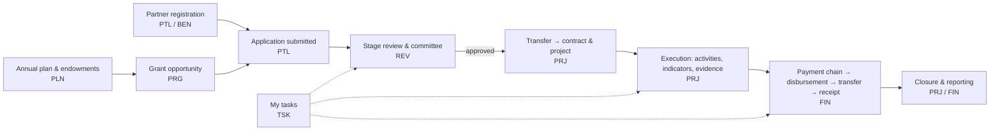

# Manih Grant Management — Business Analysis Package

Requirements specification reverse-engineered from the **Manih** interactive prototype (`WBLcompany/manih`, Lovable-built, Arabic RTL, React + TanStack Router + Supabase). It is intended to be managed in ClickUp and used by Business Analysts, Developers, UI/UX Designers, QA Engineers and Product Owners.

## 1. Method & limitations

- **Source of evidence:** the prototype's source code at commit `cfb75c2` (routes, components, business-logic libraries, Supabase migrations and generated types), plus the project's own architecture notes (`AGENTS.md`).
- **The live demo (https://manih.lovable.app) was not inspected.** Screens, fields, states and messages are documented from the code that renders them. Visual layout, copy as rendered and runtime data were not observed.
- Ten modules were analyzed independently against one shared spec (`_SPEC.md`), each with a full file list in its *Scope & Coverage* section. All in-scope files were read; no module reports an unanalyzed file.
- Several tables and columns used by the code (e.g. `project_indicators`, `project_plan_allocations`, `tenant_roles`, `proposed_changes`, `external_ai_*`) exist in the generated types but not in the migrations folder; their structure was taken from `types.ts` and usage.

### Evidence labels (used on every rule, requirement and behaviour)

| Label | Meaning |
|---|---|
| **[Observed]** | Implemented in the prototype code (with file reference) |
| **[Inferred]** | Reasonable reading of the code's intent, not explicit |
| **[Recommended]** | Analyst proposal; not in the prototype |
| **[To Confirm]** | Business decision, value or role that stakeholders must confirm |

## 2. Package contents

| File | Purpose |
|---|---|
| `README.md` | This overview, cross-module findings and usage guide |
| `modules/01-PLT.md` … `modules/10-TSK.md` | Full analysis per module: screen & interaction inventory, workflows (Mermaid), business rules, data requirements, epics/features, functional requirements, user stories (Given/When/Then), issues, open questions |
| `traceability-matrix.md` | Requirement → Feature → Epic → Stories → Screens, per module |
| `coverage.md` | Record counts per module |
| `clickup-import.csv` | 494 rows (Epics, Features, User Stories) ready for ClickUp CSV import |
| `data/*.json` | Machine-readable records per module (source for the CSV and matrix) |
| `Manih-BA-Package.md` | Everything above concatenated into a single file |
| `_SPEC.md`, `build.py` | Authoring spec and the assembler (`python3 build.py` regenerates CSV, matrix, coverage, combined file) |

## 3. Modules & coverage

| # | Code | Module | Screens | Features | FRs | Stories | Issues |
|---|---|---|---|---|---|---|---|
| 01 | PLT | Platform: shell, navigation, personas, login, search, AI copilot, shared UI | 14 | 17 | 65 | 32 | 28 |
| 02 | CFG | Settings & configuration (team, roles, departments, workflow, forms, endowments, taxonomies) | 13 | 16 | 54 | 34 | 22 |
| 03 | PLN | Annual plans, endowments, budget adjustments, initiatives | 14 | 17 | 67 | 28 | 25 |
| 04 | PRG | Grant opportunities, workflow engines, products, RFP, eligibility | 17 | 20 | 65 | 31 | 24 |
| 05 | PTL | Partner portal: registration, apply, track, respond, license update | 12 | 20 | 54 | 23 | 24 |
| 06 | BEN | Partner organizations management (staff side) | 6 | 13 | 45 | 24 | 21 |
| 07 | REV | Application review & decision workflow, committee, merge, transfer | 12 | 20 | 72 | 28 | 27 |
| 08 | PRJ | Projects & contracts, BOQ, activities, revisions, indicators | 11 | 16 | 57 | 31 | 26 |
| 09 | FIN | Payments approval chain, disbursement, reports & analytics | 8 | 11 | 56 | 22 | 22 |
| 10 | TSK | My tasks, derived vs manual tasks, focus mode | 9 | 11 | 40 | 22 | 17 |
| | | **Total** | **116** | **161** | **575** | **275** | **236** |

Also: 58 epics, 332 business rules, 149 open questions.

### Roles

`admin`, `grants_manager`, `reviewer`, `committee_secretary`, `project_manager`, `finance`, `ceo`, `applicant` (partner organization user). In the prototype, roles are demo personas switched from the header on one shared account; see PLT §5.1 for the role × navigation matrix.

### End-to-end business flow

## 4. Cross-module findings (read before planning implementation)

These themes recur across modules; they are the main gap between the prototype and a production system. 41 issues are rated High.

1. **No real authentication or authorization** — every visitor signs into one shared demo account (credentials in the client bundle); roles are chosen in the browser; the permission matrix in Settings is never enforced; database RLS lets any signed-in user read/write every table. *(ISS-PLT-01/02/03, ISS-CFG-01, ISS-REV-01, ISS-PRG-02, ISS-PLN-04, ISS-PRJ-01/02, ISS-FIN-01, ISS-BEN-01)*
2. **Business rules enforced only in the UI** — pass score, eligibility, open window, quota, stock, approval authority and state transitions are checked in pages, not in the domain layer; alternative entry points (tasks, focus mode, committee minutes, invitation links) bypass them. *(ISS-REV-02, ISS-PTL-03, ISS-PRG-04, ISS-TSK-02)*
3. **Multi-step writes without transactions** — submission, transfer to contract/projects, merge, budget adjustments, plan edits and revisions run as sequences of client writes; a failure part-way leaves partial data. *(ISS-PTL-04, ISS-REV-24, ISS-PRJ-06, ISS-PLN-01/02)*
4. **No tenant isolation in queries** — several pages, search, copilot and task lists load data across organizations and filter in the browser. *(ISS-PLT-04/05, ISS-PTL-02, ISS-FIN-08, ISS-PLN-10)*
5. **Financial integrity gaps** — payee/IBAN editable after full approval without re-approval or audit; "paid" defined differently across screens; the "pending" bucket is always 0; payments can exceed project budget after AI re-planning. *(ISS-FIN-02/05, ISS-PLN-21, ISS-PRJ-05)*
6. **Hard-coded three-stage workflow** despite configurable workflow templates. *(ISS-REV-13, ISS-PRG-09)*
7. **Data-model drift** — tables/columns used in code are missing from migrations; some settings (templates, taxonomies, tenant suspension) are saved but never read. *(ISS-PLN-20, ISS-CFG, ISS-PRJ-26)*

Each module's §13 lists its issues with location, severity and recommendation; §14 lists open questions for stakeholders.

## 5. ID conventions

`SCR-` screen · `INT-` interaction · `EP-` epic · `FT-` feature · `FR-` functional requirement · `US-` user story · `BR-` business rule · `ISS-` issue · `OQ-` open question — each followed by the module code and a number (e.g. `FR-REV-012`). IDs are stable; cross-module references name the owning module.

## 6. Using this package

### In a Claude.ai Project
Upload `README.md`, `traceability-matrix.md` and the ten `modules/*.md` files to the project's knowledge (or the single `Manih-BA-Package.md`, ~1.8 MB). Upload `clickup-import.csv` only if you also want Claude to work with the backlog rows.

### In ClickUp
1. Create a Space for the product and one Folder or List per module (or one List with a *Module* custom field).
2. Import `clickup-import.csv` (Settings → Import/Export → CSV). Map **Task Name**, **Description**, **Priority** and **Tags** to the built-in fields; map **Task Type**, **Custom ID**, **Parent ID**, **Module Code** and **Acceptance Criteria** to custom fields.
3. After import, use **Parent ID** to nest Features under Epics and Stories under Features (ClickUp CSV import does not create parent links automatically).
4. Priority mapping: Must → High, Should → Normal, Could/Won't → Low.

### Regenerating
After editing any `data/*.json`, run `python3 docs/business-analysis/build.py` to rebuild the CSV, matrix, coverage and combined file. Keep the matching `modules/*.md` in sync by hand.
