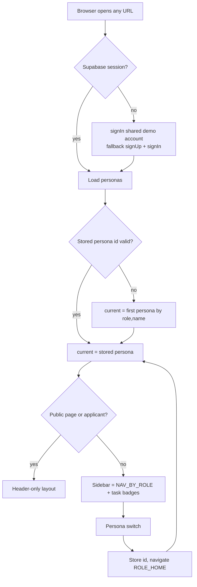
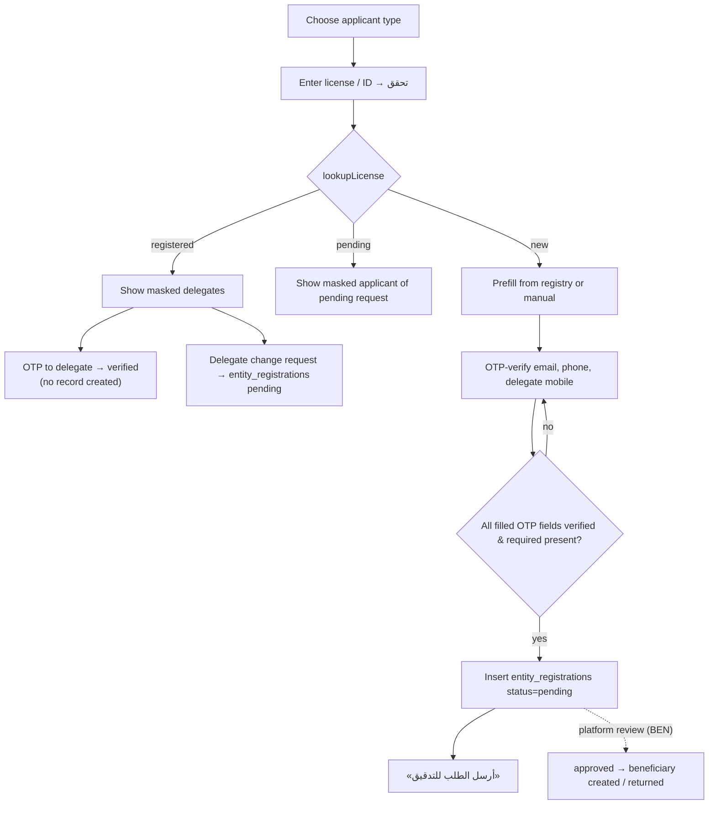
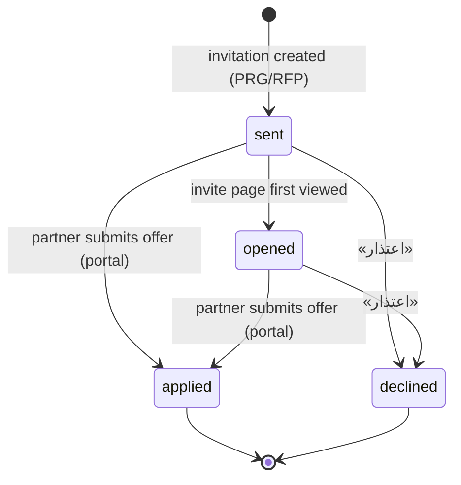
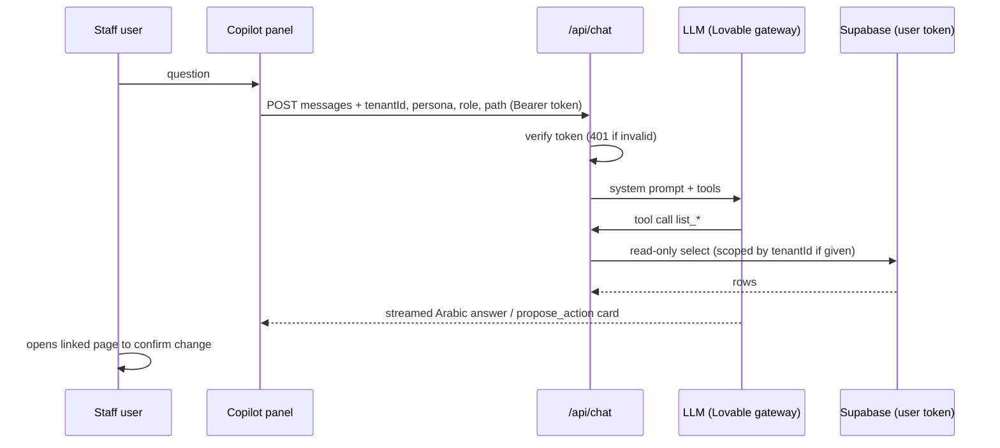
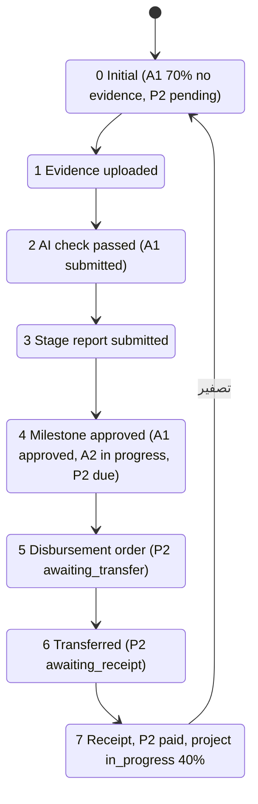

# PLT — Platform: Shell, Navigation, Personas & Shared UI

## 1. Scope & Coverage

**Module scope.** Cross-cutting platform capabilities of the Manih grant-management prototype: application shell and role-based navigation, session/login, demo personas and persona switcher, public landing page, partner self-registration (`/register-tenant`), invitation landing (`/invite/$token`), global search, AI Copilot, saved views, theme/palette/RTL/digit localization, demo guide and scripted demo controls, the admin workshop deck, and the shared UI components every other module reuses.

**Files analyzed (all read in full, `/home/user/manih/src/…`):**

- `routes/__root.tsx`
- `routes/index.tsx`
- `routes/login.tsx`
- `routes/register-tenant.tsx`
- `routes/invite.$token.tsx`
- `routes/admin.tsx (gate, tabs, workshop tab; tenants & registrations tabs only for context)`
- `routes/api/chat.ts`
- `components/AppShell.tsx`
- `components/DemoSession.tsx`
- `components/DemoGuide.tsx`
- `components/DemoControls.tsx`
- `lib/demoScript.ts`
- `components/GlobalSearch.tsx`
- `components/Copilot.tsx`
- `lib/viewPrefs.tsx`
- `components/ThemeToggle.tsx`
- `components/PalettePicker.tsx`
- `components/WorkshopDeck.tsx`
- `lib/persona.tsx`
- `components/LatinDigits.tsx`
- `components/SmartFlow.tsx`
- `components/InfoTip.tsx`
- `components/common.tsx`
- `components/DataTable.tsx`
- `components/FilterBar.tsx`
- `components/PageSkeleton.tsx`
- `components/SectionTabs.tsx`
- `components/StatCard.tsx`
- `lib/error-capture.ts`
- `lib/error-page.ts`
- `integrations/supabase/auth-middleware.ts`
- `lib/queries.ts`
- `lib/data.ts`

**Closely related files consulted:**

- `lib/navCounts.ts`
- `lib/lovable-error-reporting.ts`
- `integrations/supabase/{client,auth-attacher,previewAuthStorage,cron-auth}.ts`
- `lib/registrations.ts (lookup/submit/delegate functions)`
- `components/OtpVerifiedInput.tsx`
- `lib/applicantTypes.ts (ENTITY_TYPES, useClosedTypes)`
- `lib/rfp.ts (markInvitation)`
- `components/ui/useAutoSteps.tsx (header only)`
- `components/AmountInput.tsx (header only)`
- `routes/portal.tsx:75-90 (applicant gate)`
- `routes/settings.tsx:45-70,150-260 (tab routing, declared permission matrix)`
- `routes/projects.$id.tsx:32-33,170 (DemoControls mount)`
- `server.ts / start.ts (error-page usage, grep)`
- `supabase/migrations: 20261004085937 (tenants, personas), 20261005054632 (user_view_prefs), 20261006134413 (program_invitations), 20261006140739 (RLS reset)`
- `src/integrations/supabase/types.ts (entity_registrations, beneficiary_memberships, program_invitations, user_view_prefs, tenants, personas)`

**Coverage notes & limitations.**

- Analysis is from source only; the live demo (https://manih.lovable.app) was not inspected. Line numbers refer to the files as read on 2026-10-19.
- `/admin` tabs *Tenants* and *Registration requests* are owned by CFG and BEN respectively; the *Registration review* that approves submissions from SCR-PLT-03 is in BEN. The portal (`/portal`) is in PTL; this module only documents its persona gate.
- Permission differences between roles are **UI-level only**. All data access goes through the loose `db` client under one shared Supabase account, and RLS allows any signed-in user full access (see §13).
- `personas.role` was converted from an enum (`admin|reviewer|applicant`) to free text in later schema changes (types.ts:2085); the 8 roles are defined in `lib/persona.tsx`.

## 2. Screen Inventory

| Screen ID | Name (EN + Arabic label) | Route / Component | Roles | Purpose | Entry points | Exits / Navigates to |
|---|---|---|---|---|---|---|
| SCR-PLT-01 | Public landing page — «الصفحة الرئيسية — منصة منح» | `/` — routes/index.tsx | public visitor, all personas | Marketing entry: value proposition and list of active grant programs. | Direct URL; brand logo; 404/error 'back home' links | /portal (Browse programs, Apply now); /register-tenant; /login (header) |
| SCR-PLT-02 | Login — «تسجيل الدخول» | `/login` — routes/login.tsx | public visitor, all personas | Cosmetic sign-in form for the demo; forwards to the current persona's home. | Header 'تسجيل الدخول'; registration success (delegate verified) | ROLE_HOME of current persona; /register-tenant |
| SCR-PLT-03 | Partner organization registration — «تسجيل جهة شريكة / سجّل جهتك» | `/register-tenant` — routes/register-tenant.tsx (+ OtpVerifiedInput, lib/registrations.ts) | public visitor (partner representative) | License/ID lookup, registry prefill, OTP-verified contact fields, submission for platform review; delegate verification or delegate-change request for already-registered entities. | Landing CTA; header 'سجّل جهتك'; login link; workshop deck link | / (after success); /login (after delegate verification) |
| SCR-PLT-04 | Invitation landing — «دعوة للتقديم» | `/invite/$token` — routes/invite.$token.tsx | invited partner (applicant) | Shows a private grant opportunity invitation; activate account, proceed to apply or decline. | Invitation link sent from an RFP/targeted program (see PRG) | /portal?apply=<programId> |
| SCR-PLT-05 | Application shell (sidebar + header) — «القائمة / الإطار العام» | `all routes (components/AppShell.tsx)` — components/AppShell.tsx, routes/__root.tsx | all staff roles, applicant (header-only layout) | Persistent layout: brand, role-based sidebar with task badges, header with search, demo guide, copilot, persona switcher, theme toggle; mobile drawer. | Every page | Any sidebar destination |
| SCR-PLT-06 | Persona switcher (demo mode) — «وضع العرض — اختر شخصية» | `dropdown in AppShell` — components/AppShell.tsx (personaMenu) | all personas (demo) | Switch the active demo persona/role; navigates to that role's home. | User card in sidebar footer; header switch icon; landing header user card | ROLE_HOME[role] |
| SCR-PLT-07 | Global search (command palette) — «البحث (Ctrl+K)» | `dialog in header` — components/GlobalSearch.tsx | all signed-in personas incl. applicant | Cross-entity search with Arabic-tolerant matching, page shortcuts and recent items. | Header search icon; Ctrl/Cmd+K | /beneficiaries/:id, /reviewer/:id, /projects/:id, /programs/:id, /plans/:id, /staff/:id, static pages |
| SCR-PLT-08 | AI Copilot panel — «رفيق المنح» | `side sheet in header` — components/Copilot.tsx, routes/api/chat.ts | admin, grants_manager, reviewer, committee_secretary, project_manager, finance, ceo | Arabic conversational assistant over tenant data with read-only tools; proposes actions as link cards. | Header bot icon | Page linked in a proposed-action card |
| SCR-PLT-09 | Demo guide panel — «دليل العرض — عند من واقف الإجراء؟» | `side sheet in header` — components/DemoGuide.tsx | all staff roles (sidebar layout) | Per-page walkthrough hints; on a project page, shows which payment step is pending and lets the presenter switch to the responsible persona. | Header help icon | Same page under another persona |
| SCR-PLT-10 | Interactive demo controls bar — «وضع العرض التفاعلي» | `/projects/<DEMO_PROJECT_ID> (embedded)` — components/DemoControls.tsx, lib/demoScript.ts | any persona viewing the demo project | Advance / undo / reset a 7-step scripted project-payment scenario directly in the database. | Opening the demo project 'ملتقى الشركاء السنوي' | Same page (data refreshed) |
| SCR-PLT-11 | Platform admin — workshop deck tab — «بوابة الآدمن ← عرض ورشة العمل» | `/admin (tab 'workshop')` — routes/admin.tsx (AdminGate, Tabs) + components/WorkshopDeck.tsx | admin | Facilitated requirements-workshop deck (11 slides) with per-session note capture. Other /admin tabs (tenants, registrations) are covered by CFG and BEN. | Sidebar 'الإعدادات' → SectionTabs 'الجهات والمستخدمون'; global search 'الإدارة' | Deep links per session (new tab) |
| SCR-PLT-12 | Appearance — colour palette — «الإعدادات ← المظهر (التدرج اللوني)» | `/settings?tab=appearance` — components/PalettePicker.tsx (rendered by routes/settings.tsx) | all roles that reach Settings | Choose one of three colour palettes, stored on the device. | Settings section tabs 'المظهر' | — |
| SCR-PLT-13 | Not found page — «الصفحة غير موجودة (404)» | `any unknown route` — routes/__root.tsx NotFoundComponent | all | Friendly 404 with link home. | Unknown URL | / |
| SCR-PLT-14 | Error page / error boundary — «تعذّر تحميل الصفحة» | `any route on uncaught error` — routes/__root.tsx ErrorComponent; lib/error-page.ts (SSR) | all | Client error boundary with retry/home and telemetry; server-rendered fallback page. | Uncaught render/loader error | Same route (retry) or / |

## 3. Screen Details

### SCR-PLT-01 — Public landing page («الصفحة الرئيسية — منصة منح»)

- **Data:** hero badge «نسخة عرض أولى», title «إدارة المنح من التقديم حتى الاعتماد», subtitle [Observed] `routes/index.tsx:54-76`.
- **Actions:** «تصفح برامج المنح» → `/portal`; «سجّل جهتك كمانحة» → `/register-tenant` [Observed] `index.tsx:66-75`.
- **Sections:** three capability cards — «تقديم إلكتروني», «سير مراجعة واضح», «مؤشرات لحظية» [Observed] `index.tsx:79-109`.
- **Program cards:** title, description (2 lines), «الميزانية» (formatSAR), «آخر موعد» (formatDate of `deadline`), button «قدّم الآن» → `/portal` [Observed] `index.tsx:111-140`. Source: `grant_programs` where `status='active'` order by `created_at desc` [Observed] `index.tsx:39-50`.
- **Header (public layout):** brand logo, theme toggle, persona user card (≥sm), «تسجيل الدخول», «سجّل جهتك» [Observed] `AppShell.tsx:172-186`.
- **States:** no loading/empty/error UI for programs — an empty grid is shown [Observed]; page blocked by the global «جارٍ التحميل…» until the demo session exists [Observed] `DemoSession.tsx:21`.

### SCR-PLT-02 — Login («تسجيل الدخول»)

- **Fields:** «البريد الإلكتروني» (email, LTR, required, placeholder name@example.com); «كلمة المرور» (password, LTR, required) [Observed] `login.tsx:63-85`.
- **Actions:** «دخول» submits → navigate to `ROLE_HOME[current.role]` or `/portal` [Observed] `login.tsx:43-47`; link «سجّل جهتك» → `/register-tenant` [Observed] `login.tsx:93-98`.
- **Behaviour:** first pointer-down anywhere on the page fills demo credentials (demo@minah.sa / Demo1234) [Observed] `login.tsx:36-41,52`; disclaimer «في نسخة العرض الحالية، الدخول شكلي…» [Observed] `login.tsx:89-91`.
- **States:** validation = HTML required/email only; no error, lockout or loading state [Observed].

### SCR-PLT-03 — Partner organization registration («تسجيل جهة شريكة / سجّل جهتك»)

- **Header:** «سجّل جهتك» / «سجّل حسابك» for individuals; description «اختر نوع المستفيد ثم أدخل رقم التحقق…» [Observed] `register-tenant.tsx:82-85`.
- **Type chips:** portal-enabled types not closed by the tenant: جمعية أهلية، مؤسسة غير ربحية، شركة، فرد، وقف، أخرى (government excluded) [Observed] `register-tenant.tsx:33-36,87-92`; `applicantTypes.ts:7-15`. Changing type clears the lookup result.
- **Lookup form:** ID input (placeholder = type's idLabel, LTR) + «تحقق»; demo hint links «مسجلة 1234 · جديدة 7781 8890» [Observed] `register-tenant.tsx:93-97`.
- **Result = registered:** card ««name» مسجلة مسبقاً», masked delegates list (primary flagged), buttons «إرسال رمز تحقق للمفوض» (disabled if none) and «طلب تغيير المفوض» [Observed] `register-tenant.tsx:173-184`.
  - *OTP sub-form:* message, demo code displayed, 6-digit input, «تحقق», «رجوع»; wrong code → toast «الرمز غير صحيح — تأكد وأعد المحاولة» [Observed] `:186-196,159-163`.
  - *Verified:* green panel «تم التحقق من صلتك بالجهة», «سجّل دخولك وسيضيفك المفوض لفريق الجهة», button «تسجيل الدخول» [Observed] `:198-204`.
  - *Change request sub-form:* «اسم المفوض الجديد *», «رقم الهوية *», «جوال المفوض الجديد *», «سبب التغيير *», «إرسال الطلب», «رجوع» → confirmation «أُرسل طلب تغيير المفوض» [Observed] `:206-227`.
- **Result = pending:** «يوجد طلب تسجيل لهذا الترخيص قيد التدقيق — قدمه <masked name> وجواله ينتهي بـ<masked mobile>» [Observed] `:100-105`.
- **Result = new:** provenance banner («جلبنا البيانات من السجل الرسمي…» or «لم نجد الرقم في السجل…»), OTP hint, 2-column field grid (REG_FIELDS) with «من السجل» / «معدّل عن السجل» tags, OTP inputs for البريد الرسمي، هاتف الجهة، جوال المفوض, submit «تأكيد البيانات وإرسالها للتدقيق» [Observed] `:107-139`.
- **Validation:** HTML required per field; unverified OTP fields → toast «تحقق أولاً من: …» [Observed] `:58-62`. No format validation of IBAN, national ID or mobile [Observed – gap].
- **Success state:** card «أُرسل الطلب للتدقيق» — «تدقق إدارة المنصة الحقول المؤكدة والمدخلة، وتُفعَّل الجهة بعد اعتمادها.», button «العودة للرئيسية» [Observed] `:68-76`.
- **Error state:** toast with DB error message [Observed] `:65`.

### SCR-PLT-04 — Invitation landing («دعوة للتقديم»)

- **Loading:** PageSkeleton [Observed] `invite.$token.tsx:40`. **Invalid:** «رابط الدعوة غير صالح» [Observed] `:41`.
- **Header line:** «دعوة خاصة لـ <beneficiary name>» [Observed] `:65`.
- **Opportunity card:** title; chips: kind label, «السقف <budget>», «آخر موعد <close_at>», «مدة التنفيذ N يوم» (if set); description; «نطاق العمل»; «المخرجات» [Observed] `:66-79`.
- **Final states:** declined → «سجّلتم اعتذاركم عن هذه الفرصة.»; applied → «قدّمتم عرضكم على هذه الفرصة، تابعوا حالته من البوابة.» [Observed] `:80-81`.
- **Active account actions:** «الانتقال للتقديم», «اعتذار» [Observed] `:82-83`.
- **Inactive account:** card «تفعيل حساب الجهة» with fields الاسم، رقم الهوية، البريد الرسمي (prefilled), كلمة المرور — all required, demo defaults prefilled; buttons «تفعيل والانتقال للتقديم», «اعتذار» [Observed] `:84-97`.
- **Toasts:** «مرحباً بك» / «تم تفعيل حساب الجهة»; «تم تسجيل الاعتذار، شكراً لكم» [Observed] `:53,59`.

### SCR-PLT-05 — Application shell (sidebar + header) («القائمة / الإطار العام»)

- **Root:** `<html lang="ar" dir="rtl">`, React Query provider, Radix `DirectionProvider dir="rtl"`, DemoSession gate, PersonaProvider, Toaster (top-center, rich colours), LatinDigits [Observed] `__root.tsx:117-155`.
- **Sidebar layout (staff roles, non-public pages):** brand link (admin → /analytics, others → /tasks), section label «القائمة», role items with icon, label and badge, footer user card (initials, name, role, switch chevron) [Observed] `AppShell.tsx:141-170,201-211`.
- **Header (sidebar layout):** mobile menu button «القائمة الجانبية», active item icon+label, GlobalSearch, DemoGuide, Copilot, persona switch icon «تبديل المستخدم (وضع العرض)», ThemeToggle [Observed] `:212-237`.
- **Header-only layout:** public pages and applicant role — see FR-PLT-013 [Observed] `:172-199`.
- **Mobile drawer:** Sheet from the right with brand and the same navigation [Observed] `:241-248`.
- **States:** global loading «جارٍ التحميل…» until session [Observed] `DemoSession.tsx:21`; FocusPill (TSK) mounted under every page [Observed] `AppShell.tsx:196,239`.

### SCR-PLT-06 — Persona switcher (demo mode) («وضع العرض — اختر شخصية»)

- **Content:** label «وضع العرض — اختر شخصية», one item per persona (initials avatar, name, Arabic role label, check on current), scrollable (max 70vh) [Observed] `AppShell.tsx:100-123`.
- **Visibility:** landing page and all non-public pages; hidden on /login and /register-tenant [Observed] `:89`.
- **Action:** select → persist persona → navigate to ROLE_HOME [Observed] `:94-98`.

### SCR-PLT-07 — Global search (command palette) («البحث (Ctrl+K)»)

- **Trigger:** search icon «البحث (Ctrl+K)» or Ctrl/Cmd+K [Observed] `GlobalSearch.tsx:45-52,97-99`.
- **Input:** placeholder «ابحث عن جهة، طلب، مشروع، دفعة، شخص…» [Observed] `:101`.
- **Groups:** الصفحات، الجهات الشريكة، طلبات المنح، المشاريع والمبادرات، الدفعات، فرص ومسارات المنح، الخطط السنوية، أعضاء الفريق; recent group «آخر ما فتحته» [Observed] `:19-28,104-123`.
- **Result row:** icon, title, subtitle (ref no · city/partner/project/year/e-mail) [Observed] `:68-76,113-117`.
- **Empty states:** «اكتب حرفين على الأقل» / «لا نتائج» [Observed] `:103`. No loading indicator while querying [Observed – gap].

### SCR-PLT-08 — AI Copilot panel («رفيق المنح»)

- **Trigger:** outline bot button «رفيق المنح» (hidden for applicant) [Observed] `Copilot.tsx:152-157`.
- **Panel:** left-side sheet, title «رفيق المنح», expand/minimise toggle (≥sm) [Observed] `:158-167`.
- **Empty conversation:** intro text and section-specific prompt chips [Observed] `:71-80`.
- **Messages:** user bubbles (primary colour), assistant text (Markdown asterisks stripped), tool progress «قراءة البيانات» with spinner/✓, proposed-action cards (title, details, link «فتح الصفحة للتأكيد») [Observed] `:81-108`.
- **Composer:** textarea «اكتب طلبك…» (Enter sends, Shift+Enter newline), send / stop buttons; trash icon «محادثة جديدة» [Observed] `:115-143`.
- **States:** submitted spinner; error banner «تعذر الحصول على رد: …» [Observed] `:109-112`.

### SCR-PLT-09 — Demo guide panel («دليل العرض — عند من واقف الإجراء؟»)

- **Trigger:** help icon «دليل العرض — عند من واقف الإجراء؟» (hidden on public pages; only in sidebar layout) [Observed] `DemoGuide.tsx:111,117-125`.
- **Pending-action box (project pages):** loading «جارٍ تحديد الخطوة الحالية…»; «الإجراء واقف عند خطوة «label» (payment title)»; persona card with «بدّل إليه» or «أنت هنا الآن»; «لا يوجد حساب بدور …» ; «كل الدفعات مكتملة — لا إجراء معلّق على هذا المشروع.» [Observed] `:132-175`.
- **Steps list:** title and hint per step; generic text «تجوّل في الصفحات وسيظهر لك شرح كل شاشة هنا.» [Observed] `:176-187`.

### SCR-PLT-10 — Interactive demo controls bar («وضع العرض التفاعلي»)

- **Bar:** «وضع العرض التفاعلي», «الخطوة n من 7», buttons «تراجع», «تقدّم», «تصفير»; «آخر خطوة منفذة: … (actor)»; «الخطوة التالية: … (actor)» or «اكتملت كل خطوات العرض — استخدم «تصفير» لإعادته.» [Observed] `DemoControls.tsx:37-72`.
- **Scenario steps (actor):** رفع شاهد المرحلة الأولى (الجمعية الشريكة) → الفحص الذكي → رفع تقرير المرحلة الأولى → اعتماد المحطة الأولى (مدير المنح) → اعتماد إذن صرف دفعة التجهيزات (مدير المنح) → تحويل الدفعة وإرفاق إشعار الحوالة (المسؤول المالي) → إرفاق سند القبض وإقفال الدفعة (الجمعية) [Observed] `demoScript.ts:23-31`.
- **States:** buttons disabled while busy/at limits; success toasts «تم تصفير المشروع…» / «الحالة الآن: بعد خطوة n من 7»; error toast [Observed] `DemoControls.tsx:19-32`.

### SCR-PLT-11 — Platform admin — workshop deck tab («بوابة الآدمن ← عرض ورشة العمل»)

- **Gate:** non-admin → «هذه الصفحة خاصة بإدارة المنصة» + «الانتقال إلى فريق العمل» [Observed] `admin.tsx:58-71`.
- **Page header:** «الإعدادات», «كل ما يخص تهيئة المنصة في مكان واحد», SETTINGS_TABS; inner tabs «الجهات (n)», «طلبات تسجيل الجهات», «عرض ورشة العمل» [Observed] `admin.tsx:136-160`. (Tenants tab → CFG; registrations → BEN.)
- **Deck toolbar:** previous/next, «i / 11», progress bar, «ملء الشاشة»/«خروج»; footer hint «الأسهم للتنقل · F لملء الشاشة · الملاحظات تُحفظ تلقائياً على هذا الجهاز» [Observed] `WorkshopDeck.tsx:175-187`.
- **Slides (11):** 1 Welcome (WBL & Noura logos, «ورشة عمل تحليل نظام مانح»); 2 Agenda (09:00–15:00 incl. prayer/lunch break); 3 Method (40% live demo / 40% comparison / 20% open space); 4–9 Sessions 1–6 (time, title, goal, 4 points, comparison questions, deep links, three note boxes «ميزات لاحظها العميل في مانح», «كيف تتم في نظامهم الحالي», «تحديات ومتطلبات جديدة»); 10 Parking lot «الاستطرادات المؤجلة»; 11 Summary (aggregated notes by category + «الخطوات القادمة والمسؤوليات») [Observed] `WorkshopDeck.tsx:14-149`.
- **Frame:** header logos and «ورشة عمل تحليل نظام مانح», footer «شركة وبل WBL» and page number [Observed] `:59-71`.

### SCR-PLT-12 — Appearance — colour palette («الإعدادات ← المظهر (التدرج اللوني)»)

- **Card:** «التدرج اللوني», «اختر الهوية اللونية للمنصة — تُحفظ على هذا الجهاز», three swatch buttons طيني / أخضر مائي / خزامى with active check [Observed] `PalettePicker.tsx:22-65`.

### SCR-PLT-13 — Not found page («الصفحة غير موجودة (404)»)

- «404», «الصفحة غير موجودة», «الصفحة التي تبحث عنها غير موجودة أو تم نقلها.», link «العودة للرئيسية» [Observed] `__root.tsx:22-44`.

### SCR-PLT-14 — Error page / error boundary («تعذّر تحميل الصفحة»)

- **Client:** «تعذّر تحميل الصفحة», «حدث خطأ من جهتنا…», «حاول مجدداً» (router.invalidate + reset), «العودة للرئيسية»; error logged and reported via `reportLovableError` [Observed] `__root.tsx:46-82`.
- **Server (SSR):** static English page «This page didn't load» with «Try again»/«Go home» [Observed] `lib/error-page.ts`; console.error expanded with cause chain and last error captured for 5 s [Observed] `lib/error-capture.ts`.

## 4. Interaction Inventory

| INT ID | Screen | Trigger (control) | System response | Data written | Evidence |
|---|---|---|---|---|---|
| INT-PLT-001 | SCR-PLT-01 | Button «تصفح برامج المنح» / «قدّم الآن» | Navigate to /portal | — | [Observed] index.tsx:67,131 |
| INT-PLT-002 | SCR-PLT-01 | Button «سجّل جهتك كمانحة» | Navigate to /register-tenant | — | [Observed] index.tsx:70 |
| INT-PLT-003 | SCR-PLT-02 | Pointer-down on page | Autofill demo e-mail/password once | — | [Observed] login.tsx:36-41,52 |
| INT-PLT-004 | SCR-PLT-02 | Submit «دخول» | Navigate to ROLE_HOME of current persona (or /portal) | — | [Observed] login.tsx:43-47 |
| INT-PLT-005 | SCR-PLT-03 | Type chip | Set entity type; reset lookup result; adapt ID label/fields | — | [Observed] register-tenant.tsx:88-91 |
| INT-PLT-006 | SCR-PLT-03 | «تحقق» / demo license link | lookupLicense → registered / pending / new; prefill values | — (reads beneficiaries, beneficiary_memberships, entity_registrations) | [Observed] register-tenant.tsx:46-55,93-97 |
| INT-PLT-007 | SCR-PLT-03 | OTP icon → code → «تأكيد» | Generate and show demo code; mark field verified on match | — (client state) | [Observed] OtpVerifiedInput.tsx:14-15 |
| INT-PLT-008 | SCR-PLT-03 | Submit «تأكيد البيانات وإرسالها للتدقيق» | Block if unverified OTP; insert registration; show success | entity_registrations (insert, status pending) | [Observed] register-tenant.tsx:58-66; registrations.ts:69-77 |
| INT-PLT-009 | SCR-PLT-03 | «إرسال رمز تحقق للمفوض» → «تحقق» | Show demo 6-digit code; on match show verified panel | — | [Observed] register-tenant.tsx:155-163 |
| INT-PLT-010 | SCR-PLT-03 | «طلب تغيير المفوض» → «إرسال الطلب» | Insert delegate-change request; confirmation | entity_registrations (insert with note) | [Observed] register-tenant.tsx:164-171; registrations.ts:85-97 |
| INT-PLT-011 | SCR-PLT-04 | Page load | Load invitation; mark opened if 'sent' | program_invitations (status opened, opened_at) | [Observed] invite.$token.tsx:35-39 |
| INT-PLT-012 | SCR-PLT-04 | «الانتقال للتقديم» / «تفعيل والانتقال للتقديم» | Activate account if inactive; select partner persona; toast; go to /portal?apply= | beneficiaries (account_status, activated_at) | [Observed] invite.$token.tsx:46-56 |
| INT-PLT-013 | SCR-PLT-04 | «اعتذار» | Mark declined; toast | program_invitations (declined, responded_at) | [Observed] invite.$token.tsx:57-60 |
| INT-PLT-014 | SCR-PLT-05 | Sidebar item | Navigate; highlight active | — | [Observed] AppShell.tsx:145-166 |
| INT-PLT-015 | SCR-PLT-05 | Mobile menu button | Open navigation drawer; close on navigate | — | [Observed] AppShell.tsx:215,241-248 |
| INT-PLT-016 | SCR-PLT-05 | Theme toggle | Toggle dark class; persist | localStorage theme | [Observed] ThemeToggle.tsx:10-17 |
| INT-PLT-017 | SCR-PLT-06 | Persona menu item | Select persona; navigate to role home | localStorage grants-poc-persona | [Observed] AppShell.tsx:94-98; persona.tsx:77-80 |
| INT-PLT-018 | SCR-PLT-07 | Ctrl/Cmd+K or search icon | Toggle search dialog | — | [Observed] GlobalSearch.tsx:47-49 |
| INT-PLT-019 | SCR-PLT-07 | Typing (≥2 chars) | Debounced tenant-scoped search of 7 entity types | — | [Observed] GlobalSearch.tsx:54-80 |
| INT-PLT-020 | SCR-PLT-07 | Select result | Navigate; save to recent (max 6) | localStorage recent-search | [Observed] GlobalSearch.tsx:82-88 |
| INT-PLT-021 | SCR-PLT-08 | Bot button | Open Copilot sheet | — | [Observed] Copilot.tsx:155 |
| INT-PLT-022 | SCR-PLT-08 | Prompt chip / Send (Enter) | POST /api/chat with persona context; stream answer | localStorage copilot:<personaId> | [Observed] Copilot.tsx:30-64; chat.ts:12-145 |
| INT-PLT-023 | SCR-PLT-08 | Stop / New chat / Expand | Abort stream / clear history / widen panel | localStorage (remove) | [Observed] Copilot.tsx:128-143,163 |
| INT-PLT-024 | SCR-PLT-08 | Proposed-action link «فتح الصفحة للتأكيد» | Close panel; open target page | — | [Observed] Copilot.tsx:92-94 |
| INT-PLT-025 | SCR-PLT-09 | Help icon | Open guide; on project page compute pending payment step | — | [Observed] DemoGuide.tsx:82-109 |
| INT-PLT-026 | SCR-PLT-09 | «بدّل إليه» | Switch persona; close sheet | localStorage persona | [Observed] DemoGuide.tsx:154-164 |
| INT-PLT-027 | SCR-PLT-10 | «تقدّم» / «تراجع» / «تصفير» | Apply scenario state n; invalidate all queries; toast | project_activities, project_reports (upsert/delete), payments, projects; localStorage demo-step-<id> | [Observed] DemoControls.tsx:19-32; demoScript.ts:97-110 |
| INT-PLT-028 | SCR-PLT-11 | Inner tab «عرض ورشة العمل» | Render deck | — | [Observed] admin.tsx:150,157-159 |
| INT-PLT-029 | SCR-PLT-11 | Prev/Next, ←/→/space, F, «ملء الشاشة» | Change slide / toggle fullscreen (ignored while typing) | — | [Observed] WorkshopDeck.tsx:151-173 |
| INT-PLT-030 | SCR-PLT-11 | Typing in a note box | Autosave note | localStorage workshop-notes | [Observed] WorkshopDeck.tsx:52-57,73-78 |
| INT-PLT-031 | SCR-PLT-11 | Session deep link | Open target page in new tab | — | [Observed] WorkshopDeck.tsx:123 |
| INT-PLT-032 | SCR-PLT-12 | Palette swatch | Apply data-palette; persist | localStorage palette | [Observed] PalettePicker.tsx:13-20,40-43 |
| INT-PLT-033 | SCR-PLT-13 | «العودة للرئيسية» | Navigate to / | — | [Observed] __root.tsx:34-39 |
| INT-PLT-034 | SCR-PLT-14 | «حاول مجدداً» | router.invalidate(); reset boundary | — | [Observed] __root.tsx:63-71 |
| INT-PLT-035 | (any list page) | DataTable search / columns / page size / paging / row click | Filter, toggle columns, paginate, open details | — (view state local until pinned) | [Observed] DataTable.tsx:42-150 |
| INT-PLT-036 | (any list page) | DataTable «تصدير» XLSX / CSV | Download file of filtered rows, visible columns | — (file) | [Observed] DataTable.tsx:64-78,111-119 |
| INT-PLT-037 | (any list page) | Pin «حفظ كعرض افتراضي» / «استعادة العرض الأصلي» | Upsert / delete saved view | user_view_prefs | [Observed] viewPrefs.tsx:48-65,68-88 |
| INT-PLT-038 | (any list page) | «تصفية» popover / chip × | Open secondary filters / clear one filter | — | [Observed] FilterBar.tsx |
| INT-PLT-039 | (PageSkeleton) | «إعادة المحاولة» | Refetch failed active queries | — | [Observed] PageSkeleton.tsx:23-25 |
| INT-PLT-040 | (SmartFlow) | Step dot / «السابق» / next / finish | Move between steps; run onFinish | Depends on host flow | [Observed] SmartFlow.tsx:33-63 |
| INT-PLT-041 | (InfoTip) | Info icon | Show concept popover | — | [Observed] InfoTip.tsx:20-36 |

## 5. Shared Components & Dependencies

### 5.1 Role × navigation / permission matrix

Legend: ✓ = shown/allowed in UI; — = not shown; *URL* = not in sidebar but reachable by typing the URL (no route guard). All entries are **UI-level only** [Observed] — the database accepts any operation from the shared signed-in account (ISS-PLT-02/03).

| Role | Home (ROLE_HOME) | Data & reports `/analytics` (+/reports) | Annual plan `/plans` | My tasks `/tasks` | Grant applications `/reviewer` (+/programs) | Projects `/projects` (+/finance, /contracts) | Partners `/beneficiaries` | Settings `/settings` (+/admin) | My portal `/portal` |
|---|---|---|---|---|---|---|---|---|---|
| `admin` | /tasks (logo → /analytics) | ✓ | ✓ | ✓ | ✓ | ✓ | ✓ | ✓ | URL (gated: 'switch persona') |
| `grants_manager` | /tasks | ✓ | ✓ | ✓ | ✓ | ✓ | ✓ | ✓ | URL (gated: 'switch persona') |
| `reviewer` | /tasks | ✓ | URL | ✓ | ✓ | URL | ✓ | URL | URL (gated: 'switch persona') |
| `committee_secretary` | /analytics | URL | URL | ✓ | ✓ | URL | URL | URL | URL (gated: 'switch persona') |
| `project_manager` | /tasks | URL | URL | ✓ | URL | ✓ | URL | URL | URL (gated: 'switch persona') |
| `finance` | /tasks | ✓ | ✓ | ✓ | URL | ✓ | URL | URL | URL (gated: 'switch persona') |
| `ceo` | /analytics | ✓ | ✓ | ✓ | ✓ | ✓ | URL | URL | URL (gated: 'switch persona') |
| `applicant` | /portal | URL | URL | URL | URL | URL | URL | URL | ✓ |

Source: `components/AppShell.tsx:40-62`, `lib/persona.tsx:106-115`, `routes/portal.tsx:82`.

**Header tools and page gates by role** [Observed]:

| Role | Global search | AI Copilot | Demo guide | Persona switcher | Theme toggle | /admin page | Settings tabs | /portal content |
|---|---|---|---|---|---|---|---|---|
| `admin` | ✓ | ✓ | ✓ | ✓ | ✓ | ✓ | ✓ (Tenants & users; no Team/Roles/Endowments) | message |
| `grants_manager` | ✓ | ✓ | ✓ | ✓ | ✓ | message → Team | ✓ (Team, Roles, Endowments…) | message |
| `reviewer` | ✓ | ✓ | ✓ | ✓ | ✓ | message → Team | URL only (tabs per tenant scope) | message |
| `committee_secretary` | ✓ | ✓ | ✓ | ✓ | ✓ | message → Team | URL only (tabs per tenant scope) | message |
| `project_manager` | ✓ | ✓ | ✓ | ✓ | ✓ | message → Team | URL only (tabs per tenant scope) | message |
| `finance` | ✓ | ✓ | ✓ | ✓ | ✓ | message → Team | URL only (tabs per tenant scope) | message |
| `ceo` | ✓ | ✓ | ✓ | ✓ | ✓ | message → Team | URL only (tabs per tenant scope) | message |
| `applicant` | ✓ | — | — | ✓ | ✓ | message → Team | URL only (tabs per tenant scope) | ✓ |

Sources: `AppShell.tsx:186-237`, `Copilot.tsx:152`, `DemoGuide.tsx:111`, `admin.tsx:61`, `SectionTabs.tsx:11-12`, `portal.tsx:82`. Applicants see Global Search but not Copilot or Demo guide (applicant uses the header-only layout which does not mount DemoGuide).

**Declared (not enforced) permission matrix in Settings › Roles (CFG)** — shown for traceability; compare with sidebar access [Observed] `routes/settings.tsx:156-181`:

| Group | Permission | System roles granted |
|---|---|---|
| Applications & review | apps_view — view applications | grants_manager, reviewer, ceo, committee_secretary |
|  | apps_review — evaluate / accept / reject | reviewer |
|  | apps_approve — final approval | grants_manager, ceo, committee_secretary |
|  | apps_transfer — transfer approved application to project | grants_manager |
| Finance & payments | fin_orders — issue disbursement orders | grants_manager |
|  | fin_pay — execute transfer & attach remittance | finance |
|  | fin_plans — manage annual plan & budgets | grants_manager, finance, ceo |
| Projects & evidence | proj_view — view projects & milestones | grants_manager, project_manager, finance, ceo |
|  | proj_manage — manage milestones & tasks | project_manager, grants_manager |
|  | proj_replan — approve execution-plan changes | grants_manager |
| Settings | set_team — manage team & roles | grants_manager |
|  | set_workflow — edit workflows & forms | grants_manager |
|  | set_endow — manage endowments | grants_manager, finance |

Observations: `admin` appears in no permission row although it has the widest sidebar; `reviewer` has the Partners sidebar entry with no matching permission; `committee_secretary` holds `apps_approve` but its home (/analytics) is not in its sidebar; `finance` has no application permission and indeed no Applications entry. None of these permissions is checked by any page or library (grep for permission keys outside settings.tsx returns nothing) — see ISS-PLT-03.

### 5.2 Shared UI components (reusable patterns referenced by other modules)

| Component / API | File | Contract & behaviour | Used by |
|---|---|---|---|
| AppShell | components/AppShell.tsx | Layout, role sidebar (NAV_BY_ROLE), header tools, persona menu, mobile drawer. | Root (all pages) |
| PersonaProvider / usePersona / ROLE_LABELS / ROLE_HOME | lib/persona.tsx | Current persona context, role labels/home. | Almost every page and lib hook |
| Page, PageHeader(title, description, actions, info) | components/common.tsx:6-32 | Standard page container and title row with optional InfoTip and actions. | All module pages |
| StatCard (clickable KPI filter) | components/common.tsx:34-75 | Label/value/hint, tone (default/warn/good/bad), onClick + active (role=button, Enter/Space). | Lists with KPI filters (REV, PRJ, FIN, BEN…) |
| StatCard (simple) | components/StatCard.tsx | Plain KPI card (duplicate, ISS-PLT-17). | Some dashboards |
| Pill / Field / StageTracker | components/common.tsx:77-142 | Status pill (hidden if empty); label/value hiding empty/zero; fixed 3-stage tracker. | Detail pages (REV, BEN, PRJ) |
| DataTable<T>(rows, columns, filters, fileName, empty, view, onRowClick) | components/DataTable.tsx | Search, column chooser (defaultHidden), page size 15-50, paging, XLSX/CSV export, row click, saved view. | All list pages (AGENTS.md); 5+ routes |
| useSavedView / SaveViewButton | lib/viewPrefs.tsx | Per-persona pinned view (user_view_prefs). | DataTable, finance, plans.index, reviewer.index, tasks |
| MoreFilters / FilterChips / FilterField | components/FilterBar.tsx | Secondary filters popover with count and removable chips. | List pages |
| PageSkeleton(compact) | components/PageSkeleton.tsx | Loading skeleton → error + retry when an active query failed. | Detail and list pages |
| SectionTabs + GRANTS_TABS / SETTINGS_TABS / DATA_TABS / PROJECT_TABS | components/SectionTabs.tsx | Link tabs grouping pages under one sidebar entry; platformOnly/tenantOnly. | reviewer, programs*, settings, admin, analytics, reports, projects, contracts, finance |
| SmartFlow(open, title, steps[], onFinish, finishLabel, busy, extraActions) | components/SmartFlow.tsx | Guided step dialog with kinds info/ai/input/decision. | CreateOpportunityFlow (PRG), PaymentActions (FIN) |
| InfoTip(k) + CONCEPTS | components/InfoTip.tsx | Concept glossary popover (11 concepts). | PageHeader info, forms |
| useAutoSteps (DialogContent autoSteps) | components/ui/useAutoSteps.tsx | Auto-paginates dialogs to ≤3 fields per step. | All entry/edit dialogs |
| AmountInput | components/AmountInput.tsx | Money input with thousands separators (AGENTS.md). | PLN, PRG, FIN, PRJ forms |
| LatinDigits / formatSAR / formatDate | components/LatinDigits.tsx; lib/data.ts:377-390 | Western-digit rendering. | Global |
| GlobalSearch, Copilot, DemoGuide, ThemeToggle | components/*.tsx | Header tools. | AppShell |
| Status label/colour dictionaries | lib/data.ts:218-375 | APPLICATION_*, STAGE_*, BENEFICIARY_*, BANK_*, CONTRACT_*, PROJECT_*, PAYMENT_* labels/colours; PAYMENT_APPROVAL_CHAIN; CLOSE_REASONS; REGIONS; ACCOUNT_TYPES. | All modules |
| Query hooks | lib/queries.ts | useApplications, usePrograms, useBeneficiaries, usePartnerGroups, useStages, useProjects, usePayments; projectProgress (weighted). | REV, PRJ, FIN, TSK, BEN |
| db (loose client), TENANT_ID, isPeriodOpen, downloadCSV, normalizeRegion | lib/data.ts | Untyped Supabase client and helpers. | All modules |
| requireSupabaseAuth / attachSupabaseAuth | integrations/supabase/auth-middleware.ts, auth-attacher.ts | Bearer-token middleware for server functions. | docAi, attachmentAi, entityUpdates functions |

### 5.3 External dependencies

- **Supabase** (Auth, Postgres, Storage) — single shared account in the prototype [Observed].
- **Lovable AI gateway** (`https://ai.gateway.lovable.dev/v1`, model id `openai/gpt-6-astra`, env `LOVABLE_API_KEY`) via Vercel AI SDK [Observed] `chat.ts:31-52,133`.
- **Lovable telemetry** (`window.__lovableEvents`, `__lovableReportRuntimeError`) [Observed] `lovable-error-reporting.ts`.
- **xlsx** library (dynamic import) for exports [Observed] `DataTable.tsx:70`.
- **Simulated National Center registry** (2 hard-coded licenses) and **simulated OTP** [Observed] `registrations.ts:27-32,79-83`.
- Other modules: TSK (task derivation for nav badges, FocusPill), CFG (settings tabs, roles, applicant types), BEN (registration review, team), PRG (programs, invitations), PTL (portal application), FIN (payments in demo guide/controls), PRJ (demo project).

## 6. Business Process Workflows

### 6.1 Session, persona and navigation (prototype)

[Observed] `DemoSession.tsx`, `persona.tsx`, `AppShell.tsx`. Actor: any visitor. Guard: none server-side.

### 6.2 Partner registration (license lookup)

Entity registration status values observed: `pending` (on submit), `returned`, `approved` (set in BEN review, `registrations.ts:105-121`). Field decision values: `pending | accepted | rejected`; field source: `registry | registry_edited | manual` [Observed] `registrations.ts:4-9`.

### 6.3 Invitation lifecycle

[Observed] `program_invitations.status` default `sent`; `markInvitation` (`rfp.ts:43-51`) sets `opened` (only from `sent`), `applied`, `declined`. The transition to `applied` happens in the portal (PTL). Guard for 'proceed': status not declined/applied. Side effect: inactive beneficiary account → `active` [Observed] `invite.$token.tsx:50`. No expiry state exists [Observed – gap].

### 6.4 Copilot request

### 6.5 Scripted demo scenario (demo project only)

[Observed] `lib/demoScript.ts:36-94`. Each arrow is reversible with «تراجع». Actors are narrated only (partner, AI check, grants manager, finance officer) — all executed from one account.

## 7. Business Rules

| BR ID | Rule | Evidence label + reference |
|---|---|---|
| BR-PLT-01 | Every page renders only after an authenticated Supabase session exists; if none, the client signs into (or signs up) one shared demo account before rendering. | [Observed] components/DemoSession.tsx:4-22 |
| BR-PLT-02 | The active persona is chosen client-side and persisted in browser storage (key 'grants-poc-persona'); if none is stored, the first persona (ordered by role, then name) is used. | [Observed] lib/persona.tsx:32,48-80 |
| BR-PLT-03 | Each role has a fixed sidebar set (NAV_BY_ROLE) and a home route (ROLE_HOME); switching persona navigates to the role home. | [Observed] components/AppShell.tsx:53-62,94-98; lib/persona.tsx:106-115 |
| BR-PLT-04 | The sidebar is hidden on public pages ('/', '/login', '/register-tenant') and for the applicant role, which uses a header-only layout. | [Observed] components/AppShell.tsx:85-87,172-199 |
| BR-PLT-05 | /admin is available only to the 'admin' role; other roles see a message pointing to Settings > Team. | [Observed] routes/admin.tsx:58-71 |
| BR-PLT-06 | /portal content is available only to the 'applicant' role; other roles are asked to switch persona. | [Observed] routes/portal.tsx:82-83 |
| BR-PLT-07 | Settings section tabs flagged platformOnly are shown only to admin; tabs flagged tenantOnly are hidden from admin. | [Observed] components/SectionTabs.tsx:11-12,23-34 |
| BR-PLT-08 | The AI Copilot is not available to applicant personas. | [Observed] components/Copilot.tsx:152 |
| BR-PLT-09 | The Copilot never writes data: it uses read-only query tools and returns any change as a 'propose_action' link card that the employee confirms on the real page. | [Observed] routes/api/chat.ts:7-8,121-129,137 |
| BR-PLT-10 | The Copilot answers in Arabic plain text with Western digits and SAR amounts, uses tools instead of inventing figures, and is limited to 6 model/tool steps per answer. | [Observed] routes/api/chat.ts:134-140 |
| BR-PLT-11 | Global search runs only for terms of at least 2 characters, debounced 250 ms, scoped to the current persona's tenant, returning at most 5 hits per entity type. | [Observed] components/GlobalSearch.tsx:54-80 |
| BR-PLT-12 | Search matching treats hamza variants of alef, taa marbuta/haa, alef maqsura/yaa and Eastern/Western digits as equivalent. | [Observed] components/GlobalSearch.tsx:30-33 |
| BR-PLT-13 | The recent-items list keeps the last 6 opened results, de-duplicated by link. | [Observed] components/GlobalSearch.tsx:82-88 |
| BR-PLT-14 | Self-registration offers only applicant types flagged for the portal and not closed by the tenant; government entities are internal-only. | [Observed] lib/applicantTypes.ts:7-15; routes/register-tenant.tsx:33-36 |
| BR-PLT-15 | License lookup precedence: an existing beneficiary with that license → 'registered'; else a pending registration → 'pending'; else 'new' (with registry prefill when found). | [Observed] lib/registrations.ts:48-67 |
| BR-PLT-16 | Email, entity phone and delegate mobile must be OTP-verified when filled before a registration can be submitted. | [Observed] routes/register-tenant.tsx:30,58-62 |
| BR-PLT-17 | A registration is stored as a pending request with per-field source (registry / registry_edited / manual) and decision 'pending'; the partner organization is created only when the platform approves it (see BEN). | [Observed] lib/registrations.ts:69-77,105-121; AGENTS.md |
| BR-PLT-18 | Delegate identity shown to anonymous users is masked: mobile shows only the last 4 digits; name shows initials plus the first 3 letters of the family name. | [Observed] lib/registrations.ts:34-46 |
| BR-PLT-19 | For the 'individual' type, organization-only fields (entity type, unified number, classification, entity phone, delegate name/ID) are hidden and labels are personalised. | [Observed] routes/register-tenant.tsx:56-57 |
| BR-PLT-20 | An invitation is marked 'opened' only when its status is still 'sent'; accept/decline set 'applied'/'declined' with a response timestamp. | [Observed] lib/rfp.ts:43-51; routes/invite.$token.tsx:39,57-60 |
| BR-PLT-21 | Proceeding from an invitation for an inactive partner account activates the account (account_status='active', activated_at). | [Observed] routes/invite.$token.tsx:46-55 |
| BR-PLT-22 | Saved views store only values the user explicitly pins (e.g. hidden columns, page size, page filters) per persona and view key; search text and page number are never saved. | [Observed] lib/viewPrefs.tsx:23-66; AGENTS.md; migration 20261005054632 (UNIQUE persona_id, view_key) |
| BR-PLT-23 | List exports contain only visible columns that define an export value, for all filtered rows (not just the current page); CSV is UTF-8 with BOM, XLSX is right-to-left. | [Observed] components/DataTable.tsx:64-78; lib/data.ts:411-423 |
| BR-PLT-24 | Rendered labels and visible attributes are normalised to Western digits; inputs, textareas, code and [data-no-convert] are excluded; formatters use the '-u-nu-latn' locale extension. | [Observed] components/LatinDigits.tsx:5-75; lib/data.ts:377-390 |
| BR-PLT-25 | The Field display component hides empty, '—' and zero values. | [Observed] components/common.tsx:97-106 |
| BR-PLT-26 | Sidebar badges count open tasks from the same source as 'My tasks': total for /tasks, application tasks for /reviewer, payment tasks for /projects and /finance; manual tasks count only if assigned to or attended by the current persona. | [Observed] lib/navCounts.ts:7-21 |
| BR-PLT-27 | Demo controls appear only on the designated demo project; step k moves the scenario from state k to k+1 across 7 steps; reset returns to state 0. | [Observed] lib/demoScript.ts:4,23-31; routes/projects.$id.tsx:170 |
| BR-PLT-28 | A stored theme preference overrides the operating-system colour-scheme preference and is applied before hydration. | [Observed] routes/__root.tsx:122-127; components/ThemeToggle.tsx |
| BR-PLT-29 | Workshop notes autosave to the presenting device; deck keyboard shortcuts are ignored while typing in a note. | [Observed] components/WorkshopDeck.tsx:49-57,158-171 |
| BR-PLT-30 | In production, every request must be authorised server-side by the authenticated user's tenant and role, not by a client-selected persona. | [Recommended] Analyst — closes ISS-PLT-01..05 |

## 8. Data Requirements

### personas

Demo user identities per tenant (one row per person-role). [Observed] (migrations / types.ts).

| Field | Type | Required | Meaning |
|---|---|---|---|
| id | uuid | Y | PK |
| tenant_id | uuid → tenants | Y | Owning tenant |
| name | text | Y | Display name (initials derived) |
| email | text | N | Contact |
| role | text (was enum) | Y | One of 8 roles (lib/persona.tsx) |
| beneficiary_id | uuid → beneficiaries | N | Partner org for applicant personas |
| avatar_url | text | N | Bundled avatar mapping |
| department_id | uuid → departments | N | Org unit (CFG) |

**Relationships:** Referenced by user_view_prefs, manual_tasks, application history, etc.  
**Lifecycle / status:** No status; selection stored client-side.

### tenants

Donor organizations (read for counts on /admin; managed in CFG). [Observed] (migrations / types.ts).

| Field | Type | Required | Meaning |
|---|---|---|---|
| id | uuid | Y | PK |
| name | text | Y | Tenant name |
| contact_email | text | N | Official e-mail |
| status | text | Y | active \| suspended |
| created_at | timestamptz | Y | Creation |

**Relationships:** 1:N personas, programs, beneficiaries…  
**Lifecycle / status:** active ↔ suspended (CFG).

### user_view_prefs

Per-persona saved list views. [Observed] (migrations / types.ts).

| Field | Type | Required | Meaning |
|---|---|---|---|
| id | uuid | Y | PK |
| persona_id | uuid → personas (cascade) | Y | Owner |
| view_key | text | Y | e.g. 'table:<fileName>' or page key |
| prefs | jsonb | Y | Pinned values (hidden[], size, filters) |
| updated_at | timestamptz | Y | Last save |

**Relationships:** UNIQUE(persona_id, view_key).  
**Lifecycle / status:** Created on pin; deleted on reset.

### entity_registrations

Partner registration and delegate-change requests (written here, reviewed in BEN). [Observed] (migrations / types.ts).

| Field | Type | Required | Meaning |
|---|---|---|---|
| id | uuid | Y | PK |
| tenant_id | uuid | Y | Hard-coded TENANT_ID in prototype |
| license_no | text | Y | License / ID entered |
| fields | jsonb RegField[] | Y | {key, label, value, registry_value, source, decision} |
| status | text | Y | pending \| returned \| approved |
| note | text | N | Delegate-change reason / review note |
| beneficiary_id | uuid | N | Set on approval |
| decided_by / decided_at | uuid / timestamptz | N | Reviewer and time |

**Relationships:** → beneficiaries on approval.  
**Lifecycle / status:** pending → approved | returned.

### beneficiary_memberships

Links personas to partner orgs (read for delegate lookup). [Observed] (migrations / types.ts).

| Field | Type | Required | Meaning |
|---|---|---|---|
| beneficiary_id | uuid | Y | Partner |
| persona_id | uuid | Y | Member |
| role | text | Y | primary_delegate \| delegate \| … |
| is_primary | bool | Y | Primary delegate |
| mobile | text | N | Shown masked |
| national_id | text | N | — |
| active | bool | Y | Only active shown |
| verified_via | text | Y | Verification channel |
| start_at / end_at | timestamptz | Y/N | Validity |

**Relationships:** Managed in BEN.  
**Lifecycle / status:** active true/false.

### program_invitations

Private invitations to apply. [Observed] (migrations / types.ts).

| Field | Type | Required | Meaning |
|---|---|---|---|
| id | uuid | Y | PK |
| program_id | uuid → grant_programs | Y | Opportunity |
| beneficiary_id | uuid → beneficiaries | Y | Invitee |
| token | text unique | Y | Random 32-hex link token |
| email | text | N | Invite e-mail |
| status | text | Y | sent \| opened \| applied \| declined |
| sent_by | uuid → personas | N | Sender |
| sent_at / opened_at / responded_at | timestamptz | Y/N/N | Timeline |

**Relationships:** UNIQUE(program_id, beneficiary_id).  
**Lifecycle / status:** See §6.3.

### beneficiaries (subset)

Partner org fields touched by PLT. [Observed] (migrations / types.ts).

| Field | Type | Required | Meaning |
|---|---|---|---|
| license_no | text | N | Lookup key |
| account_status | text | Y | pending \| active \| … |
| activated_at | timestamptz | N | Set on invite activation |
| name, email | text | Y/N | Displayed |

**Relationships:** Owned by BEN.  
**Lifecycle / status:** account_status → active via invitation.

### grant_programs (subset)

Displayed on landing/invite; searched. [Observed] (migrations / types.ts).

| Field | Type | Required | Meaning |
|---|---|---|---|
| title, description, budget, status, deadline, close_at, kind, rfp_scope, rfp_deliverables, rfp_duration_days, created_at | various | — | Read-only here |

**Relationships:** Owned by PRG.  
**Lifecycle / status:** active | closed.

### Demo scenario rows

project_activities, project_reports, payments, projects with fixed UUIDs. [Observed] (migrations / types.ts).

| Field | Type | Required | Meaning |
|---|---|---|---|
| A1–A4, P1–P3, R1, DEMO_PROJECT_ID | uuid | Y | Seeded ids in demoScript.ts:4-13 |

**Relationships:** Owned by PRJ/FIN.  
**Lifecycle / status:** See §6.5.

### Browser storage (client-side)

Non-database state. [Observed] (migrations / types.ts).

| Field | Type | Required | Meaning |
|---|---|---|---|
| grants-poc-persona | string | — | Current persona id |
| theme / palette | string | — | UI prefs |
| recent-search | JSON Hit[] | — | Last 6 search hits |
| copilot:<personaId> | JSON UIMessage[] | — | Chat history |
| workshop-notes | JSON map | — | Deck notes |
| demo-step-<projectId> | number | — | Demo step pointer |

**Relationships:** —  
**Lifecycle / status:** —

## 9. Product Structure

- **EP-PLT-01 — Identity, Session & Access Control**: Session establishment, login, personas/roles and (recommended) production-grade authentication and authorization.
  - FT-PLT-01 — Session establishment & login *(Priority: Must)*
  - FT-PLT-02 — Persona & role model with demo switcher *(Priority: Must)*
  - FT-PLT-17 — Production identity & authorization (recommended) *(Priority: Must)*
- **EP-PLT-02 — Public Entry & Partner Onboarding**: Landing page, partner self-registration with registry lookup and OTP, delegate verification, invitation acceptance.
  - FT-PLT-04 — Public landing page *(Priority: Should)*
  - FT-PLT-05 — Partner self-registration (license lookup, registry prefill, OTP) *(Priority: Must)*
  - FT-PLT-06 — Existing-entity delegate verification & delegate change request *(Priority: Should)*
  - FT-PLT-07 — Invitation acceptance *(Priority: Should)*
- **EP-PLT-03 — Workspace Shell & Navigation**: Role-based sidebar, header tools, global search, theme/palette, RTL and digit localization.
  - FT-PLT-03 — Role-based navigation & page gates *(Priority: Must)*
  - FT-PLT-08 — Global search *(Priority: Should)*
  - FT-PLT-09 — Theme, palette, RTL & digit localization *(Priority: Must)*
- **EP-PLT-04 — AI Copilot**: Read-only conversational assistant over tenant data that proposes actions for human confirmation.
  - FT-PLT-10 — AI Copilot (read-only assistant) *(Priority: Should)*
- **EP-PLT-05 — Demo & Workshop Enablement**: Contextual demo guide, scripted demo controls and the requirements-workshop deck.
  - FT-PLT-11 — Contextual demo guide *(Priority: Could)*
  - FT-PLT-12 — Scripted demo controls *(Priority: Won't)*
  - FT-PLT-13 — Requirements-workshop deck with notes *(Priority: Could)*
- **EP-PLT-06 — Shared UI Framework**: Reusable list, view-preference, loading/error, guided-dialog and help patterns used by all modules.
  - FT-PLT-14 — Data table & saved views *(Priority: Must)*
  - FT-PLT-15 — Page scaffolding, loading and error handling *(Priority: Must)*
  - FT-PLT-16 — Guided actions, concept help & layout helpers *(Priority: Should)*

## 10. Features

### FT-PLT-01 — Session establishment & login

- **Feature ID:** FT-PLT-01 (Epic EP-PLT-01)
- **Name:** Session establishment & login
- **Description:** Ensures a Supabase session before rendering; provides a login page (cosmetic in the prototype) and bearer-token authentication for server functions.
- **Business Objective:** [Inferred] Keep data unreadable by anonymous visitors while allowing frictionless demo access (DemoSession.tsx:4 comment).
- **Expected Business Value:** [To Confirm]
- **Primary User Roles:** all
- **Scope:** Auto sign-in to shared account; loading state; login form with demo autofill; redirect to role home; server-function auth middleware; token attachment for RPCs.
- **Out of Scope:** Real per-user credentials, password reset, MFA, SSO (see FT-PLT-17).
- **Functional Requirements:** FR-PLT-001, FR-PLT-002, FR-PLT-003
- **User Stories:** US-PLT-001, US-PLT-002
- **Business Rules:** BR-PLT-01
- **Dependencies:** Supabase Auth; lib/persona.tsx
- **Related Screens:** SCR-PLT-02, SCR-PLT-05
- **Acceptance Criteria:**
  - No page content renders before a session exists.
  - Submitting the login form lands the user on their role's home page.
  - Server functions reject requests without a valid bearer JWT.
- **Open Questions:** OQ-PLT-01
- **Assumptions:** Prototype login is intentionally cosmetic.
- **Priority Recommendation (MoSCoW):** Must

### FT-PLT-02 — Persona & role model with demo switcher

- **Feature ID:** FT-PLT-02 (Epic EP-PLT-01)
- **Name:** Persona & role model with demo switcher
- **Description:** Loads personas, keeps a current persona per browser and lets a presenter switch persona; defines role labels and role home pages.
- **Business Objective:** [Inferred] Demonstrate each role's experience from one browser.
- **Expected Business Value:** [To Confirm]
- **Primary User Roles:** all (demo presenter)
- **Scope:** Persona context, persistence, switcher menu (initials, name, role label, check mark), ROLE_LABELS, ROLE_HOME.
- **Out of Scope:** Real user-role assignment and multi-membership switching (see CFG memberships).
- **Functional Requirements:** FR-PLT-007, FR-PLT-008, FR-PLT-009
- **User Stories:** US-PLT-005
- **Business Rules:** BR-PLT-02, BR-PLT-03
- **Dependencies:** personas table
- **Related Screens:** SCR-PLT-06, SCR-PLT-05
- **Acceptance Criteria:**
  - Switching persona updates sidebar, header and lands on the role home.
  - The selected persona survives a page reload on the same browser.
- **Open Questions:** OQ-PLT-02, OQ-PLT-03
- **Assumptions:** Persona switching is a demo-only capability.
- **Priority Recommendation (MoSCoW):** Must

### FT-PLT-03 — Role-based navigation & page gates

- **Feature ID:** FT-PLT-03 (Epic EP-PLT-03)
- **Name:** Role-based navigation & page gates
- **Description:** Role-specific sidebar with active-state, grouped sub-routes, open-task badges, header breadcrumb, mobile drawer; page-level gates for /admin, /portal and settings tabs.
- **Business Objective:** [Inferred] Show each role only the sections relevant to its work and surface pending work.
- **Expected Business Value:** [To Confirm]
- **Primary User Roles:** admin, grants_manager, reviewer, committee_secretary, project_manager, finance, ceo, applicant
- **Scope:** NAV_BY_ROLE, active matching incl. 'also' routes, badges from navCounts, mobile Sheet, applicant/public header layout, AdminGate, portal gate, SectionTabs filtering.
- **Out of Scope:** Server-side authorization (FT-PLT-17); content of destination pages (other modules).
- **Functional Requirements:** FR-PLT-010, FR-PLT-011, FR-PLT-012, FR-PLT-013, FR-PLT-014, FR-PLT-015, FR-PLT-016
- **User Stories:** US-PLT-006, US-PLT-007, US-PLT-008
- **Business Rules:** BR-PLT-03, BR-PLT-04, BR-PLT-05, BR-PLT-06, BR-PLT-07, BR-PLT-26
- **Dependencies:** TSK (task derivation for badges); CFG (settings tabs)
- **Related Screens:** SCR-PLT-05, SCR-PLT-11
- **Acceptance Criteria:**
  - Each role sees exactly its configured sidebar items.
  - Badge counts equal the open items on 'My tasks'.
  - A non-admin opening /admin sees the restriction message.
- **Open Questions:** OQ-PLT-04, OQ-PLT-13
- **Assumptions:** Sidebar visibility is not a security control in the prototype.
- **Priority Recommendation (MoSCoW):** Must

### FT-PLT-04 — Public landing page

- **Feature ID:** FT-PLT-04 (Epic EP-PLT-02)
- **Name:** Public landing page
- **Description:** Hero with calls to action, three capability cards and cards for active grant programs.
- **Business Objective:** [Inferred] Attract applicants and partner organizations to the portal and registration.
- **Expected Business Value:** [To Confirm]
- **Primary User Roles:** public visitor
- **Scope:** Hero, CTAs (browse programs, register entity), capability cards, active program cards with budget/deadline and 'Apply now'.
- **Out of Scope:** Program detail page; tenant branding per donor.
- **Functional Requirements:** FR-PLT-017, FR-PLT-018
- **User Stories:** US-PLT-009
- **Business Rules:** —
- **Dependencies:** grant_programs (PRG)
- **Related Screens:** SCR-PLT-01
- **Acceptance Criteria:**
  - Active programs are listed newest first with budget and deadline.
  - CTAs navigate to /portal and /register-tenant.
- **Open Questions:** OQ-PLT-07
- **Assumptions:** The landing page is reachable only after the shared demo session is established.
- **Priority Recommendation (MoSCoW):** Should

### FT-PLT-05 — Partner self-registration (license lookup, registry prefill, OTP)

- **Feature ID:** FT-PLT-05 (Epic EP-PLT-02)
- **Name:** Partner self-registration (license lookup, registry prefill, OTP)
- **Description:** A partner representative selects an applicant type, looks up the license/ID, completes registry-prefilled fields, verifies contact channels by OTP and submits for platform review.
- **Business Objective:** [Inferred] Ensure verified, registry-backed partner data before activation (registrations.ts header comment).
- **Expected Business Value:** [To Confirm]
- **Primary User Roles:** public visitor (partner representative)
- **Scope:** Type chips, lookup states (registered/pending/new), registry prefill and provenance tags, OTP inputs, required-field validation, submission & confirmation screen.
- **Out of Scope:** Platform review/approval of registrations (BEN); real registry (NCNP) integration; real SMS/email OTP.
- **Functional Requirements:** FR-PLT-019, FR-PLT-020, FR-PLT-021, FR-PLT-022, FR-PLT-023, FR-PLT-024
- **User Stories:** US-PLT-010, US-PLT-011, US-PLT-012
- **Business Rules:** BR-PLT-14, BR-PLT-15, BR-PLT-16, BR-PLT-17, BR-PLT-18, BR-PLT-19
- **Dependencies:** lib/registrations.ts; lib/applicantTypes.ts; BEN (RegistrationReview)
- **Related Screens:** SCR-PLT-03
- **Acceptance Criteria:**
  - A new license produces a form prefilled from the registry where available.
  - Submission is blocked until filled OTP fields are verified.
  - A successful submission creates a pending entity_registrations row.
- **Open Questions:** OQ-PLT-08, OQ-PLT-12
- **Assumptions:** Registry data and OTP codes are simulated in the prototype.
- **Priority Recommendation (MoSCoW):** Must

### FT-PLT-06 — Existing-entity delegate verification & delegate change request

- **Feature ID:** FT-PLT-06 (Epic EP-PLT-02)
- **Name:** Existing-entity delegate verification & delegate change request
- **Description:** For an already-registered license, shows masked delegates, lets the user verify affiliation by OTP to the delegate, or request a delegate change for platform review.
- **Business Objective:** [Inferred] Prevent duplicate entities and tie new users to the existing organization through its authorised delegate.
- **Expected Business Value:** [To Confirm]
- **Primary User Roles:** public visitor (staff of a registered partner)
- **Scope:** Masked delegate list, OTP to delegate, verification result, change-request form (name, national ID, mobile, reason).
- **Out of Scope:** Actual team-join workflow (BEN team); delegate-change approval (BEN).
- **Functional Requirements:** FR-PLT-025, FR-PLT-026, FR-PLT-027
- **User Stories:** US-PLT-013, US-PLT-014
- **Business Rules:** BR-PLT-15, BR-PLT-18
- **Dependencies:** lib/registrations.ts; BEN
- **Related Screens:** SCR-PLT-03
- **Acceptance Criteria:**
  - Delegates are displayed masked.
  - A delegate-change request is stored for platform review.
- **Open Questions:** OQ-PLT-08
- **Assumptions:** Verification success currently persists nothing (ISS-PLT-10).
- **Priority Recommendation (MoSCoW):** Should

### FT-PLT-07 — Invitation acceptance

- **Feature ID:** FT-PLT-07 (Epic EP-PLT-02)
- **Name:** Invitation acceptance
- **Description:** Token-based invitation page showing the opportunity, with activate-and-apply, apply, or decline paths.
- **Business Objective:** [Inferred] Let invited partners respond to private/RFP opportunities with minimal friction.
- **Expected Business Value:** [To Confirm]
- **Primary User Roles:** invited partner (applicant)
- **Scope:** Token lookup, invalid-link state, opened tracking, program summary, account activation form, proceed to portal application, decline, final states.
- **Out of Scope:** Sending invitations (PRG/RFP); the application form itself (PTL).
- **Functional Requirements:** FR-PLT-028, FR-PLT-029, FR-PLT-030, FR-PLT-031, FR-PLT-032, FR-PLT-033
- **User Stories:** US-PLT-015, US-PLT-016, US-PLT-017
- **Business Rules:** BR-PLT-20, BR-PLT-21
- **Dependencies:** program_invitations; lib/rfp.ts; PTL portal
- **Related Screens:** SCR-PLT-04
- **Acceptance Criteria:**
  - An unknown token shows 'invalid invitation link'.
  - First view of a 'sent' invitation sets it to 'opened'.
  - Proceeding opens the portal application for that program.
- **Open Questions:** OQ-PLT-09
- **Assumptions:** —
- **Priority Recommendation (MoSCoW):** Should

### FT-PLT-08 — Global search

- **Feature ID:** FT-PLT-08 (Epic EP-PLT-03)
- **Name:** Global search
- **Description:** Command-palette search across partners, applications, projects/initiatives, payments, programs, plans and staff plus page shortcuts and recent items.
- **Business Objective:** [Inferred] Reduce navigation time to any record.
- **Expected Business Value:** [To Confirm]
- **Primary User Roles:** all signed-in personas
- **Scope:** Ctrl/Cmd+K, tenant-scoped ilike search with Arabic normalisation, grouped results, page shortcuts, recent list.
- **Out of Scope:** Full-text ranking; permission-aware filtering (recommended FR-PLT-041).
- **Functional Requirements:** FR-PLT-034, FR-PLT-035, FR-PLT-036, FR-PLT-037
- **User Stories:** US-PLT-018, US-PLT-019
- **Business Rules:** BR-PLT-11, BR-PLT-12, BR-PLT-13
- **Dependencies:** All entity tables
- **Related Screens:** SCR-PLT-07
- **Acceptance Criteria:**
  - Typing ≥2 characters returns grouped results within the tenant.
  - Selecting a result navigates and adds it to recent items.
- **Open Questions:** OQ-PLT-05
- **Assumptions:** —
- **Priority Recommendation (MoSCoW):** Should

### FT-PLT-09 — Theme, palette, RTL & digit localization

- **Feature ID:** FT-PLT-09 (Epic EP-PLT-03)
- **Name:** Theme, palette, RTL & digit localization
- **Description:** Light/dark mode, three colour palettes, Arabic RTL document with Radix direction provider, Western-digit normalisation.
- **Business Objective:** [Observed] Arabic-first UI consistent with the project decision on Western digits (AGENTS.md).
- **Expected Business Value:** [To Confirm]
- **Primary User Roles:** all
- **Scope:** ThemeToggle, PalettePicker, pre-hydration script, DirectionProvider rtl, LatinDigits, -u-nu-latn formatters.
- **Out of Scope:** Organisation-level branding; English UI.
- **Functional Requirements:** FR-PLT-038, FR-PLT-039, FR-PLT-040, FR-PLT-041
- **User Stories:** US-PLT-020, US-PLT-021
- **Business Rules:** BR-PLT-24, BR-PLT-28
- **Dependencies:** styles.css tokens
- **Related Screens:** SCR-PLT-05, SCR-PLT-12
- **Acceptance Criteria:**
  - Theme and palette persist across reloads on the same device.
  - Eastern Arabic digits never appear in rendered labels.
- **Open Questions:** OQ-PLT-10
- **Assumptions:** —
- **Priority Recommendation (MoSCoW):** Must

### FT-PLT-10 — AI Copilot (read-only assistant)

- **Feature ID:** FT-PLT-10 (Epic EP-PLT-04)
- **Name:** AI Copilot (read-only assistant)
- **Description:** Side-panel chat that answers questions using read-only tools over tenant data and proposes changes as link cards.
- **Business Objective:** [Observed] Assist staff while keeping humans in control of changes (chat.ts:7-8).
- **Expected Business Value:** [To Confirm]
- **Primary User Roles:** admin, grants_manager, reviewer, committee_secretary, project_manager, finance, ceo
- **Scope:** Section-specific suggested prompts, streaming answers, tool progress, proposed-action cards, per-persona local history, new chat, stop, wide mode, error display; /api/chat endpoint with auth check and 7 tools.
- **Out of Scope:** Executing changes; applicant access; document upload to chat.
- **Functional Requirements:** FR-PLT-042, FR-PLT-043, FR-PLT-044, FR-PLT-045, FR-PLT-046, FR-PLT-047
- **User Stories:** US-PLT-022, US-PLT-023
- **Business Rules:** BR-PLT-08, BR-PLT-09, BR-PLT-10
- **Dependencies:** Lovable AI gateway (LOVABLE_API_KEY); Supabase
- **Related Screens:** SCR-PLT-08
- **Acceptance Criteria:**
  - Answers use live data from tools.
  - Any change request yields a link card, never a data write.
  - Requests without a valid session get 401.
- **Open Questions:** OQ-PLT-06
- **Assumptions:** —
- **Priority Recommendation (MoSCoW):** Should

### FT-PLT-11 — Contextual demo guide

- **Feature ID:** FT-PLT-11 (Epic EP-PLT-05)
- **Name:** Contextual demo guide
- **Description:** Help sheet with page-specific walkthrough steps; on project pages it identifies the pending payment step and the persona to switch to.
- **Business Objective:** [Observed] Support live demos ('عند من واقف الإجراء؟').
- **Expected Business Value:** [To Confirm]
- **Primary User Roles:** demo presenter (any staff persona)
- **Scope:** Guides for 6 route patterns; pending-payment detection; one-click persona switch.
- **Out of Scope:** Production help centre.
- **Functional Requirements:** FR-PLT-048, FR-PLT-049
- **User Stories:** US-PLT-024
- **Business Rules:** —
- **Dependencies:** payments, projects tables; FT-PLT-02
- **Related Screens:** SCR-PLT-09
- **Acceptance Criteria:**
  - On a project with a payment awaiting transfer, the guide proposes the finance persona.
  - Pages without a guide show a generic hint.
- **Open Questions:** OQ-PLT-11
- **Assumptions:** Demo-only.
- **Priority Recommendation (MoSCoW):** Could

### FT-PLT-12 — Scripted demo controls

- **Feature ID:** FT-PLT-12 (Epic EP-PLT-05)
- **Name:** Scripted demo controls
- **Description:** Advance/undo/reset a 7-step scenario on the demo project by writing predefined states to the database.
- **Business Objective:** [Observed] Run a repeatable client demo from one account (demoScript.ts:22 comment).
- **Expected Business Value:** [To Confirm]
- **Primary User Roles:** demo presenter
- **Scope:** Step bar, last/next step text with actor, DB snapshot application, query invalidation, local step pointer.
- **Out of Scope:** Any production use.
- **Functional Requirements:** FR-PLT-050
- **User Stories:** US-PLT-025
- **Business Rules:** BR-PLT-27
- **Dependencies:** project_activities, project_reports, payments, projects
- **Related Screens:** SCR-PLT-10
- **Acceptance Criteria:**
  - 'Advance' applies the next scripted state and refreshes the page data.
  - 'Reset' returns the project to its initial state.
- **Open Questions:** OQ-PLT-11
- **Assumptions:** Demo-only; to be removed before production.
- **Priority Recommendation (MoSCoW):** Won't

### FT-PLT-13 — Requirements-workshop deck with notes

- **Feature ID:** FT-PLT-13 (Epic EP-PLT-05)
- **Name:** Requirements-workshop deck with notes
- **Description:** 11-slide 16:9 presentation inside /admin with agenda, method, six sessions (goal, points, comparison questions, deep links) and note boxes, a parking lot and a summary.
- **Business Objective:** [Observed] Run a gap-analysis workshop comparing the prototype with the client's current system.
- **Expected Business Value:** [To Confirm]
- **Primary User Roles:** admin (facilitator)
- **Scope:** Slides, scaling, navigation (buttons, keyboard, progress), fullscreen, note capture/autosave, summary aggregation.
- **Out of Scope:** Sharing/exporting notes (recommended); editing slide content.
- **Functional Requirements:** FR-PLT-051, FR-PLT-052, FR-PLT-053
- **User Stories:** US-PLT-026, US-PLT-027
- **Business Rules:** BR-PLT-29
- **Dependencies:** browser storage
- **Related Screens:** SCR-PLT-11
- **Acceptance Criteria:**
  - Arrow keys/space navigate slides when not typing.
  - Notes typed in a session reappear in the summary slide.
- **Open Questions:** OQ-PLT-11
- **Assumptions:** —
- **Priority Recommendation (MoSCoW):** Could

### FT-PLT-14 — Data table & saved views

- **Feature ID:** FT-PLT-14 (Epic EP-PLT-06)
- **Name:** Data table & saved views
- **Description:** Reusable list component with search, column chooser, pagination, export and per-user pinned views, plus a secondary-filter popover with chips.
- **Business Objective:** [Observed] One consistent list experience across modules (AGENTS.md: 'list pages share DataTable').
- **Expected Business Value:** [To Confirm]
- **Primary User Roles:** all staff roles
- **Scope:** DataTable, useSavedView/SaveViewButton, MoreFilters/FilterChips/FilterField.
- **Out of Scope:** Server-side pagination/sorting; column sorting (not present).
- **Functional Requirements:** FR-PLT-054, FR-PLT-055, FR-PLT-056, FR-PLT-057
- **User Stories:** US-PLT-028, US-PLT-029
- **Business Rules:** BR-PLT-22, BR-PLT-23
- **Dependencies:** user_view_prefs; xlsx library
- **Related Screens:** (used by list screens in other modules)
- **Acceptance Criteria:**
  - Export contains only visible exportable columns of all filtered rows.
  - A pinned view is restored on next visit for the same persona.
- **Open Questions:** OQ-PLT-14
- **Assumptions:** —
- **Priority Recommendation (MoSCoW):** Must

### FT-PLT-15 — Page scaffolding, loading and error handling

- **Feature ID:** FT-PLT-15 (Epic EP-PLT-06)
- **Name:** Page scaffolding, loading and error handling
- **Description:** Page container and header, page-shaped skeleton that turns into an error-with-retry, 404 page, root error boundary, telemetry reporting and SSR error capture.
- **Business Objective:** [Inferred] Predictable states on every page.
- **Expected Business Value:** [To Confirm]
- **Primary User Roles:** all
- **Scope:** Page, PageHeader, PageSkeleton, NotFoundComponent, ErrorComponent, reportLovableError, error-capture, error-page.
- **Out of Scope:** Offline mode.
- **Functional Requirements:** FR-PLT-058, FR-PLT-059, FR-PLT-060
- **User Stories:** US-PLT-030
- **Business Rules:** —
- **Dependencies:** React Query cache; Lovable telemetry
- **Related Screens:** SCR-PLT-13, SCR-PLT-14
- **Acceptance Criteria:**
  - A failed query on a loading page shows 'تعذّر تحميل البيانات' with retry.
  - Unknown URLs show the 404 page.
- **Open Questions:** —
- **Assumptions:** —
- **Priority Recommendation (MoSCoW):** Must

### FT-PLT-16 — Guided actions, concept help & layout helpers

- **Feature ID:** FT-PLT-16 (Epic EP-PLT-06)
- **Name:** Guided actions, concept help & layout helpers
- **Description:** SmartFlow step dialog, auto-stepping long dialogs, InfoTip concept glossary, SectionTabs, StatCard (clickable filter), Pill, Field, StageTracker.
- **Business Objective:** [Observed] Break complex actions into confirmable steps and explain domain concepts in place.
- **Expected Business Value:** [To Confirm]
- **Primary User Roles:** all staff roles
- **Scope:** Component behaviour and contracts as reusable patterns.
- **Out of Scope:** Business logic of the flows that use them (PRG, FIN).
- **Functional Requirements:** FR-PLT-061, FR-PLT-062, FR-PLT-063, FR-PLT-064, FR-PLT-065
- **User Stories:** US-PLT-031, US-PLT-032
- **Business Rules:** BR-PLT-25
- **Dependencies:** components/ui/useAutoSteps.tsx
- **Related Screens:** (embedded in other modules)
- **Acceptance Criteria:**
  - SmartFlow shows a stepper only when there is more than one step.
  - Clicking a StatCard toggles its table filter and shows an active ring.
- **Open Questions:** —
- **Assumptions:** —
- **Priority Recommendation (MoSCoW):** Should

### FT-PLT-17 — Production identity & authorization (recommended)

- **Feature ID:** FT-PLT-17 (Epic EP-PLT-01)
- **Name:** Production identity & authorization (recommended)
- **Description:** Replace the shared demo account and client-side persona with per-user authentication, server-side role/tenant authorization and tenant-scoped RLS.
- **Business Objective:** [Recommended] Make every action attributable and data access enforceable.
- **Expected Business Value:** [To Confirm]
- **Primary User Roles:** all
- **Scope:** Per-user sign-in, user↔persona binding, role/permission enforcement in RLS and server functions, removal of demo artefacts.
- **Out of Scope:** Choice of identity provider (OQ-PLT-01).
- **Functional Requirements:** FR-PLT-004, FR-PLT-005, FR-PLT-006
- **User Stories:** US-PLT-003, US-PLT-004
- **Business Rules:** BR-PLT-30
- **Dependencies:** CFG (roles & permissions, memberships)
- **Related Screens:** SCR-PLT-02
- **Acceptance Criteria:**
  - A user can only read and write rows of their own tenant permitted by their role.
  - Demo credentials and switchers are absent from production builds.
- **Open Questions:** OQ-PLT-01, OQ-PLT-02, OQ-PLT-03, OQ-PLT-04
- **Assumptions:** —
- **Priority Recommendation (MoSCoW):** Must

## 11. Functional Requirements

### FR-PLT-001

- **Statement:** The system shall establish an authenticated session before rendering any page.
- **Description:** On load, reuse an existing Supabase session; otherwise sign in to the shared demo account, signing it up on first use; show 'جارٍ التحميل…' until done.
- **Type:** Security
- **Source / Prototype reference:** `components/DemoSession.tsx:8-22`
- **Related Feature:** FT-PLT-01 · **Related Story:** US-PLT-001
- **Priority:** Must · **Dependencies:** Supabase Auth
- **Acceptance Criteria:**
  - Given no session, when the app loads, then a loading message shows until a session exists and the page renders.
  - Given an existing session, when the app loads, then no new sign-in occurs.
- **Validation Rules:** —
- **Exceptions & Alternative Flows:** If sign-in and sign-up both fail the page still renders (finally) and data queries fail → PageSkeleton error state.
- **Open Questions:** —
- **Evidence:** [Observed]

### FR-PLT-002

- **Statement:** The system shall provide a login page with email and password fields that forwards the user to the home page of the active role.
- **Description:** Prototype: credentials are not checked; any pointer-down on the page autofills demo@minah.sa / Demo1234; submit navigates to ROLE_HOME[current.role] or /portal; a link offers registration.
- **Type:** UI
- **Source / Prototype reference:** `routes/login.tsx:29-103`
- **Related Feature:** FT-PLT-01 · **Related Story:** US-PLT-002
- **Priority:** Must · **Dependencies:** FR-PLT-008
- **Acceptance Criteria:**
  - Given the login page, when the user submits, then they land on their role home.
  - Given the login page, when the user clicks anywhere, then the demo credentials are filled once.
- **Validation Rules:** Email type=email, both fields required (HTML).
- **Exceptions & Alternative Flows:** No error state exists because no verification occurs (ISS-PLT-06).
- **Open Questions:** OQ-PLT-01
- **Evidence:** [Observed]

### FR-PLT-003

- **Statement:** The system shall require a valid bearer JWT on authenticated server functions and execute their database calls under the caller's token.
- **Description:** requireSupabaseAuth checks env, Authorization header format, JWT shape and claims (sub); attachSupabaseAuth adds the token to client RPCs. Used by docAi, attachmentAi, entityUpdates functions.
- **Type:** Security
- **Source / Prototype reference:** `integrations/supabase/auth-middleware.ts:34-111; auth-attacher.ts; lib/*.functions.ts`
- **Related Feature:** FT-PLT-01 · **Related Story:** US-PLT-001
- **Priority:** Must · **Dependencies:** Supabase Auth
- **Acceptance Criteria:**
  - Given a request without Authorization, when a protected server function is called, then it fails with 'Unauthorized'.
  - Given a valid token, when called, then the function receives userId and a user-scoped client.
- **Validation Rules:** —
- **Exceptions & Alternative Flows:** Missing SUPABASE_URL/KEY → configuration error thrown.
- **Open Questions:** —
- **Evidence:** [Observed]

### FR-PLT-004

- **Statement:** The system shall authenticate each person with individual credentials and bind the session to exactly one user record (persona) per tenant membership.
- **Description:** Replace the shared demo account and client-chosen persona; current persona derived from the authenticated user.
- **Type:** Security
- **Source / Prototype reference:** `Analyst (gap vs DemoSession.tsx, persona.tsx)`
- **Related Feature:** FT-PLT-17 · **Related Story:** US-PLT-003
- **Priority:** Must · **Dependencies:** Identity provider decision
- **Acceptance Criteria:**
  - Given two different users, when they sign in, then each sees only their own persona and role.
  - Given an unauthenticated visitor, when they open a staff page, then they are redirected to login.
- **Validation Rules:** —
- **Exceptions & Alternative Flows:** —
- **Open Questions:** OQ-PLT-01, OQ-PLT-02
- **Evidence:** [Recommended]

### FR-PLT-005

- **Statement:** The system shall enforce tenant isolation and role permissions in database policies and server functions.
- **Description:** RLS policies keyed on the user's tenant and role/permissions (CFG permission matrix); server endpoints derive tenant from the token, not the request body.
- **Type:** Security
- **Source / Prototype reference:** `Analyst (gap vs migration 20261006140739, chat.ts:33)`
- **Related Feature:** FT-PLT-17 · **Related Story:** US-PLT-004
- **Priority:** Must · **Dependencies:** FR-PLT-004; CFG roles
- **Acceptance Criteria:**
  - Given a reviewer, when they call an update on payments directly, then the database rejects it.
  - Given a user of tenant A, when they query tenant B rows, then none are returned.
- **Validation Rules:** —
- **Exceptions & Alternative Flows:** —
- **Open Questions:** —
- **Evidence:** [Recommended]

### FR-PLT-006

- **Statement:** The system shall exclude demo artefacts (shared credentials, persona switcher, demo guide, demo controls, demo OTP display) from production builds.
- **Description:** Feature-flag or remove DemoSession credentials, personaMenu, DemoGuide, DemoControls, on-screen OTP codes, login autofill.
- **Type:** Security
- **Source / Prototype reference:** `Analyst`
- **Related Feature:** FT-PLT-17 · **Related Story:** US-PLT-003
- **Priority:** Must · **Dependencies:** FR-PLT-004
- **Acceptance Criteria:**
  - Given a production build, when any page loads, then no persona switcher or demo bar is rendered.
  - Given the production bundle, when inspected, then it contains no hard-coded passwords.
- **Validation Rules:** —
- **Exceptions & Alternative Flows:** —
- **Open Questions:** —
- **Evidence:** [Recommended]

### FR-PLT-007

- **Statement:** The system shall load the persona list and maintain a current persona persisted in the browser, defaulting to the first persona.
- **Description:** personas ordered by role then name; selection stored under 'grants-poc-persona'; invalid stored id falls back to first persona.
- **Type:** Functional
- **Source / Prototype reference:** `lib/persona.tsx:48-89`
- **Related Feature:** FT-PLT-02 · **Related Story:** US-PLT-005
- **Priority:** Must · **Dependencies:** personas table
- **Acceptance Criteria:**
  - Given a stored persona id, when the app reloads, then that persona is active.
  - Given no stored id, when personas load, then the first persona becomes active and is stored.
- **Validation Rules:** —
- **Exceptions & Alternative Flows:** —
- **Open Questions:** —
- **Evidence:** [Observed]

### FR-PLT-008

- **Statement:** The system shall define a display label and a home route for each of the 8 roles.
- **Description:** ROLE_LABELS (e.g. grants_manager='مدير المنح') and ROLE_HOME (staff → /tasks; ceo, committee_secretary → /analytics; applicant → /portal).
- **Type:** Data
- **Source / Prototype reference:** `lib/persona.tsx:95-115`
- **Related Feature:** FT-PLT-02 · **Related Story:** US-PLT-005
- **Priority:** Must · **Dependencies:** —
- **Acceptance Criteria:**
  - Given any role, when displayed, then its Arabic label is shown.
  - Given a persona switch, when completed, then navigation goes to ROLE_HOME of the new role.
- **Validation Rules:** —
- **Exceptions & Alternative Flows:** —
- **Open Questions:** OQ-PLT-13
- **Evidence:** [Observed]

### FR-PLT-009

- **Statement:** The system shall let the user switch persona from a 'demo mode' menu listing all personas with initials, name, role and current marker.
- **Description:** Available from the sidebar user card, header icon (sidebar layout) and landing header; selecting navigates to the role home.
- **Type:** UI
- **Source / Prototype reference:** `components/AppShell.tsx:89-139`
- **Related Feature:** FT-PLT-02 · **Related Story:** US-PLT-005
- **Priority:** Must · **Dependencies:** FR-PLT-007, FR-PLT-008
- **Acceptance Criteria:**
  - Given the menu, when a persona is chosen, then it becomes current and the user lands on its home.
  - Given the menu, when opened, then the current persona shows a check mark.
- **Validation Rules:** —
- **Exceptions & Alternative Flows:** On /login and /register-tenant the switcher is hidden.
- **Open Questions:** OQ-PLT-03
- **Evidence:** [Observed]

### FR-PLT-010

- **Statement:** The system shall show a sidebar whose items depend on the current role (NAV_BY_ROLE).
- **Description:** See role × navigation matrix in §5.1.
- **Type:** UI
- **Source / Prototype reference:** `components/AppShell.tsx:40-62,141-170`
- **Related Feature:** FT-PLT-03 · **Related Story:** US-PLT-006
- **Priority:** Must · **Dependencies:** FR-PLT-007
- **Acceptance Criteria:**
  - Given role reviewer, when the shell renders, then the sidebar shows exactly Data & reports, My tasks, Grant applications, Partner organizations.
  - Given role project_manager, then only My tasks and Projects are shown.
- **Validation Rules:** —
- **Exceptions & Alternative Flows:** —
- **Open Questions:** —
- **Evidence:** [Observed]

### FR-PLT-011

- **Statement:** The system shall highlight the active sidebar item, including grouped sub-routes, and show its icon and label in the header.
- **Description:** Matching on 'to' and 'also' prefixes (dashboard also /reports; applications also /programs; projects also /finance; settings also /admin).
- **Type:** UI
- **Source / Prototype reference:** `components/AppShell.tsx:90-92,218-225`
- **Related Feature:** FT-PLT-03 · **Related Story:** US-PLT-006
- **Priority:** Should · **Dependencies:** FR-PLT-010
- **Acceptance Criteria:**
  - Given /programs/123, when rendered for grants_manager, then 'طلبات المنح' is active.
  - Given a route not in the role's sidebar, then no item is active and the header label is empty.
- **Validation Rules:** —
- **Exceptions & Alternative Flows:** —
- **Open Questions:** —
- **Evidence:** [Observed]

### FR-PLT-012

- **Statement:** The system shall display open-task count badges on sidebar items.
- **Description:** /tasks = all open tasks; /reviewer = application tasks; /projects and /finance = payment tasks; badge hidden at 0.
- **Type:** UI
- **Source / Prototype reference:** `lib/navCounts.ts:7-21; components/AppShell.tsx:146,163`
- **Related Feature:** FT-PLT-03 · **Related Story:** US-PLT-006
- **Priority:** Should · **Dependencies:** TSK task derivation (lib/tasks.ts)
- **Acceptance Criteria:**
  - Given 3 open application tasks, when the sidebar renders, then 'طلبات المنح' shows 3.
  - Given no open tasks, then no badge is shown.
- **Validation Rules:** —
- **Exceptions & Alternative Flows:** —
- **Open Questions:** —
- **Evidence:** [Observed]

### FR-PLT-013

- **Statement:** The system shall render a header-only layout for public pages and the applicant role.
- **Description:** Public: brand, theme, user card (landing only), login and register buttons. Applicant: brand, theme, global search, copilot (hidden for applicant), user card.
- **Type:** UI
- **Source / Prototype reference:** `components/AppShell.tsx:172-199`
- **Related Feature:** FT-PLT-03 · **Related Story:** US-PLT-007
- **Priority:** Must · **Dependencies:** —
- **Acceptance Criteria:**
  - Given an applicant persona, when any page renders, then no sidebar is shown.
  - Given /login, when rendered, then login and register buttons appear in the header.
- **Validation Rules:** —
- **Exceptions & Alternative Flows:** —
- **Open Questions:** —
- **Evidence:** [Observed]

### FR-PLT-014

- **Statement:** The system shall provide the sidebar as a slide-in drawer on small screens.
- **Description:** Menu button (md:hidden) opens a right-side Sheet with the same navigation; choosing an item closes it.
- **Type:** UI
- **Source / Prototype reference:** `components/AppShell.tsx:215-217,241-248`
- **Related Feature:** FT-PLT-03 · **Related Story:** US-PLT-007
- **Priority:** Should · **Dependencies:** FR-PLT-010
- **Acceptance Criteria:**
  - Given a mobile viewport, when the menu button is tapped, then the drawer opens with role items.
  - Given the drawer, when an item is chosen, then the drawer closes and navigation occurs.
- **Validation Rules:** —
- **Exceptions & Alternative Flows:** —
- **Open Questions:** —
- **Evidence:** [Observed]

### FR-PLT-015

- **Statement:** The system shall restrict the platform admin page (/admin) to the admin role.
- **Description:** Non-admin personas see 'هذه الصفحة خاصة بإدارة المنصة' with a link to /settings?tab=team; nothing renders while personas load.
- **Type:** Security
- **Source / Prototype reference:** `routes/admin.tsx:58-71`
- **Related Feature:** FT-PLT-03 · **Related Story:** US-PLT-008
- **Priority:** Must · **Dependencies:** FR-PLT-007
- **Acceptance Criteria:**
  - Given a grants_manager, when opening /admin, then the restriction message and Team link are shown.
  - Given admin, when opening /admin, then the tabs render.
- **Validation Rules:** —
- **Exceptions & Alternative Flows:** —
- **Open Questions:** —
- **Evidence:** [Observed]

### FR-PLT-016

- **Statement:** The system shall filter Settings section tabs by platform vs tenant scope.
- **Description:** platformOnly tabs (Tenants & users) only for admin; tenantOnly tabs (Team, Roles, Endowments) hidden for admin.
- **Type:** UI
- **Source / Prototype reference:** `components/SectionTabs.tsx:8-34`
- **Related Feature:** FT-PLT-03 · **Related Story:** US-PLT-008
- **Priority:** Must · **Dependencies:** CFG settings
- **Acceptance Criteria:**
  - Given admin, when Settings renders, then 'الجهات والمستخدمون' is shown and 'فريق العمل' is hidden.
  - Given grants_manager, then the reverse holds.
- **Validation Rules:** —
- **Exceptions & Alternative Flows:** —
- **Open Questions:** —
- **Evidence:** [Observed]

### FR-PLT-017

- **Statement:** The system shall show a landing page with hero text, calls to action and three capability cards.
- **Description:** CTAs: 'تصفح برامج المنح' → /portal; 'سجّل جهتك كمانحة' → /register-tenant. Cards: electronic submission, clear review flow, live indicators.
- **Type:** UI
- **Source / Prototype reference:** `routes/index.tsx:52-109`
- **Related Feature:** FT-PLT-04 · **Related Story:** US-PLT-009
- **Priority:** Should · **Dependencies:** —
- **Acceptance Criteria:**
  - Given the landing page, when 'تصفح برامج المنح' is clicked, then /portal opens.
  - Given the landing page, then three capability cards are shown.
- **Validation Rules:** —
- **Exceptions & Alternative Flows:** —
- **Open Questions:** OQ-PLT-07
- **Evidence:** [Observed]

### FR-PLT-018

- **Statement:** The system shall list active grant programs on the landing page with title, description, budget and deadline.
- **Description:** Query grant_programs where status='active' ordered by created_at desc; 'قدّم الآن' → /portal.
- **Type:** Functional
- **Source / Prototype reference:** `routes/index.tsx:38-50,111-140`
- **Related Feature:** FT-PLT-04 · **Related Story:** US-PLT-009
- **Priority:** Should · **Dependencies:** PRG grant_programs
- **Acceptance Criteria:**
  - Given two active programs, when the landing renders, then both appear newest first.
  - Given a closed program, then it is not listed.
- **Validation Rules:** —
- **Exceptions & Alternative Flows:** Query error → list silently empty (no error UI).
- **Open Questions:** OQ-PLT-07
- **Evidence:** [Observed]

### FR-PLT-019

- **Statement:** The system shall let the representative choose an applicant type from the portal-enabled, open types of the tenant.
- **Description:** Chips from ENTITY_TYPES filtered by portal && !closed; each type defines the ID label (e.g. license number, commercial registration, national ID).
- **Type:** Functional
- **Source / Prototype reference:** `routes/register-tenant.tsx:33-44,87-92; lib/applicantTypes.ts:7-30`
- **Related Feature:** FT-PLT-05 · **Related Story:** US-PLT-010
- **Priority:** Must · **Dependencies:** CFG applicant types
- **Acceptance Criteria:**
  - Given the tenant closed 'company', when the page loads, then the 'شركة' chip is absent.
  - Given 'فرد' is chosen, then the ID placeholder reads 'رقم الهوية الوطنية / الإقامة'.
- **Validation Rules:** —
- **Exceptions & Alternative Flows:** —
- **Open Questions:** —
- **Evidence:** [Observed]

### FR-PLT-020

- **Statement:** The system shall look up the entered license/ID and classify it as registered, pending or new.
- **Description:** Precedence per BR-PLT-15; editing the ID resets the result; demo shortcuts 1234 (registered), 7781/8890 (new with registry data).
- **Type:** Integration
- **Source / Prototype reference:** `lib/registrations.ts:48-67; routes/register-tenant.tsx:46-55,93-105`
- **Related Feature:** FT-PLT-05 · **Related Story:** US-PLT-010
- **Priority:** Must · **Dependencies:** beneficiaries, beneficiary_memberships, entity_registrations
- **Acceptance Criteria:**
  - Given license 1234, when 'تحقق' is pressed, then the registered card is shown.
  - Given a license with a pending request, then the masked applicant name and mobile are shown.
- **Validation Rules:** Empty input ignored.
- **Exceptions & Alternative Flows:** Lookup errors are not surfaced (busy flag resets).
- **Open Questions:** OQ-PLT-08
- **Evidence:** [Observed]

### FR-PLT-021

- **Statement:** The system shall prefill registration fields from the official registry and mark each field's provenance.
- **Description:** Tags 'من السجل' (unchanged) / 'معدّل عن السجل' (edited); account_type defaults to the chosen type label; message when not found in registry.
- **Type:** Integration
- **Source / Prototype reference:** `routes/register-tenant.tsx:53,107-136; lib/registrations.ts:27-32`
- **Related Feature:** FT-PLT-05 · **Related Story:** US-PLT-011
- **Priority:** Must · **Dependencies:** Registry (simulated)
- **Acceptance Criteria:**
  - Given license 7781, when looked up, then name, unified number, region, city, classification, phone and delegate name are prefilled and tagged 'من السجل'.
  - Given a prefilled field is edited, then its tag changes to 'معدّل عن السجل'.
- **Validation Rules:** —
- **Exceptions & Alternative Flows:** —
- **Open Questions:** —
- **Evidence:** [Observed]

### FR-PLT-022

- **Statement:** The system shall collect the registration field set with required-field validation, adapting it for individuals.
- **Description:** Fields: name*, account_type*, entity_number, region*, city*, classification_group, email*, phone*, delegate_name*, delegate_id*, delegate_mobile*, bank_name, iban. Individual: hides account_type, entity_number, classification_group, phone, delegate_name, delegate_id; relabels name/mobile/email.
- **Type:** Data
- **Source / Prototype reference:** `lib/registrations.ts:11-25; routes/register-tenant.tsx:56-57`
- **Related Feature:** FT-PLT-05 · **Related Story:** US-PLT-011
- **Priority:** Must · **Dependencies:** —
- **Acceptance Criteria:**
  - Given an empty required field, when submitting, then the browser blocks submission.
  - Given type 'فرد', then only personal fields are displayed.
- **Validation Rules:** HTML required only; no IBAN/ID/mobile format validation (gap).
- **Exceptions & Alternative Flows:** —
- **Open Questions:** —
- **Evidence:** [Observed]

### FR-PLT-023

- **Statement:** The system shall verify email, entity phone and delegate mobile by one-time code before submission.
- **Description:** Per-field send-code icon; 4-digit code; confirm; verified badge; editing the value resets verification; submit lists unverified fields in a toast.
- **Type:** Security
- **Source / Prototype reference:** `components/OtpVerifiedInput.tsx; routes/register-tenant.tsx:30,58-62`
- **Related Feature:** FT-PLT-05 · **Related Story:** US-PLT-012
- **Priority:** Must · **Dependencies:** SMS/email gateway (production)
- **Acceptance Criteria:**
  - Given an unverified mobile, when submitting, then a toast 'تحقق أولاً من: …' appears.
  - Given a wrong code, when confirming, then 'الرمز غير صحيح' is shown.
- **Validation Rules:** —
- **Exceptions & Alternative Flows:** Prototype shows the code on screen (ISS-PLT-09).
- **Open Questions:** OQ-PLT-08
- **Evidence:** [Observed]

### FR-PLT-024

- **Statement:** The system shall submit the registration as a pending request for platform review and confirm it to the user.
- **Description:** Insert entity_registrations {tenant_id, license_no, fields[] with value, registry_value, source, decision='pending'}; success card 'أُرسل الطلب للتدقيق'.
- **Type:** Data
- **Source / Prototype reference:** `lib/registrations.ts:69-77; routes/register-tenant.tsx:63-76`
- **Related Feature:** FT-PLT-05 · **Related Story:** US-PLT-011
- **Priority:** Must · **Dependencies:** BEN registration review
- **Acceptance Criteria:**
  - Given a valid form, when submitted, then a pending registration exists and the confirmation card is shown.
  - Given a database error, then a toast shows the error and the form stays.
- **Validation Rules:** —
- **Exceptions & Alternative Flows:** —
- **Open Questions:** —
- **Evidence:** [Observed]

### FR-PLT-025

- **Statement:** The system shall let a user of a registered entity verify affiliation with a code sent to the current delegate.
- **Description:** Masked delegates (primary flagged); 'إرسال رمز تحقق للمفوض' disabled when no delegate; 6-digit code; success panel with login link.
- **Type:** Security
- **Source / Prototype reference:** `routes/register-tenant.tsx:148-204; lib/registrations.ts:79-83`
- **Related Feature:** FT-PLT-06 · **Related Story:** US-PLT-013
- **Priority:** Should · **Dependencies:** SMS gateway (production)
- **Acceptance Criteria:**
  - Given a registered entity with a delegate, when the correct code is entered, then 'تم التحقق من صلتك بالجهة' appears.
  - Given a wrong code, then a toast error appears.
- **Validation Rules:** —
- **Exceptions & Alternative Flows:** —
- **Open Questions:** —
- **Evidence:** [Observed]

### FR-PLT-026

- **Statement:** The system shall accept a delegate-change request (new delegate name, national ID, mobile, reason) for platform review.
- **Description:** Stored as entity_registrations with entity name pre-accepted and delegate fields pending; note holds the reason.
- **Type:** Functional
- **Source / Prototype reference:** `routes/register-tenant.tsx:164-171,206-226; lib/registrations.ts:85-97`
- **Related Feature:** FT-PLT-06 · **Related Story:** US-PLT-014
- **Priority:** Should · **Dependencies:** BEN registration review
- **Acceptance Criteria:**
  - Given all four fields, when submitted, then 'أُرسل طلب تغيير المفوض' is shown.
  - Given an empty field, then the browser blocks submission.
- **Validation Rules:** —
- **Exceptions & Alternative Flows:** —
- **Open Questions:** —
- **Evidence:** [Observed]

### FR-PLT-027

- **Statement:** The system shall create a pending team-join request linked to the entity when a user successfully verifies affiliation through the delegate.
- **Description:** Today the success state persists nothing; the delegate should see and approve the request (BEN team).
- **Type:** Functional
- **Source / Prototype reference:** `Analyst (gap at routes/register-tenant.tsx:198-203)`
- **Related Feature:** FT-PLT-06 · **Related Story:** US-PLT-013
- **Priority:** Should · **Dependencies:** BEN team management
- **Acceptance Criteria:**
  - Given successful delegate verification, when the user signs in, then a join request is visible to the delegate.
  - Given the delegate rejects, then the user is notified.
- **Validation Rules:** —
- **Exceptions & Alternative Flows:** —
- **Open Questions:** —
- **Evidence:** [Recommended]

### FR-PLT-028

- **Statement:** The system shall resolve an invitation by its token and show an invalid-link message when not found.
- **Description:** Loads program_invitations with program and beneficiary; skeleton while loading.
- **Type:** Functional
- **Source / Prototype reference:** `routes/invite.$token.tsx:35-41`
- **Related Feature:** FT-PLT-07 · **Related Story:** US-PLT-015
- **Priority:** Should · **Dependencies:** program_invitations
- **Acceptance Criteria:**
  - Given an unknown token, then 'رابط الدعوة غير صالح' is shown.
  - Given a valid token, then the invited entity name and opportunity are shown.
- **Validation Rules:** —
- **Exceptions & Alternative Flows:** —
- **Open Questions:** —
- **Evidence:** [Observed]

### FR-PLT-029

- **Statement:** The system shall record the first opening of an invitation.
- **Description:** status 'sent' → 'opened' with opened_at.
- **Type:** Data
- **Source / Prototype reference:** `routes/invite.$token.tsx:39; lib/rfp.ts:43-51`
- **Related Feature:** FT-PLT-07 · **Related Story:** US-PLT-015
- **Priority:** Should · **Dependencies:** FR-PLT-028
- **Acceptance Criteria:**
  - Given status 'sent', when the page loads, then status becomes 'opened'.
  - Given status 'opened', then it is unchanged.
- **Validation Rules:** —
- **Exceptions & Alternative Flows:** —
- **Open Questions:** —
- **Evidence:** [Observed]

### FR-PLT-030

- **Statement:** The system shall display the invited opportunity's kind, ceiling, closing date, duration, description, scope and deliverables.
- **Description:** Optional fields hidden when empty.
- **Type:** UI
- **Source / Prototype reference:** `routes/invite.$token.tsx:62-79`
- **Related Feature:** FT-PLT-07 · **Related Story:** US-PLT-015
- **Priority:** Should · **Dependencies:** PRG
- **Acceptance Criteria:**
  - Given an RFP with scope and deliverables, then both sections are shown.
  - Given no duration, then the duration label is hidden.
- **Validation Rules:** —
- **Exceptions & Alternative Flows:** —
- **Open Questions:** —
- **Evidence:** [Observed]

### FR-PLT-031

- **Statement:** The system shall let an invited partner proceed to the application for the invited program.
- **Description:** Switch to the applicant persona linked to the beneficiary (if any), toast, navigate to /portal?apply=<programId>.
- **Type:** Functional
- **Source / Prototype reference:** `routes/invite.$token.tsx:46-56,82-83`
- **Related Feature:** FT-PLT-07 · **Related Story:** US-PLT-015, US-PLT-016
- **Priority:** Should · **Dependencies:** PTL portal
- **Acceptance Criteria:**
  - Given an active account, when 'الانتقال للتقديم' is clicked, then the portal opens with the program's application.
  - Given status 'applied', then a 'track from portal' message replaces the actions.
- **Validation Rules:** —
- **Exceptions & Alternative Flows:** —
- **Open Questions:** —
- **Evidence:** [Observed]

### FR-PLT-032

- **Statement:** The system shall activate an inactive partner account from the invitation before proceeding.
- **Description:** Form: name, national ID, official email (prefilled from invitation/entity), password (all required); sets account_status='active', activated_at.
- **Type:** Functional
- **Source / Prototype reference:** `routes/invite.$token.tsx:50,84-97`
- **Related Feature:** FT-PLT-07 · **Related Story:** US-PLT-016
- **Priority:** Should · **Dependencies:** beneficiaries
- **Acceptance Criteria:**
  - Given an inactive account, when the form is submitted, then the account becomes active and the portal opens.
  - Given a missing field, then the browser blocks submission.
- **Validation Rules:** —
- **Exceptions & Alternative Flows:** Entered identity data is not stored (ISS-PLT-11).
- **Open Questions:** OQ-PLT-09
- **Evidence:** [Observed]

### FR-PLT-033

- **Statement:** The system shall let an invited partner decline an invitation.
- **Description:** Sets status 'declined' with responded_at and shows a thank-you toast; declined invitations show 'سجّلتم اعتذاركم'.
- **Type:** Functional
- **Source / Prototype reference:** `routes/invite.$token.tsx:57-60,80`
- **Related Feature:** FT-PLT-07 · **Related Story:** US-PLT-017
- **Priority:** Should · **Dependencies:** lib/rfp.ts
- **Acceptance Criteria:**
  - Given an open invitation, when 'اعتذار' is clicked, then status becomes 'declined'.
  - Given a declined invitation on reload, then only the declined message is shown.
- **Validation Rules:** —
- **Exceptions & Alternative Flows:** The page does not refresh after declining (ISS-PLT-12).
- **Open Questions:** —
- **Evidence:** [Observed]

### FR-PLT-034

- **Statement:** The system shall open global search from a header button or Ctrl/Cmd+K.
- **Description:** CommandDialog with Arabic placeholder; toggle on shortcut.
- **Type:** UI
- **Source / Prototype reference:** `components/GlobalSearch.tsx:45-52,97-101`
- **Related Feature:** FT-PLT-08 · **Related Story:** US-PLT-018
- **Priority:** Should · **Dependencies:** —
- **Acceptance Criteria:**
  - Given any shell page, when Ctrl+K is pressed, then the search dialog toggles.
  - Given the dialog, when Esc is pressed, then it closes.
- **Validation Rules:** —
- **Exceptions & Alternative Flows:** —
- **Open Questions:** —
- **Evidence:** [Observed]

### FR-PLT-035

- **Statement:** The system shall search partners, applications, projects/initiatives, payments, programs, plans and staff within the current tenant.
- **Description:** Fields: partner name/license; application title/ref; project title/ref; payment title/ref; program title; plan name/ref; staff name. Max 5 each; subtitle shows ref/context.
- **Type:** Functional
- **Source / Prototype reference:** `components/GlobalSearch.tsx:54-80`
- **Related Feature:** FT-PLT-08 · **Related Story:** US-PLT-018
- **Priority:** Should · **Dependencies:** All entity tables
- **Acceptance Criteria:**
  - Given 'سند', when typed, then partners named 'جمعية سند…' appear under 'الجهات الشريكة'.
  - Given a 1-character term, then 'اكتب حرفين على الأقل' is shown.
- **Validation Rules:** —
- **Exceptions & Alternative Flows:** —
- **Open Questions:** —
- **Evidence:** [Observed]

### FR-PLT-036

- **Statement:** The system shall match page shortcuts by normalised title and navigate on selection, recording recent items.
- **Description:** 17 static pages; recent list (max 6) stored locally and shown when the query is empty.
- **Type:** Functional
- **Source / Prototype reference:** `components/GlobalSearch.tsx:11-17,82-93`
- **Related Feature:** FT-PLT-08 · **Related Story:** US-PLT-018
- **Priority:** Could · **Dependencies:** —
- **Acceptance Criteria:**
  - Given 'مالية', then the 'المالية' page shortcut is listed.
  - Given an empty query after previous use, then 'آخر ما فتحته' lists recent items.
- **Validation Rules:** —
- **Exceptions & Alternative Flows:** —
- **Open Questions:** —
- **Evidence:** [Observed]

### FR-PLT-037

- **Statement:** The system shall restrict search results and page shortcuts to entities and pages the user's role may access; applicants shall only find their own organization's records.
- **Description:** Today applicants see tenant-wide results and staff see shortcuts to pages outside their role.
- **Type:** Security
- **Source / Prototype reference:** `Analyst (gap: AppShell.tsx:188, GlobalSearch.tsx:11-17,59-66)`
- **Related Feature:** FT-PLT-08 · **Related Story:** US-PLT-019
- **Priority:** Must · **Dependencies:** FR-PLT-005
- **Acceptance Criteria:**
  - Given an applicant, when searching another partner's name, then no result is returned.
  - Given a reviewer, then '/admin' is not offered as a shortcut.
- **Validation Rules:** —
- **Exceptions & Alternative Flows:** —
- **Open Questions:** —
- **Evidence:** [Recommended]

### FR-PLT-038

- **Statement:** The system shall offer a light/dark theme toggle persisted on the device and applied before first paint.
- **Description:** localStorage 'theme'; falls back to prefers-color-scheme.
- **Type:** UI
- **Source / Prototype reference:** `components/ThemeToggle.tsx; routes/__root.tsx:122-127`
- **Related Feature:** FT-PLT-09 · **Related Story:** US-PLT-020
- **Priority:** Should · **Dependencies:** —
- **Acceptance Criteria:**
  - Given dark selected, when reloading, then the page renders dark without flashing light.
  - Given no stored choice and OS dark mode, then dark is used.
- **Validation Rules:** —
- **Exceptions & Alternative Flows:** —
- **Open Questions:** —
- **Evidence:** [Observed]

### FR-PLT-039

- **Statement:** The system shall let the user choose a colour palette (clay default, teal, lavender) stored on the device.
- **Description:** Settings › Appearance; data-palette attribute on <html>.
- **Type:** UI
- **Source / Prototype reference:** `components/PalettePicker.tsx; routes/settings.tsx:68`
- **Related Feature:** FT-PLT-09 · **Related Story:** US-PLT-020
- **Priority:** Could · **Dependencies:** styles.css palettes
- **Acceptance Criteria:**
  - Given 'أخضر مائي' is chosen, then the UI switches palette immediately and after reload.
  - Given 'طيني', then the data-palette attribute is removed.
- **Validation Rules:** —
- **Exceptions & Alternative Flows:** —
- **Open Questions:** OQ-PLT-10
- **Evidence:** [Observed]

### FR-PLT-040

- **Statement:** The system shall render the application in Arabic, right-to-left, with portaled menus and dialogs following RTL.
- **Description:** <html lang='ar' dir='rtl'>; Radix DirectionProvider dir='rtl'; logical alignment in shared controls.
- **Type:** UI
- **Source / Prototype reference:** `routes/__root.tsx:117-155; AGENTS.md`
- **Related Feature:** FT-PLT-09 · **Related Story:** US-PLT-021
- **Priority:** Must · **Dependencies:** —
- **Acceptance Criteria:**
  - Given any dropdown or dialog, when opened, then its content aligns right-to-left.
  - Given the document, then lang='ar' and dir='rtl'.
- **Validation Rules:** —
- **Exceptions & Alternative Flows:** —
- **Open Questions:** —
- **Evidence:** [Observed]

### FR-PLT-041

- **Statement:** The system shall display all numbers with Western digits (0-9) without altering form inputs or exported data.
- **Description:** Formatters (formatSAR, formatDate) use ar-SA-u-nu-latn; LatinDigits observer rewrites rendered text and title/placeholder/aria-label after a 1 s delay.
- **Type:** UI
- **Source / Prototype reference:** `components/LatinDigits.tsx; lib/data.ts:377-390`
- **Related Feature:** FT-PLT-09 · **Related Story:** US-PLT-021
- **Priority:** Must · **Dependencies:** —
- **Acceptance Criteria:**
  - Given an amount, then it renders like '1,250,000 ر.س' with Western digits.
  - Given a textarea containing Eastern digits, then its value is not changed.
- **Validation Rules:** —
- **Exceptions & Alternative Flows:** —
- **Open Questions:** —
- **Evidence:** [Observed]

### FR-PLT-042

- **Statement:** The system shall provide the AI Copilot to non-applicant personas in an expandable side panel.
- **Description:** Header bot button; sheet (md / wide 3xl); hidden for applicant or no persona.
- **Type:** AI
- **Source / Prototype reference:** `components/Copilot.tsx:148-173`
- **Related Feature:** FT-PLT-10 · **Related Story:** US-PLT-022
- **Priority:** Should · **Dependencies:** FR-PLT-007
- **Acceptance Criteria:**
  - Given an applicant persona, then the Copilot button is not rendered.
  - Given a staff persona, when the expand icon is clicked, then the panel widens.
- **Validation Rules:** —
- **Exceptions & Alternative Flows:** —
- **Open Questions:** —
- **Evidence:** [Observed]

### FR-PLT-043

- **Statement:** The system shall offer suggested prompts based on the current section.
- **Description:** Sets for /programs, /beneficiaries, /finance, /projects and a default set; shown when the conversation is empty.
- **Type:** AI
- **Source / Prototype reference:** `components/Copilot.tsx:13-19,65-79`
- **Related Feature:** FT-PLT-10 · **Related Story:** US-PLT-022
- **Priority:** Could · **Dependencies:** —
- **Acceptance Criteria:**
  - Given /finance with an empty chat, then prompts about due payments are shown.
  - Given a prompt is clicked, then it is sent as a message.
- **Validation Rules:** —
- **Exceptions & Alternative Flows:** —
- **Open Questions:** —
- **Evidence:** [Observed]

### FR-PLT-044

- **Statement:** The system shall authenticate Copilot requests and answer using read-only tools over the tenant's data.
- **Description:** POST /api/chat requires Bearer token validated with getUser (401 otherwise); 500 if AI key missing; tools: list_programs, list_applications, list_partners, list_projects, list_payments, list_plan_levels, list_tasks (limits 50–100 rows); context: persona name, role label, pathname, date.
- **Type:** AI
- **Source / Prototype reference:** `routes/api/chat.ts:12-131`
- **Related Feature:** FT-PLT-10 · **Related Story:** US-PLT-022
- **Priority:** Should · **Dependencies:** Lovable AI gateway; Supabase
- **Acceptance Criteria:**
  - Given no token, when posting to /api/chat, then 401 is returned.
  - Given 'ما الطلبات التي تنتظر قراراً؟', then the answer is based on list_applications results.
- **Validation Rules:** —
- **Exceptions & Alternative Flows:** Tool errors are returned to the model as {error}; UI shows 'تعذر الحصول على رد' on transport errors.
- **Open Questions:** OQ-PLT-06
- **Evidence:** [Observed]

### FR-PLT-045

- **Statement:** The system shall present any requested change as a proposed-action card linking to the page where the user confirms it.
- **Description:** propose_action(title, details, path) → card with 'فتح الصفحة للتأكيد'; the assistant never writes.
- **Type:** AI
- **Source / Prototype reference:** `routes/api/chat.ts:121-129,137; components/Copilot.tsx:86-97`
- **Related Feature:** FT-PLT-10 · **Related Story:** US-PLT-023
- **Priority:** Should · **Dependencies:** Target pages
- **Acceptance Criteria:**
  - Given 'اعتمد الدفعة X', then a card links to the relevant page and no data changes.
  - Given the card link is clicked, then the panel closes and the page opens.
- **Validation Rules:** —
- **Exceptions & Alternative Flows:** —
- **Open Questions:** —
- **Evidence:** [Observed]

### FR-PLT-046

- **Statement:** The system shall keep the conversation per persona on the device and allow stopping a response and starting a new conversation.
- **Description:** localStorage key 'copilot:<personaId>'; stop button while streaming; trash icon clears history.
- **Type:** AI
- **Source / Prototype reference:** `components/Copilot.tsx:47-58,128-143,168`
- **Related Feature:** FT-PLT-10 · **Related Story:** US-PLT-022
- **Priority:** Could · **Dependencies:** —
- **Acceptance Criteria:**
  - Given a reload, when the panel reopens, then previous messages for that persona are shown.
  - Given 'محادثة جديدة', then messages are cleared.
- **Validation Rules:** —
- **Exceptions & Alternative Flows:** —
- **Open Questions:** OQ-PLT-06
- **Evidence:** [Observed]

### FR-PLT-047

- **Statement:** The system shall derive the Copilot's tenant scope from the authenticated user on the server and log each request for audit.
- **Description:** Currently tenantId comes from the request body and plan levels are unscoped.
- **Type:** Security
- **Source / Prototype reference:** `Analyst (gap: chat.ts:33-34,107)`
- **Related Feature:** FT-PLT-10 · **Related Story:** US-PLT-023
- **Priority:** Must · **Dependencies:** FR-PLT-004
- **Acceptance Criteria:**
  - Given a body with another tenant's id, then results remain limited to the caller's tenant.
  - Given any Copilot call, then an audit record with user, time and tools used exists.
- **Validation Rules:** —
- **Exceptions & Alternative Flows:** —
- **Open Questions:** —
- **Evidence:** [Recommended]

### FR-PLT-048

- **Statement:** The system shall show page-specific demo walkthrough steps in a help panel.
- **Description:** Patterns: project detail, application detail, tasks, finance, partner detail, settings; generic hint otherwise; hidden on public pages.
- **Type:** UI
- **Source / Prototype reference:** `components/DemoGuide.tsx:11-63,111-190`
- **Related Feature:** FT-PLT-11 · **Related Story:** US-PLT-024
- **Priority:** Could · **Dependencies:** —
- **Acceptance Criteria:**
  - Given /tasks, when the guide opens, then 'وضع التركيز' and 'المهام المتخطاة' steps are listed.
  - Given a page without a guide, then the generic hint is shown.
- **Validation Rules:** —
- **Exceptions & Alternative Flows:** —
- **Open Questions:** —
- **Evidence:** [Observed]

### FR-PLT-049

- **Statement:** The system shall identify the pending payment step on a project and offer to switch to the responsible persona.
- **Description:** First payment with status awaiting_approval/due (grants_manager), awaiting_transfer (finance), awaiting_receipt (applicant of the project's beneficiary); 'بدّل إليه' or 'أنت هنا الآن'.
- **Type:** Functional
- **Source / Prototype reference:** `components/DemoGuide.tsx:65-109,132-175`
- **Related Feature:** FT-PLT-11 · **Related Story:** US-PLT-024
- **Priority:** Could · **Dependencies:** payments, projects; FT-PLT-02
- **Acceptance Criteria:**
  - Given a payment awaiting receipt, then the guide proposes the beneficiary's applicant persona.
  - Given all payments paid, then 'كل الدفعات مكتملة' is shown.
- **Validation Rules:** —
- **Exceptions & Alternative Flows:** —
- **Open Questions:** —
- **Evidence:** [Observed]

### FR-PLT-050

- **Statement:** The system shall provide advance, undo and reset controls that apply predefined scenario states to the demo project.
- **Description:** 7 steps (evidence upload, AI check, report, milestone approval, disbursement order, transfer, receipt); writes project_activities, project_reports, payments, projects; step stored in localStorage; all queries invalidated.
- **Type:** Functional
- **Source / Prototype reference:** `components/DemoControls.tsx; lib/demoScript.ts`
- **Related Feature:** FT-PLT-12 · **Related Story:** US-PLT-025
- **Priority:** Won't · **Dependencies:** Demo project seed data
- **Acceptance Criteria:**
  - Given step 4, when 'تقدّم' is clicked, then the disbursement order exists and the bar shows step 5 of 7.
  - Given any step, when 'تصفير' is clicked, then the project returns to its initial state.
- **Validation Rules:** —
- **Exceptions & Alternative Flows:** DB error → toast with message; step unchanged.
- **Open Questions:** —
- **Evidence:** [Observed]

### FR-PLT-051

- **Statement:** The system shall present the workshop deck with slide navigation, progress, keyboard shortcuts and fullscreen.
- **Description:** 11 slides at 1920×1080 scaled to container; ←/space next, → previous, F fullscreen; buttons disabled at ends.
- **Type:** UI
- **Source / Prototype reference:** `components/WorkshopDeck.tsx:80-188; routes/admin.tsx:150-159`
- **Related Feature:** FT-PLT-13 · **Related Story:** US-PLT-026
- **Priority:** Could · **Dependencies:** FR-PLT-015
- **Acceptance Criteria:**
  - Given slide 1, when space is pressed, then slide 2 shows and progress updates.
  - Given F, then the deck enters fullscreen.
- **Validation Rules:** —
- **Exceptions & Alternative Flows:** —
- **Open Questions:** —
- **Evidence:** [Observed]

### FR-PLT-052

- **Statement:** The system shall capture notes per session in three categories and aggregate them on the summary slide.
- **Description:** Per session: features noticed, current system, challenges/new requirements; plus parking lot and next steps; autosaved locally.
- **Type:** Functional
- **Source / Prototype reference:** `components/WorkshopDeck.tsx:49-78,115-148`
- **Related Feature:** FT-PLT-13 · **Related Story:** US-PLT-027
- **Priority:** Could · **Dependencies:** —
- **Acceptance Criteria:**
  - Given a note in session 3 'challenges', then the summary slide lists it under 'تحديات ومتطلبات' with the session title.
  - Given a reload on the same device, then notes persist.
- **Validation Rules:** —
- **Exceptions & Alternative Flows:** —
- **Open Questions:** —
- **Evidence:** [Observed]

### FR-PLT-053

- **Statement:** The system shall allow exporting or sharing workshop notes.
- **Description:** No export exists; notes are device-local.
- **Type:** Reporting
- **Source / Prototype reference:** `Analyst`
- **Related Feature:** FT-PLT-13 · **Related Story:** US-PLT-027
- **Priority:** Could · **Dependencies:** —
- **Acceptance Criteria:**
  - Given notes, when 'export' is chosen, then a document with all sessions' notes downloads.
  - Given another facilitator device, then shared notes are visible.
- **Validation Rules:** —
- **Exceptions & Alternative Flows:** —
- **Open Questions:** —
- **Evidence:** [Recommended]

### FR-PLT-054

- **Statement:** The system shall provide a reusable data table with free-text search, column visibility, pagination and row navigation.
- **Description:** Search over column value accessors; columns may be defaultHidden; page sizes 15/20/30/40/50 (default 15); total count; row click ignores clicks on buttons/links/inputs; empty message.
- **Type:** UI
- **Source / Prototype reference:** `components/DataTable.tsx:17-155`
- **Related Feature:** FT-PLT-14 · **Related Story:** US-PLT-028
- **Priority:** Must · **Dependencies:** FR-PLT-056
- **Acceptance Criteria:**
  - Given 40 rows and size 15, then 3 pages are available.
  - Given a search term, then only rows whose exported values contain it are shown and paging resets to page 1.
- **Validation Rules:** —
- **Exceptions & Alternative Flows:** —
- **Open Questions:** —
- **Evidence:** [Observed]

### FR-PLT-055

- **Statement:** The system shall export the filtered table to XLSX and CSV.
- **Description:** Per BR-PLT-23.
- **Type:** Reporting
- **Source / Prototype reference:** `components/DataTable.tsx:64-78,111-119; lib/data.ts:411-423`
- **Related Feature:** FT-PLT-14 · **Related Story:** US-PLT-028
- **Priority:** Must · **Dependencies:** xlsx library
- **Acceptance Criteria:**
  - Given a filter leaving 22 rows across 2 pages, when exporting CSV, then the file has 22 data rows.
  - Given a hidden column, then it is not exported.
- **Validation Rules:** —
- **Exceptions & Alternative Flows:** —
- **Open Questions:** OQ-PLT-14
- **Evidence:** [Observed]

### FR-PLT-056

- **Statement:** The system shall let each user pin the current view as their default and restore the original.
- **Description:** useSavedView(viewKey, defaults): local changes mark 'dirty'; pin button highlighted when dirty; save upserts user_view_prefs; reset deletes it.
- **Type:** Data
- **Source / Prototype reference:** `lib/viewPrefs.tsx:23-88`
- **Related Feature:** FT-PLT-14 · **Related Story:** US-PLT-029
- **Priority:** Should · **Dependencies:** user_view_prefs
- **Acceptance Criteria:**
  - Given hidden columns changed, when 'حفظ كعرض افتراضي' is chosen, then the next visit restores them.
  - Given a saved view, when 'استعادة العرض الأصلي' is chosen, then defaults return.
- **Validation Rules:** —
- **Exceptions & Alternative Flows:** Save error → toast 'تعذر حفظ العرض'.
- **Open Questions:** —
- **Evidence:** [Observed]

### FR-PLT-057

- **Statement:** The system shall group secondary filters behind a 'تصفية' popover showing the active count and removable chips.
- **Description:** MoreFilters, FilterChips, FilterField.
- **Type:** UI
- **Source / Prototype reference:** `components/FilterBar.tsx`
- **Related Feature:** FT-PLT-14 · **Related Story:** US-PLT-028
- **Priority:** Should · **Dependencies:** —
- **Acceptance Criteria:**
  - Given two active secondary filters, then the button shows 2 and two chips appear.
  - Given a chip's ×, then that filter clears.
- **Validation Rules:** —
- **Exceptions & Alternative Flows:** —
- **Open Questions:** —
- **Evidence:** [Observed]

### FR-PLT-058

- **Statement:** The system shall show a page-shaped loading skeleton that switches to an error message with retry when an active query fails.
- **Description:** Full and compact variants; retry refetches failed active queries.
- **Type:** UI
- **Source / Prototype reference:** `components/PageSkeleton.tsx`
- **Related Feature:** FT-PLT-15 · **Related Story:** US-PLT-030
- **Priority:** Must · **Dependencies:** React Query
- **Acceptance Criteria:**
  - Given a failing query, then 'تعذّر تحميل البيانات' with 'إعادة المحاولة' is shown.
  - Given retry succeeds, then the page renders.
- **Validation Rules:** —
- **Exceptions & Alternative Flows:** —
- **Open Questions:** —
- **Evidence:** [Observed]

### FR-PLT-059

- **Statement:** The system shall show a 404 page for unknown routes and an error page with retry and home actions for uncaught errors, reporting them to telemetry.
- **Description:** Root notFound/error components; reportLovableError; server console.error expansion and SSR fallback page.
- **Type:** UI
- **Source / Prototype reference:** `routes/__root.tsx:22-82; lib/lovable-error-reporting.ts; lib/error-capture.ts; lib/error-page.ts`
- **Related Feature:** FT-PLT-15 · **Related Story:** US-PLT-030
- **Priority:** Must · **Dependencies:** —
- **Acceptance Criteria:**
  - Given /unknown, then 'الصفحة غير موجودة' with 'العودة للرئيسية' is shown.
  - Given a render error, when 'حاول مجدداً' is clicked, then the route reloads.
- **Validation Rules:** —
- **Exceptions & Alternative Flows:** —
- **Open Questions:** —
- **Evidence:** [Observed]

### FR-PLT-060

- **Statement:** The system shall provide a standard page container and page header with optional concept help and actions.
- **Description:** Page (max-w-7xl, responsive padding); PageHeader(title, description, actions, info).
- **Type:** UI
- **Source / Prototype reference:** `components/common.tsx:6-32`
- **Related Feature:** FT-PLT-15 · **Related Story:** US-PLT-030
- **Priority:** Should · **Dependencies:** FR-PLT-062
- **Acceptance Criteria:**
  - Given PageHeader with info='plan', then an info icon opens the plan concept.
  - Given actions, then they render aligned at the end of the header.
- **Validation Rules:** —
- **Exceptions & Alternative Flows:** —
- **Open Questions:** —
- **Evidence:** [Observed]

### FR-PLT-061

- **Statement:** The system shall provide a guided 'smart path' dialog that walks the user through typed steps before a final action.
- **Description:** Step kinds info/ai/input/decision with labels; stepper for >1 step; back; next label per kind; canNext guard; finish with busy state; extra actions on last step; resets on close.
- **Type:** UI
- **Source / Prototype reference:** `components/SmartFlow.tsx`
- **Related Feature:** FT-PLT-16 · **Related Story:** US-PLT-031
- **Priority:** Should · **Dependencies:** Used by CreateOpportunityFlow (PRG), PaymentActions (FIN)
- **Acceptance Criteria:**
  - Given a 3-step flow, when on step 1, then later steps cannot be jumped to.
  - Given canNext=false, then the next/finish button is disabled.
- **Validation Rules:** —
- **Exceptions & Alternative Flows:** —
- **Open Questions:** —
- **Evidence:** [Observed]

### FR-PLT-062

- **Statement:** The system shall explain key domain concepts in place through info popovers.
- **Description:** 11 concepts: plan, track, endowment, program, kind, product, engine, initiative, project, evidence, targeting — title, explanation, example.
- **Type:** UI
- **Source / Prototype reference:** `components/InfoTip.tsx`
- **Related Feature:** FT-PLT-16 · **Related Story:** US-PLT-032
- **Priority:** Could · **Dependencies:** —
- **Acceptance Criteria:**
  - Given the info icon next to 'الخطة السنوية', then its definition and example are shown.
  - Given a concept with empty example, then no example line is shown.
- **Validation Rules:** —
- **Exceptions & Alternative Flows:** —
- **Open Questions:** —
- **Evidence:** [Observed]

### FR-PLT-063

- **Statement:** The system shall split long entry dialogs into steps of at most three fields automatically unless opted out.
- **Description:** ui/useAutoSteps.tsx; DialogContent autoSteps={false} opts out.
- **Type:** UI
- **Source / Prototype reference:** `components/ui/useAutoSteps.tsx:5-30; AGENTS.md`
- **Related Feature:** FT-PLT-16 · **Related Story:** US-PLT-031
- **Priority:** Should · **Dependencies:** —
- **Acceptance Criteria:**
  - Given a dialog with 7 fields, then it shows 3 steps with the submit button on the last.
  - Given autoSteps={false}, then all fields show at once.
- **Validation Rules:** —
- **Exceptions & Alternative Flows:** —
- **Open Questions:** —
- **Evidence:** [Observed]

### FR-PLT-064

- **Statement:** The system shall provide link tabs that group related pages under one sidebar entry.
- **Description:** GRANTS_TABS, SETTINGS_TABS, DATA_TABS, PROJECT_TABS; active by path and ?tab.
- **Type:** UI
- **Source / Prototype reference:** `components/SectionTabs.tsx`
- **Related Feature:** FT-PLT-16 · **Related Story:** US-PLT-032
- **Priority:** Should · **Dependencies:** —
- **Acceptance Criteria:**
  - Given /contracts, then 'العقود' is active within PROJECT_TABS.
  - Given /settings without tab, then the first settings tab for the role is active.
- **Validation Rules:** —
- **Exceptions & Alternative Flows:** —
- **Open Questions:** —
- **Evidence:** [Observed]

### FR-PLT-065

- **Statement:** The system shall provide KPI cards that can act as accessible table filters, and standard Pill, Field and StageTracker display elements.
- **Description:** StatCard(label, value, hint, tone, onClick, active) with role=button, Enter/Space; Pill hidden for empty/'—'; Field hides empty/zero; StageTracker 3 fixed stages.
- **Type:** UI
- **Source / Prototype reference:** `components/common.tsx:34-142; components/StatCard.tsx`
- **Related Feature:** FT-PLT-16 · **Related Story:** US-PLT-028
- **Priority:** Should · **Dependencies:** —
- **Acceptance Criteria:**
  - Given a clickable StatCard, when Enter is pressed, then its filter applies and the card shows an active ring.
  - Given Field value 0, then nothing renders.
- **Validation Rules:** —
- **Exceptions & Alternative Flows:** —
- **Open Questions:** —
- **Evidence:** [Observed]

## 12. User Stories

### US-PLT-001 — The platform to establish my authenticated session before showing data

- **Parent Epic:** EP-PLT-01 · **Parent Feature:** FT-PLT-01 · **User Role:** Any user
- **Story:** As any user, I want the platform to establish my authenticated session before showing data so that records are never readable anonymously.
- **Related Requirements:** FR-PLT-001, FR-PLT-003
- **Preconditions:** Browser opens any route.
- **Main Flow:**
  1. System checks for an existing session.
  2. If none, system signs in (or signs up then signs in) the demo account.
  3. System renders the requested page.
- **Alternative Flows:** Existing session → render immediately.
- **Exception Flows:** Sign-in fails → page renders but data queries fail and PageSkeleton shows error with retry.
- **Business Rules:** BR-PLT-01
- **Acceptance Criteria:**
  - Given no session, When the app loads, Then 'جارٍ التحميل…' shows until the session exists.
  - Given a valid session, When a server function is called, Then it runs with the caller's token.
  - Given a call without token, When a protected server function runs, Then it fails 'Unauthorized'.
- **Required Data:** Supabase auth session (access token).
- **Field Validations:** —
- **Permissions:** None (pre-auth).
- **Error Handling:** Unauthorized errors from server functions.
- **Dependencies:** Supabase Auth
- **Definition of Ready:**
  - [ ] Story statement agreed with business owner
  - [x] Acceptance criteria defined
  - [x] Business rules identified
  - [x] Data requirements identified
  - [x] UI reference available (prototype)
  - [x] Dependencies identified
  - [ ] Open questions resolved
  - [ ] Security / permissions defined
- **Suggested Priority:** Must
- **Open Questions:** OQ-PLT-01

### US-PLT-002 — Sign in from a login page

- **Parent Epic:** EP-PLT-01 · **Parent Feature:** FT-PLT-01 · **User Role:** Staff user / partner user
- **Story:** As a returning user, I want to sign in from a login page so that I reach my workspace.
- **Related Requirements:** FR-PLT-002
- **Preconditions:** User on /login.
- **Main Flow:**
  1. User enters email and password.
  2. User presses 'دخول'.
  3. System navigates to the home page of the active role.
- **Alternative Flows:** User clicks 'سجّل جهتك' → /register-tenant.
- **Exception Flows:** Prototype: invalid credentials are not detected (ISS-PLT-06).
- **Business Rules:** BR-PLT-03
- **Acceptance Criteria:**
  - Given the login page, When the form is submitted, Then the user lands on ROLE_HOME of the active persona.
  - Given required fields are empty, When submitting, Then the browser blocks submission.
- **Required Data:** email, password.
- **Field Validations:** Email format; both required.
- **Permissions:** Public page.
- **Error Handling:** No server error handling (cosmetic).
- **Dependencies:** FR-PLT-008
- **Definition of Ready:**
  - [ ] Story statement agreed with business owner
  - [x] Acceptance criteria defined
  - [x] Business rules identified
  - [x] Data requirements identified
  - [x] UI reference available (prototype)
  - [x] Dependencies identified
  - [ ] Open questions resolved
  - [ ] Security / permissions defined
- **Suggested Priority:** Must
- **Open Questions:** OQ-PLT-01

### US-PLT-003 — Each person to sign in with individual credentials and no demo shortcuts in production

- **Parent Epic:** EP-PLT-01 · **Parent Feature:** FT-PLT-17 · **User Role:** Platform administrator
- **Story:** As a platform administrator, I want each person to sign in with individual credentials and no demo shortcuts in production so that every action is attributable.
- **Related Requirements:** FR-PLT-004, FR-PLT-006
- **Preconditions:** Identity provider chosen.
- **Main Flow:**
  1. User signs in with own credentials.
  2. System resolves the user's persona(s)/membership.
  3. System renders the role workspace without demo artefacts.
- **Alternative Flows:** User with several memberships chooses the active organization/role (see CFG).
- **Exception Flows:** Invalid credentials → error message; account locked after N attempts [To Confirm].
- **Business Rules:** BR-PLT-30
- **Acceptance Criteria:**
  - Given two users, When each signs in, Then audit records show their own identity.
  - Given a production build, When any page loads, Then no persona switcher, demo guide or demo bar is visible.
- **Required Data:** auth user ↔ personas mapping.
- **Field Validations:** [To Confirm] password policy / SSO.
- **Permissions:** All roles.
- **Error Handling:** Clear Arabic error messages.
- **Dependencies:** Identity provider; CFG memberships
- **Definition of Ready:**
  - [ ] Story statement agreed with business owner
  - [x] Acceptance criteria defined
  - [ ] Business rules identified
  - [ ] Data requirements identified
  - [ ] UI reference available (prototype)
  - [x] Dependencies identified
  - [ ] Open questions resolved
  - [ ] Security / permissions defined
- **Suggested Priority:** Must
- **Open Questions:** OQ-PLT-01, OQ-PLT-02, OQ-PLT-03

### US-PLT-004 — Data access enforced by tenant and role on the server

- **Parent Epic:** EP-PLT-01 · **Parent Feature:** FT-PLT-17 · **User Role:** Tenant administrator
- **Story:** As a tenant administrator, I want data access enforced by tenant and role on the server so that users cannot see or change data outside their remit.
- **Related Requirements:** FR-PLT-005
- **Preconditions:** FR-PLT-004 in place.
- **Main Flow:**
  1. User performs a read/write.
  2. Database policy checks tenant and permission.
  3. Allowed operations succeed; others are rejected.
- **Alternative Flows:** —
- **Exception Flows:** Rejected operation → user-friendly 'not permitted' message.
- **Business Rules:** BR-PLT-30
- **Acceptance Criteria:**
  - Given a reviewer, When attempting to update a payment via API, Then the request is rejected.
  - Given a user of tenant A, When listing applications, Then no tenant B rows are returned.
- **Required Data:** tenant_id on all business tables; role/permission mapping (CFG).
- **Field Validations:** —
- **Permissions:** Per CFG permission matrix.
- **Error Handling:** 403-style errors surfaced as toasts.
- **Dependencies:** CFG roles & permissions
- **Definition of Ready:**
  - [ ] Story statement agreed with business owner
  - [x] Acceptance criteria defined
  - [ ] Business rules identified
  - [ ] Data requirements identified
  - [ ] UI reference available (prototype)
  - [x] Dependencies identified
  - [ ] Open questions resolved
  - [ ] Security / permissions defined
- **Suggested Priority:** Must
- **Open Questions:** OQ-PLT-04

### US-PLT-005 — Switch between personas

- **Parent Epic:** EP-PLT-01 · **Parent Feature:** FT-PLT-02 · **User Role:** Demo presenter
- **Story:** As a demo presenter, I want to switch between personas so that I can show each role's experience from one browser.
- **Related Requirements:** FR-PLT-007, FR-PLT-008, FR-PLT-009
- **Preconditions:** Personas exist in the database.
- **Main Flow:**
  1. Presenter opens the user card or switch icon.
  2. Presenter picks a persona.
  3. System stores it and navigates to that role's home.
- **Alternative Flows:** Reload keeps the selected persona.
- **Exception Flows:** Personas fail to load → no current persona; shell shows header only.
- **Business Rules:** BR-PLT-02, BR-PLT-03
- **Acceptance Criteria:**
  - Given the persona menu, When 'مدير المنح' persona is selected, Then the sidebar shows the grants-manager items and /tasks opens.
  - Given a reload, When the app starts, Then the same persona is active.
- **Required Data:** personas: id, name, role, tenant_id, beneficiary_id.
- **Field Validations:** —
- **Permissions:** Any visitor (demo).
- **Error Handling:** —
- **Dependencies:** personas table
- **Definition of Ready:**
  - [ ] Story statement agreed with business owner
  - [x] Acceptance criteria defined
  - [x] Business rules identified
  - [x] Data requirements identified
  - [x] UI reference available (prototype)
  - [x] Dependencies identified
  - [ ] Open questions resolved
  - [ ] Security / permissions defined
- **Suggested Priority:** Must
- **Open Questions:** OQ-PLT-03

### US-PLT-006 — A sidebar showing only my role's sections with pending-work badges

- **Parent Epic:** EP-PLT-03 · **Parent Feature:** FT-PLT-03 · **User Role:** Staff user (any staff role)
- **Story:** As a staff user, I want a sidebar showing only my role's sections with pending-work badges so that I can go straight to my work.
- **Related Requirements:** FR-PLT-010, FR-PLT-011, FR-PLT-012
- **Preconditions:** Staff persona active.
- **Main Flow:**
  1. System builds sidebar from NAV_BY_ROLE.
  2. System computes open-task counts.
  3. User selects an item; active item and header label update.
- **Alternative Flows:** Sub-route (e.g. /finance) highlights its parent (Projects).
- **Exception Flows:** Task queries fail → badges absent.
- **Business Rules:** BR-PLT-03, BR-PLT-26
- **Acceptance Criteria:**
  - Given role finance, When the shell renders, Then items are Data & reports, Annual plan, My tasks, Projects.
  - Given 2 open payment tasks, When rendered, Then 'المشاريع' shows badge 2.
- **Required Data:** Tasks (derived), manual_tasks.
- **Field Validations:** —
- **Permissions:** UI-level only.
- **Error Handling:** —
- **Dependencies:** TSK
- **Definition of Ready:**
  - [ ] Story statement agreed with business owner
  - [x] Acceptance criteria defined
  - [x] Business rules identified
  - [x] Data requirements identified
  - [x] UI reference available (prototype)
  - [x] Dependencies identified
  - [ ] Open questions resolved
  - [ ] Security / permissions defined
- **Suggested Priority:** Must
- **Open Questions:** OQ-PLT-13

### US-PLT-007 — A layout suited to my context (header-only portal layout; navigation drawer on phones)

- **Parent Epic:** EP-PLT-03 · **Parent Feature:** FT-PLT-03 · **User Role:** Applicant / mobile user
- **Story:** As an applicant or mobile user, I want a layout suited to my context (header-only portal layout; navigation drawer on phones) so that the interface stays usable.
- **Related Requirements:** FR-PLT-013, FR-PLT-014
- **Preconditions:** Applicant persona or small viewport.
- **Main Flow:**
  1. Applicant: header with brand, theme, search, user card.
  2. Mobile staff: tap menu → drawer → choose item → drawer closes.
- **Alternative Flows:** Public pages show login/register buttons.
- **Exception Flows:** —
- **Business Rules:** BR-PLT-04
- **Acceptance Criteria:**
  - Given an applicant persona, When any page renders, Then no sidebar is shown.
  - Given a phone viewport, When the menu is tapped, Then the role navigation opens in a drawer from the right.
- **Required Data:** —
- **Field Validations:** —
- **Permissions:** —
- **Error Handling:** —
- **Dependencies:** —
- **Definition of Ready:**
  - [ ] Story statement agreed with business owner
  - [x] Acceptance criteria defined
  - [x] Business rules identified
  - [x] Data requirements identified
  - [x] UI reference available (prototype)
  - [x] Dependencies identified
  - [x] Open questions resolved
  - [ ] Security / permissions defined
- **Suggested Priority:** Should
- **Open Questions:** —

### US-PLT-008 — Platform-level pages and settings tabs hidden from tenant users

- **Parent Epic:** EP-PLT-03 · **Parent Feature:** FT-PLT-03 · **User Role:** Platform administrator
- **Story:** As a platform administrator, I want platform-level pages and settings tabs hidden from tenant users so that tenant staff only manage their own organization.
- **Related Requirements:** FR-PLT-015, FR-PLT-016
- **Preconditions:** Persona loaded.
- **Main Flow:**
  1. Non-admin opens /admin → restriction message with link to Team.
  2. Settings tabs filtered by scope.
- **Alternative Flows:** Admin sees Tenants & users tab; tenant users see Team/Roles/Endowments.
- **Exception Flows:** —
- **Business Rules:** BR-PLT-05, BR-PLT-07
- **Acceptance Criteria:**
  - Given a grants_manager, When opening /admin, Then 'هذه الصفحة خاصة بإدارة المنصة' is shown.
  - Given admin, When opening Settings, Then 'فريق العمل' tab is not shown.
- **Required Data:** —
- **Field Validations:** —
- **Permissions:** admin vs others.
- **Error Handling:** —
- **Dependencies:** CFG
- **Definition of Ready:**
  - [ ] Story statement agreed with business owner
  - [x] Acceptance criteria defined
  - [x] Business rules identified
  - [x] Data requirements identified
  - [x] UI reference available (prototype)
  - [x] Dependencies identified
  - [ ] Open questions resolved
  - [ ] Security / permissions defined
- **Suggested Priority:** Must
- **Open Questions:** OQ-PLT-04

### US-PLT-009 — See the platform's purpose and currently active grant programs

- **Parent Epic:** EP-PLT-02 · **Parent Feature:** FT-PLT-04 · **User Role:** Public visitor
- **Story:** As a prospective applicant, I want to see the platform's purpose and currently active grant programs so that I can decide to apply or register.
- **Related Requirements:** FR-PLT-017, FR-PLT-018
- **Preconditions:** Visitor on /.
- **Main Flow:**
  1. System shows hero, CTAs, capability cards.
  2. System lists active programs with budget and deadline.
  3. Visitor chooses 'قدّم الآن' or 'تصفح برامج المنح' → /portal.
- **Alternative Flows:** Visitor chooses 'سجّل جهتك كمانحة' → /register-tenant.
- **Exception Flows:** No active programs → section heading with empty grid.
- **Business Rules:** —
- **Acceptance Criteria:**
  - Given active programs exist, When the landing loads, Then each shows title, description, budget and deadline.
  - Given 'تصفح برامج المنح', When clicked, Then /portal opens.
- **Required Data:** grant_programs: title, description, budget, deadline, status, created_at.
- **Field Validations:** —
- **Permissions:** Public.
- **Error Handling:** Query failure silently shows none.
- **Dependencies:** PRG
- **Definition of Ready:**
  - [ ] Story statement agreed with business owner
  - [x] Acceptance criteria defined
  - [x] Business rules identified
  - [x] Data requirements identified
  - [x] UI reference available (prototype)
  - [x] Dependencies identified
  - [ ] Open questions resolved
  - [ ] Security / permissions defined
- **Suggested Priority:** Should
- **Open Questions:** OQ-PLT-07

### US-PLT-010 — Choose my entity type and check my license/ID

- **Parent Epic:** EP-PLT-02 · **Parent Feature:** FT-PLT-05 · **User Role:** Partner representative
- **Story:** As a partner representative, I want to choose my entity type and check my license/ID so that I know whether my entity is already registered.
- **Related Requirements:** FR-PLT-019, FR-PLT-020
- **Preconditions:** On /register-tenant.
- **Main Flow:**
  1. Select type chip.
  2. Enter license/ID and press 'تحقق'.
  3. System shows registered / pending / new outcome.
- **Alternative Flows:** Demo shortcut links fill and check sample licenses.
- **Exception Flows:** Empty ID → nothing happens.
- **Business Rules:** BR-PLT-14, BR-PLT-15, BR-PLT-18
- **Acceptance Criteria:**
  - Given license 1234, When checked, Then '«…» مسجلة مسبقاً' with masked delegates appears.
  - Given a pending license, When checked, Then the masked applicant name and mobile are shown.
- **Required Data:** license_no; beneficiaries; entity_registrations; beneficiary_memberships.
- **Field Validations:** Non-empty ID.
- **Permissions:** Public.
- **Error Handling:** —
- **Dependencies:** CFG applicant types
- **Definition of Ready:**
  - [ ] Story statement agreed with business owner
  - [x] Acceptance criteria defined
  - [x] Business rules identified
  - [x] Data requirements identified
  - [x] UI reference available (prototype)
  - [x] Dependencies identified
  - [ ] Open questions resolved
  - [ ] Security / permissions defined
- **Suggested Priority:** Must
- **Open Questions:** OQ-PLT-08

### US-PLT-011 — The form prefilled from the official registry and to submit it for review

- **Parent Epic:** EP-PLT-02 · **Parent Feature:** FT-PLT-05 · **User Role:** Partner representative
- **Story:** As a representative of a new entity, I want the form prefilled from the official registry and to submit it for review so that registration is fast and accurate.
- **Related Requirements:** FR-PLT-021, FR-PLT-022, FR-PLT-024
- **Preconditions:** Lookup result 'new'.
- **Main Flow:**
  1. System prefills from registry and tags provenance.
  2. Representative completes/corrects fields.
  3. Representative submits; system stores pending request and shows confirmation.
- **Alternative Flows:** Not in registry → manual entry message.; Type 'فرد' → personal field set.
- **Exception Flows:** Insert error → toast; form kept.
- **Business Rules:** BR-PLT-16, BR-PLT-17, BR-PLT-19
- **Acceptance Criteria:**
  - Given license 7781, When looked up, Then registry fields are prefilled and tagged 'من السجل'.
  - Given a complete verified form, When submitted, Then 'أُرسل الطلب للتدقيق' is shown and a pending registration exists.
- **Required Data:** REG_FIELDS values; entity_registrations.fields[].
- **Field Validations:** Required fields per REG_FIELDS.
- **Permissions:** Public.
- **Error Handling:** Toast on error.
- **Dependencies:** BEN review
- **Definition of Ready:**
  - [ ] Story statement agreed with business owner
  - [x] Acceptance criteria defined
  - [x] Business rules identified
  - [x] Data requirements identified
  - [x] UI reference available (prototype)
  - [x] Dependencies identified
  - [ ] Open questions resolved
  - [ ] Security / permissions defined
- **Suggested Priority:** Must
- **Open Questions:** OQ-PLT-08, OQ-PLT-12

### US-PLT-012 — Confirm my email and mobile numbers with a one-time code

- **Parent Epic:** EP-PLT-02 · **Parent Feature:** FT-PLT-05 · **User Role:** Partner representative
- **Story:** As a partner representative, I want to confirm my email and mobile numbers with a one-time code so that the platform can trust the contact channels.
- **Related Requirements:** FR-PLT-023
- **Preconditions:** Registration form displayed.
- **Main Flow:**
  1. Representative enters value and taps the verify icon.
  2. System sends code (demo: displayed).
  3. Representative enters code and confirms; verified badge shows.
- **Alternative Flows:** Editing a verified value resets verification.
- **Exception Flows:** Wrong code → 'الرمز غير صحيح'.; Submit with unverified filled field → toast listing fields.
- **Business Rules:** BR-PLT-16
- **Acceptance Criteria:**
  - Given an unverified mobile, When submitting, Then 'تحقق أولاً من: جوال المفوض' appears.
  - Given the correct code, When confirming, Then the field shows a verified badge.
- **Required Data:** email, phone, delegate_mobile.
- **Field Validations:** Code equality; value non-empty to send.
- **Permissions:** Public.
- **Error Handling:** Inline error.
- **Dependencies:** SMS/email gateway
- **Definition of Ready:**
  - [ ] Story statement agreed with business owner
  - [x] Acceptance criteria defined
  - [x] Business rules identified
  - [x] Data requirements identified
  - [x] UI reference available (prototype)
  - [x] Dependencies identified
  - [ ] Open questions resolved
  - [ ] Security / permissions defined
- **Suggested Priority:** Must
- **Open Questions:** OQ-PLT-08

### US-PLT-013 — Prove my affiliation through the current delegate

- **Parent Epic:** EP-PLT-02 · **Parent Feature:** FT-PLT-06 · **User Role:** Staff member of a registered partner
- **Story:** As an employee of an already-registered entity, I want to prove my affiliation through the current delegate so that I can join my organization's team.
- **Related Requirements:** FR-PLT-025, FR-PLT-027
- **Preconditions:** Lookup result 'registered' with ≥1 delegate.
- **Main Flow:**
  1. User presses 'إرسال رمز تحقق للمفوض'.
  2. User enters the code received by the delegate.
  3. System confirms and invites the user to sign in.
- **Alternative Flows:** No delegate → button disabled; user may request delegate change.
- **Exception Flows:** Wrong code → toast.
- **Business Rules:** BR-PLT-18
- **Acceptance Criteria:**
  - Given the correct code, When verifying, Then 'تم التحقق من صلتك بالجهة' with a login button appears.
  - Given verification succeeded, When the delegate signs in, Then a pending join request is visible (recommended).
- **Required Data:** beneficiary_memberships (delegates).
- **Field Validations:** 6-digit code.
- **Permissions:** Public.
- **Error Handling:** Toast.
- **Dependencies:** BEN team
- **Definition of Ready:**
  - [ ] Story statement agreed with business owner
  - [x] Acceptance criteria defined
  - [x] Business rules identified
  - [x] Data requirements identified
  - [x] UI reference available (prototype)
  - [x] Dependencies identified
  - [ ] Open questions resolved
  - [ ] Security / permissions defined
- **Suggested Priority:** Should
- **Open Questions:** OQ-PLT-08

### US-PLT-014 — Request a change of delegate

- **Parent Epic:** EP-PLT-02 · **Parent Feature:** FT-PLT-06 · **User Role:** Staff member of a registered partner
- **Story:** As a member of a registered entity, I want to request a change of delegate so that the organization's authorised contact stays current.
- **Related Requirements:** FR-PLT-026
- **Preconditions:** Lookup result 'registered'.
- **Main Flow:**
  1. User opens 'طلب تغيير المفوض'.
  2. User enters new delegate name, national ID, mobile and reason.
  3. System stores request and confirms.
- **Alternative Flows:** 'رجوع' returns to options.
- **Exception Flows:** Insert error → toast.
- **Business Rules:** BR-PLT-17
- **Acceptance Criteria:**
  - Given all fields, When submitted, Then 'أُرسل طلب تغيير المفوض' appears.
  - Given the request, When the platform opens registration review, Then it lists the delegate fields as pending (see BEN).
- **Required Data:** entity_registrations with note.
- **Field Validations:** All four fields required.
- **Permissions:** Public.
- **Error Handling:** Toast.
- **Dependencies:** BEN
- **Definition of Ready:**
  - [ ] Story statement agreed with business owner
  - [x] Acceptance criteria defined
  - [x] Business rules identified
  - [x] Data requirements identified
  - [x] UI reference available (prototype)
  - [x] Dependencies identified
  - [ ] Open questions resolved
  - [ ] Security / permissions defined
- **Suggested Priority:** Should
- **Open Questions:** OQ-PLT-08

### US-PLT-015 — Open my invitation link and go straight to the application

- **Parent Epic:** EP-PLT-02 · **Parent Feature:** FT-PLT-07 · **User Role:** Invited partner
- **Story:** As an invited partner, I want to open my invitation link and go straight to the application so that I can respond to the opportunity quickly.
- **Related Requirements:** FR-PLT-028, FR-PLT-029, FR-PLT-030, FR-PLT-031
- **Preconditions:** Valid invitation token; partner account active.
- **Main Flow:**
  1. Partner opens link; status becomes 'opened'.
  2. Partner reviews the opportunity details.
  3. Partner presses 'الانتقال للتقديم' and lands in the portal application.
- **Alternative Flows:** Already applied → message to track from portal.
- **Exception Flows:** Invalid token → 'رابط الدعوة غير صالح'.
- **Business Rules:** BR-PLT-20
- **Acceptance Criteria:**
  - Given a 'sent' invitation, When opened, Then status becomes 'opened'.
  - Given an active account, When proceeding, Then /portal?apply=<programId> opens under the partner's applicant persona.
- **Required Data:** program_invitations; grant_programs; beneficiaries.
- **Field Validations:** —
- **Permissions:** Token holder.
- **Error Handling:** —
- **Dependencies:** PTL portal; PRG
- **Definition of Ready:**
  - [ ] Story statement agreed with business owner
  - [x] Acceptance criteria defined
  - [x] Business rules identified
  - [x] Data requirements identified
  - [x] UI reference available (prototype)
  - [x] Dependencies identified
  - [ ] Open questions resolved
  - [ ] Security / permissions defined
- **Suggested Priority:** Should
- **Open Questions:** OQ-PLT-09

### US-PLT-016 — Activate it from the invitation

- **Parent Epic:** EP-PLT-02 · **Parent Feature:** FT-PLT-07 · **User Role:** Invited partner (inactive account)
- **Story:** As an invited partner whose account is not yet active, I want to activate it from the invitation so that I can apply without a separate registration.
- **Related Requirements:** FR-PLT-031, FR-PLT-032
- **Preconditions:** Valid invitation; beneficiary account_status ≠ active.
- **Main Flow:**
  1. Partner completes name, national ID, official email, password.
  2. System activates the account.
  3. System opens the application.
- **Alternative Flows:** —
- **Exception Flows:** Missing field → browser blocks submit.
- **Business Rules:** BR-PLT-21
- **Acceptance Criteria:**
  - Given an inactive account, When the activation form is submitted, Then account_status becomes 'active' and the toast 'تم تفعيل حساب الجهة' shows.
  - Given activation, When complete, Then the portal application opens.
- **Required Data:** beneficiaries.account_status, activated_at.
- **Field Validations:** All fields required; email format.
- **Permissions:** Token holder.
- **Error Handling:** —
- **Dependencies:** FR-PLT-004 (real accounts)
- **Definition of Ready:**
  - [ ] Story statement agreed with business owner
  - [x] Acceptance criteria defined
  - [x] Business rules identified
  - [x] Data requirements identified
  - [x] UI reference available (prototype)
  - [x] Dependencies identified
  - [ ] Open questions resolved
  - [ ] Security / permissions defined
- **Suggested Priority:** Should
- **Open Questions:** OQ-PLT-09

### US-PLT-017 — Decline an invitation

- **Parent Epic:** EP-PLT-02 · **Parent Feature:** FT-PLT-07 · **User Role:** Invited partner
- **Story:** As an invited partner, I want to decline an invitation so that the donor knows we will not apply.
- **Related Requirements:** FR-PLT-033
- **Preconditions:** Valid, not yet answered invitation.
- **Main Flow:**
  1. Partner presses 'اعتذار'.
  2. System records declined status and thanks the partner.
- **Alternative Flows:** —
- **Exception Flows:** Update fails silently (no error handling).
- **Business Rules:** BR-PLT-20
- **Acceptance Criteria:**
  - Given an open invitation, When 'اعتذار' is pressed, Then status 'declined' and responded_at are stored.
  - Given a declined invitation, When reopened, Then 'سجّلتم اعتذاركم عن هذه الفرصة' is shown.
- **Required Data:** program_invitations.status, responded_at.
- **Field Validations:** —
- **Permissions:** Token holder.
- **Error Handling:** Toast success only.
- **Dependencies:** PRG RFP tracking
- **Definition of Ready:**
  - [ ] Story statement agreed with business owner
  - [x] Acceptance criteria defined
  - [x] Business rules identified
  - [x] Data requirements identified
  - [x] UI reference available (prototype)
  - [x] Dependencies identified
  - [x] Open questions resolved
  - [ ] Security / permissions defined
- **Suggested Priority:** Should
- **Open Questions:** —

### US-PLT-018 — Search across partners, applications, projects, payments, programs, plans and colleagues from anywhe

- **Parent Epic:** EP-PLT-03 · **Parent Feature:** FT-PLT-08 · **User Role:** Staff user
- **Story:** As a staff user, I want to search across partners, applications, projects, payments, programs, plans and colleagues from anywhere so that I can open any record quickly.
- **Related Requirements:** FR-PLT-034, FR-PLT-035, FR-PLT-036
- **Preconditions:** Signed-in persona with tenant.
- **Main Flow:**
  1. User presses Ctrl+K or the search icon.
  2. User types ≥2 characters.
  3. System shows grouped results and page shortcuts.
  4. User selects; system navigates and stores the item in recent.
- **Alternative Flows:** Empty query → recent items.
- **Exception Flows:** <2 characters → hint.; No hits → 'لا نتائج'.
- **Business Rules:** BR-PLT-11, BR-PLT-12, BR-PLT-13
- **Acceptance Criteria:**
  - Given 'اسرة' typed, When results return, Then 'جمعية سند الأسرية' is matched despite hamza/taa-marbuta differences.
  - Given a result is selected, When the dialog closes, Then the record page opens and appears first in recent items.
- **Required Data:** Names/ref numbers of 7 entity types.
- **Field Validations:** Min length 2.
- **Permissions:** Tenant-scoped (UI).
- **Error Handling:** —
- **Dependencies:** All modules' detail pages
- **Definition of Ready:**
  - [ ] Story statement agreed with business owner
  - [x] Acceptance criteria defined
  - [x] Business rules identified
  - [x] Data requirements identified
  - [x] UI reference available (prototype)
  - [x] Dependencies identified
  - [ ] Open questions resolved
  - [ ] Security / permissions defined
- **Suggested Priority:** Should
- **Open Questions:** OQ-PLT-05

### US-PLT-019 — Search to return only records and pages the user is entitled to

- **Parent Epic:** EP-PLT-03 · **Parent Feature:** FT-PLT-08 · **User Role:** Applicant / staff user
- **Story:** As a data owner, I want search to return only records and pages the user is entitled to so that confidential partner data is not exposed.
- **Related Requirements:** FR-PLT-037
- **Preconditions:** FR-PLT-005 implemented.
- **Main Flow:**
  1. User searches.
  2. System filters results by tenant, role and (for applicants) own organization.
- **Alternative Flows:** —
- **Exception Flows:** —
- **Business Rules:** BR-PLT-30
- **Acceptance Criteria:**
  - Given an applicant, When searching another partner's name, Then no result is returned.
  - Given a reviewer, When typing 'الإدارة', Then no /admin shortcut is shown.
- **Required Data:** —
- **Field Validations:** —
- **Permissions:** Role-aware.
- **Error Handling:** —
- **Dependencies:** FR-PLT-005
- **Definition of Ready:**
  - [ ] Story statement agreed with business owner
  - [x] Acceptance criteria defined
  - [ ] Business rules identified
  - [ ] Data requirements identified
  - [ ] UI reference available (prototype)
  - [x] Dependencies identified
  - [ ] Open questions resolved
  - [ ] Security / permissions defined
- **Suggested Priority:** Must
- **Open Questions:** OQ-PLT-05

### US-PLT-020 — Choose light/dark mode and a colour palette

- **Parent Epic:** EP-PLT-03 · **Parent Feature:** FT-PLT-09 · **User Role:** Any user
- **Story:** As a user, I want to choose light/dark mode and a colour palette so that the interface is comfortable for me.
- **Related Requirements:** FR-PLT-038, FR-PLT-039
- **Preconditions:** Any page.
- **Main Flow:**
  1. User toggles theme in header.
  2. User picks palette in Settings › Appearance.
  3. Choices persist on the device.
- **Alternative Flows:** No stored theme → OS preference.
- **Exception Flows:** Storage blocked → choice applies for the session only.
- **Business Rules:** BR-PLT-28
- **Acceptance Criteria:**
  - Given dark mode chosen, When reloading, Then the page renders dark from first paint.
  - Given palette 'خزامى', When selected, Then colours update immediately and persist.
- **Required Data:** localStorage theme, palette.
- **Field Validations:** —
- **Permissions:** All.
- **Error Handling:** —
- **Dependencies:** styles.css
- **Definition of Ready:**
  - [ ] Story statement agreed with business owner
  - [x] Acceptance criteria defined
  - [x] Business rules identified
  - [x] Data requirements identified
  - [x] UI reference available (prototype)
  - [x] Dependencies identified
  - [ ] Open questions resolved
  - [ ] Security / permissions defined
- **Suggested Priority:** Could
- **Open Questions:** OQ-PLT-10

### US-PLT-021 — A right-to-left interface with Western digits everywhere

- **Parent Epic:** EP-PLT-03 · **Parent Feature:** FT-PLT-09 · **User Role:** Any user
- **Story:** As an Arabic-speaking user, I want a right-to-left interface with Western digits everywhere so that reading figures is consistent.
- **Related Requirements:** FR-PLT-040, FR-PLT-041
- **Preconditions:** —
- **Main Flow:**
  1. System renders RTL with DirectionProvider.
  2. System formats numbers with Latin digits and normalises rendered text.
- **Alternative Flows:** —
- **Exception Flows:** —
- **Business Rules:** BR-PLT-24
- **Acceptance Criteria:**
  - Given any dialog or menu, When opened, Then it aligns right-to-left.
  - Given a date or amount, When displayed, Then it uses digits 0-9.
  - Given a text input with Eastern digits, Then its value is unchanged.
- **Required Data:** —
- **Field Validations:** —
- **Permissions:** All.
- **Error Handling:** —
- **Dependencies:** —
- **Definition of Ready:**
  - [ ] Story statement agreed with business owner
  - [x] Acceptance criteria defined
  - [x] Business rules identified
  - [x] Data requirements identified
  - [x] UI reference available (prototype)
  - [x] Dependencies identified
  - [x] Open questions resolved
  - [ ] Security / permissions defined
- **Suggested Priority:** Must
- **Open Questions:** —

### US-PLT-022 — Ask the Copilot questions about programs, applications, partners, projects, payments, plans and task

- **Parent Epic:** EP-PLT-04 · **Parent Feature:** FT-PLT-10 · **User Role:** Grants staff (admin, grants manager, reviewer, secretary, PM, finance, CEO)
- **Story:** As a grants staff member, I want to ask the Copilot questions about programs, applications, partners, projects, payments, plans and tasks in Arabic so that I get answers from live data without building reports.
- **Related Requirements:** FR-PLT-042, FR-PLT-043, FR-PLT-044, FR-PLT-046
- **Preconditions:** Staff persona; AI key configured.
- **Main Flow:**
  1. User opens 'رفيق المنح'.
  2. User picks a suggested prompt or types a question.
  3. System streams an answer, showing data-reading progress.
  4. History is kept for the persona; user may stop or start a new conversation.
- **Alternative Flows:** Wide mode.
- **Exception Flows:** No token → 401; missing AI key → 500; error banner 'تعذر الحصول على رد'.
- **Business Rules:** BR-PLT-08, BR-PLT-10
- **Acceptance Criteria:**
  - Given an applicant persona, Then the Copilot button is hidden.
  - Given 'ما الدفعات المستحقة هذا الشهر؟', When asked, Then the answer cites amounts from list_payments with Western digits.
  - Given 'محادثة جديدة', When clicked, Then history clears.
- **Required Data:** Read-only views of 7 tables.
- **Field Validations:** —
- **Permissions:** Non-applicant (UI); RLS (any signed-in).
- **Error Handling:** Error banner.
- **Dependencies:** Lovable AI gateway
- **Definition of Ready:**
  - [ ] Story statement agreed with business owner
  - [x] Acceptance criteria defined
  - [x] Business rules identified
  - [x] Data requirements identified
  - [x] UI reference available (prototype)
  - [x] Dependencies identified
  - [ ] Open questions resolved
  - [ ] Security / permissions defined
- **Suggested Priority:** Should
- **Open Questions:** OQ-PLT-06

### US-PLT-023 — The Copilot to propose actions as links I confirm on the real page

- **Parent Epic:** EP-PLT-04 · **Parent Feature:** FT-PLT-10 · **User Role:** Grants staff
- **Story:** As a grants staff member, I want the Copilot to propose actions as links I confirm on the real page so that no change happens without my explicit approval and evidence.
- **Related Requirements:** FR-PLT-045, FR-PLT-047
- **Preconditions:** Conversation open.
- **Main Flow:**
  1. User asks for a change (e.g. approve, create).
  2. Copilot returns a proposed-action card.
  3. User opens the page and performs the action there.
- **Alternative Flows:** —
- **Exception Flows:** —
- **Business Rules:** BR-PLT-09
- **Acceptance Criteria:**
  - Given a request to approve a payment, When answered, Then a card with 'فتح الصفحة للتأكيد' appears and no data changes.
  - Given a forged tenant id in the request, When tools run, Then results stay within the caller's tenant (recommended).
- **Required Data:** propose_action {title, details, path}.
- **Field Validations:** —
- **Permissions:** As target page.
- **Error Handling:** —
- **Dependencies:** Target module pages
- **Definition of Ready:**
  - [ ] Story statement agreed with business owner
  - [x] Acceptance criteria defined
  - [x] Business rules identified
  - [x] Data requirements identified
  - [x] UI reference available (prototype)
  - [x] Dependencies identified
  - [ ] Open questions resolved
  - [ ] Security / permissions defined
- **Suggested Priority:** Should
- **Open Questions:** OQ-PLT-06

### US-PLT-024 — A contextual guide that tells me who holds the pending action and lets me switch to that persona

- **Parent Epic:** EP-PLT-05 · **Parent Feature:** FT-PLT-11 · **User Role:** Demo presenter
- **Story:** As a demo presenter, I want a contextual guide that tells me who holds the pending action and lets me switch to that persona so that I can narrate the end-to-end flow.
- **Related Requirements:** FR-PLT-048, FR-PLT-049
- **Preconditions:** Staff layout; on a supported page.
- **Main Flow:**
  1. Presenter opens the help icon.
  2. System shows page steps; on a project, the pending payment step and responsible persona.
  3. Presenter clicks 'بدّل إليه'.
- **Alternative Flows:** Presenter is already that persona → 'أنت هنا الآن'.
- **Exception Flows:** No persona for the role → informative message.
- **Business Rules:** —
- **Acceptance Criteria:**
  - Given a payment awaiting transfer, When the guide opens on its project, Then the finance persona is proposed.
  - Given 'بدّل إليه', When clicked, Then the persona switches and the sheet closes.
- **Required Data:** payments.status, projects.beneficiary_id, personas.
- **Field Validations:** —
- **Permissions:** Demo.
- **Error Handling:** —
- **Dependencies:** FT-PLT-02
- **Definition of Ready:**
  - [ ] Story statement agreed with business owner
  - [x] Acceptance criteria defined
  - [x] Business rules identified
  - [x] Data requirements identified
  - [x] UI reference available (prototype)
  - [x] Dependencies identified
  - [ ] Open questions resolved
  - [ ] Security / permissions defined
- **Suggested Priority:** Could
- **Open Questions:** OQ-PLT-11

### US-PLT-025 — Advance, undo or reset a scripted scenario on the demo project

- **Parent Epic:** EP-PLT-05 · **Parent Feature:** FT-PLT-12 · **User Role:** Demo presenter
- **Story:** As a demo presenter, I want to advance, undo or reset a scripted scenario on the demo project so that I can replay the milestone-to-receipt flow reliably.
- **Related Requirements:** FR-PLT-050
- **Preconditions:** Viewing the demo project.
- **Main Flow:**
  1. Presenter presses 'تقدّم'.
  2. System writes the next state and refreshes data.
  3. Bar shows last and next step with actor.
- **Alternative Flows:** 'تراجع' goes back one step; 'تصفير' returns to start.
- **Exception Flows:** DB error → toast; step unchanged.
- **Business Rules:** BR-PLT-27
- **Acceptance Criteria:**
  - Given step 0, When 'تقدّم' is pressed, Then the first activity has evidence 'العقد الموقع.pdf' and the bar shows step 1 of 7.
  - Given step 7, Then 'اكتملت كل خطوات العرض' is shown and 'تقدّم' is disabled.
- **Required Data:** project_activities, project_reports, payments, projects.
- **Field Validations:** —
- **Permissions:** Any (demo).
- **Error Handling:** Toast.
- **Dependencies:** Seed data IDs
- **Definition of Ready:**
  - [ ] Story statement agreed with business owner
  - [x] Acceptance criteria defined
  - [x] Business rules identified
  - [x] Data requirements identified
  - [x] UI reference available (prototype)
  - [x] Dependencies identified
  - [ ] Open questions resolved
  - [ ] Security / permissions defined
- **Suggested Priority:** Won't
- **Open Questions:** OQ-PLT-11

### US-PLT-026 — Present the agenda and sessions from inside the platform

- **Parent Epic:** EP-PLT-05 · **Parent Feature:** FT-PLT-13 · **User Role:** Platform admin (workshop facilitator)
- **Story:** As a workshop facilitator, I want to present the agenda and sessions from inside the platform so that I can switch between slides and live screens.
- **Related Requirements:** FR-PLT-051
- **Preconditions:** Admin persona on /admin › 'عرض ورشة العمل'.
- **Main Flow:**
  1. Facilitator navigates slides by buttons/keys.
  2. Facilitator opens session deep links in a new tab.
  3. Facilitator toggles fullscreen.
- **Alternative Flows:** —
- **Exception Flows:** —
- **Business Rules:** BR-PLT-29
- **Acceptance Criteria:**
  - Given slide 4, When ArrowRight is pressed, Then slide 3 shows.
  - Given a session slide, When 'فرص المنح' link is clicked, Then /programs opens in a new tab.
- **Required Data:** —
- **Field Validations:** —
- **Permissions:** admin only (UI).
- **Error Handling:** —
- **Dependencies:** FR-PLT-015
- **Definition of Ready:**
  - [ ] Story statement agreed with business owner
  - [x] Acceptance criteria defined
  - [x] Business rules identified
  - [x] Data requirements identified
  - [x] UI reference available (prototype)
  - [x] Dependencies identified
  - [ ] Open questions resolved
  - [ ] Security / permissions defined
- **Suggested Priority:** Could
- **Open Questions:** OQ-PLT-11

### US-PLT-027 — Capture notes per session and see them consolidated

- **Parent Epic:** EP-PLT-05 · **Parent Feature:** FT-PLT-13 · **User Role:** Platform admin (workshop facilitator)
- **Story:** As a workshop facilitator, I want to capture notes per session and see them consolidated so that workshop outcomes are not lost.
- **Related Requirements:** FR-PLT-052, FR-PLT-053
- **Preconditions:** Deck open.
- **Main Flow:**
  1. Facilitator types in a session's note box.
  2. Notes autosave.
  3. Summary slide aggregates notes by category; facilitator records next steps.
- **Alternative Flows:** Export/share notes (recommended).
- **Exception Flows:** Storage unavailable → notes lost on reload.
- **Business Rules:** BR-PLT-29
- **Acceptance Criteria:**
  - Given notes in sessions 1 and 5 under 'ميزات', When the summary slide opens, Then both appear with their session titles.
  - Given a reload, When the deck reopens, Then notes are restored.
- **Required Data:** Notes map (device-local).
- **Field Validations:** —
- **Permissions:** admin.
- **Error Handling:** —
- **Dependencies:** —
- **Definition of Ready:**
  - [ ] Story statement agreed with business owner
  - [x] Acceptance criteria defined
  - [x] Business rules identified
  - [x] Data requirements identified
  - [x] UI reference available (prototype)
  - [x] Dependencies identified
  - [ ] Open questions resolved
  - [ ] Security / permissions defined
- **Suggested Priority:** Could
- **Open Questions:** OQ-PLT-11

### US-PLT-028 — Lists with search, secondary filters, KPI-card filters, column selection, paging and Excel/CSV expor

- **Parent Epic:** EP-PLT-06 · **Parent Feature:** FT-PLT-14 · **User Role:** Staff user
- **Story:** As a staff user, I want lists with search, secondary filters, KPI-card filters, column selection, paging and Excel/CSV export so that I can analyse and share data consistently across modules.
- **Related Requirements:** FR-PLT-054, FR-PLT-055, FR-PLT-057, FR-PLT-065
- **Preconditions:** A list page using DataTable.
- **Main Flow:**
  1. User searches and/or applies filters.
  2. User hides/shows columns and changes page size.
  3. User exports XLSX or CSV.
  4. User clicks a row to open details.
- **Alternative Flows:** KPI StatCard click applies its filter.
- **Exception Flows:** No rows → empty message.
- **Business Rules:** BR-PLT-23
- **Acceptance Criteria:**
  - Given a search term, When typed, Then the table filters and returns to page 1.
  - Given hidden columns, When exporting XLSX, Then only visible exportable columns of all filtered rows are written in an RTL sheet.
- **Required Data:** Column definitions per page.
- **Field Validations:** —
- **Permissions:** As the hosting page.
- **Error Handling:** —
- **Dependencies:** xlsx
- **Definition of Ready:**
  - [ ] Story statement agreed with business owner
  - [x] Acceptance criteria defined
  - [x] Business rules identified
  - [x] Data requirements identified
  - [x] UI reference available (prototype)
  - [x] Dependencies identified
  - [ ] Open questions resolved
  - [ ] Security / permissions defined
- **Suggested Priority:** Must
- **Open Questions:** OQ-PLT-14

### US-PLT-029 — Pin my preferred columns, page size and filters as my default view

- **Parent Epic:** EP-PLT-06 · **Parent Feature:** FT-PLT-14 · **User Role:** Staff user
- **Story:** As a staff user, I want to pin my preferred columns, page size and filters as my default view so that lists open the way I work.
- **Related Requirements:** FR-PLT-056
- **Preconditions:** List with SaveViewButton.
- **Main Flow:**
  1. User changes view; pin button highlights.
  2. User selects 'حفظ كعرض افتراضي'.
  3. Next visit restores the view.
- **Alternative Flows:** 'استعادة العرض الأصلي' deletes the saved view.
- **Exception Flows:** Save error → toast.
- **Business Rules:** BR-PLT-22
- **Acceptance Criteria:**
  - Given a pinned view, When the page is reopened, Then the saved columns and page size apply.
  - Given a reset, When completed, Then defaults return and the toast 'رجع العرض لشكله الأصلي' shows.
- **Required Data:** user_view_prefs(persona_id, view_key, prefs).
- **Field Validations:** Unique persona+view.
- **Permissions:** Own prefs.
- **Error Handling:** Toast.
- **Dependencies:** —
- **Definition of Ready:**
  - [ ] Story statement agreed with business owner
  - [x] Acceptance criteria defined
  - [x] Business rules identified
  - [x] Data requirements identified
  - [x] UI reference available (prototype)
  - [x] Dependencies identified
  - [x] Open questions resolved
  - [ ] Security / permissions defined
- **Suggested Priority:** Should
- **Open Questions:** —

### US-PLT-030 — Clear loading, not-found and error states with retry

- **Parent Epic:** EP-PLT-06 · **Parent Feature:** FT-PLT-15 · **User Role:** Any user
- **Story:** As a user, I want clear loading, not-found and error states with retry so that I always know what is happening.
- **Related Requirements:** FR-PLT-058, FR-PLT-059, FR-PLT-060
- **Preconditions:** —
- **Main Flow:**
  1. Page shows skeleton while loading.
  2. On failure, error with retry is shown.
  3. Unknown routes show 404; crashes show error page with retry/home.
- **Alternative Flows:** —
- **Exception Flows:** Repeated failures → message persists.
- **Business Rules:** —
- **Acceptance Criteria:**
  - Given a failed query, When the skeleton renders, Then 'تعذّر تحميل البيانات' and 'إعادة المحاولة' appear.
  - Given an unknown URL, Then the 404 page with 'العودة للرئيسية' is shown.
- **Required Data:** —
- **Field Validations:** —
- **Permissions:** All.
- **Error Handling:** Telemetry report on boundary errors.
- **Dependencies:** —
- **Definition of Ready:**
  - [ ] Story statement agreed with business owner
  - [x] Acceptance criteria defined
  - [x] Business rules identified
  - [x] Data requirements identified
  - [x] UI reference available (prototype)
  - [x] Dependencies identified
  - [x] Open questions resolved
  - [ ] Security / permissions defined
- **Suggested Priority:** Must
- **Open Questions:** —

### US-PLT-031 — Complex actions and long forms broken into short guided steps

- **Parent Epic:** EP-PLT-06 · **Parent Feature:** FT-PLT-16 · **User Role:** Staff user
- **Story:** As a staff user, I want complex actions and long forms broken into short guided steps so that I can complete them without errors.
- **Related Requirements:** FR-PLT-061, FR-PLT-063
- **Preconditions:** Action using SmartFlow or a dialog with >3 fields.
- **Main Flow:**
  1. System shows step 1 with its kind label.
  2. User confirms/accepts/enters and moves next.
  3. User executes on the last step.
- **Alternative Flows:** Back to previous step.
- **Exception Flows:** canNext=false → button disabled.
- **Business Rules:** —
- **Acceptance Criteria:**
  - Given a 3-step smart path, When on step 2, Then 'السابق' returns to step 1 and step 3 is not clickable.
  - Given a 7-field dialog, When opened, Then fields are grouped into steps of at most 3.
- **Required Data:** —
- **Field Validations:** Per step canNext.
- **Permissions:** As hosting action.
- **Error Handling:** —
- **Dependencies:** PRG, FIN flows
- **Definition of Ready:**
  - [ ] Story statement agreed with business owner
  - [x] Acceptance criteria defined
  - [x] Business rules identified
  - [x] Data requirements identified
  - [x] UI reference available (prototype)
  - [x] Dependencies identified
  - [x] Open questions resolved
  - [ ] Security / permissions defined
- **Suggested Priority:** Should
- **Open Questions:** —

### US-PLT-032 — Inline explanations of domain concepts and grouped section tabs

- **Parent Epic:** EP-PLT-06 · **Parent Feature:** FT-PLT-16 · **User Role:** New staff user
- **Story:** As a new staff user, I want inline explanations of domain concepts and grouped section tabs so that I understand where I am and what terms mean.
- **Related Requirements:** FR-PLT-062, FR-PLT-064
- **Preconditions:** —
- **Main Flow:**
  1. User clicks an info icon → concept popover.
  2. User moves between related pages via section tabs.
- **Alternative Flows:** —
- **Exception Flows:** —
- **Business Rules:** —
- **Acceptance Criteria:**
  - Given the info icon next to 'محرك سير الإجراء', When clicked, Then the definition and example 'استقبال ← دراسة ← لجنة' show.
  - Given /reports, Then the DATA_TABS tab 'التقارير التفصيلية' is active.
- **Required Data:** —
- **Field Validations:** —
- **Permissions:** All.
- **Error Handling:** —
- **Dependencies:** —
- **Definition of Ready:**
  - [ ] Story statement agreed with business owner
  - [x] Acceptance criteria defined
  - [x] Business rules identified
  - [x] Data requirements identified
  - [x] UI reference available (prototype)
  - [x] Dependencies identified
  - [x] Open questions resolved
  - [ ] Security / permissions defined
- **Suggested Priority:** Could
- **Open Questions:** —

## 13. Issues, Inconsistencies & Prototype Gaps

| ISS ID | Description | Location | Severity | Recommendation |
|---|---|---|---|---|
| ISS-PLT-01 | Shared demo account: hard-coded e-mail/password in the client bundle with a sign-up fallback; every visitor is silently authenticated as the same user, so 'signed-in only' RLS is effectively public access and no action is attributable to a person. | components/DemoSession.tsx:4-16 | High | Replace with per-user authentication (FR-PLT-004); remove credentials from source; rotate the demo account password. |
| ISS-PLT-02 | RLS policies grant any authenticated user full SELECT/INSERT/UPDATE/DELETE on every public table and the attachments bucket; no tenant isolation, no role checks. | supabase/migrations/20261006140739_*.sql | High | Tenant- and permission-scoped policies; append-only audit tables; storage paths scoped by tenant (FR-PLT-005). |
| ISS-PLT-03 | Permissions are UI-only: the persona is chosen client-side (localStorage) so anyone can become 'admin'; only /admin and /portal have page gates; every other route is reachable by URL; the Settings › Roles permission matrix is declarative and enforced nowhere. | lib/persona.tsx:48-80; routes/admin.tsx:61; routes/portal.tsx:82; routes/settings.tsx:156-181 | High | Server-side authorization, route guards (beforeLoad) driven by the authenticated user's permissions. |
| ISS-PLT-04 | Applicant personas get Global Search in their header, which queries tenant-wide partners, applications, payments and staff — exposing other partners' data to an external user. | components/AppShell.tsx:186-191; components/GlobalSearch.tsx:59-66 | High | Hide or scope search for applicants to their own organization (FR-PLT-037). |
| ISS-PLT-05 | Copilot tenant scope comes from the client request body (tenantId); omitted or forged values widen the scope; list_plan_levels is never tenant-scoped; no audit log or rate limit; reasoning is streamed to the client. | routes/api/chat.ts:24-38,103-111,144 | High | Derive tenant/role from the token server-side; scope every tool; log calls; quotas (FR-PLT-047). |
| ISS-PLT-06 | Login is cosmetic: credentials are ignored and any pointer-down autofills 'demo@minah.sa / Demo1234', which is not even the account actually used by DemoSession. | routes/login.tsx:36-47 | Medium | Implement real sign-in; remove autofill. |
| ISS-PLT-07 | Shared query hooks and the persona list load rows of all tenants without a tenant filter; the persona switcher lists personas from every tenant. | lib/queries.ts:4-92; lib/persona.tsx:54-65 | Medium | Filter by the user's tenant in queries and RLS. |
| ISS-PLT-08 | Terminology/route mismatch: route '/register-tenant' and CTAs 'سجّل جهتك كمانحة' (register as donor) / 'جهة مانحة جديدة؟' lead to a page that registers partner (beneficiary) organizations; registration writes to a hard-coded TENANT_ID. | routes/index.tsx:70-73; routes/login.tsx:94-97; routes/register-tenant.tsx:14-25; lib/data.ts:7; lib/registrations.ts:75 | Medium | Rename route/labels to partner registration; resolve tenant from context (domain/invitation); decide whether donor (tenant) self-onboarding exists (OQ-PLT-12). |
| ISS-PLT-09 | OTP codes are generated with Math.random in the browser and displayed on screen; verification is client-side only, so verification can be bypassed and is not recorded. | components/OtpVerifiedInput.tsx:14-15; lib/registrations.ts:79-83; routes/register-tenant.tsx:155-163 | Medium | Server-generated OTP via SMS/e-mail provider, expiry, attempt limits, verification stored with the registration. |
| ISS-PLT-10 | Successful delegate verification persists nothing: the user is told the delegate will add them, but no join request is created. | routes/register-tenant.tsx:159-162,198-203 | Medium | Create a pending membership/join request (FR-PLT-027). |
| ISS-PLT-11 | Invitation activation form has hard-coded demo defaults (name, national ID, password 'demo1234') and stores none of the entered values; token links have no expiry and no check that the program is still open; the invite page renders inside whatever persona's shell is active (staff sidebar for the default admin). | routes/invite.$token.tsx:46-56,84-97; components/AppShell.tsx:85 | Medium | Persist delegate identity (ideally via national SSO), add expiry/open-window checks, treat /invite as a public layout. |
| ISS-PLT-12 | Declining an invitation does not refresh the query; the actions remain visible until reload. | routes/invite.$token.tsx:57-60 | Low | Invalidate the invite query after decline. |
| ISS-PLT-13 | Role home inconsistencies: committee_secretary's home is /analytics, which is not in its sidebar; admin's home is /tasks while the brand logo sends admin to /analytics. | lib/persona.tsx:106-115; components/AppShell.tsx:53-62,204-206 | Medium | Align ROLE_HOME with NAV_BY_ROLE (OQ-PLT-13). |
| ISS-PLT-14 | Landing lists programs with status 'active' regardless of 'published' and open window (isPeriodOpen not applied), across all tenants, and shows the legacy 'deadline' field instead of close_at; 'Apply now' sends visitors to /portal, which for the default non-applicant persona only says 'switch persona'. | routes/index.tsx:39-50,128-133; lib/data.ts:403-409 | Medium | Use isPeriodOpen and close_at; route visitors to registration/login when not an applicant. |
| ISS-PLT-15 | Demo controls write directly to project/payment tables bypassing workflow/payment libraries, use payment status 'pending' (not in PAYMENT_STATUS_LABELS), are visible to every role, and keep the step pointer per device so it can desync from the database. | lib/demoScript.ts:70-92,97-110; components/DemoControls.tsx:8-16; lib/data.ts:351-359 | Medium | Keep demo-only behind a flag; derive step from DB state; align status values. |
| ISS-PLT-16 | Demo guide maps 'awaiting_approval' payments to grants_manager only, whereas the approval chain is project_manager → grants_manager → ceo. | components/DemoGuide.tsx:65-70; lib/data.ts:371-375 | Low | Derive the responsible role from approval_step (see FIN). |
| ISS-PLT-17 | Two different StatCard components exist (common.tsx with tone/onClick and StatCard.tsx without). | components/common.tsx:34-75; components/StatCard.tsx | Low | Consolidate into one shared component. |
| ISS-PLT-18 | StageTracker hard-codes three stages (استقبال، دراسة، اعتماد) while workflow stages are configurable per program/template. | components/common.tsx:108-142 | Medium | Render stages from workflow_stages (see PRG/REV). |
| ISS-PLT-19 | Field hides zero values, so legitimate zeros (e.g. 0 SAR spent, 0%) disappear. | components/common.tsx:97-99 | Low | Hide only null/empty; let callers opt-in to hiding zero. |
| ISS-PLT-20 | LatinDigits starts after a 1 s delay and observes the whole DOM, causing a flash of Eastern digits and runtime cost. | components/LatinDigits.tsx:48-73 | Low | Format at source (-u-nu-latn) and keep the observer only as a fallback. |
| ISS-PLT-21 | The server-side error page is in English and LTR while the product is Arabic RTL. | lib/error-page.ts | Low | Localise the SSR error page. |
| ISS-PLT-22 | Browser storage holds potentially sensitive data: Copilot transcripts per persona, recent-search items (one key shared by all personas on the device), workshop notes. | components/Copilot.tsx:47-55; components/GlobalSearch.tsx:34,83-85; components/WorkshopDeck.tsx:49-57 | Low | Store server-side per user or clear on sign-out; key recent items per user. |
| ISS-PLT-23 | Global-search page shortcuts are not filtered by role (e.g. /admin, /finance offered to reviewers). | components/GlobalSearch.tsx:11-17,91 | Low | Filter shortcuts by role permissions. |
| ISS-PLT-24 | Product naming is inconsistent: 'منصة منح' (page titles), 'مانح' (workshop deck), Noura Al-Mallahi Foundation logo in the shell, repository 'manih', demo e-mail domain 'minah.sa'. | routes/__root.tsx:90; components/WorkshopDeck.tsx:63; components/AppShell.tsx:68-78 | Low | Confirm product and brand names (OQ-PLT-15). |
| ISS-PLT-25 | Authenticated server functions resolve userId to the shared demo account, and audit fields (changed_by, actor_id, sent_by) take persona ids supplied by the client — audit trails are not trustworthy. | integrations/supabase/auth-middleware.ts:94-109; lib/registrations.ts:105-121 | Medium | Derive actor from the token on the server (FR-PLT-004/005). |
| ISS-PLT-26 | Unused navigation definitions (ALL.finance, ALL.reports) and a header label 'الإعدادات' on /admin while the page is titled 'بوابة الآدمن' in metadata. | components/AppShell.tsx:46-47; routes/admin.tsx:44,138 | Low | Clean up; align titles. |
| ISS-PLT-27 | Workshop deck content (client names, agenda times, questions) is hard-coded; notes cannot be exported or shared between facilitators. | components/WorkshopDeck.tsx:14-47 | Low | Externalise content; add export (FR-PLT-053) or remove after the workshop. |
| ISS-PLT-28 | Landing page queries and other list queries show no error UI (failures render empty lists). | routes/index.tsx:39-50 | Low | Use PageSkeleton error pattern. |

## 14. Open Questions & Assumptions

### Open questions

| OQ ID | Question | Related |
|---|---|---|
| OQ-PLT-01 | Which identity provider(s) will production use (e.g. national SSO such as Nafath for partner delegates, e-mail/password, corporate SSO for staff)? Is MFA required for any role? | FT-PLT-01, FT-PLT-17 |
| OQ-PLT-02 | Can one person hold several roles or organization memberships at once (persona_memberships / beneficiary_memberships), and how is the active role chosen in production? | FT-PLT-02, FT-PLT-17 |
| OQ-PLT-03 | Is any persona-switching/impersonation capability needed in production (e.g. support), or is it removed entirely? | FT-PLT-02, FR-PLT-006 |
| OQ-PLT-04 | Is the product a multi-tenant SaaS operated by a platform admin, or a single-donor deployment? What exactly may the 'admin' role see across tenants? | FT-PLT-03, FT-PLT-17 |
| OQ-PLT-05 | Should partner (applicant) users have global search, and over which records? | FT-PLT-08 |
| OQ-PLT-06 | Copilot: approved LLM provider and data-residency constraints, roles allowed, conversation retention/logging, and per-user quotas? | FT-PLT-10 |
| OQ-PLT-07 | Must the landing page be truly public (no session), and should it list only published, open opportunities — of which tenant(s)? | FT-PLT-04 |
| OQ-PLT-08 | Registry and OTP integration: which registry API (e.g. National Center for Non-Profit Sector) per applicant type, which SMS/e-mail provider, code length/expiry/attempt limits? | FT-PLT-05, FT-PLT-06 |
| OQ-PLT-09 | Invitation policy: link expiry, resend, who may activate the account, and what identity proof is required on activation? | FT-PLT-07 |
| OQ-PLT-10 | Should theme/palette/saved views be per user (server-side) or per device; is there organization-level branding? | FT-PLT-09, FT-PLT-14 |
| OQ-PLT-11 | Are the demo guide, demo controls and workshop deck retained after the analysis phase (e.g. as a training mode) or removed? | FT-PLT-11, FT-PLT-12, FT-PLT-13 |
| OQ-PLT-12 | Is self-service onboarding of donor organizations (tenants) in scope, or only partner registration? (Route is named register-tenant.) | FT-PLT-05 |
| OQ-PLT-13 | What should be the home page and dashboard access of the committee secretary (home is /analytics but it is not in its sidebar)? | FT-PLT-03 |
| OQ-PLT-14 | Which roles may export lists to Excel/CSV, and are exports to be logged or watermarked? | FT-PLT-14 |
| OQ-PLT-15 | What is the official product name and branding (منصة منح / مانح / Manih) and whose logo appears in the shell? | ISS-PLT-24 |

### Assumptions

- [Inferred] The persona switcher, demo guide, demo controls, login autofill and on-screen OTP codes exist only for demonstrations and are not intended for production.
- [Inferred] '/register-tenant' is the partner (beneficiary) registration entry; donor (tenant) creation is done by the platform admin in /admin (CFG).
- [Inferred] 'admin' represents a platform operator above tenants (Tenants & users tab, 'بوابة الآدمن'), while grants_manager acts as the tenant administrator.
- [Inferred] Sidebar composition per role reflects intended job scope, but must be confirmed against the declared permission matrix (§5.1).
- [Assumed] All business entities carry tenant_id, which allows tenant-scoped RLS to be introduced without schema redesign (to be verified per table by each module).

