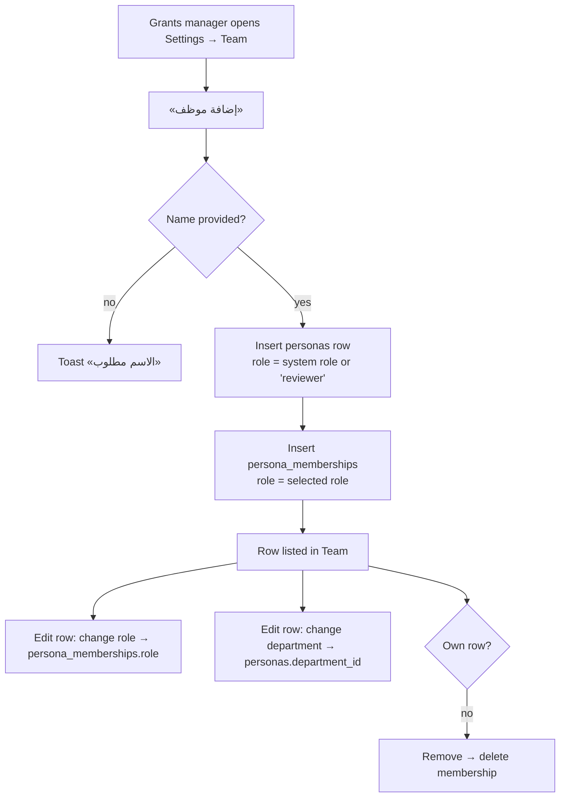
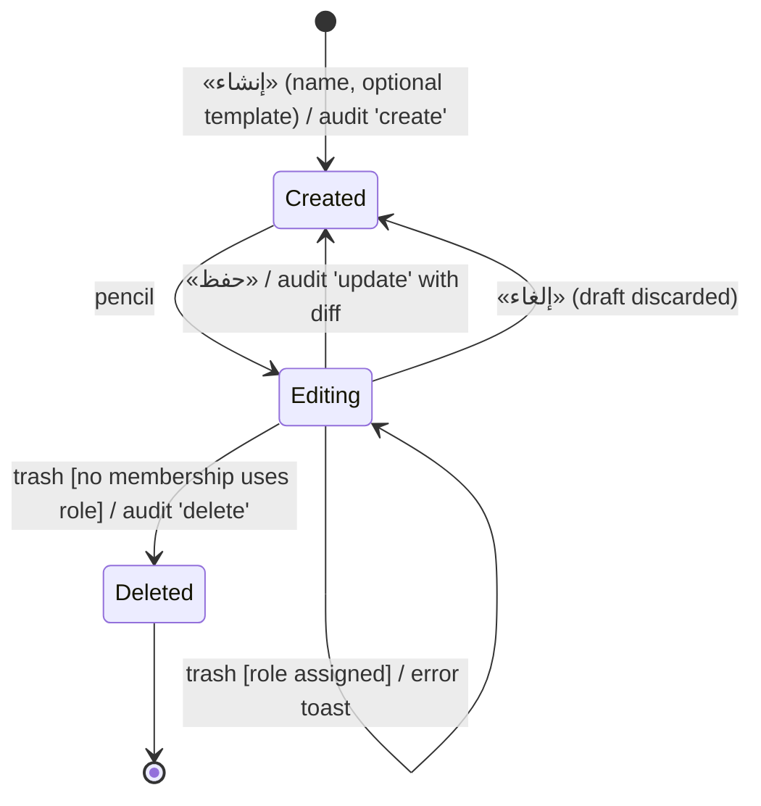
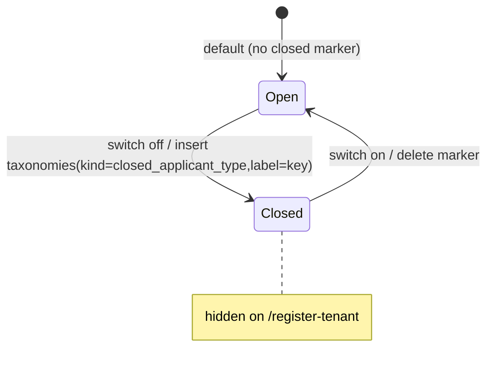
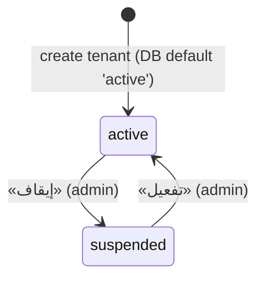
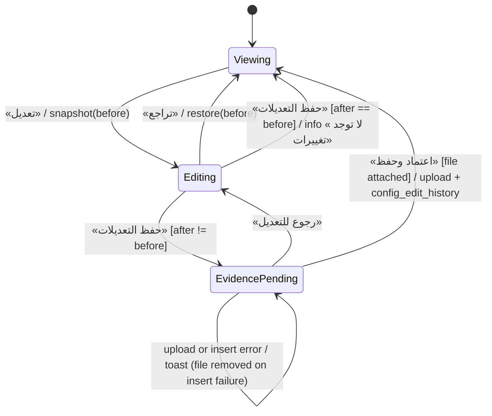
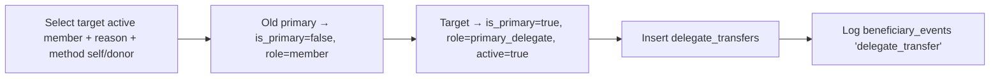

# CFG — Settings & Configuration

## 1. Scope & Coverage

**Files analyzed (source: `/home/user/manih`):**
- `src/routes/settings.tsx` — settings page and all nine tabs (Team, Roles, Departments, Workflow, Forms, Endowments, Templates, Taxonomies incl. Applicant Types, Appearance)
- `src/routes/admin.tsx` — platform admin page (tenants tab; registrations tab hosts `RegistrationReview` — see BEN; workshop tab hosts `WorkshopDeck` — see PLT)
- `src/lib/applicantTypes.ts`, `src/lib/memberships.ts`, `src/lib/configEdits.ts`
- `src/components/FormBuilder.tsx`, `src/components/PalettePicker.tsx`, `src/components/SectionTabs.tsx` (SETTINGS_TABS), `src/components/EditSession.tsx` (UI for configEdits)
- `src/routes/staff.$id.tsx`
- Supporting reads: `src/lib/persona.tsx` (roles, ROLE_LABELS), `src/components/AppShell.tsx` (NAV_BY_ROLE), `src/lib/data.ts` (FIELD_TYPE_LABELS), `src/lib/plans.ts` (endowment size/active), `src/routes/register-tenant.tsx` (closed-type consumer), `src/integrations/supabase/types.ts`, migrations for tenants, personas, persona_memberships, departments, templates, taxonomies, endowments, plan_level_endowments, application_forms, form_fields, config_edit_history, beneficiary_memberships, delegate_transfers.

**Coverage notes and limitations**
- Analysis is from source only; the live demo was not inspected. [Observed]
- Personas are switched through a demo persona switcher on one shared Supabase account; RLS allows any signed-in user (`supabase/migrations/20261006140739_*.sql`). All role restrictions documented here are UI-level only. [Observed]
- Out of module: Registration review UI (BEN), Workshop deck (PLT), program/engine/product configuration screens that host the edit session (PRG), endowment detail page `/endowments/$id` and plan allocation (PLN), entity team UI `BeneficiaryTeam` (BEN). `lib/memberships.ts` is documented here as a service library; its screens are in BEN/PTL.
- `tenant_roles` and `role_audit_log` exist in `types.ts` but no migration creates them (see ISS-CFG-05).

## 2. Screen Inventory

| Screen ID | Name (EN + Arabic label) | Route / Component | Roles | Purpose | Entry points | Exits / Navigates to |
|---|---|---|---|---|---|---|
| SCR-CFG-01 | Team — فريق العمل | `/settings?tab=team` (Team) | grants_manager (sidebar); hidden for admin | Manage the organization's staff, their role and department | Sidebar «الإعدادات» (default tab for non-admin); /admin gate link | /staff/$id (name link) |
| SCR-CFG-02 | Roles & Permissions — الأدوار والصلاحيات | `/settings?tab=roles` (Roles) | grants_manager; hidden for admin | View system role permissions; create/edit/delete custom roles; view role audit | Settings tabs; Workshop deck link (PLT) | Role audit sheet; New role dialog |
| SCR-CFG-03 | Departments — الإدارات | `/settings?tab=departments` | grants_manager, admin (default tab for admin) | Maintain organizational departments | Settings tabs | — |
| SCR-CFG-04 | Workflow hub — سير الإجراءات | `/settings?tab=workflow` | grants_manager, admin | Entry point to per-program stages/criteria/form configuration | Settings tabs | /programs/$id (see PRG) |
| SCR-CFG-05 | Form library — نماذج التقديم | `/settings?tab=forms` + FormBuilder | grants_manager, admin | Maintain reusable application forms and their fields | Settings tabs; «إدارة مكتبة النماذج» link on /programs/$id | — |
| SCR-CFG-06 | Endowments — الأوقاف | `/settings?tab=endowments` | grants_manager; hidden for admin | Register funding sources (endowments) used to fund plan tracks | Settings tabs; back link from /endowments/$id | /endowments/$id (see PLN) |
| SCR-CFG-07 | Templates — القوالب | `/settings?tab=templates` | grants_manager, admin | Maintain text templates (apology / contract / notification) | Settings tabs | Template editor dialog |
| SCR-CFG-08 | Taxonomies — التصنيفات (incl. أنواع المتقدمين) | `/settings?tab=taxonomies` | grants_manager, admin | Open/close applicant types for registration; maintain reference lists | Settings tabs | — |
| SCR-CFG-09 | Appearance — المظهر | `/settings?tab=appearance` (PalettePicker) | grants_manager, admin | Choose color palette for this device | Settings tabs | — |
| SCR-CFG-10 | Platform admin — الجهات والمستخدمون (بوابة الآدمن) | `/admin` (AdminPage) | admin only | Manage grantor organizations (tenants); host registration review and workshop deck tabs | Settings tab «الجهات والمستخدمون» (platform only); sidebar settings `also: /admin` | Registrations tab (see BEN); Workshop tab (see PLT) |
| SCR-CFG-11 | Admin access notice | `/admin` (AdminGate, non-admin) | Any non-admin persona | Explain page is platform-only and redirect to team settings | Direct URL | /settings?tab=team |
| SCR-CFG-12 | Staff profile — ملف الموظف وأداؤه | `/staff/$id` | Any staff persona (no guard) | Show a staff member's KPIs, open manual tasks and managed projects | Team table name link; assignee avatar on /tasks (see TSK) | /projects/$id (see PRJ) |
| SCR-CFG-13 | Config edit session — وضع التعديل / تأكيد التعديلات | `components/EditSession.tsx` (+ `lib/configEdits.ts`) | grants_manager, admin (screens in PRG) | Edit-by-session with mandatory evidence and change history for programs, engines, product catalog | «تعديل» button on PRG configuration pages | Change history section; evidence signed URL |

## 3. Screen Details

### Settings page shell (frame shared by SCR-CFG-01 … SCR-CFG-09)
- Header «الإعدادات» / «كل ما يخص تهيئة المنصة في مكان واحد»; `SectionTabs` with SETTINGS_TABS rendered as URL links (`?tab=`). [Observed] settings.tsx:57-69
- `tab` search param validated by zod enum of 9 values; invalid values fall back to the default tab (BR-CFG-02). [Observed] settings.tsx:28-31,56
- No route-level authorization: any persona can open `/settings?tab=…` by URL; only the sidebar hides it (settings item is in NAV_BY_ROLE for grants_manager and admin only). [Observed] AppShell.tsx:53-62

### SCR-CFG-01 Team (فريق العمل)
- Intro «موظفو جهتك فقط وأدوارهم وإداراتهم». [Observed] settings.tsx:120
- Table columns: الاسم (link to /staff/$id), البريد ("—" if empty), الدور (ROLE_LABELS or custom role label or raw value), الإدارة («بدون إدارة» if none), actions. [Observed] settings.tsx:123-139
- Row edit mode (pencil ↔ check): role select (system TEAM_ROLES + custom roles), department select, trash (not on own row). Changes save immediately on selection with toast. [Observed] settings.tsx:128-136
- Add-employee dialog: AI assist (free-text → name/email), الاسم (required, max 100), البريد (email, max 255), الدور select (default reviewer), الإدارة select (default none); buttons إلغاء / إضافة. [Observed] settings.tsx:140-151
- States: validation toast «الاسم مطلوب»; error toast «تعذّر إضافة الموظف»; success toasts; no loading or empty-state message (empty table). [Observed]; [Inferred] membership `active` flag not displayed.

### SCR-CFG-02 Roles & Permissions (الأدوار والصلاحيات)
- Toolbar card: role select (system roles suffixed «(نظامي)»), badge «نظامي — للقراءة فقط» for system roles, history icon, edit pencil (custom only); in edit mode حفظ / إلغاء / delete; header-level «كل الصلاحيات» action toggles. [Observed] settings.tsx:320-337
- Four permission group cards (الطلبات والمراجعة; المالية والمدفوعات; المشاريع والشواهد; الإعدادات والتخصيص) with 13 permissions; each row has icon toggles عرض/كتابة/حذف/تحديد الكل; group header has text toggles. Disabled unless editing. [Observed] settings.tsx:156-178,296-347
- New role dialog: اسم الدور (max 60, placeholder «مثال: منسق برامج»), «نسخ صلاحيات قالب» (optional system role), helper text; إلغاء / إنشاء. [Observed] settings.tsx:369-379
- Role audit sheet (left side): events (إنشاء الدور / تعديل الصلاحيات / حذف الدور), timestamp (ar-SA latn digits), actor name, per-permission diff "from ← to"; empty «لا توجد أحداث مسجلة لهذا الدور بعد»; «حفظ بدون تغييرات» for empty updates. [Observed] settings.tsx:349-367
- Errors: «اسم الدور مطلوب», «تعذّر إنشاء الدور», «الدور مُسند لموظفين — غيّر أدوارهم أولاً». [Observed]

### SCR-CFG-03 Departments (الإدارات)
- Inline add form (اسم الإدارة, max 100, «إضافة»). Grid of cards: name, «N مستخدم», member name chips (personas with department_id), trash. No empty state. [Observed] settings.tsx:388-409

### SCR-CFG-04 Workflow hub (سير الإجراءات)
- Explanatory text; grid of program cards (title, «سير الإجراءات · المعايير · النموذج») linking to `/programs/$id`. Programs list is not tenant-filtered (`usePrograms`). [Observed] settings.tsx:411-417; queries.ts:20-29

### SCR-CFG-05 Application form library (نماذج التقديم)
- Left list: forms with «مستخدم في N فرصة»; inline create («نموذج جديد» + «+»). Right card: form name, explanation, delete (disabled with tooltip «النموذج مستخدم في فرص» when used), FormBuilder. Empty: «لا توجد نماذج بعد.» [Observed] settings.tsx:467-499
- FormBuilder: field rows (label, * if required, type badge, options, «إلزامي» switch, delete); empty «لا توجد حقول بعد.»; add row (عنوان الحقل, type select, إلزامي checkbox, «إضافة حقل», options input when type=select). No edit of label/type/options, no reordering. [Observed] FormBuilder.tsx

### SCR-CFG-06 Endowments (الأوقاف)
- Explanatory text on single vs. multiple endowments. Table: الوقف (link), الوصف, الحجم الحالي (formatSAR of fundings or "—"), نشط (switch), delete. Add form: اسم الوقف, الوصف (اختياري), إضافة. No empty state; no delete confirmation. [Observed] settings.tsx:501-526

### SCR-CFG-07 Templates (القوالب)
- «قالب جديد» button; variables hint; grid of cards (kind label, name, 3-line body preview, edit pencil). Editor dialog: النوع select, الاسم, النص (textarea 6 rows); إلغاء / حفظ. No delete. [Observed] settings.tsx:419-449

### SCR-CFG-08 Taxonomies & applicant types (التصنيفات)
- Card «أنواع المتقدمين»: note that closed types do not appear on registration and government entities are added internally; switch per portal type showing label and identifier label (e.g., «رقم السجل التجاري»). [Observed] settings.tsx:73-83
- Three cards (أنواع الجهات, المناطق, الفئات المستهدفة) with removable chips and add input (max 80) + «+». [Observed] settings.tsx:451-465

### SCR-CFG-09 Appearance (المظهر)
- Card «التدرج اللوني», hint «تُحفظ على هذا الجهاز»; three swatch buttons (طيني, أخضر مائي, خزامى) with check on active. [Observed] PalettePicker.tsx

### SCR-CFG-10 Platform admin – Organizations
- Header «الإعدادات» + SectionTabs; inner Tabs (default «الجهات (N)», «طلبات تسجيل الجهات», «عرض ورشة العمل»); tab state not in URL. [Observed] admin.tsx:136-160
- Tenants table: الجهة, البريد (LTR), المستخدمون (count), تاريخ الإنشاء, الحالة badge (فعّالة / موقوفة), action (إيقاف / تفعيل). [Observed] admin.tsx:167-217
- New tenant dialog: AI assist, اسم الجهة (required, max 120), البريد الرسمي (email, LTR); button disabled while saving («جارٍ الحفظ...»). [Observed] admin.tsx:222-242

### SCR-CFG-11 Admin access notice
- Renders nothing while persona loading; non-admin sees «هذه الصفحة خاصة بإدارة المنصة» + link to team settings. [Observed] admin.tsx:58-71

### SCR-CFG-12 Staff profile & performance
- Header: name; description = role label · email. KPI cards: قرارات آخر 30 يوم, مهام منجزة, متوسط زمن إنجاز المهمة («—» if none), مهام عالقة. Cards: المهام العالقة (title + due date, red if overdue; empty «لا توجد مهام عالقة.»), المشاريع التي يشرف عليها (links; empty «لا يشرف على مشاريع.»). Loading skeleton; «الموظف غير موجود.» when not found. [Observed] staff.$id.tsx

### SCR-CFG-13 Configuration edit session & evidence dialog
- View mode: «تعديل» button. Edit mode: amber bar «وضع التعديل — التغييرات لا تُعتمد إلا بإرفاق المستند الشاهد» with تراجع and حفظ التعديلات; page controls wrapped in disabled fieldset when not editing. [Observed] EditSession.tsx:51-66,89-91
- Evidence dialog «تأكيد التعديلات»: المستند الشاهد (إلزامي) file + DocAiCheck (advisory), ملاحظة; «رجوع للتعديل» / «اعتماد وحفظ» (disabled without file). [Observed] EditSession.tsx:68-86
- History section «سجل التغييرات»: target name — note, actor · date, evidence button; empty «لا توجد تعديلات موثقة بعد.» [Observed] EditSession.tsx:93-119

## 4. Interaction Inventory

| INT ID | Screen | Trigger (control) | System response | Data written | Evidence |
|---|---|---|---|---|---|
| INT-CFG-001 | SCR-CFG-01 | «إضافة موظف» button | Opens Add-employee dialog (name, email, role, department, AI assist) | — | [Observed] settings.tsx:121,140-151 |
| INT-CFG-002 | SCR-CFG-01 | Dialog «إضافة» (submit) | Validates name; inserts persona then membership; toast; closes; refreshes | personas (tenant_id, name, email, role, department_id); persona_memberships (persona_id, tenant_id, role) | [Observed] settings.tsx:108-116 |
| INT-CFG-003 | SCR-CFG-01 | AI assist (AiAssist) in dialog | Proposes name/email from free text and fills form fields | — (proposal only) | [Observed] settings.tsx:143-144 |
| INT-CFG-004 | SCR-CFG-01 | Row pencil icon | Toggles row edit mode (role and department become selects; trash appears unless self) | — | [Observed] settings.tsx:135-136 |
| INT-CFG-005 | SCR-CFG-01 | Role select (edit mode) | Updates membership role immediately; toast «تم تحديث الدور» | persona_memberships.role | [Observed] settings.tsx:128 |
| INT-CFG-006 | SCR-CFG-01 | Department select (edit mode) | Updates persona department immediately | personas.department_id | [Observed] settings.tsx:131 |
| INT-CFG-007 | SCR-CFG-01 | Trash icon «إزالة من الفريق» | Deletes membership (no confirmation); hidden for own row | persona_memberships (delete) | [Observed] settings.tsx:136 |
| INT-CFG-008 | SCR-CFG-01 | Staff name link | Navigates to staff profile | — | [Observed] settings.tsx:126 |
| INT-CFG-009 | SCR-CFG-02 | Role select | Switches displayed role, exits edit mode, discards draft | — | [Observed] settings.tsx:321 |
| INT-CFG-010 | SCR-CFG-02 | «دور جديد» → dialog «إنشاء» | Validates name, copies optional template permissions, inserts role, logs audit 'create', selects new role | tenant_roles; role_audit_log | [Observed] settings.tsx:272-279 |
| INT-CFG-011 | SCR-CFG-02 | Pencil «تعديل الدور» (custom only) | Enters edit mode with draft = current permissions; toggles become enabled | — | [Observed] settings.tsx:327 |
| INT-CFG-012 | SCR-CFG-02 | Permission toggles (cell / group header / global header / «الكل») | Updates draft for view/write/delete of one, a group, or all permissions | — (draft) | [Observed] settings.tsx:253-256,296-313 |
| INT-CFG-013 | SCR-CFG-02 | «حفظ» | Encodes draft, updates role, logs per-permission from/to diff | tenant_roles.permissions; role_audit_log | [Observed] settings.tsx:263-271 |
| INT-CFG-014 | SCR-CFG-02 | «إلغاء» (edit) | Discards draft, exits edit mode | — | [Observed] settings.tsx:330 |
| INT-CFG-015 | SCR-CFG-02 | Trash «حذف الدور» | Blocks if any membership uses role (error toast); else deletes and logs 'delete' | tenant_roles (delete); role_audit_log | [Observed] settings.tsx:280-287 |
| INT-CFG-016 | SCR-CFG-02 | History icon «سجل الدور» | Opens side sheet with audit events for selected role (system or custom) | — | [Observed] settings.tsx:326,349-367 |
| INT-CFG-017 | SCR-CFG-03 | «إضافة» department form | Inserts department if name non-empty; clears input | departments | [Observed] settings.tsx:395 |
| INT-CFG-018 | SCR-CFG-03 | Trash on department card | Deletes department immediately (no confirmation) | departments (delete) → personas/projects.department_id set NULL (FK) | [Observed] settings.tsx:403; migration 20261004132647 |
| INT-CFG-019 | SCR-CFG-04 | Program card | Navigates to program configuration | — | [Observed] settings.tsx:415 |
| INT-CFG-020 | SCR-CFG-05 | Form list item | Selects form; loads its fields | — | [Observed] settings.tsx:481 |
| INT-CFG-021 | SCR-CFG-05 | «نموذج جديد» + «+» | Inserts form; selects it; toast | application_forms | [Observed] settings.tsx:483-488 |
| INT-CFG-022 | SCR-CFG-05 | Trash «حذف النموذج» | Disabled when used by ≥1 program; else deletes form (fields cascade) | application_forms (delete), form_fields (cascade) | [Observed] settings.tsx:493-494; migration 20261004144143 |
| INT-CFG-023 | SCR-CFG-05 | FormBuilder «إضافة حقل» | Inserts field with label, type, required, options (select only), sort_order | form_fields | [Observed] FormBuilder.tsx:16-24 |
| INT-CFG-024 | SCR-CFG-05 | FormBuilder «إلزامي» switch | Toggles required flag | form_fields.required | [Observed] FormBuilder.tsx:26 |
| INT-CFG-025 | SCR-CFG-05 | FormBuilder trash «حذف الحقل» | Deletes field (no confirmation) | form_fields (delete) | [Observed] FormBuilder.tsx:25 |
| INT-CFG-026 | SCR-CFG-06 | Endowment name link | Navigates to endowment detail | — | [Observed] settings.tsx:513 |
| INT-CFG-027 | SCR-CFG-06 | «نشط» switch | Updates active flag; refreshes plan data | endowments.active | [Observed] settings.tsx:516 |
| INT-CFG-028 | SCR-CFG-06 | Trash «حذف» | Deletes endowment (no confirmation; cascades plan_level_endowments) | endowments (delete) | [Observed] settings.tsx:517; migration 20261004184736 |
| INT-CFG-029 | SCR-CFG-06 | Add form «إضافة» | Inserts endowment with name and optional description | endowments | [Observed] settings.tsx:519-524 |
| INT-CFG-030 | SCR-CFG-07 | «قالب جديد» / pencil on card | Opens template editor (kind, name, body) | — | [Observed] settings.tsx:432,436,439-447 |
| INT-CFG-031 | SCR-CFG-07 | Editor «حفظ» | Ignores if name empty; inserts or updates template; toast | templates | [Observed] settings.tsx:425-430 |
| INT-CFG-032 | SCR-CFG-08 | Applicant type switch | Open → deletes closed marker; closed → inserts marker; toast | taxonomies (kind=closed_applicant_type, label=type key) | [Observed] settings.tsx:80; applicantTypes.ts:27-31 |
| INT-CFG-033 | SCR-CFG-08 | Taxonomy «+» add | Inserts value for kind if non-empty | taxonomies (kind, label) | [Observed] settings.tsx:460 |
| INT-CFG-034 | SCR-CFG-08 | Chip «×» | Deletes taxonomy value (no confirmation) | taxonomies (delete) | [Observed] settings.tsx:459 |
| INT-CFG-035 | SCR-CFG-09 | Palette card | Applies palette to document and stores in localStorage | localStorage `palette` | [Observed] PalettePicker.tsx:13-20,40-43 |
| INT-CFG-036 | SCR-CFG-10 | «جهة جديدة» → dialog «إنشاء الجهة» | Inserts tenant (name, contact email); toast; refresh | tenants | [Observed] admin.tsx:104-120,222-242 |
| INT-CFG-037 | SCR-CFG-10 | Row «إيقاف» / «تفعيل» | Toggles tenant status active↔suspended | tenants.status | [Observed] admin.tsx:122-134 |
| INT-CFG-038 | SCR-CFG-10 | Tab «طلبات تسجيل الجهات» | Renders RegistrationReview (see module BEN) | see BEN | [Observed] admin.tsx:153-155 |
| INT-CFG-039 | SCR-CFG-10 | Tab «عرض ورشة العمل» | Renders WorkshopDeck (see module PLT) | — | [Observed] admin.tsx:157-159 |
| INT-CFG-040 | SCR-CFG-11 | «الانتقال إلى فريق العمل» link | Navigates to /settings?tab=team | — | [Observed] admin.tsx:66 |
| INT-CFG-041 | SCR-CFG-12 | Project link | Navigates to project detail | — | [Observed] staff.$id.tsx:64 |
| INT-CFG-042 | SCR-CFG-13 | «تعديل» | Takes snapshot; enables controls (Editable fieldset); shows amber edit bar | — | [Observed] EditSession.tsx:27,51-61,89-91 |
| INT-CFG-043 | SCR-CFG-13 | «حفظ التعديلات» | Compares snapshot; if unchanged → info toast and exit; else opens evidence dialog | — | [Observed] EditSession.tsx:34-38 |
| INT-CFG-044 | SCR-CFG-13 | Evidence dialog «اعتماد وحفظ» | Requires file; AI doc check (advisory); uploads evidence; inserts history; rollback file on failure | storage attachments/config/...; config_edit_history | [Observed] EditSession.tsx:39-50,68-86; configEdits.ts:11-26 |
| INT-CFG-045 | SCR-CFG-13 | «تراجع» | Restores pre-edit snapshot via page-supplied restore() | Entity table restored (PRG) | [Observed] EditSession.tsx:28-33 |
| INT-CFG-046 | SCR-CFG-13 | History row evidence button | Creates 300 s signed URL and opens evidence in new tab | — | [Observed] EditSession.tsx:102-106 |

## 5. Shared Components & Dependencies

| Component / lib | Used for | Notes |
|---|---|---|
| `SectionTabs` / `SETTINGS_TABS` | Settings navigation (also on /admin) | platformOnly / tenantOnly filtering (BR-CFG-01) |
| `AiAssist` + `fillForm` | Prefill Add-employee and New-tenant dialogs | Proposes values only (see PLT) |
| `FormBuilder` | Field editor for library forms | Direct DB writes, no error handling |
| `PalettePicker` (`applyPalette`) | Appearance tab | Boot script in `__root.tsx` re-applies |
| `EditSession` (`useEditSession`, `Editable`, `ConfigEditHistory`) + `lib/configEdits.ts` | Evidence-backed config edits on PRG pages | Entity types: product_catalog, engine, program |
| `DocAiCheck` | Advisory AI check of evidence file | See REV/attachments; never blocks |
| `RegistrationReview` | /admin registrations tab | See module BEN |
| `WorkshopDeck` | /admin workshop tab | See module PLT |
| `lib/applicantTypes.ts` | Taxonomies tab, public registration | See PTL/PLT for registration |
| `lib/memberships.ts` | Entity team (BeneficiaryTeam, beneficiaries list/detail, portal) | UI in BEN/PTL |
| `usePersona` (`lib/persona.tsx`) | Current persona, tenant, role labels | Demo persona switcher (PLT) |
| `usePlanData`, `endowmentSize` (`lib/plans.ts`) | Endowment current size | See PLN |
| `usePrograms` (`lib/queries.ts`) | Workflow hub, form usage counts | Not tenant-filtered |

## 6. Business Process Workflows

### 6.1 Employee onboarding and maintenance

### 6.2 Custom role lifecycle

### 6.3 Applicant type availability

Government type is never shown on the portal and has no switch. [Observed]

### 6.4 Tenant status

No downstream effect of suspension was found in code (ISS-CFG-08). [Observed]

### 6.5 Evidence-backed configuration edit (programs, engines, product catalog)

### 6.6 Partner primary-delegate transfer (service library; UI in BEN)

## 7. Business Rules

| BR ID | Rule | Evidence label + reference |
|---|---|---|
| BR-CFG-01 | Settings tab visibility: «الجهات والمستخدمون» (/admin) is shown only to the platform admin; Team, Roles and Endowments tabs are tenant-only (hidden for admin); other tabs show to both. | [Observed] `src/components/SectionTabs.tsx:12,23-34` |
| BR-CFG-02 | Default settings tab: admin → Departments; others → Team. An admin requesting tab=team is shown Departments. | [Observed] `src/routes/settings.tsx:56` |
| BR-CFG-03 | /admin renders only for the admin persona; any other persona sees a notice and a link to Settings → Team. | [Observed] `src/routes/admin.tsx:58-71` |
| BR-CFG-04 | The Team list shows only memberships of the current tenant whose role is neither 'applicant' nor 'admin'. | [Observed] `src/routes/settings.tsx:93` |
| BR-CFG-05 | Adding an employee requires a name (≤100 chars); email optional (≤255, email input type); department optional. | [Observed] `src/routes/settings.tsx:112,145-148` |
| BR-CFG-06 | On employee creation the persona's base role is the selected system role, or 'reviewer' when a custom role is selected; the membership stores the selected role (system key or custom role id). | [Observed] `src/routes/settings.tsx:113-115` |
| BR-CFG-07 | A user cannot remove their own membership from the team (trash hidden on own row). | [Observed] `src/routes/settings.tsx:136` |
| BR-CFG-08 | System roles (grants_manager, reviewer, project_manager, finance, ceo, committee_secretary) are read-only. Their matrix is derived: View if the role is listed for a permission; Write if listed and the permission key does not end with '_view'; Delete only for grants_manager. | [Observed] `src/routes/settings.tsx:155-199` |
| BR-CFG-09 | Custom role permissions are stored as strings: 'key' means view+write+delete; 'key:view|write|delete' grants a single level. | [Observed] `src/routes/settings.tsx:200-219` |
| BR-CFG-10 | A custom role requires a name (≤60 chars) and may start from a copy of a system role's permissions; otherwise it starts empty. | [Observed] `src/routes/settings.tsx:272-279,372-375` |
| BR-CFG-11 | A custom role cannot be deleted while any membership in the tenant is assigned to it. | [Observed] `src/routes/settings.tsx:282` |
| BR-CFG-12 | Every custom-role create, permission update and delete is written to role_audit_log with actor, timestamp and, for updates, a per-permission from/to diff. | [Observed] `src/routes/settings.tsx:258-287` |
| BR-CFG-13 | The permission matrix is descriptive only: no code reads tenant_roles.permissions or the system matrix to allow/deny actions; access is driven by personas.role in the sidebar and per-page checks. | [Observed] `grep of src for tenant_roles/.permissions (only settings.tsx)` |
| BR-CFG-14 | Department name is required (trimmed, ≤100). Deleting a department nulls department_id on personas and projects (FK ON DELETE SET NULL). | [Observed] `src/routes/settings.tsx:395-396; supabase/migrations/20261004132647_*.sql` |
| BR-CFG-15 | Templates have a kind of apology (اعتذار), contract (عقد) or notification (إشعار; default) and a required name; the body may use {ref}, {program}, {beneficiary}, {amount} placeholders. | [Observed] `src/routes/settings.tsx:42,425-433` |
| BR-CFG-16 | Reference taxonomies are per tenant in three kinds: account_type (أنواع الجهات), region (المناطق), target_group (الفئات المستهدفة); a value is required and ≤80 chars. | [Observed] `src/routes/settings.tsx:43,451-465` |
| BR-CFG-17 | Applicant types are a fixed list (association, nonprofit, company, individual, endowment, government, other). Government is internal-only (portal=false) and is not switchable; others are open by default and closed per tenant by a taxonomies row of kind 'closed_applicant_type' whose label is the type key. | [Observed] `src/lib/applicantTypes.ts:5-33` |
| BR-CFG-18 | Closed applicant types are hidden from the public registration page. | [Observed] `src/routes/register-tenant.tsx:33-34` |
| BR-CFG-19 | An application form cannot be deleted while any grant program references it (form_id); deleting a form deletes its fields (cascade). | [Observed] `src/routes/settings.tsx:478,493; supabase/migrations/20261004144143_*.sql` |
| BR-CFG-20 | Form fields require a label; type ∈ text, textarea, number, date, select, file, email, phone; select options are split on ',' or '،' and trimmed; new fields append at sort_order = count+1. | [Observed] `src/components/FormBuilder.tsx:15-24; src/lib/data.ts:304-313` |
| BR-CFG-21 | Library form fields are shown to applicants after the base data in every program that uses the form (one form reused across periods). | [Observed] `src/routes/settings.tsx:492; AGENTS.md` |
| BR-CFG-22 | Endowment name is required; description optional. If the tenant has a single endowment the whole plan is counted against it and no split is shown; splits appear only with 2+ active endowments. | [Observed] `src/routes/settings.tsx:510,519-520; AGENTS.md` |
| BR-CFG-23 | Only active endowments participate in plan allocation; the displayed current size is the sum of the endowment's fundings (see PLN). | [Observed] `src/lib/plans.ts:118-121,195; src/routes/settings.tsx:515` |
| BR-CFG-24 | Deleting an endowment is not guarded and cascades its plan_level_endowments shares. | [Observed] `src/routes/settings.tsx:517; supabase/migrations/20261004184736_*.sql` |
| BR-CFG-25 | A tenant requires a name (≤120); contact email optional; status toggles between active and suspended; user count = number of persona_memberships rows for the tenant (aggregate only, no personal data). | [Observed] `src/routes/admin.tsx:91-134,231` |
| BR-CFG-26 | Committing a configuration edit requires an evidence document; it is uploaded to attachments/config/<entity_type>/<entity_id|catalog>/<timestamp>-<sanitized name>, and a config_edit_history row stores before/after snapshots, note and actor. If the history insert fails the uploaded file is removed. | [Observed] `src/lib/configEdits.ts:11-26` |
| BR-CFG-27 | An edit session with no differences between the entry snapshot and the current state is closed without saving ('لا توجد تغييرات'); cancel restores the entry snapshot. | [Observed] `src/components/EditSession.tsx:28-38; src/lib/configEdits.ts:28` |
| BR-CFG-28 | Configuration history is append-only (only SELECT and INSERT policies). | [Observed] `supabase/migrations/20261006140739_*.sql:13-16` |
| BR-CFG-29 | The colour palette (clay default, teal, lavender) is a per-device preference in localStorage, applied before render. | [Observed] `src/components/PalettePicker.tsx; src/routes/__root.tsx:125` |
| BR-CFG-30 | Staff KPIs: decisions in last 30 days = application_status_history rows changed_by the person + payment_approvals by the person; completed tasks = manual tasks done; average completion = mean(updated_at − created_at) of done manual tasks in days; open tasks = manual tasks not done; overdue due dates shown in red. | [Observed] `src/routes/staff.$id.tsx:25-52,60` |
| BR-CFG-31 | Partner-entity memberships: one person may represent many entities with different roles (primary_delegate, project_manager, finance, member); each entity has one primary delegate; the primary cannot be deactivated before delegation is transferred; deactivation sets active=false and end_at. | [Observed] `src/lib/memberships.ts:1-49` |
| BR-CFG-32 | Adding an entity team member reuses an existing persona with the same email, otherwise creates an applicant persona; the membership is upserted on (persona_id, beneficiary_id). | [Observed] `src/lib/memberships.ts:61-78` |
| BR-CFG-33 | Transferring primary delegation demotes the previous primary to 'member', promotes the target (active), records delegate_transfers (reason, method self|donor) and a beneficiary_events 'delegate_transfer' entry. | [Observed] `src/lib/memberships.ts:86-101` |
| BR-CFG-34 | Inviting an entity sets account_status='invited', invited_email and invited_at and logs an 'invited' event. | [Observed] `src/lib/memberships.ts:103-107` |

## 8. Data Requirements

### tenants (grantor organization)
| Field | Type | Req | Meaning |
|---|---|---|---|
| id | uuid | Y | PK |
| name | text | Y | Organization name |
| contact_email | text | N | Official email |
| status | text | Y | 'active' (default) / 'suspended' |
| created_at | timestamptz | Y | Creation date |
Relationships: parent of personas, persona_memberships, departments, templates, taxonomies, endowments, application_forms, tenant_roles (cascade on most). [Observed] migration 20261004085937

### personas (staff and applicant users)
id, tenant_id (FK tenants), name (req), email, role (persona_role enum: admin, grants_manager, reviewer, project_manager, finance, ceo, committee_secretary, applicant), beneficiary_id, avatar_url, department_id (FK departments, ON DELETE SET NULL). `role` drives sidebar/home and task derivation. [Observed]

### persona_memberships (per-organization role)
| Field | Type | Req | Meaning |
|---|---|---|---|
| id | uuid | Y | PK |
| persona_id | uuid | Y | FK personas (cascade) |
| tenant_id | uuid | Y | FK tenants (cascade) |
| role | text | Y | System role key or tenant_roles.id |
| active | boolean | Y | default true; used by task assignee validation (TSK) |
| created_at | timestamptz | Y | |
Unique (persona_id, tenant_id). [Observed] migration 20261004103715

### tenant_roles (custom roles)
id, tenant_id, label (req, ≤60 UI), permissions text[] (encoded per BR-CFG-09), created_at. **No migration in repo.** [Observed] types.ts

### role_audit_log
id, tenant_id, role_id (system key or custom id), role_label, action ('create'|'update'|'delete'), changes jsonb ({template} or {permKey: {from, to}}), actor_id, created_at. **No migration in repo.** [Observed]

### departments
id, tenant_id (cascade), name (req), created_at. Referenced by personas.department_id, projects.department_id, initiatives.department_id (SET NULL). [Observed]

### templates
id, tenant_id, kind ('apology'|'contract'|'notification'; free text in DB), name (req), body (default ''), created_at. [Observed]

### taxonomies
id, tenant_id, kind ('account_type'|'region'|'target_group'|'closed_applicant_type'), label (req), sort_order int (default 0, unused), created_at. [Observed]

### endowments
id, tenant_id (cascade), name (req), description, active (default true), created_at. Children: plan_level_endowments (percent, cascade on delete), fundings (see PLN). [Observed]

### application_forms
id, tenant_id (cascade), name (req), description (not editable in UI), created_at. Referenced by grant_programs.form_id (SET NULL). [Observed]

### form_fields
id, form_id (FK application_forms, cascade), program_id (legacy, nullable), label (req), field_type (default 'text'), required (default false), options text[], sort_order int, created_at. [Observed]

### config_edit_history (append-only)
id, tenant_id, entity_type ('product_catalog'|'engine'|'program'), entity_id (null = catalog), target_name, before_values jsonb, after_values jsonb, note, evidence_name (req), evidence_path (req), actor_id (FK personas), created_at. Index (entity_type, entity_id). [Observed]

### beneficiary_memberships / delegate_transfers (service library)
beneficiary_memberships: id, persona_id, beneficiary_id, role (primary_delegate|project_manager|finance|member), is_primary, active, national_id, mobile, verified_via, start_at, end_at; unique (persona_id, beneficiary_id). delegate_transfers: id, beneficiary_id, from_persona_id, to_persona_id, reason, method ('self'|'donor'), created_at (insert-only). [Observed]

### Device-local data
localStorage `palette` (clay|teal|lavender). [Observed]

## 9. Product Structure

**EP-CFG-01 — Organization & Access Management**: Staff, roles and permissions, departments, staff performance and partner-entity membership services.

- FT-CFG-01 — Team member management (Must)
- FT-CFG-02 — Roles & permission matrix (Must)
- FT-CFG-03 — Role change audit log (Should)
- FT-CFG-04 — Departments (Should)
- FT-CFG-05 — Staff performance profile (Should)
- FT-CFG-16 — Partner-entity membership services (Must)

**EP-CFG-02 — Grant Configuration Libraries**: Reusable application forms, workflow configuration entry, text templates, reference taxonomies and applicant types.

- FT-CFG-06 — Application form library & builder (Must)
- FT-CFG-07 — Workflow settings hub (Could)
- FT-CFG-08 — Communication templates (Should)
- FT-CFG-09 — Reference taxonomies (Should)
- FT-CFG-10 — Applicant type registration switch (Should)

**EP-CFG-03 — Funding Source Configuration**: Registry of endowments (funding sources) used by annual plans.

- FT-CFG-11 — Endowment registry (Must)

**EP-CFG-04 — Platform Administration**: Platform-level management of grantor organizations and separation of platform vs. tenant settings.

- FT-CFG-12 — Organization (tenant) management (Must)
- FT-CFG-13 — Platform vs. tenant settings separation (Must)

**EP-CFG-05 — Configuration Governance & Personalization**: Evidence-backed, audited configuration changes and per-device appearance.

- FT-CFG-14 — Evidence-backed configuration edits (Must)
- FT-CFG-15 — Appearance palette (Could)

## 10. Features

### FT-CFG-01 — Team member management

- **Feature ID:** FT-CFG-01 (Epic EP-CFG-01)
- **Name:** Team member management
- **Description:** List, add, edit (role, department) and remove the organization's staff.
- **Business Objective:** Let each grantor organization administer its own staff roster.
- **Expected Business Value:** [To Confirm] — not stated in prototype; inferred: decentralised user administration per tenant.
- **Primary User Roles:** grants_manager
- **Scope:**
  - Team table
  - Add-employee dialog with AI prefill
  - Inline role/department edit
  - Remove membership (not self)
- **Out of Scope:**
  - Real authentication/invitations for staff (PLT)
  - Applicant/partner users (BEN)
  - Platform admins
- **Functional Requirements:** FR-CFG-001, FR-CFG-002, FR-CFG-003, FR-CFG-004
- **Business Rules:** BR-CFG-04, BR-CFG-05, BR-CFG-06, BR-CFG-07
- **Dependencies:** PLT persona model; FT-CFG-02 custom roles; FT-CFG-04 departments
- **Related Screens:** SCR-CFG-01, SCR-CFG-12
- **Acceptance Criteria:**
  - Only tenant staff (no applicant/admin) are listed
  - A new employee appears with chosen role and department
  - A user cannot remove themselves
- **Open Questions:** OQ-CFG-01; OQ-CFG-02
- **Assumptions:**
  - Email uniqueness is not required by the prototype
- **Priority Recommendation (MoSCoW):** Must

### FT-CFG-02 — Roles & permission matrix

- **Feature ID:** FT-CFG-02 (Epic EP-CFG-01)
- **Name:** Roles & permission matrix
- **Description:** Read-only matrix for system roles and editable custom roles with view/write/delete per permission.
- **Business Objective:** Make each role's responsibilities transparent and allow organization-specific roles.
- **Expected Business Value:** [To Confirm] — not stated in prototype
- **Primary User Roles:** grants_manager
- **Scope:**
  - 13 permissions in 4 groups
  - System role matrix (derived)
  - Custom role create (with template copy) / edit / delete
- **Out of Scope:**
  - Runtime enforcement (not implemented — see FR-CFG-009 Recommended)
  - Per-record permissions
- **Functional Requirements:** FR-CFG-005, FR-CFG-006, FR-CFG-007, FR-CFG-008, FR-CFG-009
- **Business Rules:** BR-CFG-08, BR-CFG-09, BR-CFG-10, BR-CFG-11, BR-CFG-13
- **Dependencies:** FT-CFG-03 audit; PLT navigation by role
- **Related Screens:** SCR-CFG-02
- **Acceptance Criteria:**
  - System roles cannot be edited
  - Custom role permission changes persist
  - Assigned custom roles cannot be deleted
- **Open Questions:** OQ-CFG-01
- **Assumptions:**
  - Permission list is fixed in code
- **Priority Recommendation (MoSCoW):** Must

### FT-CFG-03 — Role change audit log

- **Feature ID:** FT-CFG-03 (Epic EP-CFG-01)
- **Name:** Role change audit log
- **Description:** Record and display the history of custom role creation, permission changes and deletion.
- **Business Objective:** Accountability for access-right changes.
- **Expected Business Value:** Inferred: audit/compliance for access changes; [To Confirm] — not stated in prototype
- **Primary User Roles:** grants_manager
- **Scope:**
  - Audit insert on create/update/delete
  - Per-role audit side sheet with diffs
- **Out of Scope:**
  - Audit of team membership changes (not implemented)
- **Functional Requirements:** FR-CFG-010, FR-CFG-011
- **Business Rules:** BR-CFG-12
- **Dependencies:** FT-CFG-02
- **Related Screens:** SCR-CFG-02
- **Acceptance Criteria:**
  - Each change shows actor, time, and from→to per permission
- **Open Questions:** OQ-CFG-12
- **Assumptions:**
  - Actor = currently selected demo persona
- **Priority Recommendation (MoSCoW):** Should

### FT-CFG-04 — Departments

- **Feature ID:** FT-CFG-04 (Epic EP-CFG-01)
- **Name:** Departments
- **Description:** Maintain the organization's departments and see member counts.
- **Business Objective:** Organise staff and initiatives/projects by department.
- **Expected Business Value:** [To Confirm] — not stated in prototype
- **Primary User Roles:** grants_manager, admin
- **Scope:**
  - Add department
  - List with member chips
  - Delete department
- **Out of Scope:**
  - Department hierarchy
  - Department heads
- **Functional Requirements:** FR-CFG-012, FR-CFG-013, FR-CFG-014
- **Business Rules:** BR-CFG-14
- **Dependencies:** PRJ (projects.department_id); PLN initiatives
- **Related Screens:** SCR-CFG-03
- **Acceptance Criteria:**
  - Departments listed with correct member counts
  - Deleting a department unassigns staff and projects
- **Open Questions:** None
- **Assumptions:**
  - Names need not be unique
- **Priority Recommendation (MoSCoW):** Should

### FT-CFG-05 — Staff performance profile

- **Feature ID:** FT-CFG-05 (Epic EP-CFG-01)
- **Name:** Staff performance profile
- **Description:** Per-staff page with decision and task KPIs, open tasks and managed projects.
- **Business Objective:** Give managers visibility of individual workload and throughput.
- **Expected Business Value:** [To Confirm] — not stated in prototype
- **Primary User Roles:** grants_manager, all staff
- **Scope:**
  - KPIs (decisions 30 days, done tasks, avg completion, open tasks)
  - Open manual tasks list
  - Managed projects list
- **Out of Scope:**
  - Derived (workflow/payment) tasks in KPIs
  - Period filters
- **Functional Requirements:** FR-CFG-015, FR-CFG-016, FR-CFG-017
- **Business Rules:** BR-CFG-30
- **Dependencies:** TSK manual_tasks; REV status history; FIN payment approvals; PRJ projects
- **Related Screens:** SCR-CFG-12
- **Acceptance Criteria:**
  - KPIs match the formulas in BR-CFG-30
  - Overdue tasks highlighted
- **Open Questions:** OQ-CFG-09
- **Assumptions:**
  - Only manual tasks count as tasks
- **Priority Recommendation (MoSCoW):** Should

### FT-CFG-06 — Application form library & builder

- **Feature ID:** FT-CFG-06 (Epic EP-CFG-02)
- **Name:** Application form library & builder
- **Description:** Per-organization library of application forms with field builder, reusable across programs and periods.
- **Business Objective:** Reuse one application form across programs instead of per-program forms.
- **Expected Business Value:** Inferred from AGENTS.md: one form reused across periods; [To Confirm] — not stated in prototype
- **Primary User Roles:** grants_manager, admin
- **Scope:**
  - Form list with usage count
  - Create/delete form
  - Add field, toggle required, delete field
- **Out of Scope:**
  - Field editing/reordering (Recommended FR-CFG-023)
  - Conditional logic
  - Program-to-form assignment (PRG)
- **Functional Requirements:** FR-CFG-018, FR-CFG-019, FR-CFG-020, FR-CFG-021, FR-CFG-022, FR-CFG-023
- **Business Rules:** BR-CFG-19, BR-CFG-20, BR-CFG-21
- **Dependencies:** PRG grant_programs.form_id; PTL application form rendering
- **Related Screens:** SCR-CFG-05
- **Acceptance Criteria:**
  - Used forms cannot be deleted
  - Select fields store options
  - Fields appear in applicant form of programs using the form
- **Open Questions:** OQ-CFG-07
- **Assumptions:**
  - Applications freeze data in applications.snapshot, so field changes do not alter submitted data
- **Priority Recommendation (MoSCoW):** Must

### FT-CFG-07 — Workflow settings hub

- **Feature ID:** FT-CFG-07 (Epic EP-CFG-02)
- **Name:** Workflow settings hub
- **Description:** Settings tab listing programs as entry points to their stages, committee secretary, criteria and form.
- **Business Objective:** Single place to reach per-program workflow configuration.
- **Expected Business Value:** [To Confirm] — not stated in prototype
- **Primary User Roles:** grants_manager, admin
- **Scope:**
  - Program cards linking to /programs/$id
- **Out of Scope:**
  - Stage/criteria editing itself (PRG)
- **Functional Requirements:** FR-CFG-024
- **Business Rules:** None
- **Dependencies:** PRG
- **Related Screens:** SCR-CFG-04
- **Acceptance Criteria:**
  - Each program of the tenant is listed and opens its configuration
- **Open Questions:** None
- **Assumptions:**
  - Hub only; configuration rules live in PRG
- **Priority Recommendation (MoSCoW):** Could

### FT-CFG-08 — Communication templates

- **Feature ID:** FT-CFG-08 (Epic EP-CFG-02)
- **Name:** Communication templates
- **Description:** Maintain apology, contract and notification text templates with placeholders.
- **Business Objective:** Standardise outgoing communications.
- **Expected Business Value:** [To Confirm] — not stated in prototype
- **Primary User Roles:** grants_manager, admin
- **Scope:**
  - List
  - Create/edit (kind, name, body)
  - Placeholder hint
- **Out of Scope:**
  - Template rendering/merge, sending, delete (not implemented)
- **Functional Requirements:** FR-CFG-025, FR-CFG-026, FR-CFG-027
- **Business Rules:** BR-CFG-15
- **Dependencies:** REV (apology/close), PRJ (contracts) — consumers to be confirmed
- **Related Screens:** SCR-CFG-07
- **Acceptance Criteria:**
  - Template saved with kind, name and body
- **Open Questions:** OQ-CFG-03
- **Assumptions:**
  - Placeholders are documented only
- **Priority Recommendation (MoSCoW):** Should

### FT-CFG-09 — Reference taxonomies

- **Feature ID:** FT-CFG-09 (Epic EP-CFG-02)
- **Name:** Reference taxonomies
- **Description:** Tenant-maintained value lists: entity types, regions, target groups.
- **Business Objective:** Configurable reference data instead of hard-coded lists.
- **Expected Business Value:** [To Confirm] — not stated in prototype
- **Primary User Roles:** grants_manager, admin
- **Scope:**
  - Add value
  - Delete value
- **Out of Scope:**
  - Consumption by registration/partner forms (not implemented)
  - Ordering
- **Functional Requirements:** FR-CFG-028, FR-CFG-029
- **Business Rules:** BR-CFG-16
- **Dependencies:** PTL/BEN forms (future consumers)
- **Related Screens:** SCR-CFG-08
- **Acceptance Criteria:**
  - Values can be added and removed per kind
- **Open Questions:** OQ-CFG-04
- **Assumptions:**
  - None
- **Priority Recommendation (MoSCoW):** Should

### FT-CFG-10 — Applicant type registration switch

- **Feature ID:** FT-CFG-10 (Epic EP-CFG-02)
- **Name:** Applicant type registration switch
- **Description:** Open or close each applicant type for public registration per organization.
- **Business Objective:** Control which kinds of partners may self-register.
- **Expected Business Value:** [To Confirm] — not stated in prototype
- **Primary User Roles:** grants_manager, admin
- **Scope:**
  - Switch per portal type
  - Closed types hidden on registration
- **Out of Scope:**
  - Government partners (internal only, BEN)
- **Functional Requirements:** FR-CFG-030, FR-CFG-031
- **Business Rules:** BR-CFG-17, BR-CFG-18
- **Dependencies:** PTL/PLT registration page
- **Related Screens:** SCR-CFG-08
- **Acceptance Criteria:**
  - Closing a type hides it on the registration page
  - Government is never listed
- **Open Questions:** OQ-CFG-11
- **Assumptions:**
  - Registration page reads the demo TENANT_ID
- **Priority Recommendation (MoSCoW):** Should

### FT-CFG-11 — Endowment registry

- **Feature ID:** FT-CFG-11 (Epic EP-CFG-03)
- **Name:** Endowment registry
- **Description:** Register funding sources (endowments), activate/deactivate, see current size and open detail.
- **Business Objective:** Know which funding sources finance plan tracks.
- **Expected Business Value:** [To Confirm] — not stated in prototype
- **Primary User Roles:** grants_manager, finance (per matrix)
- **Scope:**
  - List with size
  - Add
  - Activate/deactivate
  - Delete
- **Out of Scope:**
  - Funding entries and plan splits (PLN)
- **Functional Requirements:** FR-CFG-032, FR-CFG-033, FR-CFG-034, FR-CFG-035
- **Business Rules:** BR-CFG-22, BR-CFG-23, BR-CFG-24
- **Dependencies:** PLN plans.ts, /endowments/$id
- **Related Screens:** SCR-CFG-06
- **Acceptance Criteria:**
  - Only active endowments participate in plan
  - Size equals sum of fundings
- **Open Questions:** OQ-CFG-05
- **Assumptions:**
  - None
- **Priority Recommendation (MoSCoW):** Must

### FT-CFG-12 — Organization (tenant) management

- **Feature ID:** FT-CFG-12 (Epic EP-CFG-04)
- **Name:** Organization (tenant) management
- **Description:** Platform admin lists, creates and suspends/activates grantor organizations.
- **Business Objective:** Onboard and control organizations on the multi-tenant platform.
- **Expected Business Value:** [To Confirm] — not stated in prototype
- **Primary User Roles:** admin
- **Scope:**
  - Tenants table
  - Create tenant
  - Suspend/activate
- **Out of Scope:**
  - Tenant self-registration (PLT)
  - Registration review (BEN)
  - Effects of suspension (not implemented)
- **Functional Requirements:** FR-CFG-036, FR-CFG-037, FR-CFG-038, FR-CFG-039
- **Business Rules:** BR-CFG-25
- **Dependencies:** PLT
- **Related Screens:** SCR-CFG-10
- **Acceptance Criteria:**
  - Admin sees all tenants with user counts
  - Status toggles
- **Open Questions:** OQ-CFG-06
- **Assumptions:**
  - None
- **Priority Recommendation (MoSCoW):** Must

### FT-CFG-13 — Platform vs. tenant settings separation

- **Feature ID:** FT-CFG-13 (Epic EP-CFG-04)
- **Name:** Platform vs. tenant settings separation
- **Description:** Tab visibility, default tab and admin-only gate separate platform administration from tenant configuration.
- **Business Objective:** Delegate user administration to each organization while keeping platform admin separate.
- **Expected Business Value:** Inferred from admin.tsx:91 comment; [To Confirm] — not stated in prototype
- **Primary User Roles:** admin, grants_manager
- **Scope:**
  - Tab filtering
  - Default tab
  - /admin gate
  - Route-level authorization (Recommended)
- **Out of Scope:**
  - Real auth (PLT)
- **Functional Requirements:** FR-CFG-040, FR-CFG-041, FR-CFG-042, FR-CFG-043
- **Business Rules:** BR-CFG-01, BR-CFG-02, BR-CFG-03
- **Dependencies:** PLT AppShell
- **Related Screens:** SCR-CFG-10, SCR-CFG-11, SCR-CFG-01
- **Acceptance Criteria:**
  - Admin never sees Team/Roles/Endowments tabs
  - Non-admin cannot use /admin
- **Open Questions:** OQ-CFG-02
- **Assumptions:**
  - None
- **Priority Recommendation (MoSCoW):** Must

### FT-CFG-14 — Evidence-backed configuration edits

- **Feature ID:** FT-CFG-14 (Epic EP-CFG-05)
- **Name:** Evidence-backed configuration edits
- **Description:** Edit sessions with snapshot, mandatory evidence document, rollback and append-only change history for programs, engines and product catalog.
- **Business Objective:** Every configuration change is attributable and supported by a document.
- **Expected Business Value:** Inferred: auditability of configuration; [To Confirm] — not stated in prototype
- **Primary User Roles:** grants_manager, admin
- **Scope:**
  - Edit/view mode
  - No-change detection
  - Evidence dialog
  - Rollback
  - History with evidence download
- **Out of Scope:**
  - Settings tabs in this module (they save directly — see ISS-CFG-21)
  - Approval workflow for config changes
- **Functional Requirements:** FR-CFG-044, FR-CFG-045, FR-CFG-046, FR-CFG-047, FR-CFG-048
- **Business Rules:** BR-CFG-26, BR-CFG-27, BR-CFG-28
- **Dependencies:** PRG pages; attachments bucket; DocAiCheck
- **Related Screens:** SCR-CFG-13
- **Acceptance Criteria:**
  - Cannot commit without evidence
  - Cancel restores
  - History lists evidence
- **Open Questions:** OQ-CFG-08
- **Assumptions:**
  - None
- **Priority Recommendation (MoSCoW):** Must

### FT-CFG-15 — Appearance palette

- **Feature ID:** FT-CFG-15 (Epic EP-CFG-05)
- **Name:** Appearance palette
- **Description:** Per-device colour palette selection.
- **Business Objective:** Visual personalisation.
- **Expected Business Value:** [To Confirm] — not stated in prototype
- **Primary User Roles:** all staff
- **Scope:**
  - Three palettes
  - Persist per device
- **Out of Scope:**
  - Tenant branding
- **Functional Requirements:** FR-CFG-049
- **Business Rules:** BR-CFG-29
- **Dependencies:** PLT theme
- **Related Screens:** SCR-CFG-09
- **Acceptance Criteria:**
  - Selected palette persists after reload on the same device
- **Open Questions:** OQ-CFG-10
- **Assumptions:**
  - None
- **Priority Recommendation (MoSCoW):** Could

### FT-CFG-16 — Partner-entity membership services

- **Feature ID:** FT-CFG-16 (Epic EP-CFG-01)
- **Name:** Partner-entity membership services
- **Description:** Library services for partner entity teams: fetch memberships, add/deactivate members, transfer primary delegation, invite entity.
- **Business Objective:** Every partner action is attributable to a verified delegate; one person can represent several entities.
- **Expected Business Value:** Inferred from AGENTS.md (every action attributable); [To Confirm] — not stated in prototype
- **Primary User Roles:** applicant (primary delegate), grants_manager
- **Scope:**
  - fetchMembershipsForPersona, fetchTeam, fetchTransfers
  - addTeamMember, deactivateMember
  - transferPrimary
  - inviteEntity
- **Out of Scope:**
  - Team UI (BEN/PTL)
  - Identity verification (Nafath etc.)
- **Functional Requirements:** FR-CFG-050, FR-CFG-051, FR-CFG-052, FR-CFG-053, FR-CFG-054
- **Business Rules:** BR-CFG-31, BR-CFG-32, BR-CFG-33, BR-CFG-34
- **Dependencies:** BEN BeneficiaryTeam, beneficiaryActions.logEvent (screens in BEN/PTL); PTL portal
- **Related Screens:** 
- **Acceptance Criteria:**
  - Exactly one primary per entity after transfer
  - Primary cannot be deactivated
- **Open Questions:** OQ-CFG-13
- **Assumptions:**
  - Screens documented in BEN
- **Priority Recommendation (MoSCoW):** Must

## 11. Functional Requirements

### FR-CFG-001

- **Statement:** The system shall list the current organization's staff memberships (excluding applicant and admin roles) with name, email, role label and department.
- **Description:** Team table joins memberships to personas; role label resolves system or custom role names.
- **Type:** UI
- **Source/Prototype reference:** `src/routes/settings.tsx:88-139`
- **Related Feature:** FT-CFG-01
- **Related Story:** US-CFG-001
- **Priority:** Must
- **Dependencies:** persona_memberships, personas, tenant_roles, departments
- **Acceptance Criteria:**
  - Given memberships with roles reviewer and applicant When the Team tab opens Then only the reviewer is listed
  - Given a custom role id When listed Then its label is shown
- **Validation Rules:** None
- **Exceptions & Alternative Flows:** None
- **Open Questions:** None
- **Evidence label:** [Observed]

### FR-CFG-002

- **Statement:** The system shall allow adding an employee with name (required), email, role and department, creating a persona and a tenant membership.
- **Description:** Dialog with AI assist prefill; persona base role falls back to reviewer for custom roles.
- **Type:** Functional
- **Source/Prototype reference:** `src/routes/settings.tsx:108-116,140-151`
- **Related Feature:** FT-CFG-01
- **Related Story:** US-CFG-001
- **Priority:** Must
- **Dependencies:** None
- **Acceptance Criteria:**
  - Given an empty name When «إضافة» Then toast «الاسم مطلوب» and nothing is saved
  - Given valid data When «إضافة» Then a persona and membership are created and the row appears
- **Validation Rules:** name ≤100, email type ≤255
- **Exceptions & Alternative Flows:** Persona insert fails → «تعذّر إضافة الموظف»; membership insert fails → error toast (persona remains orphaned).
- **Open Questions:** OQ-CFG-01
- **Evidence label:** [Observed]

### FR-CFG-003

- **Statement:** The system shall allow editing a member's role and department inline, saving each change immediately.
- **Description:** Role updates persona_memberships.role; department updates personas.department_id.
- **Type:** Functional
- **Source/Prototype reference:** `src/routes/settings.tsx:128-135`
- **Related Feature:** FT-CFG-01
- **Related Story:** US-CFG-002
- **Priority:** Must
- **Dependencies:** None
- **Acceptance Criteria:**
  - Given edit mode When a new role is selected Then membership role is updated and toast shown
  - Given edit mode When «بدون إدارة» is selected Then department_id becomes null
- **Validation Rules:** None
- **Exceptions & Alternative Flows:** DB error → error toast, value not changed.
- **Open Questions:** OQ-CFG-01
- **Evidence label:** [Observed]

### FR-CFG-004

- **Statement:** The system shall allow removing a member from the team except the current user.
- **Description:** Deletes the membership row; persona remains.
- **Type:** Functional
- **Source/Prototype reference:** `src/routes/settings.tsx:136`
- **Related Feature:** FT-CFG-01
- **Related Story:** US-CFG-003
- **Priority:** Must
- **Dependencies:** None
- **Acceptance Criteria:**
  - Given my own row in edit mode Then no remove button is shown
  - Given another member When remove Then the membership is deleted and the row disappears
- **Validation Rules:** None
- **Exceptions & Alternative Flows:** None
- **Open Questions:** None
- **Evidence label:** [Observed]

### FR-CFG-005

- **Statement:** The system shall display, for a selected role, a matrix of 13 permissions in 4 groups with view/write/delete levels; system roles are read-only.
- **Description:** System matrix is derived by rule BR-CFG-08.
- **Type:** UI
- **Source/Prototype reference:** `src/routes/settings.tsx:155-199,315-347`
- **Related Feature:** FT-CFG-02
- **Related Story:** US-CFG-004
- **Priority:** Must
- **Dependencies:** None
- **Acceptance Criteria:**
  - Given role 'reviewer' When selected Then 'تقييم الطلبات' shows view+write and no delete
  - Given a system role Then toggles are disabled and the read-only badge shows
- **Validation Rules:** None
- **Exceptions & Alternative Flows:** None
- **Open Questions:** None
- **Evidence label:** [Observed]

### FR-CFG-006

- **Statement:** The system shall allow creating a custom role with a name and an optional system-role template whose permissions are copied.
- **Description:** 
- **Type:** Functional
- **Source/Prototype reference:** `src/routes/settings.tsx:272-279,369-379`
- **Related Feature:** FT-CFG-02
- **Related Story:** US-CFG-005
- **Priority:** Must
- **Dependencies:** None
- **Acceptance Criteria:**
  - Given name 'منسق برامج' and template reviewer When «إنشاء» Then a role with reviewer's permissions exists and is selected
  - Given empty name Then toast «اسم الدور مطلوب»
- **Validation Rules:** name required, ≤60
- **Exceptions & Alternative Flows:** None
- **Open Questions:** None
- **Evidence label:** [Observed]

### FR-CFG-007

- **Statement:** The system shall allow editing a custom role's permissions per cell, per group, globally and via 'select all', with save and cancel.
- **Description:** Draft is held client-side until «حفظ».
- **Type:** Functional
- **Source/Prototype reference:** `src/routes/settings.tsx:253-271,296-313,327-332`
- **Related Feature:** FT-CFG-02
- **Related Story:** US-CFG-006
- **Priority:** Must
- **Dependencies:** None
- **Acceptance Criteria:**
  - Given edit mode When group 'الكل' toggled on Then all permissions of the group get view/write/delete
  - Given changes When «إلغاء» Then stored permissions are unchanged
- **Validation Rules:** None
- **Exceptions & Alternative Flows:** None
- **Open Questions:** None
- **Evidence label:** [Observed]

### FR-CFG-008

- **Statement:** The system shall delete a custom role only if no membership is assigned to it.
- **Description:** 
- **Type:** Functional
- **Source/Prototype reference:** `src/routes/settings.tsx:280-287`
- **Related Feature:** FT-CFG-02
- **Related Story:** US-CFG-007
- **Priority:** Must
- **Dependencies:** None
- **Acceptance Criteria:**
  - Given role assigned to a member When delete Then error «الدور مُسند لموظفين — غيّر أدوارهم أولاً»
  - Given unassigned role When delete Then role removed and selection returns to grants_manager
- **Validation Rules:** None
- **Exceptions & Alternative Flows:** None
- **Open Questions:** None
- **Evidence label:** [Observed]

### FR-CFG-009

- **Statement:** The system shall enforce role permissions (system and custom) on navigation, actions and data access server-side.
- **Description:** Not implemented: matrix is descriptive only (BR-CFG-13).
- **Type:** Security
- **Source/Prototype reference:** `n/a (absent)`
- **Related Feature:** FT-CFG-02
- **Related Story:** US-CFG-008
- **Priority:** Must
- **Dependencies:** None
- **Acceptance Criteria:**
  - Given a custom role without 'apps_approve' When the user attempts final approval Then the action is denied server-side
  - Given RLS When a user of another tenant queries data Then no rows are returned
- **Validation Rules:** None
- **Exceptions & Alternative Flows:** None
- **Open Questions:** OQ-CFG-01
- **Evidence label:** [Recommended]

### FR-CFG-010

- **Statement:** The system shall record each custom role creation, permission update and deletion in an audit log with actor, time and changes.
- **Description:** Updates store per-permission {from,to}; create stores template.
- **Type:** Data
- **Source/Prototype reference:** `src/routes/settings.tsx:258-287`
- **Related Feature:** FT-CFG-03
- **Related Story:** US-CFG-009
- **Priority:** Should
- **Dependencies:** None
- **Acceptance Criteria:**
  - Given a permission change When saved Then an 'update' entry with from/to for that permission is stored
  - Given role deletion Then a 'delete' entry is stored
- **Validation Rules:** None
- **Exceptions & Alternative Flows:** None
- **Open Questions:** None
- **Evidence label:** [Observed]

### FR-CFG-011

- **Statement:** The system shall show a per-role audit sheet listing events newest-first with action, date, actor and diffs.
- **Description:** 
- **Type:** Reporting
- **Source/Prototype reference:** `src/routes/settings.tsx:238-241,349-367`
- **Related Feature:** FT-CFG-03
- **Related Story:** US-CFG-009
- **Priority:** Should
- **Dependencies:** None
- **Acceptance Criteria:**
  - Given no events Then «لا توجد أحداث مسجلة لهذا الدور بعد» is shown
  - Given an update event Then each changed permission shows 'from ← to'
- **Validation Rules:** None
- **Exceptions & Alternative Flows:** None
- **Open Questions:** None
- **Evidence label:** [Observed]

### FR-CFG-012

- **Statement:** The system shall list departments as cards with member count and member names.
- **Description:** 
- **Type:** UI
- **Source/Prototype reference:** `src/routes/settings.tsx:399-407`
- **Related Feature:** FT-CFG-04
- **Related Story:** US-CFG-010
- **Priority:** Should
- **Dependencies:** None
- **Acceptance Criteria:**
  - Given 2 personas in department X Then card X shows «2 مستخدم» and two chips
  - Given no departments Then grid is empty
- **Validation Rules:** None
- **Exceptions & Alternative Flows:** None
- **Open Questions:** None
- **Evidence label:** [Observed]

### FR-CFG-013

- **Statement:** The system shall allow adding a department by name.
- **Description:** 
- **Type:** Functional
- **Source/Prototype reference:** `src/routes/settings.tsx:395-397`
- **Related Feature:** FT-CFG-04
- **Related Story:** US-CFG-010
- **Priority:** Should
- **Dependencies:** None
- **Acceptance Criteria:**
  - Given name 'إدارة المنح' When «إضافة» Then department created and input cleared
  - Given blank name Then nothing happens
- **Validation Rules:** trimmed, ≤100
- **Exceptions & Alternative Flows:** None
- **Open Questions:** None
- **Evidence label:** [Observed]

### FR-CFG-014

- **Statement:** The system shall allow deleting a department, unassigning its staff and projects.
- **Description:** 
- **Type:** Functional
- **Source/Prototype reference:** `src/routes/settings.tsx:403; migration 20261004132647`
- **Related Feature:** FT-CFG-04
- **Related Story:** US-CFG-011
- **Priority:** Should
- **Dependencies:** None
- **Acceptance Criteria:**
  - Given department with members When deleted Then those personas show «بدون إدارة»
  - Given deletion Then toast «تم الحذف»
- **Validation Rules:** None
- **Exceptions & Alternative Flows:** No confirmation (ISS-CFG-04).
- **Open Questions:** None
- **Evidence label:** [Observed]

### FR-CFG-015

- **Statement:** The system shall show a staff member's name, role, email and four KPIs (decisions last 30 days, completed tasks, average completion days, open tasks).
- **Description:** 
- **Type:** Reporting
- **Source/Prototype reference:** `src/routes/staff.$id.tsx:25-56`
- **Related Feature:** FT-CFG-05
- **Related Story:** US-CFG-012
- **Priority:** Should
- **Dependencies:** None
- **Acceptance Criteria:**
  - Given 3 status changes and 1 payment approval in last 30 days Then decisions = 4
  - Given no done tasks Then average shows «—»
- **Validation Rules:** None
- **Exceptions & Alternative Flows:** None
- **Open Questions:** None
- **Evidence label:** [Observed]

### FR-CFG-016

- **Statement:** The system shall list the staff member's open manual tasks (overdue in red) and projects they manage with links.
- **Description:** 
- **Type:** UI
- **Source/Prototype reference:** `src/routes/staff.$id.tsx:59-66`
- **Related Feature:** FT-CFG-05
- **Related Story:** US-CFG-012
- **Priority:** Should
- **Dependencies:** None
- **Acceptance Criteria:**
  - Given an open task due yesterday Then its date is red
  - Given no managed projects Then «لا يشرف على مشاريع.»
- **Validation Rules:** None
- **Exceptions & Alternative Flows:** None
- **Open Questions:** None
- **Evidence label:** [Observed]

### FR-CFG-017

- **Statement:** The system shall show a loading skeleton while loading and «الموظف غير موجود.» for unknown ids.
- **Description:** 
- **Type:** UI
- **Source/Prototype reference:** `src/routes/staff.$id.tsx:38-39`
- **Related Feature:** FT-CFG-05
- **Related Story:** US-CFG-012
- **Priority:** Should
- **Dependencies:** None
- **Acceptance Criteria:**
  - Given an invalid id Then the not-found message shows
  - Given slow load Then skeleton shows
- **Validation Rules:** None
- **Exceptions & Alternative Flows:** None
- **Open Questions:** None
- **Evidence label:** [Observed]

### FR-CFG-018

- **Statement:** The system shall list the organization's application forms with the number of programs using each and allow selecting one.
- **Description:** 
- **Type:** UI
- **Source/Prototype reference:** `src/routes/settings.tsx:470-482`
- **Related Feature:** FT-CFG-06
- **Related Story:** US-CFG-013
- **Priority:** Must
- **Dependencies:** None
- **Acceptance Criteria:**
  - Given form F used by 2 programs Then «مستخدم في 2 فرصة»
  - Given no selection Then the first form is active
- **Validation Rules:** None
- **Exceptions & Alternative Flows:** None
- **Open Questions:** None
- **Evidence label:** [Observed]

### FR-CFG-019

- **Statement:** The system shall allow creating a new form by name and select it.
- **Description:** 
- **Type:** Functional
- **Source/Prototype reference:** `src/routes/settings.tsx:483-488`
- **Related Feature:** FT-CFG-06
- **Related Story:** US-CFG-013
- **Priority:** Must
- **Dependencies:** None
- **Acceptance Criteria:**
  - Given name When + Then form created, selected, toast «تم إنشاء النموذج»
  - Given DB error Then error message toast
- **Validation Rules:** None
- **Exceptions & Alternative Flows:** None
- **Open Questions:** None
- **Evidence label:** [Observed]

### FR-CFG-020

- **Statement:** The system shall prevent deleting a form used by any program and delete unused forms with their fields.
- **Description:** 
- **Type:** Functional
- **Source/Prototype reference:** `src/routes/settings.tsx:493-494`
- **Related Feature:** FT-CFG-06
- **Related Story:** US-CFG-013
- **Priority:** Must
- **Dependencies:** None
- **Acceptance Criteria:**
  - Given a used form Then delete is disabled with tooltip «النموذج مستخدم في فرص»
  - Given unused form When delete Then form and fields removed
- **Validation Rules:** None
- **Exceptions & Alternative Flows:** None
- **Open Questions:** None
- **Evidence label:** [Observed]

### FR-CFG-021

- **Statement:** The system shall allow adding a field with label, type, required flag and (for select) comma-separated options.
- **Description:** 
- **Type:** Functional
- **Source/Prototype reference:** `src/components/FormBuilder.tsx:16-24,39-48`
- **Related Feature:** FT-CFG-06
- **Related Story:** US-CFG-014
- **Priority:** Must
- **Dependencies:** None
- **Acceptance Criteria:**
  - Given type select and options 'أ، ب,ج' When added Then options = [أ,ب,ج]
  - Given empty label Then nothing is added
- **Validation Rules:** label required; type in FIELD_TYPE_LABELS
- **Exceptions & Alternative Flows:** DB errors are ignored silently (ISS-CFG-11).
- **Open Questions:** None
- **Evidence label:** [Observed]

### FR-CFG-022

- **Statement:** The system shall allow toggling a field's required flag and deleting a field.
- **Description:** 
- **Type:** Functional
- **Source/Prototype reference:** `src/components/FormBuilder.tsx:25-26,29-37`
- **Related Feature:** FT-CFG-06
- **Related Story:** US-CFG-014
- **Priority:** Must
- **Dependencies:** None
- **Acceptance Criteria:**
  - Given optional field When switch on Then it shows *
  - Given field When deleted Then it disappears
- **Validation Rules:** None
- **Exceptions & Alternative Flows:** None
- **Open Questions:** None
- **Evidence label:** [Observed]

### FR-CFG-023

- **Statement:** The system shall allow editing a field's label/type/options, reordering fields, and editing form name/description.
- **Description:** Not in prototype.
- **Type:** Functional
- **Source/Prototype reference:** `n/a (absent)`
- **Related Feature:** FT-CFG-06
- **Related Story:** US-CFG-015
- **Priority:** Should
- **Dependencies:** None
- **Acceptance Criteria:**
  - Given a field When label edited Then new label is used in new applications
  - Given drag reorder Then sort_order persists
- **Validation Rules:** None
- **Exceptions & Alternative Flows:** None
- **Open Questions:** OQ-CFG-07
- **Evidence label:** [Recommended]

### FR-CFG-024

- **Statement:** The system shall list grant programs as cards linking to each program's configuration page.
- **Description:** 
- **Type:** UI
- **Source/Prototype reference:** `src/routes/settings.tsx:411-417`
- **Related Feature:** FT-CFG-07
- **Related Story:** US-CFG-016
- **Priority:** Could
- **Dependencies:** None
- **Acceptance Criteria:**
  - Given programs exist When Workflow tab opens Then each program card links to /programs/$id
  - Given another tenant's program Then it should not be listed (currently is — ISS-CFG-09)
- **Validation Rules:** None
- **Exceptions & Alternative Flows:** None
- **Open Questions:** None
- **Evidence label:** [Observed]

### FR-CFG-025

- **Statement:** The system shall list templates showing kind, name and body preview.
- **Description:** 
- **Type:** UI
- **Source/Prototype reference:** `src/routes/settings.tsx:434-438`
- **Related Feature:** FT-CFG-08
- **Related Story:** US-CFG-017
- **Priority:** Should
- **Dependencies:** None
- **Acceptance Criteria:**
  - Given template of kind apology Then label «اعتذار» shows
  - Given long body Then preview is clamped to 3 lines
- **Validation Rules:** None
- **Exceptions & Alternative Flows:** None
- **Open Questions:** None
- **Evidence label:** [Observed]

### FR-CFG-026

- **Statement:** The system shall allow creating and editing a template's kind, name and body.
- **Description:** 
- **Type:** Functional
- **Source/Prototype reference:** `src/routes/settings.tsx:425-447`
- **Related Feature:** FT-CFG-08
- **Related Story:** US-CFG-017
- **Priority:** Should
- **Dependencies:** None
- **Acceptance Criteria:**
  - Given new template with name When «حفظ» Then inserted with tenant_id
  - Given existing template When edited Then updated
- **Validation Rules:** name required (silently ignored when empty)
- **Exceptions & Alternative Flows:** None
- **Open Questions:** None
- **Evidence label:** [Observed]

### FR-CFG-027

- **Statement:** The system shall merge placeholders ({ref}, {program}, {beneficiary}, {amount}) when generating communications and allow deleting templates.
- **Description:** Not implemented; templates are not consumed.
- **Type:** Integration
- **Source/Prototype reference:** `n/a (absent)`
- **Related Feature:** FT-CFG-08
- **Related Story:** US-CFG-018
- **Priority:** Could
- **Dependencies:** None
- **Acceptance Criteria:**
  - Given apology template When an application is closed Then the message uses the template with values substituted
  - Given unused template When deleted Then removed
- **Validation Rules:** None
- **Exceptions & Alternative Flows:** None
- **Open Questions:** OQ-CFG-03
- **Evidence label:** [Recommended]

### FR-CFG-028

- **Statement:** The system shall allow adding and removing values for account types, regions and target groups.
- **Description:** 
- **Type:** Functional
- **Source/Prototype reference:** `src/routes/settings.tsx:451-465`
- **Related Feature:** FT-CFG-09
- **Related Story:** US-CFG-019
- **Priority:** Should
- **Dependencies:** None
- **Acceptance Criteria:**
  - Given value 'الرياض' in المناطق When + Then chip appears
  - Given chip × Then value deleted
- **Validation Rules:** required, ≤80
- **Exceptions & Alternative Flows:** None
- **Open Questions:** None
- **Evidence label:** [Observed]

### FR-CFG-029

- **Statement:** The system shall use taxonomy values as the option lists in partner registration and profile forms, prevent duplicates and support ordering.
- **Description:** Not implemented.
- **Type:** Data
- **Source/Prototype reference:** `n/a (absent)`
- **Related Feature:** FT-CFG-09
- **Related Story:** US-CFG-019
- **Priority:** Should
- **Dependencies:** None
- **Acceptance Criteria:**
  - Given region taxonomy values Then the registration region field offers exactly those values
  - Given duplicate value Then it is rejected
- **Validation Rules:** None
- **Exceptions & Alternative Flows:** None
- **Open Questions:** OQ-CFG-04
- **Evidence label:** [Recommended]

### FR-CFG-030

- **Statement:** The system shall show a switch per portal applicant type with its identifier label, excluding government.
- **Description:** 
- **Type:** UI
- **Source/Prototype reference:** `src/routes/settings.tsx:73-83; src/lib/applicantTypes.ts:7-15`
- **Related Feature:** FT-CFG-10
- **Related Story:** US-CFG-020
- **Priority:** Should
- **Dependencies:** None
- **Acceptance Criteria:**
  - Given the taxonomies tab Then 6 switches show and no 'جهة حكومية'
  - Given 'company' Then label «رقم السجل التجاري» shows
- **Validation Rules:** None
- **Exceptions & Alternative Flows:** None
- **Open Questions:** None
- **Evidence label:** [Observed]

### FR-CFG-031

- **Statement:** The system shall persist a closed applicant type per organization and hide it on the registration page.
- **Description:** 
- **Type:** Functional
- **Source/Prototype reference:** `src/lib/applicantTypes.ts:17-33; src/routes/register-tenant.tsx:33-34`
- **Related Feature:** FT-CFG-10
- **Related Story:** US-CFG-020
- **Priority:** Should
- **Dependencies:** None
- **Acceptance Criteria:**
  - Given 'individual' switched off Then registration does not offer 'فرد'
  - Given switched on again Then it reappears
- **Validation Rules:** None
- **Exceptions & Alternative Flows:** Write errors not handled; success toast always shown (ISS-CFG-12).
- **Open Questions:** None
- **Evidence label:** [Observed]

### FR-CFG-032

- **Statement:** The system shall list endowments with name (link to detail), description, current size and active switch.
- **Description:** 
- **Type:** UI
- **Source/Prototype reference:** `src/routes/settings.tsx:509-518`
- **Related Feature:** FT-CFG-11
- **Related Story:** US-CFG-021
- **Priority:** Must
- **Dependencies:** None
- **Acceptance Criteria:**
  - Given endowment with fundings 1,000,000 Then size shows formatted SAR
  - Given no fundings Then «—»
- **Validation Rules:** None
- **Exceptions & Alternative Flows:** None
- **Open Questions:** None
- **Evidence label:** [Observed]

### FR-CFG-033

- **Statement:** The system shall allow adding an endowment with name and optional description.
- **Description:** 
- **Type:** Functional
- **Source/Prototype reference:** `src/routes/settings.tsx:519-524`
- **Related Feature:** FT-CFG-11
- **Related Story:** US-CFG-021
- **Priority:** Must
- **Dependencies:** None
- **Acceptance Criteria:**
  - Given name When «إضافة» Then endowment created active
  - Given blank name Then nothing happens
- **Validation Rules:** None
- **Exceptions & Alternative Flows:** None
- **Open Questions:** None
- **Evidence label:** [Observed]

### FR-CFG-034

- **Statement:** The system shall allow activating/deactivating an endowment; only active endowments participate in plan allocation.
- **Description:** 
- **Type:** Functional
- **Source/Prototype reference:** `src/routes/settings.tsx:516; src/lib/plans.ts:195`
- **Related Feature:** FT-CFG-11
- **Related Story:** US-CFG-022
- **Priority:** Must
- **Dependencies:** None
- **Acceptance Criteria:**
  - Given endowment deactivated Then plan default shares exclude it
  - Given toggle Then toast «تم التحديث»
- **Validation Rules:** None
- **Exceptions & Alternative Flows:** None
- **Open Questions:** None
- **Evidence label:** [Observed]

### FR-CFG-035

- **Statement:** The system shall allow deleting an endowment only after confirmation and only when it has no fundings or plan shares; otherwise require deactivation.
- **Description:** Prototype deletes immediately with cascade (BR-CFG-24).
- **Type:** Functional
- **Source/Prototype reference:** `src/routes/settings.tsx:517`
- **Related Feature:** FT-CFG-11
- **Related Story:** US-CFG-023
- **Priority:** Must
- **Dependencies:** None
- **Acceptance Criteria:**
  - Given an endowment with plan shares When delete Then the system blocks and suggests deactivation
  - Given an unused endowment When delete confirmed Then removed
- **Validation Rules:** None
- **Exceptions & Alternative Flows:** None
- **Open Questions:** OQ-CFG-05
- **Evidence label:** [Recommended]

### FR-CFG-036

- **Statement:** The system shall list all organizations with name, email, user count, creation date and status.
- **Description:** 
- **Type:** UI
- **Source/Prototype reference:** `src/routes/admin.tsx:79-102,167-217`
- **Related Feature:** FT-CFG-12
- **Related Story:** US-CFG-024
- **Priority:** Must
- **Dependencies:** None
- **Acceptance Criteria:**
  - Given 3 memberships in tenant T Then users = 3
  - Given suspended tenant Then badge «موقوفة»
- **Validation Rules:** None
- **Exceptions & Alternative Flows:** None
- **Open Questions:** None
- **Evidence label:** [Observed]

### FR-CFG-037

- **Statement:** The system shall allow the platform admin to create an organization with name and official email.
- **Description:** 
- **Type:** Functional
- **Source/Prototype reference:** `src/routes/admin.tsx:104-120,222-242`
- **Related Feature:** FT-CFG-12
- **Related Story:** US-CFG-024
- **Priority:** Must
- **Dependencies:** None
- **Acceptance Criteria:**
  - Given name When «إنشاء الجهة» Then tenant created active and dialog closes
  - Given DB error Then «تعذّر إنشاء الجهة»
- **Validation Rules:** name required ≤120; email type
- **Exceptions & Alternative Flows:** None
- **Open Questions:** None
- **Evidence label:** [Observed]

### FR-CFG-038

- **Statement:** The system shall allow the platform admin to suspend and reactivate an organization.
- **Description:** 
- **Type:** Functional
- **Source/Prototype reference:** `src/routes/admin.tsx:122-134`
- **Related Feature:** FT-CFG-12
- **Related Story:** US-CFG-025
- **Priority:** Must
- **Dependencies:** None
- **Acceptance Criteria:**
  - Given active tenant When «إيقاف» Then status suspended
  - Given suspended When «تفعيل» Then active
- **Validation Rules:** None
- **Exceptions & Alternative Flows:** None
- **Open Questions:** None
- **Evidence label:** [Observed]

### FR-CFG-039

- **Statement:** The system shall block sign-in, portal registration and new transactions for users of a suspended organization.
- **Description:** Not implemented.
- **Type:** Security
- **Source/Prototype reference:** `n/a (absent)`
- **Related Feature:** FT-CFG-12
- **Related Story:** US-CFG-025
- **Priority:** Should
- **Dependencies:** None
- **Acceptance Criteria:**
  - Given suspended tenant When a staff user signs in Then access is denied with explanation
  - Given suspended tenant Then its programs are not shown on the public portal
- **Validation Rules:** None
- **Exceptions & Alternative Flows:** None
- **Open Questions:** OQ-CFG-06
- **Evidence label:** [Recommended]

### FR-CFG-040

- **Statement:** The system shall show settings tabs according to platform/tenant context (BR-CFG-01).
- **Description:** 
- **Type:** UI
- **Source/Prototype reference:** `src/components/SectionTabs.tsx:8-34`
- **Related Feature:** FT-CFG-13
- **Related Story:** US-CFG-026
- **Priority:** Must
- **Dependencies:** None
- **Acceptance Criteria:**
  - Given admin Then «الجهات والمستخدمون» shows and Team/Roles/Endowments are hidden
  - Given grants_manager Then the admin tab is hidden
- **Validation Rules:** None
- **Exceptions & Alternative Flows:** None
- **Open Questions:** None
- **Evidence label:** [Observed]

### FR-CFG-041

- **Statement:** The system shall open the Departments tab by default for admin and the Team tab for other users.
- **Description:** 
- **Type:** UI
- **Source/Prototype reference:** `src/routes/settings.tsx:56`
- **Related Feature:** FT-CFG-13
- **Related Story:** US-CFG-026
- **Priority:** Must
- **Dependencies:** None
- **Acceptance Criteria:**
  - Given admin opens /settings Then Departments renders
  - Given grants_manager opens /settings Then Team renders
- **Validation Rules:** None
- **Exceptions & Alternative Flows:** None
- **Open Questions:** None
- **Evidence label:** [Observed]

### FR-CFG-042

- **Statement:** The system shall restrict /admin to the platform admin and show a notice with a link to team settings to others.
- **Description:** 
- **Type:** Security
- **Source/Prototype reference:** `src/routes/admin.tsx:58-71`
- **Related Feature:** FT-CFG-13
- **Related Story:** US-CFG-026
- **Priority:** Must
- **Dependencies:** None
- **Acceptance Criteria:**
  - Given reviewer opens /admin Then notice and link shown
  - Given admin Then admin page shown
- **Validation Rules:** None
- **Exceptions & Alternative Flows:** None
- **Open Questions:** None
- **Evidence label:** [Observed]

### FR-CFG-043

- **Statement:** The system shall authorise /settings tabs per role on the route and server, not only by hiding sidebar items.
- **Description:** Not implemented.
- **Type:** Security
- **Source/Prototype reference:** `n/a (absent)`
- **Related Feature:** FT-CFG-13
- **Related Story:** US-CFG-027
- **Priority:** Must
- **Dependencies:** None
- **Acceptance Criteria:**
  - Given a reviewer When opening /settings?tab=roles by URL Then access is denied
  - Given admin When opening tab=endowments by URL Then access is denied or tenant chosen explicitly
- **Validation Rules:** None
- **Exceptions & Alternative Flows:** None
- **Open Questions:** OQ-CFG-02
- **Evidence label:** [Recommended]

### FR-CFG-044

- **Statement:** The system shall show configuration pages read-only until the user starts an edit session, taking a snapshot of current values.
- **Description:** 
- **Type:** UI
- **Source/Prototype reference:** `src/components/EditSession.tsx:20-27,51-61,89-91`
- **Related Feature:** FT-CFG-14
- **Related Story:** US-CFG-028
- **Priority:** Must
- **Dependencies:** None
- **Acceptance Criteria:**
  - Given view mode Then all inputs inside Editable are disabled
  - Given «تعديل» Then amber edit bar appears
- **Validation Rules:** None
- **Exceptions & Alternative Flows:** None
- **Open Questions:** None
- **Evidence label:** [Observed]

### FR-CFG-045

- **Statement:** The system shall, on save, detect no-change sessions and otherwise require an evidence document (with optional note) before committing.
- **Description:** 
- **Type:** Functional
- **Source/Prototype reference:** `src/components/EditSession.tsx:34-38,68-86`
- **Related Feature:** FT-CFG-14
- **Related Story:** US-CFG-028
- **Priority:** Must
- **Dependencies:** None
- **Acceptance Criteria:**
  - Given no changes When «حفظ التعديلات» Then «لا توجد تغييرات» and session ends
  - Given changes and no file Then «اعتماد وحفظ» disabled
- **Validation Rules:** None
- **Exceptions & Alternative Flows:** None
- **Open Questions:** None
- **Evidence label:** [Observed]

### FR-CFG-046

- **Statement:** The system shall upload the evidence and append a history record with before/after snapshots, removing the file if the record fails.
- **Description:** 
- **Type:** Data
- **Source/Prototype reference:** `src/lib/configEdits.ts:11-26`
- **Related Feature:** FT-CFG-14
- **Related Story:** US-CFG-028
- **Priority:** Must
- **Dependencies:** None
- **Acceptance Criteria:**
  - Given commit Then file stored under config/<type>/<id>/ and history row inserted
  - Given insert failure Then uploaded file removed and error shown
- **Validation Rules:** None
- **Exceptions & Alternative Flows:** None
- **Open Questions:** None
- **Evidence label:** [Observed]

### FR-CFG-047

- **Statement:** The system shall allow cancelling an edit session, restoring the entry snapshot.
- **Description:** 
- **Type:** Functional
- **Source/Prototype reference:** `src/components/EditSession.tsx:28-33`
- **Related Feature:** FT-CFG-14
- **Related Story:** US-CFG-029
- **Priority:** Must
- **Dependencies:** None
- **Acceptance Criteria:**
  - Given edits When «تراجع» Then values return to snapshot and toast «تم التراجع عن التعديلات»
  - Given restore error Then error toast
- **Validation Rules:** None
- **Exceptions & Alternative Flows:** None
- **Open Questions:** None
- **Evidence label:** [Observed]

### FR-CFG-048

- **Statement:** The system shall list configuration change history per entity with target, note, actor, date and a link to open the evidence.
- **Description:** 
- **Type:** Reporting
- **Source/Prototype reference:** `src/components/EditSession.tsx:93-119`
- **Related Feature:** FT-CFG-14
- **Related Story:** US-CFG-030
- **Priority:** Must
- **Dependencies:** None
- **Acceptance Criteria:**
  - Given history Then evidence opens via 5-minute signed URL
  - Given none Then «لا توجد تعديلات موثقة بعد.»
- **Validation Rules:** None
- **Exceptions & Alternative Flows:** None
- **Open Questions:** None
- **Evidence label:** [Observed]

### FR-CFG-049

- **Statement:** The system shall let the user choose a colour palette (clay, teal, lavender) persisted on the device and applied at startup.
- **Description:** 
- **Type:** UI
- **Source/Prototype reference:** `src/components/PalettePicker.tsx; src/routes/__root.tsx:125`
- **Related Feature:** FT-CFG-15
- **Related Story:** US-CFG-031
- **Priority:** Could
- **Dependencies:** None
- **Acceptance Criteria:**
  - Given teal selected When reload Then teal applied
  - Given clay selected Then data-palette removed
- **Validation Rules:** None
- **Exceptions & Alternative Flows:** None
- **Open Questions:** None
- **Evidence label:** [Observed]

### FR-CFG-050

- **Statement:** The system shall provide an entity's team (all memberships, primary first) and a person's active memberships across entities.
- **Description:** 
- **Type:** Integration
- **Source/Prototype reference:** `src/lib/memberships.ts:39-58`
- **Related Feature:** FT-CFG-16
- **Related Story:** US-CFG-032
- **Priority:** Must
- **Dependencies:** None
- **Acceptance Criteria:**
  - Given a person in 2 entities Then both active memberships are returned primary first
  - Given entity Then team includes inactive members
- **Validation Rules:** None
- **Exceptions & Alternative Flows:** None
- **Open Questions:** None
- **Evidence label:** [Observed]

### FR-CFG-051

- **Statement:** The system shall add a team member to an entity, reusing a persona by email or creating an applicant persona, and allow deactivating non-primary members.
- **Description:** 
- **Type:** Functional
- **Source/Prototype reference:** `src/lib/memberships.ts:61-84`
- **Related Feature:** FT-CFG-16
- **Related Story:** US-CFG-032
- **Priority:** Must
- **Dependencies:** None
- **Acceptance Criteria:**
  - Given existing email Then no new persona is created
  - Given primary member When deactivate Then error «لا يمكن إيقاف المفوض الرئيسي قبل نقل التفويض»
- **Validation Rules:** None
- **Exceptions & Alternative Flows:** None
- **Open Questions:** None
- **Evidence label:** [Observed]

### FR-CFG-052

- **Statement:** The system shall transfer primary delegation to another member, recording reason and method and logging an entity event.
- **Description:** 
- **Type:** Functional
- **Source/Prototype reference:** `src/lib/memberships.ts:86-101`
- **Related Feature:** FT-CFG-16
- **Related Story:** US-CFG-033
- **Priority:** Must
- **Dependencies:** None
- **Acceptance Criteria:**
  - Given transfer A→B Then A is member, B is primary_delegate
  - Given transfer Then delegate_transfers and beneficiary_events rows exist
- **Validation Rules:** None
- **Exceptions & Alternative Flows:** None
- **Open Questions:** None
- **Evidence label:** [Observed]

### FR-CFG-053

- **Statement:** The system shall mark an entity as invited with the invited email and timestamp and log the invitation.
- **Description:** 
- **Type:** Functional
- **Source/Prototype reference:** `src/lib/memberships.ts:103-107`
- **Related Feature:** FT-CFG-16
- **Related Story:** US-CFG-034
- **Priority:** Must
- **Dependencies:** None
- **Acceptance Criteria:**
  - Given invite Then account_status = invited
  - Given invite Then event 'invited' logged with email
- **Validation Rules:** None
- **Exceptions & Alternative Flows:** None
- **Open Questions:** None
- **Evidence label:** [Observed]

### FR-CFG-054

- **Statement:** The system shall perform the delegate transfer atomically (single transaction).
- **Description:** Prototype issues sequential updates; partial failure possible.
- **Type:** Data
- **Source/Prototype reference:** `src/lib/memberships.ts:86-101`
- **Related Feature:** FT-CFG-16
- **Related Story:** US-CFG-033
- **Priority:** Should
- **Dependencies:** None
- **Acceptance Criteria:**
  - Given failure after demotion Then no state change persists
  - Given success Then exactly one primary exists
- **Validation Rules:** None
- **Exceptions & Alternative Flows:** None
- **Open Questions:** None
- **Evidence label:** [Recommended]

## 12. User Stories

### US-CFG-001

- **Parent Epic:** EP-CFG-01
- **Parent Feature:** FT-CFG-01
- **User Role:** Grants manager
- **Story:** As a grants manager I want to see my organization's staff and add a new employee with role and department so that the team is ready to work on grants.
- **Preconditions:** Persona is a tenant staff member; Settings → Team open.
- **Main Flow:**
  1. Open Team tab
  2. Review list
  3. Click «إضافة موظف»
  4. Optionally use AI assist
  5. Enter name, email, role, department
  6. Click «إضافة»
- **Alternative Flows:** AI assist fills name/email from text.
- **Exception Flows:** Insert error → toast; possible orphan persona.
- **Business Rules:** BR-CFG-04, BR-CFG-05, BR-CFG-06
- **Acceptance Criteria:**
  - Given the Team tab When it loads Then only non-applicant, non-admin memberships of my tenant are listed
  - Given valid name and role When I click «إضافة» Then the employee appears in the table with toast «تمت إضافة الموظف»
  - Given no name When I submit Then I see «الاسم مطلوب»
- **Required Data:** personas(name,email,role,department_id); persona_memberships(role)
- **Field Validations:** name ≤100 required; email format
- **Permissions:** grants_manager (UI-level only; RLS open to any signed-in user)
- **Error Handling:** Toasts
- **Dependencies:** FT-CFG-02
- **Definition of Ready:**
  - [ ] Business value confirmed by stakeholders
  - [x] Prototype screen / behaviour identified
  - [x] Acceptance criteria defined (Given/When/Then)
  - [x] Business rules identified and referenced
  - [x] Data entities and fields identified
  - [ ] Roles and permissions confirmed
  - [x] Dependencies identified
  - [ ] Open questions resolved
- **Suggested Priority:** Must
- **Requirements:** FR-CFG-001, FR-CFG-002
- **Open Questions:** OQ-CFG-01

### US-CFG-002

- **Parent Epic:** EP-CFG-01
- **Parent Feature:** FT-CFG-01
- **User Role:** Grants manager
- **Story:** As a grants manager I want to change a team member's role or department so that responsibilities reflect reorganisations.
- **Preconditions:** Member listed.
- **Main Flow:**
  1. Click pencil on row
  2. Choose role and/or department
  3. Click check to finish
- **Alternative Flows:** None
- **Exception Flows:** DB error toast.
- **Business Rules:** BR-CFG-06
- **Acceptance Criteria:**
  - Given edit mode When I pick a new role Then the membership role updates and «تم تحديث الدور» shows
  - Given edit mode When I pick «بدون إدارة» Then the member shows «بدون إدارة»
- **Required Data:** persona_memberships.role, personas.department_id
- **Field Validations:** None
- **Permissions:** grants_manager (UI-level only; RLS open to any signed-in user)
- **Error Handling:** None
- **Dependencies:** None
- **Definition of Ready:**
  - [ ] Business value confirmed by stakeholders
  - [x] Prototype screen / behaviour identified
  - [x] Acceptance criteria defined (Given/When/Then)
  - [x] Business rules identified and referenced
  - [x] Data entities and fields identified
  - [ ] Roles and permissions confirmed
  - [x] Dependencies identified
  - [ ] Open questions resolved
- **Suggested Priority:** Must
- **Requirements:** FR-CFG-003
- **Open Questions:** OQ-CFG-01

### US-CFG-003

- **Parent Epic:** EP-CFG-01
- **Parent Feature:** FT-CFG-01
- **User Role:** Grants manager
- **Story:** As a grants manager I want to remove a person from the team so that leavers no longer appear as staff.
- **Preconditions:** Member is not me.
- **Main Flow:**
  1. Click pencil
  2. Click trash «إزالة من الفريق»
- **Alternative Flows:** None
- **Exception Flows:** None
- **Business Rules:** BR-CFG-07
- **Acceptance Criteria:**
  - Given another member When I remove Then the row disappears and «تمت الإزالة من الفريق» shows
  - Given my own row Then no remove control is offered
- **Required Data:** persona_memberships.id
- **Field Validations:** None
- **Permissions:** grants_manager (UI-level only; RLS open to any signed-in user)
- **Error Handling:** DB error toast
- **Dependencies:** None
- **Definition of Ready:**
  - [ ] Business value confirmed by stakeholders
  - [x] Prototype screen / behaviour identified
  - [x] Acceptance criteria defined (Given/When/Then)
  - [x] Business rules identified and referenced
  - [x] Data entities and fields identified
  - [ ] Roles and permissions confirmed
  - [x] Dependencies identified
  - [ ] Open questions resolved
- **Suggested Priority:** Must
- **Requirements:** FR-CFG-004
- **Open Questions:** OQ-CFG-14

### US-CFG-004

- **Parent Epic:** EP-CFG-01
- **Parent Feature:** FT-CFG-02
- **User Role:** Grants manager
- **Story:** As a grants manager I want to view each role's permissions so that I understand who can do what.
- **Preconditions:** Roles tab open.
- **Main Flow:**
  1. Select a role
  2. Review groups and levels
- **Alternative Flows:** None
- **Exception Flows:** None
- **Business Rules:** BR-CFG-08
- **Acceptance Criteria:**
  - Given system role finance When selected Then 'تنفيذ التحويل وإرفاق الحوالة' shows view and write but not delete
  - Given a system role Then the «نظامي — للقراءة فقط» badge shows and toggles are disabled
- **Required Data:** PERMISSION_GROUPS, tenant_roles
- **Field Validations:** None
- **Permissions:** grants_manager (UI-level only; RLS open to any signed-in user)
- **Error Handling:** None
- **Dependencies:** None
- **Definition of Ready:**
  - [ ] Business value confirmed by stakeholders
  - [x] Prototype screen / behaviour identified
  - [x] Acceptance criteria defined (Given/When/Then)
  - [x] Business rules identified and referenced
  - [x] Data entities and fields identified
  - [ ] Roles and permissions confirmed
  - [x] Dependencies identified
  - [x] Open questions resolved
- **Suggested Priority:** Must
- **Requirements:** FR-CFG-005
- **Open Questions:** None

### US-CFG-005

- **Parent Epic:** EP-CFG-01
- **Parent Feature:** FT-CFG-02
- **User Role:** Grants manager
- **Story:** As a grants manager I want to create a custom role, optionally copying a system role, so that I can model organisation-specific positions.
- **Preconditions:** Roles tab open.
- **Main Flow:**
  1. Click «دور جديد»
  2. Enter name
  3. Optionally choose template
  4. Click «إنشاء»
- **Alternative Flows:** None
- **Exception Flows:** None
- **Business Rules:** BR-CFG-10, BR-CFG-12
- **Acceptance Criteria:**
  - Given name and template reviewer When created Then the new role is selected with reviewer's permissions
  - Given no name Then «اسم الدور مطلوب»
  - Given creation Then an audit 'create' entry exists
- **Required Data:** tenant_roles(label, permissions)
- **Field Validations:** name ≤60
- **Permissions:** grants_manager (UI-level only; RLS open to any signed-in user)
- **Error Handling:** None
- **Dependencies:** None
- **Definition of Ready:**
  - [ ] Business value confirmed by stakeholders
  - [x] Prototype screen / behaviour identified
  - [x] Acceptance criteria defined (Given/When/Then)
  - [x] Business rules identified and referenced
  - [x] Data entities and fields identified
  - [ ] Roles and permissions confirmed
  - [x] Dependencies identified
  - [x] Open questions resolved
- **Suggested Priority:** Must
- **Requirements:** FR-CFG-006
- **Open Questions:** None

### US-CFG-006

- **Parent Epic:** EP-CFG-01
- **Parent Feature:** FT-CFG-02
- **User Role:** Grants manager
- **Story:** As a grants manager I want to edit a custom role's permissions at cell, group or global level so that I can tailor access quickly.
- **Preconditions:** Custom role selected.
- **Main Flow:**
  1. Click pencil
  2. Toggle levels
  3. Click «حفظ»
- **Alternative Flows:** None
- **Exception Flows:** None
- **Business Rules:** BR-CFG-09, BR-CFG-12
- **Acceptance Criteria:**
  - Given edit mode When I toggle 'حذف' on a permission and save Then the stored permissions include 'key:delete'
  - Given all three levels on Then the permission is stored as plain 'key'
  - Given «إلغاء» Then nothing changes
- **Required Data:** tenant_roles.permissions
- **Field Validations:** None
- **Permissions:** grants_manager (UI-level only; RLS open to any signed-in user)
- **Error Handling:** None
- **Dependencies:** None
- **Definition of Ready:**
  - [ ] Business value confirmed by stakeholders
  - [x] Prototype screen / behaviour identified
  - [x] Acceptance criteria defined (Given/When/Then)
  - [x] Business rules identified and referenced
  - [x] Data entities and fields identified
  - [ ] Roles and permissions confirmed
  - [x] Dependencies identified
  - [x] Open questions resolved
- **Suggested Priority:** Must
- **Requirements:** FR-CFG-007
- **Open Questions:** None

### US-CFG-007

- **Parent Epic:** EP-CFG-01
- **Parent Feature:** FT-CFG-02
- **User Role:** Grants manager
- **Story:** As a grants manager I want to delete an unused custom role so that the role list stays clean.
- **Preconditions:** Custom role in edit mode.
- **Main Flow:**
  1. Click delete
- **Alternative Flows:** None
- **Exception Flows:** None
- **Business Rules:** BR-CFG-11, BR-CFG-12
- **Acceptance Criteria:**
  - Given the role is assigned to a member When I delete Then I see «الدور مُسند لموظفين — غيّر أدوارهم أولاً»
  - Given unassigned When I delete Then it is removed and an audit 'delete' entry is stored
- **Required Data:** tenant_roles, persona_memberships.role
- **Field Validations:** None
- **Permissions:** grants_manager (UI-level only; RLS open to any signed-in user)
- **Error Handling:** None
- **Dependencies:** None
- **Definition of Ready:**
  - [ ] Business value confirmed by stakeholders
  - [x] Prototype screen / behaviour identified
  - [x] Acceptance criteria defined (Given/When/Then)
  - [x] Business rules identified and referenced
  - [x] Data entities and fields identified
  - [ ] Roles and permissions confirmed
  - [x] Dependencies identified
  - [x] Open questions resolved
- **Suggested Priority:** Must
- **Requirements:** FR-CFG-008
- **Open Questions:** None

### US-CFG-008

- **Parent Epic:** EP-CFG-01
- **Parent Feature:** FT-CFG-02
- **User Role:** Grants manager
- **Story:** As a grants manager I want role permissions to actually restrict what users can see and do so that the matrix is a real control.
- **Preconditions:** Authentication per user exists (PLT).
- **Main Flow:**
  1. Assign role
  2. User attempts restricted action
  3. System denies
- **Alternative Flows:** None
- **Exception Flows:** None
- **Business Rules:** BR-CFG-13
- **Acceptance Criteria:**
  - Given a user without 'fin_orders' When they try to issue a disbursement order Then the server denies it
  - Given a user with 'apps_view' only When they open an application Then decision buttons are hidden and server rejects decisions
- **Required Data:** tenant_roles, persona_memberships
- **Field Validations:** None
- **Permissions:** Security model to be defined
- **Error Handling:** None
- **Dependencies:** PLT real auth
- **Definition of Ready:**
  - [ ] Business value confirmed by stakeholders
  - [ ] Prototype screen / behaviour identified
  - [x] Acceptance criteria defined (Given/When/Then)
  - [x] Business rules identified and referenced
  - [x] Data entities and fields identified
  - [ ] Roles and permissions confirmed
  - [x] Dependencies identified
  - [ ] Open questions resolved
- **Suggested Priority:** Must
- **Requirements:** FR-CFG-009
- **Open Questions:** OQ-CFG-01

### US-CFG-009

- **Parent Epic:** EP-CFG-01
- **Parent Feature:** FT-CFG-03
- **User Role:** Grants manager
- **Story:** As a grants manager I want to see the history of a role's changes so that I can audit who changed access and when.
- **Preconditions:** Role selected.
- **Main Flow:**
  1. Click history icon
  2. Read events
- **Alternative Flows:** None
- **Exception Flows:** None
- **Business Rules:** BR-CFG-12
- **Acceptance Criteria:**
  - Given a role with an update When I open history Then I see «تعديل الصلاحيات», actor, date and each permission's from ← to
  - Given no events Then «لا توجد أحداث مسجلة لهذا الدور بعد»
- **Required Data:** role_audit_log
- **Field Validations:** None
- **Permissions:** grants_manager (UI-level only; RLS open to any signed-in user)
- **Error Handling:** None
- **Dependencies:** None
- **Definition of Ready:**
  - [ ] Business value confirmed by stakeholders
  - [x] Prototype screen / behaviour identified
  - [x] Acceptance criteria defined (Given/When/Then)
  - [x] Business rules identified and referenced
  - [x] Data entities and fields identified
  - [ ] Roles and permissions confirmed
  - [x] Dependencies identified
  - [ ] Open questions resolved
- **Suggested Priority:** Should
- **Requirements:** FR-CFG-010, FR-CFG-011
- **Open Questions:** OQ-CFG-12

### US-CFG-010

- **Parent Epic:** EP-CFG-01
- **Parent Feature:** FT-CFG-04
- **User Role:** Grants manager / admin
- **Story:** As a grants manager I want to add departments and see who belongs to each so that staff and projects can be organised.
- **Preconditions:** Departments tab open.
- **Main Flow:**
  1. Type name
  2. Click «إضافة»
  3. Review cards
- **Alternative Flows:** None
- **Exception Flows:** None
- **Business Rules:** BR-CFG-14
- **Acceptance Criteria:**
  - Given name When added Then a card appears with «0 مستخدم»
  - Given personas assigned Then their names show as chips
- **Required Data:** departments, personas.department_id
- **Field Validations:** ≤100
- **Permissions:** grants_manager (UI-level only; RLS open to any signed-in user)
- **Error Handling:** None
- **Dependencies:** None
- **Definition of Ready:**
  - [ ] Business value confirmed by stakeholders
  - [x] Prototype screen / behaviour identified
  - [x] Acceptance criteria defined (Given/When/Then)
  - [x] Business rules identified and referenced
  - [x] Data entities and fields identified
  - [ ] Roles and permissions confirmed
  - [x] Dependencies identified
  - [x] Open questions resolved
- **Suggested Priority:** Should
- **Requirements:** FR-CFG-012, FR-CFG-013
- **Open Questions:** None

### US-CFG-011

- **Parent Epic:** EP-CFG-01
- **Parent Feature:** FT-CFG-04
- **User Role:** Grants manager / admin
- **Story:** As a grants manager I want to delete an obsolete department so that lists stay current.
- **Preconditions:** Department exists.
- **Main Flow:**
  1. Click trash on card
- **Alternative Flows:** None
- **Exception Flows:** No confirmation (ISS-CFG-04).
- **Business Rules:** BR-CFG-14
- **Acceptance Criteria:**
  - Given department with members When deleted Then members become «بدون إدارة»
  - Given deleted Then toast «تم الحذف»
- **Required Data:** departments
- **Field Validations:** None
- **Permissions:** grants_manager (UI-level only; RLS open to any signed-in user)
- **Error Handling:** None
- **Dependencies:** None
- **Definition of Ready:**
  - [ ] Business value confirmed by stakeholders
  - [x] Prototype screen / behaviour identified
  - [x] Acceptance criteria defined (Given/When/Then)
  - [x] Business rules identified and referenced
  - [x] Data entities and fields identified
  - [ ] Roles and permissions confirmed
  - [x] Dependencies identified
  - [x] Open questions resolved
- **Suggested Priority:** Should
- **Requirements:** FR-CFG-014
- **Open Questions:** None

### US-CFG-012

- **Parent Epic:** EP-CFG-01
- **Parent Feature:** FT-CFG-05
- **User Role:** Grants manager
- **Story:** As a grants manager I want to open a staff member's profile with KPIs, open tasks and managed projects so that I can balance workload.
- **Preconditions:** Staff id known (from Team or task avatar).
- **Main Flow:**
  1. Click name/avatar
  2. Review KPIs
  3. Open a project
- **Alternative Flows:** None
- **Exception Flows:** None
- **Business Rules:** BR-CFG-30
- **Acceptance Criteria:**
  - Given done tasks Then average completion is shown in days with one decimal
  - Given an invalid id Then «الموظف غير موجود.»
  - Given open tasks overdue Then their dates are red
- **Required Data:** personas, manual_tasks, application_status_history, payment_approvals, projects
- **Field Validations:** None
- **Permissions:** Any persona (no guard)
- **Error Handling:** None
- **Dependencies:** None
- **Definition of Ready:**
  - [ ] Business value confirmed by stakeholders
  - [x] Prototype screen / behaviour identified
  - [x] Acceptance criteria defined (Given/When/Then)
  - [x] Business rules identified and referenced
  - [x] Data entities and fields identified
  - [ ] Roles and permissions confirmed
  - [x] Dependencies identified
  - [ ] Open questions resolved
- **Suggested Priority:** Should
- **Requirements:** FR-CFG-015, FR-CFG-016, FR-CFG-017
- **Open Questions:** OQ-CFG-09

### US-CFG-013

- **Parent Epic:** EP-CFG-02
- **Parent Feature:** FT-CFG-06
- **User Role:** Grants manager
- **Story:** As a grants manager I want to create, select and delete application forms in a library so that programs can reuse them.
- **Preconditions:** Forms tab open.
- **Main Flow:**
  1. Review list with usage
  2. Create a form
  3. Delete an unused form
- **Alternative Flows:** None
- **Exception Flows:** None
- **Business Rules:** BR-CFG-19
- **Acceptance Criteria:**
  - Given a form used by a program Then its delete button is disabled
  - Given a new name When + Then the form is created and selected
- **Required Data:** application_forms, grant_programs.form_id
- **Field Validations:** None
- **Permissions:** grants_manager (UI-level only; RLS open to any signed-in user)
- **Error Handling:** None
- **Dependencies:** None
- **Definition of Ready:**
  - [ ] Business value confirmed by stakeholders
  - [x] Prototype screen / behaviour identified
  - [x] Acceptance criteria defined (Given/When/Then)
  - [x] Business rules identified and referenced
  - [x] Data entities and fields identified
  - [ ] Roles and permissions confirmed
  - [x] Dependencies identified
  - [x] Open questions resolved
- **Suggested Priority:** Must
- **Requirements:** FR-CFG-018, FR-CFG-019, FR-CFG-020
- **Open Questions:** None

### US-CFG-014

- **Parent Epic:** EP-CFG-02
- **Parent Feature:** FT-CFG-06
- **User Role:** Grants manager
- **Story:** As a grants manager I want to add, require and remove fields in a form so that applicants supply the information we need.
- **Preconditions:** A form is selected.
- **Main Flow:**
  1. Enter label
  2. Choose type
  3. Set required
  4. Enter options if select
  5. Click «إضافة حقل»
- **Alternative Flows:** None
- **Exception Flows:** None
- **Business Rules:** BR-CFG-20, BR-CFG-21
- **Acceptance Criteria:**
  - Given type select and options 'أ،ب' When added Then the field lists both options
  - Given a field When I toggle «إلزامي» Then it shows *
  - Given empty label Then nothing is added
- **Required Data:** form_fields
- **Field Validations:** None
- **Permissions:** grants_manager (UI-level only; RLS open to any signed-in user)
- **Error Handling:** Silent on DB error (ISS-CFG-11)
- **Dependencies:** None
- **Definition of Ready:**
  - [ ] Business value confirmed by stakeholders
  - [x] Prototype screen / behaviour identified
  - [x] Acceptance criteria defined (Given/When/Then)
  - [x] Business rules identified and referenced
  - [x] Data entities and fields identified
  - [ ] Roles and permissions confirmed
  - [x] Dependencies identified
  - [x] Open questions resolved
- **Suggested Priority:** Must
- **Requirements:** FR-CFG-021, FR-CFG-022
- **Open Questions:** None

### US-CFG-015

- **Parent Epic:** EP-CFG-02
- **Parent Feature:** FT-CFG-06
- **User Role:** Grants manager
- **Story:** As a grants manager I want to edit and reorder existing fields so that I can fix forms without deleting and re-adding fields.
- **Preconditions:** Form selected.
- **Main Flow:**
  1. Edit field
  2. Drag to reorder
  3. Save
- **Alternative Flows:** None
- **Exception Flows:** None
- **Business Rules:** BR-CFG-20
- **Acceptance Criteria:**
  - Given a field When I rename it Then the new label shows in the builder and portal
  - Given reorder Then applicants see the new order
- **Required Data:** form_fields.sort_order
- **Field Validations:** None
- **Permissions:** grants_manager (UI-level only; RLS open to any signed-in user)
- **Error Handling:** None
- **Dependencies:** None
- **Definition of Ready:**
  - [ ] Business value confirmed by stakeholders
  - [ ] Prototype screen / behaviour identified
  - [x] Acceptance criteria defined (Given/When/Then)
  - [x] Business rules identified and referenced
  - [x] Data entities and fields identified
  - [ ] Roles and permissions confirmed
  - [x] Dependencies identified
  - [ ] Open questions resolved
- **Suggested Priority:** Should
- **Requirements:** FR-CFG-023
- **Open Questions:** OQ-CFG-07

### US-CFG-016

- **Parent Epic:** EP-CFG-02
- **Parent Feature:** FT-CFG-07
- **User Role:** Grants manager
- **Story:** As a grants manager I want a list of programs in settings so that I can jump to each program's workflow configuration.
- **Preconditions:** Programs exist.
- **Main Flow:**
  1. Open Workflow tab
  2. Click a program card
- **Alternative Flows:** None
- **Exception Flows:** None
- **Business Rules:** None
- **Acceptance Criteria:**
  - Given programs When opened Then each shows a card
  - Given a card click Then /programs/$id opens
- **Required Data:** grant_programs
- **Field Validations:** None
- **Permissions:** grants_manager (UI-level only; RLS open to any signed-in user)
- **Error Handling:** None
- **Dependencies:** None
- **Definition of Ready:**
  - [ ] Business value confirmed by stakeholders
  - [x] Prototype screen / behaviour identified
  - [x] Acceptance criteria defined (Given/When/Then)
  - [x] Business rules identified and referenced
  - [x] Data entities and fields identified
  - [ ] Roles and permissions confirmed
  - [x] Dependencies identified
  - [x] Open questions resolved
- **Suggested Priority:** Could
- **Requirements:** FR-CFG-024
- **Open Questions:** None

### US-CFG-017

- **Parent Epic:** EP-CFG-02
- **Parent Feature:** FT-CFG-08
- **User Role:** Grants manager
- **Story:** As a grants manager I want to create and edit apology, contract and notification templates so that communications are consistent.
- **Preconditions:** Templates tab open.
- **Main Flow:**
  1. Click «قالب جديد» or pencil
  2. Choose kind, enter name and body
  3. Click «حفظ»
- **Alternative Flows:** None
- **Exception Flows:** None
- **Business Rules:** BR-CFG-15
- **Acceptance Criteria:**
  - Given name and body When saved Then the card shows kind label and preview
  - Given an existing template When edited Then changes persist
- **Required Data:** templates
- **Field Validations:** name required
- **Permissions:** grants_manager (UI-level only; RLS open to any signed-in user)
- **Error Handling:** None
- **Dependencies:** None
- **Definition of Ready:**
  - [ ] Business value confirmed by stakeholders
  - [x] Prototype screen / behaviour identified
  - [x] Acceptance criteria defined (Given/When/Then)
  - [x] Business rules identified and referenced
  - [x] Data entities and fields identified
  - [ ] Roles and permissions confirmed
  - [x] Dependencies identified
  - [x] Open questions resolved
- **Suggested Priority:** Should
- **Requirements:** FR-CFG-025, FR-CFG-026
- **Open Questions:** None

### US-CFG-018

- **Parent Epic:** EP-CFG-02
- **Parent Feature:** FT-CFG-08
- **User Role:** Grants manager
- **Story:** As a grants manager I want templates to be used automatically with placeholders filled so that I do not retype letters.
- **Preconditions:** Templates exist; consumer flows defined.
- **Main Flow:**
  1. Trigger communication
  2. System merges template
- **Alternative Flows:** None
- **Exception Flows:** None
- **Business Rules:** BR-CFG-15
- **Acceptance Criteria:**
  - Given apology template with {ref} When an application is rejected Then the letter contains the reference number
  - Given an unused template When I delete it Then it is removed
- **Required Data:** templates, applications
- **Field Validations:** None
- **Permissions:** grants_manager (UI-level only; RLS open to any signed-in user)
- **Error Handling:** None
- **Dependencies:** None
- **Definition of Ready:**
  - [ ] Business value confirmed by stakeholders
  - [ ] Prototype screen / behaviour identified
  - [x] Acceptance criteria defined (Given/When/Then)
  - [x] Business rules identified and referenced
  - [x] Data entities and fields identified
  - [ ] Roles and permissions confirmed
  - [x] Dependencies identified
  - [ ] Open questions resolved
- **Suggested Priority:** Could
- **Requirements:** FR-CFG-027
- **Open Questions:** OQ-CFG-03

### US-CFG-019

- **Parent Epic:** EP-CFG-02
- **Parent Feature:** FT-CFG-09
- **User Role:** Grants manager
- **Story:** As a grants manager I want to maintain lists of entity types, regions and target groups so that forms use our terminology.
- **Preconditions:** Taxonomies tab open.
- **Main Flow:**
  1. Type value
  2. Click +
  3. Remove with ×
- **Alternative Flows:** None
- **Exception Flows:** None
- **Business Rules:** BR-CFG-16
- **Acceptance Criteria:**
  - Given value When added Then chip shows under its list
  - Given × Then value removed
  - Given the registration form Then it offers the maintained regions (Recommended)
- **Required Data:** taxonomies
- **Field Validations:** ≤80
- **Permissions:** grants_manager (UI-level only; RLS open to any signed-in user)
- **Error Handling:** None
- **Dependencies:** None
- **Definition of Ready:**
  - [ ] Business value confirmed by stakeholders
  - [x] Prototype screen / behaviour identified
  - [x] Acceptance criteria defined (Given/When/Then)
  - [x] Business rules identified and referenced
  - [x] Data entities and fields identified
  - [ ] Roles and permissions confirmed
  - [x] Dependencies identified
  - [ ] Open questions resolved
- **Suggested Priority:** Should
- **Requirements:** FR-CFG-028, FR-CFG-029
- **Open Questions:** OQ-CFG-04

### US-CFG-020

- **Parent Epic:** EP-CFG-02
- **Parent Feature:** FT-CFG-10
- **User Role:** Grants manager
- **Story:** As a grants manager I want to open or close applicant types for registration so that only eligible kinds of partners can self-register.
- **Preconditions:** Taxonomies tab open.
- **Main Flow:**
  1. Toggle a type switch
- **Alternative Flows:** None
- **Exception Flows:** None
- **Business Rules:** BR-CFG-17, BR-CFG-18
- **Acceptance Criteria:**
  - Given 'شركة' switched off Then the registration page no longer offers 'شركة'
  - Given the list Then 'جهة حكومية' is not shown
- **Required Data:** taxonomies(kind=closed_applicant_type)
- **Field Validations:** None
- **Permissions:** grants_manager (UI-level only; RLS open to any signed-in user)
- **Error Handling:** None
- **Dependencies:** None
- **Definition of Ready:**
  - [ ] Business value confirmed by stakeholders
  - [x] Prototype screen / behaviour identified
  - [x] Acceptance criteria defined (Given/When/Then)
  - [x] Business rules identified and referenced
  - [x] Data entities and fields identified
  - [ ] Roles and permissions confirmed
  - [x] Dependencies identified
  - [ ] Open questions resolved
- **Suggested Priority:** Should
- **Requirements:** FR-CFG-030, FR-CFG-031
- **Open Questions:** OQ-CFG-11

### US-CFG-021

- **Parent Epic:** EP-CFG-03
- **Parent Feature:** FT-CFG-11
- **User Role:** Grants manager
- **Story:** As a grants manager I want to register endowments and see their current size so that plan funding sources are known.
- **Preconditions:** Endowments tab open.
- **Main Flow:**
  1. Enter name/description
  2. Click «إضافة»
  3. Review table
- **Alternative Flows:** None
- **Exception Flows:** None
- **Business Rules:** BR-CFG-22, BR-CFG-23
- **Acceptance Criteria:**
  - Given a new endowment Then it appears active with size «—»
  - Given fundings Then size shows SAR total
- **Required Data:** endowments, fundings (PLN)
- **Field Validations:** None
- **Permissions:** grants_manager (UI-level only; RLS open to any signed-in user)
- **Error Handling:** None
- **Dependencies:** None
- **Definition of Ready:**
  - [ ] Business value confirmed by stakeholders
  - [x] Prototype screen / behaviour identified
  - [x] Acceptance criteria defined (Given/When/Then)
  - [x] Business rules identified and referenced
  - [x] Data entities and fields identified
  - [ ] Roles and permissions confirmed
  - [x] Dependencies identified
  - [x] Open questions resolved
- **Suggested Priority:** Must
- **Requirements:** FR-CFG-032, FR-CFG-033
- **Open Questions:** None

### US-CFG-022

- **Parent Epic:** EP-CFG-03
- **Parent Feature:** FT-CFG-11
- **User Role:** Grants manager
- **Story:** As a grants manager I want to deactivate an endowment so that it no longer funds new plan allocations.
- **Preconditions:** Endowment exists.
- **Main Flow:**
  1. Toggle «نشط»
- **Alternative Flows:** None
- **Exception Flows:** None
- **Business Rules:** BR-CFG-23
- **Acceptance Criteria:**
  - Given deactivated Then plan default shares exclude it
  - Given reactivated Then it participates again
- **Required Data:** endowments.active
- **Field Validations:** None
- **Permissions:** grants_manager (UI-level only; RLS open to any signed-in user)
- **Error Handling:** None
- **Dependencies:** None
- **Definition of Ready:**
  - [ ] Business value confirmed by stakeholders
  - [x] Prototype screen / behaviour identified
  - [x] Acceptance criteria defined (Given/When/Then)
  - [x] Business rules identified and referenced
  - [x] Data entities and fields identified
  - [ ] Roles and permissions confirmed
  - [x] Dependencies identified
  - [x] Open questions resolved
- **Suggested Priority:** Must
- **Requirements:** FR-CFG-034
- **Open Questions:** None

### US-CFG-023

- **Parent Epic:** EP-CFG-03
- **Parent Feature:** FT-CFG-11
- **User Role:** Grants manager
- **Story:** As a grants manager I want endowment deletion to be safe so that plan splits are not silently lost.
- **Preconditions:** Endowment exists.
- **Main Flow:**
  1. Click delete
  2. Confirm
- **Alternative Flows:** None
- **Exception Flows:** None
- **Business Rules:** BR-CFG-24
- **Acceptance Criteria:**
  - Given plan shares exist When I delete Then the system blocks and suggests deactivation
  - Given no usage When confirmed Then deleted
- **Required Data:** endowments, plan_level_endowments
- **Field Validations:** None
- **Permissions:** grants_manager (UI-level only; RLS open to any signed-in user)
- **Error Handling:** None
- **Dependencies:** None
- **Definition of Ready:**
  - [ ] Business value confirmed by stakeholders
  - [ ] Prototype screen / behaviour identified
  - [x] Acceptance criteria defined (Given/When/Then)
  - [x] Business rules identified and referenced
  - [x] Data entities and fields identified
  - [ ] Roles and permissions confirmed
  - [x] Dependencies identified
  - [ ] Open questions resolved
- **Suggested Priority:** Must
- **Requirements:** FR-CFG-035
- **Open Questions:** OQ-CFG-05

### US-CFG-024

- **Parent Epic:** EP-CFG-04
- **Parent Feature:** FT-CFG-12
- **User Role:** Platform admin
- **Story:** As the platform admin I want to see all organizations and create new ones so that I can onboard grantors.
- **Preconditions:** Persona role admin.
- **Main Flow:**
  1. Open /admin
  2. Review table
  3. Click «جهة جديدة»
  4. Enter name/email
  5. Click «إنشاء الجهة»
- **Alternative Flows:** None
- **Exception Flows:** None
- **Business Rules:** BR-CFG-25
- **Acceptance Criteria:**
  - Given tenants Then each row shows users count and status
  - Given valid name When created Then the tenant appears with «فعّالة»
- **Required Data:** tenants, persona_memberships (count)
- **Field Validations:** None
- **Permissions:** admin (UI gate only)
- **Error Handling:** None
- **Dependencies:** None
- **Definition of Ready:**
  - [ ] Business value confirmed by stakeholders
  - [x] Prototype screen / behaviour identified
  - [x] Acceptance criteria defined (Given/When/Then)
  - [x] Business rules identified and referenced
  - [x] Data entities and fields identified
  - [ ] Roles and permissions confirmed
  - [x] Dependencies identified
  - [x] Open questions resolved
- **Suggested Priority:** Must
- **Requirements:** FR-CFG-036, FR-CFG-037
- **Open Questions:** None

### US-CFG-025

- **Parent Epic:** EP-CFG-04
- **Parent Feature:** FT-CFG-12
- **User Role:** Platform admin
- **Story:** As the platform admin I want to suspend or reactivate an organization so that I can control platform access.
- **Preconditions:** Tenant exists.
- **Main Flow:**
  1. Click «إيقاف» / «تفعيل»
- **Alternative Flows:** None
- **Exception Flows:** None
- **Business Rules:** BR-CFG-25
- **Acceptance Criteria:**
  - Given active When «إيقاف» Then badge «موقوفة»
  - Given suspended tenant Then its users cannot sign in (Recommended)
- **Required Data:** tenants.status
- **Field Validations:** None
- **Permissions:** admin
- **Error Handling:** None
- **Dependencies:** None
- **Definition of Ready:**
  - [ ] Business value confirmed by stakeholders
  - [x] Prototype screen / behaviour identified
  - [x] Acceptance criteria defined (Given/When/Then)
  - [x] Business rules identified and referenced
  - [x] Data entities and fields identified
  - [ ] Roles and permissions confirmed
  - [x] Dependencies identified
  - [ ] Open questions resolved
- **Suggested Priority:** Must
- **Requirements:** FR-CFG-038, FR-CFG-039
- **Open Questions:** OQ-CFG-06

### US-CFG-026

- **Parent Epic:** EP-CFG-04
- **Parent Feature:** FT-CFG-13
- **User Role:** Platform admin / Grants manager
- **Story:** As a user I want settings to show only the sections relevant to my context so that platform and organization administration are separated.
- **Preconditions:** Persona selected.
- **Main Flow:**
  1. Open Settings
  2. See filtered tabs and default tab
- **Alternative Flows:** None
- **Exception Flows:** None
- **Business Rules:** BR-CFG-01, BR-CFG-02, BR-CFG-03
- **Acceptance Criteria:**
  - Given admin Then «الجهات والمستخدمون» is visible and Team is not
  - Given a reviewer opening /admin Then a notice with link to Team is shown
- **Required Data:** persona.role
- **Field Validations:** None
- **Permissions:** UI-level
- **Error Handling:** None
- **Dependencies:** None
- **Definition of Ready:**
  - [ ] Business value confirmed by stakeholders
  - [x] Prototype screen / behaviour identified
  - [x] Acceptance criteria defined (Given/When/Then)
  - [x] Business rules identified and referenced
  - [x] Data entities and fields identified
  - [ ] Roles and permissions confirmed
  - [x] Dependencies identified
  - [x] Open questions resolved
- **Suggested Priority:** Must
- **Requirements:** FR-CFG-040, FR-CFG-041, FR-CFG-042
- **Open Questions:** None

### US-CFG-027

- **Parent Epic:** EP-CFG-04
- **Parent Feature:** FT-CFG-13
- **User Role:** Security officer
- **Story:** As a security officer I want settings routes to be authorised server-side so that hidden tabs cannot be reached by URL.
- **Preconditions:** Per-user auth (PLT).
- **Main Flow:**
  1. User opens restricted URL
  2. System denies
- **Alternative Flows:** None
- **Exception Flows:** None
- **Business Rules:** BR-CFG-01
- **Acceptance Criteria:**
  - Given reviewer When opening /settings?tab=roles Then access denied
  - Given RLS Then non-authorised writes to tenant_roles fail
- **Required Data:** —
- **Field Validations:** None
- **Permissions:** To define
- **Error Handling:** None
- **Dependencies:** None
- **Definition of Ready:**
  - [ ] Business value confirmed by stakeholders
  - [ ] Prototype screen / behaviour identified
  - [x] Acceptance criteria defined (Given/When/Then)
  - [x] Business rules identified and referenced
  - [x] Data entities and fields identified
  - [ ] Roles and permissions confirmed
  - [x] Dependencies identified
  - [ ] Open questions resolved
- **Suggested Priority:** Must
- **Requirements:** FR-CFG-043
- **Open Questions:** OQ-CFG-02

### US-CFG-028

- **Parent Epic:** EP-CFG-05
- **Parent Feature:** FT-CFG-14
- **User Role:** Grants manager
- **Story:** As a grants manager I want to edit a program, engine or product catalog in an edit session that requires an evidence document so that every change is justified and auditable.
- **Preconditions:** On a PRG configuration page.
- **Main Flow:**
  1. Click «تعديل»
  2. Change values
  3. Click «حفظ التعديلات»
  4. Attach evidence, add note
  5. Click «اعتماد وحفظ»
- **Alternative Flows:** None
- **Exception Flows:** Upload/insert failure → toast, file cleaned up.
- **Business Rules:** BR-CFG-26, BR-CFG-27
- **Acceptance Criteria:**
  - Given no changes When saving Then «لا توجد تغييرات» and the session closes
  - Given changes and no file Then «اعتماد وحفظ» is disabled
  - Given file When committed Then a history entry with before/after is added
- **Required Data:** config_edit_history, attachments
- **Field Validations:** None
- **Permissions:** grants_manager (UI-level only; RLS open to any signed-in user)
- **Error Handling:** None
- **Dependencies:** PRG pages
- **Definition of Ready:**
  - [ ] Business value confirmed by stakeholders
  - [x] Prototype screen / behaviour identified
  - [x] Acceptance criteria defined (Given/When/Then)
  - [x] Business rules identified and referenced
  - [x] Data entities and fields identified
  - [ ] Roles and permissions confirmed
  - [x] Dependencies identified
  - [ ] Open questions resolved
- **Suggested Priority:** Must
- **Requirements:** FR-CFG-044, FR-CFG-045, FR-CFG-046
- **Open Questions:** OQ-CFG-08

### US-CFG-029

- **Parent Epic:** EP-CFG-05
- **Parent Feature:** FT-CFG-14
- **User Role:** Grants manager
- **Story:** As a grants manager I want to cancel an edit session and restore the original values so that experiments do not leak into live configuration.
- **Preconditions:** Edit session active.
- **Main Flow:**
  1. Click «تراجع»
- **Alternative Flows:** None
- **Exception Flows:** None
- **Business Rules:** BR-CFG-27
- **Acceptance Criteria:**
  - Given edits When «تراجع» Then values equal the snapshot and «تم التراجع عن التعديلات» shows
  - Given restore error Then an error toast shows
- **Required Data:** entity snapshot
- **Field Validations:** None
- **Permissions:** grants_manager (UI-level only; RLS open to any signed-in user)
- **Error Handling:** None
- **Dependencies:** PRG restore()
- **Definition of Ready:**
  - [ ] Business value confirmed by stakeholders
  - [x] Prototype screen / behaviour identified
  - [x] Acceptance criteria defined (Given/When/Then)
  - [x] Business rules identified and referenced
  - [x] Data entities and fields identified
  - [ ] Roles and permissions confirmed
  - [x] Dependencies identified
  - [x] Open questions resolved
- **Suggested Priority:** Must
- **Requirements:** FR-CFG-047
- **Open Questions:** None

### US-CFG-030

- **Parent Epic:** EP-CFG-05
- **Parent Feature:** FT-CFG-14
- **User Role:** Grants manager / CEO
- **Story:** As a manager I want to see the change history with evidence for a configuration item so that I can audit it.
- **Preconditions:** Entity has history.
- **Main Flow:**
  1. Scroll to «سجل التغييرات»
  2. Open evidence
- **Alternative Flows:** None
- **Exception Flows:** None
- **Business Rules:** BR-CFG-28
- **Acceptance Criteria:**
  - Given entries Then each shows target, note, actor and date
  - Given evidence click Then the file opens in a new tab
- **Required Data:** config_edit_history
- **Field Validations:** None
- **Permissions:** grants_manager (UI-level only; RLS open to any signed-in user)
- **Error Handling:** None
- **Dependencies:** None
- **Definition of Ready:**
  - [ ] Business value confirmed by stakeholders
  - [x] Prototype screen / behaviour identified
  - [x] Acceptance criteria defined (Given/When/Then)
  - [x] Business rules identified and referenced
  - [x] Data entities and fields identified
  - [ ] Roles and permissions confirmed
  - [x] Dependencies identified
  - [x] Open questions resolved
- **Suggested Priority:** Must
- **Requirements:** FR-CFG-048
- **Open Questions:** None

### US-CFG-031

- **Parent Epic:** EP-CFG-05
- **Parent Feature:** FT-CFG-15
- **User Role:** Any staff user
- **Story:** As a user I want to pick a colour palette so that the interface suits my preference on this device.
- **Preconditions:** Appearance tab open.
- **Main Flow:**
  1. Click a palette
- **Alternative Flows:** None
- **Exception Flows:** None
- **Business Rules:** BR-CFG-29
- **Acceptance Criteria:**
  - Given teal chosen When I reload Then teal is applied
  - Given another device Then default clay applies
- **Required Data:** localStorage palette
- **Field Validations:** None
- **Permissions:** Any
- **Error Handling:** None
- **Dependencies:** None
- **Definition of Ready:**
  - [ ] Business value confirmed by stakeholders
  - [x] Prototype screen / behaviour identified
  - [x] Acceptance criteria defined (Given/When/Then)
  - [x] Business rules identified and referenced
  - [x] Data entities and fields identified
  - [ ] Roles and permissions confirmed
  - [x] Dependencies identified
  - [ ] Open questions resolved
- **Suggested Priority:** Could
- **Requirements:** FR-CFG-049
- **Open Questions:** OQ-CFG-10

### US-CFG-032

- **Parent Epic:** EP-CFG-01
- **Parent Feature:** FT-CFG-16
- **User Role:** Partner primary delegate / Grants manager
- **Story:** As a primary delegate I want to add and deactivate members of my entity's team so that the right people act for the entity.
- **Preconditions:** Entity exists; caller can manage (BEN UI).
- **Main Flow:**
  1. Add member with name, email, national id, role
  2. Deactivate a non-primary member
- **Alternative Flows:** None
- **Exception Flows:** None
- **Business Rules:** BR-CFG-31, BR-CFG-32
- **Acceptance Criteria:**
  - Given an email already registered When added Then the existing persona is linked
  - Given the primary member When deactivation attempted Then «لا يمكن إيقاف المفوض الرئيسي قبل نقل التفويض»
- **Required Data:** beneficiary_memberships, personas
- **Field Validations:** None
- **Permissions:** UI in BEN
- **Error Handling:** None
- **Dependencies:** BEN BeneficiaryTeam
- **Definition of Ready:**
  - [ ] Business value confirmed by stakeholders
  - [x] Prototype screen / behaviour identified
  - [x] Acceptance criteria defined (Given/When/Then)
  - [x] Business rules identified and referenced
  - [x] Data entities and fields identified
  - [ ] Roles and permissions confirmed
  - [x] Dependencies identified
  - [x] Open questions resolved
- **Suggested Priority:** Must
- **Requirements:** FR-CFG-050, FR-CFG-051
- **Open Questions:** None

### US-CFG-033

- **Parent Epic:** EP-CFG-01
- **Parent Feature:** FT-CFG-16
- **User Role:** Partner primary delegate / Grants manager
- **Story:** As a primary delegate (or the donor) I want to transfer primary delegation with a reason so that responsibility changes are documented.
- **Preconditions:** Target is an entity member.
- **Main Flow:**
  1. Choose target
  2. Enter reason
  3. Confirm
- **Alternative Flows:** None
- **Exception Flows:** None
- **Business Rules:** BR-CFG-33
- **Acceptance Criteria:**
  - Given transfer Then exactly one primary_delegate exists for the entity
  - Given transfer Then delegate_transfers and a 'delegate_transfer' event are recorded
- **Required Data:** beneficiary_memberships, delegate_transfers, beneficiary_events
- **Field Validations:** None
- **Permissions:** UI in BEN
- **Error Handling:** None
- **Dependencies:** None
- **Definition of Ready:**
  - [ ] Business value confirmed by stakeholders
  - [x] Prototype screen / behaviour identified
  - [x] Acceptance criteria defined (Given/When/Then)
  - [x] Business rules identified and referenced
  - [x] Data entities and fields identified
  - [ ] Roles and permissions confirmed
  - [x] Dependencies identified
  - [ ] Open questions resolved
- **Suggested Priority:** Must
- **Requirements:** FR-CFG-052, FR-CFG-054
- **Open Questions:** OQ-CFG-13

### US-CFG-034

- **Parent Epic:** EP-CFG-01
- **Parent Feature:** FT-CFG-16
- **User Role:** Grants manager
- **Story:** As a grants manager I want to invite an approved entity by email so that its delegate can activate the account.
- **Preconditions:** Entity unclaimed.
- **Main Flow:**
  1. Enter email
  2. Send invite
- **Alternative Flows:** None
- **Exception Flows:** None
- **Business Rules:** BR-CFG-34
- **Acceptance Criteria:**
  - Given invite Then status shows «تمت دعوته»
  - Given invite Then an 'invited' event with the email is logged
- **Required Data:** beneficiaries.account_status, invited_email, invited_at
- **Field Validations:** None
- **Permissions:** UI in BEN
- **Error Handling:** None
- **Dependencies:** BEN
- **Definition of Ready:**
  - [ ] Business value confirmed by stakeholders
  - [x] Prototype screen / behaviour identified
  - [x] Acceptance criteria defined (Given/When/Then)
  - [x] Business rules identified and referenced
  - [x] Data entities and fields identified
  - [ ] Roles and permissions confirmed
  - [x] Dependencies identified
  - [x] Open questions resolved
- **Suggested Priority:** Must
- **Requirements:** FR-CFG-053
- **Open Questions:** None

## 13. Issues, Inconsistencies & Prototype Gaps

| ISS ID | Description | Location | Severity | Recommendation |
|---|---|---|---|---|
| ISS-CFG-01 | Permission matrix and custom roles are not enforced anywhere; access depends on personas.role and UI hiding, and RLS allows any signed-in user. | `src/routes/settings.tsx:155-219; supabase/migrations/20261006140739_*.sql` | High | Define authoritative role model and enforce server-side (RLS/edge functions) — FR-CFG-009. |
| ISS-CFG-02 | Changing a member's role in Team updates persona_memberships.role only, while sidebar, home page, task derivation and staff page use personas.role; adding with a custom role silently sets personas.role='reviewer'. | `src/routes/settings.tsx:113,128; src/components/AppShell.tsx:87; src/lib/tasks.ts:98` | High | Use one role source (membership) everywhere. |
| ISS-CFG-03 | Endowment delete has no confirmation or usage guard and cascades plan_level_endowments shares (and possibly fundings). | `src/routes/settings.tsx:517; supabase/migrations/20261004184736_*.sql` | High | Block deletion when used; prefer deactivation (FR-CFG-035). |
| ISS-CFG-04 | No confirmation on destructive actions: remove team member, delete department, taxonomy value, form, form field, custom role. | `src/routes/settings.tsx:136,403,459,494; src/components/FormBuilder.tsx:25` | Medium | Add confirmation dialogs consistent with app conventions. |
| ISS-CFG-05 | tenant_roles and role_audit_log tables exist in generated types but no migration creates them (schema drift). | `src/integrations/supabase/types.ts; supabase/migrations/` | Medium | Add migrations with FKs, RLS, and append-only policy for the audit log. |
| ISS-CFG-06 | Templates are maintained but never consumed; placeholders are documented with no merge engine; no delete. | `src/routes/settings.tsx:419-449` | Medium | Confirm consumers (OQ-CFG-03) or hide the tab. |
| ISS-CFG-07 | Taxonomies account_type/region/target_group are not read by any other screen; registration uses hard-coded lists. | `src/routes/settings.tsx:451-465; src/lib/registrations.ts:15` | Medium | Bind forms to taxonomies (FR-CFG-029). |
| ISS-CFG-08 | Tenant suspension has no effect on access, portal or transactions. | `src/routes/admin.tsx:122-134` | Medium | Implement suspension effects (FR-CFG-039). |
| ISS-CFG-09 | usePrograms is not tenant-filtered: Workflow hub lists and form usage counts include other organizations' programs. | `src/lib/queries.ts:20-29; src/routes/settings.tsx:412,478` | Medium | Filter by current tenant. |
| ISS-CFG-10 | Settings tabs and /staff/$id are reachable by URL for any persona; admin can open tenant-only tabs (team redirected, but roles/endowments render for admin's tenant). | `src/routes/settings.tsx:56; src/components/SectionTabs.tsx:12` | Medium | Route guards and server checks (FR-CFG-043). |
| ISS-CFG-11 | FormBuilder ignores DB errors; no field edit/reorder; sort_order may collide after deletions. | `src/components/FormBuilder.tsx:16-26` | Low | Handle errors; add edit/reorder (FR-CFG-023). |
| ISS-CFG-12 | Applicant type toggle shows success toast regardless of write result; closed marker stored in a generic taxonomies table using the type key as label. | `src/routes/settings.tsx:80; src/lib/applicantTypes.ts:27-31` | Low | Check errors; consider a dedicated settings table. |
| ISS-CFG-13 | Template save with an empty name silently does nothing (no message). | `src/routes/settings.tsx:426` | Low | Show validation message. |
| ISS-CFG-14 | Saving a custom role without changes writes an empty 'update' audit entry. | `src/routes/settings.tsx:263-270` | Low | Skip save/log when diff is empty. |
| ISS-CFG-15 | Staff profile is not tenant-scoped and shows personas.role, not membership role. | `src/routes/staff.$id.tsx:25-35,54` | Low | Scope by tenant; use membership role. |
| ISS-CFG-16 | Most settings tabs lack loading, error and empty states (Team, Departments, Templates, Endowments, Taxonomies). | `src/routes/settings.tsx` | Low | Add standard states. |
| ISS-CFG-17 | /admin uses its own layout and non-URL Tabs (defaultValue), unlike Page/PageHeader and URL tabs elsewhere. | `src/routes/admin.tsx:136-160` | Low | Align with shared layout and URL-synced tabs. |
| ISS-CFG-18 | Duplicate taxonomy values, department names and template names are allowed; taxonomies.sort_order is unused. | `src/routes/settings.tsx:395,460` | Low | Add uniqueness per tenant/kind and ordering. |
| ISS-CFG-19 | Public registration reads closed applicant types for the fixed demo TENANT_ID only; other tenants' switches have no effect on registration. | `src/routes/register-tenant.tsx:33; src/lib/data.ts:7` | Medium | Resolve tenant from registration context (OQ-CFG-11). |
| ISS-CFG-20 | Team removal deletes the membership row (history lost) and membership 'active' flag is neither displayed nor managed, though task assignment depends on it. | `src/routes/settings.tsx:136; src/lib/tasks.ts:75` | Low | Deactivate instead of delete; show status. |
| ISS-CFG-21 | Settings tabs in this module (team, roles, forms, endowments, departments) save directly without the evidence-backed edit session used for programs/engines/products — inconsistent governance. | `src/routes/settings.tsx vs src/components/EditSession.tsx` | Medium | Decide which settings require evidence (OQ-CFG-08). |
| ISS-CFG-22 | Adding an employee inserts persona then membership without a transaction; a failed membership insert leaves an orphan persona. | `src/routes/settings.tsx:113-115` | Low | Use a server function/transaction. |

## 14. Open Questions & Assumptions

### Open Questions

| OQ ID | Question | Related |
|---|---|---|
| OQ-CFG-01 | What is the authoritative role source (personas.role vs persona_memberships.role vs custom roles) and must the permission matrix be enforced server-side? | FT-CFG-01, FT-CFG-02, ISS-CFG-01, ISS-CFG-02 |
| OQ-CFG-02 | Which roles may access each settings tab (only grants_manager? finance for endowments as matrix suggests?) and which tenant does the platform admin configure? | FT-CFG-13, ISS-CFG-10 |
| OQ-CFG-03 | Where are templates used (apology on rejection, contract generation, notifications) and what is the full placeholder list? | FT-CFG-08, ISS-CFG-06 |
| OQ-CFG-04 | Which forms should consume the account_type, region and target_group taxonomies? | FT-CFG-09, ISS-CFG-07 |
| OQ-CFG-05 | What is the policy for deleting or deactivating an endowment that has fundings or plan shares? | FT-CFG-11, ISS-CFG-03 |
| OQ-CFG-06 | What exactly should suspension of an organization block (login, portal, payments, data visibility)? | FT-CFG-12, ISS-CFG-08 |
| OQ-CFG-07 | May fields of a form already used by submitted applications be edited/deleted, or must forms be versioned? | FT-CFG-06 |
| OQ-CFG-08 | Should settings changes (roles, forms, endowments) also require evidence documents like programs/engines/products? | FT-CFG-14, ISS-CFG-21 |
| OQ-CFG-09 | How should staff KPIs be defined (include derived workflow/payment tasks, SLA compliance, period selection)? | FT-CFG-05 |
| OQ-CFG-10 | Should the palette be an organization-level branding setting rather than per device? | FT-CFG-15 |
| OQ-CFG-11 | In a multi-tenant deployment, which organization's applicant-type switches apply to the public registration page? | FT-CFG-10, ISS-CFG-19 |
| OQ-CFG-12 | Should team membership changes (add/remove/role change) also be audited? | FT-CFG-03 |
| OQ-CFG-13 | Which identity verification (verified_via) is required before a person becomes primary delegate? | FT-CFG-16 |
| OQ-CFG-14 | Should removing a staff member deactivate rather than delete the membership, and what happens to their open tasks and stage assignments? | FT-CFG-01, ISS-CFG-20 |

### Assumptions

- All role-based restrictions are UI-level; production needs per-user auth and enforcement (AGENTS.md). [Observed]
- Field changes do not affect submitted applications because applications.snapshot freezes data (AGENTS.md). [Inferred]
- The finance role's 'set_endow' permission in the matrix suggests finance should manage endowments, but finance has no Settings sidebar item. [To Confirm]
- Business value statements are marked [To Confirm] where the prototype gives no evidence.
