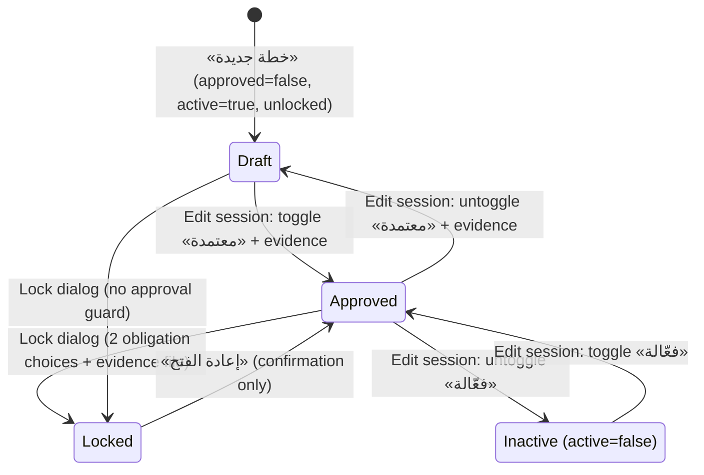
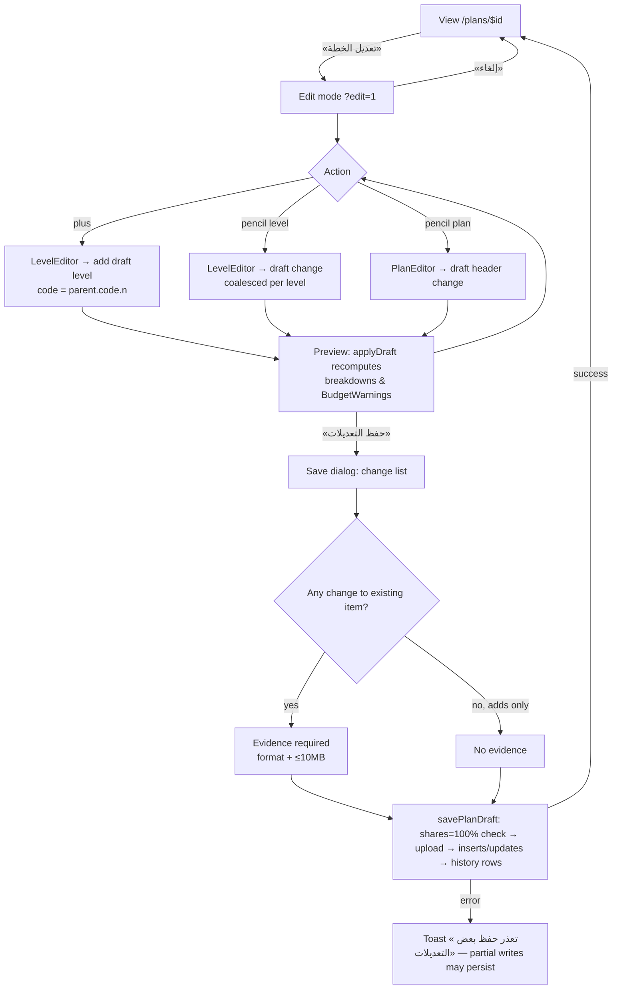
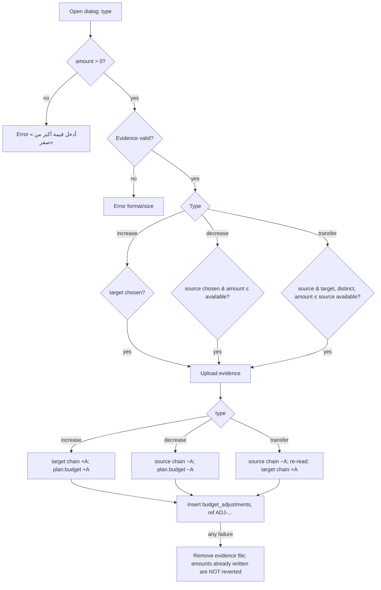

# PLN — Annual Plans, Endowments & Initiatives

## 1. Scope & Coverage

**Module purpose (as evidenced in code):** maintain the organization's annual plans (budget ceilings) and their hierarchical breakdown (tracks → items/initiatives), monitor how much of each level is used, committed, due, paid and still available, execute evidenced budget adjustments (increase / decrease / transfer), lock plans against new approvals, and manage endowments (funding sources) that adopt plan levels by percentage.

**Files analyzed (all read in full):**

| File | Role |
|---|---|
| `src/routes/plans.tsx`, `src/routes/plans.$id.tsx` | Layout outlets only (5 lines each) |
| `src/routes/plans.index.tsx` | Annual plans register, KPIs, lock/reopen dialog |
| `src/routes/plans.$id.index.tsx` | Hierarchy view + hierarchy edit session (`?edit=1`) |
| `src/routes/plans.$id.summary.tsx` | Plan summary dashboard |
| `src/routes/plans.$id.tree.tsx` | Read-only tree diagram (React Flow) |
| `src/routes/plans.adjustments.tsx` | Financial operations register |
| `src/routes/endowments.$id.tsx` | Endowment detail, funding ledger, participation, portion report |
| `src/routes/initiatives.tsx` | Legacy redirect to projects filtered by `source=initiative` |
| `src/lib/plans.ts` | All budget math, adjustment engine, edit-session commit, endowment split logic |
| `src/components/AdjustmentDialog.tsx` | Increase / decrease / transfer dialog |
| `src/components/PlanEditors.tsx` | `PlanEditor`, `LevelEditor`, `EvidenceField`, `BudgetWarning`, (disabled) `SharesField` |
| `src/components/PlanEditHistory.tsx` | Evidenced edit-history list |
| `src/components/PlanLevelPicker.tsx` | `PlanLevelPicker`, `InitiativeSelect` (used by other modules) |
| `src/components/PlanViewNav.tsx` | Summary / hierarchy / tree switcher + edit entry |
| `src/components/FinanceBreakdown.tsx` | Five-way money split bar + legend |
| `src/components/AmountInput.tsx` | Money input with thousands separators |
| `src/components/EditSession.tsx` | Generic config edit session — **not used by plans** (used by PRG config pages); documented only as a dependency note |

**Related files consulted (outside scope, referenced only):** `src/lib/workflow.ts:140-158` (plan-lock enforcement in `transferApplication`), `src/components/Indicators.tsx:44-71` (`LevelIndicators` on leaf levels), `src/components/DocAiCheck.tsx` (advisory AI document check), `src/components/ProjectAllocations.tsx`, `src/components/ApplicationEdits.tsx`, `src/routes/portal.tsx:343`, `src/routes/programs.$id.tsx:321` (consumers of the pickers), `src/routes/reports.tsx:40-60`, `src/routes/analytics.tsx:47` (consumers of the breakdown helpers), `src/routes/settings.tsx:501-520` (endowment CRUD — module CFG), `src/components/AppShell.tsx:49-61` (navigation), `src/lib/data.ts` (status label sets), `supabase/migrations/20261004115345_*`, `20261004121507_*`, `20261004123509_*`, `20261004184736_*`, `20261006140739_*`, `src/integrations/supabase/types.ts` (plans, plan_levels, budget_adjustments, plan_edit_history, endowments, plan_level_endowments, endowment_fundings, project_plan_allocations, plan_indicators).

**Coverage notes and limitations**
- Analysis is from source code only; the live demo was not inspected.
- Roles: the Plans sidebar entry is shown to `grants_manager`, `finance`, `ceo`, `admin` (`AppShell.tsx:57-61`). No page, dialog or lib function in this module checks the persona role; any persona can reach every route by URL and RLS allows any signed-in user (`20261006140739_*.sql`). All role statements below are therefore **UI navigation only** unless stated otherwise.
- `plans.budget_locked`, `endowment_fundings` and `project_plan_allocations` exist in `types.ts` but no migration in `supabase/migrations` creates them (schema drift; see ISS-PLN-20).
- Endowment master-data CRUD (create / activate / delete) lives in Settings → Endowments and belongs to module CFG; plan-level indicators (`LevelIndicators`) are shared with REV/PRJ; project allocation splitting UI (`ProjectAllocations`) belongs to PRJ. Only their PLN-facing behaviour is described here.

## 2. Screen Inventory

| Screen ID | Name (EN + Arabic label) | Route / Component | Roles | Purpose | Entry points | Exits / Navigates to |
|---|---|---|---|---|---|---|
| SCR-PLN-01 | Annual Plans register (الخطط السنوية) | `/plans` — `plans.index.tsx` | grants_manager, finance, ceo, admin (nav) | List plans, portfolio KPIs, start adjustments, lock/reopen, create plan | Sidebar «الخطة السنوية»; Global search «الخطط السنوية»; back links on all plan pages | SCR-PLN-02 (row click, eye icon, name), SCR-PLN-04 (menu «تعديل الخطة والاعتماد»), SCR-PLN-06 («العمليات المالية»), SCR-PLN-09, SCR-PLN-10, SCR-PLN-11 |
| SCR-PLN-02 | Plan Summary (ملخص الخطة) | `/plans/$id/summary` — `plans.$id.summary.tsx` | same | One-page financial and KPI overview of a plan | SCR-PLN-01 | SCR-PLN-03/05 via PlanViewNav, SCR-PLN-04 («تعديل الخطة»), SCR-PLN-01 (back) |
| SCR-PLN-03 | Plan Hierarchy view (العرض الهرمي) | `/plans/$id` — `plans.$id.index.tsx` | same | Read the level tree with per-level money split, projects/applications counts, indicators | PlanViewNav «هرمي»; endowment page plan link | Project detail `/projects/$id`, application `/reviewer/$id`, endowment `/endowments/$id`, SCR-PLN-02/05, SCR-PLN-04 |
| SCR-PLN-04 | Plan Hierarchy Edit Session (وضع التعديل) | `/plans/$id?edit=1` — `plans.$id.index.tsx` (`editing`) | same | Draft structure/header changes, then commit once with one evidence document | PlanViewNav «تعديل الخطة»; SCR-PLN-01 row menu | SCR-PLN-03 (cancel / after save), SCR-PLN-09, SCR-PLN-12, SCR-PLN-13 |
| SCR-PLN-05 | Plan Tree diagram (العرض الشجري) | `/plans/$id/tree` — `plans.$id.tree.tsx` | same | Visual tree of levels with amount and share of parent | PlanViewNav «شجري» | SCR-PLN-02/03, SCR-PLN-01 |
| SCR-PLN-06 | Financial Operations register (العمليات المالية) | `/plans/adjustments` — `plans.adjustments.tsx` | same | Browse adjustments by type and plan; open evidence; start a new adjustment | SCR-PLN-01 header button; Global search «المناقلات والتعديلات» | SCR-PLN-10, SCR-PLN-01 (back) |
| SCR-PLN-07 | Endowment detail (تفاصيل الوقف) | `/endowments/$id` — `endowments.$id.tsx` | grants_manager, admin (via Settings → Endowments) | Endowment size, funding ledger, participation per level, portion of plans, funded projects | Settings → Endowments name link; endowment chips on SCR-PLN-03 | SCR-PLN-14, SCR-PLN-03 (plan link), `/projects/$id`, Settings endowments tab (back) |
| SCR-PLN-08 | Initiatives (legacy redirect) (المبادرات) | `/initiatives` — `initiatives.tsx` | any | Keep old links working | Old bookmarks/links | `/projects?source=initiative` (module PRJ) |
| SCR-PLN-09 | Plan editor dialog (خطة جديدة / تعديل الخطة) | `PlanEditor` — `PlanEditors.tsx:37-75` | same as SCR-PLN-01 | Create a plan (direct save) or edit plan header inside an edit session (apply to draft) | SCR-PLN-01 «خطة جديدة»; SCR-PLN-04 pencil next to plan name | Closes back to caller |
| SCR-PLN-10 | Budget adjustment dialog (تعزيز / تخفيض / نقل) | `AdjustmentDialog.tsx` | same | Execute increase / decrease / transfer with evidence | SCR-PLN-01 row menu; SCR-PLN-06 header button | Closes; data refreshed |
| SCR-PLN-11 | Lock / reopen plan dialog (إغلاق الخطة / إعادة فتح الخطة) | AlertDialog in `plans.index.tsx:152-196` | same | Lock a plan budget against new approvals, or reopen | SCR-PLN-01 lock icon | Closes; SCR-PLN-01 |
| SCR-PLN-12 | Level editor dialog (مسار جديد / مستوى فرعي / تعديل مستوى) | `LevelEditor` — `PlanEditors.tsx:110-149` | same | Add or edit one level inside the edit session | SCR-PLN-04 pencil / plus buttons | Closes to SCR-PLN-04 |
| SCR-PLN-13 | Save plan changes dialog (حفظ تعديلات الخطة) | Dialog in `plans.$id.index.tsx:220-227` | same | Review change list, attach evidence, commit | SCR-PLN-04 «حفظ التعديلات» | SCR-PLN-03 on success |
| SCR-PLN-14 | Endowment funding dialog (تغذية الوقف) | `FundingDialog` — `endowments.$id.tsx:39-76` | same as SCR-PLN-07 | Record a dated funding movement with evidence | SCR-PLN-07 «تغذية الوقف» | Closes to SCR-PLN-07 |

## 3. Screen Details

### SCR-PLN-01 — Annual Plans register (`/plans`)
- **Header** «الخطط السنوية» / «الموازنات السنوية وتوزيعها على المسارات والبنود», info tip `plan`; actions «العمليات المالية» (link to SCR-PLN-06) and «خطة جديدة» (opens SCR-PLN-09 prefilled with year = current year + 1, active = true, approved = false) — [Observed] `plans.index.tsx:122-129`.
- **KPI cards** — [Observed] `plans.index.tsx:71-75,131-135`:
  - «عدد الخطط» = count of all loaded plans (all tenants, unfiltered).
  - «الصرف من الموازنة (إجمالي الخطط المعتمدة)» = Σ paid of approved plans ÷ Σ budget of approved plans (sum-based, not an average of %).
  - «إنجاز المؤشرات (مرجّح بالموازنة)» = Σ(indicators_progress × budget) ÷ Σ budget over approved plans.
- **Table (shared DataTable)** columns: actions; «الاسم» (link to summary); «السنة»; «الموازنة» (SAR); «الصرف من الموازنة» (progress bar, BR-PLN-07); «الإنجاز في المؤشرات» (stored `indicators_progress`); «الحالة» (فعال / غير فعال pill); «اعتماد الخطة» (معتمد / غير معتمد pill); «رقم الخطة» (hidden by default); «تاريخ الإضافة» (hidden by default) — [Observed] `plans.index.tsx:77-111`. Row click opens the summary (`:140`). Export file name `annual-plans`; actions column excluded from export (`noExport`).
- **Row actions** — [Observed] `plans.index.tsx:79-100`: eye (view summary); lock icon (red `Lock` when locked, `LockOpen` otherwise → SCR-PLN-11); «المزيد» menu: «تعزيز موازنة», «تخفيض موازنة», «نقل المخصصات المالية» (→ SCR-PLN-10 with the type), «تعديل الخطة والاعتماد» (→ SCR-PLN-04).
- **Filters** — status (all/فعال/غير فعال), approval (all/معتمد/غير معتمد), year (all, 2021–2031), created-from date, created-to date. Status/approval/year, hidden columns and page size (15) are persisted per user through `useSavedView("plans.v2")`; date range is not — [Observed] `plans.index.tsx:47-52,62-70,142-148`.
- **States**: loading → `PageSkeleton` (`:60`); empty table handled by DataTable [Inferred]; errors in core queries throw (React Query error state; no custom message) — [Observed] `plans.ts:164`.

### SCR-PLN-02 — Plan Summary (`/plans/$id/summary`)
- Back link to plans; header «ملخص الخطة — {name}» with subtitle `{year} · معتمدة/غير معتمدة · فعالة/غير فعالة`; PlanViewNav (active = summary) — [Observed] `plans.$id.summary.tsx:38-39`.
- **Budget block**: «الموازنة الإجمالية» + full `FinanceBreakdown` of `planBreakdown()` (BR-PLN-05) — `:40`.
- **«مؤشرات الخطة»**: three progress bars — «الصرف من الموازنة» (BR-PLN-07), «الصرف من المعتمد — خطة {year}» (BR-PLN-08), «إنجاز المؤشرات» (stored value) — `:42-49`.
- **«توزيع الموازنة حسب المسار»**: legend + one bare breakdown bar per root level with code/name, amount and a red «تجاوز الموازنة» badge when the track's breakdown available < 0 (BR-PLN-41) — `:50-60`. Empty: «لا توجد مسارات في الخطة.».
- **«المبادرات المرتبطة بالخطة»** (only if any): cards for linked projects with `source = 'initiative'`, showing title, progress % (BR-PLN-10) and budget — `:63-66`.
- **«آخر التعديلات المالية»**: last 5 adjustments of the plan (type label · ref no, amount, date). Empty: «لا توجد تعديلات مالية بعد.» — `:67-73`.
- **Plan edit history** (PlanEditHistory) — `:75`.
- **States**: skeleton while loading; «الخطة غير موجودة» when id unknown — `:27-29`.

### SCR-PLN-03 — Plan Hierarchy view (`/plans/$id`)
- Back link; header «العرض الهرمي — {name}»; description «الموازنة المالية الإجمالية: {budget} · المستخدم {planUsed}»; PlanViewNav (active = hierarchy, shows «تعديل الخطة» button) — [Observed] `plans.$id.index.tsx:169-174`.
- Plan name row + root `BudgetWarning` comparing Σ root amounts with plan budget (BR-PLN-22) — `:182-191`.
- **Tracks (root levels)** as collapsible cards (open by default): code-name, endowment chips, «قيمة المستوى» + compact FinanceBreakdown, BudgetWarning — `:193-210`.
- **Nested levels** (recursive): code-name, endowment chips (only when org has ≥2 active endowments and the level has its own split; inherited splits are hidden; «بدون وقف» when no shares), stats, BudgetWarning, buttons «المشاريع: n» / «الطلبات: n» (disabled when 0), and `LevelIndicators` on persisted leaf levels — `:107-116,147-164`.
- **Drill-down dialog** (max-w-4xl): projects table (#, ref no → project, title, partner, period start ← end, project manager, status pill) or applications table (#, ref no → `/reviewer/$id`, project title, partner, requested amount, status pill). Counts include all descendants — `:229-269`.
- **PlanEditHistory** at the bottom — `:213`.
- **Empty**: «لا توجد مستويات بعد.» — `:211`.

### SCR-PLN-04 — Plan Hierarchy Edit Session (`/plans/$id?edit=1`)
- Same page as SCR-PLN-03 with `editing = (edit === 1)` (search param validated with zod) — [Observed] `plans.$id.index.tsx:29,60-61`.
- Header description switches to «وضع التعديل: أضف وعدّل العناصر ثم احفظ مرة واحدة مع المستند النظامي»; the «تعديل الخطة» button is hidden — `:172-173`, `PlanViewNav.tsx:8`.
- **Amber session banner**: «{n} تعديل غير محفوظ» or «لا توجد تعديلات بعد — استخدم القلم أو علامة الزائد بجانب العناصر»; buttons «إلغاء» (discard draft, leave edit mode) and «حفظ التعديلات» (disabled when no changes, opens SCR-PLN-13) — `:175-181`.
- **Edit controls**: pencil + plus next to plan name (edit header → SCR-PLN-09 in apply mode; add root track → SCR-PLN-12); pencil «تعديل المستوى» and plus «إضافة عنصر فرعي» on every level — `:129-138,184-189,198`.
- **Draft preview**: all figures, warnings and the tree are recomputed on a copy of the data with pending changes applied (`applyDraft`); changed items are highlighted amber — `:44-56,73-74,150,183,195`.
- Leaf indicators become editable (`LevelIndicators canEdit`) — but these writes are immediate, outside the draft (see ISS-PLN-19) — `:161`.

### SCR-PLN-05 — Plan Tree (`/plans/$id/tree`)
- Header «العرض الشجري — {name}», description «مستويات الخطة السنوية وتوزيع مبالغها»; PlanViewNav (active = tree) — [Observed] `plans.$id.tree.tsx:89-93`.
- React Flow canvas (70vh, LTR container): root node = plan (name, «100%», budget, inverted colours); level nodes show `code - name`, share of parent % (BR-PLN-44), amount, BudgetWarning. Leaves are laid out in columns 280 px apart, parents centred over children, rows 140 px apart. Not draggable/connectable; zoom 0.15–0.7 fit; controls without interactivity toggle — `:30-45,52-81,95-108`.
- PlanEditHistory below — `:110`. States: skeleton; «الخطة غير موجودة».

### SCR-PLN-06 — Financial Operations register (`/plans/adjustments`)
- Header «العمليات المالية», description «التعزيز يرفع مبلغ المستوى، والتخفيض ينقصه، والنقل يحوّل مبلغاً بين مستويين ولا يتجاوز المتاح الفعلي»; action button labelled with the current type (e.g. «تعزيز موازنة») opening SCR-PLN-10 — [Observed] `plans.adjustments.tsx:72-76`.
- **Tabs**: «التعزيزات المالية» / «تخفيض الموازنات» / «نقل المخصصات المالية» (filter by `type`) — `:30-34,77-79`.
- **Filter**: plan select («كل الخطط» or one plan) — `:84-92`. Not persisted.
- **Columns**: «الرقم» (ref_no ADJ-…), «الخطة», «المستوى» (transfer: `source ← target`; others: the single level), «القيمة» (red for decrease, green otherwise), «المنشئ» (persona name), «ملاحظة», «الشاهد النظامي» (button opening a 300-second signed URL; excluded from export), «تاريخ الإضافة» — `:58-67`.
- **Target plan of the «new» button**: the plan selected in the filter, otherwise the first active plan, otherwise the first plan — `:45,94` (see ISS-PLN-11).
- Error: «تعذر فتح الشاهد النظامي» when signing fails — `:54`.

### SCR-PLN-07 — Endowment detail (`/endowments/$id`)
- Back link «الأوقاف» to Settings endowments tab; header = endowment name, description (or «حصة الوقف من خطط الجهة»), info tip `endowment`; action «تغذية الوقف» → SCR-PLN-14 — [Observed] `endowments.$id.tsx:124-126`.
- **Stat cards**: «حجم الوقف الحالي» (Σ fundings, «—» if 0), «حصته من الموازنات» (Σ allocation), «المستخدم من حصته», «المتاح من حصته» (green if ≥0 else red) — `:127-132`.
- **«سجل التغذيات»**: date, amount, note, document name (not clickable). Empty: «لا توجد تغذيات مسجلة بعد — سجّل أول تغذية لتفعيل التوزيع حسب حجم الوقف.» — `:133-145`.
- **«المشاركة في عناصر الخطة»** (only when org has ≥2 active endowments): per plan of the tenant, every level (indented by code depth) with «{my %} من {n} وقف» and a switch to join/leave — `:79-109,147`.
- **Per-plan portion cards**: plan link, «الحصة · المستخدم · المتاح»; levels table (level — marked «(موروث)» when not own, level amount, %, endowment share = amount × %); «المشاريع الممولة منه» table (ref → project, title, budget, %, endowment share, status) — `:149-177`.
- **States**: skeleton; «الوقف غير موجود»; «لا يتبنى هذا الوقف أي مسار بعد.» when report empty — `:115-117,148`.

### SCR-PLN-08 — Initiatives redirect (`/initiatives`)
- `beforeLoad` throws a redirect to `/projects` with `source=initiative`, `replace: true` — [Observed] `initiatives.tsx:4-6`. No UI.

### SCR-PLN-09 — Plan editor dialog
- Fields: AI assist box (context «خطة سنوية», proposes name/year/budget — advisory only, values applied to the form on user action) ; «الاسم»; «السنة» (select 2021–2031); «الموازنة (ر.س)» (AmountInput + BudgetWarning vs Σ root levels for an existing plan); switches «فعّالة», «معتمدة»; «المستند النظامي *» (only for an existing plan edited outside a session — path not reachable in current UI, ISS-PLN-17) — [Observed] `PlanEditors.tsx:60-74`.
- Button «تطبيق» (session mode) or «حفظ» (create). Validation toasts: «الاسم والسنة مطلوبان», «أدخل موازنة صحيحة» — `:45-46`. Success toast «تم حفظ الخطة».

### SCR-PLN-10 — Budget adjustment dialog
- Title «{type label} — {plan name}» — [Observed] `AdjustmentDialog.tsx:82`.
- Fields by type: decrease → «المستوى» (source); increase → «المستوى» (target); transfer → «من المستوى» + «إلى المستوى». Level select lists all plan levels (indented by depth) and, once chosen, shows «المبلغ {amount} · المتاح الفعلي {available}» — `:41-60,84-85`.
- «القيمة (ر.س)» (AmountInput), «ملاحظة» (textarea), «الشاهد النظامي *» (file, accept pdf/doc/docx/xls/xlsx/png/jpg/jpeg) with advisory `DocAiCheck` (context: amount, from, to) — `:86-101`.
- «تنفيذ» disabled while busy or no evidence — `:104`. Fields reset every time the dialog opens — `:37`.
- Messages: see BR-PLN-11…15 (validation errors shown as toasts); success «تم تنفيذ {type label}».

### SCR-PLN-11 — Lock / reopen plan dialog
- **Lock**: title «إغلاق الخطة»; text «إغلاق «{name}»؟ لن تُعتمد مشاريع جديدة من ميزانيتها.»; two mandatory choices — «التزامات متعاقد عليها غير مستحقة» and «التزامات مستحقة غير مصروفة», each «تستمر على هذه الخطة» / «ترحَّل للخطة القادمة»; «الشاهد النظامي (إلزامي)» file picker («إرفاق قرار أو محضر»); destructive button «إغلاق الخطة» enabled only when both choices and a file are set — [Observed] `plans.index.tsx:155-180`.
- **Reopen**: title «إعادة فتح الخطة»; text «… سيتاح اعتماد مشاريع جديدة من ميزانيتها.»; button «إعادة الفتح»; no choices/evidence.
- On confirm only `plans.budget_locked` is updated; toast echoes the choices — `:182-190` (ISS-PLN-03).

### SCR-PLN-12 — Level editor dialog
- Title: «تعديل {code} - {name}» / «مستوى فرعي تحت {parent code}» / «مسار جديد» — [Observed] `PlanEditors.tsx:140`.
- Fields: «الاسم», «المبلغ المخصص (ر.س)» (AmountInput + BudgetWarning vs current children when editing). The endowment split editor is compiled but disabled (`splitting = false`) — `:118,142-144`.
- Button «تطبيق» (adds/updates the draft). Validation: «الاسم مطلوب», «أدخل مبلغاً صحيحاً» — `:122-123`.

### SCR-PLN-13 — Save plan changes dialog
- Title «حفظ تعديلات الخطة»; scrollable list of pending changes: «إضافة {code} - {name} ({amount})», «تعديل بيانات الخطة», «تعديل أوقاف {code} - {name}», «تعديل {code} - {name}» — [Observed] `plans.$id.index.tsx:221-224`.
- Evidence field (when any existing item changed) or note «إضافات فقط — لا يلزم مستند نظامي.» — `:225`.
- «حفظ الكل» disabled while busy or when evidence is needed and missing — `:226`. Success toast «تم حفظ {n} تعديل», then the session closes; error toast «تعذر حفظ بعض التعديلات: …» — `:123`, `plans.ts:372`.

### SCR-PLN-14 — Endowment funding dialog
- Title «تغذية الوقف — {name}»; fields «المبلغ (ر.س)», «تاريخ التغذية» (default today), «ملاحظة (اختياري)», evidence field with AI check (action «تغذية وقف») — [Observed] `endowments.$id.tsx:66-73`.
- «حفظ» disabled while busy or no file. Errors «أدخل مبلغاً صحيحاً», «أرفق المستند النظامي», evidence format/size errors; success «تم تسجيل التغذية» — `:47-64`.

## 4. Interaction Inventory

| INT ID | Screen | Trigger (control) | System response | Data written | Evidence |
|---|---|---|---|---|---|
| INT-PLN-001 | SCR-PLN-01 | Change status / approval / year filter | Re-filters rows; saves preference | `user_view_prefs` (via useSavedView, on explicit save) | [Observed] `plans.index.tsx:47-51` |
| INT-PLN-002 | SCR-PLN-01 | Set from/to date | Filters by `created_at` | — | [Observed] `plans.index.tsx:68-69` |
| INT-PLN-003 | SCR-PLN-01 | Row click / eye / name | Navigate to summary | — | [Observed] `plans.index.tsx:81-83,102,140` |
| INT-PLN-004 | SCR-PLN-01 | «خطة جديدة» → «حفظ» | Validates and inserts plan; ref no assigned by trigger | `plans` insert (tenant_id = constant TENANT_ID) | [Observed] `PlanEditors.tsx:44-58` |
| INT-PLN-005 | SCR-PLN-01 | Lock icon → «إغلاق الخطة» | Sets plan locked; toast with chosen obligation treatment | `plans.budget_locked = true` only | [Observed] `plans.index.tsx:182-190` |
| INT-PLN-006 | SCR-PLN-01 | Lock icon (locked plan) → «إعادة الفتح» | Unlocks plan | `plans.budget_locked = false` | [Observed] same |
| INT-PLN-007 | SCR-PLN-01 / 06 | Menu «تعزيز/تخفيض/نقل» or header button | Opens SCR-PLN-10 for the plan/type | — | [Observed] `plans.index.tsx:92-94`; `plans.adjustments.tsx:75` |
| INT-PLN-008 | SCR-PLN-10 | «تنفيذ» (increase) | Validates; uploads evidence; adds amount to target + ancestors and plan budget; records adjustment | storage `plan-adjustments/…`; `plan_levels.amount`; `plans.budget`; `budget_adjustments` | [Observed] `plans.ts:487-551` |
| INT-PLN-009 | SCR-PLN-10 | «تنفيذ» (decrease) | Validates availability; subtracts from source + ancestors and plan budget; records | same | [Observed] `plans.ts:502-503,527-533` |
| INT-PLN-010 | SCR-PLN-10 | «تنفيذ» (transfer) | Validates availability & distinct levels; subtracts on source chain, re-reads, adds on target chain; records | storage; `plan_levels.amount`; `budget_adjustments` | [Observed] `plans.ts:519-526` |
| INT-PLN-011 | SCR-PLN-10 / 13 / 14 | Pick evidence file | Shows file name; runs advisory AI document check (never blocks) | — (server call `checkOfficialDoc`) | [Observed] `DocAiCheck.tsx:11` |
| INT-PLN-012 | SCR-PLN-02/03/05 | PlanViewNav buttons | Switch summary / hierarchy / tree; «تعديل الخطة» enters edit session | — | [Observed] `PlanViewNav.tsx:5-21` |
| INT-PLN-013 | SCR-PLN-03 | «المشاريع: n» / «الطلبات: n» | Opens drill-down dialog for level + descendants | — | [Observed] `plans.$id.index.tsx:158-159,229-269` |
| INT-PLN-014 | SCR-PLN-03 | Endowment chip | Navigate to endowment detail | — | [Observed] `plans.$id.index.tsx:114` |
| INT-PLN-015 | SCR-PLN-04 | Plus (root / level) → «تطبيق» | Adds draft level with generated code, temp id | client draft only | [Observed] `plans.$id.index.tsx:102-106` |
| INT-PLN-016 | SCR-PLN-04 | Pencil (level) → «تطبيق» | Adds/replaces draft change for level; removed if values equal original | client draft only | [Observed] `plans.$id.index.tsx:84-101` |
| INT-PLN-017 | SCR-PLN-04 | Pencil (plan) → «تطبيق» | Replaces draft plan-header change | client draft only | [Observed] `plans.$id.index.tsx:217-218` |
| INT-PLN-018 | SCR-PLN-04 | «إلغاء» | Clears draft and file; navigates to view mode | — | [Observed] `plans.$id.index.tsx:117` |
| INT-PLN-019 | SCR-PLN-13 | «حفظ الكل» | Validates share totals; uploads evidence (if needed); inserts new levels parents-first; updates edited rows; writes one history row per edited item | storage `plan-edits/…`; `plan_levels`; `plans`; `plan_level_endowments`; `plan_edit_history` | [Observed] `plans.ts:320-374` |
| INT-PLN-020 | SCR-PLN-02/03/05 | Evidence button in history | Opens 300-s signed URL in new tab | — | [Observed] `PlanEditHistory.tsx:9-13` |
| INT-PLN-021 | SCR-PLN-06 | Tab / plan filter | Filters adjustments | — | [Observed] `plans.adjustments.tsx:44` |
| INT-PLN-022 | SCR-PLN-06 | Evidence button | Opens 300-s signed URL | — | [Observed] `plans.adjustments.tsx:52-56` |
| INT-PLN-023 | SCR-PLN-07 / 14 | «تغذية الوقف» → «حفظ» | Validates; uploads evidence; inserts funding; removes file if insert fails | storage `endowment-fundings/…`; `endowment_fundings` | [Observed] `endowments.$id.tsx:47-65` |
| INT-PLN-024 | SCR-PLN-07 | Participation switch | Recomputes participants, rewrites level's own shares as equal split | `plan_level_endowments` delete + insert | [Observed] `plans.ts:219-227` |
| INT-PLN-025 | SCR-PLN-04 | Indicator add / delete on leaf | Immediate insert/delete (outside draft); delete blocked if linked | `plan_indicators` | [Observed] `Indicators.tsx:53-71` |
| INT-PLN-026 | other modules | PlanLevelPicker change | Updates the link column on application/project/program | `applications`/`projects`/`grant_programs`.`plan_level_id` or `default_plan_level_id` | [Observed] `PlanLevelPicker.tsx:21-27` |
| INT-PLN-027 | SCR-PLN-08 | Open `/initiatives` | Redirect to projects (initiative filter) | — | [Observed] `initiatives.tsx:5` |
| INT-PLN-028 | SCR-PLN-01/06 | DataTable export / column toggle | Exports visible rows (actions/evidence excluded) | — | [Observed] `plans.index.tsx:139`; `plans.adjustments.tsx:83` |

## 5. Shared Components & Dependencies

| Component / lib | Used for | Notes |
|---|---|---|
| `lib/plans.ts` | Single source of plan math (`buildPlanIndex`, `breakdownOf`, `projectBreakdown`, `spendProgress`, `spendOfApproved`), adjustments (`applyAdjustment`), session commit (`savePlanDraft`), endowment logic | Also consumed by `reports.tsx`, `analytics.tsx`, `projects.$id.tsx`, `ProjectAllocations.tsx`, `settings.tsx` |
| `usePlanData()` | One React Query (`plan-data`) loading 11 tables in parallel; core tables (plans, plan_levels, budget_adjustments, projects, applications, payments) must load, secondary (plan_edit_history, endowments, plan_level_endowments, endowment_fundings, project_plan_allocations) degrade to empty with a console warning | [Observed] `plans.ts:142-180`. Not tenant-filtered. |
| `useRefreshPlans()` | Invalidates `plan-data`, `projects`, `applications` | `plans.ts:258-265` |
| `FinanceBreakdown` / `FinanceLegend` | Stacked bar + figures for paid (green), due (amber), approved (blue), available (grey); pending shown aside (violet dashed, «محجوز مؤقتاً») | Bar scale = max(total, paid+due+approved, 1); negative available in red. `hidePending` used on project page. |
| `AmountInput` | Money entry with thousands separators; converts Arabic-Indic and Persian digits to Latin; strips non-digits except one decimal point (no negative values possible); exposes number or null | `AmountInput.tsx:10-47` |
| `EvidenceField` + `DocAiCheck` | Evidence file picker (accept pdf/doc/docx/xls/xlsx/png/jpg/jpeg) + advisory AI verdict (مطابق / يحتاج مراجعة / غير مطابق) — never blocks | `PlanEditors.tsx:21-31`; `DocAiCheck.tsx:11` |
| `AiAssist` | Proposes plan name/year/budget from free text | Advisory only (see PTL/PLT for AI assist) |
| `DataTable` + `useSavedView` | Lists, column hiding, export, saved filters | PLT module |
| `PlanLevelPicker`, `InitiativeSelect` | Linking applications/projects/programs to plan items | Consumed by REV, PRJ, PTL, PRG |
| `LevelIndicators` | Leaf-level indicators | Shared with REV/PRJ |
| `transferApplication` (`lib/workflow.ts`) | Enforces plan lock when an approved application becomes a project | REV/PRJ |
| Storage bucket `attachments` (private) | Evidence for adjustments (`plan-adjustments/`), plan edits (`plan-edits/`), fundings (`endowment-fundings/`) | Signed URLs valid 300 s |
| `EditSession.tsx` (`useEditSession`) | Generic snapshot/commit/rollback session for configuration entities with `config_edit_history` | **Not used by plans**; used by PRG (`programs.$id.tsx`, `programs.products.tsx`, `programs.engines_.$id.tsx`). Listed in scope; the plan hierarchy session is a separate mechanism in `plans.$id.index.tsx`. |

## 6. Business Process Workflows

### 6.1 Plan lifecycle (flags, not a formal workflow)
The prototype stores three independent booleans — `active`, `approved`, `budget_locked` — with no enforced ordering [Observed] `plans.ts:4-17`. The diagram shows the practical lifecycle the UI supports.

Guards/effects: a locked **or** inactive plan disappears from the plan-item pickers (BR-PLN-35/37); a locked plan blocks `transferApplication` (BR-PLN-35). Approval has no downstream effect in code except the plans-list KPIs (BR-PLN-09) [Observed]; whether approval should gate linking or adjustments is [To Confirm] (OQ-PLN-02).

### 6.2 Hierarchy edit session

### 6.3 Budget adjustment

Actors: any persona reaching the page (nav: grants_manager, finance, ceo, admin). No approval step (maker-checker) exists [Observed]; [To Confirm] OQ-PLN-14.

### 6.4 Plan lock
Actor opens lock dialog → chooses treatment for (a) contracted-not-due obligations and (b) due-not-paid obligations (continue on this plan / carry to next plan) → attaches a decision/minutes file → confirms → `budget_locked = true`. Effects: new links to the plan's items disappear from pickers; `transferApplication` throws «ميزانية «…» مقفلة — لا يمكن اعتماد مشاريع جديدة منها»; running projects continue [Observed] `plans.ts:13`, `workflow.ts:154-158`. The choices and file are not persisted (ISS-PLN-03).

### 6.5 Endowment funding & participation
Funding: amount + date + evidence → `endowment_fundings` row; size = Σ fundings. Participation: switch per level → effective participant set ± this endowment → level's own split rewritten as equal shares (min. one participant). Split resolution order: single-endowment org → own rows → nearest ancestor rows → equal split among all active endowments (BR-PLN-26).

### 6.6 Worked examples of the budget math

**Example A — five-way breakdown of one level** (BR-PLN-01…04). Level «1.2» amount = 1,000,000. Linked (directly or via descendants):
- Project P1 budget 400,000; payments: 100,000 `paid`, 50,000 `due`, 80,000 `new`.
- Project P2 budget 200,000; no payments.
- Application A1 `approved`, not transferred, requested 150,000.
- Application A2 `pending` (current status set), requested 80,000.

| Bucket | Calculation | Value |
|---|---|---|
| paid | P1 paid statuses (`awaiting_receipt`,`paid`) | 100,000 |
| due | P1 due statuses (`due`,`awaiting_approval`,`awaiting_transfer`) | 50,000 |
| approved (committed, not due) | max(0, 400,000 − 150,000) + max(0, 200,000 − 0) + A1 150,000 | 600,000 |
| available | 1,000,000 − 600,000 − 50,000 − 100,000 | 250,000 |
| pending («محجوز مؤقتاً») | Σ apps in `submitted`/`under_review` | 0 (A2 is `pending`, not in the set — ISS-PLN-21) |
| used (`idx.used`) | 400,000 + 200,000 + 150,000 | 750,000 |
| actual available (`idx.available`) used by adjustments | 1,000,000 − 750,000 | 250,000 |

The `new` payment (80,000) stays inside «approved» until it becomes due. Spend from budget (plan level) = paid ÷ plan.budget; spend of approved = 100,000 ÷ (600,000 + 50,000 + 100,000) = 13.33 %.

**Example B — multi-initiative project** (BR-PLN-06). Project P3 budget 300,000 with allocations L1 = 200,000 and L2 = 100,000 (2 rows ⇒ split). P3 becomes two pieces: at L1 budget 200,000, share 2/3; at L2 budget 100,000, share 1/3. A paid payment of 90,000 counts 60,000 paid at L1 and 30,000 at L2; approved at L1 = 200,000 − 60,000 = 140,000. With one allocation row, P3 counts 300,000 entirely at its `plan_level_id`.

**Example C — adjustment propagation** (BR-PLN-13…15). Plan budget 1,500,000; Track 1 = 1,000,000 (items 1.1 = 600,000, 1.2 = 400,000); Track 2 = 500,000 (item 2.1 = 500,000).
- Increase 2.1 by 100,000 → 2.1 = 600,000, Track 2 = 600,000, plan = 1,600,000.
- Decrease 1.2 by 50,000 (allowed only if 1.2 actual available ≥ 50,000) → 1.2 = 350,000, Track 1 = 950,000, plan = 1,550,000.
- Transfer 100,000 from 1.1 to 2.1 → 1.1 = 500,000, Track 1 = 900,000; 2.1 = 600,000, Track 2 = 600,000; plan unchanged.
- Transfer 100,000 from 1.1 to 1.2 (same parent) → 1.1 −100,000, 1.2 +100,000, Track 1 −100,000 then +100,000 = unchanged.
- Edge: transfer from 1.1 to its parent Track 1 → 1.1 −100,000; Track 1 −100,000 then +100,000 = unchanged ⇒ Track 1 now has 100,000 unallocated residual (BudgetWarning). Transfer from Track 1 to 1.1 → Track 1 unchanged, 1.1 +100,000 ⇒ children exceed parent (ISS-PLN-06).

**Example D — endowment splits** (BR-PLN-26…30). Org has active endowments A and B; no explicit shares ⇒ every level 50/50 (inherited default). Track 1 = 1,000,000 with children 1.1 = 600,000, 1.2 = 300,000 (residual 100,000).
- A's allocation for Track 1 = 600,000×50 % + 300,000×50 % + 100,000×50 % = 500,000 (each level contributes only its unallocated residual; leaves contribute their full amount).
- If 1.1 has own rows A = 100 %: A = 600,000 + 150,000 + 50,000 = 800,000; B = 0 + 150,000 + 50,000 = 200,000.
- Equal split of 3 endowments = 34 / 33 / 33 (remainder to first). Size-weighted with sizes 5 M / 3 M / 2 M = 50 / 30 / 20; sizes 1/1/1 ⇒ 33/33/33 then +1 to the largest (first maximum) ⇒ 34/33/33. Size-weighted unavailable if any selected endowment has zero fundings.
- A project of 200,000 under 1.1 (A = 100 %) uses 200,000 of A's portion.

## 7. Business Rules

| BR ID | Rule | Evidence label + reference |
|---|---|---|
| BR-PLN-01 | Level «used» = Σ budget of projects linked to the level or any descendant + Σ requested_amount of applications linked to the level or any descendant whose status is `approved` and `transferred = false`. | [Observed] `src/lib/plans.ts:376-418 (countsAsUsedApp, used)` |
| BR-PLN-02 | Level «actual available» (المتاح الفعلي) = level.amount − used. This is the figure shown in the adjustment dialog and used to validate decreases/transfers. Child allocations are not deducted. | [Observed] `src/lib/plans.ts:419; AdjustmentDialog.tsx:56` |
| BR-PLN-03 | Five-way breakdown per level/plan: paid = Σ payments in `awaiting_receipt`/`paid`; due = Σ payments in `due`/`awaiting_approval`/`awaiting_transfer`; approved = Σ max(0, project budget − (paid+due)×share) + Σ approved-not-transferred application amounts; available = total − approved − due − paid. Payments in `new` stay inside approved; `cancelled` payments are ignored. | [Observed] `src/lib/plans.ts:379-437` |
| BR-PLN-04 | «Pending» (محجوز مؤقتاً) = Σ requested_amount of applications in `submitted`/`under_review`; it is informational only and never reduces available or the ceiling. | [Observed] `src/lib/plans.ts:382,424,435; FinanceBreakdown.tsx:12,55-60` |
| BR-PLN-05 | Plan-level breakdown uses plan.budget as total and includes every project/application linked to any level of the plan (not the sum of root-level breakdowns). | [Observed] `src/lib/plans.ts:439-443` |
| BR-PLN-06 | A project with two or more project_plan_allocations rows is counted as one piece per allocation: piece budget = allocation amount, share = amount ÷ Σ allocation amounts (fallback divisor 1); its payments are prorated by share. With fewer than two rows the project counts fully at projects.plan_level_id (share 1). | [Observed] `src/lib/plans.ts:182-191,431-432` |
| BR-PLN-07 | Spend from budget (الصرف من الموازنة) = min(100, plan paid ÷ plan.budget × 100); 0 when budget is 0. | [Observed] `src/lib/plans.ts:448-452` |
| BR-PLN-08 | Spend of approved (الصرف من المعتمد) = min(100, paid ÷ (approved + due + paid) × 100); 0 when the base is 0. | [Observed] `src/lib/plans.ts:454-459` |
| BR-PLN-09 | Plans-list portfolio KPIs consider approved plans only: spend = Σ (spend% × budget) ÷ Σ budget; indicator achievement = Σ(indicators_progress × budget) ÷ Σ budget. «عدد الخطط» counts all plans. | [Observed] `src/routes/plans.index.tsx:71-75,132-134` |
| BR-PLN-10 | Project/initiative progress = round(Σ activity weight × progress ÷ Σ weight) when activities with non-zero total weight exist; otherwise round(stored projects.progress). | [Observed] `src/lib/plans.ts:461-468` |
| BR-PLN-11 | An adjustment amount must be strictly greater than zero. | [Observed] `src/lib/plans.ts:494` |
| BR-PLN-12 | Every adjustment requires an evidence document with extension pdf, doc, docx, xls, xlsx, png, jpg or jpeg and size ≤ 10 MB, stored privately at `plan-adjustments/<plan_id>/<uuid>/<file name>`. | [Observed] `src/lib/plans.ts:497-499,507-509; AdjustmentDialog.tsx:63,104` |
| BR-PLN-13 | Increase: a target level is required; the target and every ancestor are increased by the amount and plan.budget is increased by the amount. | [Observed] `src/lib/plans.ts:500,512-514,530-533,474-484` |
| BR-PLN-14 | Decrease: a source level is required and amount ≤ source actual available (BR-PLN-02); the source and every ancestor are reduced by the amount and plan.budget is reduced by the amount. | [Observed] `src/lib/plans.ts:501-503,516-518,527,530-533` |
| BR-PLN-15 | Transfer: source and target are required and must differ; amount ≤ source actual available; source chain −amount, then levels are re-read and target chain +amount; plan.budget unchanged; common ancestors net to zero. | [Observed] `src/lib/plans.ts:504-505,519-526` |
| BR-PLN-16 | Each executed adjustment is recorded with plan, type, source (null for increase), target (null for decrease), amount, note, acting persona and evidence; reference ADJ-… is assigned by DB trigger. | [Observed] `src/lib/plans.ts:535-545; migration 20261004115345:53` |
| BR-PLN-17 | If any step fails after the evidence upload, the evidence file is deleted; level/plan amounts already written are not reverted. | [Observed] `src/lib/plans.ts:547-550` |
| BR-PLN-18 | Plan structure edits: one evidence document (same format/size rule as BR-PLN-12) per edit session, required when any existing item (plan header, level, endowment split) changes; sessions containing only additions need no evidence. Stored at `plan-edits/<plan_id>/<uuid>/<file name>`. | [Observed] `src/lib/plans.ts:277-282,325-332; plans.$id.index.tsx:118,225-226` |
| BR-PLN-19 | On commit, each changed existing item writes one plan_edit_history row (before/after JSON, shared evidence); added levels write no history row. plan_edit_history is append-only (insert/select policies only). | [Observed] `src/lib/plans.ts:336-370; migration 20261006140739:13-15` |
| BR-PLN-20 | New level code = `<parent code>.<n>` (root: `<n>`) where n = max(sort_order of siblings, including draft siblings) + 1; sort_order = n. | [Observed] `plans.$id.index.tsx:102-106; PlanEditors.tsx:130-132` |
| BR-PLN-21 | Draft coalescing: at most one pending change per existing level; a change whose values equal the original is dropped; editing a draft (added) level updates its add record; only the latest plan-header change is kept. | [Observed] `plans.$id.index.tsx:84-101,218` |
| BR-PLN-22 | When a level (or the plan) has children and Σ children amounts ≠ parent amount (difference rounded to 2 decimals), a non-blocking warning shows the children sum and the absolute difference. Saving is not blocked. | [Observed] `src/lib/plans.ts:269-275; PlanEditors.tsx:16-19` |
| BR-PLN-23 | Plan header: name (trimmed) and year required; budget must be a finite number ≥ 0; year chosen from 2021–2031; new plan defaults: year = current year + 1, active = true, approved = false. | [Observed] `PlanEditors.tsx:45-47; plans.ts:89; plans.index.tsx:128` |
| BR-PLN-24 | Level: name (trimmed) required; amount required, finite and ≥ 0. | [Observed] `PlanEditors.tsx:122-123` |
| BR-PLN-25 | When endowment shares are specified for a level they must total exactly 100 % (rounded to 2 decimals). | [Observed] `src/lib/plans.ts:315-324; PlanEditors.tsx:106` |
| BR-PLN-26 | Effective endowment split of a level: if the organization has exactly one active endowment → that endowment 100 %; else the level's own rows; else the nearest ancestor's rows (inherited); else an equal split among all active endowments. | [Observed] `src/lib/plans.ts:202-216` |
| BR-PLN-27 | Equal split: each endowment gets floor(100 ÷ n); the first gets the remainder so the total is exactly 100 (e.g. 34/33/33). | [Observed] `src/lib/plans.ts:123-128` |
| BR-PLN-28 | Size-weighted split: shares proportional to current endowment sizes, rounded to integers; rounding difference added to the largest endowment; not available when any selected endowment has size ≤ 0. | [Observed] `src/lib/plans.ts:130-140; PlanEditors.tsx:91-93` |
| BR-PLN-29 | Participation toggle: start from the level's effective participants, add or remove the endowment, and rewrite the level's own rows as an equal split; at least one endowment must participate in every level. | [Observed] `src/lib/plans.ts:218-227` |
| BR-PLN-30 | Endowment allocation within a plan = Σ over levels of max(0, level.amount − Σ children amounts) × endowment % at that level (each level contributes only its unallocated residual; leaves contribute their full amount). | [Observed] `src/lib/plans.ts:229-250` |
| BR-PLN-31 | Endowment used = Σ (project piece budget × endowment % at the project's level) + Σ (approved-not-transferred application amount × %); endowment available = allocation − used. | [Observed] `src/lib/plans.ts:246-254` |
| BR-PLN-32 | Endowment size = Σ of its funding movements (endowment_fundings.amount); it grows as the endowment is topped up during the year. | [Observed] `src/lib/plans.ts:118-121` |
| BR-PLN-33 | Recording a funding requires amount > 0, a funding date (default today), and a valid evidence document; note optional. If the insert fails the uploaded file is removed. | [Observed] `src/routes/endowments.$id.tsx:47-61` |
| BR-PLN-34 | Endowment split UI (chips, participation card) is shown only when the organization has two or more active endowments. | [Observed] `src/lib/plans.ts:193; plans.$id.index.tsx:81,108; endowments.$id.tsx:147` |
| BR-PLN-35 | A locked plan (budget_locked) accepts no new project approvals: pickers exclude locked or inactive plans (an existing link stays visible) and transferApplication refuses levels of a locked plan; running projects continue. | [Observed] `src/lib/plans.ts:13; PlanLevelPicker.tsx:19-20,47; workflow.ts:154-158` |
| BR-PLN-36 | Locking requires choosing how contracted-not-due and due-not-paid obligations are treated (continue on this plan / carry to next plan) and attaching an evidence file; reopening requires confirmation only. | [Observed] `src/routes/plans.index.tsx:162-180` |
| BR-PLN-37 | Plan-item pickers list only non-root levels (levels with a parent) of active, unlocked plans, labelled `<year> · <code> - <name>`. | [Observed] `PlanLevelPicker.tsx:34-35,52-53` |
| BR-PLN-38 | Initiatives are projects with projects.source = 'initiative'; the legacy /initiatives route redirects to /projects?source=initiative. | [Observed] `src/routes/initiatives.tsx:3-5; AGENTS.md` |
| BR-PLN-39 | Plan structure and header changes (including the approval and active flags) are made only in the hierarchy edit session (?edit=1) and committed together. | [Observed] `plans.$id.index.tsx:117-127,217-218; AGENTS.md` |
| BR-PLN-40 | Indicators attach to persisted leaf levels only; quantitative indicators need name, unit and target > 0; milestones get unit «تحقق» and target 1; an indicator linked to applications or projects cannot be deleted. | [Observed] `plans.$id.index.tsx:161; Indicators.tsx:53-67` |
| BR-PLN-41 | A root track whose breakdown available < 0 is flagged «تجاوز الموازنة» on the plan summary. | [Observed] `src/routes/plans.$id.summary.tsx:55` |
| BR-PLN-42 | Plans receive reference numbers PLN-… from a DB trigger on insert. | [Observed] `migration 20261004115345:20` |
| BR-PLN-43 | Plans are listed newest year first; default hidden columns are plan number and creation date; default page size 15. | [Observed] `src/lib/plans.ts:147; plans.index.tsx:47` |
| BR-PLN-44 | Tree view share of a level = level.amount ÷ parent amount × 100 (plan.budget for root levels; 0 when parent amount is 0). | [Observed] `src/routes/plans.$id.tree.tsx:65,70,75` |

## 8. Data Requirements

All tables carry RLS «signed in access» (any authenticated user; one shared demo account), except `plan_edit_history` which is insert + select only (append-only) — [Observed] `20261006140739_*.sql:13-17`.

### plans
| Field | Type | Req. | Meaning |
|---|---|---|---|
| id | uuid PK | Y | — |
| tenant_id | uuid FK tenants | Y | Owning organization (UI inserts constant `TENANT_ID`) |
| ref_no | text | auto | `PLN-…` set by trigger `plans_ref` (`set_ref_no('PLN', plan_seq)`) |
| name | text | Y | Plan name |
| year | integer | Y | Plan year (UI list 2021–2031) |
| budget | numeric (default 0) | Y | Plan ceiling; changed by edit session and by increase/decrease adjustments |
| active | boolean (default true) | Y | Active plans appear in pickers |
| approved | boolean (default false) | Y | Approval flag; used by plans-list KPIs |
| budget_locked | boolean | Y | Locked: no new projects may be approved from the plan (not in migrations — ISS-PLN-20) |
| indicators_progress | numeric (default 0) | Y | Stored indicator achievement % (never recomputed — ISS-PLN-09) |
| created_at | timestamptz | auto | Used by date filters |
Relationships: 1-N `plan_levels`, `budget_adjustments`, `plan_edit_history` (all ON DELETE CASCADE).

### plan_levels
| Field | Type | Req. | Meaning |
|---|---|---|---|
| id | uuid PK | Y | — |
| plan_id | uuid FK plans (cascade) | Y | — |
| parent_id | uuid FK plan_levels (cascade) | N | null = root track |
| code | text | Y | Hierarchical code `1`, `1.2`, `1.2.3` (generated, BR-PLN-20) |
| name | text | Y | — |
| amount | numeric (default 0) | Y | Allocated amount (ceiling) |
| sort_order | integer | Y | Sibling ordering (= last code segment) |
Relationships: referenced by `applications.plan_level_id`, `projects.plan_level_id`, `grant_programs.default_plan_level_id` (ON DELETE SET NULL), `plan_level_endowments`, `plan_indicators`, `project_plan_allocations`, `budget_adjustments.source_level_id/target_level_id` (SET NULL).

### budget_adjustments
| Field | Type | Req. | Meaning |
|---|---|---|---|
| id, plan_id (FK cascade) | uuid | Y | — |
| ref_no | text | auto | `ADJ-…` trigger `adj_ref` |
| type | text | Y | `increase` (تعزيز موازنة) / `decrease` (تخفيض موازنة) / `transfer` (نقل مخصصات) — not DB-constrained |
| source_level_id | uuid | cond. | null for increase |
| target_level_id | uuid | cond. | null for decrease |
| amount | numeric | Y | > 0 (app-validated) |
| created_by | uuid FK personas | N | Acting persona |
| note | text | N | — |
| evidence_name / evidence_path | text | app-required | File in private bucket `attachments/plan-adjustments/<plan>/<uuid>/<name>` (nullable in DB) |
| created_at | timestamptz | auto | — |

### plan_edit_history (append-only)
plan_id (FK cascade), level_id (null = plan header; FK SET NULL), target_name, before_values jsonb, after_values jsonb (for share changes: `{endowments: [...]}`), evidence_name, evidence_path (NOT NULL), created_at, updated_at (touch trigger).

### endowments (master data — CFG)
id, tenant_id (FK cascade), name, description, active (default true), created_at.

### plan_level_endowments
plan_level_id (FK cascade), endowment_id (FK cascade), percent numeric default 100; UNIQUE(plan_level_id, endowment_id). Own rows of a level; absence = inherit (BR-PLN-26). Sum = 100 enforced only in `savePlanDraft` (BR-PLN-25).

### endowment_fundings
id, endowment_id, amount (required), funded_at (date, default today in UI), note, evidence_name / evidence_path (required), created_by, created_at. Lifecycle: insert only (no edit/delete UI).

### project_plan_allocations (owned by PRJ/REV)
project_id (nullable), application_id (nullable), plan_level_id (required), amount. ≥2 rows for a project ⇒ split counting (BR-PLN-06).

### plan_indicators (shared with REV/PRJ)
plan_level_id, name, unit, target, kind (`quantitative` | `milestone`).

### Read-only inputs from other modules
- `projects`: id, ref_no, title, budget, status (planning / in_progress / completed / closed / stalled), start_date, end_date, plan_level_id, source (`grant` default | `initiative`), progress, `project_activities(weight, progress)`, partner name, manager name.
- `applications`: id, ref_no, project_title, requested_amount, status (current set: pending / approved / closed / cancelled / awaiting_apology), transferred, plan_level_id, partner name.
- `payments`: project_id, amount, status (new / due / awaiting_approval / awaiting_transfer / awaiting_receipt / paid / cancelled).
- Legacy `initiatives` table exists but is unused (AGENTS.md; `20261004132647_*.sql:17`).

## 9. Product Structure

- **EP-PLN-01 — Annual Plan Portfolio & Lifecycle**: Register of annual plans, creation, approval/active flags and budget locking.
  - FT-PLN-01 — Annual plans register (Must)
  - FT-PLN-02 — Create annual plan (Must)
  - FT-PLN-03 — Plan budget lock and reopen (Must)
- **EP-PLN-02 — Plan Structure Management**: Hierarchical levels (tracks, items, initiatives) edited in an evidenced edit session, with audit history and leaf indicators.
  - FT-PLN-04 — Hierarchy edit session (Must)
  - FT-PLN-05 — Plan edit audit history (Should)
  - FT-PLN-06 — Leaf-level plan indicators (Should)
- **EP-PLN-03 — Budget Monitoring & Visualization**: Single budget-math engine (used, available, pending, approved, due, paid) and the summary, hierarchy and tree views built on it.
  - FT-PLN-07 — Budget breakdown engine (Must)
  - FT-PLN-08 — Plan summary dashboard (Must)
  - FT-PLN-09 — Hierarchical plan view (Must)
  - FT-PLN-10 — Plan tree diagram (Could)
- **EP-PLN-04 — Budget Adjustments**: Evidenced increase, decrease and transfer of level budgets with propagation up the hierarchy, and the operations register.
  - FT-PLN-11 — Budget adjustment execution (Must)
  - FT-PLN-12 — Financial operations register (Must)
- **EP-PLN-05 — Endowments**: Endowment funding ledger, participation and percentage splits across plan levels, and the endowment portion report.
  - FT-PLN-13 — Endowment funding ledger (Should)
  - FT-PLN-14 — Endowment participation and splits (Should)
  - FT-PLN-15 — Endowment portion report (Could)
- **EP-PLN-06 — Plan Linkage & Initiatives**: Linking applications, projects and programs to plan items, lock enforcement, and initiatives modelled as projects.
  - FT-PLN-16 — Plan item linking (Must)
  - FT-PLN-17 — Initiatives as projects (Should)

## 10. Features

### FT-PLN-01 — Annual plans register
- **Feature ID:** FT-PLN-01 (Epic EP-PLN-01)
- **Name:** Annual plans register
- **Description:** Tabular list of annual plans with spend and indicator progress, status/approval/year/date filters, saved view, export, row navigation and per-plan action menu.
- **Business Objective:** [Inferred] Give planners and executives one place to find plans and their execution status.
- **Expected Business Value:** [To Confirm] Faster oversight of plan execution across years.
- **Primary User Roles:** grants_manager, finance, ceo, admin — UI navigation only [To Confirm]
- **Scope:** List, filter, KPI cards, export, navigation to summary/edit/adjustments/lock.
- **Out of Scope:** Plan creation logic (FT-PLN-02); lock logic (FT-PLN-03).
- **Functional Requirements:** FR-PLN-001, FR-PLN-002, FR-PLN-003, FR-PLN-004, FR-PLN-005
- **User Stories:** US-PLN-001, US-PLN-002
- **Business Rules:** BR-PLN-07, BR-PLN-09, BR-PLN-43
- **Dependencies:** PLT DataTable & saved views; FT-PLN-07 budget engine
- **Related Screens:** SCR-PLN-01
- **Acceptance Criteria:**
  - All plans are listed with name, year, budget, spend %, indicator %, status and approval.
  - Filters for status, approval and year persist per user when the view is saved.
  - Portfolio KPIs are computed on approved plans only, sum-based.
- **Open Questions:** OQ-PLN-01
- **Assumptions:** Plans list should be tenant-scoped (currently not — ISS-PLN-10).
- **Priority Recommendation (MoSCoW):** Must

### FT-PLN-02 — Create annual plan
- **Feature ID:** FT-PLN-02 (Epic EP-PLN-01)
- **Name:** Create annual plan
- **Description:** Dialog to create a plan with name, year, budget, active and approved flags, optionally pre-filled by AI assist.
- **Business Objective:** [Inferred] Start a new budget year.
- **Expected Business Value:** [To Confirm]
- **Primary User Roles:** grants_manager, finance, ceo, admin — UI navigation only [To Confirm]
- **Scope:** Create plan header only; levels are added in the edit session.
- **Out of Scope:** Copying a previous year's structure; approval workflow.
- **Functional Requirements:** FR-PLN-006, FR-PLN-007, FR-PLN-008
- **User Stories:** US-PLN-003
- **Business Rules:** BR-PLN-23, BR-PLN-42
- **Dependencies:** AiAssist (PLT)
- **Related Screens:** SCR-PLN-01, SCR-PLN-09
- **Acceptance Criteria:**
  - A plan can be created with name, year and budget ≥ 0.
  - New plans default to next year, active and not approved.
  - A reference number PLN-… is assigned.
- **Open Questions:** OQ-PLN-01, OQ-PLN-05
- **Assumptions:** Creating a plan needs no evidence document (observed).
- **Priority Recommendation (MoSCoW):** Must

### FT-PLN-03 — Plan budget lock and reopen
- **Feature ID:** FT-PLN-03 (Epic EP-PLN-01)
- **Name:** Plan budget lock and reopen
- **Description:** Lock a plan so no new projects can be approved from its budget, recording the treatment of outstanding obligations and a decision document; reopen when needed.
- **Business Objective:** [Inferred] Close a budget year in a controlled way while running projects continue.
- **Expected Business Value:** [To Confirm] Prevents over-commitment after year-end.
- **Primary User Roles:** grants_manager, finance, ceo, admin — UI navigation only [To Confirm]
- **Scope:** Lock/reopen dialog, lock indicator, enforcement in pickers and project transfer.
- **Out of Scope:** Automatic carry-over of obligations (not implemented).
- **Functional Requirements:** FR-PLN-009, FR-PLN-010, FR-PLN-011, FR-PLN-012
- **User Stories:** US-PLN-004, US-PLN-005
- **Business Rules:** BR-PLN-35, BR-PLN-36
- **Dependencies:** FT-PLN-16; REV/PRJ transferApplication
- **Related Screens:** SCR-PLN-01, SCR-PLN-11
- **Acceptance Criteria:**
  - Locking requires both obligation choices and an evidence file.
  - A locked plan's items are not offered in pickers and project transfer is refused.
  - Reopening restores availability.
- **Open Questions:** OQ-PLN-01, OQ-PLN-03
- **Assumptions:** Locking does not change any amounts.
- **Priority Recommendation (MoSCoW):** Must

### FT-PLN-04 — Hierarchy edit session
- **Feature ID:** FT-PLN-04 (Epic EP-PLN-02)
- **Name:** Hierarchy edit session
- **Description:** View-by-default hierarchy with an explicit edit mode (?edit=1) where users draft level additions, level edits and plan-header changes (including approval/active flags), preview their effect, and commit all at once with one evidence document.
- **Business Objective:** [Inferred] Keep plan structure changes deliberate, reviewable and evidenced.
- **Expected Business Value:** [To Confirm] Auditability of plan changes.
- **Primary User Roles:** grants_manager, finance, ceo, admin — UI navigation only [To Confirm]
- **Scope:** Draft add/edit of levels and plan header; preview; consolidated save with conditional evidence; history rows.
- **Out of Scope:** Deleting/moving levels; endowment split editing (disabled); indicator changes (immediate, FT-PLN-06).
- **Functional Requirements:** FR-PLN-013, FR-PLN-014, FR-PLN-015, FR-PLN-016, FR-PLN-017, FR-PLN-018, FR-PLN-019, FR-PLN-020, FR-PLN-021, FR-PLN-022
- **User Stories:** US-PLN-006, US-PLN-007, US-PLN-008, US-PLN-009, US-PLN-010
- **Business Rules:** BR-PLN-18, BR-PLN-19, BR-PLN-20, BR-PLN-21, BR-PLN-22, BR-PLN-23, BR-PLN-24, BR-PLN-25, BR-PLN-39
- **Dependencies:** Storage bucket attachments; DocAiCheck
- **Related Screens:** SCR-PLN-04, SCR-PLN-09, SCR-PLN-12, SCR-PLN-13
- **Acceptance Criteria:**
  - No change is written until «حفظ الكل».
  - Changes to existing items require one evidence document; additions only do not.
  - Each changed existing item produces one history row with before/after values.
- **Open Questions:** OQ-PLN-06, OQ-PLN-07, OQ-PLN-10, OQ-PLN-16
- **Assumptions:** Drafts are per browser session (not shared).
- **Priority Recommendation (MoSCoW):** Must

### FT-PLN-05 — Plan edit audit history
- **Feature ID:** FT-PLN-05 (Epic EP-PLN-02)
- **Name:** Plan edit audit history
- **Description:** List of evidenced plan and level edits on summary, hierarchy and tree pages with access to the evidence document.
- **Business Objective:** [Inferred] Traceability of who-changed-what (document-based).
- **Expected Business Value:** [To Confirm]
- **Primary User Roles:** grants_manager, finance, ceo, admin — UI navigation only [To Confirm]
- **Scope:** Read-only history list with evidence link.
- **Out of Scope:** Before/after diff display; actor name (not stored).
- **Functional Requirements:** FR-PLN-023, FR-PLN-024
- **User Stories:** US-PLN-011
- **Business Rules:** BR-PLN-19
- **Dependencies:** Storage signed URLs
- **Related Screens:** SCR-PLN-02, SCR-PLN-03, SCR-PLN-05
- **Acceptance Criteria:**
  - History lists each edit with type, target, date and document.
  - Evidence opens through a time-limited signed URL.
- **Open Questions:** —
- **Assumptions:** plan_edit_history does not store the acting persona (observed schema).
- **Priority Recommendation (MoSCoW):** Should

### FT-PLN-06 — Leaf-level plan indicators
- **Feature ID:** FT-PLN-06 (Epic EP-PLN-02)
- **Name:** Leaf-level plan indicators
- **Description:** Display and (in edit mode) add/delete quantitative or milestone indicators on leaf plan levels.
- **Business Objective:** [Inferred] Define what each funded item must achieve.
- **Expected Business Value:** [To Confirm]
- **Primary User Roles:** grants_manager, finance, ceo, admin — UI navigation only [To Confirm]
- **Scope:** Indicator list per leaf; add/delete with link guard.
- **Out of Scope:** Linking indicators to applications and measuring achievement (REV/PRJ).
- **Functional Requirements:** FR-PLN-025, FR-PLN-026
- **User Stories:** US-PLN-012
- **Business Rules:** BR-PLN-40
- **Dependencies:** Indicators.tsx (REV/PRJ)
- **Related Screens:** SCR-PLN-03, SCR-PLN-04
- **Acceptance Criteria:**
  - Indicators appear only on persisted leaf levels.
  - A linked indicator cannot be deleted.
- **Open Questions:** OQ-PLN-08
- **Assumptions:** —
- **Priority Recommendation (MoSCoW):** Should

### FT-PLN-07 — Budget breakdown engine
- **Feature ID:** FT-PLN-07 (Epic EP-PLN-03)
- **Name:** Budget breakdown engine
- **Description:** Shared calculation of used, actual available and the five-way split (paid, due, approved/committed, available, pending) per level and per plan, including multi-initiative splits, spend ratios and project progress.
- **Business Objective:** [Inferred] One consistent definition of plan money across all screens and reports.
- **Expected Business Value:** [To Confirm] Reliable availability checks before commitments.
- **Primary User Roles:** grants_manager, finance, ceo, admin — UI navigation only [To Confirm]
- **Scope:** lib/plans.ts helpers and FinanceBreakdown rendering.
- **Out of Scope:** Payment processing (FIN).
- **Functional Requirements:** FR-PLN-027, FR-PLN-028, FR-PLN-029, FR-PLN-030, FR-PLN-031, FR-PLN-032, FR-PLN-033
- **User Stories:** US-PLN-013, US-PLN-014
- **Business Rules:** BR-PLN-01, BR-PLN-02, BR-PLN-03, BR-PLN-04, BR-PLN-05, BR-PLN-06, BR-PLN-07, BR-PLN-08, BR-PLN-10
- **Dependencies:** payments (FIN); project_plan_allocations (PRJ); applications (REV)
- **Related Screens:** SCR-PLN-02, SCR-PLN-03
- **Acceptance Criteria:**
  - Figures follow BR-PLN-01…08 exactly (see worked examples §6.6).
  - Pending never reduces available.
  - A multi-initiative project is counted once in total.
- **Open Questions:** OQ-PLN-11
- **Assumptions:** Payment statuses as defined in FIN.
- **Priority Recommendation (MoSCoW):** Must

### FT-PLN-08 — Plan summary dashboard
- **Feature ID:** FT-PLN-08 (Epic EP-PLN-03)
- **Name:** Plan summary dashboard
- **Description:** One-page overview: total budget split, spend KPIs, per-track distribution with over-budget flag, linked initiatives and recent adjustments.
- **Business Objective:** [Inferred] Executive view of plan health.
- **Expected Business Value:** [To Confirm]
- **Primary User Roles:** grants_manager, finance, ceo, admin — UI navigation only [To Confirm]
- **Scope:** Summary page.
- **Out of Scope:** Cross-plan comparison (analytics, FIN).
- **Functional Requirements:** FR-PLN-034, FR-PLN-035, FR-PLN-036, FR-PLN-037, FR-PLN-038
- **User Stories:** US-PLN-015
- **Business Rules:** BR-PLN-07, BR-PLN-08, BR-PLN-10, BR-PLN-41
- **Dependencies:** FT-PLN-07
- **Related Screens:** SCR-PLN-02
- **Acceptance Criteria:**
  - Summary shows plan breakdown, three KPI bars, per-track bars, initiatives and last five adjustments.
  - Tracks with negative available are flagged.
- **Open Questions:** OQ-PLN-08
- **Assumptions:** —
- **Priority Recommendation (MoSCoW):** Must

### FT-PLN-09 — Hierarchical plan view
- **Feature ID:** FT-PLN-09 (Epic EP-PLN-03)
- **Name:** Hierarchical plan view
- **Description:** Collapsible tree of tracks and nested levels with amount, money split, budget warnings, endowment chips, projects/applications drill-down and a view switcher.
- **Business Objective:** [Inferred] Let planners see where money sits and what consumes it.
- **Expected Business Value:** [To Confirm]
- **Primary User Roles:** grants_manager, finance, ceo, admin — UI navigation only [To Confirm]
- **Scope:** Read mode of /plans/$id.
- **Out of Scope:** Editing (FT-PLN-04).
- **Functional Requirements:** FR-PLN-039, FR-PLN-040, FR-PLN-041, FR-PLN-042
- **User Stories:** US-PLN-016, US-PLN-017
- **Business Rules:** BR-PLN-01, BR-PLN-22, BR-PLN-34
- **Dependencies:** FT-PLN-07
- **Related Screens:** SCR-PLN-03
- **Acceptance Criteria:**
  - Every level shows its amount and breakdown.
  - Project and application counts include descendants and open a list dialog.
- **Open Questions:** —
- **Assumptions:** —
- **Priority Recommendation (MoSCoW):** Must

### FT-PLN-10 — Plan tree diagram
- **Feature ID:** FT-PLN-10 (Epic EP-PLN-03)
- **Name:** Plan tree diagram
- **Description:** Read-only organisation-chart style diagram of the plan with each level's amount and share of its parent.
- **Business Objective:** [Inferred] Visual communication of the plan structure.
- **Expected Business Value:** [To Confirm]
- **Primary User Roles:** grants_manager, finance, ceo, admin — UI navigation only [To Confirm]
- **Scope:** Tree page.
- **Out of Scope:** Editing in the diagram.
- **Functional Requirements:** FR-PLN-043
- **User Stories:** US-PLN-018
- **Business Rules:** BR-PLN-22, BR-PLN-44
- **Dependencies:** @xyflow/react
- **Related Screens:** SCR-PLN-05
- **Acceptance Criteria:**
  - Each node shows code-name, share % and amount.
  - Mismatched children sums show a warning on the node.
- **Open Questions:** —
- **Assumptions:** —
- **Priority Recommendation (MoSCoW):** Could

### FT-PLN-11 — Budget adjustment execution
- **Feature ID:** FT-PLN-11 (Epic EP-PLN-04)
- **Name:** Budget adjustment execution
- **Description:** Dialog to increase, decrease or transfer a level's budget with mandatory evidence; changes propagate to all ancestors and (for increase/decrease) to the plan budget, and are recorded.
- **Business Objective:** [Inferred] Controlled, documented changes to approved allocations during the year.
- **Expected Business Value:** [To Confirm]
- **Primary User Roles:** grants_manager, finance, ceo, admin — UI navigation only [To Confirm]
- **Scope:** Increase, decrease, transfer; validation; propagation; record.
- **Out of Scope:** Approval workflow for adjustments; cascading to children.
- **Functional Requirements:** FR-PLN-044, FR-PLN-045, FR-PLN-046, FR-PLN-047, FR-PLN-048, FR-PLN-049, FR-PLN-050, FR-PLN-051
- **User Stories:** US-PLN-019, US-PLN-020, US-PLN-021
- **Business Rules:** BR-PLN-02, BR-PLN-11, BR-PLN-12, BR-PLN-13, BR-PLN-14, BR-PLN-15, BR-PLN-16, BR-PLN-17
- **Dependencies:** FT-PLN-07; Storage; DocAiCheck
- **Related Screens:** SCR-PLN-10, SCR-PLN-01, SCR-PLN-06
- **Acceptance Criteria:**
  - No adjustment executes without a valid evidence document.
  - Decrease/transfer cannot exceed the source's actual available.
  - Ancestors and plan budget are updated as per BR-PLN-13…15.
- **Open Questions:** OQ-PLN-04, OQ-PLN-12, OQ-PLN-14, OQ-PLN-15
- **Assumptions:** —
- **Priority Recommendation (MoSCoW):** Must

### FT-PLN-12 — Financial operations register
- **Feature ID:** FT-PLN-12 (Epic EP-PLN-04)
- **Name:** Financial operations register
- **Description:** List of executed adjustments by type and plan with reference, levels, amount, creator, note, evidence and date.
- **Business Objective:** [Inferred] Audit trail of budget movements.
- **Expected Business Value:** [To Confirm]
- **Primary User Roles:** grants_manager, finance, ceo, admin — UI navigation only [To Confirm]
- **Scope:** Register page with tabs, plan filter, export.
- **Out of Scope:** Editing/reversing adjustments.
- **Functional Requirements:** FR-PLN-052, FR-PLN-053, FR-PLN-054
- **User Stories:** US-PLN-022
- **Business Rules:** BR-PLN-16
- **Dependencies:** FT-PLN-11
- **Related Screens:** SCR-PLN-06
- **Acceptance Criteria:**
  - Adjustments are filtered by type tab and plan.
  - Evidence opens via signed URL.
- **Open Questions:** —
- **Assumptions:** —
- **Priority Recommendation (MoSCoW):** Must

### FT-PLN-13 — Endowment funding ledger
- **Feature ID:** FT-PLN-13 (Epic EP-PLN-05)
- **Name:** Endowment funding ledger
- **Description:** Record dated, evidenced funding movements for an endowment; endowment size is their sum.
- **Business Objective:** [Inferred] Track the size of each funding source.
- **Expected Business Value:** [To Confirm]
- **Primary User Roles:** grants_manager, admin — UI navigation only [To Confirm]
- **Scope:** Funding dialog, ledger table, size card.
- **Out of Scope:** Endowment CRUD (CFG); reversals.
- **Functional Requirements:** FR-PLN-055, FR-PLN-056
- **User Stories:** US-PLN-023
- **Business Rules:** BR-PLN-32, BR-PLN-33
- **Dependencies:** CFG endowments master data; Storage
- **Related Screens:** SCR-PLN-07, SCR-PLN-14
- **Acceptance Criteria:**
  - A funding needs amount > 0, date and evidence.
  - Endowment size equals the sum of fundings.
- **Open Questions:** OQ-PLN-13
- **Assumptions:** —
- **Priority Recommendation (MoSCoW):** Should

### FT-PLN-14 — Endowment participation and splits
- **Feature ID:** FT-PLN-14 (Epic EP-PLN-05)
- **Name:** Endowment participation and splits
- **Description:** Determine which endowments fund each level and in what percentage (own, inherited or default equal split), and let users toggle an endowment's participation per level.
- **Business Objective:** [Inferred] Attribute plan money to funding sources.
- **Expected Business Value:** [To Confirm]
- **Primary User Roles:** grants_manager, admin — UI navigation only [To Confirm]
- **Scope:** Participation toggles; split resolution; split helpers.
- **Out of Scope:** Manual percentage editing (disabled).
- **Functional Requirements:** FR-PLN-057, FR-PLN-058, FR-PLN-059
- **User Stories:** US-PLN-024
- **Business Rules:** BR-PLN-25, BR-PLN-26, BR-PLN-27, BR-PLN-28, BR-PLN-29, BR-PLN-34
- **Dependencies:** FT-PLN-13
- **Related Screens:** SCR-PLN-07, SCR-PLN-03
- **Acceptance Criteria:**
  - With one active endowment every level is 100 % that endowment.
  - Toggling rewrites the level's split equally among participants; the last participant cannot leave.
- **Open Questions:** OQ-PLN-09
- **Assumptions:** —
- **Priority Recommendation (MoSCoW):** Should

### FT-PLN-15 — Endowment portion report
- **Feature ID:** FT-PLN-15 (Epic EP-PLN-05)
- **Name:** Endowment portion report
- **Description:** Per endowment: its allocation, used and available across the organization's plans, level-by-level percentages and funded projects.
- **Business Objective:** [Inferred] Report to each funding source what it finances.
- **Expected Business Value:** [To Confirm] (OQ-PLN-17)
- **Primary User Roles:** grants_manager, admin — UI navigation only [To Confirm]
- **Scope:** Endowment detail report section.
- **Out of Scope:** Export/print.
- **Functional Requirements:** FR-PLN-060, FR-PLN-061, FR-PLN-062
- **User Stories:** US-PLN-025
- **Business Rules:** BR-PLN-30, BR-PLN-31
- **Dependencies:** FT-PLN-07; FT-PLN-14
- **Related Screens:** SCR-PLN-07
- **Acceptance Criteria:**
  - Allocation, used and available follow BR-PLN-30/31.
  - Inherited percentages are labelled «(موروث)».
- **Open Questions:** OQ-PLN-17
- **Assumptions:** —
- **Priority Recommendation (MoSCoW):** Could

### FT-PLN-16 — Plan item linking
- **Feature ID:** FT-PLN-16 (Epic EP-PLN-06)
- **Name:** Plan item linking
- **Description:** Reusable pickers to link applications, projects and grant programs (default item) to plan items, and applicant-facing initiative selection, both limited to active unlocked plans; lock enforced at project transfer.
- **Business Objective:** [Inferred] Ensure every commitment is charged to a plan item.
- **Expected Business Value:** [To Confirm]
- **Primary User Roles:** grants_manager, finance, ceo, admin, applicant — UI navigation only [To Confirm]
- **Scope:** PlanLevelPicker, InitiativeSelect, lock check.
- **Out of Scope:** Multi-initiative allocation editing (PRJ).
- **Functional Requirements:** FR-PLN-063, FR-PLN-064, FR-PLN-065
- **User Stories:** US-PLN-026, US-PLN-027
- **Business Rules:** BR-PLN-35, BR-PLN-37
- **Dependencies:** REV, PRJ, PTL, PRG consumers
- **Related Screens:** SCR-PLN-03
- **Acceptance Criteria:**
  - Pickers list only non-root levels of active, unlocked plans.
  - Transfer to a project from a locked plan is refused.
- **Open Questions:** OQ-PLN-02, OQ-PLN-16
- **Assumptions:** —
- **Priority Recommendation (MoSCoW):** Must

### FT-PLN-17 — Initiatives as projects
- **Feature ID:** FT-PLN-17 (Epic EP-PLN-06)
- **Name:** Initiatives as projects
- **Description:** Initiatives are projects with source = initiative; legacy route redirects to the filtered projects list; initiative progress is derived from weighted activities and shown on the plan summary.
- **Business Objective:** [Inferred] Single projects module keeps plan usage single-counted.
- **Expected Business Value:** [To Confirm]
- **Primary User Roles:** grants_manager, finance, ceo, admin, project_manager — UI navigation only [To Confirm]
- **Scope:** Redirect; progress calculation; summary cards.
- **Out of Scope:** Initiative creation and management (PRJ).
- **Functional Requirements:** FR-PLN-066, FR-PLN-067
- **User Stories:** US-PLN-028
- **Business Rules:** BR-PLN-10, BR-PLN-38
- **Dependencies:** PRJ projects module
- **Related Screens:** SCR-PLN-08, SCR-PLN-02
- **Acceptance Criteria:**
  - /initiatives lands on /projects?source=initiative.
  - Initiative progress = weighted activity progress.
- **Open Questions:** —
- **Assumptions:** —
- **Priority Recommendation (MoSCoW):** Should

## 11. Functional Requirements

### FR-PLN-001
- **Statement:** The system shall list annual plans with name, year, budget, spend-from-budget %, indicator achievement %, active status and approval status, with plan number and creation date available as optional columns.
- **Description:** Rows come from usePlanData ordered by year descending; spend % per BR-PLN-07.
- **Type:** UI · **Priority:** Must · **Evidence:** [Observed]
- **Source/Prototype reference:** `src/routes/plans.index.tsx:62-111`
- **Related Feature:** FT-PLN-01 · **Related Story:** US-PLN-001
- **Dependencies:** FR-PLN-030
- **Acceptance Criteria:**
  - Each plan appears once with the seven default columns.
  - Plan number and creation date are hidden by default and can be shown.
- **Validation Rules:** —
- **Exceptions & Alternative Flows:** —
- **Open Questions:** —

### FR-PLN-002
- **Statement:** The system shall filter plans by active status, approval status, year (2021–2031) and creation date range, and persist status/approval/year, hidden columns and page size in the user's saved view.
- **Description:** Date range is session-only.
- **Type:** Functional · **Priority:** Must · **Evidence:** [Observed]
- **Source/Prototype reference:** `src/routes/plans.index.tsx:47-70,142-148`
- **Related Feature:** FT-PLN-01 · **Related Story:** US-PLN-001
- **Dependencies:** —
- **Acceptance Criteria:**
  - Selecting «معتمد» shows only approved plans.
  - A saved view restores the status, approval and year filters on next visit.
- **Validation Rules:** From/to dates are ISO dates; ‘to’ is inclusive by day.
- **Exceptions & Alternative Flows:** —
- **Open Questions:** —

### FR-PLN-003
- **Statement:** The system shall show portfolio KPI cards: number of plans, spend from budget across approved plans (sum-based), and budget-weighted indicator achievement across approved plans.
- **Description:** See BR-PLN-09.
- **Type:** Reporting · **Priority:** Should · **Evidence:** [Observed]
- **Source/Prototype reference:** `src/routes/plans.index.tsx:71-75,131-135`
- **Related Feature:** FT-PLN-01 · **Related Story:** US-PLN-002
- **Dependencies:** —
- **Acceptance Criteria:**
  - Spend KPI = Σ paid ÷ Σ budget of approved plans.
  - Unapproved plans do not affect the spend and indicator KPIs.
- **Validation Rules:** —
- **Exceptions & Alternative Flows:** —
- **Open Questions:** OQ-PLN-08

### FR-PLN-004
- **Statement:** The system shall allow exporting the plans table and toggling column visibility, excluding the actions column from exports.
- **Description:** Provided by the shared DataTable (PLT).
- **Type:** Reporting · **Priority:** Should · **Evidence:** [Observed]
- **Source/Prototype reference:** `src/routes/plans.index.tsx:79,136-141`
- **Related Feature:** FT-PLN-01 · **Related Story:** US-PLN-001
- **Dependencies:** PLT DataTable
- **Acceptance Criteria:**
  - Export file is named annual-plans.
  - Actions column is not exported.
- **Validation Rules:** —
- **Exceptions & Alternative Flows:** —
- **Open Questions:** —

### FR-PLN-005
- **Statement:** The system shall provide per-plan actions: view summary (row click, name, eye icon), lock/reopen, increase, decrease, transfer, and «تعديل الخطة والاعتماد» opening the edit session.
- **Type:** UI · **Priority:** Must · **Evidence:** [Observed]
- **Source/Prototype reference:** `src/routes/plans.index.tsx:79-100,140`
- **Related Feature:** FT-PLN-01 · **Related Story:** US-PLN-001
- **Dependencies:** —
- **Acceptance Criteria:**
  - Row click opens /plans/$id/summary.
  - The menu offers the three adjustment types and the edit session link.
- **Validation Rules:** —
- **Exceptions & Alternative Flows:** —
- **Open Questions:** —

### FR-PLN-006
- **Statement:** The system shall create a plan with name, year, budget, active and approved flags, assigning a PLN reference number.
- **Description:** Defaults: year = current + 1, active = true, approved = false. Inserted for the configured tenant.
- **Type:** Data · **Priority:** Must · **Evidence:** [Observed]
- **Source/Prototype reference:** `src/routes/plans.index.tsx:128; PlanEditors.tsx:44-58; migration 20261004115345:20`
- **Related Feature:** FT-PLN-02 · **Related Story:** US-PLN-003
- **Dependencies:** FR-PLN-007
- **Acceptance Criteria:**
  - Saving a valid form inserts a plan and shows «تم حفظ الخطة».
  - The new plan appears in the list with a PLN-… number.
- **Validation Rules:** —
- **Exceptions & Alternative Flows:** —
- **Open Questions:** —

### FR-PLN-007
- **Statement:** The system shall validate that plan name and year are provided and budget is a finite number ≥ 0.
- **Type:** Functional · **Priority:** Must · **Evidence:** [Observed]
- **Source/Prototype reference:** `src/components/PlanEditors.tsx:45-46`
- **Related Feature:** FT-PLN-02 · **Related Story:** US-PLN-003
- **Dependencies:** —
- **Acceptance Criteria:**
  - Empty name shows «الاسم والسنة مطلوبان».
  - Invalid budget shows «أدخل موازنة صحيحة».
- **Validation Rules:** Name trimmed non-empty; year ∈ 2021–2031; budget ≥ 0 (AmountInput blocks negatives).
- **Exceptions & Alternative Flows:** —
- **Open Questions:** —

### FR-PLN-008
- **Statement:** The system shall offer an AI assist that proposes plan name, year and budget from free text, applied to the form only on user action.
- **Description:** Advisory only.
- **Type:** AI · **Priority:** Could · **Evidence:** [Observed]
- **Source/Prototype reference:** `src/components/PlanEditors.tsx:63-65`
- **Related Feature:** FT-PLN-02 · **Related Story:** US-PLN-003
- **Dependencies:** AiAssist (PLT)
- **Acceptance Criteria:**
  - AI proposals populate the form fields without saving.
  - User can edit proposed values before saving.
- **Validation Rules:** —
- **Exceptions & Alternative Flows:** —
- **Open Questions:** —

### FR-PLN-009
- **Statement:** The system shall lock a plan only after the user chooses the treatment of contracted-not-due and due-not-paid obligations and attaches an evidence file, then set budget_locked = true.
- **Type:** Functional · **Priority:** Must · **Evidence:** [Observed]
- **Source/Prototype reference:** `src/routes/plans.index.tsx:162-190`
- **Related Feature:** FT-PLN-03 · **Related Story:** US-PLN-004
- **Dependencies:** —
- **Acceptance Criteria:**
  - «إغلاق الخطة» stays disabled until both choices and a file are set.
  - After confirmation the lock icon turns red and the plan is locked.
- **Validation Rules:** —
- **Exceptions & Alternative Flows:** DB error → toast with message; lock not applied.
- **Open Questions:** OQ-PLN-03

### FR-PLN-010
- **Statement:** The system shall reopen a locked plan after confirmation, setting budget_locked = false.
- **Description:** No evidence required.
- **Type:** Functional · **Priority:** Must · **Evidence:** [Observed]
- **Source/Prototype reference:** `src/routes/plans.index.tsx:155-159,182-190`
- **Related Feature:** FT-PLN-03 · **Related Story:** US-PLN-005
- **Dependencies:** —
- **Acceptance Criteria:**
  - Confirming «إعادة الفتح» unlocks the plan and shows «أُعيد فتح الخطة».
  - Cancelling leaves the plan locked.
- **Validation Rules:** —
- **Exceptions & Alternative Flows:** —
- **Open Questions:** —

### FR-PLN-011
- **Statement:** The system shall indicate each plan's lock state in the register with distinct icons and tooltips.
- **Type:** UI · **Priority:** Should · **Evidence:** [Observed]
- **Source/Prototype reference:** `src/routes/plans.index.tsx:84-88`
- **Related Feature:** FT-PLN-03 · **Related Story:** US-PLN-004, US-PLN-005
- **Dependencies:** —
- **Acceptance Criteria:**
  - Locked plans show a red closed-lock icon titled «الخطة مقفلة — اضغط لإعادة فتحها».
  - Unlocked plans show an open-lock icon titled «إغلاق الخطة».
- **Validation Rules:** —
- **Exceptions & Alternative Flows:** —
- **Open Questions:** —

### FR-PLN-012
- **Statement:** The system shall store each lock/reopen decision with actor, timestamp, obligation treatment choices and the uploaded evidence document.
- **Description:** Gap: currently only the flag is stored (ISS-PLN-03).
- **Type:** Data · **Priority:** Must · **Evidence:** [Recommended]
- **Source/Prototype reference:** `src/routes/plans.index.tsx:171-189`
- **Related Feature:** FT-PLN-03 · **Related Story:** US-PLN-004
- **Dependencies:** —
- **Acceptance Criteria:**
  - The evidence file is uploaded to private storage and retrievable.
  - Lock history shows choices and document.
- **Validation Rules:** —
- **Exceptions & Alternative Flows:** —
- **Open Questions:** OQ-PLN-03

### FR-PLN-013
- **Statement:** The system shall provide an explicit edit mode for a plan's hierarchy (search param edit=1) entered from the plan views or the register, and exited by cancel (discarding drafts) or successful save.
- **Type:** UI · **Priority:** Must · **Evidence:** [Observed]
- **Source/Prototype reference:** `src/routes/plans.$id.index.tsx:29,60-61,117,175-181; PlanViewNav.tsx:8`
- **Related Feature:** FT-PLN-04 · **Related Story:** US-PLN-006, US-PLN-010
- **Dependencies:** —
- **Acceptance Criteria:**
  - Opening /plans/$id?edit=1 shows the amber session banner and edit controls.
  - «إلغاء» clears the draft and returns to view mode.
- **Validation Rules:** —
- **Exceptions & Alternative Flows:** —
- **Open Questions:** —

### FR-PLN-014
- **Statement:** The system shall let users add a root track or a child level to any level as a draft with name and amount, generating code and sort order automatically.
- **Description:** Code rule BR-PLN-20.
- **Type:** Functional · **Priority:** Must · **Evidence:** [Observed]
- **Source/Prototype reference:** `src/routes/plans.$id.index.tsx:102-106,135-136,187`
- **Related Feature:** FT-PLN-04 · **Related Story:** US-PLN-006
- **Dependencies:** —
- **Acceptance Criteria:**
  - Adding under level 1.2 with siblings 1.2.1–1.2.3 creates code 1.2.4.
  - The draft level appears highlighted before saving.
- **Validation Rules:** BR-PLN-24
- **Exceptions & Alternative Flows:** —
- **Open Questions:** —

### FR-PLN-015
- **Statement:** The system shall let users edit a level's name and amount as a draft, keeping one pending change per level and dropping it when values return to the original.
- **Type:** Functional · **Priority:** Must · **Evidence:** [Observed]
- **Source/Prototype reference:** `src/routes/plans.$id.index.tsx:84-101`
- **Related Feature:** FT-PLN-04 · **Related Story:** US-PLN-007
- **Dependencies:** —
- **Acceptance Criteria:**
  - Editing the same level twice yields one change entry.
  - Restoring original values removes the change.
- **Validation Rules:** BR-PLN-24
- **Exceptions & Alternative Flows:** —
- **Open Questions:** —

### FR-PLN-016
- **Statement:** The system shall let users edit plan name, year, budget, active and approved flags as a single draft change within the session.
- **Type:** Functional · **Priority:** Must · **Evidence:** [Observed]
- **Source/Prototype reference:** `src/routes/plans.$id.index.tsx:186,217-218; PlanEditors.tsx:48`
- **Related Feature:** FT-PLN-04 · **Related Story:** US-PLN-008
- **Dependencies:** —
- **Acceptance Criteria:**
  - Applying the plan editor adds «تعديل بيانات الخطة» to the change list.
  - Only the last plan-header change is kept.
- **Validation Rules:** BR-PLN-23
- **Exceptions & Alternative Flows:** —
- **Open Questions:** OQ-PLN-02

### FR-PLN-017
- **Statement:** The system shall recompute all displayed amounts, breakdowns and warnings with drafts applied and highlight changed items and the number of unsaved changes.
- **Type:** UI · **Priority:** Should · **Evidence:** [Observed]
- **Source/Prototype reference:** `src/routes/plans.$id.index.tsx:44-56,73-74,150,176`
- **Related Feature:** FT-PLN-04 · **Related Story:** US-PLN-006, US-PLN-007
- **Dependencies:** —
- **Acceptance Criteria:**
  - After a draft amount change, the level's figures reflect the new amount.
  - Changed levels have an amber border/background.
- **Validation Rules:** —
- **Exceptions & Alternative Flows:** —
- **Open Questions:** —

### FR-PLN-018
- **Statement:** The system shall warn, without blocking, when the sum of a node's children differs from its amount, showing the children sum and the absolute difference.
- **Description:** Applies to plan root, tracks and levels, in view and edit modes and inside editors.
- **Type:** UI · **Priority:** Must · **Evidence:** [Observed]
- **Source/Prototype reference:** `src/lib/plans.ts:269-275; PlanEditors.tsx:16-19,68,143`
- **Related Feature:** FT-PLN-04 · **Related Story:** US-PLN-007
- **Dependencies:** —
- **Acceptance Criteria:**
  - Parent 1,000,000 with children 600,000 + 300,000 shows difference 100,000.
  - Equal sums show no warning.
- **Validation Rules:** —
- **Exceptions & Alternative Flows:** —
- **Open Questions:** OQ-PLN-10

### FR-PLN-019
- **Statement:** The system shall present a save dialog listing all pending changes and require one evidence document when any existing item changes, otherwise stating that no document is needed.
- **Type:** UI · **Priority:** Must · **Evidence:** [Observed]
- **Source/Prototype reference:** `src/routes/plans.$id.index.tsx:118,220-227`
- **Related Feature:** FT-PLN-04 · **Related Story:** US-PLN-009
- **Dependencies:** —
- **Acceptance Criteria:**
  - With a level edit pending, «حفظ الكل» is disabled until a file is chosen.
  - With additions only, the note «إضافات فقط — لا يلزم مستند نظامي.» is shown.
- **Validation Rules:** BR-PLN-18
- **Exceptions & Alternative Flows:** —
- **Open Questions:** —

### FR-PLN-020
- **Statement:** The system shall persist a session by uploading the evidence, inserting new levels parent-first (mapping temporary ids), updating edited plan/level rows and endowment splits, and writing one plan_edit_history row per changed existing item.
- **Type:** Data · **Priority:** Must · **Evidence:** [Observed]
- **Source/Prototype reference:** `src/lib/plans.ts:320-374`
- **Related Feature:** FT-PLN-04 · **Related Story:** US-PLN-009
- **Dependencies:** —
- **Acceptance Criteria:**
  - A child added under a draft parent is saved with the parent's real id.
  - Each edited level produces a history row with before/after values and the evidence path.
- **Validation Rules:** —
- **Exceptions & Alternative Flows:** Any error → «تعذر حفظ بعض التعديلات: …» (partial writes possible — ISS-PLN-02).
- **Open Questions:** —

### FR-PLN-021
- **Statement:** The system shall reject a session whose endowment splits (edited or for added levels) do not total 100 %.
- **Type:** Functional · **Priority:** Should · **Evidence:** [Observed]
- **Source/Prototype reference:** `src/lib/plans.ts:321-324`
- **Related Feature:** FT-PLN-04 · **Related Story:** US-PLN-009
- **Dependencies:** —
- **Acceptance Criteria:**
  - A split of 60 % + 30 % blocks saving with «مجموع نسب الأوقاف لكل مستوى يجب أن يساوي 100%».
  - An empty split (inherit) is accepted.
- **Validation Rules:** BR-PLN-25
- **Exceptions & Alternative Flows:** —
- **Open Questions:** —

### FR-PLN-022
- **Statement:** The system shall commit an edit session atomically (all changes or none) and remove the evidence on failure.
- **Description:** Gap ISS-PLN-02.
- **Type:** Data · **Priority:** Must · **Evidence:** [Recommended]
- **Source/Prototype reference:** `src/lib/plans.ts:320-374`
- **Related Feature:** FT-PLN-04 · **Related Story:** US-PLN-009
- **Dependencies:** —
- **Acceptance Criteria:**
  - A failure in any change leaves the plan unchanged.
  - No orphan evidence file remains after a failed save.
- **Validation Rules:** —
- **Exceptions & Alternative Flows:** —
- **Open Questions:** —

### FR-PLN-023
- **Statement:** The system shall display the plan's edit history (plan vs level edit, target name, date, evidence name) on summary, hierarchy and tree pages, newest first.
- **Type:** Reporting · **Priority:** Should · **Evidence:** [Observed]
- **Source/Prototype reference:** `src/components/PlanEditHistory.tsx:7-21; plans.ts:156`
- **Related Feature:** FT-PLN-05 · **Related Story:** US-PLN-011
- **Dependencies:** —
- **Acceptance Criteria:**
  - Each history row shows «تعديل مستوى» or «تعديل الخطة» with the target name.
  - Empty history shows «لا توجد تعديلات موثقة بعد.».
- **Validation Rules:** —
- **Exceptions & Alternative Flows:** —
- **Open Questions:** —

### FR-PLN-024
- **Statement:** The system shall open evidence documents through a signed URL valid for 300 seconds in a new tab.
- **Type:** Security · **Priority:** Should · **Evidence:** [Observed]
- **Source/Prototype reference:** `src/components/PlanEditHistory.tsx:9-13`
- **Related Feature:** FT-PLN-05 · **Related Story:** US-PLN-011
- **Dependencies:** —
- **Acceptance Criteria:**
  - Clicking the document opens it in a new tab.
  - If signing fails «تعذر فتح المستند النظامي» is shown.
- **Validation Rules:** —
- **Exceptions & Alternative Flows:** —
- **Open Questions:** —

### FR-PLN-025
- **Statement:** The system shall display indicators on persisted leaf levels of the hierarchy.
- **Type:** UI · **Priority:** Should · **Evidence:** [Observed]
- **Source/Prototype reference:** `src/routes/plans.$id.index.tsx:161; Indicators.tsx:44-51`
- **Related Feature:** FT-PLN-06 · **Related Story:** US-PLN-012
- **Dependencies:** —
- **Acceptance Criteria:**
  - A leaf with indicators lists them.
  - Non-leaf levels and draft levels show no indicator block.
- **Validation Rules:** —
- **Exceptions & Alternative Flows:** —
- **Open Questions:** —

### FR-PLN-026
- **Statement:** The system shall allow adding (quantitative or milestone) and deleting leaf indicators in edit mode, preventing deletion of indicators linked to applications or projects.
- **Description:** Writes are immediate (ISS-PLN-19).
- **Type:** Functional · **Priority:** Should · **Evidence:** [Observed]
- **Source/Prototype reference:** `src/components/Indicators.tsx:53-71`
- **Related Feature:** FT-PLN-06 · **Related Story:** US-PLN-012
- **Dependencies:** —
- **Acceptance Criteria:**
  - Quantitative indicator without unit or target is rejected.
  - Deleting a linked indicator shows the link counts and is not executed.
- **Validation Rules:** BR-PLN-40
- **Exceptions & Alternative Flows:** —
- **Open Questions:** —

### FR-PLN-027
- **Statement:** The system shall compute, for every level, used and actual available amounts rolled up over the level and its descendants.
- **Type:** Functional · **Priority:** Must · **Evidence:** [Observed]
- **Source/Prototype reference:** `src/lib/plans.ts:402-422`
- **Related Feature:** FT-PLN-07 · **Related Story:** US-PLN-013
- **Dependencies:** —
- **Acceptance Criteria:**
  - Used includes descendant projects and approved untransferred applications.
  - Available = amount − used.
- **Validation Rules:** BR-PLN-01, BR-PLN-02
- **Exceptions & Alternative Flows:** —
- **Open Questions:** —

### FR-PLN-028
- **Statement:** The system shall compute the five-way split (paid, due, approved, available, pending) per level and per plan from projects, applications and payments.
- **Type:** Functional · **Priority:** Must · **Evidence:** [Observed]
- **Source/Prototype reference:** `src/lib/plans.ts:424-443`
- **Related Feature:** FT-PLN-07 · **Related Story:** US-PLN-013
- **Dependencies:** —
- **Acceptance Criteria:**
  - Worked example A (§6.6) yields paid 100,000, due 50,000, approved 600,000, available 250,000.
  - Pending is excluded from available.
- **Validation Rules:** BR-PLN-03, 04, 05
- **Exceptions & Alternative Flows:** —
- **Open Questions:** OQ-PLN-11

### FR-PLN-029
- **Statement:** The system shall split a project funded by two or more plan allocations into one piece per allocation, prorating its payments by share.
- **Type:** Functional · **Priority:** Must · **Evidence:** [Observed]
- **Source/Prototype reference:** `src/lib/plans.ts:182-191,431-432`
- **Related Feature:** FT-PLN-07 · **Related Story:** US-PLN-014
- **Dependencies:** project_plan_allocations (PRJ)
- **Acceptance Criteria:**
  - Worked example B: 90,000 paid splits into 60,000 and 30,000.
  - A project with one allocation counts fully at its plan_level_id.
- **Validation Rules:** BR-PLN-06
- **Exceptions & Alternative Flows:** —
- **Open Questions:** —

### FR-PLN-030
- **Statement:** The system shall compute spend from budget and spend of approved per plan using a single definition reused across screens.
- **Type:** Reporting · **Priority:** Must · **Evidence:** [Observed]
- **Source/Prototype reference:** `src/lib/plans.ts:448-459`
- **Related Feature:** FT-PLN-07 · **Related Story:** US-PLN-013
- **Dependencies:** —
- **Acceptance Criteria:**
  - Spend from budget is capped at 100 %.
  - A plan with budget 0 shows 0 %.
- **Validation Rules:** BR-PLN-07, 08
- **Exceptions & Alternative Flows:** —
- **Open Questions:** —

### FR-PLN-031
- **Statement:** The system shall render money splits as a stacked bar with paid, due, approved and available figures (full, compact or bare variants), pending shown aside, and negative available highlighted in red.
- **Type:** UI · **Priority:** Must · **Evidence:** [Observed]
- **Source/Prototype reference:** `src/components/FinanceBreakdown.tsx:5-64`
- **Related Feature:** FT-PLN-07 · **Related Story:** US-PLN-013
- **Dependencies:** —
- **Acceptance Criteria:**
  - Bar widths are proportional to max(total, paid+due+approved).
  - Negative available displays in destructive colour.
- **Validation Rules:** —
- **Exceptions & Alternative Flows:** —
- **Open Questions:** —

### FR-PLN-032
- **Statement:** The system shall provide a per-project breakdown (contract value, approved-not-due, due, paid) for use on the project page.
- **Type:** Functional · **Priority:** Should · **Evidence:** [Observed]
- **Source/Prototype reference:** `src/lib/plans.ts:384-389; projects.$id.tsx:159`
- **Related Feature:** FT-PLN-07 · **Related Story:** US-PLN-014
- **Dependencies:** PRJ project page
- **Acceptance Criteria:**
  - Approved = max(0, budget − paid − due).
  - Pending and available are 0 for a project.
- **Validation Rules:** —
- **Exceptions & Alternative Flows:** —
- **Open Questions:** —

### FR-PLN-033
- **Statement:** The system shall load plan data in one query set, failing on core tables but degrading secondary tables (history, endowments, shares, fundings, allocations) to empty with a warning.
- **Type:** Integration · **Priority:** Should · **Evidence:** [Observed]
- **Source/Prototype reference:** `src/lib/plans.ts:142-180`
- **Related Feature:** FT-PLN-07 · **Related Story:** US-PLN-013
- **Dependencies:** —
- **Acceptance Criteria:**
  - If plan_edit_history fails, plan pages still render.
  - If payments fail, the page shows the query error.
- **Validation Rules:** —
- **Exceptions & Alternative Flows:** —
- **Open Questions:** —

### FR-PLN-034
- **Statement:** The system shall show on the plan summary the plan year, approval and active status, total budget and the plan-level five-way breakdown.
- **Type:** Reporting · **Priority:** Must · **Evidence:** [Observed]
- **Source/Prototype reference:** `src/routes/plans.$id.summary.tsx:39-40`
- **Related Feature:** FT-PLN-08 · **Related Story:** US-PLN-015
- **Dependencies:** —
- **Acceptance Criteria:**
  - Header subtitle reads «{year} · معتمدة/غير معتمدة · فعالة/غير فعالة».
  - Unknown plan id shows «الخطة غير موجودة».
- **Validation Rules:** —
- **Exceptions & Alternative Flows:** —
- **Open Questions:** —

### FR-PLN-035
- **Statement:** The system shall show progress bars for spend from budget, spend of approved and indicator achievement.
- **Type:** Reporting · **Priority:** Must · **Evidence:** [Observed]
- **Source/Prototype reference:** `src/routes/plans.$id.summary.tsx:42-49`
- **Related Feature:** FT-PLN-08 · **Related Story:** US-PLN-015
- **Dependencies:** —
- **Acceptance Criteria:**
  - Values equal FR-PLN-030 results.
  - Indicator achievement shows the stored plan value.
- **Validation Rules:** —
- **Exceptions & Alternative Flows:** —
- **Open Questions:** OQ-PLN-08

### FR-PLN-036
- **Statement:** The system shall show per-track amount and breakdown bars with a shared legend and flag tracks with negative available as «تجاوز الموازنة».
- **Type:** Reporting · **Priority:** Must · **Evidence:** [Observed]
- **Source/Prototype reference:** `src/routes/plans.$id.summary.tsx:50-60`
- **Related Feature:** FT-PLN-08 · **Related Story:** US-PLN-015
- **Dependencies:** —
- **Acceptance Criteria:**
  - A track with available −10,000 shows the over-budget badge.
  - A plan without tracks shows «لا توجد مسارات في الخطة.».
- **Validation Rules:** BR-PLN-41
- **Exceptions & Alternative Flows:** —
- **Open Questions:** —

### FR-PLN-037
- **Statement:** The system shall list initiatives (projects with source = initiative) linked to the plan with title, progress and budget.
- **Type:** Reporting · **Priority:** Should · **Evidence:** [Observed]
- **Source/Prototype reference:** `src/routes/plans.$id.summary.tsx:63-66`
- **Related Feature:** FT-PLN-08 · **Related Story:** US-PLN-015, US-PLN-028
- **Dependencies:** —
- **Acceptance Criteria:**
  - Only source = initiative projects appear.
  - Section is hidden when there are none.
- **Validation Rules:** —
- **Exceptions & Alternative Flows:** —
- **Open Questions:** —

### FR-PLN-038
- **Statement:** The system shall show the five most recent adjustments of the plan with type, reference, amount and date.
- **Type:** Reporting · **Priority:** Should · **Evidence:** [Observed]
- **Source/Prototype reference:** `src/routes/plans.$id.summary.tsx:34,67-73`
- **Related Feature:** FT-PLN-08 · **Related Story:** US-PLN-015
- **Dependencies:** —
- **Acceptance Criteria:**
  - At most five rows, newest first.
  - No adjustments shows «لا توجد تعديلات مالية بعد.».
- **Validation Rules:** —
- **Exceptions & Alternative Flows:** —
- **Open Questions:** —

### FR-PLN-039
- **Statement:** The system shall render the plan hierarchy as collapsible tracks with nested levels, each showing code-name, amount, compact breakdown and budget warning.
- **Type:** UI · **Priority:** Must · **Evidence:** [Observed]
- **Source/Prototype reference:** `src/routes/plans.$id.index.tsx:140-164,193-211`
- **Related Feature:** FT-PLN-09 · **Related Story:** US-PLN-016
- **Dependencies:** —
- **Acceptance Criteria:**
  - Tracks are expanded by default and can be collapsed.
  - Empty plan shows «لا توجد مستويات بعد.».
- **Validation Rules:** —
- **Exceptions & Alternative Flows:** —
- **Open Questions:** —

### FR-PLN-040
- **Statement:** The system shall show counts of projects and applications per level (including descendants) and open a list dialog with key columns and links.
- **Type:** UI · **Priority:** Should · **Evidence:** [Observed]
- **Source/Prototype reference:** `src/routes/plans.$id.index.tsx:148-159,229-269`
- **Related Feature:** FT-PLN-09 · **Related Story:** US-PLN-017
- **Dependencies:** —
- **Acceptance Criteria:**
  - Buttons are disabled when count is 0.
  - Project refs link to /projects/$id; application refs link to /reviewer/$id.
- **Validation Rules:** —
- **Exceptions & Alternative Flows:** —
- **Open Questions:** —

### FR-PLN-041
- **Statement:** The system shall show endowment share chips on levels that have their own split when the organization has two or more active endowments, linking to the endowment page.
- **Type:** UI · **Priority:** Could · **Evidence:** [Observed]
- **Source/Prototype reference:** `src/routes/plans.$id.index.tsx:107-116`
- **Related Feature:** FT-PLN-09 · **Related Story:** US-PLN-016
- **Dependencies:** —
- **Acceptance Criteria:**
  - Inherited splits show no chips.
  - With one endowment no chips are shown.
- **Validation Rules:** BR-PLN-34
- **Exceptions & Alternative Flows:** —
- **Open Questions:** —

### FR-PLN-042
- **Statement:** The system shall provide a view switcher (summary, hierarchy, tree) and an edit entry button on plan pages, hiding the edit button while editing.
- **Type:** UI · **Priority:** Should · **Evidence:** [Observed]
- **Source/Prototype reference:** `src/components/PlanViewNav.tsx:5-21`
- **Related Feature:** FT-PLN-09 · **Related Story:** US-PLN-016
- **Dependencies:** —
- **Acceptance Criteria:**
  - The active view button is highlighted.
  - «تعديل الخطة» opens /plans/$id?edit=1.
- **Validation Rules:** —
- **Exceptions & Alternative Flows:** —
- **Open Questions:** —

### FR-PLN-043
- **Statement:** The system shall render a read-only zoomable tree of the plan with each node showing code-name, share of parent and amount, and a budget warning where children sums mismatch.
- **Type:** UI · **Priority:** Could · **Evidence:** [Observed]
- **Source/Prototype reference:** `src/routes/plans.$id.tree.tsx:30-108`
- **Related Feature:** FT-PLN-10 · **Related Story:** US-PLN-018
- **Dependencies:** —
- **Acceptance Criteria:**
  - Root node shows plan name, 100 % and budget.
  - Nodes cannot be dragged or connected.
- **Validation Rules:** BR-PLN-44
- **Exceptions & Alternative Flows:** —
- **Open Questions:** —

### FR-PLN-044
- **Statement:** The system shall open the adjustment dialog for a given plan and type from the plans register menu or the financial operations page, resetting all fields on open.
- **Type:** UI · **Priority:** Must · **Evidence:** [Observed]
- **Source/Prototype reference:** `src/routes/plans.index.tsx:92-94,150; plans.adjustments.tsx:75,94; AdjustmentDialog.tsx:37`
- **Related Feature:** FT-PLN-11 · **Related Story:** US-PLN-019, US-PLN-020, US-PLN-021
- **Dependencies:** —
- **Acceptance Criteria:**
  - Dialog title shows type and plan name.
  - Re-opening shows empty fields.
- **Validation Rules:** —
- **Exceptions & Alternative Flows:** —
- **Open Questions:** —

### FR-PLN-045
- **Statement:** The system shall let the user pick the source and/or target level among all plan levels (indented) and show the chosen level's amount and actual available.
- **Description:** Decrease: source only; increase: target only; transfer: both.
- **Type:** UI · **Priority:** Must · **Evidence:** [Observed]
- **Source/Prototype reference:** `src/components/AdjustmentDialog.tsx:41-60,84-85`
- **Related Feature:** FT-PLN-11 · **Related Story:** US-PLN-019, US-PLN-020, US-PLN-021
- **Dependencies:** —
- **Acceptance Criteria:**
  - Selecting a level shows «المبلغ … · المتاح الفعلي …».
  - Increase shows only one level picker.
- **Validation Rules:** —
- **Exceptions & Alternative Flows:** —
- **Open Questions:** —

### FR-PLN-046
- **Statement:** The system shall validate amount > 0, required levels, distinct source/target for transfers, and amount ≤ source actual available for decreases and transfers.
- **Type:** Functional · **Priority:** Must · **Evidence:** [Observed]
- **Source/Prototype reference:** `src/lib/plans.ts:494-505`
- **Related Feature:** FT-PLN-11 · **Related Story:** US-PLN-020, US-PLN-021
- **Dependencies:** —
- **Acceptance Criteria:**
  - Amount exceeding available shows «القيمة تتجاوز المتاح الفعلي للمستوى (…)».
  - Same source and target shows «لا يمكن النقل إلى نفس المستوى».
- **Validation Rules:** BR-PLN-11, 14, 15
- **Exceptions & Alternative Flows:** —
- **Open Questions:** OQ-PLN-04

### FR-PLN-047
- **Statement:** The system shall require an evidence document (allowed formats, ≤ 10 MB), run an advisory AI check on it, and store it privately before applying the adjustment.
- **Type:** Security · **Priority:** Must · **Evidence:** [Observed]
- **Source/Prototype reference:** `src/lib/plans.ts:497-499,507-509; AdjustmentDialog.tsx:94-104`
- **Related Feature:** FT-PLN-11 · **Related Story:** US-PLN-019, US-PLN-020, US-PLN-021
- **Dependencies:** —
- **Acceptance Criteria:**
  - «تنفيذ» is disabled without a file.
  - A .zip file is rejected with the format message.
- **Validation Rules:** BR-PLN-12
- **Exceptions & Alternative Flows:** —
- **Open Questions:** OQ-PLN-15

### FR-PLN-048
- **Statement:** The system shall apply an increase by adding the amount to the target level, each of its ancestors and the plan budget.
- **Type:** Functional · **Priority:** Must · **Evidence:** [Observed]
- **Source/Prototype reference:** `src/lib/plans.ts:512-514,530-533`
- **Related Feature:** FT-PLN-11 · **Related Story:** US-PLN-019
- **Dependencies:** —
- **Acceptance Criteria:**
  - Worked example C: increase 2.1 by 100,000 → 2.1, Track 2 and plan each +100,000.
  - Sibling levels are unchanged.
- **Validation Rules:** BR-PLN-13
- **Exceptions & Alternative Flows:** —
- **Open Questions:** —

### FR-PLN-049
- **Statement:** The system shall apply a decrease by subtracting the amount from the source level, each of its ancestors and the plan budget.
- **Type:** Functional · **Priority:** Must · **Evidence:** [Observed]
- **Source/Prototype reference:** `src/lib/plans.ts:527,530-533`
- **Related Feature:** FT-PLN-11 · **Related Story:** US-PLN-020
- **Dependencies:** —
- **Acceptance Criteria:**
  - Decrease 1.2 by 50,000 → 1.2, Track 1 and plan each −50,000.
  - Decrease above available is rejected before any write.
- **Validation Rules:** BR-PLN-14
- **Exceptions & Alternative Flows:** —
- **Open Questions:** —

### FR-PLN-050
- **Statement:** The system shall apply a transfer by subtracting the amount along the source chain, re-reading levels and adding it along the target chain, leaving the plan budget unchanged.
- **Type:** Functional · **Priority:** Must · **Evidence:** [Observed]
- **Source/Prototype reference:** `src/lib/plans.ts:519-526`
- **Related Feature:** FT-PLN-11 · **Related Story:** US-PLN-021
- **Dependencies:** —
- **Acceptance Criteria:**
  - Transfer 1.1→2.1 of 100,000: Track 1 −100,000, Track 2 +100,000, plan unchanged.
  - Transfer between siblings leaves the common parent unchanged.
- **Validation Rules:** BR-PLN-15
- **Exceptions & Alternative Flows:** —
- **Open Questions:** OQ-PLN-04

### FR-PLN-051
- **Statement:** The system shall record each executed adjustment (type, levels, amount, note, actor, evidence) with an ADJ reference and refresh plan, project and application data; on failure it shall delete the uploaded evidence.
- **Description:** Amount writes are not rolled back (ISS-PLN-01); atomicity recommended.
- **Type:** Data · **Priority:** Must · **Evidence:** [Observed]
- **Source/Prototype reference:** `src/lib/plans.ts:535-550; AdjustmentDialog.tsx:66-71`
- **Related Feature:** FT-PLN-11 · **Related Story:** US-PLN-019, US-PLN-020, US-PLN-021
- **Dependencies:** —
- **Acceptance Criteria:**
  - Success toast «تم تنفيذ {type}» and the register shows the new row.
  - On insert failure the evidence file no longer exists in storage.
- **Validation Rules:** BR-PLN-16, 17
- **Exceptions & Alternative Flows:** —
- **Open Questions:** —

### FR-PLN-052
- **Statement:** The system shall list adjustments in three tabs (increases, decreases, transfers) filterable by plan.
- **Type:** Reporting · **Priority:** Must · **Evidence:** [Observed]
- **Source/Prototype reference:** `src/routes/plans.adjustments.tsx:30-45,77-92`
- **Related Feature:** FT-PLN-12 · **Related Story:** US-PLN-022
- **Dependencies:** —
- **Acceptance Criteria:**
  - Switching tab shows only that type.
  - Selecting a plan shows only its adjustments.
- **Validation Rules:** —
- **Exceptions & Alternative Flows:** —
- **Open Questions:** —

### FR-PLN-053
- **Statement:** The system shall show reference, plan, level(s) (source ← target for transfers), amount (red for decreases), creator, note, evidence link and date for each adjustment.
- **Type:** UI · **Priority:** Must · **Evidence:** [Observed]
- **Source/Prototype reference:** `src/routes/plans.adjustments.tsx:47-67`
- **Related Feature:** FT-PLN-12 · **Related Story:** US-PLN-022
- **Dependencies:** —
- **Acceptance Criteria:**
  - Transfer rows show «source ← target».
  - Evidence opens via a 300-second signed URL.
- **Validation Rules:** —
- **Exceptions & Alternative Flows:** —
- **Open Questions:** —

### FR-PLN-054
- **Statement:** The system shall export the adjustments of the current tab (file adjustments-<type>), excluding the evidence column.
- **Type:** Reporting · **Priority:** Could · **Evidence:** [Observed]
- **Source/Prototype reference:** `src/routes/plans.adjustments.tsx:65,83`
- **Related Feature:** FT-PLN-12 · **Related Story:** US-PLN-022
- **Dependencies:** —
- **Acceptance Criteria:**
  - Export file name includes the type.
  - Evidence column is not exported.
- **Validation Rules:** —
- **Exceptions & Alternative Flows:** —
- **Open Questions:** —

### FR-PLN-055
- **Statement:** The system shall record an endowment funding with amount, funding date, optional note, evidence document and acting persona.
- **Type:** Data · **Priority:** Must · **Evidence:** [Observed]
- **Source/Prototype reference:** `src/routes/endowments.$id.tsx:47-65`
- **Related Feature:** FT-PLN-13 · **Related Story:** US-PLN-023
- **Dependencies:** —
- **Acceptance Criteria:**
  - Missing evidence shows «أرفق المستند النظامي».
  - Successful save shows «تم تسجيل التغذية» and updates the endowment size.
- **Validation Rules:** BR-PLN-33
- **Exceptions & Alternative Flows:** —
- **Open Questions:** —

### FR-PLN-056
- **Statement:** The system shall display the endowment's current size (sum of fundings) and its funding ledger (date, amount, note, document name).
- **Type:** Reporting · **Priority:** Should · **Evidence:** [Observed]
- **Source/Prototype reference:** `src/routes/endowments.$id.tsx:120-145; plans.ts:118-121`
- **Related Feature:** FT-PLN-13 · **Related Story:** US-PLN-023
- **Dependencies:** —
- **Acceptance Criteria:**
  - Size equals Σ funding amounts.
  - With no fundings the empty-state hint is shown and size shows «—».
- **Validation Rules:** BR-PLN-32
- **Exceptions & Alternative Flows:** —
- **Open Questions:** —

### FR-PLN-057
- **Statement:** The system shall let the user toggle an endowment's participation in each level of each plan of its organization, rewriting that level's split equally among participants.
- **Description:** Shown only with ≥ 2 active endowments.
- **Type:** Functional · **Priority:** Should · **Evidence:** [Observed]
- **Source/Prototype reference:** `src/routes/endowments.$id.tsx:79-109; plans.ts:218-227`
- **Related Feature:** FT-PLN-14 · **Related Story:** US-PLN-024
- **Dependencies:** —
- **Acceptance Criteria:**
  - Turning A off where A, B, C participate leaves B 50 % / C 50 %.
  - Turning off the last participant shows «يجب أن يشارك وقف واحد على الأقل في كل مستوى».
- **Validation Rules:** BR-PLN-29
- **Exceptions & Alternative Flows:** —
- **Open Questions:** OQ-PLN-09

### FR-PLN-058
- **Statement:** The system shall resolve each level's effective endowment split as own rows, else nearest ancestor's rows, else equal default, with a single-endowment organization always 100 %.
- **Type:** Functional · **Priority:** Should · **Evidence:** [Observed]
- **Source/Prototype reference:** `src/lib/plans.ts:202-216`
- **Related Feature:** FT-PLN-14 · **Related Story:** US-PLN-024
- **Dependencies:** —
- **Acceptance Criteria:**
  - A level without own rows under a parent with A 70 / B 30 inherits 70/30.
  - With no rows anywhere and 2 endowments, 50/50 applies.
- **Validation Rules:** BR-PLN-26
- **Exceptions & Alternative Flows:** —
- **Open Questions:** —

### FR-PLN-059
- **Statement:** The system shall provide equal and size-weighted split calculations totalling exactly 100 %.
- **Description:** Size-weighted is used only by the disabled SharesField.
- **Type:** Functional · **Priority:** Could · **Evidence:** [Observed]
- **Source/Prototype reference:** `src/lib/plans.ts:123-140`
- **Related Feature:** FT-PLN-14 · **Related Story:** US-PLN-024
- **Dependencies:** —
- **Acceptance Criteria:**
  - Equal split of 3 = 34/33/33.
  - Size-weighted is unavailable if any endowment has no funding.
- **Validation Rules:** BR-PLN-27, 28
- **Exceptions & Alternative Flows:** —
- **Open Questions:** —

### FR-PLN-060
- **Statement:** The system shall show an endowment's total allocation, used and available across its organization's plans.
- **Type:** Reporting · **Priority:** Could · **Evidence:** [Observed]
- **Source/Prototype reference:** `src/routes/endowments.$id.tsx:118-132; plans.ts:229-256`
- **Related Feature:** FT-PLN-15 · **Related Story:** US-PLN-025
- **Dependencies:** —
- **Acceptance Criteria:**
  - Available is green when ≥ 0, red otherwise.
  - Allocation follows the residual rule BR-PLN-30.
- **Validation Rules:** BR-PLN-30, 31
- **Exceptions & Alternative Flows:** —
- **Open Questions:** —

### FR-PLN-061
- **Statement:** The system shall show, per plan, the levels where the endowment has a share with level amount, percentage, share amount and an «(موروث)» marker for inherited percentages.
- **Type:** Reporting · **Priority:** Could · **Evidence:** [Observed]
- **Source/Prototype reference:** `src/routes/endowments.$id.tsx:149-162; plans.ts:241-244`
- **Related Feature:** FT-PLN-15 · **Related Story:** US-PLN-025
- **Dependencies:** —
- **Acceptance Criteria:**
  - Levels with 0 % are omitted.
  - Inherited rows are greyed and marked «(موروث)».
- **Validation Rules:** —
- **Exceptions & Alternative Flows:** —
- **Open Questions:** —

### FR-PLN-062
- **Statement:** The system shall list projects funded by the endowment with budget, percentage, endowment share and status.
- **Type:** Reporting · **Priority:** Could · **Evidence:** [Observed]
- **Source/Prototype reference:** `src/routes/endowments.$id.tsx:163-176; plans.ts:246-249`
- **Related Feature:** FT-PLN-15 · **Related Story:** US-PLN-025
- **Dependencies:** —
- **Acceptance Criteria:**
  - Share = project piece budget × %.
  - Project reference links to the project page.
- **Validation Rules:** —
- **Exceptions & Alternative Flows:** —
- **Open Questions:** —

### FR-PLN-063
- **Statement:** The system shall provide a plan-item picker that links an application, project or grant program (default item) to a non-root level of an active, unlocked plan, or unlinks it.
- **Description:** An existing link to a locked/inactive plan remains visible.
- **Type:** Functional · **Priority:** Must · **Evidence:** [Observed]
- **Source/Prototype reference:** `src/components/PlanLevelPicker.tsx:7-41`
- **Related Feature:** FT-PLN-16 · **Related Story:** US-PLN-026
- **Dependencies:** —
- **Acceptance Criteria:**
  - Options are labelled «year · code - name».
  - Choosing «غير مرتبط ببند» clears the link.
- **Validation Rules:** BR-PLN-37
- **Exceptions & Alternative Flows:** —
- **Open Questions:** —

### FR-PLN-064
- **Statement:** The system shall provide an initiative selector listing non-root levels of active, unlocked plans for applicants on open opportunities and staff re-placing applications.
- **Type:** Functional · **Priority:** Must · **Evidence:** [Observed]
- **Source/Prototype reference:** `src/components/PlanLevelPicker.tsx:43-58; portal.tsx:343; ApplicationEdits.tsx:40`
- **Related Feature:** FT-PLN-16 · **Related Story:** US-PLN-027
- **Dependencies:** PTL, REV
- **Acceptance Criteria:**
  - Levels of locked plans are not listed.
  - Root tracks are not selectable.
- **Validation Rules:** BR-PLN-37
- **Exceptions & Alternative Flows:** —
- **Open Questions:** —

### FR-PLN-065
- **Statement:** The system shall refuse to create projects from an approved application when the target plan item belongs to a locked plan.
- **Type:** Functional · **Priority:** Must · **Evidence:** [Observed]
- **Source/Prototype reference:** `src/lib/workflow.ts:154-158`
- **Related Feature:** FT-PLN-16 · **Related Story:** US-PLN-026
- **Dependencies:** REV/PRJ transferApplication
- **Acceptance Criteria:**
  - Transfer to a locked plan item fails with «ميزانية «…» مقفلة — لا يمكن اعتماد مشاريع جديدة منها».
  - Transfer to an unlocked plan item proceeds.
- **Validation Rules:** BR-PLN-35
- **Exceptions & Alternative Flows:** —
- **Open Questions:** —

### FR-PLN-066
- **Statement:** The system shall redirect /initiatives to /projects filtered by source = initiative, replacing the history entry.
- **Type:** UI · **Priority:** Should · **Evidence:** [Observed]
- **Source/Prototype reference:** `src/routes/initiatives.tsx:4-6`
- **Related Feature:** FT-PLN-17 · **Related Story:** US-PLN-028
- **Dependencies:** —
- **Acceptance Criteria:**
  - Opening /initiatives shows the projects list filtered to initiatives.
  - Back navigation does not return to /initiatives.
- **Validation Rules:** —
- **Exceptions & Alternative Flows:** —
- **Open Questions:** —

### FR-PLN-067
- **Statement:** The system shall compute initiative/project progress as the weight-averaged progress of its activities, falling back to the stored progress.
- **Type:** Functional · **Priority:** Should · **Evidence:** [Observed]
- **Source/Prototype reference:** `src/lib/plans.ts:461-468`
- **Related Feature:** FT-PLN-17 · **Related Story:** US-PLN-028
- **Dependencies:** —
- **Acceptance Criteria:**
  - Activities (weight 1, 60 %) and (weight 3, 20 %) give 30 %.
  - No activities → stored progress rounded.
- **Validation Rules:** BR-PLN-10
- **Exceptions & Alternative Flows:** —
- **Open Questions:** —

## 12. User Stories

### US-PLN-001 — browse and filter annual plans
- **Parent Epic:** EP-PLN-01 · **Parent Feature:** FT-PLN-01 · **User Role:** Grants Manager
- **Story:** As a grants manager I want to browse and filter annual plans so that I can find a plan and see its execution status quickly.
- **Requirements:** FR-PLN-001, FR-PLN-002, FR-PLN-004, FR-PLN-005
- **Preconditions:** Plans exist.
- **Main Flow:**
  1. Open «الخطة السنوية».
  2. Review KPI cards and table.
  3. Apply status/approval/year/date filters.
  4. Click a row to open its summary.
- **Alternative Flows:** Save the view to keep filters.; Export the filtered table.
- **Exception Flows:** Data load fails → error state from query.
- **Business Rules:** BR-PLN-07, BR-PLN-43
- **Acceptance Criteria:**
  - Given plans of several years, When I select year 2026, Then only 2026 plans are listed.
  - Given I click a plan row, When the page loads, Then the plan summary of that plan is shown.
  - Given I saved a view with «معتمد», When I return to the page, Then the approval filter is still «معتمد».
- **Required Data:** plans (name, year, budget, active, approved, ref_no, created_at), spend %.
- **Field Validations:** Date filters accept ISO dates.
- **Permissions:** UI navigation only: Plans menu visible to grants_manager, finance, ceo, admin; no server-side role check (ISS-PLN-04). [To Confirm] OQ-PLN-01.
- **Error Handling:** Query error surfaces the generic error state.
- **Dependencies:** PLT DataTable
- **Definition of Ready:**
  - [x] Story follows the role / goal / benefit format
  - [x] Acceptance criteria defined (Given/When/Then)
  - [x] Prototype UI reference available
  - [x] Behaviour fully implemented in prototype (no Recommended FRs)
  - [x] Required data identified
  - [x] Dependencies identified
  - [ ] Business value confirmed by stakeholders
  - [ ] Roles / permissions confirmed
  - [ ] Open questions resolved
- **Suggested Priority:** Must
- **Open Questions:** OQ-PLN-01

### US-PLN-002 — portfolio KPIs for approved plans
- **Parent Epic:** EP-PLN-01 · **Parent Feature:** FT-PLN-01 · **User Role:** CEO
- **Story:** As a CEO I want portfolio KPIs for approved plans so that I can judge overall spend and indicator achievement.
- **Requirements:** FR-PLN-003
- **Preconditions:** At least one approved plan.
- **Main Flow:**
  1. Open plans register.
  2. Read the three KPI cards.
- **Alternative Flows:** No approved plans → KPIs show 0 %.
- **Exception Flows:** —
- **Business Rules:** BR-PLN-09
- **Acceptance Criteria:**
  - Given two approved plans of 10 M (paid 2 M) and 30 M (paid 3 M), When I open the register, Then spend shows 12.5 %.
  - Given an unapproved plan with payments, When KPIs compute, Then it is excluded from spend and indicator KPIs.
- **Required Data:** plans.budget, approved, indicators_progress; payments.
- **Field Validations:** —
- **Permissions:** UI navigation only: Plans menu visible to grants_manager, finance, ceo, admin; no server-side role check (ISS-PLN-04). [To Confirm] OQ-PLN-01.
- **Error Handling:** —
- **Dependencies:** FT-PLN-07
- **Definition of Ready:**
  - [x] Story follows the role / goal / benefit format
  - [x] Acceptance criteria defined (Given/When/Then)
  - [x] Prototype UI reference available
  - [x] Behaviour fully implemented in prototype (no Recommended FRs)
  - [x] Required data identified
  - [x] Dependencies identified
  - [ ] Business value confirmed by stakeholders
  - [ ] Roles / permissions confirmed
  - [ ] Open questions resolved
- **Suggested Priority:** Should
- **Open Questions:** OQ-PLN-08

### US-PLN-003 — create a new annual plan
- **Parent Epic:** EP-PLN-01 · **Parent Feature:** FT-PLN-02 · **User Role:** Grants Manager
- **Story:** As a grants manager I want to create a new annual plan so that I can start allocating next year's budget.
- **Requirements:** FR-PLN-006, FR-PLN-007, FR-PLN-008
- **Preconditions:** User is on the plans register.
- **Main Flow:**
  1. Click «خطة جديدة».
  2. Enter name, choose year, enter budget, set flags (defaults: next year, active, not approved).
  3. Click «حفظ».
- **Alternative Flows:** Use AI assist to pre-fill name/year/budget, then adjust.
- **Exception Flows:** Missing name → «الاسم والسنة مطلوبان».; Invalid budget → «أدخل موازنة صحيحة».; DB error → toast.
- **Business Rules:** BR-PLN-23, BR-PLN-42
- **Acceptance Criteria:**
  - Given a valid name, year and budget, When I save, Then a plan with a PLN-… reference appears in the list.
  - Given an empty name, When I save, Then the error «الاسم والسنة مطلوبان» is shown and nothing is saved.
- **Required Data:** name, year, budget, active, approved.
- **Field Validations:** Name required; year 2021–2031; budget ≥ 0.
- **Permissions:** UI navigation only: Plans menu visible to grants_manager, finance, ceo, admin; no server-side role check (ISS-PLN-04). [To Confirm] OQ-PLN-01.
- **Error Handling:** Toast messages.
- **Dependencies:** AiAssist
- **Definition of Ready:**
  - [x] Story follows the role / goal / benefit format
  - [x] Acceptance criteria defined (Given/When/Then)
  - [x] Prototype UI reference available
  - [x] Behaviour fully implemented in prototype (no Recommended FRs)
  - [x] Required data identified
  - [x] Dependencies identified
  - [ ] Business value confirmed by stakeholders
  - [ ] Roles / permissions confirmed
  - [ ] Open questions resolved
- **Suggested Priority:** Must
- **Open Questions:** OQ-PLN-05

### US-PLN-004 — lock a plan's budget with a documented decision
- **Parent Epic:** EP-PLN-01 · **Parent Feature:** FT-PLN-03 · **User Role:** Finance officer
- **Story:** As a finance officer I want to lock a plan's budget with a documented decision so that no new projects are approved from a closed year.
- **Requirements:** FR-PLN-009, FR-PLN-011, FR-PLN-012
- **Preconditions:** Plan is unlocked.
- **Main Flow:**
  1. Click the open-lock icon.
  2. Choose treatment for contracted-not-due obligations.
  3. Choose treatment for due-not-paid obligations.
  4. Attach decision/minutes file.
  5. Confirm «إغلاق الخطة».
- **Alternative Flows:** Cancel → no change.
- **Exception Flows:** DB error → toast; plan stays unlocked.
- **Business Rules:** BR-PLN-35, BR-PLN-36
- **Acceptance Criteria:**
  - Given only one obligation choice is made, When I look at the confirm button, Then it is disabled.
  - Given both choices and a file, When I confirm, Then the plan is locked and its items no longer appear in plan-item pickers.
  - Given a lock decision, When it is saved, Then the document and choices are retrievable in the plan history (Recommended).
- **Required Data:** budget_locked; obligation choices; evidence.
- **Field Validations:** Both choices + file mandatory.
- **Permissions:** UI navigation only: Plans menu visible to grants_manager, finance, ceo, admin; no server-side role check (ISS-PLN-04). [To Confirm] OQ-PLN-01.
- **Error Handling:** Toast with DB error.
- **Dependencies:** FT-PLN-16
- **Definition of Ready:**
  - [x] Story follows the role / goal / benefit format
  - [x] Acceptance criteria defined (Given/When/Then)
  - [x] Prototype UI reference available
  - [ ] Behaviour fully implemented in prototype (no Recommended FRs)
  - [x] Required data identified
  - [x] Dependencies identified
  - [ ] Business value confirmed by stakeholders
  - [ ] Roles / permissions confirmed
  - [ ] Open questions resolved
- **Suggested Priority:** Must
- **Open Questions:** OQ-PLN-01, OQ-PLN-03

### US-PLN-005 — reopen a locked plan
- **Parent Epic:** EP-PLN-01 · **Parent Feature:** FT-PLN-03 · **User Role:** Finance officer
- **Story:** As a finance officer I want to reopen a locked plan so that approvals can resume when a decision is reversed.
- **Requirements:** FR-PLN-010, FR-PLN-011
- **Preconditions:** Plan is locked.
- **Main Flow:**
  1. Click the red lock icon.
  2. Confirm «إعادة الفتح».
- **Alternative Flows:** Cancel.
- **Exception Flows:** DB error → toast.
- **Business Rules:** BR-PLN-35
- **Acceptance Criteria:**
  - Given a locked plan, When I confirm reopening, Then budget_locked is false and «أُعيد فتح الخطة» is shown.
  - Given the plan is reopened, When a staff member opens a plan-item picker, Then the plan's items are listed again (if the plan is active).
- **Required Data:** budget_locked.
- **Field Validations:** —
- **Permissions:** UI navigation only: Plans menu visible to grants_manager, finance, ceo, admin; no server-side role check (ISS-PLN-04). [To Confirm] OQ-PLN-01.
- **Error Handling:** Toast.
- **Dependencies:** —
- **Definition of Ready:**
  - [x] Story follows the role / goal / benefit format
  - [x] Acceptance criteria defined (Given/When/Then)
  - [x] Prototype UI reference available
  - [x] Behaviour fully implemented in prototype (no Recommended FRs)
  - [x] Required data identified
  - [x] Dependencies identified
  - [ ] Business value confirmed by stakeholders
  - [ ] Roles / permissions confirmed
  - [ ] Open questions resolved
- **Suggested Priority:** Must
- **Open Questions:** OQ-PLN-03

### US-PLN-006 — add tracks and sub-levels in an edit session
- **Parent Epic:** EP-PLN-02 · **Parent Feature:** FT-PLN-04 · **User Role:** Grants Manager
- **Story:** As a grants manager I want to add tracks and sub-levels in an edit session so that I can build the plan structure before committing it.
- **Requirements:** FR-PLN-013, FR-PLN-014, FR-PLN-017
- **Preconditions:** Plan exists.
- **Main Flow:**
  1. Click «تعديل الخطة».
  2. Use plus next to the plan name (track) or a level (child).
  3. Enter name and amount; «تطبيق».
  4. Review highlighted draft level and recalculated warnings.
- **Alternative Flows:** Add a child under a draft level.
- **Exception Flows:** Missing name/amount → validation toast.
- **Business Rules:** BR-PLN-20, BR-PLN-22, BR-PLN-24
- **Acceptance Criteria:**
  - Given track 1 has children 1.1 and 1.2, When I add a child to track 1, Then the draft level gets code 1.3.
  - Given I added a draft level, When I look at the banner, Then it shows «1 تعديل غير محفوظ».
- **Required Data:** plan_levels (name, amount, code, parent).
- **Field Validations:** Name required; amount ≥ 0.
- **Permissions:** UI navigation only: Plans menu visible to grants_manager, finance, ceo, admin; no server-side role check (ISS-PLN-04). [To Confirm] OQ-PLN-01.
- **Error Handling:** Toasts.
- **Dependencies:** —
- **Definition of Ready:**
  - [x] Story follows the role / goal / benefit format
  - [x] Acceptance criteria defined (Given/When/Then)
  - [x] Prototype UI reference available
  - [x] Behaviour fully implemented in prototype (no Recommended FRs)
  - [x] Required data identified
  - [x] Dependencies identified
  - [ ] Business value confirmed by stakeholders
  - [ ] Roles / permissions confirmed
  - [ ] Open questions resolved
- **Suggested Priority:** Must
- **Open Questions:** OQ-PLN-16

### US-PLN-007 — change level names and amounts in the session
- **Parent Epic:** EP-PLN-02 · **Parent Feature:** FT-PLN-04 · **User Role:** Grants Manager
- **Story:** As a grants manager I want to change level names and amounts in the session so that allocations reflect the revised plan.
- **Requirements:** FR-PLN-015, FR-PLN-017, FR-PLN-018
- **Preconditions:** Edit mode active.
- **Main Flow:**
  1. Click the pencil on a level.
  2. Change name/amount; «تطبيق».
  3. Check the BudgetWarning on parent and level.
- **Alternative Flows:** Revert values → change disappears.
- **Exception Flows:** Invalid amount → «أدخل مبلغاً صحيحاً».
- **Business Rules:** BR-PLN-21, BR-PLN-22, BR-PLN-24
- **Acceptance Criteria:**
  - Given a parent of 1,000,000 with children 600,000 and 400,000, When I draft child 1.2 to 300,000, Then the parent shows a warning with difference 100,000.
  - Given I edit a level and then restore its original values, When I check the change count, Then the change is no longer listed.
- **Required Data:** plan_levels.name, amount.
- **Field Validations:** Amount ≥ 0.
- **Permissions:** UI navigation only: Plans menu visible to grants_manager, finance, ceo, admin; no server-side role check (ISS-PLN-04). [To Confirm] OQ-PLN-01.
- **Error Handling:** Toasts.
- **Dependencies:** —
- **Definition of Ready:**
  - [x] Story follows the role / goal / benefit format
  - [x] Acceptance criteria defined (Given/When/Then)
  - [x] Prototype UI reference available
  - [x] Behaviour fully implemented in prototype (no Recommended FRs)
  - [x] Required data identified
  - [x] Dependencies identified
  - [ ] Business value confirmed by stakeholders
  - [ ] Roles / permissions confirmed
  - [ ] Open questions resolved
- **Suggested Priority:** Must
- **Open Questions:** OQ-PLN-10

### US-PLN-008 — edit the plan header, including approval and active flags, in the session
- **Parent Epic:** EP-PLN-02 · **Parent Feature:** FT-PLN-04 · **User Role:** Grants Manager
- **Story:** As a grants manager I want to edit the plan header, including approval and active flags, in the session so that plan status changes are evidenced.
- **Requirements:** FR-PLN-016
- **Preconditions:** Edit mode active.
- **Main Flow:**
  1. Click the pencil next to the plan name.
  2. Change name/year/budget/flags; «تطبيق».
- **Alternative Flows:** Apply again → replaces previous header change.
- **Exception Flows:** Missing name → toast.
- **Business Rules:** BR-PLN-23, BR-PLN-39
- **Acceptance Criteria:**
  - Given I toggle «معتمدة» on, When I apply, Then «تعديل بيانات الخطة» appears in the save list.
  - Given I saved the session, When I view history, Then a «تعديل الخطة» row holds before/after values.
- **Required Data:** plans.name, year, budget, active, approved.
- **Field Validations:** BR-PLN-23.
- **Permissions:** UI navigation only: Plans menu visible to grants_manager, finance, ceo, admin; no server-side role check (ISS-PLN-04). [To Confirm] OQ-PLN-01.
- **Error Handling:** Toasts.
- **Dependencies:** —
- **Definition of Ready:**
  - [x] Story follows the role / goal / benefit format
  - [x] Acceptance criteria defined (Given/When/Then)
  - [x] Prototype UI reference available
  - [x] Behaviour fully implemented in prototype (no Recommended FRs)
  - [x] Required data identified
  - [x] Dependencies identified
  - [ ] Business value confirmed by stakeholders
  - [ ] Roles / permissions confirmed
  - [ ] Open questions resolved
- **Suggested Priority:** Must
- **Open Questions:** OQ-PLN-02

### US-PLN-009 — save all session changes at once with one official document
- **Parent Epic:** EP-PLN-02 · **Parent Feature:** FT-PLN-04 · **User Role:** Grants Manager
- **Story:** As a grants manager I want to save all session changes at once with one official document so that the plan stays auditable.
- **Requirements:** FR-PLN-019, FR-PLN-020, FR-PLN-021, FR-PLN-022
- **Preconditions:** At least one draft change.
- **Main Flow:**
  1. Click «حفظ التعديلات».
  2. Review the change list.
  3. Attach evidence if required.
  4. Click «حفظ الكل».
- **Alternative Flows:** Additions only → save without evidence.
- **Exception Flows:** Evidence wrong format/size → error.; Shares ≠ 100 % → error.; Write failure → «تعذر حفظ بعض التعديلات».
- **Business Rules:** BR-PLN-18, BR-PLN-19, BR-PLN-25
- **Acceptance Criteria:**
  - Given a level edit is pending and no file chosen, When I look at «حفظ الكل», Then it is disabled.
  - Given two level edits and a valid PDF, When I save, Then two history rows share the same evidence path and the session closes.
  - Given a save fails mid-way, When I retry, Then no partial changes remain (Recommended, FR-PLN-022).
- **Required Data:** Draft change set; evidence file.
- **Field Validations:** pdf/doc/docx/xls/xlsx/png/jpg/jpeg ≤ 10 MB.
- **Permissions:** UI navigation only: Plans menu visible to grants_manager, finance, ceo, admin; no server-side role check (ISS-PLN-04). [To Confirm] OQ-PLN-01.
- **Error Handling:** Toast with failure reason.
- **Dependencies:** Storage
- **Definition of Ready:**
  - [x] Story follows the role / goal / benefit format
  - [x] Acceptance criteria defined (Given/When/Then)
  - [x] Prototype UI reference available
  - [ ] Behaviour fully implemented in prototype (no Recommended FRs)
  - [x] Required data identified
  - [x] Dependencies identified
  - [ ] Business value confirmed by stakeholders
  - [ ] Roles / permissions confirmed
  - [ ] Open questions resolved
- **Suggested Priority:** Must
- **Open Questions:** OQ-PLN-06

### US-PLN-010 — cancel an edit session
- **Parent Epic:** EP-PLN-02 · **Parent Feature:** FT-PLN-04 · **User Role:** Grants Manager
- **Story:** As a grants manager I want to cancel an edit session so that unwanted draft changes are discarded.
- **Requirements:** FR-PLN-013
- **Preconditions:** Edit mode active.
- **Main Flow:**
  1. Click «إلغاء».
- **Alternative Flows:** —
- **Exception Flows:** —
- **Business Rules:** BR-PLN-39
- **Acceptance Criteria:**
  - Given three draft changes, When I click «إلغاء», Then the plan is shown in view mode with no changes saved.
  - Given I cancel, When I re-enter edit mode, Then the change count is 0.
- **Required Data:** —
- **Field Validations:** —
- **Permissions:** UI navigation only: Plans menu visible to grants_manager, finance, ceo, admin; no server-side role check (ISS-PLN-04). [To Confirm] OQ-PLN-01.
- **Error Handling:** —
- **Dependencies:** —
- **Definition of Ready:**
  - [x] Story follows the role / goal / benefit format
  - [x] Acceptance criteria defined (Given/When/Then)
  - [x] Prototype UI reference available
  - [x] Behaviour fully implemented in prototype (no Recommended FRs)
  - [x] Required data identified
  - [x] Dependencies identified
  - [ ] Business value confirmed by stakeholders
  - [ ] Roles / permissions confirmed
  - [x] Open questions resolved
- **Suggested Priority:** Should
- **Open Questions:** —

### US-PLN-011 — see the evidenced history of plan edits
- **Parent Epic:** EP-PLN-02 · **Parent Feature:** FT-PLN-05 · **User Role:** Auditor / Finance officer
- **Story:** As an auditor I want to see the evidenced history of plan edits so that I can verify each change against its official document.
- **Requirements:** FR-PLN-023, FR-PLN-024
- **Preconditions:** Plan has edit history.
- **Main Flow:**
  1. Open a plan view.
  2. Scroll to «تعديلات الخطة والمستويات».
  3. Click the document.
- **Alternative Flows:** —
- **Exception Flows:** Signing fails → «تعذر فتح المستند النظامي».
- **Business Rules:** BR-PLN-19
- **Acceptance Criteria:**
  - Given a level edit was saved, When I open the summary, Then a «تعديل مستوى» row with its date and document is listed.
  - Given I click the document, When the URL is signed, Then it opens in a new tab.
- **Required Data:** plan_edit_history.
- **Field Validations:** —
- **Permissions:** UI navigation only: Plans menu visible to grants_manager, finance, ceo, admin; no server-side role check (ISS-PLN-04). [To Confirm] OQ-PLN-01.
- **Error Handling:** Toast.
- **Dependencies:** Storage
- **Definition of Ready:**
  - [x] Story follows the role / goal / benefit format
  - [x] Acceptance criteria defined (Given/When/Then)
  - [x] Prototype UI reference available
  - [x] Behaviour fully implemented in prototype (no Recommended FRs)
  - [x] Required data identified
  - [x] Dependencies identified
  - [ ] Business value confirmed by stakeholders
  - [ ] Roles / permissions confirmed
  - [ ] Open questions resolved
- **Suggested Priority:** Should
- **Open Questions:** OQ-PLN-01

### US-PLN-012 — define indicators on leaf plan items
- **Parent Epic:** EP-PLN-02 · **Parent Feature:** FT-PLN-06 · **User Role:** Grants Manager
- **Story:** As a grants manager I want to define indicators on leaf plan items so that funded work has measurable targets.
- **Requirements:** FR-PLN-025, FR-PLN-026
- **Preconditions:** Edit mode; leaf level persisted.
- **Main Flow:**
  1. Open the indicator block on a leaf.
  2. Add quantitative (name, unit, target) or milestone indicator.
  3. Optionally delete an unlinked indicator.
- **Alternative Flows:** —
- **Exception Flows:** Missing fields → validation toast.; Linked indicator → deletion blocked.
- **Business Rules:** BR-PLN-40
- **Acceptance Criteria:**
  - Given a quantitative indicator without unit, When I add it, Then «أدخل المؤشر والوحدة والعدد» is shown.
  - Given an indicator linked to a project, When I try to delete it, Then the dialog explains the links and nothing is deleted.
- **Required Data:** plan_indicators.
- **Field Validations:** Target > 0 for quantitative.
- **Permissions:** UI navigation only: Plans menu visible to grants_manager, finance, ceo, admin; no server-side role check (ISS-PLN-04). [To Confirm] OQ-PLN-01.
- **Error Handling:** Toasts.
- **Dependencies:** Indicators (REV/PRJ)
- **Definition of Ready:**
  - [x] Story follows the role / goal / benefit format
  - [x] Acceptance criteria defined (Given/When/Then)
  - [x] Prototype UI reference available
  - [x] Behaviour fully implemented in prototype (no Recommended FRs)
  - [x] Required data identified
  - [x] Dependencies identified
  - [ ] Business value confirmed by stakeholders
  - [ ] Roles / permissions confirmed
  - [ ] Open questions resolved
- **Suggested Priority:** Should
- **Open Questions:** OQ-PLN-08

### US-PLN-013 — each plan level to show paid, due, committed, available and pending amounts
- **Parent Epic:** EP-PLN-03 · **Parent Feature:** FT-PLN-07 · **User Role:** Finance officer
- **Story:** As a finance officer I want each plan level to show paid, due, committed, available and pending amounts so that I know how much can still be committed.
- **Requirements:** FR-PLN-027, FR-PLN-028, FR-PLN-030, FR-PLN-031, FR-PLN-033
- **Preconditions:** Levels linked to projects/applications/payments.
- **Main Flow:**
  1. Open hierarchy or summary.
  2. Read the breakdown bars.
- **Alternative Flows:** —
- **Exception Flows:** Secondary data fails → page still renders.
- **Business Rules:** BR-PLN-01, BR-PLN-02, BR-PLN-03, BR-PLN-04, BR-PLN-05, BR-PLN-07, BR-PLN-08
- **Acceptance Criteria:**
  - Given worked example A, When I open the level, Then it shows paid 100,000, due 50,000, approved 600,000 and available 250,000.
  - Given an application under review on the level, When figures compute, Then available is not reduced by it.
- **Required Data:** projects, applications, payments, plan_levels.
- **Field Validations:** —
- **Permissions:** UI navigation only: Plans menu visible to grants_manager, finance, ceo, admin; no server-side role check (ISS-PLN-04). [To Confirm] OQ-PLN-01.
- **Error Handling:** —
- **Dependencies:** FIN payments
- **Definition of Ready:**
  - [x] Story follows the role / goal / benefit format
  - [x] Acceptance criteria defined (Given/When/Then)
  - [x] Prototype UI reference available
  - [x] Behaviour fully implemented in prototype (no Recommended FRs)
  - [x] Required data identified
  - [x] Dependencies identified
  - [ ] Business value confirmed by stakeholders
  - [ ] Roles / permissions confirmed
  - [ ] Open questions resolved
- **Suggested Priority:** Must
- **Open Questions:** OQ-PLN-11

### US-PLN-014 — a project funded by several initiatives to be split across them
- **Parent Epic:** EP-PLN-03 · **Parent Feature:** FT-PLN-07 · **User Role:** Finance officer
- **Story:** As a finance officer I want a project funded by several initiatives to be split across them so that plan usage is counted once and in the right items.
- **Requirements:** FR-PLN-029, FR-PLN-032
- **Preconditions:** Project with ≥ 2 allocations.
- **Main Flow:**
  1. Open plan hierarchy.
  2. Check each funding level's figures.
- **Alternative Flows:** Single allocation → counted fully at main level.
- **Exception Flows:** —
- **Business Rules:** BR-PLN-06
- **Acceptance Criteria:**
  - Given project P3 300,000 with allocations 200,000 / 100,000 and 90,000 paid, When I view L1, Then paid shows 60,000 and approved 140,000.
  - Given the same project, When I view the plan total, Then its budget is counted once (300,000).
- **Required Data:** project_plan_allocations, payments.
- **Field Validations:** —
- **Permissions:** UI navigation only: Plans menu visible to grants_manager, finance, ceo, admin; no server-side role check (ISS-PLN-04). [To Confirm] OQ-PLN-01.
- **Error Handling:** —
- **Dependencies:** PRJ allocations
- **Definition of Ready:**
  - [x] Story follows the role / goal / benefit format
  - [x] Acceptance criteria defined (Given/When/Then)
  - [x] Prototype UI reference available
  - [x] Behaviour fully implemented in prototype (no Recommended FRs)
  - [x] Required data identified
  - [x] Dependencies identified
  - [ ] Business value confirmed by stakeholders
  - [ ] Roles / permissions confirmed
  - [x] Open questions resolved
- **Suggested Priority:** Must
- **Open Questions:** —

### US-PLN-015 — a one-page plan summary
- **Parent Epic:** EP-PLN-03 · **Parent Feature:** FT-PLN-08 · **User Role:** CEO
- **Story:** As a CEO I want a one-page plan summary so that I can assess budget use, spend rates, tracks at risk and recent changes.
- **Requirements:** FR-PLN-034, FR-PLN-035, FR-PLN-036, FR-PLN-037, FR-PLN-038
- **Preconditions:** Plan exists.
- **Main Flow:**
  1. Open plan summary.
  2. Review breakdown, KPI bars, tracks, initiatives, last adjustments, history.
- **Alternative Flows:** —
- **Exception Flows:** Unknown plan → «الخطة غير موجودة».
- **Business Rules:** BR-PLN-07, BR-PLN-08, BR-PLN-41
- **Acceptance Criteria:**
  - Given a track with available below zero, When I open the summary, Then it shows «تجاوز الموازنة».
  - Given seven adjustments, When I open the summary, Then only the five most recent are listed.
- **Required Data:** plans, levels, adjustments, projects.
- **Field Validations:** —
- **Permissions:** UI navigation only: Plans menu visible to grants_manager, finance, ceo, admin; no server-side role check (ISS-PLN-04). [To Confirm] OQ-PLN-01.
- **Error Handling:** —
- **Dependencies:** FT-PLN-07
- **Definition of Ready:**
  - [x] Story follows the role / goal / benefit format
  - [x] Acceptance criteria defined (Given/When/Then)
  - [x] Prototype UI reference available
  - [x] Behaviour fully implemented in prototype (no Recommended FRs)
  - [x] Required data identified
  - [x] Dependencies identified
  - [ ] Business value confirmed by stakeholders
  - [ ] Roles / permissions confirmed
  - [ ] Open questions resolved
- **Suggested Priority:** Must
- **Open Questions:** OQ-PLN-08

### US-PLN-016 — navigate the plan hierarchy with each level's figures
- **Parent Epic:** EP-PLN-03 · **Parent Feature:** FT-PLN-09 · **User Role:** Grants Manager
- **Story:** As a grants manager I want to navigate the plan hierarchy with each level's figures so that I can see where money is allocated and consumed.
- **Requirements:** FR-PLN-039, FR-PLN-041, FR-PLN-042
- **Preconditions:** Plan has levels.
- **Main Flow:**
  1. Open «هرمي».
  2. Expand/collapse tracks.
  3. Switch to summary or tree.
- **Alternative Flows:** —
- **Exception Flows:** —
- **Business Rules:** BR-PLN-22, BR-PLN-34
- **Acceptance Criteria:**
  - Given a plan with tracks, When I open the hierarchy, Then tracks are expanded with amount and breakdown.
  - Given the organization has two active endowments and a level with its own split, When I view it, Then share chips link to the endowment pages.
- **Required Data:** plan_levels, shares.
- **Field Validations:** —
- **Permissions:** UI navigation only: Plans menu visible to grants_manager, finance, ceo, admin; no server-side role check (ISS-PLN-04). [To Confirm] OQ-PLN-01.
- **Error Handling:** —
- **Dependencies:** —
- **Definition of Ready:**
  - [x] Story follows the role / goal / benefit format
  - [x] Acceptance criteria defined (Given/When/Then)
  - [x] Prototype UI reference available
  - [x] Behaviour fully implemented in prototype (no Recommended FRs)
  - [x] Required data identified
  - [x] Dependencies identified
  - [ ] Business value confirmed by stakeholders
  - [ ] Roles / permissions confirmed
  - [x] Open questions resolved
- **Suggested Priority:** Must
- **Open Questions:** —

### US-PLN-017 — list the projects and applications charged to a level
- **Parent Epic:** EP-PLN-03 · **Parent Feature:** FT-PLN-09 · **User Role:** Grants Manager
- **Story:** As a grants manager I want to list the projects and applications charged to a level so that I can verify what consumes its budget.
- **Requirements:** FR-PLN-040
- **Preconditions:** Level with linked records.
- **Main Flow:**
  1. Click «المشاريع: n» or «الطلبات: n».
  2. Open a record from the list.
- **Alternative Flows:** —
- **Exception Flows:** Count 0 → button disabled.
- **Business Rules:** BR-PLN-01
- **Acceptance Criteria:**
  - Given a track whose child has 3 projects, When I click the track's projects button, Then the dialog lists the 3 projects.
  - Given I click an application reference, When navigation completes, Then the reviewer detail opens.
- **Required Data:** projects, applications.
- **Field Validations:** —
- **Permissions:** UI navigation only: Plans menu visible to grants_manager, finance, ceo, admin; no server-side role check (ISS-PLN-04). [To Confirm] OQ-PLN-01.
- **Error Handling:** —
- **Dependencies:** REV, PRJ pages
- **Definition of Ready:**
  - [x] Story follows the role / goal / benefit format
  - [x] Acceptance criteria defined (Given/When/Then)
  - [x] Prototype UI reference available
  - [x] Behaviour fully implemented in prototype (no Recommended FRs)
  - [x] Required data identified
  - [x] Dependencies identified
  - [ ] Business value confirmed by stakeholders
  - [ ] Roles / permissions confirmed
  - [x] Open questions resolved
- **Suggested Priority:** Should
- **Open Questions:** —

### US-PLN-018 — a tree diagram of the plan
- **Parent Epic:** EP-PLN-03 · **Parent Feature:** FT-PLN-10 · **User Role:** CEO
- **Story:** As a CEO I want a tree diagram of the plan so that I can present the structure and proportions visually.
- **Requirements:** FR-PLN-043
- **Preconditions:** Plan has levels.
- **Main Flow:**
  1. Open «شجري».
  2. Zoom/pan.
- **Alternative Flows:** —
- **Exception Flows:** —
- **Business Rules:** BR-PLN-44
- **Acceptance Criteria:**
  - Given a track of 2 M in a 10 M plan, When I open the tree, Then the node shows 20 %.
  - Given the diagram, When I try to drag a node, Then it does not move.
- **Required Data:** plan_levels.
- **Field Validations:** —
- **Permissions:** UI navigation only: Plans menu visible to grants_manager, finance, ceo, admin; no server-side role check (ISS-PLN-04). [To Confirm] OQ-PLN-01.
- **Error Handling:** —
- **Dependencies:** @xyflow/react
- **Definition of Ready:**
  - [x] Story follows the role / goal / benefit format
  - [x] Acceptance criteria defined (Given/When/Then)
  - [x] Prototype UI reference available
  - [x] Behaviour fully implemented in prototype (no Recommended FRs)
  - [x] Required data identified
  - [x] Dependencies identified
  - [ ] Business value confirmed by stakeholders
  - [ ] Roles / permissions confirmed
  - [x] Open questions resolved
- **Suggested Priority:** Could
- **Open Questions:** —

### US-PLN-019 — increase a level's budget with an official document
- **Parent Epic:** EP-PLN-04 · **Parent Feature:** FT-PLN-11 · **User Role:** Finance officer
- **Story:** As a finance officer I want to increase a level's budget with an official document so that additional funding is reflected throughout the plan.
- **Requirements:** FR-PLN-044, FR-PLN-045, FR-PLN-047, FR-PLN-048, FR-PLN-051
- **Preconditions:** Plan has levels.
- **Main Flow:**
  1. Open «تعزيز موازنة».
  2. Choose target level.
  3. Enter amount and note.
  4. Attach evidence.
  5. Click «تنفيذ».
- **Alternative Flows:** Start from the operations page.
- **Exception Flows:** No target → «اختر المستوى المراد تعزيزه».; Amount ≤ 0 → «أدخل قيمة أكبر من صفر».; Invalid evidence → format/size error.
- **Business Rules:** BR-PLN-11, BR-PLN-12, BR-PLN-13, BR-PLN-16, BR-PLN-17
- **Acceptance Criteria:**
  - Given level 2.1 of 500,000 under track 2 of 500,000 in a 1.5 M plan, When I increase 2.1 by 100,000, Then 2.1, track 2 and plan become 600,000, 600,000 and 1.6 M.
  - Given the increase succeeded, When I open the operations register, Then an ADJ row with my evidence is listed.
- **Required Data:** budget_adjustments; plan_levels; plans.budget.
- **Field Validations:** Amount > 0; evidence rules.
- **Permissions:** UI navigation only: Plans menu visible to grants_manager, finance, ceo, admin; no server-side role check (ISS-PLN-04). [To Confirm] OQ-PLN-01.
- **Error Handling:** Toast errors.
- **Dependencies:** Storage; DocAiCheck
- **Definition of Ready:**
  - [x] Story follows the role / goal / benefit format
  - [x] Acceptance criteria defined (Given/When/Then)
  - [x] Prototype UI reference available
  - [x] Behaviour fully implemented in prototype (no Recommended FRs)
  - [x] Required data identified
  - [x] Dependencies identified
  - [ ] Business value confirmed by stakeholders
  - [ ] Roles / permissions confirmed
  - [ ] Open questions resolved
- **Suggested Priority:** Must
- **Open Questions:** OQ-PLN-14

### US-PLN-020 — decrease a level's budget within its actual availability
- **Parent Epic:** EP-PLN-04 · **Parent Feature:** FT-PLN-11 · **User Role:** Finance officer
- **Story:** As a finance officer I want to decrease a level's budget within its actual availability so that cuts never undercut existing commitments.
- **Requirements:** FR-PLN-044, FR-PLN-045, FR-PLN-046, FR-PLN-047, FR-PLN-049, FR-PLN-051
- **Preconditions:** Level has available balance.
- **Main Flow:**
  1. Open «تخفيض موازنة».
  2. Choose level; read actual available.
  3. Enter amount ≤ available, note, evidence.
  4. Click «تنفيذ».
- **Alternative Flows:** —
- **Exception Flows:** Amount > available → «القيمة تتجاوز المتاح الفعلي للمستوى (…)».
- **Business Rules:** BR-PLN-02, BR-PLN-11, BR-PLN-12, BR-PLN-14, BR-PLN-17
- **Acceptance Criteria:**
  - Given a level with available 250,000, When I decrease by 300,000, Then the operation is rejected and nothing changes.
  - Given a valid decrease of 50,000, When executed, Then the level, its ancestors and the plan budget each drop by 50,000.
- **Required Data:** same as US-PLN-019.
- **Field Validations:** Amount ≤ available.
- **Permissions:** UI navigation only: Plans menu visible to grants_manager, finance, ceo, admin; no server-side role check (ISS-PLN-04). [To Confirm] OQ-PLN-01.
- **Error Handling:** Toast.
- **Dependencies:** FT-PLN-07
- **Definition of Ready:**
  - [x] Story follows the role / goal / benefit format
  - [x] Acceptance criteria defined (Given/When/Then)
  - [x] Prototype UI reference available
  - [x] Behaviour fully implemented in prototype (no Recommended FRs)
  - [x] Required data identified
  - [x] Dependencies identified
  - [ ] Business value confirmed by stakeholders
  - [ ] Roles / permissions confirmed
  - [ ] Open questions resolved
- **Suggested Priority:** Must
- **Open Questions:** OQ-PLN-04, OQ-PLN-12

### US-PLN-021 — transfer allocations between levels
- **Parent Epic:** EP-PLN-04 · **Parent Feature:** FT-PLN-11 · **User Role:** Finance officer
- **Story:** As a finance officer I want to transfer allocations between levels so that budget follows changing priorities without changing the plan total.
- **Requirements:** FR-PLN-044, FR-PLN-045, FR-PLN-046, FR-PLN-047, FR-PLN-050, FR-PLN-051
- **Preconditions:** Two or more levels.
- **Main Flow:**
  1. Open «نقل المخصصات المالية».
  2. Choose source and target.
  3. Enter amount ≤ source available, note, evidence.
  4. Click «تنفيذ».
- **Alternative Flows:** —
- **Exception Flows:** Same level → «لا يمكن النقل إلى نفس المستوى».; Missing target → «اختر المستوى الهدف».
- **Business Rules:** BR-PLN-15, BR-PLN-12, BR-PLN-17
- **Acceptance Criteria:**
  - Given 1.1 (600,000) and 2.1 (500,000), When I transfer 100,000 from 1.1 to 2.1, Then track 1 decreases and track 2 increases by 100,000 and the plan budget is unchanged.
  - Given source equals target, When I execute, Then the error «لا يمكن النقل إلى نفس المستوى» is shown.
- **Required Data:** same as US-PLN-019.
- **Field Validations:** Distinct levels; amount ≤ available.
- **Permissions:** UI navigation only: Plans menu visible to grants_manager, finance, ceo, admin; no server-side role check (ISS-PLN-04). [To Confirm] OQ-PLN-01.
- **Error Handling:** Toast.
- **Dependencies:** FT-PLN-07
- **Definition of Ready:**
  - [x] Story follows the role / goal / benefit format
  - [x] Acceptance criteria defined (Given/When/Then)
  - [x] Prototype UI reference available
  - [x] Behaviour fully implemented in prototype (no Recommended FRs)
  - [x] Required data identified
  - [x] Dependencies identified
  - [ ] Business value confirmed by stakeholders
  - [ ] Roles / permissions confirmed
  - [ ] Open questions resolved
- **Suggested Priority:** Must
- **Open Questions:** OQ-PLN-04

### US-PLN-022 — a register of all budget operations
- **Parent Epic:** EP-PLN-04 · **Parent Feature:** FT-PLN-12 · **User Role:** Finance officer
- **Story:** As a finance officer I want a register of all budget operations so that I can review and evidence every movement.
- **Requirements:** FR-PLN-052, FR-PLN-053, FR-PLN-054
- **Preconditions:** Adjustments exist.
- **Main Flow:**
  1. Open «العمليات المالية».
  2. Pick tab and plan.
  3. Open evidence or export.
- **Alternative Flows:** —
- **Exception Flows:** Evidence signing fails → «تعذر فتح الشاهد النظامي».
- **Business Rules:** BR-PLN-16
- **Acceptance Criteria:**
  - Given the transfers tab, When rows load, Then each shows «source ← target».
  - Given a plan filter, When applied, Then only that plan's adjustments are listed.
- **Required Data:** budget_adjustments.
- **Field Validations:** —
- **Permissions:** UI navigation only: Plans menu visible to grants_manager, finance, ceo, admin; no server-side role check (ISS-PLN-04). [To Confirm] OQ-PLN-01.
- **Error Handling:** Toast.
- **Dependencies:** —
- **Definition of Ready:**
  - [x] Story follows the role / goal / benefit format
  - [x] Acceptance criteria defined (Given/When/Then)
  - [x] Prototype UI reference available
  - [x] Behaviour fully implemented in prototype (no Recommended FRs)
  - [x] Required data identified
  - [x] Dependencies identified
  - [ ] Business value confirmed by stakeholders
  - [ ] Roles / permissions confirmed
  - [x] Open questions resolved
- **Suggested Priority:** Must
- **Open Questions:** —

### US-PLN-023 — record endowment fundings with documents
- **Parent Epic:** EP-PLN-05 · **Parent Feature:** FT-PLN-13 · **User Role:** Grants Manager
- **Story:** As a grants manager I want to record endowment fundings with documents so that each endowment's size is known and evidenced.
- **Requirements:** FR-PLN-055, FR-PLN-056
- **Preconditions:** Endowment exists (CFG).
- **Main Flow:**
  1. Open endowment page.
  2. Click «تغذية الوقف».
  3. Enter amount, date, note; attach evidence; «حفظ».
- **Alternative Flows:** —
- **Exception Flows:** Amount ≤ 0 → «أدخل مبلغاً صحيحاً».; No file → «أرفق المستند النظامي».
- **Business Rules:** BR-PLN-32, BR-PLN-33
- **Acceptance Criteria:**
  - Given an endowment with fundings 1 M and 0.5 M, When I open it, Then «حجم الوقف الحالي» shows 1.5 M.
  - Given no evidence, When I try to save, Then the save button is disabled.
- **Required Data:** endowment_fundings.
- **Field Validations:** Amount > 0; evidence rules.
- **Permissions:** Endowments reachable from Settings (grants_manager, admin); no role check on the page (ISS-PLN-04). [To Confirm] OQ-PLN-01.
- **Error Handling:** Toasts.
- **Dependencies:** CFG endowments
- **Definition of Ready:**
  - [x] Story follows the role / goal / benefit format
  - [x] Acceptance criteria defined (Given/When/Then)
  - [x] Prototype UI reference available
  - [x] Behaviour fully implemented in prototype (no Recommended FRs)
  - [x] Required data identified
  - [x] Dependencies identified
  - [ ] Business value confirmed by stakeholders
  - [ ] Roles / permissions confirmed
  - [ ] Open questions resolved
- **Suggested Priority:** Should
- **Open Questions:** OQ-PLN-13

### US-PLN-024 — set which endowments fund each plan level
- **Parent Epic:** EP-PLN-05 · **Parent Feature:** FT-PLN-14 · **User Role:** Grants Manager
- **Story:** As a grants manager I want to set which endowments fund each plan level so that plan money is attributed to the right source.
- **Requirements:** FR-PLN-057, FR-PLN-058, FR-PLN-059
- **Preconditions:** Organization has ≥ 2 active endowments.
- **Main Flow:**
  1. Open endowment page.
  2. Toggle participation per level.
- **Alternative Flows:** —
- **Exception Flows:** Last participant → «يجب أن يشارك وقف واحد على الأقل في كل مستوى».
- **Business Rules:** BR-PLN-26, BR-PLN-27, BR-PLN-29, BR-PLN-34
- **Acceptance Criteria:**
  - Given A, B, C share a level equally, When I switch A off, Then B and C show 50 % each.
  - Given only A participates in a level, When I switch A off, Then the error is shown and nothing changes.
- **Required Data:** plan_level_endowments.
- **Field Validations:** At least one participant.
- **Permissions:** Endowments reachable from Settings (grants_manager, admin); no role check on the page (ISS-PLN-04). [To Confirm] OQ-PLN-01.
- **Error Handling:** Toast.
- **Dependencies:** FT-PLN-13
- **Definition of Ready:**
  - [x] Story follows the role / goal / benefit format
  - [x] Acceptance criteria defined (Given/When/Then)
  - [x] Prototype UI reference available
  - [x] Behaviour fully implemented in prototype (no Recommended FRs)
  - [x] Required data identified
  - [x] Dependencies identified
  - [ ] Business value confirmed by stakeholders
  - [ ] Roles / permissions confirmed
  - [ ] Open questions resolved
- **Suggested Priority:** Should
- **Open Questions:** OQ-PLN-09

### US-PLN-025 — an endowment's share of plans and projects
- **Parent Epic:** EP-PLN-05 · **Parent Feature:** FT-PLN-15 · **User Role:** Grants Manager
- **Story:** As a grants manager I want an endowment's share of plans and projects so that I can report what each endowment finances.
- **Requirements:** FR-PLN-060, FR-PLN-061, FR-PLN-062
- **Preconditions:** Endowment participates in levels.
- **Main Flow:**
  1. Open endowment page.
  2. Read totals, per-plan levels and funded projects.
- **Alternative Flows:** —
- **Exception Flows:** No participation → «لا يتبنى هذا الوقف أي مسار بعد.».
- **Business Rules:** BR-PLN-30, BR-PLN-31
- **Acceptance Criteria:**
  - Given worked example D, When I open endowment A, Then its allocation for track 1 is 500,000.
  - Given a level inherits A's percentage, When listed, Then it is marked «(موروث)».
- **Required Data:** levels, shares, projects, applications.
- **Field Validations:** —
- **Permissions:** Endowments reachable from Settings (grants_manager, admin); no role check on the page (ISS-PLN-04). [To Confirm] OQ-PLN-01.
- **Error Handling:** —
- **Dependencies:** FT-PLN-14
- **Definition of Ready:**
  - [x] Story follows the role / goal / benefit format
  - [x] Acceptance criteria defined (Given/When/Then)
  - [x] Prototype UI reference available
  - [x] Behaviour fully implemented in prototype (no Recommended FRs)
  - [x] Required data identified
  - [x] Dependencies identified
  - [ ] Business value confirmed by stakeholders
  - [ ] Roles / permissions confirmed
  - [ ] Open questions resolved
- **Suggested Priority:** Could
- **Open Questions:** OQ-PLN-17

### US-PLN-026 — link applications, projects and programs to plan items
- **Parent Epic:** EP-PLN-06 · **Parent Feature:** FT-PLN-16 · **User Role:** Grants Manager
- **Story:** As a grants manager I want to link applications, projects and programs to plan items so that every commitment is charged to the plan.
- **Requirements:** FR-PLN-063, FR-PLN-065
- **Preconditions:** Active unlocked plan with sub-levels.
- **Main Flow:**
  1. Open the record's plan-item picker.
  2. Choose «year · code - name».
- **Alternative Flows:** Choose «غير مرتبط ببند» to unlink.
- **Exception Flows:** Locked plan at project transfer → error.; DB error → toast.
- **Business Rules:** BR-PLN-35, BR-PLN-37
- **Acceptance Criteria:**
  - Given a locked plan, When I open the picker, Then its items are not offered.
  - Given an approved application linked to a locked plan item, When it is transferred to a project, Then the transfer is refused with the lock message.
- **Required Data:** plan_level_id / default_plan_level_id.
- **Field Validations:** Non-root level only.
- **Permissions:** UI navigation only: Plans menu visible to grants_manager, finance, ceo, admin; no server-side role check (ISS-PLN-04). [To Confirm] OQ-PLN-01.
- **Error Handling:** Toast.
- **Dependencies:** REV, PRJ, PRG
- **Definition of Ready:**
  - [x] Story follows the role / goal / benefit format
  - [x] Acceptance criteria defined (Given/When/Then)
  - [x] Prototype UI reference available
  - [x] Behaviour fully implemented in prototype (no Recommended FRs)
  - [x] Required data identified
  - [x] Dependencies identified
  - [ ] Business value confirmed by stakeholders
  - [ ] Roles / permissions confirmed
  - [ ] Open questions resolved
- **Suggested Priority:** Must
- **Open Questions:** OQ-PLN-02, OQ-PLN-16

### US-PLN-027 — choose the initiative my request serves on an open opportunity
- **Parent Epic:** EP-PLN-06 · **Parent Feature:** FT-PLN-16 · **User Role:** Applicant (partner user)
- **Story:** As an applicant I want to choose the initiative my request serves on an open opportunity so that it is routed to the right plan item.
- **Requirements:** FR-PLN-064
- **Preconditions:** Open (general) opportunity in the portal.
- **Main Flow:**
  1. Open the application form.
  2. Pick an initiative from «المبادرة *».
- **Alternative Flows:** —
- **Exception Flows:** No active unlocked plan → empty list.
- **Business Rules:** BR-PLN-37
- **Acceptance Criteria:**
  - Given an active unlocked plan with sub-levels, When I open the initiative list, Then only its non-root levels are listed.
  - Given a locked plan, When I open the list, Then none of its levels appear.
- **Required Data:** applications.plan_level_id.
- **Field Validations:** Selection required on open opportunities (PTL).
- **Permissions:** Applicant persona in portal (PTL).
- **Error Handling:** —
- **Dependencies:** PTL portal
- **Definition of Ready:**
  - [x] Story follows the role / goal / benefit format
  - [x] Acceptance criteria defined (Given/When/Then)
  - [x] Prototype UI reference available
  - [x] Behaviour fully implemented in prototype (no Recommended FRs)
  - [x] Required data identified
  - [x] Dependencies identified
  - [ ] Business value confirmed by stakeholders
  - [ ] Roles / permissions confirmed
  - [ ] Open questions resolved
- **Suggested Priority:** Must
- **Open Questions:** OQ-PLN-16

### US-PLN-028 — initiatives to be managed as projects with activity-based progress
- **Parent Epic:** EP-PLN-06 · **Parent Feature:** FT-PLN-17 · **User Role:** Project Manager
- **Story:** As a project manager I want initiatives to be managed as projects with activity-based progress so that their plan usage and progress are consistent.
- **Requirements:** FR-PLN-066, FR-PLN-067, FR-PLN-037
- **Preconditions:** Initiative project exists.
- **Main Flow:**
  1. Open /initiatives (legacy) or projects filtered by initiative.
  2. View initiative progress on the plan summary.
- **Alternative Flows:** —
- **Exception Flows:** —
- **Business Rules:** BR-PLN-10, BR-PLN-38
- **Acceptance Criteria:**
  - Given I open /initiatives, When the route loads, Then I land on /projects?source=initiative.
  - Given activities weighted 1 at 60 % and 3 at 20 %, When progress is computed, Then it shows 30 %.
- **Required Data:** projects.source, project_activities.
- **Field Validations:** —
- **Permissions:** UI navigation (project_manager sees projects).
- **Error Handling:** —
- **Dependencies:** PRJ
- **Definition of Ready:**
  - [x] Story follows the role / goal / benefit format
  - [x] Acceptance criteria defined (Given/When/Then)
  - [x] Prototype UI reference available
  - [x] Behaviour fully implemented in prototype (no Recommended FRs)
  - [x] Required data identified
  - [x] Dependencies identified
  - [ ] Business value confirmed by stakeholders
  - [ ] Roles / permissions confirmed
  - [x] Open questions resolved
- **Suggested Priority:** Should
- **Open Questions:** —

## 13. Issues, Inconsistencies & Prototype Gaps

| ISS ID | Description | Location | Severity | Recommendation |
|---|---|---|---|---|
| ISS-PLN-01 | applyAdjustment is not atomic: shiftChain updates each level of the chain in separate requests, then plans.budget, then inserts budget_adjustments. A failure mid-way leaves amounts partly changed with no adjustment record; only the evidence file is removed. | `src/lib/plans.ts:474-551` | High | Execute each adjustment as one database transaction (RPC / stored procedure) that validates availability server-side and writes amounts + record together. |
| ISS-PLN-02 | savePlanDraft is not atomic: inserts/updates/history rows run sequentially; on error, earlier writes persist, the uploaded evidence is not deleted, and the client draft is kept, so re-saving can duplicate added levels. | `src/lib/plans.ts:320-374; plans.$id.index.tsx:119-127` | High | Commit the change set in one transaction; on failure roll back everything and delete the evidence; make adds idempotent. |
| ISS-PLN-03 | Plan lock dialog: the evidence file is only read for its name (never uploaded or stored); the two obligation-treatment choices are shown in a toast but not persisted; no audit row is written for lock or reopen; reopen requires no evidence. | `src/routes/plans.index.tsx:162-191` | High | Persist lock/reopen as an evidenced, audited operation (who, when, choices, document) and implement carry-over behaviour for ‘ترحَّل للخطة القادمة’. |
| ISS-PLN-04 | No role-based authorization: every plan action (create, edit, approve, adjust, lock, endowment funding/participation) is available to any persona; routes are reachable by URL; RLS grants any signed-in user full access. | `All PLN routes; migration 20261006140739` | High | Define a permission matrix (OQ-PLN-01) and enforce it in RLS / server functions, not only in navigation. |
| ISS-PLN-05 | Decrease and transfer validate only against amount − used of the source (BR-PLN-02) and ignore child allocations. Decreasing a parent does not touch its children, so children can exceed the parent (only a warning appears). | `src/lib/plans.ts:419,502-503` | Medium | For non-leaf sources validate against the unallocated residual (amount − Σ children) or cascade the change to a chosen child. |
| ISS-PLN-06 | Transfers between a level and its own ancestor/descendant produce non-intuitive results: child→parent creates unallocated residual at the parent; parent→child leaves the parent unchanged and over-allocates children. | `src/lib/plans.ts:519-526` | Medium | Block transfers between levels on the same branch, or define explicit ‘allocate residual to child’ semantics. |
| ISS-PLN-07 | Added levels are not audited: additions-only sessions need no evidence and savePlanDraft writes no plan_edit_history row for ‘add’ changes, although additions change the allocated structure. | `src/lib/plans.ts:325,337-345` | Medium | Write a history row for every added level and decide whether additions to an approved plan need evidence (OQ-PLN-06). |
| ISS-PLN-08 | Levels cannot be deleted, moved to another parent, re-ordered or re-coded anywhere in the UI. | `plans.$id.index.tsx; PlanEditors.tsx` | Medium | Confirm requirement (OQ-PLN-07); if needed, add evidenced delete/move with guards for linked projects, applications, indicators and adjustments. |
| ISS-PLN-09 | plans.indicators_progress is a stored number that no code ever updates; plan list, portfolio KPI and summary show a static (seeded) value unrelated to leaf indicators. | `plans.index.tsx:75,106; plans.$id.summary.tsx:47` | Medium | Derive plan indicator achievement from leaf indicator targets and accepted evidence (see PRJ), or confirm a manual entry process (OQ-PLN-08). |
| ISS-PLN-10 | usePlanData loads plans, levels, adjustments and endowments of all tenants without a tenant filter; the plans list, adjustments register and pickers therefore mix organizations, and new plans are inserted with the hard-coded TENANT_ID. Reports page does filter by tenant (inconsistent). | `src/lib/plans.ts:142-162; PlanEditors.tsx:53; reports.tsx:41` | Medium | Scope every plan query and insert to the current persona's tenant and enforce tenant isolation in RLS. |
| ISS-PLN-11 | On the Financial Operations page, with filter ‘كل الخطط’ the «new adjustment» button silently targets the first active plan (or the first plan); the user cannot choose the plan in the dialog. | `src/routes/plans.adjustments.tsx:45,94` | Medium | Add a plan selector inside the adjustment dialog or disable the button until a plan is selected. |
| ISS-PLN-12 | Adjustments are allowed on unapproved, inactive or locked plans; there is no state guard. | `src/lib/plans.ts:487-506` | Low | Confirm the allowed plan states for each adjustment type (OQ-PLN-12) and enforce them. |
| ISS-PLN-13 | Endowment page levels table shows level.amount × % for every level, while the allocation total counts only each level's unallocated residual (BR-PLN-30); row values therefore do not add up to «الحصة». | `src/routes/endowments.$id.tsx:160 vs src/lib/plans.ts:236-240` | Low | Show the residual-based share per row (or add a column) so the table reconciles with the total. |
| ISS-PLN-14 | Endowment participation toggles write plan_level_endowments immediately with no evidence document and no history row, contradicting the ‘every financial operation requires evidence’ principle and the edit-session approach used for other split changes. | `src/routes/endowments.$id.tsx:83-88; src/lib/plans.ts:219-227` | Medium | Route participation changes through an evidenced, audited change (e.g., the plan edit session) — see OQ-PLN-09. |
| ISS-PLN-15 | Endowment funding evidence is listed by file name only and cannot be opened; fundings cannot be corrected or reversed. | `src/routes/endowments.$id.tsx:142` | Low | Add signed-URL opening and an evidenced reversal entry (OQ-PLN-13). |
| ISS-PLN-16 | The per-level endowment split editor (SharesField) is compiled but disabled (`splitting = false`); split editing in the session is therefore unreachable while savePlanDraft still supports it — dead code. | `src/components/PlanEditors.tsx:80-108,118` | Low | Remove or re-enable deliberately once the split-editing owner (plan session vs endowment page) is decided. |
| ISS-PLN-17 | Non-session save paths (savePlanEdit; PlanEditor/LevelEditor without onApply for existing items) are not reachable from current UI — dead code with a different audit pattern. | `src/lib/plans.ts:285-307; PlanEditors.tsx:51,128` | Low | Remove to keep a single commit path (savePlanDraft). |
| ISS-PLN-18 | Edit-session drafts live only in browser memory: they are lost on refresh or navigation without warning; a plan-header change is recorded even when values equal the original. | `plans.$id.index.tsx:68,217-218` | Medium | Add an unsaved-changes guard and drop no-op header changes; consider server-side drafts. |
| ISS-PLN-19 | In edit mode, leaf indicator add/delete is written immediately, outside the draft and without evidence; cancelling the session does not undo it. | `plans.$id.index.tsx:161; Indicators.tsx:53-71` | Low | Include indicator changes in the session change set or clearly separate them from the session UI. |
| ISS-PLN-20 | Schema drift: plans.budget_locked, endowment_fundings and project_plan_allocations appear in types.ts but in no SQL migration. | `supabase/migrations; src/integrations/supabase/types.ts:1074,2318,2609` | Medium | Add the missing migrations (with constraints) so environments can be rebuilt reproducibly. |
| ISS-PLN-21 | The «pending» bucket counts applications in `submitted`/`under_review`, but current application statuses are pending / approved / closed / cancelled / awaiting_apology (legacy enum values). The «محجوز مؤقتاً» figure is therefore always 0. | `src/lib/plans.ts:382; src/lib/data.ts:230-236; migration 20261004093306:6` | High | Redefine pending as applications with status `pending` (optionally from a given stage) linked to the level; confirm with stakeholders (OQ-PLN-11). |
| ISS-PLN-22 | Two definitions of ‘available’ coexist: idx.available = amount − used (used for adjustments) and breakdown.available = total − approved − due − paid. They diverge when payments exceed a project budget (approved is clamped at 0). | `src/lib/plans.ts:419 vs 432,436` | Low | Use one definition everywhere and flag overpaid projects explicitly. |
| ISS-PLN-23 | Inactive endowments' existing own rows still count in ownShares/effectiveShares, so a deactivated endowment can keep a share, while equal-split defaults ignore it. | `src/lib/plans.ts:198-216` | Medium | Filter own rows by active endowments and re-normalise, or block deactivation while shares exist. |
| ISS-PLN-24 | Adjustment and edit-session amounts are computed from the client snapshot (stale data); concurrent users can overwrite each other's changes (lost update). | `src/lib/plans.ts:474-484,492` | Low | Apply deltas server-side (amount = amount + delta) inside a transaction with row locks. |
| ISS-PLN-25 | Plan summary computes projectTotal / pendingTotal but never displays them (dead code). | `src/routes/plans.$id.summary.tsx:32-33` | Low | Remove or surface the figures. |

## 14. Open Questions & Assumptions

### Open Questions

| OQ ID | Question | Related |
|---|---|---|
| OQ-PLN-01 | Which roles may create plans, edit structure, approve plans, execute increases/decreases/transfers, lock/reopen plans and manage endowment funding/participation? Is segregation of duties (maker ≠ approver) required? [To Confirm] | FT-PLN-02, FT-PLN-03, FT-PLN-04, FT-PLN-11, FT-PLN-13, FT-PLN-14, ISS-PLN-04 |
| OQ-PLN-02 | Is plan approval a formal multi-step workflow (e.g., board/CEO approval) rather than a flag? Should an unapproved plan be usable for linking applications, adjustments or project transfers? [To Confirm] | FT-PLN-04, FT-PLN-16 |
| OQ-PLN-03 | What must happen to obligations marked ‘carry to next plan’ when a plan is locked (automatic carry-over adjustments, re-linking projects, reporting only)? [To Confirm] | FT-PLN-03, ISS-PLN-03 |
| OQ-PLN-04 | Should decreases/transfers on parent levels be limited to the unallocated residual, or cascade to children? Should transfers within the same branch be allowed? [To Confirm] | FT-PLN-11, ISS-PLN-05, ISS-PLN-06 |
| OQ-PLN-05 | May an organization have several plans for the same year, or several active plans at once? [To Confirm] | FT-PLN-02 |
| OQ-PLN-06 | Do level additions to an approved plan require an evidence document and audit history? [To Confirm] | FT-PLN-04, ISS-PLN-07 |
| OQ-PLN-07 | Must users be able to delete, move or re-order levels? What happens to linked projects, applications, indicators and adjustments? [To Confirm] | FT-PLN-04, ISS-PLN-08 |
| OQ-PLN-08 | How is plan indicator achievement (indicators_progress) calculated and by whom is it maintained? [To Confirm] | FT-PLN-06, FT-PLN-08, ISS-PLN-09 |
| OQ-PLN-09 | Do endowment participation/split changes require an evidence document and approval like other financial operations? Where should splits be edited (plan session or endowment page)? [To Confirm] | FT-PLN-14, ISS-PLN-14, ISS-PLN-16 |
| OQ-PLN-10 | Should a mismatch between children sum and parent amount block saving or approving a plan? [To Confirm] | FT-PLN-04 |
| OQ-PLN-11 | Which application states should count as ‘pending / temporarily reserved’ against a level (all pending, or only from a certain review stage)? [To Confirm] | FT-PLN-07, ISS-PLN-21 |
| OQ-PLN-12 | Which adjustment types are allowed on unapproved, inactive or locked plans? [To Confirm] | FT-PLN-11, ISS-PLN-12 |
| OQ-PLN-13 | How are erroneous endowment fundings corrected (reversal entry, edit with evidence)? [To Confirm] | FT-PLN-13, ISS-PLN-15 |
| OQ-PLN-14 | Must budget adjustments go through an approval (maker-checker) step before being applied? [To Confirm] | FT-PLN-11 |
| OQ-PLN-15 | Should the AI evidence check (DocAiCheck) ever block an operation (e.g., verdict ‘غير مطابق’), or remain advisory? [To Confirm] | FT-PLN-11, FT-PLN-04, FT-PLN-13 |
| OQ-PLN-16 | What is the intended level taxonomy and maximum depth (track → item → initiative)? Are only non-root levels valid funding targets? [To Confirm] | FT-PLN-04, FT-PLN-16 |
| OQ-PLN-17 | What is the business value and target audience of the endowment portion report (e.g., reporting to endowment boards)? [To Confirm] | FT-PLN-15 |

### Assumptions

- [Inferred] «Track» (مسار) = root level, «item/initiative» (بند/مبادرة) = non-root level; only non-root levels are funding targets.
- [Inferred] Amounts are in SAR (formatSAR) with no multi-currency support.
- [Inferred] Plan approval is currently a flag; formal approval authority is outside the prototype.
- [Observed] Permission differences are UI-level only; one shared demo account is used for all personas.
- [Inferred] Payment statuses and application statuses are owned by FIN and REV respectively; PLN only reads them.
- [Recommended] All financial writes (adjustments, edit sessions, lock, fundings, participation) should become server-side transactions with audit rows.
