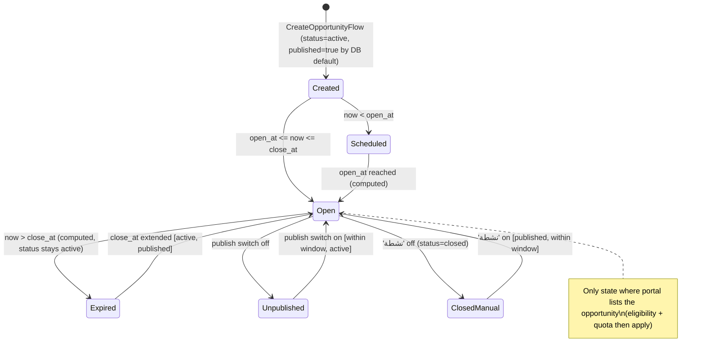
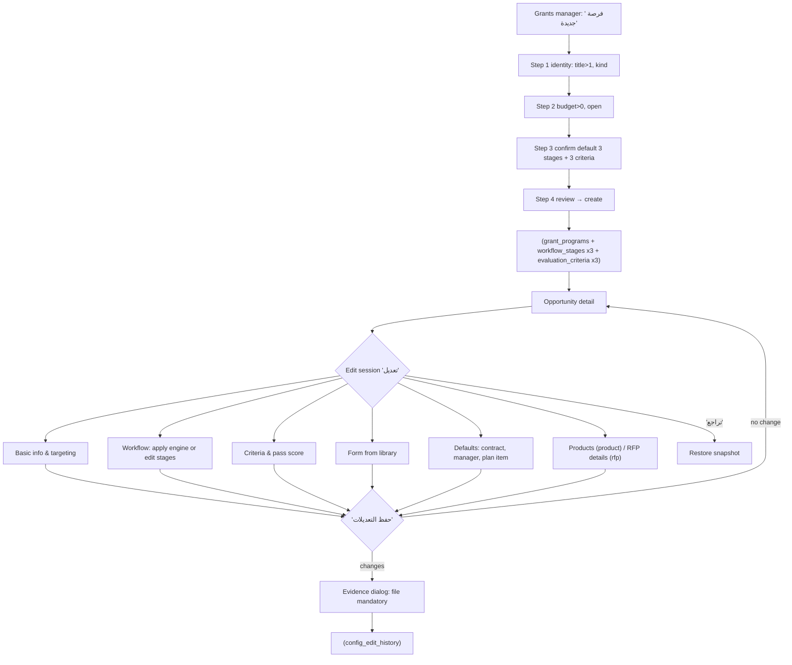
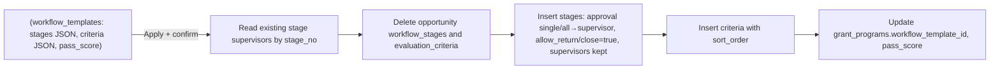
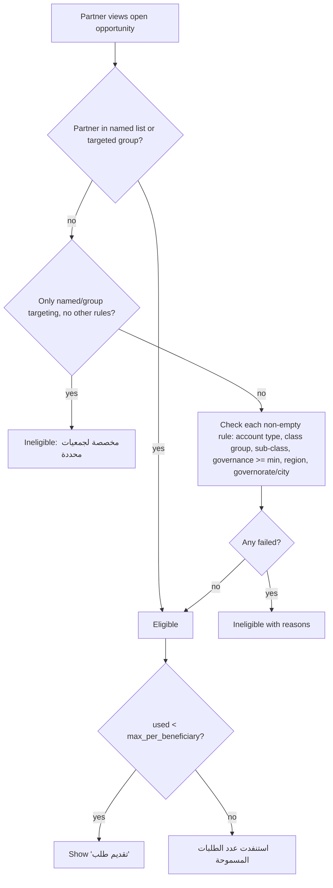
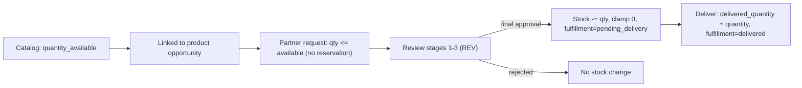
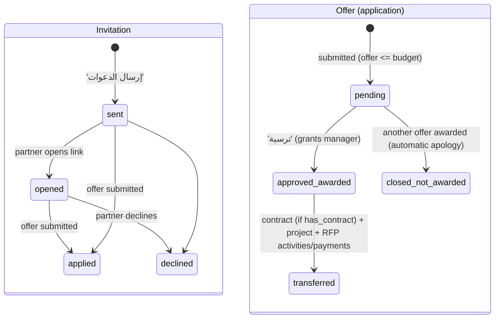
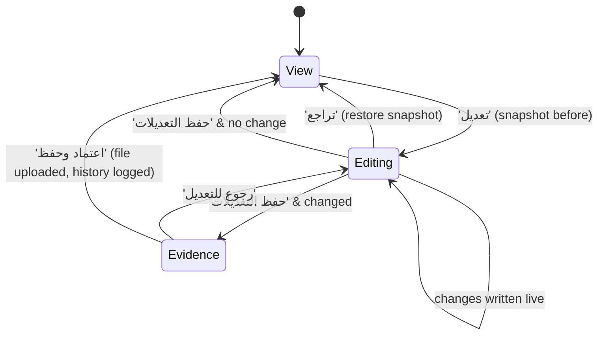

# PRG — Grant Programs / Opportunities, Workflow Engines, Products

## 1. Scope & Coverage

**Module purpose.** Configuration and lifecycle of grant *opportunities* (فرص المنح, table `grant_programs`) of three kinds — project (مشروع), product/in-kind (منتجات) and RFP/tendered project (مشروع مطروح) — together with the reusable workflow-engine library (`workflow_templates`), the organization product catalog (`grant_products`), eligibility targeting, targeted invitations and RFP offer award.

**Files analyzed (all read in full unless noted).**

| File | Lines | Role |
|---|---|---|
| src/routes/programs.tsx | 5 | Layout outlet for /programs |
| src/routes/programs.index.tsx | 143 | Opportunities list (SCR-PRG-01) |
| src/routes/programs.$id.tsx | 425 | Opportunity detail & tabs (SCR-PRG-03..09) |
| src/routes/programs.engines.tsx | 82 | Engine library (SCR-PRG-13) |
| src/routes/programs.engines_.$id.tsx | 146 | Engine detail (SCR-PRG-14) |
| src/routes/programs.products.tsx | 117 | Product catalog (SCR-PRG-15) |
| src/routes/programs.products_.$id.tsx | 117 | Product detail (SCR-PRG-16) |
| src/components/CreateOpportunityFlow.tsx | 141 | Guided creation (SCR-PRG-02) |
| src/components/EngineEditor.tsx | 56 | Engine editor |
| src/components/RfpTabs.tsx | 193 | RFP details, invitations, offers (SCR-PRG-10..12) |
| src/lib/rfp.ts | 73 | Invitations, award, RFP plan seeding |
| src/lib/eligibility.ts | 72 | Targeting / eligibility engine |
| src/components/TargetingSection.tsx | 67 | Targeting UI |
| src/components/PeriodSummary.tsx | 99 | Opportunity summary tab |
| src/lib/stageStats.ts | 51 | Stage statistics |

**Related files read partially (for cross-module behaviour):** src/lib/data.ts (types, `isPeriodOpen`, constants), src/lib/workflow.ts (`approveStage` stock deduction, `transferApplication` defaults, RFP seeding), src/routes/portal.tsx (eligibility/quota/stock/general-opportunity use), src/routes/invite.$token.tsx (invitation status), src/components/EditSession.tsx + src/lib/configEdits.ts (edit sessions), src/components/SmartFlow.tsx, src/components/SectionTabs.tsx, src/components/AppShell.tsx (navigation), src/routes/settings.tsx (Workflow tab links), src/lib/tasks.ts and src/routes/reviewer.$id.tsx (consumers of stage settings), src/components/InfoTip.tsx, supabase migrations for `grant_programs`, `workflow_stages`, `evaluation_criteria`, `workflow_templates`, `grant_products`, `program_products`, `program_invitations`, `application_items`, `evaluations`.

**Coverage notes & limitations.**
- Analysis is from source code only; the live demo was not inspected.
- The form library itself (application_forms / form_fields) is covered by **CFG**; partner-side application, invitation acceptance page and portal listing by **PTL**; review actions, evaluation and committee minutes by **REV**; transfer to contract/project by **PRJ**; annual-plan items/initiatives by **PLN**; derived tasks by **TSK**; AI assist infrastructure by **PLT**. They are referenced, not duplicated.
- Permissions: the prototype uses a demo persona switcher on one shared account; RLS policies are fully open (`USING (true)`). No role check exists on any PRG route or action — all role statements are UI-reachability only.
- `grant_programs.open_track` exists in the generated Supabase types but in no migration file (see ISS-PRG-15).

## 2. Screen Inventory

| Screen ID | Name (EN + Arabic label) | Route / Component | Roles | Purpose | Entry points | Exits / Navigates to |
|---|---|---|---|---|---|---|
| SCR-PRG-01 | Grant Opportunities List (فرص المنح) | /programs (routes/programs.index.tsx) | grants_manager, admin (primary - [Inferred]); reviewer, committee_secretary, ceo can also reach it via the Grant Applications section tabs (no role check - [Observed]) | Portfolio of all grant opportunities with KPIs, reception status and publish switch. | Sidebar 'طلبات المنح' (also matches /programs); Grants section tab 'فرص المنح'; Global search; Workshop deck link | SCR-PRG-02 (New opportunity), SCR-PRG-03 (view), section tabs to /reviewer (REV), SCR-PRG-15, SCR-PRG-13 |
| SCR-PRG-02 | Create Opportunity Guided Flow (فرصة منح جديدة) | Dialog: components/CreateOpportunityFlow.tsx (SmartFlow) | grants_manager, admin (primary - [Inferred]); reviewer, committee_secretary, ceo can also reach it via the Grant Applications section tabs (no role check - [Observed]) | Four-step guided creation of an opportunity with default workflow and criteria. | SCR-PRG-01 button 'فرصة جديدة' | SCR-PRG-03 of the created opportunity; close returns to SCR-PRG-01 |
| SCR-PRG-03 | Opportunity Detail - shell & Summary tab (عرض فرصة المنح / الملخص) | /programs/$id (routes/programs.$id.tsx) + components/PeriodSummary.tsx | grants_manager, admin (primary - [Inferred]); reviewer, committee_secretary, ceo can also reach it via the Grant Applications section tabs (no role check - [Observed]) | Tabbed view/configuration of one opportunity; default tab shows performance summary. | SCR-PRG-01 eye icon; SCR-PRG-02 after creation; SCR-PRG-14 opportunities list; Settings > سير الإجراءات tab (CFG) | Back link to SCR-PRG-01; tabs SCR-PRG-04..12 |
| SCR-PRG-04 | Basic Information & Targeting tab (المعلومات الأساسية / الجمعيات المستهدفة) | /programs/$id - InfoTab + components/TargetingSection.tsx | grants_manager, admin (primary - [Inferred]); reviewer, committee_secretary, ceo can also reach it via the Grant Applications section tabs (no role check - [Observed]) | Edit title, budget, quota, dates, publication, active status and eligibility targeting. | SCR-PRG-03 tab | stays |
| SCR-PRG-05 | Workflow tab (سير الإجراءات) | /programs/$id - EngineApply + WorkflowTab | grants_manager, admin (primary - [Inferred]); reviewer, committee_secretary, ceo can also reach it via the Grant Applications section tabs (no role check - [Observed]) | Apply an engine from the library and configure each stage (approval type, committee, SLA, supervisors, permissions). | SCR-PRG-03 tab | Link 'مكتبة المحركات' to SCR-PRG-13 |
| SCR-PRG-06 | Evaluation Criteria tab (معايير التقييم) | /programs/$id - CriteriaTab | grants_manager, admin (primary - [Inferred]); reviewer, committee_secretary, ceo can also reach it via the Grant Applications section tabs (no role check - [Observed]) | Maintain weighted evaluation criteria and pass score. | SCR-PRG-03 tab | stays |
| SCR-PRG-07 | Application Form tab (نموذج التقديم) | /programs/$id - FormTab | grants_manager, admin (primary - [Inferred]); reviewer, committee_secretary, ceo can also reach it via the Grant Applications section tabs (no role check - [Observed]) | Pick the application form from the organization library and preview its fields. | SCR-PRG-03 tab | Link 'إدارة مكتبة النماذج' to /settings?tab=forms (CFG) |
| SCR-PRG-08 | Default Settings tab (الإعدادات الافتراضية) | /programs/$id - DefaultsTab | grants_manager, admin (primary - [Inferred]); reviewer, committee_secretary, ceo can also reach it via the Grant Applications section tabs (no role check - [Observed]) | Defaults applied when an approved application is transferred to a project. | SCR-PRG-03 tab | stays (PlanLevelPicker from PLN) |
| SCR-PRG-09 | Products tab (المنتجات) - product opportunities only | /programs/$id - ProductsTab | grants_manager, admin (primary - [Inferred]); reviewer, committee_secretary, ceo can also reach it via the Grant Applications section tabs (no role check - [Observed]) | Link catalog products to a product-type opportunity. | SCR-PRG-03 tab (kind=product) | Link to SCR-PRG-15 |
| SCR-PRG-10 | Invitations tab (الدعوات) | /programs/$id - InvitationsTab (components/RfpTabs.tsx) | grants_manager, admin (primary - [Inferred]); reviewer, committee_secretary, ceo can also reach it via the Grant Applications section tabs (no role check - [Observed]) | Send and track private invitations to targeted partners. | SCR-PRG-03 tab (all kinds) | 'فتح' opens /invite/$token (PTL/PLT) |
| SCR-PRG-11 | RFP Project Details tab (تفاصيل المشروع) - RFP only | /programs/$id - RfpDetailsTab | grants_manager, admin (primary - [Inferred]); reviewer, committee_secretary, ceo can also reach it via the Grant Applications section tabs (no role check - [Observed]) | Define the tendered project: scope, deliverables, duration, weighted activities and payment plan. | SCR-PRG-03 tab (kind=rfp) | stays |
| SCR-PRG-12 | Offers & Award tab (العروض والترسية) - RFP only | /programs/$id - OffersTab | grants_manager, admin (primary - [Inferred]); reviewer, committee_secretary, ceo can also reach it via the Grant Applications section tabs (no role check - [Observed]) | Compare submitted offers and award the project to one offer. | SCR-PRG-03 tab (kind=rfp) | 'فتح العرض' to /reviewer/$id (REV) |
| SCR-PRG-13 | Workflow Engines Library (محركات سير الإجراء) | /programs/engines (routes/programs.engines.tsx) | grants_manager, admin (primary - [Inferred]); reviewer, committee_secretary, ceo can also reach it via the Grant Applications section tabs (no role check - [Observed]) | Reusable library of workflow templates (stages + criteria + pass score). | Grants section tab; SCR-PRG-05 link; Global search | SCR-PRG-14 |
| SCR-PRG-14 | Workflow Engine Detail & Editor (تفاصيل محرك سير الإجراء) | /programs/engines/$id (routes/programs.engines_.$id.tsx + components/EngineEditor.tsx) | grants_manager, admin (primary - [Inferred]); reviewer, committee_secretary, ceo can also reach it via the Grant Applications section tabs (no role check - [Observed]) | Engine usage and per-stage performance analytics; edit/delete the engine in an edit session. | SCR-PRG-13 eye icon or after creation | Back to SCR-PRG-13; opportunity links to SCR-PRG-03 |
| SCR-PRG-15 | Grant Products Catalog (منتجات المنح) | /programs/products (routes/programs.products.tsx) | grants_manager, admin (primary - [Inferred]); reviewer, committee_secretary, ceo can also reach it via the Grant Applications section tabs (no role check - [Observed]) | Organization catalog of ready products with unit, unit price and stock. | Grants section tab; SCR-PRG-09 link; Global search | SCR-PRG-16 |
| SCR-PRG-16 | Product Detail (تفاصيل المنتج) | /programs/products/$id (routes/programs.products_.$id.tsx) | grants_manager, admin (primary - [Inferred]); reviewer, committee_secretary, ceo can also reach it via the Grant Applications section tabs (no role check - [Observed]) | Historical movement of one product (requested / approved / delivered) across months and opportunities. | SCR-PRG-15 product name | Back to SCR-PRG-15; application rows to /reviewer/$id (REV) |
| SCR-PRG-17 | Configuration Edit Session bar & Evidence dialog (وضع التعديل / تأكيد التعديلات) | components/EditSession.tsx (used by SCR-PRG-03..12, 14, 15) | grants_manager, admin (primary - [Inferred]); reviewer, committee_secretary, ceo can also reach it via the Grant Applications section tabs (no role check - [Observed]) | View-by-default editing with mandatory evidence document, rollback and change history. | 'تعديل' button on SCR-PRG-03, 14, 15 | Returns to host screen |

## 3. Screen Details

### SCR-PRG-01 — Grant Opportunities List (فرص المنح)
- **Header:** title 'فرص المنح', description, info tip `program`, action **'فرصة جديدة'** [Observed] programs.index.tsx:91-92. Section tabs: الطلبات / فرص المنح / منتجات المنح / محركات سير الإجراء [Observed] SectionTabs.tsx:22.
- **KPI cards:** عدد فرص المنح, إجمالي عدد الطلبات, إجمالي المنح (الميزانيات) [Observed] :94-98.
- **Table columns:** عنوان الفرصة (+ kind badge, + 'مستهدفة' badge with tooltip), استقبال الطلبات (open ← close dates), الميزانية, حالة الاستقبال (pill مفتوحة/مغلقة via `isPeriodOpen`), النشر (switch), الطلبات (count), view icon [Observed] :99-138.
- **Filters/sorting/search:** none [Observed]. Order = created_at ascending (lib/queries.ts:24) [Observed].
- **States:** no loading skeleton or empty message; empty list renders an empty table [Observed]. Publish toggle has no success/error toast [Observed] :54-57.
- **Dead code:** a second `create()` handler and unused dialog imports remain [Observed] :1-28,59-87 (ISS-PRG-16).

### SCR-PRG-02 — Create Opportunity Guided Flow (فرصة منح جديدة)
SmartFlow dialog, buttons السابق / التالي (or 'تأكيد ومتابعة' on info steps) / 'إنشاء الفرصة' [Observed] SmartFlow.tsx:57-61.
1. **هوية الفرصة** (input): AI assist box (placeholder example), عنوان الفرصة *, نوع المنحة * (three cards with descriptions: مشروع — طلب دعم يتحول لعقد ومشروع; منتجات — منتجات جاهزة تُسلَّم للمستفيد; مشروع مطروح — المانح يحدد المشروع ويدعو جهات لتقديم عروض), الوصف (textarea). Next enabled when title > 1 char [Observed] CreateOpportunityFlow.tsx:68-93.
2. **المواعيد والميزانية** (input): الميزانية (ر.س) * (AmountInput), بداية/نهاية الاستقبال * (datetime-local), validation message when end ≤ start, checkbox **فرصة عامة** ('غير مرتبطة بمبادرة محددة؛ الجهة تختار المبادرة عند التقديم'). Next enabled when dates valid and budget > 0 [Observed] :94-108.
3. **سير الإجراء ومعايير المفاضلة** (info): read-only list of the 3 default stages with supervisor name and SLA, and criteria chips [Observed] :109-125.
4. **المراجعة والإنشاء** (decision): summary rows (العنوان، النوع، الميزانية، الاستقبال، فرصة عامة، المراحل) [Observed] :126-138.
- **States:** busy flag disables finish; error toast on insert error; success toast 'أُنشئت الفرصة' then navigation [Observed] :43-61.

### SCR-PRG-03 — Opportunity Detail shell & Summary tab
- Back link 'فرص المنح', header with title and subtitle 'عرض الفرصة' / 'تعديل الفرصة' (edit mode), edit-session bar (SCR-PRG-17) [Observed] programs.$id.tsx:95-99.
- **Tabs:** الملخص (default), المعلومات الأساسية, المنتجات (kind=product), تفاصيل المشروع + العروض والترسية (kind=rfp), الدعوات, الإعدادات الافتراضية, سير الإجراءات, معايير التقييم, نموذج التقديم [Observed] :100-112. Summary, Invitations and Offers are **outside** the `Editable` fieldset (always active); all other tabs are disabled unless in edit mode [Observed] :113-124.
- **Configuration history** list below tabs [Observed] :126.
- **Summary tab** (PeriodSummary): KPI cards الطلبات, المعتمدة, المغلقة (closed/cancelled/awaiting_apology), المطلوب / المعتمد (approved sum; hint requested sum and budget), المتبقي للإغلاق (days or 'مغلقة'); card 'الطلبات حسب المرحلة' (current, late, average duration per stage, labelled with global STAGE_NAMES); top-5 lists 'أعلى الجمعيات المتقدمة' and 'التوزيع حسب المنطقة'; product kind only: 'المنتجات المطلوبة والمسلّمة' [Observed] PeriodSummary.tsx:26-84.
- **States:** page skeleton while loading [Observed] programs.$id.tsx:91; compact skeleton for summary [Observed] PeriodSummary.tsx:24; empty lists 'لا توجد طلبات بعد.' [Observed]. Opportunity-not-found state is not handled [Observed].

### SCR-PRG-04 — Basic Information & Targeting tab
- **Fields:** عنوان الفرصة, الوصف, الميزانية (AmountInput), عدد الطلبات المسموحة للجهة الواحدة (number), تاريخ الإعلان عن بدء التسجيل (date), بداية/نهاية استقبال الطلبات (datetime-local), الفئة المستهدفة (أنواع الحسابات) — checkboxes for the 9 account types (جمعية أهلية … أخرى), targeting section, شروط الأهلية (free text), switches منشورة and نشطة, button **حفظ** [Observed] programs.$id.tsx:151-181; data.ts:262-272.
- **Targeting section 'الجمعيات المستهدفة'** (info tip): multi-selects مجموعات الجهات الشريكة (name + member count), التصنيف النوعي (المركز الوطني) (8 NCNP groups + values found in partner data), التصنيف الفرعي (filtered by chosen groups), المنطقة (13 regions), المحافظة / المدينة (filtered by chosen regions), الحد الأدنى لدرجة الحوكمة (0–100, placeholder 'بدون حد'), جمعيات محددة بالاسم; chips removable; live summary + hint 'اترك الكل فارغًا لتكون الفرصة مفتوحة للجميع' [Observed] TargetingSection.tsx:38-67; eligibility.ts:4-13.
- **Validation:** none on save (ISS-PRG-08) [Observed]. Success toast 'تم حفظ بيانات الفرصة'; error toast with DB message [Observed] :147-148.
- `kind` and `open_track` are not shown/editable [Observed].

### SCR-PRG-05 — Workflow tab (سير الإجراءات)
- **Engine apply card:** select 'تطبيق محرك من المكتبة' (tenant engines), button 'تطبيق' (disabled until selection), link 'مكتبة المحركات'. Confirmation: 'سيتم استبدال مراحل الفرصة ومعاييرها بمحتوى المحرك. متابعة؟' [Observed] programs.$id.tsx:327-360.
- **Stage cards** (one per stage, title 'n. name'): نوع الاعتماد (المشرفين / معايير التقييم / موافقة لجنة); committee panel (اسم اللجنة, أمين اللجنة + hint 'تصل طلبات هذه المرحلة إلى مهام الأمين، ويعتمدها بمحضر واحد.'); عدد أيام المرحلة (SLA); المشرفون (checkbox per non-applicant persona); switches السماح بالإرجاع, السماح بالإغلاق, السماح بتخطي المرحلة, السماح بتعديل الطلب, إرجاع للتعديل إلى المتقدم, السماح بإرفاق ملف [Observed] :184-253.
- Each control saves immediately with toast 'تم التحديث' [Observed] :187-192. No add/remove/rename of stages [Observed].

### SCR-PRG-06 — Evaluation Criteria tab
- Pass score input 'نسبة الاجتياز %' (saved on blur, toast), weight total 'مجموع الأوزان: x%' green at 100 else red, criterion rows (name, weight, delete), add row (name, weight default 20, 'إضافة') [Observed] programs.$id.tsx:362-396. No edit/reorder, no delete confirmation [Observed].

### SCR-PRG-07 — Application Form tab
- Select 'النموذج المستخدم في هذه الفرصة' with 'بدون نموذج إضافي' + tenant forms; link 'إدارة مكتبة النماذج' → /settings?tab=forms; read-only preview of fields (label, required *, type label) or 'النموذج لا يحتوي حقولاً بعد.'; toast 'تم ربط النموذج بالفرصة' [Observed] programs.$id.tsx:398-425.

### SCR-PRG-08 — Default Settings tab
- Hint 'تُطبَّق هذه القيم تلقائياً عند ترحيل الطلب المعتمد إلى مشروع.'; switch 'يوجد عقد مع الجهة الشريكة' (hidden for product kind); selects مدير المشروع الافتراضي and مسؤول إعداد العقد (same-tenant staff, 'غير محدد'); 'بند الخطة السنوية الافتراضي' via PlanLevelPicker (PLN). Each saves immediately (toast 'تم الحفظ') [Observed] programs.$id.tsx:297-325.

### SCR-PRG-09 — Products tab (product kind)
- Hint text, link 'إدارة كتالوج المنتجات'; each catalog product as a checkbox row with name, 'price / unit' and 'المخزون n'; empty state 'الكتالوج فارغ — أضف منتجات من «منتجات المنح».' [Observed] programs.$id.tsx:255-295.

### SCR-PRG-10 — Invitations tab
- Explanation with target count; button 'إرسال الدعوات (pending)' disabled without targets; hint to define targets when none; list rows: partner name, email or 'بدون بريد', sent date, pill 'حساب مفعّل'/'غير مفعّل', status pill (أُرسلت/فُتحت/قُدّم عرض/اعتذرت), 'نسخ الرابط', 'فتح'; empty 'لم تُرسل دعوات بعد'; demo note that real email needs a mail domain [Observed] RfpTabs.tsx:83-128.

### SCR-PRG-11 — RFP Project Details tab (rfp kind)
- Hint (details visible to invitees; activities and payments copied to the project after award; ceiling = budget); نطاق العمل (textarea), المخرجات المطلوبة (textarea, one per line), مدة التنفيذ (أيام); 'الأنشطة وأوزانها' rows (title, weight, switch 'مرتبط بدفعة', delete) + '+ نشاط' with total indicator; 'الدفعات (نسبة من قيمة العرض الفائز)' rows (title, %, 'بعد (يوم)', delete) + '+ دفعة' with total; button 'حفظ تفاصيل المشروع'. Validation toasts for totals ≠ 100 [Observed] RfpTabs.tsx:22-81.
- Note: this tab is inside the edit fieldset (requires edit mode) [Observed] programs.$id.tsx:118.

### SCR-PRG-12 — Offers & Award tab (rfp kind)
- Explanation with criteria count and pass score; green banner when awarded; offer cards: partner, ref_no, pill (status or 'فائز'), العرض المالي (+'الأقل'), درجة التقييم (average, green ≥ pass, or 'لم يُقيّم'), technical offer excerpt, 'فتح العرض', 'ترسية' (only when no award and status pending); confirmation text; success toast 'تمت الترسية وإنشاء المشروع'; empty 'لا توجد عروض بعد' [Observed] RfpTabs.tsx:132-193.

### SCR-PRG-13 — Workflow Engines Library
- Header 'محركات سير الإجراء' (info tip `engine`), 'محرك جديد' toggles inline name input + 'إنشاء'; table: المحرك (+description), المراحل, معايير التقييم, نسبة الاجتياز, الفرص المستخدمة, view; empty 'لا توجد محركات بعد.' [Observed] programs.engines.tsx:54-80. No edit session on this page.

### SCR-PRG-14 — Workflow Engine Detail & Editor
- Back link, header (name; description or 'n مراحل — نسبة الاجتياز x%'), edit bar; in edit mode **EngineEditor**: name input, delete icon, stage rows (name, approval label, SLA input), criteria list with delete, total indicator, add criterion [Observed] programs.engines_.$id.tsx:82-85; EngineEditor.tsx.
- KPI cards: الفرص المستخدمة, الطلبات التي مرّت به, نسبة الاعتماد, نسبة الإغلاق, متوسط التقييم (hint pass rate) [Observed] :86-92.
- 'أداء المراحل' table: المرحلة, المدة المحددة, متوسط المدة الفعلية (red if > SLA), حالياً, المتأخر (count and %), أُنجز, أُرجع, أُغلق [Observed] :93-122.
- Cards: معايير التقييم; الفرص التي تستخدم المحرك (links with application count) [Observed] :123-142. History list [Observed] :143.
- **States:** skeleton; 'المحرك غير موجود.'; delete-blocked toast [Observed] :65,69-70.

### SCR-PRG-15 — Grant Products Catalog
- Header (info tip `product`), section tabs, edit bar; grid columns المنتج (link + description), الوحدة, سعر الوحدة, المخزون; in edit mode: unit select, price & stock inputs (save on blur), delete icon, and add row (name, description, unit, price, stock, 'إضافة') [Observed] programs.products.tsx:72-116. Empty 'الكتالوج فارغ — أضف أول منتج.' [Observed] :99. Toasts: 'اسم المنتج مطلوب', 'تمت إضافة المنتج إلى الكتالوج' [Observed] :42,49.

### SCR-PRG-16 — Product Detail
- Back link; header (name, 'unit — price للوحدة'); KPIs: المخزون الحالي, المطلوب, المعتمد, المسلّم منذ البداية (each with SAR hint), الجهات الشريكة (hint top region); 'الحركة الشهرية' bar chart (مطلوب/معتمد/مسلّم) or 'لا توجد حركة بعد.'; 'المقارنة بين الفرص' (+ linked opportunities); 'الطلبات التي تحتوي المنتج' (ref — partner, qty — status — date, link to review) [Observed] programs.products_.$id.tsx:65-116. States: skeleton, 'المنتج غير موجود.' [Observed] :38-39.

### SCR-PRG-17 — Edit Session bar & Evidence dialog
- View mode: button 'تعديل'. Edit mode: amber bar 'وضع التعديل — التغييرات لا تُعتمد إلا بإرفاق المستند الشاهد' with 'تراجع' and 'حفظ التعديلات' [Observed] EditSession.tsx:51-61.
- Dialog 'تأكيد التعديلات': المستند الشاهد (إلزامي) file input with advisory AI document check, ملاحظة (سبب التعديل), buttons 'رجوع للتعديل' and 'اعتماد وحفظ' (disabled without file) [Observed] :68-86.
- Toasts: 'لا توجد تغييرات', 'حُفظت التعديلات ووُثّقت في السجل', 'تم التراجع عن التعديلات', 'تعذر التراجع', 'المستند الشاهد إلزامي لحفظ التعديلات' [Observed] EditSession.tsx; configEdits.ts:16.
- History list: date, actor, note, evidence file link [Observed] :93-119.

## 4. Interaction Inventory

| INT ID | Screen | Trigger (control) | System response | Data written | Evidence |
|---|---|---|---|---|---|
| INT-PRG-001 | SCR-PRG-01 | Button 'فرصة جديدة' | Opens the guided creation flow (SCR-PRG-02). | - | [Observed] programs.index.tsx:92,140 |
| INT-PRG-002 | SCR-PRG-01 | Switch in 'النشر' column | Publishes/unpublishes the opportunity immediately; list refreshes; open/closed pill recomputed. | grant_programs.published | [Observed] programs.index.tsx:54-57,126 |
| INT-PRG-003 | SCR-PRG-01 | Eye icon 'عرض' | Navigates to opportunity detail. | - | [Observed] programs.index.tsx:129-131 |
| INT-PRG-004 | SCR-PRG-01 | Hover 'مستهدفة' badge | Tooltip with targeting summary. | - | [Observed] programs.index.tsx:120 |
| INT-PRG-005 | SCR-PRG-02 | AI assist box (free text) + apply | AI proposes title, kind, description, budget, dates; values fill the form only after the user applies them. | - | [Observed] CreateOpportunityFlow.tsx:72-78 |
| INT-PRG-006 | SCR-PRG-02 | Kind cards (مشروع / منتجات / مشروع مطروح) | Selects kind; description shown per kind. | - | [Observed] CreateOpportunityFlow.tsx:80-88 |
| INT-PRG-007 | SCR-PRG-02 | 'التالي' on step 1/2 | Enabled only when step valid (title >1 char; dates valid and budget >0); inline error when close<=open. | - | [Observed] CreateOpportunityFlow.tsx:69,95,103; SmartFlow.tsx:61 |
| INT-PRG-008 | SCR-PRG-02 | Checkbox 'فرصة عامة' | Marks the opportunity as general (initiative chosen by applicant). | - | [Observed] CreateOpportunityFlow.tsx:104-105 |
| INT-PRG-009 | SCR-PRG-02 | 'تأكيد ومتابعة' on default workflow step | Confirms the default stages/criteria preview. | - | [Observed] CreateOpportunityFlow.tsx:110-124 |
| INT-PRG-010 | SCR-PRG-02 | 'إنشاء الفرصة' | Creates opportunity, default stages and criteria; toast 'أُنشئت الفرصة'; navigates to detail. Error toast on insert failure. | grant_programs, workflow_stages, evaluation_criteria | [Observed] CreateOpportunityFlow.tsx:43-61 |
| INT-PRG-011 | SCR-PRG-03 | Button 'تعديل' (edit session) | Takes snapshot; enables controls in editable tabs; shows amber edit bar. | - | [Observed] EditSession.tsx:27,53-61; programs.$id.tsx:99 |
| INT-PRG-012 | SCR-PRG-03 | Tab selection | Shows tab; products tab only for product kind; RFP tabs only for rfp kind. | - | [Observed] programs.$id.tsx:100-125 |
| INT-PRG-013 | SCR-PRG-04 | Button 'حفظ' | Saves basic info + targeting; deadline derived from close_at; toast 'تم حفظ بيانات الفرصة'. | grant_programs (title, description, budget, eligibility, announce_date, open_at, close_at, deadline, target_types, max_per_beneficiary, published, status, target_*) | [Observed] programs.$id.tsx:136-150,178 |
| INT-PRG-014 | SCR-PRG-04 | Switch 'نشطة' | Toggles status active/closed (persisted on Save). | grant_programs.status | [Observed] programs.$id.tsx:177 |
| INT-PRG-015 | SCR-PRG-04 | Targeting multi-selects (groups, classification, sub-class, region, governorate, named partners) and governance input | Adds/removes chips; sub-class options filtered by chosen classification; governorates by chosen regions; summary text updates live. | (on Save) grant_programs.target_* | [Observed] TargetingSection.tsx:43-64 |
| INT-PRG-016 | SCR-PRG-05 | Engine select + 'تطبيق' | Native confirm; replaces stages and criteria with engine copy; updates workflow_template_id and pass_score; toast. | workflow_stages (delete+insert), evaluation_criteria (delete+insert), grant_programs | [Observed] programs.$id.tsx:333-347 |
| INT-PRG-017 | SCR-PRG-05 | Select 'نوع الاعتماد' | Saves immediately; committee panel appears for committee type. | workflow_stages.approval_type | [Observed] programs.$id.tsx:187-192,201-210 |
| INT-PRG-018 | SCR-PRG-05 | Committee name (on blur) / secretary select | Saves committee details. | workflow_stages.committee_name, secretary_id | [Observed] programs.$id.tsx:214-223 |
| INT-PRG-019 | SCR-PRG-05 | SLA input (on blur) | Saves SLA days when changed. | workflow_stages.sla_days | [Observed] programs.$id.tsx:230 |
| INT-PRG-020 | SCR-PRG-05 | Supervisor checkboxes | Adds/removes supervisor. | workflow_stages.supervisor_ids | [Observed] programs.$id.tsx:233-240 |
| INT-PRG-021 | SCR-PRG-05 | Permission switches (return, close, skip, edit, request edit, attach) | Saves flag immediately. | workflow_stages.allow_* | [Observed] programs.$id.tsx:242-247 |
| INT-PRG-022 | SCR-PRG-06 | Pass score input (on blur) | Saves pass score; toast. | grant_programs.pass_score | [Observed] programs.$id.tsx:372,378 |
| INT-PRG-023 | SCR-PRG-06 | 'إضافة' criterion | Adds criterion (name required) with weight at end. | evaluation_criteria | [Observed] programs.$id.tsx:366-370 |
| INT-PRG-024 | SCR-PRG-06 | Trash icon on criterion | Deletes criterion (no confirmation). | evaluation_criteria (delete) | [Observed] programs.$id.tsx:371,385 |
| INT-PRG-025 | SCR-PRG-07 | Form select | Links chosen library form (or none); preview shows fields with type and required marker. | grant_programs.form_id | [Observed] programs.$id.tsx:401-421 |
| INT-PRG-026 | SCR-PRG-08 | Switch 'يوجد عقد مع الجهة الشريكة' (non-product) | Saves has_contract. | grant_programs.has_contract | [Observed] programs.$id.tsx:315-317 |
| INT-PRG-027 | SCR-PRG-08 | Default manager / contract officer selects; plan level picker | Saves immediately. | grant_programs.default_manager_id, default_contract_officer_id, default_plan_level_id | [Observed] programs.$id.tsx:318-321 |
| INT-PRG-028 | SCR-PRG-09 | Product checkbox | Links/unlinks catalog product to the opportunity. | program_products (insert/delete) | [Observed] programs.$id.tsx:267-274,285 |
| INT-PRG-029 | SCR-PRG-10 | 'إرسال الدعوات (n)' | Creates invitations for targeted partners not yet invited; toast with count or 'already invited'; error if no targets. | program_invitations | [Observed] RfpTabs.tsx:93-99,106; rfp.ts:26-41 |
| INT-PRG-030 | SCR-PRG-10 | 'نسخ الرابط' / 'فتح' | Copies invite URL to clipboard / opens /invite/$token. | - (opening sets status 'opened' - PTL) | [Observed] RfpTabs.tsx:100,118-119; invite.$token.tsx:39 |
| INT-PRG-031 | SCR-PRG-11 | Add/remove activity or payment rows; weight/percent/due-days inputs; payment-linked switch | Local edits; running totals coloured. | - | [Observed] RfpTabs.tsx:52-76 |
| INT-PRG-032 | SCR-PRG-11 | 'حفظ تفاصيل المشروع' | Validates 100% totals; saves RFP details (blank-title rows dropped). | grant_programs.rfp_* | [Observed] RfpTabs.tsx:34-43 |
| INT-PRG-033 | SCR-PRG-12 | 'ترسية' on a pending offer | Confirm; award winner, auto-close others, create contract/project, seed activities and payments; toast. | applications, application_status_history, contracts, projects, project_activities, payments | [Observed] RfpTabs.tsx:150-159,183; rfp.ts:54-73 |
| INT-PRG-034 | SCR-PRG-12 | 'فتح العرض' | Opens application review page. | - | [Observed] RfpTabs.tsx:182 |
| INT-PRG-035 | SCR-PRG-13 | 'محرك جديد' then name + 'إنشاء' / Enter | Creates engine with defaults and opens its detail. | workflow_templates | [Observed] programs.engines.tsx:43-52,57-59 |
| INT-PRG-036 | SCR-PRG-13 | Eye icon | Opens engine detail. | - | [Observed] programs.engines.tsx:73 |
| INT-PRG-037 | SCR-PRG-14 | Engine name input (blur), SLA inputs (blur), add/delete criterion (edit mode) | Saves engine JSON (name, stages, criteria). | workflow_templates | [Observed] EngineEditor.tsx:18,29-30,43-50; programs.engines_.$id.tsx:59-63 |
| INT-PRG-038 | SCR-PRG-14 | Trash icon 'حذف المحرك' | If used by opportunities: error toast; else deletes and returns to library. | workflow_templates (delete) | [Observed] programs.engines_.$id.tsx:64-68 |
| INT-PRG-039 | SCR-PRG-15 | Add row (edit mode) 'إضافة' | Adds product (name required) with unit, price, stock. | grant_products | [Observed] programs.products.tsx:41-51,100-110 |
| INT-PRG-040 | SCR-PRG-15 | Inline unit select / price / stock (blur) (edit mode) | Updates product. | grant_products | [Observed] programs.products.tsx:52-56,89-95 |
| INT-PRG-041 | SCR-PRG-15 | Trash icon (edit mode) | Deletes product immediately. | grant_products (delete; cascades application_items) | [Observed] programs.products.tsx:57,96 |
| INT-PRG-042 | SCR-PRG-15 | Product name link | Opens product detail. | - | [Observed] programs.products.tsx:86 |
| INT-PRG-043 | SCR-PRG-16 | Application row | Opens /reviewer/$id. | - | [Observed] programs.products_.$id.tsx:106 |
| INT-PRG-044 | SCR-PRG-17 | 'حفظ التعديلات' | If no change: info toast and exit; else opens evidence dialog. | - | [Observed] EditSession.tsx:34-38 |
| INT-PRG-045 | SCR-PRG-17 | Evidence dialog 'اعتماد وحفظ' (file mandatory, note optional) | Uploads evidence; AI doc check advisory; logs before/after; exits edit mode; toast. | storage attachments/config/...; config_edit_history | [Observed] EditSession.tsx:39-50,68-86; configEdits.ts:12-27 |
| INT-PRG-046 | SCR-PRG-17 | 'تراجع' | Restores pre-edit snapshot; exits edit mode; toast. | Restores grant_programs / workflow_stages / evaluation_criteria / program_products or workflow_templates or grant_products | [Observed] EditSession.tsx:28-33 |
| INT-PRG-047 | SCR-PRG-17 | Evidence link in history | Opens stored evidence file. | - | [Observed] EditSession.tsx:93-119 |

## 5. Shared Components & Dependencies

| Component / lib | Used for | Owner module |
|---|---|---|
| `SmartFlow` (components/SmartFlow.tsx) | Stepped dialog for opportunity creation | PLT (shared UI) |
| `AiAssist` | AI proposal of creation fields (proposes only) | PLT |
| `useEditSession`, `Editable`, `ConfigEditHistory` (EditSession.tsx) + `commitConfigEdit` (configEdits.ts) | Evidence-backed edit sessions for entity types `program`, `engine`, `product_catalog` | PRG (shared with CFG-style governance) |
| `DocAiCheck` | Advisory AI check of evidence file | REV/PLT |
| `SectionTabs` / `GRANTS_TABS` | Tabs الطلبات / فرص المنح / منتجات المنح / محركات سير الإجراء | PLT |
| `AmountInput`, `StatCard`, `Pill`, `PageSkeleton`, `InfoTip` | Shared UI | PLT |
| `PlanLevelPicker` | Default annual-plan item | PLN |
| `lib/eligibility.ts` | Targeting & eligibility — consumed by portal (PTL) and RFP invitations | PRG |
| `lib/rfp.ts` | Invitations, award, RFP plan seeding — consumed by invite page/portal (PTL) and workflow transfer (PRJ) | PRG |
| `lib/stageStats.ts` | Stage statistics for summary and engine detail | PRG |
| `lib/workflow.ts` (`approveStage`, `transferApplication`, `deliverApplication`) | Stock deduction, default application on transfer, RFP seeding | REV / PRJ |
| `lib/queries.ts` (`usePrograms`, `useApplications`, `useBeneficiaries`, `usePartnerGroups`) | Data loading | PLT/BEN |
| Supabase storage bucket `attachments` | Evidence documents (`config/<entity>/...`) | PLT |

**Downstream consumers of PRG configuration:** portal listing & application (PTL: `isPeriodOpen`, `checkEligibility`, `max_per_beneficiary`, `open_track`, product stock, RFP ceiling, form_id); review (REV: stage flags, SLA, approval type, criteria, pass score); tasks (TSK: supervisor_ids, secretary_id, committee_name, SLA); transfer (PRJ: has_contract, default_manager_id, default_plan_level_id, rfp_activities/payments); settings 'سير الإجراءات' tab links to each opportunity (CFG, settings.tsx:411-417).

## 6. Business Process Workflows

### 6.1 Opportunity lifecycle (stored status × computed reception state)
Stored `status` ∈ {active, closed} and `published` flag; the reception state is computed (BR-PRG-02).

Actors: grants manager/admin (Inferred; no gating in code). Guards: none server-side (BR-PRG-13).

### 6.2 Opportunity creation & configuration

### 6.3 Workflow template (engine) → opportunity copy

Copy semantics: no link back except `workflow_template_id` used for engine analytics (BR-PRG-19/20). Committee settings and other stage flags are not carried (ISS-PRG-10).

### 6.4 Eligibility decision (portal)

### 6.5 Product stock lifecycle

### 6.6 RFP: invitation → offers → award

Guard: award only if no offer has `award_status='awarded'` and target offer `status='pending'` (RfpTabs.tsx:183). No evaluation or stage guard (ISS-PRG-04).

### 6.7 Configuration edit session

## 7. Business Rules

| BR ID | Rule | Evidence label + reference |
|---|---|---|
| BR-PRG-01 | An opportunity has one kind: project (مشروع), product (منتجات) or rfp (مشروع مطروح). The kind is chosen at creation; no control exists to change it afterwards. | [Observed] components/CreateOpportunityFlow.tsx:15-19; lib/data.ts:218-222; programs.$id.tsx InfoTab (no kind field) |
| BR-PRG-02 | An opportunity is open for applications only when status='active' AND published=true AND now >= open_at (if set) AND now <= close_at (if set); otherwise it is shown as closed. | [Observed] lib/data.ts:403-409 isPeriodOpen; programs.index.tsx:114,125; portal.tsx:87 |
| BR-PRG-03 | Creating an opportunity requires a title longer than 1 character, a budget > 0, and both reception dates with close_at strictly after open_at. | [Observed] CreateOpportunityFlow.tsx:39,69,95,103 |
| BR-PRG-04 | New opportunities are created with status='active', target_types=[جمعية أهلية, مؤسسة أهلية], deadline = date part of close_at; DB defaults apply for published (true), max_per_beneficiary (1) and pass_score (80). | [Observed] CreateOpportunityFlow.tsx:45-49; migration 20261004093306:22-29 |
| BR-PRG-05 | Every new opportunity receives a default 3-stage workflow - (1) استقبال الطلبات 3 days, supervisor = first reviewer persona; (2) دراسة الطلبات 5 days, approval_type=criteria, supervisor = first reviewer; (3) اعتماد الطلبات 3 days, supervisor = first grants_manager - and 3 criteria: وضوح الأهداف 30%, الأثر المتوقع 40%, الجدوى المالية 30%. | [Observed] CreateOpportunityFlow.tsx:20-29,51-55 |
| BR-PRG-06 | General opportunity (open_track=true): not tied to one initiative - the applicant must select the annual-plan initiative when applying. Initiative-specific opportunity: the application inherits the opportunity's default plan level (default_plan_level_id). | [Observed] CreateOpportunityFlow.tsx:104-105; portal.tsx:265,300,307 |
| BR-PRG-07 | A partner named explicitly (target_beneficiary_ids) or belonging to a targeted partner group (target_group_ids) is always eligible, bypassing all other targeting rules. | [Observed] lib/eligibility.ts:31-35,40 |
| BR-PRG-08 | If an opportunity targets only named partners/groups and has no other targeting rule, every other partner is ineligible ('هذه الفرصة مخصصة لجمعيات محددة'). | [Observed] lib/eligibility.ts:42-46 |
| BR-PRG-09 | Other targeting rules are combined with AND; an empty list means 'all': account type, NCNP classification group, sub-classification, region, governorate (falls back to the partner's city), minimum governance score. | [Observed] lib/eligibility.ts:47-57; TargetingSection.tsx:64 |
| BR-PRG-10 | A partner without a governance score fails any minimum-governance rule (treated as -1). | [Observed] lib/eligibility.ts:52 |
| BR-PRG-11 | Partner-group membership is resolved at check time, so adding a partner to a targeted group makes it eligible/invitable immediately. | [Observed] lib/eligibility.ts:30-35 |
| BR-PRG-12 | A partner may hold at most max_per_beneficiary non-cancelled applications per opportunity. | [Observed] portal.tsx:162-163,171-174 |
| BR-PRG-13 | Eligibility, reception window and quota are evaluated in the partner portal UI only; no database constraint or server-side check enforces them. | [Inferred] portal.tsx:160-175; RLS 'poc_open_programs' migration 20261004085937:47 |
| BR-PRG-14 | Each stage has an approval type: supervisor (المشرفين), criteria (معايير التقييم) or committee (موافقة لجنة). A committee stage carries a committee name and a secretary; its applications go to the secretary's tasks and are approved with one minute document. | [Observed] programs.$id.tsx:201-227; lib/tasks.ts:102-107; routes/tasks.tsx:312 |
| BR-PRG-15 | Stage permission flags: allow_return (default true), allow_close (true), allow_skip (false), allow_edit (false), allow_request_edit (true), allow_attach (true). The review screen shows Return-for-edit, Reject, Skip and Return-to-previous according to these flags. | [Observed] migration 20261005090659:26-30; programs.$id.tsx:242-247; reviewer.$id.tsx:361-364 |
| BR-PRG-16 | Each stage has an SLA in days; an application is late when days since stage_entered_at exceed the stage's sla_days. | [Observed] lib/stageStats.ts:39; reviewer.$id.tsx:191-192 |
| BR-PRG-17 | Evaluation criteria weights are expected to total 100%; the total is shown green/red but saving is not blocked. | [Observed] programs.$id.tsx:365,379; EngineEditor.tsx:13,38 |
| BR-PRG-18 | Each opportunity has a pass score (%); an evaluation/offer at or above it is shown as passing. | [Observed] programs.$id.tsx:372,378; RfpTabs.tsx:178; programs.engines_.$id.tsx:78 |
| BR-PRG-19 | Applying an engine replaces all stages and criteria of the opportunity with copies from the engine: supervisors are kept per stage_no; engine approval types 'single'/'all' become 'supervisor'; allow_return/allow_close set true (other flags revert to DB defaults; committee name/secretary are lost); pass_score copied; workflow_template_id recorded. | [Observed] programs.$id.tsx:333-347 |
| BR-PRG-20 | Engines are copied, not referenced: later engine edits do not change opportunities that already applied the engine. | [Inferred] programs.$id.tsx:341-346; AGENTS.md ('workflow_templates are copied into stages/criteria') |
| BR-PRG-21 | An engine used by at least one opportunity cannot be deleted. | [Observed] programs.engines_.$id.tsx:64-68 |
| BR-PRG-22 | A new engine is created with pass score 70%, three standard stages (approval 'supervisor', SLA 5 days) and no criteria. | [Observed] programs.engines.tsx:43-49 |
| BR-PRG-23 | Products belong to the organization catalog (grant_products.tenant_id) and are made available to a product opportunity through program_products (unique per opportunity/product). | [Observed] programs.products.tsx:43-46; programs.$id.tsx:267-274; migration 20261005090659:1-17 |
| BR-PRG-24 | A partner cannot request more units of a product than its current quantity_available at submission time. | [Observed] portal.tsx:292,375 |
| BR-PRG-25 | Stock is deducted only at final approval (stage 3) of a product application, clamped at zero; the application then gets fulfillment_status='pending_delivery' (no contract/project). | [Observed] lib/workflow.ts:47-64 |
| BR-PRG-26 | Delivering a product application sets delivered_quantity equal to requested quantity for every item. | [Observed] lib/workflow.ts:208-213 |
| BR-PRG-27 | On transfer of an approved application: contract created only if has_contract (default true; hidden for product opportunities); project manager = default_manager_id, else first project_manager persona; plan level = application's plan level, else default_plan_level_id. | [Observed] programs.$id.tsx:314-321; lib/workflow.ts:141-151 |
| BR-PRG-28 | RFP details can be saved only if activity weights total 100% (when activities exist) and payment percentages total 100% (when payments exist). | [Observed] RfpTabs.tsx:32-36 |
| BR-PRG-29 | The RFP opportunity budget is the financial ceiling: an offer above it is rejected in the portal. | [Observed] RfpTabs.tsx:47; portal.tsx:295 |
| BR-PRG-30 | RFP award is possible only while no offer is awarded and only on a 'pending' offer. Award sets the winner approved/awarded, closes every other pending offer as not_awarded with an automatic apology reason, transfers the winner to contract+project, and copies RFP activities and payments (amount = % x winning amount; due date = award date + due_days). | [Observed] RfpTabs.tsx:149-159,183; lib/rfp.ts:54-73; lib/workflow.ts:196-201 |
| BR-PRG-31 | At most one invitation per opportunity and partner; invitations go only to named or group-targeted partners; email = partner email or invited email; status sent -> opened (first link open) -> applied (on submission) or declined. | [Observed] lib/rfp.ts:26-51; migration 20261006134413:11-24 |
| BR-PRG-32 | Configuration of opportunities, engines and the product catalog is done in an edit session: snapshot on entry, saving requires an evidence document (note optional), cancel restores the snapshot; each commit is logged with before/after in config_edit_history. | [Observed] components/EditSession.tsx:20-66,76-81; lib/configEdits.ts:12-27 |
| BR-PRG-33 | An opportunity uses at most one form from the organization form library (grant_programs.form_id); fields are edited only in the library (see module CFG). | [Observed] programs.$id.tsx:398-425; AGENTS.md |
| BR-PRG-34 | Stage statistics derive from application_status_history: 'submit' enters stage 1; approve_stage/skip leave to the next stage; return goes back one stage; close exits; durations are counted only for the stage the application was in. | [Observed] lib/stageStats.ts:6-31 |
| BR-PRG-35 | Opportunity status 'closed' is set only manually (switch 'نشطة'); reaching close_at does not change status - open/closed is computed per BR-PRG-02. | [Observed] programs.$id.tsx:177; lib/data.ts:403-409 |

## 8. Data Requirements

### 8.1 `grant_programs` (opportunity)
| Field | Type | Required | Meaning |
|---|---|---|---|
| id | uuid | PK | |
| tenant_id | uuid → tenants | Yes | Owning organization |
| kind | text ('project','product','rfp') | Yes (default 'project') | Opportunity type (BR-PRG-01) |
| title | text | Yes | عنوان الفرصة |
| description | text | No | الوصف |
| budget | numeric(14,2) | Yes (default 0) | Opportunity budget; RFP ceiling |
| eligibility | text | No | Free-text eligibility conditions (unused elsewhere) |
| deadline | date | No | Date part of close_at (legacy) |
| status | enum program_status ('active','closed') | Yes (default active) | Manual active/closed |
| announce_date | date | No | Announcement date (informational) |
| open_at / close_at | timestamptz | No (required by creation UI) | Reception window |
| published | boolean | Yes (default **true**) | Visible to partners |
| target_types | text[] | Yes (default '{}') | Allowed account types |
| max_per_beneficiary | int | Yes (default 1) | Quota per partner |
| pass_score | int | Yes (default 80) | Pass threshold % |
| form_id | uuid → application_forms (SET NULL) | No | Linked library form (CFG) |
| has_contract | boolean | Yes (default true) | Contract created on transfer |
| default_manager_id / default_contract_officer_id | uuid → personas (SET NULL) | No | Transfer defaults |
| default_plan_level_id | uuid → plan_levels (SET NULL) | No | Default annual-plan item (PLN) |
| workflow_template_id | uuid (no FK) | No | Last applied engine |
| target_class_groups, target_class_subs, target_regions, target_governorates | text[] | Yes (default '{}') | Targeting lists |
| min_governance | numeric | No | Minimum governance score |
| target_beneficiary_ids, target_group_ids | uuid[] | Yes (default '{}') | Named partners / partner groups |
| open_track | boolean | (types only; no migration) | General opportunity flag |
| rfp_scope, rfp_deliverables | text | No | RFP description |
| rfp_duration_days | int | No | RFP implementation duration |
| rfp_activities | jsonb [{title, weight, is_payment}] | Yes (default []) | RFP activities |
| rfp_payments | jsonb [{title, percent, due_days}] | Yes (default []) | RFP payment plan |
| created_at | timestamptz | Yes | |
Relationships: 1-N workflow_stages, evaluation_criteria, applications (CASCADE), program_products, program_invitations, form_fields (legacy). Lifecycle: see 6.1. RLS: open (POC).

### 8.2 `workflow_stages`
id; program_id → grant_programs (CASCADE); stage_no int (UNIQUE with program_id); name text; approval_type text ('supervisor','criteria','committee'; default supervisor); sla_days int (default 3); supervisor_ids uuid[]; allow_return, allow_close (default true); allow_skip, allow_edit (default false); allow_request_edit, allow_attach (default true); secretary_id → personas (SET NULL); committee_name text. [Observed] migrations 20261004093306:40-50, 20261004132647:34, 20261005090659:26-30.

### 8.3 `evaluation_criteria`
id; program_id → grant_programs (CASCADE); name text (required); weight int (default 25); sort_order int. Referenced indirectly by `evaluations.scores` (jsonb, REV).

### 8.4 `workflow_templates` (engine)
id; tenant_id → tenants; name (required); description; pass_score int (default 70); stages jsonb [{stage_no, name, approval_type ('single','all','supervisor','criteria','committee'), sla_days}]; criteria jsonb [{name, weight}]; created_at. Seeded: 'محرك المشاريع التنموية' (pass 75, committee at stage 3) and 'محرك المنتجات السريع' (pass 60).

### 8.5 `grant_products`
id; tenant_id → tenants (CASCADE); program_id (legacy, nullable); name (required); description; unit text (default 'وحدة'; UI list PRODUCT_UNITS); unit_price numeric (default 0); quantity_available int (default 0); created_at. Referenced by application_items.product_id **ON DELETE CASCADE**.

### 8.6 `program_products`
id; program_id → grant_programs (CASCADE); product_id → grant_products (CASCADE); created_at; UNIQUE(program_id, product_id).

### 8.7 `program_invitations`
id; program_id (CASCADE); beneficiary_id → beneficiaries (CASCADE); token text UNIQUE (random); email; status text ('sent','opened','applied','declined'; default sent); sent_by → personas; sent_at; opened_at; responded_at; created_at; UNIQUE(program_id, beneficiary_id).

### 8.8 Related (owned elsewhere)
- `applications` (REV/PTL): program_id, status ('pending','approved','closed','cancelled','awaiting_apology'), current_stage, stage_entered_at, requested_amount, plan_level_id, technical_offer, award_status ('awarded','not_awarded'), fulfillment_status ('none','pending_delivery','delivered'), close_reason.
- `application_items` (PTL/REV): application_id, product_id, quantity, delivered_quantity.
- `application_status_history` (REV): application_id, stage, action ('submit','approve_stage','skip','return','close','award','transfer',…), created_at — source for stage stats.
- `evaluations` (REV): application_id, reviewer_id, scores, total.
- `config_edit_history`: tenant_id, entity_type ('program','engine','product_catalog'), entity_id, target name, before, after, note, evidence_name, evidence_path, actor_id, created_at.

## 9. Product Structure

- **EP-PRG-01 — Opportunity Lifecycle Management**: Create, list, publish, open/close and maintain grant opportunities (project, product, RFP), including general vs initiative-specific opportunities.
  - FT-PRG-01 — Opportunity List & Portfolio KPIs (Must)
  - FT-PRG-02 — Guided Opportunity Creation (Must)
  - FT-PRG-03 — Opportunity Basic Info, Publication & Reception Window (Must)
  - FT-PRG-04 — General vs Initiative-Specific Opportunity (Should)
- **EP-PRG-02 — Eligibility & Targeting**: Define who may apply to an opportunity (classification, region, governance, named partners/groups, account types, quota) and evaluate partner eligibility.
  - FT-PRG-05 — Eligibility Targeting & Quota (Must)
- **EP-PRG-03 — Opportunity Workflow & Evaluation Configuration**: Per-opportunity stages, approval types, committee, SLA, supervisors, permissions, criteria, pass score, form and post-approval defaults.
  - FT-PRG-06 — Stage Configuration (Must)
  - FT-PRG-07 — Evaluation Criteria & Pass Score (Must)
  - FT-PRG-08 — Application Form Assignment (Must)
  - FT-PRG-09 — Post-Approval Defaults (Must)
- **EP-PRG-04 — Workflow Engine Library**: Reusable workflow templates copied into opportunities, with engine-level performance analytics.
  - FT-PRG-10 — Workflow Engine Library & Editor (Should)
  - FT-PRG-11 — Apply Engine to Opportunity (Should)
  - FT-PRG-12 — Engine Performance Analytics (Could)
- **EP-PRG-05 — Product Grants & Catalog**: Organization product catalog, stock control, linking products to product opportunities, and product movement analytics.
  - FT-PRG-13 — Product Catalog & Stock (Must)
  - FT-PRG-14 — Opportunity Product Linking (Must)
  - FT-PRG-15 — Product Movement Analytics (Could)
- **EP-PRG-06 — RFP (Tendered Projects) & Invitations**: Donor-defined projects, private invitations to partners, offer comparison and award to a single offer.
  - FT-PRG-16 — Targeted Invitations (Should)
  - FT-PRG-17 — RFP Project Definition (Should)
  - FT-PRG-18 — Offer Comparison & Award (Should)
- **EP-PRG-07 — Configuration Governance & Performance Insight**: Evidence-backed edit sessions with rollback/history, and opportunity summary/stage statistics.
  - FT-PRG-19 — Evidence-Backed Configuration Edit Sessions (Should)
  - FT-PRG-20 — Opportunity Summary & Stage Statistics (Should)

## 10. Features

### FT-PRG-01 — Opportunity List & Portfolio KPIs
- **Feature ID:** FT-PRG-01 (Epic EP-PRG-01)
- **Name:** Opportunity List & Portfolio KPIs
- **Description:** List of all grant opportunities with reception status, publication and KPIs.
- **Business Objective:** Give grants staff a single view of all opportunities and their status. [Inferred]
- **Expected Business Value:** [To Confirm]
- **Primary User Roles:** grants_manager, admin, ceo, reviewer, committee_secretary
- **Scope:** List, KPIs, open/closed computation, publish toggle, navigation.
- **Out of Scope:** Filtering/sorting/search on the list (not in prototype); portal listing (PTL).
- **Functional Requirements:** FR-PRG-001, FR-PRG-002, FR-PRG-003, FR-PRG-004
- **User Stories:** US-PRG-001, US-PRG-002
- **Business Rules:** BR-PRG-02, BR-PRG-35
- **Dependencies:** lib/queries.ts usePrograms/useApplications
- **Related Screens:** SCR-PRG-01
- **Acceptance Criteria:**
  - All opportunities are listed with correct open/closed status.
  - Publish switch persists and affects portal visibility.
- **Open Questions:** OQ-PRG-01, OQ-PRG-02
- **Assumptions:** List is not tenant-filtered in prototype; production lists only the current organization's opportunities.
- **Priority Recommendation (MoSCoW):** Must

### FT-PRG-02 — Guided Opportunity Creation
- **Feature ID:** FT-PRG-02 (Epic EP-PRG-01)
- **Name:** Guided Opportunity Creation
- **Description:** Four-step wizard (with optional AI assist) that creates an opportunity with a default workflow and criteria.
- **Business Objective:** Make opportunity setup fast and consistent. [Inferred]
- **Expected Business Value:** [To Confirm]
- **Primary User Roles:** grants_manager, admin
- **Scope:** Wizard steps, validation, AI proposal, default stages/criteria, navigation to detail.
- **Out of Scope:** Choosing an engine during creation (done after, in Workflow tab); targeting at creation.
- **Functional Requirements:** FR-PRG-005, FR-PRG-006, FR-PRG-007, FR-PRG-008, FR-PRG-009
- **User Stories:** US-PRG-003, US-PRG-004
- **Business Rules:** BR-PRG-01, BR-PRG-03, BR-PRG-04, BR-PRG-05
- **Dependencies:** SmartFlow; AiAssist (PLT)
- **Related Screens:** SCR-PRG-02
- **Acceptance Criteria:**
  - An opportunity cannot be created without valid title, budget and window.
  - Created opportunity has default stages and criteria.
- **Open Questions:** OQ-PRG-02, OQ-PRG-03
- **Assumptions:** Default supervisors = first reviewer / grants manager persona is a demo convenience.
- **Priority Recommendation (MoSCoW):** Must

### FT-PRG-03 — Opportunity Basic Info, Publication & Reception Window
- **Feature ID:** FT-PRG-03 (Epic EP-PRG-01)
- **Name:** Opportunity Basic Info, Publication & Reception Window
- **Description:** Detail page shell and Basic Info tab to maintain identity, budget, quota, dates, publication and active status.
- **Business Objective:** Control when and to whom an opportunity is open. [Inferred]
- **Expected Business Value:** [To Confirm]
- **Primary User Roles:** grants_manager, admin
- **Scope:** Tabbed detail; edit and save basic info; manual close/reactivate.
- **Out of Scope:** Automatic closing; budget binding to plan (PLN).
- **Functional Requirements:** FR-PRG-010, FR-PRG-011, FR-PRG-012, FR-PRG-013
- **User Stories:** US-PRG-005, US-PRG-006
- **Business Rules:** BR-PRG-02, BR-PRG-12, BR-PRG-35
- **Dependencies:** FT-PRG-19 edit session
- **Related Screens:** SCR-PRG-03, SCR-PRG-04
- **Acceptance Criteria:**
  - Saved values persist and drive portal visibility.
  - Closing via 'نشطة' removes the opportunity from the portal open list.
- **Open Questions:** OQ-PRG-08, OQ-PRG-09, OQ-PRG-15
- **Assumptions:** announce_date is informational only.
- **Priority Recommendation (MoSCoW):** Must

### FT-PRG-04 — General vs Initiative-Specific Opportunity
- **Feature ID:** FT-PRG-04 (Epic EP-PRG-01)
- **Name:** General vs Initiative-Specific Opportunity
- **Description:** Flag an opportunity as general so the applicant chooses the annual-plan initiative; otherwise the opportunity's default plan item applies.
- **Business Objective:** Correctly attribute applications/projects to annual-plan initiatives. [Inferred]
- **Expected Business Value:** [To Confirm]
- **Primary User Roles:** grants_manager, admin, applicant
- **Scope:** Flag at creation; portal initiative selection; default plan level inheritance.
- **Out of Scope:** Restricting selectable initiatives.
- **Functional Requirements:** FR-PRG-014, FR-PRG-015, FR-PRG-016
- **User Stories:** US-PRG-007
- **Business Rules:** BR-PRG-06, BR-PRG-27
- **Dependencies:** PLN initiatives; PTL portal
- **Related Screens:** SCR-PRG-02, SCR-PRG-08
- **Acceptance Criteria:**
  - A general opportunity forces initiative selection at application.
  - A specific opportunity's applications carry its default plan level.
- **Open Questions:** OQ-PRG-03, OQ-PRG-14
- **Assumptions:** open_track exists in the database although not in migrations.
- **Priority Recommendation (MoSCoW):** Should

### FT-PRG-05 — Eligibility Targeting & Quota
- **Feature ID:** FT-PRG-05 (Epic EP-PRG-02)
- **Name:** Eligibility Targeting & Quota
- **Description:** Targeting rules, eligibility evaluation and per-partner application quota.
- **Business Objective:** Ensure only intended partners apply. [Inferred]
- **Expected Business Value:** [To Confirm]
- **Primary User Roles:** grants_manager, admin, applicant
- **Scope:** Targeting UI, eligibility engine, portal display of reasons and quota, targeted badge.
- **Out of Scope:** Review-time re-check (not observed).
- **Functional Requirements:** FR-PRG-017, FR-PRG-018, FR-PRG-019, FR-PRG-020, FR-PRG-021
- **User Stories:** US-PRG-008, US-PRG-009, US-PRG-010
- **Business Rules:** BR-PRG-07, BR-PRG-08, BR-PRG-09, BR-PRG-10, BR-PRG-11, BR-PRG-12, BR-PRG-13
- **Dependencies:** BEN partner data & groups; PTL portal
- **Related Screens:** SCR-PRG-04
- **Acceptance Criteria:**
  - Ineligible partners see reasons and cannot apply.
  - Named/group partners are always eligible.
- **Open Questions:** OQ-PRG-07, OQ-PRG-13
- **Assumptions:** Partner classification, governance score, region and governorate are maintained in BEN.
- **Priority Recommendation (MoSCoW):** Must

### FT-PRG-06 — Stage Configuration
- **Feature ID:** FT-PRG-06 (Epic EP-PRG-03)
- **Name:** Stage Configuration
- **Description:** Per-opportunity stage settings: approval type, committee, SLA, supervisors, permission flags.
- **Business Objective:** Route applications to the right people within agreed SLAs. [Inferred]
- **Expected Business Value:** [To Confirm]
- **Primary User Roles:** grants_manager, admin
- **Scope:** Edit existing stages and committee details.
- **Out of Scope:** Adding/removing/renaming stages.
- **Functional Requirements:** FR-PRG-022, FR-PRG-023, FR-PRG-024, FR-PRG-025
- **User Stories:** US-PRG-011, US-PRG-012
- **Business Rules:** BR-PRG-14, BR-PRG-15, BR-PRG-16
- **Dependencies:** REV workflow.ts; TSK tasks.ts
- **Related Screens:** SCR-PRG-05
- **Acceptance Criteria:**
  - Stage settings drive the review actions and tasks.
  - Committee stages route to the secretary.
- **Open Questions:** OQ-PRG-05
- **Assumptions:** Exactly three stages per opportunity.
- **Priority Recommendation (MoSCoW):** Must

### FT-PRG-07 — Evaluation Criteria & Pass Score
- **Feature ID:** FT-PRG-07 (Epic EP-PRG-03)
- **Name:** Evaluation Criteria & Pass Score
- **Description:** Weighted criteria and pass score used by reviewers.
- **Business Objective:** Consistent, weighted scoring of applications. [Inferred]
- **Expected Business Value:** [To Confirm]
- **Primary User Roles:** grants_manager, admin
- **Scope:** Add/delete criteria, total indicator, pass score.
- **Out of Scope:** Editing/reordering criteria; criterion descriptions; mandatory criteria flags (AI, REV).
- **Functional Requirements:** FR-PRG-026, FR-PRG-027, FR-PRG-028
- **User Stories:** US-PRG-013
- **Business Rules:** BR-PRG-17, BR-PRG-18
- **Dependencies:** REV evaluation
- **Related Screens:** SCR-PRG-06
- **Acceptance Criteria:**
  - Criteria and pass score are saved and used in evaluation.
  - Weight total is visibly flagged when not 100%.
- **Open Questions:** OQ-PRG-05
- **Assumptions:** Weights are integers in %.
- **Priority Recommendation (MoSCoW):** Must

### FT-PRG-08 — Application Form Assignment
- **Feature ID:** FT-PRG-08 (Epic EP-PRG-03)
- **Name:** Application Form Assignment
- **Description:** Choose an application form from the organization library for the opportunity.
- **Business Objective:** Reuse one form across periods. [Inferred]
- **Expected Business Value:** [To Confirm]
- **Primary User Roles:** grants_manager, admin
- **Scope:** Select form, preview fields.
- **Out of Scope:** Editing form fields (CFG).
- **Functional Requirements:** FR-PRG-029
- **User Stories:** US-PRG-014
- **Business Rules:** BR-PRG-33
- **Dependencies:** CFG form library
- **Related Screens:** SCR-PRG-07
- **Acceptance Criteria:**
  - The selected form's fields appear in the portal application dialog.
- **Open Questions:** None
- **Assumptions:** Legacy program-level fields remain a fallback (AGENTS.md).
- **Priority Recommendation (MoSCoW):** Must

### FT-PRG-09 — Post-Approval Defaults
- **Feature ID:** FT-PRG-09 (Epic EP-PRG-03)
- **Name:** Post-Approval Defaults
- **Description:** Defaults used when transferring approved applications to contracts/projects.
- **Business Objective:** Reduce manual setup after approval. [Inferred]
- **Expected Business Value:** [To Confirm]
- **Primary User Roles:** grants_manager, admin
- **Scope:** Contract required, default manager, contract officer, default plan item.
- **Out of Scope:** Contract drafting (PRJ).
- **Functional Requirements:** FR-PRG-030, FR-PRG-031
- **User Stories:** US-PRG-015
- **Business Rules:** BR-PRG-27
- **Dependencies:** PRJ transferApplication; PLN plan levels
- **Related Screens:** SCR-PRG-08
- **Acceptance Criteria:**
  - Transfer applies the configured defaults.
- **Open Questions:** OQ-PRG-08
- **Assumptions:** Contract officer default is informational in the prototype.
- **Priority Recommendation (MoSCoW):** Must

### FT-PRG-10 — Workflow Engine Library & Editor
- **Feature ID:** FT-PRG-10 (Epic EP-PRG-04)
- **Name:** Workflow Engine Library & Editor
- **Description:** Organization library of reusable workflow templates with a basic editor.
- **Business Objective:** Design a workflow once and reuse it. [Inferred]
- **Expected Business Value:** [To Confirm]
- **Primary User Roles:** grants_manager, admin
- **Scope:** List, create, rename, edit SLA and criteria, delete unused.
- **Out of Scope:** Stage structure editing, versioning.
- **Functional Requirements:** FR-PRG-032, FR-PRG-033, FR-PRG-034, FR-PRG-035, FR-PRG-036
- **User Stories:** US-PRG-016, US-PRG-017
- **Business Rules:** BR-PRG-20, BR-PRG-21, BR-PRG-22
- **Dependencies:** FT-PRG-19 edit session
- **Related Screens:** SCR-PRG-13, SCR-PRG-14
- **Acceptance Criteria:**
  - Engines can be created and edited; used engines cannot be deleted.
- **Open Questions:** OQ-PRG-04, OQ-PRG-12
- **Assumptions:** Engines are tenant-scoped.
- **Priority Recommendation (MoSCoW):** Should

### FT-PRG-11 — Apply Engine to Opportunity
- **Feature ID:** FT-PRG-11 (Epic EP-PRG-04)
- **Name:** Apply Engine to Opportunity
- **Description:** Copy an engine's stages, criteria and pass score into an opportunity.
- **Business Objective:** Standardise opportunity workflows. [Inferred]
- **Expected Business Value:** [To Confirm]
- **Primary User Roles:** grants_manager, admin
- **Scope:** Engine selection, confirmation, copy semantics.
- **Out of Scope:** Live linkage to engine.
- **Functional Requirements:** FR-PRG-037, FR-PRG-038
- **User Stories:** US-PRG-018
- **Business Rules:** BR-PRG-19, BR-PRG-20
- **Dependencies:** FT-PRG-10
- **Related Screens:** SCR-PRG-05
- **Acceptance Criteria:**
  - After applying, opportunity configuration matches the engine.
- **Open Questions:** OQ-PRG-05
- **Assumptions:** None beyond section 14.
- **Priority Recommendation (MoSCoW):** Should

### FT-PRG-12 — Engine Performance Analytics
- **Feature ID:** FT-PRG-12 (Epic EP-PRG-04)
- **Name:** Engine Performance Analytics
- **Description:** Usage and per-stage performance of an engine across opportunities.
- **Business Objective:** Identify bottlenecks and SLA breaches. [Inferred]
- **Expected Business Value:** [To Confirm]
- **Primary User Roles:** grants_manager, admin, ceo
- **Scope:** KPIs, stage table, criteria, using opportunities.
- **Out of Scope:** Export; date filters.
- **Functional Requirements:** FR-PRG-039, FR-PRG-040, FR-PRG-041
- **User Stories:** US-PRG-019
- **Business Rules:** BR-PRG-16, BR-PRG-34
- **Dependencies:** application_status_history (REV)
- **Related Screens:** SCR-PRG-14
- **Acceptance Criteria:**
  - Stage metrics match status history.
- **Open Questions:** OQ-PRG-16
- **Assumptions:** None beyond section 14.
- **Priority Recommendation (MoSCoW):** Could

### FT-PRG-13 — Product Catalog & Stock
- **Feature ID:** FT-PRG-13 (Epic EP-PRG-05)
- **Name:** Product Catalog & Stock
- **Description:** Organization catalog of in-kind products with price, unit and stock, and stock movements on approval/delivery.
- **Business Objective:** Manage in-kind grants and stock. [Inferred]
- **Expected Business Value:** [To Confirm]
- **Primary User Roles:** grants_manager, admin
- **Scope:** Catalog CRUD in edit mode; stock checks/deduction.
- **Out of Scope:** Procurement, warehouses, partial delivery.
- **Functional Requirements:** FR-PRG-042, FR-PRG-043, FR-PRG-044, FR-PRG-045, FR-PRG-046
- **User Stories:** US-PRG-020, US-PRG-021
- **Business Rules:** BR-PRG-23, BR-PRG-24, BR-PRG-25, BR-PRG-26
- **Dependencies:** REV approval/delivery; PTL submission
- **Related Screens:** SCR-PRG-15
- **Acceptance Criteria:**
  - Stock decreases on final approval.
  - Requests above stock are rejected at submission.
- **Open Questions:** OQ-PRG-06
- **Assumptions:** None beyond section 14.
- **Priority Recommendation (MoSCoW):** Must

### FT-PRG-14 — Opportunity Product Linking
- **Feature ID:** FT-PRG-14 (Epic EP-PRG-05)
- **Name:** Opportunity Product Linking
- **Description:** Choose which catalog products a product opportunity offers.
- **Business Objective:** Offer the right products per opportunity. [Inferred]
- **Expected Business Value:** [To Confirm]
- **Primary User Roles:** grants_manager, admin
- **Scope:** Link/unlink products.
- **Out of Scope:** Per-opportunity quotas per product.
- **Functional Requirements:** FR-PRG-047
- **User Stories:** US-PRG-022
- **Business Rules:** BR-PRG-23
- **Dependencies:** FT-PRG-13
- **Related Screens:** SCR-PRG-09
- **Acceptance Criteria:**
  - Only linked products are requestable in the portal.
- **Open Questions:** None
- **Assumptions:** None beyond section 14.
- **Priority Recommendation (MoSCoW):** Must

### FT-PRG-15 — Product Movement Analytics
- **Feature ID:** FT-PRG-15 (Epic EP-PRG-05)
- **Name:** Product Movement Analytics
- **Description:** Historical movement of a product by month, opportunity and region.
- **Business Objective:** Plan stock and evaluate demand. [Inferred]
- **Expected Business Value:** [To Confirm]
- **Primary User Roles:** grants_manager, admin, ceo, finance
- **Scope:** KPIs, monthly chart, comparisons, application list.
- **Out of Scope:** Forecasting.
- **Functional Requirements:** FR-PRG-048, FR-PRG-049
- **User Stories:** US-PRG-023
- **Business Rules:** BR-PRG-25, BR-PRG-26
- **Dependencies:** application_items
- **Related Screens:** SCR-PRG-16
- **Acceptance Criteria:**
  - Figures reconcile with application items.
- **Open Questions:** OQ-PRG-16
- **Assumptions:** None beyond section 14.
- **Priority Recommendation (MoSCoW):** Could

### FT-PRG-16 — Targeted Invitations
- **Feature ID:** FT-PRG-16 (Epic EP-PRG-06)
- **Name:** Targeted Invitations
- **Description:** Private invitations to named/group-targeted partners with status tracking.
- **Business Objective:** Bring specific partners to an opportunity (notably RFP). [Inferred]
- **Expected Business Value:** [To Confirm]
- **Primary User Roles:** grants_manager, admin, applicant
- **Scope:** Send, list, copy/open link, status tracking.
- **Out of Scope:** Email delivery (not in prototype); invite page (PTL).
- **Functional Requirements:** FR-PRG-050, FR-PRG-051, FR-PRG-052, FR-PRG-053
- **User Stories:** US-PRG-024, US-PRG-025
- **Business Rules:** BR-PRG-11, BR-PRG-31
- **Dependencies:** FT-PRG-05 targeting; PTL invite page
- **Related Screens:** SCR-PRG-10
- **Acceptance Criteria:**
  - Each targeted partner receives exactly one invitation.
  - Status reflects partner response.
- **Open Questions:** OQ-PRG-11
- **Assumptions:** None beyond section 14.
- **Priority Recommendation (MoSCoW):** Should

### FT-PRG-17 — RFP Project Definition
- **Feature ID:** FT-PRG-17 (Epic EP-PRG-06)
- **Name:** RFP Project Definition
- **Description:** Donor-defined project specification for RFP opportunities.
- **Business Objective:** Let partners bid on a defined scope. [Inferred]
- **Expected Business Value:** [To Confirm]
- **Primary User Roles:** grants_manager, admin
- **Scope:** Scope, deliverables, duration, activities, payments, ceiling.
- **Out of Scope:** Technical evaluation templates.
- **Functional Requirements:** FR-PRG-054, FR-PRG-055
- **User Stories:** US-PRG-026
- **Business Rules:** BR-PRG-28, BR-PRG-29
- **Dependencies:** PTL offer submission
- **Related Screens:** SCR-PRG-11
- **Acceptance Criteria:**
  - Totals validated; ceiling enforced.
- **Open Questions:** OQ-PRG-10
- **Assumptions:** None beyond section 14.
- **Priority Recommendation (MoSCoW):** Should

### FT-PRG-18 — Offer Comparison & Award
- **Feature ID:** FT-PRG-18 (Epic EP-PRG-06)
- **Name:** Offer Comparison & Award
- **Description:** Compare RFP offers and award one, creating contract/project automatically.
- **Business Objective:** Select the best partner transparently. [Inferred]
- **Expected Business Value:** [To Confirm]
- **Primary User Roles:** grants_manager, admin
- **Scope:** Offer cards, award action, automatic apology, project seeding.
- **Out of Scope:** Multi-winner awards; negotiation.
- **Functional Requirements:** FR-PRG-056, FR-PRG-057, FR-PRG-058
- **User Stories:** US-PRG-027, US-PRG-028
- **Business Rules:** BR-PRG-18, BR-PRG-30
- **Dependencies:** REV evaluations; PRJ transfer
- **Related Screens:** SCR-PRG-12
- **Acceptance Criteria:**
  - Exactly one offer can be awarded.
  - Losing offers are closed with an apology.
- **Open Questions:** OQ-PRG-01, OQ-PRG-10
- **Assumptions:** None beyond section 14.
- **Priority Recommendation (MoSCoW):** Should

### FT-PRG-19 — Evidence-Backed Configuration Edit Sessions
- **Feature ID:** FT-PRG-19 (Epic EP-PRG-07)
- **Name:** Evidence-Backed Configuration Edit Sessions
- **Description:** View-by-default editing of opportunities, engines and product catalog with mandatory evidence, rollback and history.
- **Business Objective:** Auditability of configuration changes. [Inferred]
- **Expected Business Value:** [To Confirm]
- **Primary User Roles:** grants_manager, admin
- **Scope:** Edit/cancel/save, evidence upload, history.
- **Out of Scope:** Approval workflow for configuration changes.
- **Functional Requirements:** FR-PRG-059, FR-PRG-060, FR-PRG-061, FR-PRG-062
- **User Stories:** US-PRG-029, US-PRG-030
- **Business Rules:** BR-PRG-32
- **Dependencies:** attachments storage; DocAiCheck
- **Related Screens:** SCR-PRG-17, SCR-PRG-03, SCR-PRG-14, SCR-PRG-15
- **Acceptance Criteria:**
  - No configuration change is committed without evidence.
  - Cancel restores the previous configuration.
- **Open Questions:** OQ-PRG-01
- **Assumptions:** None beyond section 14.
- **Priority Recommendation (MoSCoW):** Should

### FT-PRG-20 — Opportunity Summary & Stage Statistics
- **Feature ID:** FT-PRG-20 (Epic EP-PRG-07)
- **Name:** Opportunity Summary & Stage Statistics
- **Description:** Opportunity-level performance dashboard.
- **Business Objective:** Monitor demand and processing of an opportunity. [Inferred]
- **Expected Business Value:** [To Confirm]
- **Primary User Roles:** grants_manager, admin, ceo
- **Scope:** KPIs, stage stats, top partners/regions, product movement.
- **Out of Scope:** Cross-opportunity analytics (FIN/analytics).
- **Functional Requirements:** FR-PRG-063, FR-PRG-064, FR-PRG-065
- **User Stories:** US-PRG-031
- **Business Rules:** BR-PRG-16, BR-PRG-34
- **Dependencies:** application_status_history
- **Related Screens:** SCR-PRG-03
- **Acceptance Criteria:**
  - Summary figures reconcile with applications.
- **Open Questions:** OQ-PRG-16
- **Assumptions:** None beyond section 14.
- **Priority Recommendation (MoSCoW):** Should

## 11. Functional Requirements

### FR-PRG-001
- **Statement:** The system shall list all grant opportunities with title, kind badge, targeted badge, reception window, budget, reception status, publish switch, application count and a view action.
- **Description:** Table on the opportunities page. Kind badge from PROGRAM_KIND_LABELS; 'مستهدفة' badge when targeting exists; window shown as open -> close date.
- **Type:** UI
- **Source / Prototype reference:** programs.index.tsx:99-138
- **Related Feature:** FT-PRG-01
- **Related Story:** US-PRG-001
- **Priority:** Must
- **Dependencies:** usePrograms, useApplications (lib/queries.ts)
- **Acceptance Criteria:**
  - Each opportunity row shows the 8 columns described.
  - Clicking the eye icon opens /programs/$id.
- **Validation Rules:** None specific beyond the referenced business rules.
- **Exceptions & Alternative Flows:** Database error: toast with the error message; no change applied.
- **Open Questions:** -
- **Evidence:** [Observed]

### FR-PRG-002
- **Statement:** The system shall display KPI cards: number of opportunities, total applications and total budgets.
- **Description:** Totals computed client-side over loaded opportunities/applications.
- **Type:** Reporting
- **Source / Prototype reference:** programs.index.tsx:94-98
- **Related Feature:** FT-PRG-01
- **Related Story:** US-PRG-001
- **Priority:** Should
- **Dependencies:** -
- **Acceptance Criteria:**
  - KPI 'إجمالي المنح (الميزانيات)' equals the sum of opportunity budgets in SAR format.
- **Validation Rules:** None specific beyond the referenced business rules.
- **Exceptions & Alternative Flows:** Empty data: KPIs show 0.
- **Open Questions:** -
- **Evidence:** [Observed]

### FR-PRG-003
- **Statement:** The system shall compute each opportunity's reception status as open ('مفتوحة') or closed ('مغلقة') per BR-PRG-02.
- **Description:** Computed at render time; not stored.
- **Type:** Functional
- **Source / Prototype reference:** programs.index.tsx:114,125; lib/data.ts:403-409
- **Related Feature:** FT-PRG-01
- **Related Story:** US-PRG-001
- **Priority:** Must
- **Dependencies:** -
- **Acceptance Criteria:**
  - An active, published opportunity within its window shows 'مفتوحة'.
  - An unpublished or closed-status or out-of-window opportunity shows 'مغلقة'.
- **Validation Rules:** None specific beyond the referenced business rules.
- **Exceptions & Alternative Flows:** Database error: toast with the error message; no change applied.
- **Open Questions:** -
- **Evidence:** [Observed]

### FR-PRG-004
- **Statement:** The system shall allow authorised staff to publish or unpublish an opportunity from the list.
- **Description:** Switch writes grant_programs.published immediately (outside the edit session).
- **Type:** Functional
- **Source / Prototype reference:** programs.index.tsx:54-57,126
- **Related Feature:** FT-PRG-01
- **Related Story:** US-PRG-002
- **Priority:** Must
- **Dependencies:** -
- **Acceptance Criteria:**
  - Toggling the switch persists 'published' and the reception status updates.
  - Unpublished opportunities disappear from the partner portal's open list.
- **Validation Rules:** None specific beyond the referenced business rules.
- **Exceptions & Alternative Flows:** Database error: toast with the error message; no change applied.
- **Open Questions:** OQ-PRG-01, OQ-PRG-02
- **Evidence:** [Observed]

### FR-PRG-005
- **Statement:** The system shall provide a four-step guided creation flow: identity (title, kind, description), dates & budget (+general flag), default workflow preview, review & create.
- **Description:** SmartFlow dialog with Back/Next; final 'إنشاء الفرصة'.
- **Type:** UI
- **Source / Prototype reference:** CreateOpportunityFlow.tsx:65-139
- **Related Feature:** FT-PRG-02
- **Related Story:** US-PRG-003
- **Priority:** Must
- **Dependencies:** -
- **Acceptance Criteria:**
  - The flow shows four steps in order with a Back button from step 2.
  - The review step lists title, kind, budget, window, general flag and stage/criteria counts.
- **Validation Rules:** None specific beyond the referenced business rules.
- **Exceptions & Alternative Flows:** Database error: toast with the error message; no change applied.
- **Open Questions:** -
- **Evidence:** [Observed]

### FR-PRG-006
- **Statement:** The system shall prevent progressing past a step until it is valid per BR-PRG-03.
- **Description:** Next disabled; inline message when close is not after open.
- **Type:** Functional
- **Source / Prototype reference:** CreateOpportunityFlow.tsx:39,69,95,103
- **Related Feature:** FT-PRG-02
- **Related Story:** US-PRG-003
- **Priority:** Must
- **Dependencies:** -
- **Acceptance Criteria:**
  - With a 1-character title, Next is disabled.
  - With close_at <= open_at, the message 'نهاية الاستقبال يجب أن تكون بعد البداية' appears and Next is disabled.
- **Validation Rules:** title.trim().length > 1; budget > 0; open_at and close_at present; close_at > open_at.
- **Exceptions & Alternative Flows:** Database error: toast with the error message; no change applied.
- **Open Questions:** -
- **Evidence:** [Observed]

### FR-PRG-007
- **Statement:** The system shall let the user describe the opportunity in free text and receive AI-proposed values for title, kind, description, budget and dates, applied only on user confirmation.
- **Description:** AiAssist component (see module PLT for AI infrastructure). Proposed datetimes trimmed to minutes.
- **Type:** AI
- **Source / Prototype reference:** CreateOpportunityFlow.tsx:72-78
- **Related Feature:** FT-PRG-02
- **Related Story:** US-PRG-004
- **Priority:** Could
- **Dependencies:** AiAssist (PLT)
- **Acceptance Criteria:**
  - Applying the AI proposal fills only the fields returned.
  - Nothing is saved until the user completes the flow.
- **Validation Rules:** None specific beyond the referenced business rules.
- **Exceptions & Alternative Flows:** AI failure: user continues manually.
- **Open Questions:** -
- **Evidence:** [Observed]

### FR-PRG-008
- **Statement:** On completion the system shall create the opportunity with defaults (BR-PRG-04), the default 3-stage workflow and 3 criteria (BR-PRG-05), then open the opportunity detail.
- **Description:** Sequential inserts into grant_programs, workflow_stages, evaluation_criteria.
- **Type:** Data
- **Source / Prototype reference:** CreateOpportunityFlow.tsx:43-61
- **Related Feature:** FT-PRG-02
- **Related Story:** US-PRG-003
- **Priority:** Must
- **Dependencies:** -
- **Acceptance Criteria:**
  - After creation the opportunity has 3 stages and 3 criteria totalling 100%.
  - The user lands on /programs/<new id> with toast 'أُنشئت الفرصة'.
- **Validation Rules:** None specific beyond the referenced business rules.
- **Exceptions & Alternative Flows:** Insert error on opportunity: toast, flow stays open. Errors on stage/criteria inserts are not checked (see ISS-PRG-24 pattern).
- **Open Questions:** -
- **Evidence:** [Observed]

### FR-PRG-009
- **Statement:** The system shall create new opportunities as unpublished drafts and require an explicit publish action.
- **Description:** Recommended to fix ISS-PRG-01.
- **Type:** Functional
- **Source / Prototype reference:** Recommendation (ISS-PRG-01)
- **Related Feature:** FT-PRG-02
- **Related Story:** US-PRG-003
- **Priority:** Should
- **Dependencies:** -
- **Acceptance Criteria:**
  - A newly created opportunity is not visible in the partner portal until published.
- **Validation Rules:** None specific beyond the referenced business rules.
- **Exceptions & Alternative Flows:** Database error: toast with the error message; no change applied.
- **Open Questions:** OQ-PRG-02
- **Evidence:** [Recommended]

### FR-PRG-010
- **Statement:** The system shall present an opportunity detail page with tabs: Summary, Basic Info, Products (product only), Project Details and Offers (RFP only), Invitations, Defaults, Workflow, Criteria, Form, plus configuration history.
- **Description:** Summary, Invitations and Offers are outside the editable fieldset; other tabs are editable only in edit mode.
- **Type:** UI
- **Source / Prototype reference:** programs.$id.tsx:93-128
- **Related Feature:** FT-PRG-03
- **Related Story:** US-PRG-005
- **Priority:** Must
- **Dependencies:** -
- **Acceptance Criteria:**
  - A product opportunity shows the 'المنتجات' tab and no RFP tabs.
  - An RFP opportunity shows 'تفاصيل المشروع' and 'العروض والترسية'.
- **Validation Rules:** None specific beyond the referenced business rules.
- **Exceptions & Alternative Flows:** Loading: skeleton. Opportunity not found: not handled explicitly.
- **Open Questions:** -
- **Evidence:** [Observed]

### FR-PRG-011
- **Statement:** The system shall allow editing basic information: title, description, budget, max applications per partner, announcement date, reception start/end (date-time), target account types, eligibility text, published and active flags; deadline is derived from close_at.
- **Description:** Single save button writes all fields including targeting.
- **Type:** Functional
- **Source / Prototype reference:** programs.$id.tsx:133-182
- **Related Feature:** FT-PRG-03
- **Related Story:** US-PRG-005
- **Priority:** Must
- **Dependencies:** -
- **Acceptance Criteria:**
  - Saving updates the opportunity and shows 'تم حفظ بيانات الفرصة'.
  - deadline equals the date part of the new close_at.
- **Validation Rules:** None in prototype (see FR-PRG-013).
- **Exceptions & Alternative Flows:** Database error: toast with the error message; no change applied.
- **Open Questions:** -
- **Evidence:** [Observed]

### FR-PRG-012
- **Statement:** The system shall allow staff to close or reactivate an opportunity via the 'نشطة' switch (status active/closed).
- **Description:** Manual; no automatic closure at close_at (BR-PRG-35).
- **Type:** Functional
- **Source / Prototype reference:** programs.$id.tsx:177
- **Related Feature:** FT-PRG-03
- **Related Story:** US-PRG-006
- **Priority:** Must
- **Dependencies:** -
- **Acceptance Criteria:**
  - Setting 'نشطة' off and saving sets status 'closed' and the opportunity shows 'مغلقة'.
  - Reactivating within the window and published shows 'مفتوحة'.
- **Validation Rules:** None specific beyond the referenced business rules.
- **Exceptions & Alternative Flows:** Database error: toast with the error message; no change applied.
- **Open Questions:** OQ-PRG-15
- **Evidence:** [Observed]

### FR-PRG-013
- **Statement:** The system shall validate on save that close_at is after open_at, budget > 0 and max applications per partner >= 1.
- **Description:** Recommended (ISS-PRG-08).
- **Type:** Functional
- **Source / Prototype reference:** Recommendation (ISS-PRG-08)
- **Related Feature:** FT-PRG-03
- **Related Story:** US-PRG-005
- **Priority:** Should
- **Dependencies:** -
- **Acceptance Criteria:**
  - Saving with close_at before open_at is rejected with a clear message.
- **Validation Rules:** None specific beyond the referenced business rules.
- **Exceptions & Alternative Flows:** Database error: toast with the error message; no change applied.
- **Open Questions:** -
- **Evidence:** [Recommended]

### FR-PRG-014
- **Statement:** The system shall allow marking an opportunity as general ('فرصة عامة' - not linked to a specific initiative) at creation.
- **Description:** Stored in grant_programs.open_track.
- **Type:** Data
- **Source / Prototype reference:** CreateOpportunityFlow.tsx:36,48,104-105,134
- **Related Feature:** FT-PRG-04
- **Related Story:** US-PRG-007
- **Priority:** Should
- **Dependencies:** -
- **Acceptance Criteria:**
  - Checking 'فرصة عامة' stores open_track=true and the review step shows 'نعم'.
- **Validation Rules:** None specific beyond the referenced business rules.
- **Exceptions & Alternative Flows:** Database error: toast with the error message; no change applied.
- **Open Questions:** -
- **Evidence:** [Observed]

### FR-PRG-015
- **Statement:** For a general opportunity the portal shall require the applicant to choose an annual-plan initiative; for an initiative-specific opportunity the application shall inherit the opportunity's default plan level.
- **Description:** Implemented in the portal application dialog (see module PTL).
- **Type:** Integration
- **Source / Prototype reference:** portal.tsx:265,300,307,322
- **Related Feature:** FT-PRG-04
- **Related Story:** US-PRG-007
- **Priority:** Should
- **Dependencies:** PTL application submission; PLN initiatives
- **Acceptance Criteria:**
  - Submitting to a general opportunity without an initiative shows 'اختر المبادرة التي يندرج تحتها الطلب'.
  - An application to a specific opportunity gets plan_level_id = default_plan_level_id.
- **Validation Rules:** None specific beyond the referenced business rules.
- **Exceptions & Alternative Flows:** Database error: toast with the error message; no change applied.
- **Open Questions:** -
- **Evidence:** [Observed]

### FR-PRG-016
- **Statement:** The system shall display the general/specific flag on the list and detail and allow changing it while no applications exist.
- **Description:** Recommended (ISS-PRG-15); requires a proper migration for open_track.
- **Type:** Functional
- **Source / Prototype reference:** Recommendation (ISS-PRG-15)
- **Related Feature:** FT-PRG-04
- **Related Story:** US-PRG-007
- **Priority:** Should
- **Dependencies:** -
- **Acceptance Criteria:**
  - The detail page shows whether the opportunity is general.
  - Changing the flag is blocked once an application exists.
- **Validation Rules:** None specific beyond the referenced business rules.
- **Exceptions & Alternative Flows:** Database error: toast with the error message; no change applied.
- **Open Questions:** OQ-PRG-03, OQ-PRG-14
- **Evidence:** [Recommended]

### FR-PRG-017
- **Statement:** The system shall let staff define targeting: partner groups, NCNP classification groups, sub-classifications, regions, governorates/cities, minimum governance score and named partners, with a live textual summary.
- **Description:** Sub-class options filtered by selected classifications; governorates filtered by selected regions; empty = all.
- **Type:** UI
- **Source / Prototype reference:** TargetingSection.tsx:38-67
- **Related Feature:** FT-PRG-05
- **Related Story:** US-PRG-008
- **Priority:** Must
- **Dependencies:** -
- **Acceptance Criteria:**
  - Selecting region 'منطقة الرياض' limits governorate options to partners in that region.
  - Clearing all fields shows 'مفتوحة لجميع الجمعيات'.
- **Validation Rules:** Governance input numeric 0-100 (HTML min/max only).
- **Exceptions & Alternative Flows:** Database error: toast with the error message; no change applied.
- **Open Questions:** -
- **Evidence:** [Observed]

### FR-PRG-018
- **Statement:** The system shall evaluate a partner's eligibility for an opportunity per BR-PRG-07 to BR-PRG-11 and return the list of failed-rule reasons.
- **Description:** checkEligibility(program, beneficiary, groups).
- **Type:** Functional
- **Source / Prototype reference:** lib/eligibility.ts:38-58
- **Related Feature:** FT-PRG-05
- **Related Story:** US-PRG-009
- **Priority:** Must
- **Dependencies:** -
- **Acceptance Criteria:**
  - A named partner is eligible regardless of region/classification.
  - A partner outside the targeted region gets reason 'مخصصة لـ: <regions>'.
- **Validation Rules:** None specific beyond the referenced business rules.
- **Exceptions & Alternative Flows:** No beneficiary context: treated as eligible.
- **Open Questions:** -
- **Evidence:** [Observed]

### FR-PRG-019
- **Statement:** The partner portal shall list open opportunities, show quota usage ('قدّمت x من y') and disable application with reasons when ineligible or quota exhausted.
- **Description:** See module PTL for the portal screen.
- **Type:** Integration
- **Source / Prototype reference:** portal.tsx:157-176
- **Related Feature:** FT-PRG-05
- **Related Story:** US-PRG-009
- **Priority:** Must
- **Dependencies:** PTL portal
- **Acceptance Criteria:**
  - An ineligible partner sees the reasons in red and no 'تقديم طلب' button.
  - A partner at quota sees 'استنفدت عدد الطلبات المسموحة'.
- **Validation Rules:** None specific beyond the referenced business rules.
- **Exceptions & Alternative Flows:** Database error: toast with the error message; no change applied.
- **Open Questions:** -
- **Evidence:** [Observed]

### FR-PRG-020
- **Statement:** The system shall flag targeted opportunities in the list with a 'مستهدفة' badge and a summary tooltip.
- **Description:** hasTargeting / targetingSummary.
- **Type:** UI
- **Source / Prototype reference:** programs.index.tsx:120; lib/eligibility.ts:15-26,60-72
- **Related Feature:** FT-PRG-05
- **Related Story:** US-PRG-008
- **Priority:** Could
- **Dependencies:** -
- **Acceptance Criteria:**
  - An opportunity with any targeting rule shows the badge.
- **Validation Rules:** None specific beyond the referenced business rules.
- **Exceptions & Alternative Flows:** Database error: toast with the error message; no change applied.
- **Open Questions:** See ISS-PRG-14
- **Evidence:** [Observed]

### FR-PRG-021
- **Statement:** The system shall enforce open window, eligibility and quota server-side when an application is submitted.
- **Description:** Recommended (BR-PRG-13, ISS-PRG-20).
- **Type:** Security
- **Source / Prototype reference:** Recommendation
- **Related Feature:** FT-PRG-05
- **Related Story:** US-PRG-010
- **Priority:** Must
- **Dependencies:** -
- **Acceptance Criteria:**
  - A submission to a closed or non-eligible opportunity is rejected by the server even if the UI is bypassed.
- **Validation Rules:** None specific beyond the referenced business rules.
- **Exceptions & Alternative Flows:** Database error: toast with the error message; no change applied.
- **Open Questions:** OQ-PRG-07, OQ-PRG-11
- **Evidence:** [Recommended]

### FR-PRG-022
- **Statement:** The system shall show each stage of the opportunity and allow editing approval type, SLA days, supervisors (staff personas) and permission flags (return, close, skip, edit, request edit, attach).
- **Description:** Each change saved immediately (in edit mode) with toast 'تم التحديث'.
- **Type:** Functional
- **Source / Prototype reference:** programs.$id.tsx:184-253
- **Related Feature:** FT-PRG-06
- **Related Story:** US-PRG-011
- **Priority:** Must
- **Dependencies:** -
- **Acceptance Criteria:**
  - Changing SLA to 7 and leaving the field saves sla_days=7.
  - Turning off 'السماح بالإغلاق' hides the Reject action on the review screen for that stage.
- **Validation Rules:** None specific beyond the referenced business rules.
- **Exceptions & Alternative Flows:** Database error: toast with the error message; no change applied.
- **Open Questions:** -
- **Evidence:** [Observed]

### FR-PRG-023
- **Statement:** For committee stages the system shall capture committee name and committee secretary.
- **Description:** Secretary receives the stage's applications as tasks (TSK) and approves with one minute (REV).
- **Type:** Functional
- **Source / Prototype reference:** programs.$id.tsx:210-227
- **Related Feature:** FT-PRG-06
- **Related Story:** US-PRG-012
- **Priority:** Must
- **Dependencies:** TSK tasks.ts; REV minutes
- **Acceptance Criteria:**
  - Selecting 'موافقة لجنة' reveals committee name and secretary fields.
  - Applications in that stage appear in the secretary's tasks.
- **Validation Rules:** None specific beyond the referenced business rules.
- **Exceptions & Alternative Flows:** Database error: toast with the error message; no change applied.
- **Open Questions:** -
- **Evidence:** [Observed]

### FR-PRG-024
- **Statement:** The review workflow shall honour stage flags and SLA (see module REV).
- **Description:** Consumers in reviewer.$id.tsx; allow_edit/allow_attach have no consumer (ISS-PRG-12).
- **Type:** Integration
- **Source / Prototype reference:** reviewer.$id.tsx:146,191,361-364
- **Related Feature:** FT-PRG-06
- **Related Story:** US-PRG-011
- **Priority:** Must
- **Dependencies:** -
- **Acceptance Criteria:**
  - allow_skip=true shows 'تخطي' on the review page.
  - Days in stage above SLA show 'متأخر'.
- **Validation Rules:** None specific beyond the referenced business rules.
- **Exceptions & Alternative Flows:** Database error: toast with the error message; no change applied.
- **Open Questions:** -
- **Evidence:** [Observed]

### FR-PRG-025
- **Statement:** The system shall prevent structural workflow changes (approval type, stage set, criteria) once applications exist, or version them per application.
- **Description:** Recommended (ISS-PRG-11).
- **Type:** Functional
- **Source / Prototype reference:** Recommendation
- **Related Feature:** FT-PRG-06
- **Related Story:** US-PRG-011
- **Priority:** Should
- **Dependencies:** -
- **Acceptance Criteria:**
  - Changing approval type on an opportunity with in-flight applications is blocked or creates a new version.
- **Validation Rules:** None specific beyond the referenced business rules.
- **Exceptions & Alternative Flows:** Database error: toast with the error message; no change applied.
- **Open Questions:** OQ-PRG-05
- **Evidence:** [Recommended]

### FR-PRG-026
- **Statement:** The system shall allow adding (name + weight) and deleting evaluation criteria and show the weight total coloured green at 100% and red otherwise.
- **Description:** Sort order appended; no edit/reorder.
- **Type:** Functional
- **Source / Prototype reference:** programs.$id.tsx:362-396
- **Related Feature:** FT-PRG-07
- **Related Story:** US-PRG-013
- **Priority:** Must
- **Dependencies:** -
- **Acceptance Criteria:**
  - Adding a criterion with empty name does nothing.
  - Total 90% is shown in red.
- **Validation Rules:** None specific beyond the referenced business rules.
- **Exceptions & Alternative Flows:** Database error: toast with the error message; no change applied.
- **Open Questions:** -
- **Evidence:** [Observed]

### FR-PRG-027
- **Statement:** The system shall allow setting the opportunity pass score (%).
- **Description:** Saved on blur when changed.
- **Type:** Functional
- **Source / Prototype reference:** programs.$id.tsx:372,377-378
- **Related Feature:** FT-PRG-07
- **Related Story:** US-PRG-013
- **Priority:** Must
- **Dependencies:** -
- **Acceptance Criteria:**
  - Changing pass score to 75 shows 'تم تحديث نسبة الاجتياز'.
- **Validation Rules:** None specific beyond the referenced business rules.
- **Exceptions & Alternative Flows:** Database error: toast with the error message; no change applied.
- **Open Questions:** -
- **Evidence:** [Observed]

### FR-PRG-028
- **Statement:** The system shall block publishing/committing when criteria weights do not total 100% or the pass score is outside 0-100.
- **Description:** Recommended (ISS-PRG-07).
- **Type:** Functional
- **Source / Prototype reference:** Recommendation
- **Related Feature:** FT-PRG-07
- **Related Story:** US-PRG-013
- **Priority:** Should
- **Dependencies:** -
- **Acceptance Criteria:**
  - Commit with total 90% is rejected with a message.
- **Validation Rules:** None specific beyond the referenced business rules.
- **Exceptions & Alternative Flows:** Database error: toast with the error message; no change applied.
- **Open Questions:** -
- **Evidence:** [Recommended]

### FR-PRG-029
- **Statement:** The system shall let staff choose one application form from the organization's form library (or none) and preview its fields read-only.
- **Description:** Form maintenance is in module CFG.
- **Type:** Functional
- **Source / Prototype reference:** programs.$id.tsx:398-425
- **Related Feature:** FT-PRG-08
- **Related Story:** US-PRG-014
- **Priority:** Must
- **Dependencies:** CFG form library
- **Acceptance Criteria:**
  - Selecting a form saves form_id and shows 'تم ربط النموذج بالفرصة'.
  - The preview lists field labels, type labels and required markers.
- **Validation Rules:** None specific beyond the referenced business rules.
- **Exceptions & Alternative Flows:** Database error: toast with the error message; no change applied.
- **Open Questions:** -
- **Evidence:** [Observed]

### FR-PRG-030
- **Statement:** The system shall let staff configure post-approval defaults: contract required (non-product only), default project manager, contract officer, default annual-plan item.
- **Description:** Persons limited to non-applicant personas of the same tenant; plan item via PlanLevelPicker (PLN).
- **Type:** Functional
- **Source / Prototype reference:** programs.$id.tsx:297-325
- **Related Feature:** FT-PRG-09
- **Related Story:** US-PRG-015
- **Priority:** Must
- **Dependencies:** PLN PlanLevelPicker
- **Acceptance Criteria:**
  - The contract switch is hidden for product opportunities.
  - Selecting 'غير محدد' stores null.
- **Validation Rules:** None specific beyond the referenced business rules.
- **Exceptions & Alternative Flows:** Database error: toast with the error message; no change applied.
- **Open Questions:** -
- **Evidence:** [Observed]

### FR-PRG-031
- **Statement:** When an approved application is transferred, the system shall apply the opportunity defaults per BR-PRG-27 (see module PRJ).
- **Description:** transferApplication.
- **Type:** Integration
- **Source / Prototype reference:** lib/workflow.ts:141-151
- **Related Feature:** FT-PRG-09
- **Related Story:** US-PRG-015
- **Priority:** Must
- **Dependencies:** PRJ transfer
- **Acceptance Criteria:**
  - With has_contract=false the transfer creates a project without a contract.
  - With no default manager the first project_manager persona is assigned.
- **Validation Rules:** None specific beyond the referenced business rules.
- **Exceptions & Alternative Flows:** Database error: toast with the error message; no change applied.
- **Open Questions:** -
- **Evidence:** [Observed]

### FR-PRG-032
- **Statement:** The system shall list the organization's workflow engines with stage count, criteria count, pass score and number of opportunities using each.
- **Description:** Filtered by current persona tenant.
- **Type:** UI
- **Source / Prototype reference:** programs.engines.tsx:33-79
- **Related Feature:** FT-PRG-10
- **Related Story:** US-PRG-016
- **Priority:** Should
- **Dependencies:** -
- **Acceptance Criteria:**
  - Each engine row shows the 5 data columns and a view icon.
  - Empty library shows 'لا توجد محركات بعد.'
- **Validation Rules:** None specific beyond the referenced business rules.
- **Exceptions & Alternative Flows:** Database error: toast with the error message; no change applied.
- **Open Questions:** -
- **Evidence:** [Observed]

### FR-PRG-033
- **Statement:** The system shall create an engine from a name with defaults per BR-PRG-22 and open its detail page.
- **Description:** Inline name input; Enter or 'إنشاء'.
- **Type:** Functional
- **Source / Prototype reference:** programs.engines.tsx:43-52,59
- **Related Feature:** FT-PRG-10
- **Related Story:** US-PRG-016
- **Priority:** Should
- **Dependencies:** -
- **Acceptance Criteria:**
  - Creating 'محرك تجريبي' adds an engine with 3 stages and pass 70%.
  - Blank name does nothing.
- **Validation Rules:** None specific beyond the referenced business rules.
- **Exceptions & Alternative Flows:** Database error: toast with the error message; no change applied.
- **Open Questions:** -
- **Evidence:** [Observed]

### FR-PRG-034
- **Statement:** In edit mode the system shall allow renaming an engine, changing each stage's SLA, and adding/deleting criteria with weight-total indicator.
- **Description:** Engine JSON updated per change.
- **Type:** Functional
- **Source / Prototype reference:** EngineEditor.tsx:10-56; programs.engines_.$id.tsx:59-63,85
- **Related Feature:** FT-PRG-10
- **Related Story:** US-PRG-017
- **Priority:** Should
- **Dependencies:** -
- **Acceptance Criteria:**
  - The editor is visible only in edit mode.
  - Deleting a criterion updates the criteria count.
- **Validation Rules:** None specific beyond the referenced business rules.
- **Exceptions & Alternative Flows:** Database error: toast with the error message; no change applied.
- **Open Questions:** -
- **Evidence:** [Observed]

### FR-PRG-035
- **Statement:** The system shall delete an engine only when no opportunity uses it (BR-PRG-21).
- **Description:** Client-side guard.
- **Type:** Functional
- **Source / Prototype reference:** programs.engines_.$id.tsx:64-68
- **Related Feature:** FT-PRG-10
- **Related Story:** US-PRG-017
- **Priority:** Should
- **Dependencies:** -
- **Acceptance Criteria:**
  - Deleting a used engine shows 'لا يمكن حذف محرك تستخدمه فرص'.
  - Deleting an unused engine returns to the library.
- **Validation Rules:** None specific beyond the referenced business rules.
- **Exceptions & Alternative Flows:** Database error: toast with the error message; no change applied.
- **Open Questions:** -
- **Evidence:** [Observed]

### FR-PRG-036
- **Statement:** The system shall allow editing engine description, pass score, stage names, approval types and number of stages, with versioning.
- **Description:** Recommended (ISS-PRG-09).
- **Type:** Functional
- **Source / Prototype reference:** Recommendation
- **Related Feature:** FT-PRG-10
- **Related Story:** US-PRG-017
- **Priority:** Could
- **Dependencies:** -
- **Acceptance Criteria:**
  - An engine pass score can be edited and saved.
- **Validation Rules:** None specific beyond the referenced business rules.
- **Exceptions & Alternative Flows:** Database error: toast with the error message; no change applied.
- **Open Questions:** OQ-PRG-04
- **Evidence:** [Recommended]

### FR-PRG-037
- **Statement:** The system shall let staff select an engine and apply it to an opportunity after confirmation, replacing stages and criteria per BR-PRG-19.
- **Description:** Available in edit mode in the Workflow tab.
- **Type:** Functional
- **Source / Prototype reference:** programs.$id.tsx:327-360
- **Related Feature:** FT-PRG-11
- **Related Story:** US-PRG-018
- **Priority:** Should
- **Dependencies:** -
- **Acceptance Criteria:**
  - After applying, the opportunity's stages/criteria equal the engine's and pass score equals the engine's.
  - Supervisors of stage n are preserved.
- **Validation Rules:** None specific beyond the referenced business rules.
- **Exceptions & Alternative Flows:** Cancel on confirm: no change. Partial failures not handled (ISS-PRG-24).
- **Open Questions:** -
- **Evidence:** [Observed]

### FR-PRG-038
- **Statement:** The system shall warn or block engine application when applications/evaluations exist and shall preserve committee settings and stage flags.
- **Description:** Recommended (ISS-PRG-10, ISS-PRG-11).
- **Type:** Functional
- **Source / Prototype reference:** Recommendation
- **Related Feature:** FT-PRG-11
- **Related Story:** US-PRG-018
- **Priority:** Should
- **Dependencies:** -
- **Acceptance Criteria:**
  - Applying to an opportunity with evaluations shows a blocking warning.
- **Validation Rules:** None specific beyond the referenced business rules.
- **Exceptions & Alternative Flows:** Database error: toast with the error message; no change applied.
- **Open Questions:** OQ-PRG-05
- **Evidence:** [Recommended]

### FR-PRG-039
- **Statement:** The engine detail shall show KPIs: opportunities using it, applications processed, approval rate, closure rate (closed/cancelled/awaiting apology) and average evaluation with pass rate.
- **Description:** Pass rate uses each opportunity's pass score, falling back to engine's.
- **Type:** Reporting
- **Source / Prototype reference:** programs.engines_.$id.tsx:72-92
- **Related Feature:** FT-PRG-12
- **Related Story:** US-PRG-019
- **Priority:** Could
- **Dependencies:** -
- **Acceptance Criteria:**
  - With 4 applications of which 1 approved, approval rate shows 25%.
  - Without evaluations, average shows '—'.
- **Validation Rules:** None specific beyond the referenced business rules.
- **Exceptions & Alternative Flows:** Database error: toast with the error message; no change applied.
- **Open Questions:** -
- **Evidence:** [Observed]

### FR-PRG-040
- **Statement:** The engine detail shall show per-stage performance: SLA, average actual duration (red when above SLA), current, late (with %), completed, returned and closed counts.
- **Description:** computeStageStats (BR-PRG-34).
- **Type:** Reporting
- **Source / Prototype reference:** programs.engines_.$id.tsx:93-122; lib/stageStats.ts
- **Related Feature:** FT-PRG-12
- **Related Story:** US-PRG-019
- **Priority:** Could
- **Dependencies:** -
- **Acceptance Criteria:**
  - A stage whose average duration exceeds SLA is shown in red.
- **Validation Rules:** None specific beyond the referenced business rules.
- **Exceptions & Alternative Flows:** Database error: toast with the error message; no change applied.
- **Open Questions:** -
- **Evidence:** [Observed]

### FR-PRG-041
- **Statement:** The engine detail shall list its criteria and the opportunities that use it with application counts and links.
- **Description:** -
- **Type:** UI
- **Source / Prototype reference:** programs.engines_.$id.tsx:123-142
- **Related Feature:** FT-PRG-12
- **Related Story:** US-PRG-019
- **Priority:** Could
- **Dependencies:** -
- **Acceptance Criteria:**
  - Clicking an opportunity opens /programs/$id.
- **Validation Rules:** None specific beyond the referenced business rules.
- **Exceptions & Alternative Flows:** Database error: toast with the error message; no change applied.
- **Open Questions:** -
- **Evidence:** [Observed]

### FR-PRG-042
- **Statement:** The system shall list the organization's product catalog with name, description, unit, unit price and stock.
- **Description:** View-only outside edit mode.
- **Type:** UI
- **Source / Prototype reference:** programs.products.tsx:31-117
- **Related Feature:** FT-PRG-13
- **Related Story:** US-PRG-020
- **Priority:** Must
- **Dependencies:** -
- **Acceptance Criteria:**
  - Each product shows unit and price in SAR and stock.
  - Empty catalog shows 'الكتالوج فارغ — أضف أول منتج.'
- **Validation Rules:** None specific beyond the referenced business rules.
- **Exceptions & Alternative Flows:** Database error: toast with the error message; no change applied.
- **Open Questions:** -
- **Evidence:** [Observed]

### FR-PRG-043
- **Statement:** In edit mode the system shall allow adding a product with name (required), description, unit (from a fixed list), unit price and stock quantity.
- **Description:** Units: وحدة، جهاز، سلة، جلسة، شهر، كيلو، كتاب، رخصة.
- **Type:** Functional
- **Source / Prototype reference:** programs.products.tsx:41-51,100-110; lib/data.ts:74
- **Related Feature:** FT-PRG-13
- **Related Story:** US-PRG-020
- **Priority:** Must
- **Dependencies:** -
- **Acceptance Criteria:**
  - Adding without a name shows 'اسم المنتج مطلوب'.
  - A valid add shows 'تمت إضافة المنتج إلى الكتالوج'.
- **Validation Rules:** Name required; price via AmountInput; stock numeric (non-numeric -> 0).
- **Exceptions & Alternative Flows:** Database error: toast with the error message; no change applied.
- **Open Questions:** -
- **Evidence:** [Observed]

### FR-PRG-044
- **Statement:** In edit mode the system shall allow inline editing of unit, unit price and stock, and deleting a product.
- **Description:** Delete has no confirmation and cascades (ISS-PRG-03).
- **Type:** Functional
- **Source / Prototype reference:** programs.products.tsx:52-57,89-96
- **Related Feature:** FT-PRG-13
- **Related Story:** US-PRG-020
- **Priority:** Must
- **Dependencies:** -
- **Acceptance Criteria:**
  - Editing stock and leaving the field updates quantity_available.
- **Validation Rules:** None specific beyond the referenced business rules.
- **Exceptions & Alternative Flows:** Database error: toast with the error message; no change applied.
- **Open Questions:** -
- **Evidence:** [Observed]

### FR-PRG-045
- **Statement:** The system shall limit requested quantities to available stock at submission and deduct stock at final approval per BR-PRG-24/25, tracking delivery per BR-PRG-26.
- **Description:** Cross-module: PTL submission, REV approval/delivery.
- **Type:** Integration
- **Source / Prototype reference:** portal.tsx:292; lib/workflow.ts:47-64,208-213
- **Related Feature:** FT-PRG-13
- **Related Story:** US-PRG-021
- **Priority:** Must
- **Dependencies:** PTL, REV
- **Acceptance Criteria:**
  - Final approval of 10 units reduces stock by 10 (not below 0).
  - The approved product application shows fulfillment 'بانتظار التسليم'.
- **Validation Rules:** None specific beyond the referenced business rules.
- **Exceptions & Alternative Flows:** Database error: toast with the error message; no change applied.
- **Open Questions:** -
- **Evidence:** [Observed]

### FR-PRG-046
- **Statement:** The system shall prevent deleting products referenced by applications (archive instead) and shall block approval when stock is insufficient.
- **Description:** Recommended (ISS-PRG-03, ISS-PRG-05).
- **Type:** Data
- **Source / Prototype reference:** Recommendation
- **Related Feature:** FT-PRG-13
- **Related Story:** US-PRG-020, US-PRG-021
- **Priority:** Must
- **Dependencies:** -
- **Acceptance Criteria:**
  - Deleting a referenced product is refused.
  - Approving beyond stock is blocked with a message.
- **Validation Rules:** None specific beyond the referenced business rules.
- **Exceptions & Alternative Flows:** Database error: toast with the error message; no change applied.
- **Open Questions:** OQ-PRG-06
- **Evidence:** [Recommended]

### FR-PRG-047
- **Statement:** For product opportunities the system shall allow selecting which catalog products are available, showing price/unit and stock for each.
- **Description:** Link table program_products.
- **Type:** Functional
- **Source / Prototype reference:** programs.$id.tsx:255-295
- **Related Feature:** FT-PRG-14
- **Related Story:** US-PRG-022
- **Priority:** Must
- **Dependencies:** PTL portal product selection
- **Acceptance Criteria:**
  - Checking a product creates a link; unchecking removes it.
  - Linked products are the only ones offered in the portal for that opportunity.
- **Validation Rules:** None specific beyond the referenced business rules.
- **Exceptions & Alternative Flows:** Database error: toast with the error message; no change applied.
- **Open Questions:** -
- **Evidence:** [Observed]

### FR-PRG-048
- **Statement:** The product detail shall show current stock, requested, approved and delivered quantities (with SAR value), number of partners and top requesting region.
- **Description:** Approved = items of applications with status approved.
- **Type:** Reporting
- **Source / Prototype reference:** programs.products_.$id.tsx:40-75
- **Related Feature:** FT-PRG-15
- **Related Story:** US-PRG-023
- **Priority:** Could
- **Dependencies:** -
- **Acceptance Criteria:**
  - Requested value = requested quantity x unit price.
- **Validation Rules:** None specific beyond the referenced business rules.
- **Exceptions & Alternative Flows:** Database error: toast with the error message; no change applied.
- **Open Questions:** -
- **Evidence:** [Observed]

### FR-PRG-049
- **Statement:** The product detail shall show a monthly bar chart (requested/approved/delivered), a per-opportunity comparison, linked opportunities and the list of applications containing the product.
- **Description:** Applications link to the review page.
- **Type:** Reporting
- **Source / Prototype reference:** programs.products_.$id.tsx:46-114
- **Related Feature:** FT-PRG-15
- **Related Story:** US-PRG-023
- **Priority:** Could
- **Dependencies:** -
- **Acceptance Criteria:**
  - With no requests the chart area shows 'لا توجد حركة بعد.'
  - Clicking an application opens /reviewer/$id.
- **Validation Rules:** None specific beyond the referenced business rules.
- **Exceptions & Alternative Flows:** Database error: toast with the error message; no change applied.
- **Open Questions:** -
- **Evidence:** [Observed]

### FR-PRG-050
- **Statement:** The system shall send invitations to all named and group-targeted partners not yet invited, showing the pending count, per BR-PRG-31.
- **Description:** Button disabled without targets; hint to set targets in Basic Info.
- **Type:** Functional
- **Source / Prototype reference:** RfpTabs.tsx:83-108; lib/rfp.ts:26-41
- **Related Feature:** FT-PRG-16
- **Related Story:** US-PRG-024
- **Priority:** Should
- **Dependencies:** -
- **Acceptance Criteria:**
  - With 3 targets and 1 already invited the button shows '(2)' and sends 2 invitations.
  - With all targets invited the toast says 'كل الجهات المستهدفة مدعوة مسبقاً'.
- **Validation Rules:** None specific beyond the referenced business rules.
- **Exceptions & Alternative Flows:** Database error: toast with the error message; no change applied.
- **Open Questions:** -
- **Evidence:** [Observed]

### FR-PRG-051
- **Statement:** The system shall list invitations with partner name, email, sent date, partner account activation status, invitation status, copy-link and open actions.
- **Description:** -
- **Type:** UI
- **Source / Prototype reference:** RfpTabs.tsx:110-123
- **Related Feature:** FT-PRG-16
- **Related Story:** US-PRG-025
- **Priority:** Should
- **Dependencies:** -
- **Acceptance Criteria:**
  - 'نسخ الرابط' copies <origin>/invite/<token>.
  - Status pill shows أُرسلت/فُتحت/قُدّم عرض/اعتذرت.
- **Validation Rules:** None specific beyond the referenced business rules.
- **Exceptions & Alternative Flows:** Database error: toast with the error message; no change applied.
- **Open Questions:** -
- **Evidence:** [Observed]

### FR-PRG-052
- **Statement:** The system shall update invitation status to opened on first link open, applied on application submission and declined on partner decline.
- **Description:** markInvitation (see module PTL for the invite page).
- **Type:** Integration
- **Source / Prototype reference:** lib/rfp.ts:43-51; invite.$token.tsx:39,58; portal.tsx:330
- **Related Feature:** FT-PRG-16
- **Related Story:** US-PRG-025
- **Priority:** Should
- **Dependencies:** PTL
- **Acceptance Criteria:**
  - Opening a 'sent' link sets status 'opened' with opened_at.
  - Submitting sets 'applied' with responded_at.
- **Validation Rules:** None specific beyond the referenced business rules.
- **Exceptions & Alternative Flows:** Database error: toast with the error message; no change applied.
- **Open Questions:** -
- **Evidence:** [Observed]

### FR-PRG-053
- **Statement:** The system shall deliver invitations by email using organization templates.
- **Description:** Recommended (ISS-PRG-22).
- **Type:** Integration
- **Source / Prototype reference:** Recommendation (RfpTabs.tsx:124)
- **Related Feature:** FT-PRG-16
- **Related Story:** US-PRG-024
- **Priority:** Should
- **Dependencies:** -
- **Acceptance Criteria:**
  - Sending an invitation emails the partner contact.
- **Validation Rules:** None specific beyond the referenced business rules.
- **Exceptions & Alternative Flows:** Database error: toast with the error message; no change applied.
- **Open Questions:** -
- **Evidence:** [Recommended]

### FR-PRG-054
- **Statement:** For RFP opportunities the system shall capture scope of work, deliverables, implementation duration, weighted activities (optionally payment-linked) and payment milestones (% of winning offer, due after N days), validating totals per BR-PRG-28.
- **Description:** Rows with blank title are dropped on save.
- **Type:** Functional
- **Source / Prototype reference:** RfpTabs.tsx:22-81
- **Related Feature:** FT-PRG-17
- **Related Story:** US-PRG-026
- **Priority:** Should
- **Dependencies:** -
- **Acceptance Criteria:**
  - Saving activities totalling 90% shows 'مجموع أوزان الأنشطة يجب أن يكون 100%'.
  - Valid save shows 'تم حفظ تفاصيل المشروع'.
- **Validation Rules:** Activity weights sum 100 when any; payment percents sum 100 when any.
- **Exceptions & Alternative Flows:** Database error: toast with the error message; no change applied.
- **Open Questions:** -
- **Evidence:** [Observed]

### FR-PRG-055
- **Statement:** The system shall present the opportunity budget as the financial ceiling and reject offers above it in the portal.
- **Description:** -
- **Type:** Functional
- **Source / Prototype reference:** RfpTabs.tsx:47; portal.tsx:295
- **Related Feature:** FT-PRG-17
- **Related Story:** US-PRG-026
- **Priority:** Should
- **Dependencies:** PTL
- **Acceptance Criteria:**
  - An offer of budget+1 is rejected with 'العرض المالي يتجاوز السقف'.
- **Validation Rules:** None specific beyond the referenced business rules.
- **Exceptions & Alternative Flows:** Database error: toast with the error message; no change applied.
- **Open Questions:** -
- **Evidence:** [Observed]

### FR-PRG-056
- **Statement:** The system shall show offer cards with partner, reference, status or winner badge, financial offer (lowest marked), average evaluation score vs pass score, technical offer excerpt and a link to the offer.
- **Description:** Score = average of evaluations.total.
- **Type:** Reporting
- **Source / Prototype reference:** RfpTabs.tsx:132-193
- **Related Feature:** FT-PRG-18
- **Related Story:** US-PRG-027
- **Priority:** Should
- **Dependencies:** -
- **Acceptance Criteria:**
  - With 2+ offers the lowest shows 'الأقل'.
  - Unevaluated offers show 'لم يُقيّم'.
- **Validation Rules:** None specific beyond the referenced business rules.
- **Exceptions & Alternative Flows:** Database error: toast with the error message; no change applied.
- **Open Questions:** -
- **Evidence:** [Observed]

### FR-PRG-057
- **Statement:** The system shall award an RFP to one pending offer after confirmation, per BR-PRG-30, creating the contract/project and seeding activities and payments.
- **Description:** awardOffer + transferApplication + seedRfpPlan.
- **Type:** Functional
- **Source / Prototype reference:** RfpTabs.tsx:150-159,183; lib/rfp.ts:54-73; lib/workflow.ts:196-201
- **Related Feature:** FT-PRG-18
- **Related Story:** US-PRG-028
- **Priority:** Should
- **Dependencies:** -
- **Acceptance Criteria:**
  - After award the winner shows 'فائز' and other pending offers are closed with the apology reason.
  - A project with the RFP activities and payments exists for the winner.
- **Validation Rules:** None specific beyond the referenced business rules.
- **Exceptions & Alternative Flows:** Error: toast with message; earlier writes are not rolled back (ISS-PRG-04).
- **Open Questions:** -
- **Evidence:** [Observed]

### FR-PRG-058
- **Statement:** The system shall allow award only to offers that completed evaluation and passed, by an authorised role, in one atomic server transaction.
- **Description:** Recommended (ISS-PRG-04).
- **Type:** Security
- **Source / Prototype reference:** Recommendation
- **Related Feature:** FT-PRG-18
- **Related Story:** US-PRG-028
- **Priority:** Must
- **Dependencies:** -
- **Acceptance Criteria:**
  - Award of an unevaluated offer is refused.
- **Validation Rules:** None specific beyond the referenced business rules.
- **Exceptions & Alternative Flows:** Database error: toast with the error message; no change applied.
- **Open Questions:** OQ-PRG-10
- **Evidence:** [Recommended]

### FR-PRG-059
- **Statement:** Configuration screens shall be view-only by default; 'تعديل' starts an edit session that snapshots the current configuration and enables controls.
- **Description:** Editable = disabled fieldset outside edit mode.
- **Type:** UI
- **Source / Prototype reference:** EditSession.tsx:20-27,51-61,89-91
- **Related Feature:** FT-PRG-19
- **Related Story:** US-PRG-029
- **Priority:** Should
- **Dependencies:** -
- **Acceptance Criteria:**
  - Without edit mode, basic-info inputs are disabled.
  - Clicking 'تعديل' shows the amber edit bar.
- **Validation Rules:** None specific beyond the referenced business rules.
- **Exceptions & Alternative Flows:** Database error: toast with the error message; no change applied.
- **Open Questions:** -
- **Evidence:** [Observed]

### FR-PRG-060
- **Statement:** Saving an edit session shall require an evidence document (note optional), detect no-change sessions, and log before/after snapshots with actor and evidence in config_edit_history.
- **Description:** AI document check is advisory (see REV/PLT).
- **Type:** Security
- **Source / Prototype reference:** EditSession.tsx:34-50,68-86; lib/configEdits.ts:12-27
- **Related Feature:** FT-PRG-19
- **Related Story:** US-PRG-029
- **Priority:** Should
- **Dependencies:** -
- **Acceptance Criteria:**
  - 'اعتماد وحفظ' is disabled until a file is attached.
  - Saving with no changes shows 'لا توجد تغييرات'.
- **Validation Rules:** None specific beyond the referenced business rules.
- **Exceptions & Alternative Flows:** Upload error: toast; session stays open.
- **Open Questions:** -
- **Evidence:** [Observed]

### FR-PRG-061
- **Statement:** Cancelling an edit session shall restore the pre-edit snapshot of the entity (opportunity incl. stages/criteria/product links; engine; product catalog).
- **Description:** -
- **Type:** Functional
- **Source / Prototype reference:** EditSession.tsx:28-33; programs.$id.tsx:81-89; programs.engines_.$id.tsx:57; programs.products.tsx:62-68
- **Related Feature:** FT-PRG-19
- **Related Story:** US-PRG-030
- **Priority:** Should
- **Dependencies:** -
- **Acceptance Criteria:**
  - After 'تراجع' the stages and criteria equal the state before 'تعديل'.
- **Validation Rules:** None specific beyond the referenced business rules.
- **Exceptions & Alternative Flows:** Restore error: toast 'تعذر التراجع'.
- **Open Questions:** -
- **Evidence:** [Observed]

### FR-PRG-062
- **Statement:** The system shall show the configuration change history of the entity with date, actor, note and evidence file link.
- **Description:** -
- **Type:** UI
- **Source / Prototype reference:** EditSession.tsx:93-119
- **Related Feature:** FT-PRG-19
- **Related Story:** US-PRG-030
- **Priority:** Should
- **Dependencies:** -
- **Acceptance Criteria:**
  - Each committed session appears with its evidence file name.
- **Validation Rules:** None specific beyond the referenced business rules.
- **Exceptions & Alternative Flows:** Database error: toast with the error message; no change applied.
- **Open Questions:** -
- **Evidence:** [Observed]

### FR-PRG-063
- **Statement:** The opportunity summary shall show applications, approved, closed, approved vs requested amount vs budget, and days remaining until close.
- **Description:** -
- **Type:** Reporting
- **Source / Prototype reference:** PeriodSummary.tsx:26-51
- **Related Feature:** FT-PRG-20
- **Related Story:** US-PRG-031
- **Priority:** Should
- **Dependencies:** -
- **Acceptance Criteria:**
  - After close_at the remaining card shows 'مغلقة'.
- **Validation Rules:** None specific beyond the referenced business rules.
- **Exceptions & Alternative Flows:** Database error: toast with the error message; no change applied.
- **Open Questions:** -
- **Evidence:** [Observed]

### FR-PRG-064
- **Statement:** The opportunity summary shall show applications per stage: current, late and average duration.
- **Description:** Uses STAGE_NAMES labels (ISS-PRG-17).
- **Type:** Reporting
- **Source / Prototype reference:** PeriodSummary.tsx:31,53-67; lib/stageStats.ts
- **Related Feature:** FT-PRG-20
- **Related Story:** US-PRG-031
- **Priority:** Should
- **Dependencies:** -
- **Acceptance Criteria:**
  - Late count is shown in red when > 0.
- **Validation Rules:** None specific beyond the referenced business rules.
- **Exceptions & Alternative Flows:** Database error: toast with the error message; no change applied.
- **Open Questions:** -
- **Evidence:** [Observed]

### FR-PRG-065
- **Statement:** The opportunity summary shall show top 5 applicant partners, top 5 regions and, for product opportunities, requested vs delivered quantity per product.
- **Description:** -
- **Type:** Reporting
- **Source / Prototype reference:** PeriodSummary.tsx:32-36,69-84
- **Related Feature:** FT-PRG-20
- **Related Story:** US-PRG-031
- **Priority:** Could
- **Dependencies:** -
- **Acceptance Criteria:**
  - A product opportunity shows the products card.
- **Validation Rules:** None specific beyond the referenced business rules.
- **Exceptions & Alternative Flows:** Database error: toast with the error message; no change applied.
- **Open Questions:** -
- **Evidence:** [Observed]

## 12. User Stories

### US-PRG-001
- **Parent Epic:** EP-PRG-01 · **Parent Feature:** FT-PRG-01 · **User Role:** grants_manager
- **Story:** As a grants manager I want to see all grant opportunities with their reception status, budget and application count so that I can monitor the portfolio.
- **Related FRs:** FR-PRG-001, FR-PRG-002, FR-PRG-003
- **Preconditions:** User is on a staff persona with access to the Grants section.
- **Main Flow:**
  1. Open /programs.
  2. System loads opportunities and applications.
  3. System shows KPI cards and the table with computed open/closed status.
- **Alternative Flows:** User switches to Products or Engines via section tabs.
- **Exception Flows:** Data load failure: table empty (no explicit error state).
- **Business Rules:** BR-PRG-02
- **Acceptance Criteria:**
  - Given an active published opportunity whose window includes today, When I open the list, Then its status shows 'مفتوحة'.
  - Given an opportunity whose close_at has passed, When I open the list, Then its status shows 'مغلقة'.
  - Given 3 opportunities with budgets 1, 2, 3 M SAR, When I open the list, Then 'إجمالي المنح' shows 6,000,000 SAR.
- **Required Data:** grant_programs (title, kind, open_at, close_at, budget, status, published, target_*); applications.program_id
- **Field Validations:** -
- **Permissions:** UI: reachable by grants_manager/admin and any staff persona with the Grant Applications nav (reviewer, committee_secretary, ceo); no role check in code and open RLS [Observed]. Target: restrict to grants_manager/admin [To Confirm].
- **Error Handling:** Errors surface as toast messages carrying the database/validation message; no retry logic [Observed pattern].
- **Dependencies:** FT-PRG-19 (none); lib/queries.ts
- **Definition of Ready:**
  - [x] Story follows role/goal/benefit format
  - [x] Acceptance criteria defined (Given/When/Then)
  - [x] Prototype reference available
  - [x] Data entities identified
  - [x] Business rules linked
  - [x] Dependencies identified
  - [ ] Roles & permissions confirmed by stakeholders
  - [ ] Business value confirmed
  - [ ] Open questions resolved
- **Suggested Priority:** Must
- **Open Questions:** OQ-PRG-01

### US-PRG-002
- **Parent Epic:** EP-PRG-01 · **Parent Feature:** FT-PRG-01 · **User Role:** grants_manager
- **Story:** As a grants manager I want to publish or unpublish an opportunity from the list so that I control its visibility to partners.
- **Related FRs:** FR-PRG-004
- **Preconditions:** Opportunity exists.
- **Main Flow:**
  1. Toggle the 'النشر' switch.
  2. System saves published flag.
  3. Status pill recalculates.
- **Alternative Flows:** Publish through Basic Info tab (FR-PRG-011).
- **Exception Flows:** Save fails: switch reverts on refresh (no error toast in prototype).
- **Business Rules:** BR-PRG-02
- **Acceptance Criteria:**
  - Given a published open opportunity, When I switch publishing off, Then it shows 'مغلقة' and is not listed in the partner portal.
  - Given an unpublished opportunity within its window and active, When I switch publishing on, Then it shows 'مفتوحة'.
- **Required Data:** grant_programs.published
- **Field Validations:** -
- **Permissions:** UI: reachable by grants_manager/admin and any staff persona with the Grant Applications nav (reviewer, committee_secretary, ceo); no role check in code and open RLS [Observed]. Target: restrict to grants_manager/admin [To Confirm].
- **Error Handling:** Errors surface as toast messages carrying the database/validation message; no retry logic [Observed pattern].
- **Dependencies:** PTL portal
- **Definition of Ready:**
  - [x] Story follows role/goal/benefit format
  - [x] Acceptance criteria defined (Given/When/Then)
  - [x] Prototype reference available
  - [x] Data entities identified
  - [x] Business rules linked
  - [x] Dependencies identified
  - [ ] Roles & permissions confirmed by stakeholders
  - [ ] Business value confirmed
  - [ ] Open questions resolved
- **Suggested Priority:** Must
- **Open Questions:** OQ-PRG-02

### US-PRG-003
- **Parent Epic:** EP-PRG-01 · **Parent Feature:** FT-PRG-02 · **User Role:** grants_manager
- **Story:** As a grants manager I want a guided flow to create an opportunity with its kind, budget, reception window and a default workflow so that it is ready to configure in minutes.
- **Related FRs:** FR-PRG-005, FR-PRG-006, FR-PRG-008, FR-PRG-009
- **Preconditions:** User on /programs.
- **Main Flow:**
  1. Click 'فرصة جديدة'.
  2. Enter title, choose kind, optional description.
  3. Enter budget and reception start/end; optionally tick 'فرصة عامة'.
  4. Review default stages and criteria and confirm.
  5. Review summary and click 'إنشاء الفرصة'.
  6. System creates the opportunity, 3 stages and 3 criteria and opens its detail page.
- **Alternative Flows:** User goes back to previous steps to change values.; [Recommended] Opportunity is created unpublished (FR-PRG-009).
- **Exception Flows:** Insert error: toast with message; dialog stays open.
- **Business Rules:** BR-PRG-01, BR-PRG-03, BR-PRG-04, BR-PRG-05
- **Acceptance Criteria:**
  - Given a title of one character, When I am on step 1, Then 'التالي' is disabled.
  - Given close_at earlier than open_at, When I am on step 2, Then an error message shows and 'التالي' is disabled.
  - Given valid inputs, When I click 'إنشاء الفرصة', Then I land on the new opportunity page and it has 3 stages and 3 criteria totalling 100%.
- **Required Data:** title, kind, description, budget, open_at, close_at, open_track
- **Field Validations:** title >1 char; budget >0; close_at > open_at
- **Permissions:** UI: reachable by grants_manager/admin and any staff persona with the Grant Applications nav (reviewer, committee_secretary, ceo); no role check in code and open RLS [Observed]. Target: restrict to grants_manager/admin [To Confirm].
- **Error Handling:** Errors surface as toast messages carrying the database/validation message; no retry logic [Observed pattern].
- **Dependencies:** SmartFlow
- **Definition of Ready:**
  - [x] Story follows role/goal/benefit format
  - [x] Acceptance criteria defined (Given/When/Then)
  - [x] Prototype reference available
  - [x] Data entities identified
  - [x] Business rules linked
  - [x] Dependencies identified
  - [ ] Roles & permissions confirmed by stakeholders
  - [ ] Business value confirmed
  - [ ] Open questions resolved
- **Suggested Priority:** Must
- **Open Questions:** OQ-PRG-02, OQ-PRG-03

### US-PRG-004
- **Parent Epic:** EP-PRG-01 · **Parent Feature:** FT-PRG-02 · **User Role:** grants_manager
- **Story:** As a grants manager I want to describe a new opportunity in plain Arabic and get the fields proposed by AI so that I fill the form faster.
- **Related FRs:** FR-PRG-007
- **Preconditions:** Creation flow open on step 1.
- **Main Flow:**
  1. Type a description in the AI box.
  2. System proposes values.
  3. User applies the proposal; fields are filled.
  4. User continues the flow.
- **Alternative Flows:** User ignores the proposal.
- **Exception Flows:** AI service unavailable: user fills manually.
- **Business Rules:** BR-PRG-03
- **Acceptance Criteria:**
  - Given an AI proposal containing budget 2,000,000, When I apply it, Then the budget field shows 2,000,000.
  - Given an applied proposal, When I close the dialog without finishing, Then no opportunity is created.
- **Required Data:** Proposed: title, kind, description, budget, open_at, close_at
- **Field Validations:** Same as US-PRG-003
- **Permissions:** UI: reachable by grants_manager/admin and any staff persona with the Grant Applications nav (reviewer, committee_secretary, ceo); no role check in code and open RLS [Observed]. Target: restrict to grants_manager/admin [To Confirm].
- **Error Handling:** Errors surface as toast messages carrying the database/validation message; no retry logic [Observed pattern].
- **Dependencies:** AiAssist (PLT)
- **Definition of Ready:**
  - [x] Story follows role/goal/benefit format
  - [x] Acceptance criteria defined (Given/When/Then)
  - [x] Prototype reference available
  - [x] Data entities identified
  - [x] Business rules linked
  - [x] Dependencies identified
  - [ ] Roles & permissions confirmed by stakeholders
  - [ ] Business value confirmed
  - [x] Open questions resolved
- **Suggested Priority:** Could
- **Open Questions:** None

### US-PRG-005
- **Parent Epic:** EP-PRG-01 · **Parent Feature:** FT-PRG-03 · **User Role:** grants_manager
- **Story:** As a grants manager I want to edit an opportunity's basic information, quota and reception window so that it reflects the approved announcement.
- **Related FRs:** FR-PRG-010, FR-PRG-011, FR-PRG-013
- **Preconditions:** Opportunity exists; edit session started.
- **Main Flow:**
  1. Open detail, click 'تعديل'.
  2. Open 'المعلومات الأساسية'.
  3. Edit fields and click 'حفظ'.
  4. Click 'حفظ التعديلات', attach evidence, confirm.
- **Alternative Flows:** User cancels with 'تراجع' and changes are restored.
- **Exception Flows:** Save error: toast with message.
- **Business Rules:** BR-PRG-02, BR-PRG-12, BR-PRG-32
- **Acceptance Criteria:**
  - Given edit mode, When I change close_at and save, Then deadline equals the new close date.
  - Given view mode, When I open Basic Info, Then inputs are disabled.
  - Given [Recommended] close_at before open_at, When I save, Then the save is rejected.
- **Required Data:** grant_programs fields per FR-PRG-011
- **Field Validations:** [Recommended] close_at > open_at, budget > 0, max_per_beneficiary >= 1
- **Permissions:** UI: reachable by grants_manager/admin and any staff persona with the Grant Applications nav (reviewer, committee_secretary, ceo); no role check in code and open RLS [Observed]. Target: restrict to grants_manager/admin [To Confirm].
- **Error Handling:** Errors surface as toast messages carrying the database/validation message; no retry logic [Observed pattern].
- **Dependencies:** FT-PRG-19
- **Definition of Ready:**
  - [x] Story follows role/goal/benefit format
  - [x] Acceptance criteria defined (Given/When/Then)
  - [x] Prototype reference available
  - [x] Data entities identified
  - [x] Business rules linked
  - [x] Dependencies identified
  - [ ] Roles & permissions confirmed by stakeholders
  - [ ] Business value confirmed
  - [ ] Open questions resolved
- **Suggested Priority:** Must
- **Open Questions:** OQ-PRG-08, OQ-PRG-09

### US-PRG-006
- **Parent Epic:** EP-PRG-01 · **Parent Feature:** FT-PRG-03 · **User Role:** grants_manager
- **Story:** As a grants manager I want to close an opportunity early or reactivate it so that I can stop or resume intake when needed.
- **Related FRs:** FR-PRG-012
- **Preconditions:** Edit session active.
- **Main Flow:**
  1. Toggle 'نشطة'.
  2. Save Basic Info.
  3. Commit edit session with evidence.
- **Alternative Flows:** Unpublish instead (US-PRG-002).
- **Exception Flows:** Save error: toast.
- **Business Rules:** BR-PRG-35, BR-PRG-02
- **Acceptance Criteria:**
  - Given an open opportunity, When I set 'نشطة' off and save, Then status becomes 'closed' and the portal no longer lists it.
  - Given a closed opportunity within its window and published, When I set 'نشطة' on and save, Then it is open again.
- **Required Data:** grant_programs.status
- **Field Validations:** -
- **Permissions:** UI: reachable by grants_manager/admin and any staff persona with the Grant Applications nav (reviewer, committee_secretary, ceo); no role check in code and open RLS [Observed]. Target: restrict to grants_manager/admin [To Confirm].
- **Error Handling:** Errors surface as toast messages carrying the database/validation message; no retry logic [Observed pattern].
- **Dependencies:** FT-PRG-19
- **Definition of Ready:**
  - [x] Story follows role/goal/benefit format
  - [x] Acceptance criteria defined (Given/When/Then)
  - [x] Prototype reference available
  - [x] Data entities identified
  - [x] Business rules linked
  - [x] Dependencies identified
  - [ ] Roles & permissions confirmed by stakeholders
  - [ ] Business value confirmed
  - [ ] Open questions resolved
- **Suggested Priority:** Must
- **Open Questions:** OQ-PRG-15

### US-PRG-007
- **Parent Epic:** EP-PRG-01 · **Parent Feature:** FT-PRG-04 · **User Role:** grants_manager
- **Story:** As a grants manager I want to mark an opportunity as general so that partners pick the initiative their request belongs to, while specific opportunities feed a fixed initiative.
- **Related FRs:** FR-PRG-014, FR-PRG-015, FR-PRG-016
- **Preconditions:** Creating an opportunity; annual plan initiatives exist (PLN).
- **Main Flow:**
  1. Tick 'فرصة عامة' at step 2.
  2. Create the opportunity.
  3. Partner applies and selects an initiative (PTL).
- **Alternative Flows:** Specific opportunity: set default plan item in Defaults tab; applications inherit it.
- **Exception Flows:** Partner submits without initiative: 'اختر المبادرة التي يندرج تحتها الطلب'.
- **Business Rules:** BR-PRG-06, BR-PRG-27
- **Acceptance Criteria:**
  - Given a general opportunity, When a partner submits without choosing an initiative, Then submission is refused with the initiative message.
  - Given a specific opportunity with default plan item X, When a partner submits, Then the application's plan_level_id is X.
  - Given [Recommended] an opportunity with applications, When I try to change the general flag, Then it is blocked.
- **Required Data:** grant_programs.open_track, default_plan_level_id; applications.plan_level_id
- **Field Validations:** Initiative required when general
- **Permissions:** UI: reachable by grants_manager/admin and any staff persona with the Grant Applications nav (reviewer, committee_secretary, ceo); no role check in code and open RLS [Observed]. Target: restrict to grants_manager/admin [To Confirm].
- **Error Handling:** Errors surface as toast messages carrying the database/validation message; no retry logic [Observed pattern].
- **Dependencies:** PLN; PTL
- **Definition of Ready:**
  - [x] Story follows role/goal/benefit format
  - [x] Acceptance criteria defined (Given/When/Then)
  - [x] Prototype reference available
  - [x] Data entities identified
  - [x] Business rules linked
  - [x] Dependencies identified
  - [ ] Roles & permissions confirmed by stakeholders
  - [ ] Business value confirmed
  - [ ] Open questions resolved
- **Suggested Priority:** Should
- **Open Questions:** OQ-PRG-03, OQ-PRG-14

### US-PRG-008
- **Parent Epic:** EP-PRG-02 · **Parent Feature:** FT-PRG-05 · **User Role:** grants_manager
- **Story:** As a grants manager I want to target an opportunity by classification, region, governorate, governance score, partner groups or named partners so that only intended partners can apply.
- **Related FRs:** FR-PRG-017, FR-PRG-020
- **Preconditions:** Edit session active on Basic Info.
- **Main Flow:**
  1. Pick values in the targeting multi-selects.
  2. Review live summary.
  3. Save and commit.
- **Alternative Flows:** Leave all empty to open to all.
- **Exception Flows:** Save error: toast.
- **Business Rules:** BR-PRG-07, BR-PRG-08, BR-PRG-09, BR-PRG-10, BR-PRG-11
- **Acceptance Criteria:**
  - Given I select classification 'التعليم والبحث', When I open sub-classification, Then only sub-classes of partners in that classification are offered.
  - Given no targeting values, When I view the summary, Then it reads 'مفتوحة لجميع الجمعيات'.
  - Given saved targeting, When I view the list, Then the opportunity shows the 'مستهدفة' badge.
- **Required Data:** grant_programs.target_group_ids, target_class_groups, target_class_subs, target_regions, target_governorates, min_governance, target_beneficiary_ids, target_types
- **Field Validations:** Governance 0-100
- **Permissions:** UI: reachable by grants_manager/admin and any staff persona with the Grant Applications nav (reviewer, committee_secretary, ceo); no role check in code and open RLS [Observed]. Target: restrict to grants_manager/admin [To Confirm].
- **Error Handling:** Errors surface as toast messages carrying the database/validation message; no retry logic [Observed pattern].
- **Dependencies:** BEN groups/partners
- **Definition of Ready:**
  - [x] Story follows role/goal/benefit format
  - [x] Acceptance criteria defined (Given/When/Then)
  - [x] Prototype reference available
  - [x] Data entities identified
  - [x] Business rules linked
  - [x] Dependencies identified
  - [ ] Roles & permissions confirmed by stakeholders
  - [ ] Business value confirmed
  - [ ] Open questions resolved
- **Suggested Priority:** Must
- **Open Questions:** OQ-PRG-07

### US-PRG-009
- **Parent Epic:** EP-PRG-02 · **Parent Feature:** FT-PRG-05 · **User Role:** applicant
- **Story:** As a partner user I want to see which open opportunities I am eligible for and why not otherwise, and how many applications I have left, so that I apply only where I qualify.
- **Related FRs:** FR-PRG-018, FR-PRG-019
- **Preconditions:** Applicant persona linked to a partner; open opportunities exist.
- **Main Flow:**
  1. Open portal.
  2. System evaluates eligibility and quota per opportunity.
  3. Eligible ones show 'تقديم طلب'; others show reasons.
- **Alternative Flows:** Named/group-targeted partner is eligible regardless of other rules.
- **Exception Flows:** Partner record missing: treated as eligible (prototype).
- **Business Rules:** BR-PRG-07, BR-PRG-08, BR-PRG-09, BR-PRG-10, BR-PRG-12
- **Acceptance Criteria:**
  - Given an opportunity targeting 'منطقة الرياض' and my partner in 'منطقة مكة المكرمة', When I view it, Then I see 'مخصصة لـ: منطقة الرياض' and no apply button.
  - Given max 1 application and one non-cancelled application already, When I view it, Then I see 'استنفدت عدد الطلبات المسموحة'.
  - Given my partner is named in the targeting, When I view it, Then I can apply.
- **Required Data:** beneficiaries (account_type, classification_group/sub, governance_score, region, governorate, city); partner_groups.member_ids
- **Field Validations:** -
- **Permissions:** Applicant persona only (portal); data visibility not enforced by RLS in prototype [Observed].
- **Error Handling:** Errors surface as toast messages carrying the database/validation message; no retry logic [Observed pattern].
- **Dependencies:** PTL portal; BEN
- **Definition of Ready:**
  - [x] Story follows role/goal/benefit format
  - [x] Acceptance criteria defined (Given/When/Then)
  - [x] Prototype reference available
  - [x] Data entities identified
  - [x] Business rules linked
  - [x] Dependencies identified
  - [ ] Roles & permissions confirmed by stakeholders
  - [ ] Business value confirmed
  - [ ] Open questions resolved
- **Suggested Priority:** Must
- **Open Questions:** OQ-PRG-13

### US-PRG-010
- **Parent Epic:** EP-PRG-02 · **Parent Feature:** FT-PRG-05 · **User Role:** grants_manager
- **Story:** As a grants manager I want eligibility, reception window and quota enforced by the server so that no submission bypasses the rules.
- **Related FRs:** FR-PRG-021
- **Preconditions:** [Recommended] Server-side submission endpoint exists.
- **Main Flow:**
  1. Partner submits.
  2. Server re-validates window, eligibility and quota.
  3. Server accepts or rejects with reasons.
- **Alternative Flows:** Invited partner deep link (?apply=) - same validation (confirm bypass policy).
- **Exception Flows:** Validation fails: submission rejected with reasons.
- **Business Rules:** BR-PRG-02, BR-PRG-12, BR-PRG-13
- **Acceptance Criteria:**
  - Given a closed opportunity, When a crafted request submits an application, Then the server rejects it.
  - Given an ineligible partner, When it opens /portal?apply=<id> and submits, Then the submission is rejected.
- **Required Data:** Same as US-PRG-009
- **Field Validations:** Same rules server-side
- **Permissions:** UI: reachable by grants_manager/admin and any staff persona with the Grant Applications nav (reviewer, committee_secretary, ceo); no role check in code and open RLS [Observed]. Target: restrict to grants_manager/admin [To Confirm].
- **Error Handling:** Errors surface as toast messages carrying the database/validation message; no retry logic [Observed pattern].
- **Dependencies:** PTL; Backend
- **Definition of Ready:**
  - [x] Story follows role/goal/benefit format
  - [x] Acceptance criteria defined (Given/When/Then)
  - [ ] Prototype reference available
  - [x] Data entities identified
  - [x] Business rules linked
  - [x] Dependencies identified
  - [ ] Roles & permissions confirmed by stakeholders
  - [ ] Business value confirmed
  - [ ] Open questions resolved
- **Suggested Priority:** Must
- **Open Questions:** OQ-PRG-07, OQ-PRG-11

### US-PRG-011
- **Parent Epic:** EP-PRG-03 · **Parent Feature:** FT-PRG-06 · **User Role:** grants_manager
- **Story:** As a grants manager I want to set each stage's approval type, SLA, supervisors and allowed actions so that reviewers act within the agreed process.
- **Related FRs:** FR-PRG-022, FR-PRG-024, FR-PRG-025
- **Preconditions:** Edit session active; Workflow tab.
- **Main Flow:**
  1. Change approval type / SLA / supervisors / switches per stage.
  2. System saves each change and shows 'تم التحديث'.
  3. Commit edit session with evidence.
- **Alternative Flows:** Apply an engine instead (US-PRG-018).
- **Exception Flows:** Save error: toast.
- **Business Rules:** BR-PRG-14, BR-PRG-15, BR-PRG-16
- **Acceptance Criteria:**
  - Given stage 2 with 'السماح بتخطي المرحلة' on, When a reviewer opens an application at stage 2, Then 'تخطي' is available.
  - Given SLA 5 days, When an application stays 6 days in the stage, Then it is shown late.
  - Given [Recommended] in-flight applications, When I change the approval type, Then the change is blocked or versioned.
- **Required Data:** workflow_stages (approval_type, sla_days, supervisor_ids, allow_*)
- **Field Validations:** SLA numeric
- **Permissions:** UI: reachable by grants_manager/admin and any staff persona with the Grant Applications nav (reviewer, committee_secretary, ceo); no role check in code and open RLS [Observed]. Target: restrict to grants_manager/admin [To Confirm].
- **Error Handling:** Errors surface as toast messages carrying the database/validation message; no retry logic [Observed pattern].
- **Dependencies:** REV; TSK
- **Definition of Ready:**
  - [x] Story follows role/goal/benefit format
  - [x] Acceptance criteria defined (Given/When/Then)
  - [x] Prototype reference available
  - [x] Data entities identified
  - [x] Business rules linked
  - [x] Dependencies identified
  - [ ] Roles & permissions confirmed by stakeholders
  - [ ] Business value confirmed
  - [ ] Open questions resolved
- **Suggested Priority:** Must
- **Open Questions:** OQ-PRG-05

### US-PRG-012
- **Parent Epic:** EP-PRG-03 · **Parent Feature:** FT-PRG-06 · **User Role:** grants_manager
- **Story:** As a grants manager I want to make a stage a committee approval with a named committee and secretary so that the committee decides via one minute.
- **Related FRs:** FR-PRG-023
- **Preconditions:** Edit session active; Workflow tab.
- **Main Flow:**
  1. Choose 'موافقة لجنة'.
  2. Enter committee name and pick secretary.
  3. Commit.
- **Alternative Flows:** Revert to supervisor approval.
- **Exception Flows:** Save error: toast.
- **Business Rules:** BR-PRG-14
- **Acceptance Criteria:**
  - Given a committee stage with secretary S, When an application reaches the stage, Then it appears in S's tasks.
  - Given approval type 'موافقة لجنة', When I view the stage card, Then committee name and secretary fields are shown.
- **Required Data:** workflow_stages.committee_name, secretary_id
- **Field Validations:** -
- **Permissions:** UI: reachable by grants_manager/admin and any staff persona with the Grant Applications nav (reviewer, committee_secretary, ceo); no role check in code and open RLS [Observed]. Target: restrict to grants_manager/admin [To Confirm].
- **Error Handling:** Errors surface as toast messages carrying the database/validation message; no retry logic [Observed pattern].
- **Dependencies:** TSK; REV minutes
- **Definition of Ready:**
  - [x] Story follows role/goal/benefit format
  - [x] Acceptance criteria defined (Given/When/Then)
  - [x] Prototype reference available
  - [x] Data entities identified
  - [x] Business rules linked
  - [x] Dependencies identified
  - [ ] Roles & permissions confirmed by stakeholders
  - [ ] Business value confirmed
  - [x] Open questions resolved
- **Suggested Priority:** Must
- **Open Questions:** None

### US-PRG-013
- **Parent Epic:** EP-PRG-03 · **Parent Feature:** FT-PRG-07 · **User Role:** grants_manager
- **Story:** As a grants manager I want to maintain weighted evaluation criteria and a pass score so that applications are scored consistently.
- **Related FRs:** FR-PRG-026, FR-PRG-027, FR-PRG-028
- **Preconditions:** Edit session active; Criteria tab.
- **Main Flow:**
  1. Add criteria with weights; delete unwanted ones.
  2. Check the total indicator.
  3. Set pass score.
  4. Commit.
- **Alternative Flows:** Apply engine criteria (US-PRG-018).
- **Exception Flows:** Empty name: nothing added.
- **Business Rules:** BR-PRG-17, BR-PRG-18
- **Acceptance Criteria:**
  - Given criteria totalling 100%, When I view the tab, Then the total is green.
  - Given pass score 75, When an evaluation totals 80, Then it is shown as passing.
  - Given [Recommended] total 90%, When I commit, Then commit is refused.
- **Required Data:** evaluation_criteria (name, weight, sort_order); grant_programs.pass_score
- **Field Validations:** Name required; [Recommended] sum = 100; pass 0-100
- **Permissions:** UI: reachable by grants_manager/admin and any staff persona with the Grant Applications nav (reviewer, committee_secretary, ceo); no role check in code and open RLS [Observed]. Target: restrict to grants_manager/admin [To Confirm].
- **Error Handling:** Errors surface as toast messages carrying the database/validation message; no retry logic [Observed pattern].
- **Dependencies:** REV evaluation
- **Definition of Ready:**
  - [x] Story follows role/goal/benefit format
  - [x] Acceptance criteria defined (Given/When/Then)
  - [x] Prototype reference available
  - [x] Data entities identified
  - [x] Business rules linked
  - [x] Dependencies identified
  - [ ] Roles & permissions confirmed by stakeholders
  - [ ] Business value confirmed
  - [ ] Open questions resolved
- **Suggested Priority:** Must
- **Open Questions:** OQ-PRG-05

### US-PRG-014
- **Parent Epic:** EP-PRG-03 · **Parent Feature:** FT-PRG-08 · **User Role:** grants_manager
- **Story:** As a grants manager I want to attach a form from the organization library to the opportunity so that partners answer the right questions.
- **Related FRs:** FR-PRG-029
- **Preconditions:** Forms exist in library (CFG); edit session active.
- **Main Flow:**
  1. Open Form tab.
  2. Select a form.
  3. Preview fields.
  4. Commit.
- **Alternative Flows:** Choose 'بدون نموذج إضافي'.
- **Exception Flows:** Save error: toast.
- **Business Rules:** BR-PRG-33
- **Acceptance Criteria:**
  - Given I select form F, When a partner opens the application dialog, Then F's fields are shown.
  - Given a form with no fields, When I preview, Then 'النموذج لا يحتوي حقولاً بعد.' is shown.
- **Required Data:** grant_programs.form_id; form_fields
- **Field Validations:** -
- **Permissions:** UI: reachable by grants_manager/admin and any staff persona with the Grant Applications nav (reviewer, committee_secretary, ceo); no role check in code and open RLS [Observed]. Target: restrict to grants_manager/admin [To Confirm].
- **Error Handling:** Errors surface as toast messages carrying the database/validation message; no retry logic [Observed pattern].
- **Dependencies:** CFG
- **Definition of Ready:**
  - [x] Story follows role/goal/benefit format
  - [x] Acceptance criteria defined (Given/When/Then)
  - [x] Prototype reference available
  - [x] Data entities identified
  - [x] Business rules linked
  - [x] Dependencies identified
  - [ ] Roles & permissions confirmed by stakeholders
  - [ ] Business value confirmed
  - [x] Open questions resolved
- **Suggested Priority:** Must
- **Open Questions:** None

### US-PRG-015
- **Parent Epic:** EP-PRG-03 · **Parent Feature:** FT-PRG-09 · **User Role:** grants_manager
- **Story:** As a grants manager I want to preset contract requirement, project manager, contract officer and plan item for an opportunity so that approved applications transfer without manual setup.
- **Related FRs:** FR-PRG-030, FR-PRG-031
- **Preconditions:** Edit session active; Defaults tab.
- **Main Flow:**
  1. Set switches/selects.
  2. System saves each change.
  3. Commit.
  4. Later, approved application is transferred (PRJ).
- **Alternative Flows:** Override at transfer time (PRJ).
- **Exception Flows:** Save error: toast.
- **Business Rules:** BR-PRG-27
- **Acceptance Criteria:**
  - Given has_contract off, When an approved application is transferred, Then no contract is created.
  - Given default manager M, When transferred, Then the project manager is M.
  - Given a product opportunity, When I open Defaults, Then the contract switch is hidden.
- **Required Data:** grant_programs.has_contract, default_manager_id, default_contract_officer_id, default_plan_level_id
- **Field Validations:** -
- **Permissions:** UI: reachable by grants_manager/admin and any staff persona with the Grant Applications nav (reviewer, committee_secretary, ceo); no role check in code and open RLS [Observed]. Target: restrict to grants_manager/admin [To Confirm].
- **Error Handling:** Errors surface as toast messages carrying the database/validation message; no retry logic [Observed pattern].
- **Dependencies:** PRJ; PLN
- **Definition of Ready:**
  - [x] Story follows role/goal/benefit format
  - [x] Acceptance criteria defined (Given/When/Then)
  - [x] Prototype reference available
  - [x] Data entities identified
  - [x] Business rules linked
  - [x] Dependencies identified
  - [ ] Roles & permissions confirmed by stakeholders
  - [ ] Business value confirmed
  - [ ] Open questions resolved
- **Suggested Priority:** Must
- **Open Questions:** OQ-PRG-08

### US-PRG-016
- **Parent Epic:** EP-PRG-04 · **Parent Feature:** FT-PRG-10 · **User Role:** grants_manager
- **Story:** As a grants manager I want to browse and create workflow engines so that I have reusable process templates.
- **Related FRs:** FR-PRG-032, FR-PRG-033
- **Preconditions:** On /programs/engines.
- **Main Flow:**
  1. Click 'محرك جديد', enter name, 'إنشاء'.
  2. System creates the engine with defaults and opens it.
- **Alternative Flows:** Open an existing engine.
- **Exception Flows:** Blank name: nothing happens.
- **Business Rules:** BR-PRG-22
- **Acceptance Criteria:**
  - Given name 'محرك المنح الصغيرة', When I create it, Then it has 3 stages, 0 criteria and pass 70%.
  - Given engines used by 2 opportunities, When I view the library, Then 'الفرص المستخدمة' shows 2.
- **Required Data:** workflow_templates
- **Field Validations:** Name required
- **Permissions:** UI: reachable by grants_manager/admin and any staff persona with the Grant Applications nav (reviewer, committee_secretary, ceo); no role check in code and open RLS [Observed]. Target: restrict to grants_manager/admin [To Confirm].
- **Error Handling:** Errors surface as toast messages carrying the database/validation message; no retry logic [Observed pattern].
- **Dependencies:** -
- **Definition of Ready:**
  - [x] Story follows role/goal/benefit format
  - [x] Acceptance criteria defined (Given/When/Then)
  - [x] Prototype reference available
  - [x] Data entities identified
  - [x] Business rules linked
  - [x] Dependencies identified
  - [ ] Roles & permissions confirmed by stakeholders
  - [ ] Business value confirmed
  - [ ] Open questions resolved
- **Suggested Priority:** Should
- **Open Questions:** OQ-PRG-04

### US-PRG-017
- **Parent Epic:** EP-PRG-04 · **Parent Feature:** FT-PRG-10 · **User Role:** grants_manager
- **Story:** As a grants manager I want to edit or delete an engine so that the library stays accurate.
- **Related FRs:** FR-PRG-034, FR-PRG-035, FR-PRG-036
- **Preconditions:** Engine detail open; edit session started.
- **Main Flow:**
  1. Rename, change SLAs, add/delete criteria.
  2. Commit with evidence.
  3. Or delete an unused engine.
- **Alternative Flows:** Cancel restores the engine.
- **Exception Flows:** Delete a used engine: 'لا يمكن حذف محرك تستخدمه فرص'.
- **Business Rules:** BR-PRG-20, BR-PRG-21
- **Acceptance Criteria:**
  - Given an engine used by an opportunity, When I delete it, Then deletion is refused.
  - Given edit mode, When I change stage 2 SLA to 10, Then the engine stores 10 and existing opportunities keep their own SLA.
- **Required Data:** workflow_templates (name, stages, criteria)
- **Field Validations:** [Recommended] pass 0-100; criteria sum 100
- **Permissions:** UI: reachable by grants_manager/admin and any staff persona with the Grant Applications nav (reviewer, committee_secretary, ceo); no role check in code and open RLS [Observed]. Target: restrict to grants_manager/admin [To Confirm].
- **Error Handling:** Errors surface as toast messages carrying the database/validation message; no retry logic [Observed pattern].
- **Dependencies:** FT-PRG-19
- **Definition of Ready:**
  - [x] Story follows role/goal/benefit format
  - [x] Acceptance criteria defined (Given/When/Then)
  - [x] Prototype reference available
  - [x] Data entities identified
  - [x] Business rules linked
  - [x] Dependencies identified
  - [ ] Roles & permissions confirmed by stakeholders
  - [ ] Business value confirmed
  - [ ] Open questions resolved
- **Suggested Priority:** Should
- **Open Questions:** OQ-PRG-04

### US-PRG-018
- **Parent Epic:** EP-PRG-04 · **Parent Feature:** FT-PRG-11 · **User Role:** grants_manager
- **Story:** As a grants manager I want to apply an engine to an opportunity so that it gets a standard workflow and criteria in one step.
- **Related FRs:** FR-PRG-037, FR-PRG-038
- **Preconditions:** Edit session active; Workflow tab; engines exist.
- **Main Flow:**
  1. Pick engine; click 'تطبيق'.
  2. Confirm replacement.
  3. System replaces stages/criteria, keeps supervisors per stage number, copies pass score.
- **Alternative Flows:** Cancel confirmation: nothing changes.
- **Exception Flows:** Partial failure: inconsistent stages (prototype).
- **Business Rules:** BR-PRG-19, BR-PRG-20
- **Acceptance Criteria:**
  - Given engine E with 4 criteria and pass 75, When I apply it, Then the opportunity has E's 4 criteria and pass 75.
  - Given stage 1 supervisor R before applying, When I apply, Then stage 1 supervisor is still R.
  - Given [Recommended] existing evaluations, When I apply, Then I get a blocking warning.
- **Required Data:** workflow_stages, evaluation_criteria, grant_programs.workflow_template_id, pass_score
- **Field Validations:** -
- **Permissions:** UI: reachable by grants_manager/admin and any staff persona with the Grant Applications nav (reviewer, committee_secretary, ceo); no role check in code and open RLS [Observed]. Target: restrict to grants_manager/admin [To Confirm].
- **Error Handling:** Errors surface as toast messages carrying the database/validation message; no retry logic [Observed pattern].
- **Dependencies:** FT-PRG-10
- **Definition of Ready:**
  - [x] Story follows role/goal/benefit format
  - [x] Acceptance criteria defined (Given/When/Then)
  - [x] Prototype reference available
  - [x] Data entities identified
  - [x] Business rules linked
  - [x] Dependencies identified
  - [ ] Roles & permissions confirmed by stakeholders
  - [ ] Business value confirmed
  - [ ] Open questions resolved
- **Suggested Priority:** Should
- **Open Questions:** OQ-PRG-05, OQ-PRG-12

### US-PRG-019
- **Parent Epic:** EP-PRG-04 · **Parent Feature:** FT-PRG-12 · **User Role:** grants_manager
- **Story:** As a grants manager I want to see how an engine performs across opportunities and stages so that I can fix bottlenecks and SLAs.
- **Related FRs:** FR-PRG-039, FR-PRG-040, FR-PRG-041
- **Preconditions:** Engine has been applied to opportunities with applications.
- **Main Flow:**
  1. Open engine detail.
  2. Review KPIs, stage table, criteria and opportunities.
- **Alternative Flows:** No usage: empty states.
- **Exception Flows:** -
- **Business Rules:** BR-PRG-16, BR-PRG-34
- **Acceptance Criteria:**
  - Given stage 2 average 8 days and SLA 5, When I view the table, Then the average is red.
  - Given no opportunities use the engine, When I view it, Then 'لم تُطبّق أي فرصة هذا المحرك بعد.' is shown.
- **Required Data:** workflow_templates; grant_programs; applications; application_status_history; evaluations
- **Field Validations:** -
- **Permissions:** UI: reachable by grants_manager/admin and any staff persona with the Grant Applications nav (reviewer, committee_secretary, ceo); no role check in code and open RLS [Observed]. Target: restrict to grants_manager/admin [To Confirm].
- **Error Handling:** Errors surface as toast messages carrying the database/validation message; no retry logic [Observed pattern].
- **Dependencies:** REV status history
- **Definition of Ready:**
  - [x] Story follows role/goal/benefit format
  - [x] Acceptance criteria defined (Given/When/Then)
  - [x] Prototype reference available
  - [x] Data entities identified
  - [x] Business rules linked
  - [x] Dependencies identified
  - [ ] Roles & permissions confirmed by stakeholders
  - [ ] Business value confirmed
  - [ ] Open questions resolved
- **Suggested Priority:** Could
- **Open Questions:** OQ-PRG-16

### US-PRG-020
- **Parent Epic:** EP-PRG-05 · **Parent Feature:** FT-PRG-13 · **User Role:** grants_manager
- **Story:** As a grants manager I want to maintain the product catalog (name, unit, price, stock) so that product opportunities offer accurate items.
- **Related FRs:** FR-PRG-042, FR-PRG-043, FR-PRG-044, FR-PRG-046
- **Preconditions:** On /programs/products; edit session started.
- **Main Flow:**
  1. Add products; edit unit/price/stock inline; delete obsolete ones.
  2. Commit with evidence.
- **Alternative Flows:** Cancel restores the catalog.
- **Exception Flows:** Missing name: 'اسم المنتج مطلوب'.
- **Business Rules:** BR-PRG-23
- **Acceptance Criteria:**
  - Given edit mode, When I add 'سلة غذائية' with stock 100, Then it appears with stock 100.
  - Given view mode, When I view the catalog, Then no inputs or delete buttons are active.
  - Given [Recommended] a product referenced by applications, When I delete it, Then deletion is refused.
- **Required Data:** grant_products (name, description, unit, unit_price, quantity_available, tenant_id)
- **Field Validations:** Name required; unit from list
- **Permissions:** UI: reachable by grants_manager/admin and any staff persona with the Grant Applications nav (reviewer, committee_secretary, ceo); no role check in code and open RLS [Observed]. Target: restrict to grants_manager/admin [To Confirm].
- **Error Handling:** Errors surface as toast messages carrying the database/validation message; no retry logic [Observed pattern].
- **Dependencies:** FT-PRG-19
- **Definition of Ready:**
  - [x] Story follows role/goal/benefit format
  - [x] Acceptance criteria defined (Given/When/Then)
  - [x] Prototype reference available
  - [x] Data entities identified
  - [x] Business rules linked
  - [x] Dependencies identified
  - [ ] Roles & permissions confirmed by stakeholders
  - [ ] Business value confirmed
  - [ ] Open questions resolved
- **Suggested Priority:** Must
- **Open Questions:** OQ-PRG-06

### US-PRG-021
- **Parent Epic:** EP-PRG-05 · **Parent Feature:** FT-PRG-13 · **User Role:** grants_manager
- **Story:** As a grants manager I want stock checked at request and deducted at final approval so that we never promise more than we have.
- **Related FRs:** FR-PRG-045, FR-PRG-046
- **Preconditions:** Product opportunity with linked products.
- **Main Flow:**
  1. Partner requests quantities (<= stock).
  2. Application approved at final stage.
  3. System deducts stock and marks pending delivery.
  4. Delivery records delivered quantities.
- **Alternative Flows:** [Recommended] Approval blocked when stock insufficient.
- **Exception Flows:** Request above stock: 'الكمية المطلوبة ... تتجاوز المتاح'.
- **Business Rules:** BR-PRG-24, BR-PRG-25, BR-PRG-26
- **Acceptance Criteria:**
  - Given stock 50, When a partner requests 60, Then submission is refused.
  - Given stock 50 and approved request of 20, When final approval completes, Then stock is 30 and fulfillment is 'بانتظار التسليم'.
- **Required Data:** grant_products.quantity_available; application_items; applications.fulfillment_status
- **Field Validations:** Quantity <= stock
- **Permissions:** UI: reachable by grants_manager/admin and any staff persona with the Grant Applications nav (reviewer, committee_secretary, ceo); no role check in code and open RLS [Observed]. Target: restrict to grants_manager/admin [To Confirm].
- **Error Handling:** Errors surface as toast messages carrying the database/validation message; no retry logic [Observed pattern].
- **Dependencies:** PTL; REV
- **Definition of Ready:**
  - [x] Story follows role/goal/benefit format
  - [x] Acceptance criteria defined (Given/When/Then)
  - [x] Prototype reference available
  - [x] Data entities identified
  - [x] Business rules linked
  - [x] Dependencies identified
  - [ ] Roles & permissions confirmed by stakeholders
  - [ ] Business value confirmed
  - [ ] Open questions resolved
- **Suggested Priority:** Must
- **Open Questions:** OQ-PRG-06

### US-PRG-022
- **Parent Epic:** EP-PRG-05 · **Parent Feature:** FT-PRG-14 · **User Role:** grants_manager
- **Story:** As a grants manager I want to choose which catalog products a product opportunity offers so that partners request only relevant items.
- **Related FRs:** FR-PRG-047
- **Preconditions:** Product opportunity; edit session; catalog not empty.
- **Main Flow:**
  1. Open Products tab.
  2. Tick/untick products.
  3. Commit.
- **Alternative Flows:** Empty catalog: link to catalog.
- **Exception Flows:** Save error: toast.
- **Business Rules:** BR-PRG-23
- **Acceptance Criteria:**
  - Given I tick product P, When a partner applies, Then P is offered.
  - Given an empty catalog, When I open the tab, Then 'الكتالوج فارغ' with guidance is shown.
- **Required Data:** program_products
- **Field Validations:** Unique (program, product)
- **Permissions:** UI: reachable by grants_manager/admin and any staff persona with the Grant Applications nav (reviewer, committee_secretary, ceo); no role check in code and open RLS [Observed]. Target: restrict to grants_manager/admin [To Confirm].
- **Error Handling:** Errors surface as toast messages carrying the database/validation message; no retry logic [Observed pattern].
- **Dependencies:** PTL
- **Definition of Ready:**
  - [x] Story follows role/goal/benefit format
  - [x] Acceptance criteria defined (Given/When/Then)
  - [x] Prototype reference available
  - [x] Data entities identified
  - [x] Business rules linked
  - [x] Dependencies identified
  - [ ] Roles & permissions confirmed by stakeholders
  - [ ] Business value confirmed
  - [x] Open questions resolved
- **Suggested Priority:** Must
- **Open Questions:** None

### US-PRG-023
- **Parent Epic:** EP-PRG-05 · **Parent Feature:** FT-PRG-15 · **User Role:** grants_manager
- **Story:** As a grants manager I want a product's historical movement by month, opportunity and region so that I can plan stock.
- **Related FRs:** FR-PRG-048, FR-PRG-049
- **Preconditions:** Product exists.
- **Main Flow:**
  1. Open product detail.
  2. Review KPIs, chart and lists.
- **Alternative Flows:** No movement: empty state.
- **Exception Flows:** Product not found: 'المنتج غير موجود.'
- **Business Rules:** BR-PRG-25, BR-PRG-26
- **Acceptance Criteria:**
  - Given requests in two months, When I open the chart, Then both months show requested bars.
  - Given an approved application of 10 units at 100 SAR, When I view KPIs, Then 'المعتمد' shows 10 and 1,000 SAR.
- **Required Data:** grant_products; application_items; applications; program_products
- **Field Validations:** -
- **Permissions:** UI: reachable by grants_manager/admin and any staff persona with the Grant Applications nav (reviewer, committee_secretary, ceo); no role check in code and open RLS [Observed]. Target: restrict to grants_manager/admin [To Confirm].
- **Error Handling:** Errors surface as toast messages carrying the database/validation message; no retry logic [Observed pattern].
- **Dependencies:** -
- **Definition of Ready:**
  - [x] Story follows role/goal/benefit format
  - [x] Acceptance criteria defined (Given/When/Then)
  - [x] Prototype reference available
  - [x] Data entities identified
  - [x] Business rules linked
  - [x] Dependencies identified
  - [ ] Roles & permissions confirmed by stakeholders
  - [ ] Business value confirmed
  - [ ] Open questions resolved
- **Suggested Priority:** Could
- **Open Questions:** OQ-PRG-16

### US-PRG-024
- **Parent Epic:** EP-PRG-06 · **Parent Feature:** FT-PRG-16 · **User Role:** grants_manager
- **Story:** As a grants manager I want to send private invitations to the targeted partners so that they can respond to the opportunity.
- **Related FRs:** FR-PRG-050, FR-PRG-053
- **Preconditions:** Named partners or groups set in targeting.
- **Main Flow:**
  1. Open Invitations tab.
  2. Click 'إرسال الدعوات (n)'.
  3. System creates invitations for not-yet-invited targets.
- **Alternative Flows:** All already invited: info toast.
- **Exception Flows:** No targets: button disabled and hint shown.
- **Business Rules:** BR-PRG-11, BR-PRG-31
- **Acceptance Criteria:**
  - Given 3 targets and none invited, When I send, Then 3 invitations with status 'أُرسلت' appear.
  - Given a partner added later to a targeted group, When I send again, Then only that partner is invited.
  - Given [Recommended] email integration, When invitations are sent, Then each partner receives an email with its link.
- **Required Data:** program_invitations (program_id, beneficiary_id, token, email, status, sent_by, sent_at)
- **Field Validations:** One per partner per opportunity
- **Permissions:** UI: reachable by grants_manager/admin and any staff persona with the Grant Applications nav (reviewer, committee_secretary, ceo); no role check in code and open RLS [Observed]. Target: restrict to grants_manager/admin [To Confirm].
- **Error Handling:** Errors surface as toast messages carrying the database/validation message; no retry logic [Observed pattern].
- **Dependencies:** FT-PRG-05; PTL
- **Definition of Ready:**
  - [x] Story follows role/goal/benefit format
  - [x] Acceptance criteria defined (Given/When/Then)
  - [x] Prototype reference available
  - [x] Data entities identified
  - [x] Business rules linked
  - [x] Dependencies identified
  - [ ] Roles & permissions confirmed by stakeholders
  - [ ] Business value confirmed
  - [ ] Open questions resolved
- **Suggested Priority:** Should
- **Open Questions:** OQ-PRG-11

### US-PRG-025
- **Parent Epic:** EP-PRG-06 · **Parent Feature:** FT-PRG-16 · **User Role:** grants_manager
- **Story:** As a grants manager I want to track each invitation's status and partner activation so that I can follow up.
- **Related FRs:** FR-PRG-051, FR-PRG-052
- **Preconditions:** Invitations sent.
- **Main Flow:**
  1. View invitations list.
  2. Copy or open a link.
  3. Statuses update as partners open, apply or decline.
- **Alternative Flows:** -
- **Exception Flows:** Clipboard unavailable: copy fails silently.
- **Business Rules:** BR-PRG-31
- **Acceptance Criteria:**
  - Given a partner opened the link, When I view the list, Then status shows 'فُتحت'.
  - Given a partner submitted, When I view the list, Then status shows 'قُدّم عرض'.
- **Required Data:** program_invitations; beneficiaries.account_status
- **Field Validations:** -
- **Permissions:** UI: reachable by grants_manager/admin and any staff persona with the Grant Applications nav (reviewer, committee_secretary, ceo); no role check in code and open RLS [Observed]. Target: restrict to grants_manager/admin [To Confirm].
- **Error Handling:** Errors surface as toast messages carrying the database/validation message; no retry logic [Observed pattern].
- **Dependencies:** PTL invite page
- **Definition of Ready:**
  - [x] Story follows role/goal/benefit format
  - [x] Acceptance criteria defined (Given/When/Then)
  - [x] Prototype reference available
  - [x] Data entities identified
  - [x] Business rules linked
  - [x] Dependencies identified
  - [ ] Roles & permissions confirmed by stakeholders
  - [ ] Business value confirmed
  - [x] Open questions resolved
- **Suggested Priority:** Should
- **Open Questions:** None

### US-PRG-026
- **Parent Epic:** EP-PRG-06 · **Parent Feature:** FT-PRG-17 · **User Role:** grants_manager
- **Story:** As a grants manager I want to specify an RFP's scope, deliverables, duration, activities and payment plan so that partners bid on a clear project and the awarded project is pre-planned.
- **Related FRs:** FR-PRG-054, FR-PRG-055
- **Preconditions:** RFP opportunity; edit session active.
- **Main Flow:**
  1. Fill scope, deliverables, duration.
  2. Add activities with weights and payments with % and due days.
  3. Click 'حفظ تفاصيل المشروع'.
- **Alternative Flows:** No activities/payments: save allowed.
- **Exception Flows:** Totals not 100%: error toast.
- **Business Rules:** BR-PRG-28, BR-PRG-29
- **Acceptance Criteria:**
  - Given activities totalling 100% and payments totalling 100%, When I save, Then 'تم حفظ تفاصيل المشروع' shows.
  - Given payments totalling 80%, When I save, Then 'مجموع نسب الدفعات يجب أن يكون 100%' shows.
  - Given budget 500,000, When a partner offers 600,000, Then the portal rejects the offer.
- **Required Data:** grant_programs.rfp_scope, rfp_deliverables, rfp_duration_days, rfp_activities, rfp_payments
- **Field Validations:** Weights/percents sum 100
- **Permissions:** UI: reachable by grants_manager/admin and any staff persona with the Grant Applications nav (reviewer, committee_secretary, ceo); no role check in code and open RLS [Observed]. Target: restrict to grants_manager/admin [To Confirm].
- **Error Handling:** Errors surface as toast messages carrying the database/validation message; no retry logic [Observed pattern].
- **Dependencies:** PTL
- **Definition of Ready:**
  - [x] Story follows role/goal/benefit format
  - [x] Acceptance criteria defined (Given/When/Then)
  - [x] Prototype reference available
  - [x] Data entities identified
  - [x] Business rules linked
  - [x] Dependencies identified
  - [ ] Roles & permissions confirmed by stakeholders
  - [ ] Business value confirmed
  - [ ] Open questions resolved
- **Suggested Priority:** Should
- **Open Questions:** OQ-PRG-10

### US-PRG-027
- **Parent Epic:** EP-PRG-06 · **Parent Feature:** FT-PRG-18 · **User Role:** grants_manager
- **Story:** As a grants manager I want to compare RFP offers by price and evaluation score so that I choose the best offer.
- **Related FRs:** FR-PRG-056
- **Preconditions:** Offers submitted.
- **Main Flow:**
  1. Open Offers tab.
  2. Compare cards.
  3. Open an offer for detail.
- **Alternative Flows:** No offers: 'لا توجد عروض بعد'.
- **Exception Flows:** -
- **Business Rules:** BR-PRG-18
- **Acceptance Criteria:**
  - Given offers 300k and 400k, When I view the tab, Then the 300k card shows 'الأقل'.
  - Given an offer with evaluations 70 and 80, When I view it, Then its score shows 75%.
- **Required Data:** applications (requested_amount, technical_offer, status, award_status); evaluations.total
- **Field Validations:** -
- **Permissions:** UI: reachable by grants_manager/admin and any staff persona with the Grant Applications nav (reviewer, committee_secretary, ceo); no role check in code and open RLS [Observed]. Target: restrict to grants_manager/admin [To Confirm].
- **Error Handling:** Errors surface as toast messages carrying the database/validation message; no retry logic [Observed pattern].
- **Dependencies:** REV evaluations
- **Definition of Ready:**
  - [x] Story follows role/goal/benefit format
  - [x] Acceptance criteria defined (Given/When/Then)
  - [x] Prototype reference available
  - [x] Data entities identified
  - [x] Business rules linked
  - [x] Dependencies identified
  - [ ] Roles & permissions confirmed by stakeholders
  - [ ] Business value confirmed
  - [ ] Open questions resolved
- **Suggested Priority:** Should
- **Open Questions:** OQ-PRG-10

### US-PRG-028
- **Parent Epic:** EP-PRG-06 · **Parent Feature:** FT-PRG-18 · **User Role:** grants_manager
- **Story:** As a grants manager I want to award the RFP to one offer so that the contract and project are created and other bidders are notified.
- **Related FRs:** FR-PRG-057, FR-PRG-058
- **Preconditions:** At least one pending offer; no award yet.
- **Main Flow:**
  1. Click 'ترسية' on an offer.
  2. Confirm.
  3. System awards, closes others with apology, transfers winner to contract/project and seeds activities/payments.
- **Alternative Flows:** Cancel confirmation.
- **Exception Flows:** Error: toast; partial writes possible (prototype).
- **Business Rules:** BR-PRG-30
- **Acceptance Criteria:**
  - Given offers A and B pending, When I award A, Then A is 'فائز' and B is closed with reason 'نشكر اهتمامكم، تمت ترسية المشروع على عرض آخر'.
  - Given an award exists, When I view the tab, Then no 'ترسية' buttons remain.
  - Given [Recommended] offer A not evaluated, When I try to award it, Then award is refused.
- **Required Data:** applications; application_status_history; contracts; projects; project_activities; payments
- **Field Validations:** Pending offer; no prior award
- **Permissions:** UI: reachable by grants_manager/admin and any staff persona with the Grant Applications nav (reviewer, committee_secretary, ceo); no role check in code and open RLS [Observed]. Target: restrict to grants_manager/admin [To Confirm].
- **Error Handling:** Errors surface as toast messages carrying the database/validation message; no retry logic [Observed pattern].
- **Dependencies:** PRJ transferApplication
- **Definition of Ready:**
  - [x] Story follows role/goal/benefit format
  - [x] Acceptance criteria defined (Given/When/Then)
  - [x] Prototype reference available
  - [x] Data entities identified
  - [x] Business rules linked
  - [x] Dependencies identified
  - [ ] Roles & permissions confirmed by stakeholders
  - [ ] Business value confirmed
  - [ ] Open questions resolved
- **Suggested Priority:** Should
- **Open Questions:** OQ-PRG-01, OQ-PRG-10

### US-PRG-029
- **Parent Epic:** EP-PRG-07 · **Parent Feature:** FT-PRG-19 · **User Role:** grants_manager
- **Story:** As a grants manager I want configuration changes to require an evidence document so that every change is justified and auditable.
- **Related FRs:** FR-PRG-059, FR-PRG-060
- **Preconditions:** On an opportunity, engine or catalog page.
- **Main Flow:**
  1. Click 'تعديل'.
  2. Make changes.
  3. Click 'حفظ التعديلات'.
  4. Attach evidence, optional note; 'اعتماد وحفظ'.
- **Alternative Flows:** No changes: 'لا توجد تغييرات'.
- **Exception Flows:** Upload error: toast; session stays.
- **Business Rules:** BR-PRG-32
- **Acceptance Criteria:**
  - Given changes made, When I open the evidence dialog without a file, Then 'اعتماد وحفظ' is disabled.
  - Given a file attached, When I confirm, Then a history entry with before/after and the file is recorded.
- **Required Data:** config_edit_history (entity_type, entity_id, before, after, note, evidence_name, evidence_path, actor_id)
- **Field Validations:** Evidence file required
- **Permissions:** UI: reachable by grants_manager/admin and any staff persona with the Grant Applications nav (reviewer, committee_secretary, ceo); no role check in code and open RLS [Observed]. Target: restrict to grants_manager/admin [To Confirm].
- **Error Handling:** Errors surface as toast messages carrying the database/validation message; no retry logic [Observed pattern].
- **Dependencies:** attachments storage
- **Definition of Ready:**
  - [x] Story follows role/goal/benefit format
  - [x] Acceptance criteria defined (Given/When/Then)
  - [x] Prototype reference available
  - [x] Data entities identified
  - [x] Business rules linked
  - [x] Dependencies identified
  - [ ] Roles & permissions confirmed by stakeholders
  - [ ] Business value confirmed
  - [ ] Open questions resolved
- **Suggested Priority:** Should
- **Open Questions:** OQ-PRG-01

### US-PRG-030
- **Parent Epic:** EP-PRG-07 · **Parent Feature:** FT-PRG-19 · **User Role:** grants_manager
- **Story:** As a grants manager I want to discard my configuration edits and to view past changes so that mistakes are reversible and traceable.
- **Related FRs:** FR-PRG-061, FR-PRG-062
- **Preconditions:** Edit session active / history exists.
- **Main Flow:**
  1. Click 'تراجع' to restore the snapshot.
  2. Scroll to history and open an evidence file.
- **Alternative Flows:** -
- **Exception Flows:** Restore error: 'تعذر التراجع'.
- **Business Rules:** BR-PRG-32
- **Acceptance Criteria:**
  - Given I deleted a criterion in edit mode, When I click 'تراجع', Then the criterion is back.
  - Given two committed sessions, When I view history, Then both appear newest first with evidence links.
- **Required Data:** config_edit_history; entity tables
- **Field Validations:** -
- **Permissions:** UI: reachable by grants_manager/admin and any staff persona with the Grant Applications nav (reviewer, committee_secretary, ceo); no role check in code and open RLS [Observed]. Target: restrict to grants_manager/admin [To Confirm].
- **Error Handling:** Errors surface as toast messages carrying the database/validation message; no retry logic [Observed pattern].
- **Dependencies:** -
- **Definition of Ready:**
  - [x] Story follows role/goal/benefit format
  - [x] Acceptance criteria defined (Given/When/Then)
  - [x] Prototype reference available
  - [x] Data entities identified
  - [x] Business rules linked
  - [x] Dependencies identified
  - [ ] Roles & permissions confirmed by stakeholders
  - [ ] Business value confirmed
  - [x] Open questions resolved
- **Suggested Priority:** Should
- **Open Questions:** None

### US-PRG-031
- **Parent Epic:** EP-PRG-07 · **Parent Feature:** FT-PRG-20 · **User Role:** grants_manager
- **Story:** As a grants manager I want an opportunity summary with application counts, amounts, stage delays and top partners/regions so that I can manage intake.
- **Related FRs:** FR-PRG-063, FR-PRG-064, FR-PRG-065
- **Preconditions:** Opportunity with applications.
- **Main Flow:**
  1. Open opportunity detail (Summary tab default).
  2. Review KPIs, per-stage stats, top lists, product card (product kind).
- **Alternative Flows:** No applications: empty states.
- **Exception Flows:** -
- **Business Rules:** BR-PRG-16, BR-PRG-34
- **Acceptance Criteria:**
  - Given 10 applications of which 4 approved, When I view the summary, Then 'الطلبات' = 10 and 'المعتمدة' = 4.
  - Given 2 applications beyond SLA at stage 2, When I view stage stats, Then stage 2 shows 'متأخر 2' in red.
- **Required Data:** applications; application_status_history; application_items; grant_products
- **Field Validations:** -
- **Permissions:** UI: reachable by grants_manager/admin and any staff persona with the Grant Applications nav (reviewer, committee_secretary, ceo); no role check in code and open RLS [Observed]. Target: restrict to grants_manager/admin [To Confirm].
- **Error Handling:** Errors surface as toast messages carrying the database/validation message; no retry logic [Observed pattern].
- **Dependencies:** -
- **Definition of Ready:**
  - [x] Story follows role/goal/benefit format
  - [x] Acceptance criteria defined (Given/When/Then)
  - [x] Prototype reference available
  - [x] Data entities identified
  - [x] Business rules linked
  - [x] Dependencies identified
  - [ ] Roles & permissions confirmed by stakeholders
  - [ ] Business value confirmed
  - [ ] Open questions resolved
- **Suggested Priority:** Should
- **Open Questions:** OQ-PRG-16

## 13. Issues, Inconsistencies & Prototype Gaps

| ISS ID | Description | Location | Severity (High/Med/Low) | Recommendation |
|---|---|---|---|---|
| ISS-PRG-01 | New opportunities are published immediately: the create flow does not set 'published' and the DB default is true, so an opportunity whose open_at has passed is instantly open to partners. There is no draft state. | CreateOpportunityFlow.tsx:45-49; migration 20261004093306:28 | High | Create as unpublished draft; add explicit publish step/checklist (form, criteria, targeting complete). |
| ISS-PRG-02 | No role-based permission on any PRG screen or action. Any staff persona reaching /programs (reviewer, committee_secretary, ceo) can create/edit opportunities, engines and products, publish, and award RFPs; RLS is open (shared demo account). | AppShell.tsx:43,53-62; SectionTabs.tsx:22; RLS migrations | High | Restrict configuration and award to grants_manager/admin (confirm); enforce server-side. |
| ISS-PRG-03 | Deleting a catalog product is immediate (no confirmation) and cascades to application_items (FK ON DELETE CASCADE), erasing historical requests/deliveries. | programs.products.tsx:57,96; migration 20261005063115:22 | High | Block delete when referenced; use archive/inactive flag; confirmation dialog. |
| ISS-PRG-04 | RFP award bypasses the workflow: an offer can be awarded at any stage without evaluation, pass score or committee; award runs as several non-atomic client writes (partial failure leaves inconsistent state). | RfpTabs.tsx:150-159,183; lib/rfp.ts:54-62 | High | Gate award on completed evaluation/approval authority; run as a single server-side transaction. |
| ISS-PRG-05 | Stock is not reserved: availability is checked only at submission and deducted at final approval with clamp to zero, so concurrent approvals can over-allocate and the shortage is silently hidden. | portal.tsx:292; lib/workflow.ts:55-61 | Medium | Check stock at approval and block/flag shortage; consider reservation at approval and release on rejection. |
| ISS-PRG-06 | Edit sessions write to live tables during editing; 'cancel' restores the snapshot (delete + reinsert / upsert). Operational changes made meanwhile (e.g., stock deduction during a catalog edit, stage changes) are overwritten; stage/criteria rows are re-created on rollback. | EditSession.tsx:27-33; programs.$id.tsx:81-89; programs.products.tsx:62-68 | Medium | Use draft/staging copies and apply on commit, or restrict rollback to configuration columns. |
| ISS-PRG-07 | Criteria weights not totalling 100% and pass scores outside 0-100 can be saved (opportunity and engine). | programs.$id.tsx:362-379; EngineEditor.tsx:36-51 | Medium | Enforce total = 100% before publish/commit; validate pass score range. |
| ISS-PRG-08 | Basic-info save has no validation: close_at may precede open_at, budget may be 0, max per beneficiary may be 0/negative (creation flow validates dates/budget). | programs.$id.tsx:136-161 | Medium | Reuse creation validation on save. |
| ISS-PRG-09 | Workflow structure is fixed at three stages: the engine editor only edits SLA (no add/remove/rename stage, approval type, pass score or description), the opportunity workflow tab cannot add/remove/rename stages, and lib/workflow.ts treats stage 3 as final. | EngineEditor.tsx:25-33; programs.$id.tsx:184-253; lib/workflow.ts:47,86 | Medium | Confirm whether variable stage counts are required; if so make final-stage detection data-driven. |
| ISS-PRG-10 | Applying an engine silently drops committee name/secretary and the allow_skip/edit/request_edit/attach settings, maps 'single'/'all' to 'supervisor' (distinction lost), and deletes criteria that existing evaluations may reference. | programs.$id.tsx:337-346 | Medium | Copy all stage attributes; warn/block when evaluations exist; keep single vs all semantics or remove them from engines. |
| ISS-PRG-11 | Stages, criteria and engines can be changed while applications are in flight; there is no guard or versioning, so in-progress applications may change workflow mid-way. | programs.$id.tsx:187-192,333-347,366-371 | Medium | Lock structural changes once applications exist, or version the workflow per application. |
| ISS-PRG-12 | Stage switches 'السماح بتعديل الطلب' (allow_edit) and 'السماح بإرفاق ملف' (allow_attach) have no observed consumer in review logic. | programs.$id.tsx:245,247; no usage found in lib/ or reviewer.$id.tsx | Medium | Confirm intended behaviour and implement, or remove the switches. |
| ISS-PRG-13 | Multi-tenant inconsistency: the create flow inserts the constant TENANT_ID; usePrograms lists all tenants' opportunities; default stage supervisors and the Workflow-tab staff list are not tenant-filtered (Defaults tab, engines and products are). | CreateOpportunityFlow.tsx:40-46; lib/queries.ts:20-29; programs.$id.tsx:186 | Medium | Use the current persona's tenant consistently and filter lists by tenant. |
| ISS-PRG-14 | 'مستهدفة' (targeted) badge appears on almost every opportunity because hasTargeting counts target_types, which creation always sets; the tooltip summary ignores target_types and may read 'open to all'. | lib/eligibility.ts:15-26,60-72; programs.index.tsx:120; CreateOpportunityFlow.tsx:48 | Low | Align badge and summary logic; include account types in the summary. |
| ISS-PRG-15 | The general-opportunity flag (open_track) is set only at creation and is neither displayed nor editable later; the column is absent from the migrations (only in generated types) and from the Program interface. | CreateOpportunityFlow.tsx:104-105; lib/data.ts:25-61; integrations/supabase/types.ts:1512 | Medium | Add migration, show flag on list/detail, allow edit while no applications exist. |
| ISS-PRG-16 | Dead code in the list page: an unused create() with legacy defaults plus unused state/imports (Dialog, AiAssist, kind, formRef). | programs.index.tsx:1-28,50-87 | Low | Remove to avoid divergence from CreateOpportunityFlow. |
| ISS-PRG-17 | Summary tab labels stages with global STAGE_NAMES instead of the opportunity's own stage names; engine analytics compare against engine SLA, not each opportunity's (possibly edited) SLA; stage stats ignore 'award'/'merge' events. | PeriodSummary.tsx:58; programs.engines_.$id.tsx:72,105; stageStats.ts:6 | Low | Use actual stage rows; compute lateness per opportunity SLA; handle award/merge events. |
| ISS-PRG-18 | The publish switch on the list writes immediately, bypassing the edit-session evidence required elsewhere for opportunity changes. | programs.index.tsx:54-57,126 | Low | Route publication through the same governance (or explicitly exempt it - confirm). |
| ISS-PRG-19 | announce_date, the free-text eligibility field and default_contract_officer_id are stored but not used by any other screen or logic found. | programs.$id.tsx:158,175,319 | Low | Confirm purpose (e.g., portal display, contract task assignment) or remove. |
| ISS-PRG-20 | The portal deep link ?apply=<id> (used after invitation acceptance) opens the application dialog without checking open window, eligibility or quota (see module PTL). | portal.tsx:50,63-64; invite.$token.tsx:52 | Medium | Re-validate on open and on submit; define whether invited partners may bypass the window. |
| ISS-PRG-21 | Opportunity budget is a free amount not validated against the annual plan / initiative ceiling (see module PLN). | programs.$id.tsx:156; CreateOpportunityFlow.tsx:98 | Low | Confirm if budget must be bound to plan availability. |
| ISS-PRG-22 | Invitations are not emailed - the demo shows an in-system copyable link only. | RfpTabs.tsx:124 | Low | Integrate email/SMS delivery with templates (see CFG templates). |
| ISS-PRG-23 | Criteria and catalog rows are deleted without confirmation; existing criteria cannot be edited or reordered (only add/delete). | programs.$id.tsx:371,385; programs.products.tsx:96 | Low | Add confirmation, inline edit and ordering. |
| ISS-PRG-24 | Engine apply uses a native browser confirm(); errors from delete/insert calls are not checked (partial copy possible). | programs.$id.tsx:336-346 | Low | Use app dialog and transactional server function. |

## 14. Open Questions & Assumptions

### Open Questions

| OQ ID | Question | Related |
|---|---|---|
| OQ-PRG-01 | Which roles may create, edit, publish and close opportunities, maintain engines/products, send invitations and award RFPs? | FT-PRG-02, FT-PRG-03, FT-PRG-18, ISS-PRG-02 |
| OQ-PRG-02 | Should new opportunities start as unpublished drafts, and is an approval required before publishing? | FT-PRG-02, ISS-PRG-01 |
| OQ-PRG-03 | May the opportunity kind (project/product/RFP) or the general flag change after creation, and under what conditions? | FT-PRG-03, FT-PRG-04 |
| OQ-PRG-04 | Must engines support a variable number of stages and editable approval types; should engine changes propagate to opportunities (versioning)? | FT-PRG-10, FT-PRG-11, ISS-PRG-09 |
| OQ-PRG-05 | What happens when an engine is applied, or stages/criteria edited, while applications or evaluations exist? | FT-PRG-06, FT-PRG-11, ISS-PRG-11 |
| OQ-PRG-06 | When should product stock be reserved/deducted (submission, approval, delivery)? Are partial deliveries allowed? | FT-PRG-13, ISS-PRG-05 |
| OQ-PRG-07 | Must eligibility be re-checked at review time (AGENTS.md states portal+review; only portal use was found)? | FT-PRG-05, BR-PRG-13 |
| OQ-PRG-08 | What are announce_date, the free-text eligibility conditions and the default contract officer used for? | FT-PRG-03, FT-PRG-09, ISS-PRG-19 |
| OQ-PRG-09 | Must an opportunity budget be bound to annual-plan availability of its initiative (see module PLN)? | FT-PRG-03, ISS-PRG-21 |
| OQ-PRG-10 | RFP award policy: is evaluation/committee approval mandatory, is a minimum pass score required, and how are price vs score trade-offs decided? | FT-PRG-18, ISS-PRG-04 |
| OQ-PRG-11 | Are invitations meant for all opportunity kinds or only RFP? May invited partners apply outside the open window or when unpublished? | FT-PRG-16, ISS-PRG-20 |
| OQ-PRG-12 | Is the distinction between 'single supervisor' and 'all supervisors' approval required? | FT-PRG-10, ISS-PRG-10 |
| OQ-PRG-13 | Should the quota per partner be set at creation, and which application statuses count towards it (currently all except cancelled)? | FT-PRG-05, BR-PRG-12 |
| OQ-PRG-14 | For general opportunities, may the selectable initiatives be restricted to a subset of the plan? | FT-PRG-04 |
| OQ-PRG-15 | Should status switch automatically to closed at close_at, and what are the rules to extend or reopen an opportunity? | FT-PRG-03, BR-PRG-35 |
| OQ-PRG-16 | What business value / KPIs justify engine and product analytics (e.g., SLA compliance targets)? | FT-PRG-12, FT-PRG-15 |

### Assumptions
- A1 [Inferred] The primary owners of PRG configuration are grants_manager and admin; other staff roles reach the screens only because the Grants section tabs are shared with the applications list.
- A2 [Inferred] All workflows have exactly three stages (stage 3 = final approval) as hard-coded in lib/workflow.ts; engines and opportunities follow this structure.
- A3 [Inferred] `workflow_template_id` serves analytics/traceability only; engine edits never propagate.
- A4 [Inferred] Product opportunities never produce contracts/projects; their outcome is delivery (fulfillment_status).
- A5 [Inferred] Partner attributes used for eligibility (classification, governance score, region, governorate) are maintained and kept current in BEN (e.g., via NCNP hub sync).
- A6 [To Confirm] Monetary values are SAR; budgets are not tied to plan availability.
- A7 [To Confirm] Business value of every feature is to be confirmed with stakeholders; it is not evident from the prototype.
