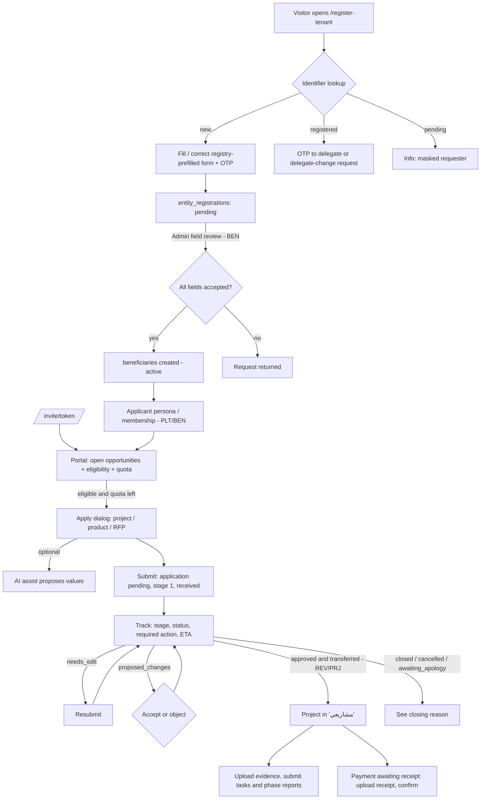
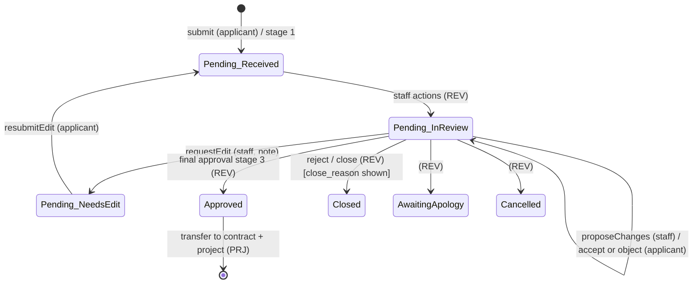
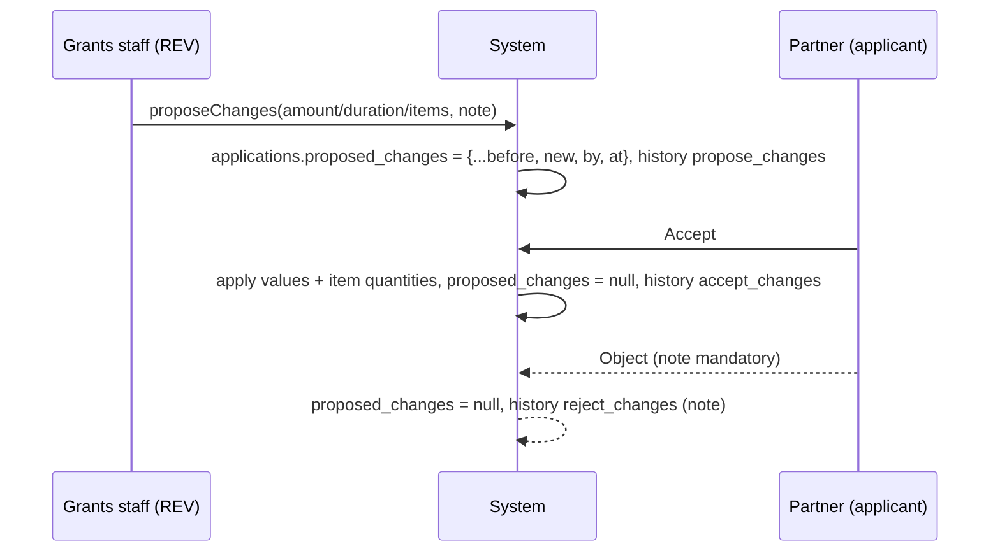
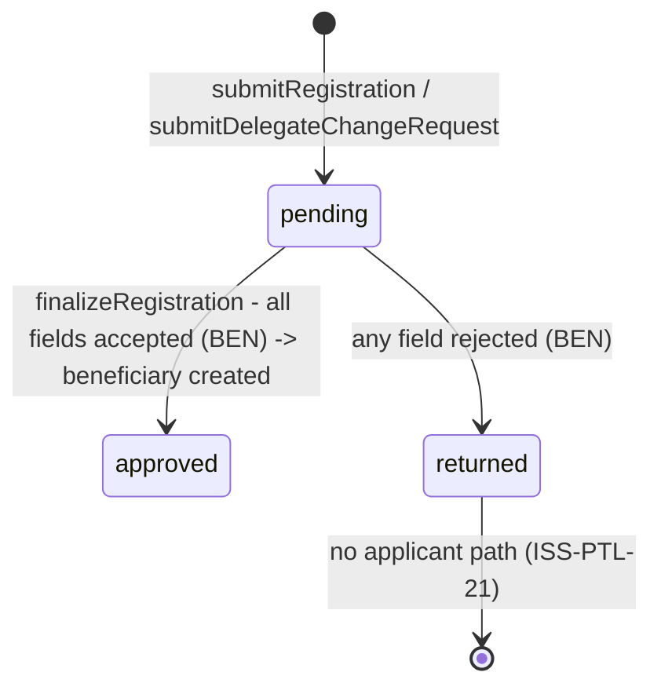
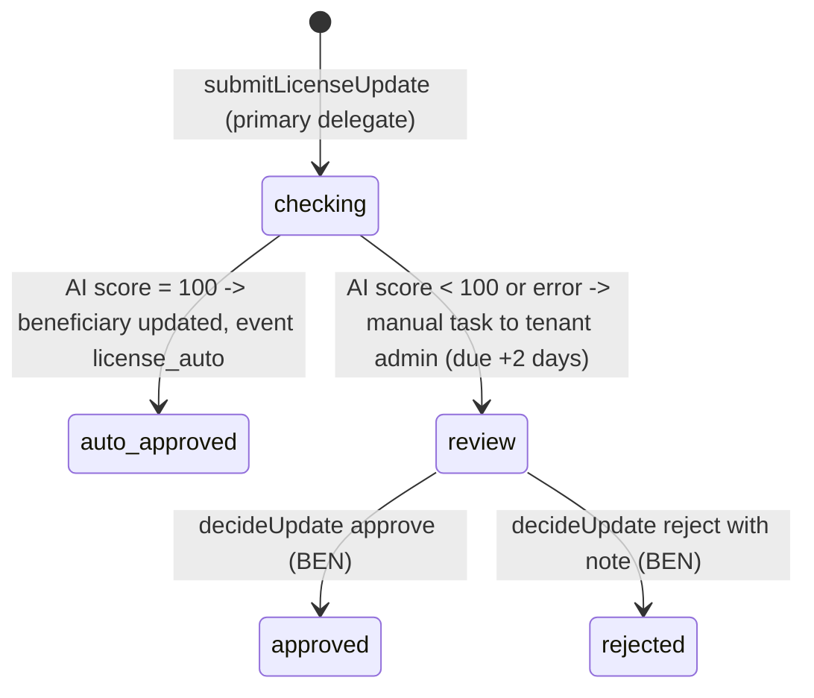
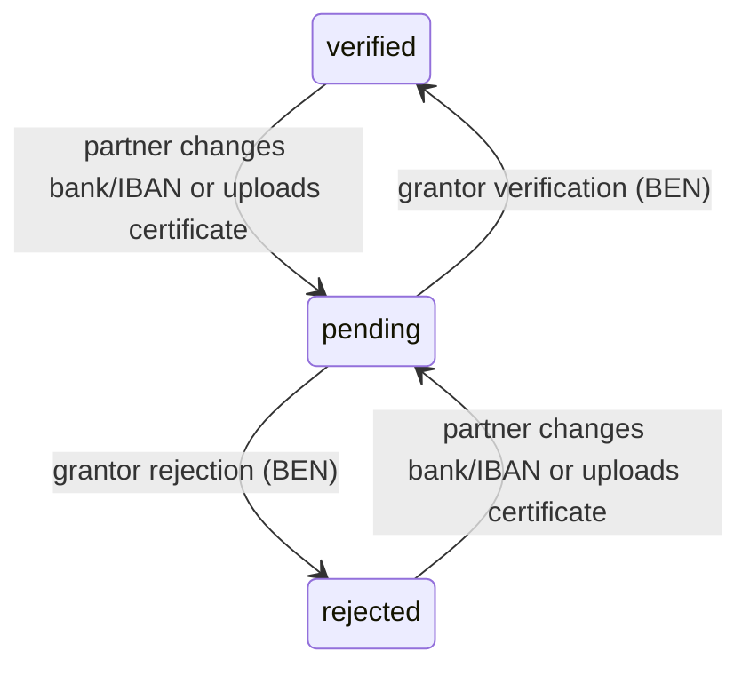
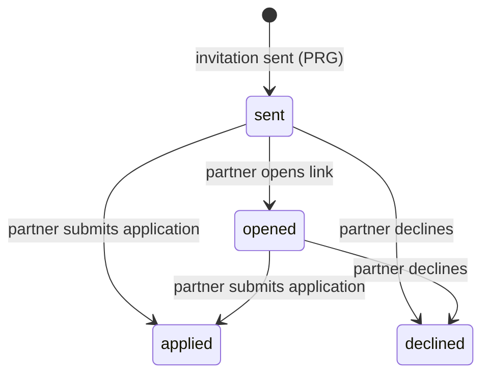

# PTL — Partner Portal (Applicant Side)

## 1. Scope & Coverage

**Files analysed (source: `/home/user/manih/src`)**

| Area | Files |
|---|---|
| Portal route | `routes/portal.tsx` (Portal, ApplyDialog, ProposalBanner) |
| Partner registration | `routes/register-tenant.tsx` (RegisterPage, RegisteredCard), `lib/registrations.ts`, `lib/applicantTypes.ts` (ENTITY_TYPES, closed types) |
| OTP | `components/OtpVerifiedInput.tsx` |
| AI form assist | `components/AiAssist.tsx`, `lib/prefill.functions.ts`, `lib/prefill.server.ts` |
| Entity profile self-service | `components/EntityProfile.tsx`, `components/LicenseUpdate.tsx` (LicenseUpdateDialog), `lib/entityUpdates.ts`, `lib/entityUpdates.functions.ts`, `lib/projectAi.server.ts` (checkLicenseDoc), `lib/beneficiaryActions.ts` (updateBankDetails, logEvent) |
| Eligibility & helpers | `lib/eligibility.ts`, `lib/data.ts` (isPeriodOpen, stageLabel, labels, REGIONS), `lib/queries.ts`, `lib/memberships.ts`, `lib/rfp.ts` (markInvitation) |
| Workflow (applicant-facing calls) | `lib/workflow.ts` (buildSnapshot, resubmitEdit, ProposedChanges, respondToProposal) |
| Invitation landing | `routes/invite.$token.tsx` |
| Applicant use of shared components | `components/FileSlots.tsx`, `components/ProjectTree.tsx` (partner branches), `components/PaymentActions.tsx` (partner branch), `components/Indicators.tsx`, `components/CoFunding.tsx`, `components/ApplicationEdits.tsx` (staff side of proposals), `routes/projects.$id.tsx` (isStaff=false) |
| Public API | `routes/api/public/ai-report.ts` |
| Data | `integrations/supabase/types.ts` (applications, entity_registrations, entity_update_requests, program_invitations, attachments, application_items, application_status_history, beneficiary_memberships), `supabase/migrations/*.sql` (ref_no trigger, defaults, POC RLS) |

**Coverage notes and limitations**

- Analysis is from source code only; the live demo was not inspected. [Observed]
- The prototype uses a demo persona switcher on one shared account; RLS is open to `anon` and `authenticated`. All applicant restrictions described below are UI-level only unless stated. [Observed — AGENTS.md, migrations `poc_open_*`]
- `/register-tenant` is, despite its name, the **partner (beneficiary) self-registration** page; it is documented here (request side). Admin field-by-field review and activation belong to module BEN. Tenant (grantor organisation) registration, login and persona switching belong to module PLT.
- Post-award screens (project detail, project tree, payments) are owned by modules PRJ and FIN. Only the **partner-mode behaviour** (`isStaff=false`, `isPartner`) is documented here to complete the applicant journey; staff behaviour is not repeated.
- Staff proposal of numeric changes (`ApplicationEdits.ProposeNumbersButton`) and edit requests are owned by module REV; only the partner response is documented here.
- `/invite/$token` is the opportunity-invitation landing (invitations are sent from module PRG); its partner-facing response is documented here.
- Not found in code: application drafts, partner application detail view, withdrawal, partner notifications/inbox, contract signature by partner. These are flagged as gaps.

## 2. Screen Inventory

| Screen ID | Name (EN + Arabic label) | Route / Component | Roles | Purpose | Entry points | Exits / Navigates to |
|---|---|---|---|---|---|---|
| SCR-PTL-01 | Partner Registration (تسجيل جهة شريكة / سجّل جهتك) | /register-tenant (routes/register-tenant.tsx RegisterPage) | anonymous visitor | Check an identifier (license / CR / national ID) and, if new, submit a registration request prefilled from the (simulated) official registry. | Landing page '/' link; login page link; public header button 'سجّل جهتك' (AppShell.tsx:184) | Success card → '/' ; registered → SCR-PTL-02; pending → info message |
| SCR-PTL-02 | Existing Entity Panel — Join / Delegate Change («…» مسجلة مسبقاً) | /register-tenant (RegisteredCard) | anonymous visitor | For an already-registered identifier: prove relation via OTP to the current delegate, or request a delegate change. | License lookup returns kind=registered | /login after verification; request-sent confirmation |
| SCR-PTL-03 | Applicant Portal Home — Applications & Projects (بوابة المتقدم — الطلبات والمشاريع) | /portal (routes/portal.tsx Portal, tab 'work') | applicant | Single home for the partner user: represented entity, my applications with status and required action, open opportunities with eligibility, my projects. | Login/persona switch (ROLE_HOME applicant → /portal); landing page; invitation landing (?apply=) | SCR-PTL-04 (apply); SCR-PTL-06 panels; SCR-PTL-07 (profile tab); SCR-PTL-11 (project) |
| SCR-PTL-04 | Application Submission Dialog (طلب منحة — <opportunity>) | /portal ApplyDialog (portal.tsx:244-440) | applicant | Dynamic application form with three variants: project grant, product request, RFP offer; plus opportunity-specific form fields and file fields. | 'تقديم طلب' button on an eligible opportunity card; /portal?apply=<programId> | Closes on submit/cancel; toast with reference number |
| SCR-PTL-05 | AI Form Assist Panel (تعبئة بالذكاء الاصطناعي) | components/AiAssist.tsx embedded in SCR-PTL-04 | applicant | Let the applicant describe the project in free text or attach a document; AI proposes field values and asks up to 4 follow-up questions. | 'تعبئة بالذكاء الاصطناعي' button inside SCR-PTL-04 (project and RFP variants) | Values written into SCR-PTL-04 fields; panel closes |
| SCR-PTL-06 | Application Action Panels — Edit Request & Proposed Changes (مطلوب تعديل / اقترح مسؤول المنح تعديلاً) | /portal application card (portal.tsx:139-147, ProposalBanner 442-469) | applicant | Respond to a staff edit request (resubmit) or accept/object to staff-proposed numeric changes. | Application card when stage_status=needs_edit or proposed_changes is set | Card refresh |
| SCR-PTL-07 | Entity Profile Tab (ملف الجهة) | /portal tab 'profile' → components/EntityProfile.tsx | applicant (primary delegate for edits) | Show official data, contact data, bank account and team; entry to self-service updates. | 'ملف الجهة' tab on SCR-PTL-03 (only when an entity is resolved) | SCR-PTL-08, SCR-PTL-09; team management (see module BEN) |
| SCR-PTL-08 | Bank Account Dialog (الحساب البنكي للجمعية) | /portal bank Dialog (portal.tsx:214-237) | applicant (primary delegate) | Update bank name, IBAN and IBAN certificate. | 'تحديث الحساب / شهادة الآيبان' on SCR-PTL-07 | Closes; profile refresh |
| SCR-PTL-09 | License Update Dialog (تحديث الترخيص والبيانات الرسمية) | components/LicenseUpdate.tsx LicenseUpdateDialog | applicant (primary delegate) | Submit new official name / license number / expiry with the license document for AI auto-verification or manual review. | 'تحديث الترخيص' on SCR-PTL-07 | Closes; toast with outcome |
| SCR-PTL-10 | Opportunity Invitation Landing (دعوة خاصة لـ …) | /invite/$token (routes/invite.$token.tsx) | invited partner (anonymous/any persona) | Respond to a private invitation to an opportunity (typically RFP): activate entity account, go to apply, or decline. | Invitation link sent by staff (see module PRG) | /portal?apply=<programId>; decline confirmation |
| SCR-PTL-11 | Partner Project View (applicant mode of project detail) | /projects/$id with role=applicant (routes/projects.$id.tsx, ProjectTree.tsx) | applicant | Follow the awarded project: contract, progress, finance breakdown, indicators (read-only); submit task completion, evidence files and phase reports. | 'مشاريعي' cards on SCR-PTL-03 | Contract document view; application detail link (/reviewer/$id) |
| SCR-PTL-12 | Partner Payment Receipt Panel (تأكيد الاستلام وإغلاق الدفعة) | components/PaymentActions.tsx partner branch inside SCR-PTL-11 | applicant | View the bank transfer notice and upload the receipt voucher, then confirm receipt to close the payment. | Payment row in project tree when status awaiting_receipt or paid | Payment closed (paid) |

## 3. Screen Details

### SCR-PTL-01 — Partner Registration (`/register-tenant`)
- **Header:** "سجّل جهتك" / "سجّل حسابك" (individual) with subtitle "اختر نوع المستفيد ثم أدخل رقم التحقق…". [Observed register-tenant.tsx:83-84]
- **Type selector:** buttons for each type in `ENTITY_TYPES` with `portal=true` and not in tenant `closed` set (جمعية أهلية، مؤسسة غير ربحية، شركة، فرد، وقف، أخرى). Changing type clears the lookup result. [Observed register-tenant.tsx:33-36,87-92; applicantTypes.ts:7-14]
- **Identifier lookup form:** single LTR input whose placeholder is the type's `idLabel` (e.g., "رقم الترخيص (المركز الوطني)", "رقم السجل التجاري", "رقم الهوية الوطنية / الإقامة"); button "تحقق". Demo shortcuts: registered 1234, new 7781 / 8890. [Observed :93-97]
- **Result states:**
  - *registered* → SCR-PTL-02 panel. [Observed :99]
  - *pending* → info box "يوجد طلب تسجيل لهذا الترخيص قيد التدقيق — قدمه <masked name> وجواله ينتهي بـ <masked mobile>". [Observed :100-105]
  - *new* → registration form with notice "جلبنا البيانات من السجل الرسمي…" or "لم نجد الرقم في السجل — أدخل البيانات يدوياً". [Observed :107-112]
- **Registration form fields** (REG_FIELDS; * = required): اسم الجهة*, نوع الكيان*, الرقم الموحد, المنطقة*, المدينة*, التصنيف, البريد الرسمي* (OTP), هاتف الجهة* (OTP), اسم المفوض*, هوية المفوض*, جوال المفوض* (OTP), البنك, الآيبان. For "فرد": type, entity number, classification, phone, delegate name and ID are hidden; labels become الاسم الكامل / الجوال / البريد الإلكتروني. Each registry-sourced field shows a badge "من السجل" (green) or "معدّل عن السجل" (amber). All inputs are free text (region/city not lists). [Observed registrations.ts:11-25; register-tenant.tsx:56-57,114-135]
- **Action:** "تأكيد البيانات وإرسالها للتدقيق". Validation: HTML `required`; toast "تحقق أولاً من: …" listing unverified OTP fields. [Observed :58-66,137]
- **Confirmation state:** card "أُرسل الطلب للتدقيق — تدقق إدارة المنصة الحقول المؤكدة والمدخلة، وتُفعَّل الجهة بعد اعتمادها." with "العودة للرئيسية". [Observed :68-76]
- **Loading:** lookup/submit buttons disabled while busy. **Error:** toast with error message on submit. [Observed]

### SCR-PTL-02 — Existing Entity Panel (RegisteredCard)
- Shows "«<name>» مسجلة مسبقاً", guidance "للانضمام لفريق الجهة، تحقق عبر المفوض الحالي أو اطلب تغييره", list of delegates (masked name, masked mobile, "(المفوض الرئيسي)") or "لا يوجد مفوض مسجل". [Observed register-tenant.tsx:174-177]
- **Mode none:** buttons "إرسال رمز تحقق للمفوض" (disabled without delegates) and "طلب تغيير المفوض". [Observed :179-184]
- **Mode otp:** code input (max 6, numeric), "تحقق", "رجوع"; demo shows the code. Error toast "الرمز غير صحيح — تأكد وأعد المحاولة". [Observed :186-196]
- **Mode verified:** success box "تم التحقق من صلتك بالجهة — سجّل دخولك وسيضيفك المفوض لفريق الجهة" + "تسجيل الدخول" → /login. Nothing is persisted. [Observed :198-204]
- **Mode change:** form اسم المفوض الجديد*, رقم الهوية*, جوال المفوض الجديد*, سبب التغيير*; "إرسال الطلب", "رجوع". [Observed :206-220]
- **Mode requested:** "أُرسل طلب تغيير المفوض — تدقق إدارة المنصة الطلب وتتواصل معك بعد الاعتماد." [Observed :222-227]

### SCR-PTL-03 — Applicant Portal Home (`/portal`)
- **Guard:** non-applicant → "هذه البوابة للمتقدمين — بدّل الشخصية من الأعلى." [Observed portal.tsx:82-83]
- **Header:** "مرحباً <persona name>", description "<entity name> — <account_type>". [Observed :91]
- **Entity switcher:** shown when >1 membership: "تمثّل حالياً:" + buttons "<entity> · <role label>" (مفوض رئيسي، مدير مشاريع، مسؤول مالي، عضو). Line "صفتك في <entity>: <role> — طلباتك تُسجّل باسمك الشخصي وباسم الجهة." [Observed :93-105; memberships.ts:6-11]
- **Tabs:** "الطلبات والمشاريع" (default) and "ملف الجهة" (only when entity resolved). [Observed :106-115]
- **Section "طلباتي":** card per own application: project_title; "ref_no · program title · amount"; stage label; status pill (قيد الانتظار / معتمد / مغلق / ملغي / بانتظار الاعتذار); "المطلوب منك: …"; "الرد المتوقع: <date | قريباً>"; embedded SCR-PTL-06 panels; "السبب: <close_reason>" for non-pending/non-approved. Empty: "لم تقدّم أي طلب بعد". No click-through to details. [Observed :117-155; data.ts:230-236,397-401]
- **Section "فرص المنح المفتوحة":** grid of cards for open programs: title, description, "يغلق الاستقبال <close_at>", "قدّمت x من max", footer = eligibility reasons (red) / "استنفدت عدد الطلبات المسموحة" / button "تقديم طلب". Available first; unavailable inside collapsible "فرص غير متاحة لك (n)" (dimmed). Empty: "لا توجد فرص متاحة لك حالياً". [Observed :158-189]
- **Section "مشاريعي":** (only if any) linked cards: title, "ref · status · إنجاز n%" → /projects/$id. [Observed :191-210]
- **Deep link:** `?apply=<programId>` auto-opens the apply dialog for that program (no eligibility re-check on this path). [Observed :50,63-64] [Inferred: bypass of eligibility check]
- **Loading:** returns nothing until persona resolved; lists render empty while queries load (no skeleton). [Observed :81]

### SCR-PTL-04 — Application Submission Dialog (ApplyDialog)
- **Title:** "طلب منحة — <program title>"; scrollable (max 90vh). [Observed portal.tsx:339-341]
- **Initiative block (open track only):** "المبادرة *" InitiativeSelect + hint "فرصة عامة: اختر المبادرة الأقرب لطلبك من الخطة السنوية." [Observed :343]
- **Variant A — project (default):** AI assist (SCR-PTL-05); "معلومات المشروع": عنوان المشروع*, وصف المشروع, القيمة المطلوبة (ر.س)* (AmountInput), مدة المشروع (أيام), مكان التنفيذ (select of 13 regions, default first), "الفئات المستهدفة وعدد المستفيدين" repeatable rows (الفئة, العدد) with add "فئة" / delete. [Observed :361,390-414]
- **Variant B — product (`kind=product`):** "المنتجات المطلوبة": per product name, "<unit price> / <unit> · المتاح <qty>", quantity input (0..available), line total; "القيمة الإجمالية التقديرية"; "ملاحظات (اختياري)". Empty: "لا توجد منتجات معرفة في هذه الفرصة بعد." No AI assist. [Observed :362-389]
- **Variant C — RFP (`kind=rfp`):** details box "تفاصيل المشروع المطروح" (scope, المخرجات, السقف, مدة التنفيذ, الأنشطة with weights, الدفعات with %); AI assist for offer/amount; "العرض الفني (المنهجية، الفريق، الخبرات السابقة) *" textarea; "العرض المالي (ر.س) *". [Observed :344-360]
- **Additional fields "البيانات الإضافية":** dynamic fields by type: textarea, select (options, placeholder "اختر"), file (single file input), number/date/email/phone(tel)/text. Required marked "*". [Observed :417-431]
- **Footer:** "إلغاء", "إرسال الطلب" (shows "جارٍ الإرسال…" and disabled while busy). [Observed :433-436]
- **Validation messages:** see BR-PTL-07..10. **Success:** toast "تم تقديم الطلب برقم <ref>". **Error:** toast with DB error message. [Observed :289-336]
- **Not present:** draft save, review/summary step, consent/declaration checkbox, attachment size/type limits. [Observed absence]

### SCR-PTL-05 — AI Form Assist Panel
- Collapsed: dashed button "تعبئة بالذكاء الاصطناعي". Expanded: title "صف ما تريد أو أرفق مستنداً", close (X), textarea with context placeholder, buttons "عبّئ الحقول", "إرفاق مستند" (accept .pdf,.txt,.csv,.md,image/*), remove-file (X); disclaimer "القيم مقترحة فقط — راجعها قبل الحفظ." [Observed AiAssist.tsx:82-121]
- **Questions state:** "بقيت معلومات مهمة لم تذكرها:" + one input per question; "إرسال الإجابات", "تخطي". [Observed :95-109]
- **States:** busy spinner; toasts "عُبّئ n حقل — راجعها قبل الحفظ" / "لم أجد قيماً كافية" / errors ("اكتب وصفاً أو أرفق مستنداً", "حجم الملف يتجاوز 10 ميجابايت", "تعذرت التعبئة", server "خدمة الذكاء الاصطناعي غير مهيأة", "تعذر قراءة نتيجة التعبئة"). Panel auto-closes when no questions remain. [Observed AiAssist.tsx:46-74; prefill.server.ts:15,54]

### SCR-PTL-06 — Application Action Panels
- **Edit request (amber):** "مطلوب تعديل: <reviewer_note>" + "تم التعديل — إعادة الإرسال"; success toast "تمت إعادة الإرسال". Visible when stage_status=needs_edit and status=pending. [Observed portal.tsx:140-147]
- **Proposed changes (ProposalBanner):** "اقترح مسؤول المنح تعديلاً على أرقام الطلب — بانتظار موافقتكم"; list: القيمة <old struck> ← <new>; المدة (أيام) <old> ← <new>; "تعديل كميات n من المنتجات"; "ملاحظة: …"; textarea "ملاحظة (إلزامية عند الاعتراض)"; buttons "الموافقة على التعديل", "اعتراض". Toasts "تمت الموافقة على التعديل" / "تم إرسال الاعتراض" / "اكتب سبب الاعتراض". Buttons disabled while busy. [Observed :442-469]

### SCR-PTL-07 — Entity Profile Tab (EntityProfile)
- **Card "البيانات الرسمية":** الاسم الرسمي, النوع, رقم الترخيص / السجل, تاريخ انتهاء الترخيص, رقم الكيان, التصنيف (group / sub), حالة الجهة (pill), الحوكمة; note that changes go through AI-checked update requests; button "تحديث الترخيص" (primary delegate only). [Observed EntityProfile.tsx:42-58]
- **Card "بيانات التواصل والمقر":** view: الجوال, البريد, المنطقة, المحافظة, المدينة; "تعديل" (primary only) → edit mode with OTP inputs for phone/email, region select, governorate/city inputs; note "تُحفظ مباشرة دون موافقة، ويُسجَّل التغيير في سجل الجهة باسمك."; "حفظ", "إلغاء". [Observed :60-94]
- **Card "الحساب البنكي":** البنك, IBAN, الحالة (قيد التحقق / موثّق / مرفوض), شهادة الآيبان (or "لم تُرفع"); button "تحديث الحساب / شهادة الآيبان" (primary only). [Observed :96-107]
- **Team:** `BeneficiaryTeam mode="self"`, manageable by primary delegate (see module BEN). [Observed :109]

### SCR-PTL-08 — Bank Account Dialog
- Title "الحساب البنكي للجمعية"; fields البنك* (prefilled), IBAN* (LTR, pattern `SA[0-9]{22}`), شهادة الآيبان (PDF أو صورة); note "أي تغيير يعيد حالة الحساب إلى «قيد التحقق» حتى يوثقه المانح."; "حفظ". Success toast "حُفظ — بانتظار توثيق المانح"; error toast. [Observed portal.tsx:214-237]

### SCR-PTL-09 — License Update Dialog
- Title "تحديث الترخيص والبيانات الرسمية"; last request box: "آخر طلب (<date>): <status pill>" (جارٍ الفحص الآلي / اعتُمد آلياً / بانتظار التدقيق اليدوي / اعتُمد / رُفض) + "ملاحظة المراجع". [Observed LicenseUpdate.tsx:26-35; entityUpdates.ts:12-18]
- Fields: اسم الجهة كما في الترخيص*, رقم الترخيص*, تاريخ الانتهاء* (date), وثيقة الترخيص* (PDF/image); explainer on AI 100% rule; submit "إرسال للتحقق" / "جارٍ الفحص…". Toasts: auto-approved / "نسبة المطابقة n% — أُحيل لموظف المانح للتدقيق" / error. [Observed :36-58]

### SCR-PTL-10 — Opportunity Invitation Landing (`/invite/$token`)
- "دعوة خاصة لـ <entity>"; opportunity card: kind pill, السقف, آخر موعد, مدة التنفيذ, description, نطاق العمل, المخرجات. [Observed invite.$token.tsx:62-80]
- States: loading skeleton; invalid "رابط الدعوة غير صالح"; declined "سجّلتم اعتذاركم…"; applied "قدّمتم عرضكم…"; active → "الانتقال للتقديم" + "اعتذار"; inactive → activation form (الاسم, رقم الهوية, البريد الرسمي, كلمة المرور — demo-prefilled) "تفعيل والانتقال للتقديم" + "اعتذار". [Observed :40-100]

### SCR-PTL-11 — Partner Project View (applicant mode of `/projects/$id`)
- Same layout as staff (see module PRJ) with staff actions hidden: no back link to /projects, no StartExecution, no ContractAdvance; contract viewable/printable ("عرض العقد", "طباعة / PDF"); finance breakdown with `hidePending`; allocations, co-funding and indicators read-only; link "طلب المنحة" to /reviewer/$id. [Observed projects.$id.tsx:102,115-172; ContractDocument.tsx:31-37]
- **Partner actions in ProjectTree:** per task: "إكمال المهمة ورفعها لاعتماد المانح"; evidence FileSlots per required document ("الشواهد المطلوبة", slot "ما يثبت الإنجاز" by default) with per-file advisory AI badge; dependency hint "بعد: …"; returned feedback "ملاحظات المانح: …"; indicator contribution chip "مؤشر: +n". Per phase: "رفع تقرير المرحلة" / "تعديل التقرير وإعادة رفعه" with textarea "ملخص الإنجاز في هذه المرحلة" and "إرسال". [Observed ProjectTree.tsx:288-444]

### SCR-PTL-12 — Partner Payment Receipt Panel
- Visible only for payments `awaiting_receipt` or `paid`: FileSlots "إشعار الحوالة البنكية" (view-only), "سند القبض" (upload only while awaiting_receipt); input "رقم سند القبض (اختياري)"; button "تأكيد الاستلام وإغلاق الدفعة" (with advisory confirm if AI flagged files). Toast "أُغلقت الدفعة". [Observed PaymentActions.tsx:28-52; payments.ts:43-49]

## 4. Interaction Inventory

| INT ID | Screen | Trigger (control) | System response | Data written | Evidence |
|---|---|---|---|---|---|
| INT-PTL-001 | SCR-PTL-01 | Type button | Sets type, clears result, updates identifier label | — | Observed register-tenant.tsx:89-90 |
| INT-PTL-002 | SCR-PTL-01 | "تحقق" / Enter | lookupLicense → registered / pending / new (+registry prefill) | — (reads beneficiaries, memberships, entity_registrations) | Observed :46-55; registrations.ts:48-67 |
| INT-PTL-003 | SCR-PTL-01 | Demo license links | Fill identifier and run lookup | — | Observed :97 |
| INT-PTL-004 | SCR-PTL-01/07 | OTP shield icon → code → "تأكيد" | Generates 4-digit code (shown), verifies, shows badge | — (client state) | Observed OtpVerifiedInput.tsx:14-15 |
| INT-PTL-005 | SCR-PTL-01 | "تأكيد البيانات وإرسالها للتدقيق" | Checks OTP; inserts request; success card | entity_registrations (license_no, fields, status=pending) | Observed :58-66; registrations.ts:69-77 |
| INT-PTL-006 | SCR-PTL-02 | "إرسال رمز تحقق للمفوض" → code → "تحقق" | Demo 6-digit code; on match shows verified + login link | — | Observed :155-163 |
| INT-PTL-007 | SCR-PTL-02 | "طلب تغيير المفوض" → "إرسال الطلب" | Stores delegate-change request | entity_registrations (fields, note) | Observed :164-171; registrations.ts:85-97 |
| INT-PTL-008 | SCR-PTL-03 | Entity chip | Switch represented entity; refresh profile, lists | — | Observed portal.tsx:97 |
| INT-PTL-009 | SCR-PTL-03 | Tab "ملف الجهة" | Shows SCR-PTL-07 | — | Observed :106-115 |
| INT-PTL-010 | SCR-PTL-03 | "تقديم طلب" | Opens SCR-PTL-04 | — | Observed :175 |
| INT-PTL-011 | SCR-PTL-03 | URL `?apply=<id>` | Opens SCR-PTL-04 for program | — | Observed :50,63-64 |
| INT-PTL-012 | SCR-PTL-03 | "فرص غير متاحة لك (n)" | Expands ineligible list | — | Observed :184-187 |
| INT-PTL-013 | SCR-PTL-03 | Project card | Navigate /projects/$id (partner mode) | — | Observed :196 |
| INT-PTL-014 | SCR-PTL-04 | "+ فئة" / trash | Add/remove target-group row | — | Observed :409-412 |
| INT-PTL-015 | SCR-PTL-04 | Product quantity input | Updates line and grand total | — | Observed :375-385 |
| INT-PTL-016 | SCR-PTL-04 | InitiativeSelect | Sets plan level for open track | — | Observed :343 |
| INT-PTL-017 | SCR-PTL-04 | "إرسال الطلب" | Validate → insert application → items → upload files → history → mark invitation → toast | applications, application_items, storage, attachments, application_status_history, program_invitations | Observed :289-336 |
| INT-PTL-018 | SCR-PTL-04 | "إلغاء" / close | Closes dialog, input discarded | — | Observed :339,434 |
| INT-PTL-019 | SCR-PTL-05 | "تعبئة بالذكاء الاصطناعي" / X | Expand / collapse panel | — | Observed AiAssist.tsx:82-93 |
| INT-PTL-020 | SCR-PTL-05 | "إرفاق مستند" | Selects one file; shows name | — | Observed :113-115 |
| INT-PTL-021 | SCR-PTL-05 | "عبّئ الحقول" | Server fn prefillFromDocument → LLM → values applied, questions shown | — (form state only) | Observed :46-74; prefill.functions.ts |
| INT-PTL-022 | SCR-PTL-05 | "إرسال الإجابات" / "تخطي" | Re-runs with answers appended / closes | — | Observed :76-81,105-106 |
| INT-PTL-023 | SCR-PTL-06 | "تم التعديل — إعادة الإرسال" | resubmitEdit; toast | applications.stage_status=received, updated_at; history action=resubmit | Observed portal.tsx:143; workflow.ts:130-133 |
| INT-PTL-024 | SCR-PTL-06 | "الموافقة على التعديل" | respondToProposal(accept) | application_items.quantity; applications requested_amount/duration_days, proposed_changes=null; history accept_changes | Observed :446-451; workflow.ts:254-268 |
| INT-PTL-025 | SCR-PTL-06 | "اعتراض" (+note) | Requires note; respondToProposal(reject) | applications.proposed_changes=null; history reject_changes | Observed same |
| INT-PTL-026 | SCR-PTL-07 | "تعديل" → "حفظ" / "إلغاء" | OTP check; update contact; log event | beneficiaries (phone, email, region, city, governorate); beneficiary_events contact_updated | Observed EntityProfile.tsx:23-38 |
| INT-PTL-027 | SCR-PTL-07 | "تحديث الحساب / شهادة الآيبان" | Opens SCR-PTL-08 | — | Observed :99 |
| INT-PTL-028 | SCR-PTL-08 | "حفظ" | updateBankDetails; status reset; events | storage (beneficiaries/<id>/iban-…); beneficiaries bank fields, bank_status=pending; beneficiary_events iban_changed / iban_doc | Observed portal.tsx:218-228; beneficiaryActions.ts:56-71 |
| INT-PTL-029 | SCR-PTL-07 | "تحديث الترخيص" | Opens SCR-PTL-09 | — | Observed EntityProfile.tsx:45 |
| INT-PTL-030 | SCR-PTL-09 | "إرسال للتحقق" | Upload + insert request; server AI check; auto-approve or review + task | storage; entity_update_requests; beneficiaries (if 100%); beneficiary_events license_auto; manual_tasks | Observed LicenseUpdate.tsx:36-48; entityUpdates.functions.ts |
| INT-PTL-031 | SCR-PTL-10 | Page open | Marks invitation opened if sent | program_invitations status=opened, opened_at | Observed invite.$token.tsx:39 |
| INT-PTL-032 | SCR-PTL-10 | "الانتقال للتقديم" / "تفعيل والانتقال للتقديم" | Activates entity if inactive; selects delegate persona; navigates /portal?apply= | beneficiaries account_status=active, activated_at | Observed :46-56 |
| INT-PTL-033 | SCR-PTL-10 | "اعتذار" | Marks declined | program_invitations status=declined, responded_at | Observed :57-60 |
| INT-PTL-034 | SCR-PTL-11 | "إكمال المهمة ورفعها لاعتماد المانح" | Task submitted | project_activities.task_status=submitted | Observed ProjectTree.tsx:337-339 |
| INT-PTL-035 | SCR-PTL-11 | Evidence slot "إرفاق" / delete | Upload multi-file (≤10 MB each), AI check per file; mark evidence submitted | storage; attachment_files (+ai_check); project_activities evidence_* | Observed FileSlots.tsx:165-190; ProjectTree.tsx:307-313 |
| INT-PTL-036 | SCR-PTL-11 | "رفع تقرير المرحلة" → "إرسال" | Create or resubmit report | project_reports (insert or body+status=pending) | Observed ProjectTree.tsx:427-441 |
| INT-PTL-037 | SCR-PTL-11 | "عرض العقد" / "طباعة / PDF" | Shows contract document, browser print | — | Observed ContractDocument.tsx:31-37 |
| INT-PTL-038 | SCR-PTL-12 | Receipt slot "إرفاق" | Upload receipt voucher | storage; attachment_files (slot سند القبض) | Observed PaymentActions.tsx:44 |
| INT-PTL-039 | SCR-PTL-12 | "تأكيد الاستلام وإغلاق الدفعة" | Advisory confirm if AI-flagged; requires receipt; closes payment | payments status=paid, receipt_ref, received_at | Observed PaymentActions.tsx:45-48; payments.ts:43-46 |
| INT-PTL-040 | API | POST /api/public/ai-report | Token check, validate, update application, JSON response | applications.external_ai_* | Observed ai-report.ts |

## 5. Shared Components & Dependencies

| Component / library | Used for | Owner module |
|---|---|---|
| `AiAssist` + `prefillFromDocument` (server fn) + `extractPrefill` (Lovable AI gateway, model `openai/gpt-6-astra`, `LOVABLE_API_KEY`) | Free-text/document prefill of application and RFP offer (also reused by staff forms) | PTL (shared) |
| `OtpVerifiedInput` | Mobile/email verification in registration and contact edit | PTL (shared) |
| `checkEligibility`, `namedTargets` (`lib/eligibility.ts`) | Opportunity eligibility in portal and review | PRG / PTL |
| `isPeriodOpen`, `stageLabel`, label maps, `REGIONS` (`lib/data.ts`) | Opportunity window, status rendering | PLT |
| `buildSnapshot`, `resubmitEdit`, `respondToProposal` (`lib/workflow.ts`) | Submission snapshot, resubmission, proposal response | REV |
| `markInvitation` (`lib/rfp.ts`) | Invitation status tracking | PRG |
| `fetchMembershipsForPersona`, `MEMBER_ROLE_LABELS` (`lib/memberships.ts`) | Represented-entity resolution | BEN / PLT |
| `EntityProfile`, `BeneficiaryTeam` | Partner profile and team | BEN (partner-side view in PTL) |
| `updateBankDetails`, `logEvent`, `openDoc` (`lib/beneficiaryActions.ts`) | Bank change and audit events | BEN |
| `LicenseUpdateDialog` / `processEntityUpdate` / `checkLicenseDoc` | License update with AI check | PTL (request) / BEN (review) |
| `InitiativeSelect` (`PlanLevelPicker`) | Initiative selection on open tracks | PLN |
| `AmountInput` | Money inputs | PLT |
| `FileSlots` (+ `attachmentAi.functions`) | Evidence and receipt files with advisory AI check | REV / PRJ / FIN |
| `ProjectTree`, `ProjectIndicators`, `CoFundingPanel`, `ProjectAllocations`, `ContractDocument`, `FinanceBreakdown` | Partner project view (read-only parts) | PRJ / FIN |
| `PaymentActions` (partner branch), `recordReceipt` | Receipt confirmation | FIN |
| `ProposeNumbersButton` (`ApplicationEdits`) | Staff side that creates proposals the partner answers | REV |
| Supabase storage bucket `attachments` (private, signed URLs 300 s) | All uploaded documents | PLT |
| `AI_AGENT_TOKEN` secret, `supabaseAdmin` | External AI report endpoint | PTL / REV |

### External AI agent report endpoint — integration requirement
- **Direction:** inbound (client's external grant-evaluation agent → platform). **Endpoint:** `POST /api/public/ai-report`. **Auth:** `Authorization: Bearer <AI_AGENT_TOKEN>`; constant-time comparison; 503 if the secret is not configured, 401 on mismatch. [Observed ai-report.ts:26-30]
- **Payload (JSON):** `application_id` (uuid) or `ref_no` (≤40) — one required; `score` 0–100 (required); `color` `#RRGGBB`; `label` ≤80; `summary` ≤2000; `report` ≤100,000 (Markdown in seed data); `recommendation` ≤200; `criteria[]` ≤50 of `{criterion_id?: uuid, name? ≤200, score 0–10, note? ≤500}`; `details` free object. [Observed :5-21]
- **Effect:** overwrites `external_ai_score/color/label/summary/report/recommendation/criteria/details` and sets `external_ai_at=now()` on the matched application. [Observed :35-40]
- **Responses:** 200 `{ok:true}`; 400 `{error: flattened zod}`; 404 `{error:"application not found"}`; 500 `{error:"update failed"}`. [Observed :31-44]
- **Business intent:** colour/label come from the agent because thresholds vary by organisation and track. Results are displayed to staff only (module REV); the applicant portal does not show them. [Observed AGENTS.md; portal.tsx]
- **Gaps:** no tenant binding, no history, no outbound trigger to the agent, no idempotency key. [Recommended — see FR-PTL-054, ISS-PTL-17, OQ-PTL-18]

## 6. Business Process Workflows

### 6.1 End-to-end applicant journey

### 6.2 Application status as seen by the applicant

Notes: `stage_status` values: waiting, received, in_progress, in_approval, needs_edit, approved, closed. A pending `proposed_changes` overlays any pending state and does not change status. [Observed data.ts:252-260; workflow.ts]

### 6.3 Staff-proposed numeric change (consent loop)

### 6.4 Partner registration request

### 6.5 License update request

### 6.6 Bank account status (partner-triggered part)

### 6.7 Invitation status

## 7. Business Rules

| BR ID | Rule | Evidence label + reference |
|---|---|---|
| BR-PTL-01 | The applicant portal is shown only to the 'applicant' role; other roles see a switch-persona message. Applicants have no sidebar. | [Observed] portal.tsx:81-83; AppShell.tsx:54,86 |
| BR-PTL-02 | Represented entity = explicitly picked membership, else first active membership (primary first), else persona.beneficiary_id. Applications are recorded under both the person (applicant_id) and the entity (beneficiary_id). | [Observed] portal.tsx:73,104,305-306; memberships.ts:40-45 |
| BR-PTL-03 | An opportunity is open only if status='active', published=true and now is within open_at..close_at (when set). | [Observed] data.ts:403-409 |
| BR-PTL-04 | Eligibility: an entity named directly or via a targeted partner group is always eligible; a program targeting only named entities/groups excludes everyone else; otherwise all configured criteria must match (types, classification group, sub-classification, minimum governance score, regions, governorates with city fallback). | [Observed] eligibility.ts:38-58 |
| BR-PTL-05 | If no entity is resolved for the applicant, every open opportunity is treated as eligible. | [Observed] eligibility.ts:39 |
| BR-PTL-06 | Per-entity quota: number of own non-cancelled applications to the program must be below max_per_beneficiary (DB default 1). | [Observed] portal.tsx:161-163; migration 20261004093306 line 27 |
| BR-PTL-07 | Project applications require title and requested amount; any form field flagged required must be answered (file fields need a file). | [Observed] portal.tsx:296-299 |
| BR-PTL-08 | Product requests need ≥1 product with quantity >0, each ≤ quantity_available; requested amount = Σ quantity × unit price. | [Observed] portal.tsx:267-268,290-292,311 |
| BR-PTL-09 | RFP offers require technical and financial offers; financial offer ≤ program budget; title = program title; duration = rfp_duration_days. | [Observed] portal.tsx:293-295,308,312 |
| BR-PTL-10 | Open-track opportunities require the applicant to choose an initiative (plan level); otherwise the program default plan level is used. | [Observed] portal.tsx:300,307 |
| BR-PTL-11 | A new application starts as status=pending, current_stage=1, stage_status=received with a 'submit' history row and a frozen submission snapshot. | [Observed] portal.tsx:314-315,329; workflow.ts:4-10 |
| BR-PTL-12 | Application reference numbers are generated by DB trigger as REQ + YYMM + 5-digit sequence. | [Observed] migration 20261004093306 set_ref_no / applications_ref |
| BR-PTL-13 | Submitting an application marks the entity's invitation to that program as 'applied'; viewing a 'sent' invitation marks it 'opened'; declining marks 'declined'. | [Observed] rfp.ts:43-51; portal.tsx:330; invite.$token.tsx:39,58 |
| BR-PTL-14 | Required applicant action: proposal pending → review proposed change; needs_edit & pending → edit and resubmit; otherwise none. | [Observed] portal.tsx:129-135 |
| BR-PTL-15 | Expected response = stage_entered_at + current stage SLA days (default 3), shown only for pending applications with no required action; shows 'soon' when overdue. | [Observed] portal.tsx:131-136 |
| BR-PTL-16 | Resubmitting after an edit request sets stage_status=received in the same stage and logs action 'resubmit'. | [Observed] workflow.ts:130-133 |
| BR-PTL-17 | Staff numeric changes (amount, duration, product quantities) wait in proposed_changes and apply only after partner acceptance; objection requires a note; both responses clear the proposal and are logged. | [Observed] workflow.ts:238-268; portal.tsx:447 |
| BR-PTL-18 | The closing reason is shown to the applicant for applications that are neither pending nor approved. | [Observed] portal.tsx:148 |
| BR-PTL-19 | AI form assist only proposes values: option fields must match an option exactly; up to 4 follow-up questions; file ≤10 MB; text ≤20,000 chars; values must be reviewed by the user. | [Observed] AiAssist.tsx:33,47-48,59-64,118; prefill.server.ts:30,53; prefill.functions.ts:6-7 |
| BR-PTL-20 | Registration offers only beneficiary types that are portal-enabled and not closed by the tenant; government entities are internal-only. | [Observed] register-tenant.tsx:33-34; applicantTypes.ts:7-14 |
| BR-PTL-21 | Identifier lookup: existing beneficiary → registered; pending entity_registrations → pending; else new (with registry data if found). | [Observed] registrations.ts:48-67 |
| BR-PTL-22 | Each registration field records value, registry value, source (registry / registry_edited / manual) and decision=pending; empty fields are not stored. | [Observed] registrations.ts:69-77 |
| BR-PTL-23 | Filled mobile/email fields must be OTP-verified before submission; editing a value resets its verification. | [Observed] register-tenant.tsx:30,61-62; OtpVerifiedInput.tsx:20 |
| BR-PTL-24 | A partner (beneficiary) record is created only when an admin accepts all registration fields; any rejected field returns the request. | [Observed] registrations.ts:104-122 (see module BEN) |
| BR-PTL-25 | Lookup results expose delegate and requester identity only masked (initials + 3 letters; last 4 mobile digits). | [Observed] registrations.ts:34-46,56,64 |
| BR-PTL-26 | Only the primary delegate can edit contact data, bank account and request license updates (UI-level). | [Observed] EntityProfile.tsx:45,63,99 |
| BR-PTL-27 | Contact data changes are saved without approval but logged as beneficiary_events (contact_updated) attributed to the actor; changed phone/email need OTP. | [Observed] EntityProfile.tsx:27-38,89 |
| BR-PTL-28 | Any bank name/IBAN change or new IBAN certificate resets bank_status to pending and clears verification; IBAN must match SA + 22 digits. | [Observed] beneficiaryActions.ts:56-71; portal.tsx:230 |
| BR-PTL-29 | License updates: document mandatory; AI scores four equal criteria (license number, name, validity, issuer); only 100% auto-applies; otherwise a manual-review task is assigned to a tenant admin with a 2-day due date; unsupported files or AI errors score 0. | [Observed] entityUpdates.ts:26-38; entityUpdates.functions.ts:9-43; projectAi.server.ts:140-164 |
| BR-PTL-30 | Partners can upload task evidence / submit completion only when the task is unlocked, dependencies are approved and the task/evidence is not approved. | [Observed] ProjectTree.tsx:316,337,362 |
| BR-PTL-31 | Partners can upload a receipt and confirm receipt only for payments in awaiting_receipt; the receipt-voucher slot must contain a file. | [Observed] PaymentActions.tsx:39-50; payments.ts:43-46 |
| BR-PTL-32 | AI checks on uploaded files are advisory and never block upload or workflow. | [Observed] FileSlots.tsx:176,196; AGENTS.md |
| BR-PTL-33 | External AI reports require a bearer token equal to AI_AGENT_TOKEN; identify the application by id or ref_no; score 0–100, criteria 0–10; results overwrite external_ai_* fields; colour/label come from the agent. | [Observed] ai-report.ts:5-44; AGENTS.md |
| BR-PTL-34 | Partners can submit a phase report when the phase is unlocked and no report exists or it was returned; resubmission resets status to pending. | [Observed] ProjectTree.tsx:427-441 |

## 8. Data Requirements

### applications (written by applicant at submission; partially updated by applicant responses)
| Field | Type | Required | Meaning |
|---|---|---|---|
| id | uuid | yes | PK |
| tenant_id | uuid | yes | Grantor organisation (POC constant TENANT_ID) |
| program_id | uuid → grant_programs | yes | Opportunity applied to |
| applicant_id | uuid → personas | yes | Person who submitted |
| beneficiary_id | uuid → beneficiaries | no | Represented entity (null if none resolved) |
| plan_level_id | uuid → plan_levels | no | Initiative (chosen on open track, else program default) |
| ref_no | text unique | auto | REQ+YYMM+00000 via trigger |
| project_title | text | yes | Title (product default "طلب منتجات — …"; RFP = program title) |
| project_description | text | no | Description / product notes |
| technical_offer | text | RFP | Technical offer |
| requested_amount | numeric | yes | Amount / product total / financial offer |
| duration_days | int | no | Duration (RFP = rfp_duration_days; product null) |
| region | text | no | Implementation region (REGIONS) |
| target_groups | jsonb [{group, count}] | no | Target groups and beneficiaries count |
| answers | jsonb {fieldId: value / file name} | no | Dynamic form answers |
| status | text | yes | pending / approved / closed / cancelled / awaiting_apology |
| current_stage | int | yes | 1 at submission (1 استقبال، 2 دراسة، 3 اعتماد) |
| stage_status | text | yes | received at submission; needs_edit; … |
| stage_entered_at | timestamptz | yes | Basis for expected-response date |
| reviewer_note | text | no | Edit request note shown to applicant |
| proposed_changes | jsonb | no | ProposedChanges {requested_amount?, duration_days?, items?, before, note?, by, at} |
| close_reason | text | no | Shown when not pending/approved |
| snapshot | jsonb {submitted: AppSnapshot} | yes | Frozen beneficiary/program data at submission |
| external_ai_score / _color / _label / _summary / _report / _recommendation / _criteria / _details / _at | numeric/text/jsonb/timestamptz | no | Written by external AI agent API (staff-only display) |
| transferred, boq, payment_schedule, merge_parts, award_status, fulfillment_status | various | — | Downstream (REV/PRJ) |

### application_items
| Field | Type | Required | Meaning |
|---|---|---|---|
| application_id | uuid | yes | Parent application |
| product_id | uuid → grant_products | yes | Requested product |
| quantity | int | yes | Requested (updated on accepted proposal) |
| delivered_quantity | int | default 0 | Fulfilment (REV) |

### attachments (legacy, used at submission)
| Field | Type | Required | Meaning |
|---|---|---|---|
| application_id | uuid | yes (here) | Application |
| name, path | text | yes | Original file name; storage path `<appId>/<ts>-<name>` |
| stage | int | no | 1 at submission |
| uploaded_by | uuid | no | Persona |

### application_status_history
action values written by applicant flows: `submit`, `resubmit`, `accept_changes`, `reject_changes`; fields: application_id, status, stage, action, note, changed_by, minute_id, created_at. [Observed]

### entity_registrations
| Field | Type | Required | Meaning |
|---|---|---|---|
| tenant_id | uuid | yes | Grantor |
| license_no | text | yes | Identifier entered |
| fields | jsonb RegField[] {key, label, value, registry_value, source: registry/registry_edited/manual, decision: pending/accepted/rejected} | yes | Submitted data with provenance |
| status | text | yes | pending → approved / returned |
| note | text | no | Delegate-change reason / decision note |
| beneficiary_id, decided_by, decided_at | — | no | Set on decision (BEN) |

### entity_update_requests
| Field | Type | Required | Meaning |
|---|---|---|---|
| beneficiary_id, tenant_id | uuid | yes | Entity |
| kind | text | yes (DB default) | Request kind (license) [Inferred] |
| doc_name, doc_path | text | yes | License document |
| before_values / new_values | jsonb {name, license_no, license_expiry} | yes | Comparison |
| ai_check | jsonb {score, summary, criteria[{key,label,ok,found,note}], checked_at} | no | AI result |
| status | text | yes | checking / auto_approved / review / approved / rejected |
| task_id | uuid → manual_tasks | no | Review task |
| requested_by, decided_by, decided_at, decision_note | — | — | Audit |

### beneficiaries (fields maintained by partner)
phone, email, region, governorate, city (direct edit); bank_name, iban, iban_doc_path, iban_doc_name, bank_status (pending/verified/rejected), bank_verified_at/by (reset on change); name, license_no, license_expiry (via update request); account_status / activated_at (invitation activation). Status values: pending, active, confirmed, blocked, rejected. [Observed data.ts:290-302; EntityProfile.tsx; beneficiaryActions.ts]

### beneficiary_events (audit written by partner flows)
kinds: contact_updated, iban_changed, iban_doc, license_auto (and license_approved/rejected by staff); fields: beneficiary_id, kind, before_value, after_value, note, actor_id, doc_path. [Observed]

### beneficiary_memberships (read)
persona_id, beneficiary_id, role (primary_delegate, delegate, project_manager, finance, member), is_primary, active, mobile, national_id, verified_via, start_at/end_at. [Observed types.ts; memberships.ts]

### program_invitations
program_id, beneficiary_id, token, email, status (sent/opened/applied/declined), sent_at, opened_at, responded_at, sent_by. [Observed types.ts; rfp.ts]

### Read-only references
grant_programs (status, published, open_at, close_at, kind project/product/rfp, open_track, form_id, default_plan_level_id, max_per_beneficiary default 1, budget, rfp_* fields, targeting fields), form_fields (form_id/program_id, label, field_type, options, required, sort_order), program_products / grant_products (name, unit, unit_price, quantity_available), workflow stages (sla_days), projects, project_activities, project_reports, payments, attachment_files. Relationships: application N–1 program, N–1 beneficiary, N–1 persona; application 1–N items, attachments, history. [Observed]

## 9. Product Structure

- **EP-PTL-01 — Partner Onboarding & Identity**: Self-registration of partner entities with registry prefill, detection of existing entities, delegate verification / change, OTP-verified contact fields.
  - FT-PTL-01 — Partner self-registration with registry prefill
  - FT-PTL-02 — Existing-entity detection, delegate verification and delegate-change request
  - FT-PTL-03 — OTP verification of mobile and email fields
- **EP-PTL-02 — Opportunity Discovery & Eligibility**: Applicant home context, open opportunity listing with eligibility and per-entity quota, and invitation responses.
  - FT-PTL-04 — Applicant context and represented-entity switching
  - FT-PTL-05 — Open opportunity listing with eligibility and quota
  - FT-PTL-06 — Opportunity invitation response
- **EP-PTL-03 — Application Submission**: Dynamic application forms for project grants, product requests and RFP offers, attachments, and AI form assist.
  - FT-PTL-07 — Project grant application with dynamic form
  - FT-PTL-08 — Product request application
  - FT-PTL-09 — RFP offer submission
  - FT-PTL-10 — Application attachments at submission
  - FT-PTL-11 — AI form assist (describe or attach to prefill)
- **EP-PTL-04 — Application Tracking & Change Responses**: Tracking status/stage/expected response and responding to edit requests and staff-proposed numeric changes.
  - FT-PTL-12 — Application status tracking and required action
  - FT-PTL-13 — Respond to edit request (resubmit)
  - FT-PTL-14 — Accept or object to staff-proposed numeric changes
- **EP-PTL-05 — Entity Profile Self-Service**: Partner maintenance of contact data, bank account and license/official data.
  - FT-PTL-15 — Contact data self-edit
  - FT-PTL-16 — Bank account update
  - FT-PTL-17 — License update with AI auto-verification
- **EP-PTL-06 — Post-Award Partner Participation**: Partner-side participation in project execution (evidence, reports) and payment receipt confirmation.
  - FT-PTL-18 — Partner project execution participation
  - FT-PTL-19 — Payment receipt confirmation
- **EP-PTL-07 — External Integrations (Applicant Data)**: Inbound API for the client's external AI grant-evaluation agent.
  - FT-PTL-20 — External AI evaluation report intake API

## 10. Features

### FT-PTL-01 — Partner self-registration with registry prefill
| Attribute | Value |
|---|---|
| Feature ID | FT-PTL-01 |
| Name | Partner self-registration with registry prefill |
| Epic | EP-PTL-01 |
| Description | A visitor selects the beneficiary type, enters the identifier, and if it is new submits a registration request whose fields are prefilled from the official (NCNP) registry and tagged by source for admin field-by-field verification. |
| Business Objective | Onboard partner entities with verified data while minimising manual data entry. [Inferred] |
| Expected Business Value | [To Confirm] — reduced onboarding effort and data errors are implied by registry prefill but not quantified. |
| Primary User Roles | anonymous visitor |
| Scope | Type selection (portal-enabled, not closed per tenant), identifier lookup, registry prefill, manual completion, OTP on contact fields, submission into entity_registrations (status pending). |
| Out of Scope | Admin field review and activation (see module BEN); real registry integration; account/password creation. |
| Functional Requirements | FR-PTL-001, FR-PTL-002, FR-PTL-003, FR-PTL-004, FR-PTL-005 |
| User Stories | US-PTL-001, US-PTL-002 |
| Business Rules | BR-PTL-20, BR-PTL-21, BR-PTL-22, BR-PTL-23, BR-PTL-24 |
| Dependencies | CFG applicant types open/closed switch (applicantTypes.ts); BEN registration review (RegistrationReview.tsx); FT-PTL-03 |
| Related Screens | SCR-PTL-01 |
| Open Questions | OQ-PTL-01, OQ-PTL-02 |
| Assumptions | The registry will be a real NCNP / MoC integration in production. |
| Priority Recommendation (MoSCoW) | Must |

**Acceptance Criteria**
- Only portal-enabled, tenant-open entity types are offered.
- A new identifier found in the registry pre-populates fields and labels them 'من السجل'; edited values are labelled 'معدّل عن السجل'.
- Submission is blocked until every non-empty mobile/email field is OTP-verified.
- On submit a pending entity_registrations row is created with per-field source and decision=pending and a confirmation card is shown.

### FT-PTL-02 — Existing-entity detection, delegate verification and delegate-change request
| Attribute | Value |
|---|---|
| Feature ID | FT-PTL-02 |
| Name | Existing-entity detection, delegate verification and delegate-change request |
| Epic | EP-PTL-01 |
| Description | If the identifier is already registered, the visitor sees the masked delegates and can verify a relation via an OTP to the delegate, or file a delegate-change request; if a registration is pending, the masked requester is shown. |
| Business Objective | Prevent duplicate entity registrations and route new users through the entity's delegate. [Inferred] |
| Expected Business Value | [To Confirm] |
| Primary User Roles | anonymous visitor |
| Scope | Lookup outcomes registered/pending; masking; demo OTP to delegate; delegate-change form (name, national ID, mobile, reason) stored for admin review. |
| Out of Scope | Adding the user to the team (done by the delegate, see module BEN); real SMS delivery. |
| Functional Requirements | FR-PTL-006, FR-PTL-007, FR-PTL-008 |
| User Stories | US-PTL-003, US-PTL-004 |
| Business Rules | BR-PTL-21, BR-PTL-25 |
| Dependencies | BEN registration review; beneficiary_memberships |
| Related Screens | SCR-PTL-02, SCR-PTL-01 |
| Open Questions | OQ-PTL-03 |
| Assumptions | None beyond module assumptions (section 14) |
| Priority Recommendation (MoSCoW) | Should |

**Acceptance Criteria**
- A registered identifier shows the entity name and delegates with masked name and mobile.
- A pending identifier shows the masked requester name and mobile and offers no form.
- A delegate-change request requires name, national ID, mobile and reason and is stored as a pending entity_registrations row with a note.

### FT-PTL-03 — OTP verification of mobile and email fields
| Attribute | Value |
|---|---|
| Feature ID | FT-PTL-03 |
| Name | OTP verification of mobile and email fields |
| Epic | EP-PTL-01 |
| Description | Reusable input requiring a one-time code before a mobile or email value is accepted; used in registration and contact edits. |
| Business Objective | Ensure contact channels belong to the registering party. [Inferred] |
| Expected Business Value | [To Confirm] |
| Primary User Roles | anonymous visitor, applicant |
| Scope | Send code, enter code, verified badge, reset on change. |
| Out of Scope | SMS/email gateway (POC shows code on screen). |
| Functional Requirements | FR-PTL-009 |
| User Stories | US-PTL-001, US-PTL-017 |
| Business Rules | BR-PTL-23 |
| Dependencies | SMS/email provider [Recommended] |
| Related Screens | SCR-PTL-01, SCR-PTL-07 |
| Open Questions | OQ-PTL-04 |
| Assumptions | Production sends real SMS/email codes with expiry and retry limits. |
| Priority Recommendation (MoSCoW) | Must |

**Acceptance Criteria**
- A code can only be requested when the field has a value.
- An incorrect code shows 'الرمز غير صحيح'; a correct code shows the verified badge.
- Changing the value after verification resets verification.

### FT-PTL-04 — Applicant context and represented-entity switching
| Attribute | Value |
|---|---|
| Feature ID | FT-PTL-04 |
| Name | Applicant context and represented-entity switching |
| Epic | EP-PTL-02 |
| Description | The portal resolves which entity the user represents (selected membership, else first active membership, else persona.beneficiary_id), shows the user's role in it, and lets multi-entity users switch. |
| Business Objective | Applications are recorded under both the person and the entity. [Observed portal.tsx:104] |
| Expected Business Value | [To Confirm] |
| Primary User Roles | applicant |
| Scope | Role guard, membership list, entity switch chips, role label, header with entity name/type. |
| Out of Scope | Membership administration (see module BEN / PLT). |
| Functional Requirements | FR-PTL-010, FR-PTL-011 |
| User Stories | US-PTL-005 |
| Business Rules | BR-PTL-01, BR-PTL-02 |
| Dependencies | memberships.ts; persona.tsx |
| Related Screens | SCR-PTL-03 |
| Open Questions | None |
| Assumptions | None beyond module assumptions (section 14) |
| Priority Recommendation (MoSCoW) | Must |

**Acceptance Criteria**
- Non-applicant personas see 'هذه البوابة للمتقدمين' instead of portal content.
- A user with more than one active membership sees switch buttons and data refreshes for the chosen entity.

### FT-PTL-05 — Open opportunity listing with eligibility and quota
| Attribute | Value |
|---|---|
| Feature ID | FT-PTL-05 |
| Name | Open opportunity listing with eligibility and quota |
| Epic | EP-PTL-02 |
| Description | Lists opportunities whose period is open, evaluates eligibility for the represented entity and the per-entity application quota, and separates available from unavailable opportunities with reasons. |
| Business Objective | Show partners only what they can apply for and explain why not otherwise. [Inferred] |
| Expected Business Value | [To Confirm] |
| Primary User Roles | applicant |
| Scope | Open-period filter, eligibility reasons, quota counter, apply button. |
| Out of Scope | Opportunity configuration and targeting (see module PRG). |
| Functional Requirements | FR-PTL-012, FR-PTL-013, FR-PTL-014 |
| User Stories | US-PTL-006 |
| Business Rules | BR-PTL-03, BR-PTL-04, BR-PTL-05, BR-PTL-06 |
| Dependencies | eligibility.ts; PRG programs |
| Related Screens | SCR-PTL-03 |
| Open Questions | OQ-PTL-05 |
| Assumptions | None beyond module assumptions (section 14) |
| Priority Recommendation (MoSCoW) | Must |

**Acceptance Criteria**
- Only active, published programs inside open_at..close_at are listed.
- Ineligible cards are dimmed and show the joined reasons; quota-exhausted cards show 'استنفدت عدد الطلبات المسموحة'.
- Unavailable opportunities are grouped in a collapsible 'فرص غير متاحة لك (n)' section.

### FT-PTL-06 — Opportunity invitation response
| Attribute | Value |
|---|---|
| Feature ID | FT-PTL-06 |
| Name | Opportunity invitation response |
| Epic | EP-PTL-02 |
| Description | An invited partner opens a tokenised link, sees the opportunity details, activates the entity account if not active, then proceeds to apply or declines; invitation status is tracked (opened/applied/declined). |
| Business Objective | Support targeted invitations (e.g., RFP) with response tracking. [Inferred] |
| Expected Business Value | [To Confirm] |
| Primary User Roles | invited partner |
| Scope | Token lookup, opened tracking, activation form, proceed/decline. |
| Out of Scope | Sending invitations (see module PRG). |
| Functional Requirements | FR-PTL-015, FR-PTL-016 |
| User Stories | US-PTL-007 |
| Business Rules | BR-PTL-13 |
| Dependencies | program_invitations; rfp.ts markInvitation |
| Related Screens | SCR-PTL-10, SCR-PTL-03 |
| Open Questions | OQ-PTL-06 |
| Assumptions | None beyond module assumptions (section 14) |
| Priority Recommendation (MoSCoW) | Should |

**Acceptance Criteria**
- Opening a 'sent' invitation marks it 'opened' with opened_at.
- Proceed navigates to /portal?apply=<programId> and opens the application dialog.
- Decline marks the invitation 'declined' with responded_at and shows a thank-you.

### FT-PTL-07 — Project grant application with dynamic form
| Attribute | Value |
|---|---|
| Feature ID | FT-PTL-07 |
| Name | Project grant application with dynamic form |
| Epic | EP-PTL-03 |
| Description | Applicant fills core project data (title, description, amount, duration, region, target groups) plus opportunity-specific fields from the form library and submits; system creates the application at stage 1 with a frozen snapshot and history. |
| Business Objective | Capture complete, comparable applications. [Inferred] |
| Expected Business Value | [To Confirm] |
| Primary User Roles | applicant |
| Scope | Core fields, dynamic fields (text, textarea, number, date, email, phone, select, file), initiative selection on open tracks, validation, submission, snapshot, history, reference number. |
| Out of Scope | Form design (see module CFG/PRG); review workflow (see module REV). |
| Functional Requirements | FR-PTL-017, FR-PTL-018, FR-PTL-019, FR-PTL-020, FR-PTL-021 |
| User Stories | US-PTL-008, US-PTL-009 |
| Business Rules | BR-PTL-07, BR-PTL-10, BR-PTL-11, BR-PTL-12 |
| Dependencies | application_forms / form_fields; PlanLevelPicker InitiativeSelect; workflow.buildSnapshot |
| Related Screens | SCR-PTL-04 |
| Open Questions | OQ-PTL-07, OQ-PTL-08 |
| Assumptions | None beyond module assumptions (section 14) |
| Priority Recommendation (MoSCoW) | Must |

**Acceptance Criteria**
- Missing title or amount shows 'أكمل الحقول الإلزامية'.
- Missing required dynamic field shows 'الحقل «…» إلزامي'.
- Open-track opportunities require an initiative.
- Successful submission shows 'تم تقديم الطلب برقم REQ…' and the application appears under 'طلباتي' with status pending, stage 1.

### FT-PTL-08 — Product request application
| Attribute | Value |
|---|---|
| Feature ID | FT-PTL-08 |
| Name | Product request application |
| Epic | EP-PTL-03 |
| Description | For product-kind opportunities the applicant selects quantities of linked grant products (bounded by available stock); total is computed from unit prices and stored with application_items. |
| Business Objective | Support in-kind grants. [Inferred from program kind 'product'] |
| Expected Business Value | [To Confirm] |
| Primary User Roles | applicant |
| Scope | Product list, quantity entry, total, notes, stock validation, items insert. |
| Out of Scope | Stock deduction/fulfilment (see module REV/PRG). |
| Functional Requirements | FR-PTL-022, FR-PTL-023 |
| User Stories | US-PTL-010 |
| Business Rules | BR-PTL-08 |
| Dependencies | program_products / grant_products |
| Related Screens | SCR-PTL-04 |
| Open Questions | OQ-PTL-09 |
| Assumptions | None beyond module assumptions (section 14) |
| Priority Recommendation (MoSCoW) | Should |

**Acceptance Criteria**
- Submitting with no quantities shows 'اختر منتجاً واحداً على الأقل وحدد الكمية'.
- Quantity above quantity_available is rejected naming the product and available amount.
- requested_amount equals Σ quantity × unit_price and one application_items row is created per chosen product.

### FT-PTL-09 — RFP offer submission
| Attribute | Value |
|---|---|
| Feature ID | FT-PTL-09 |
| Name | RFP offer submission |
| Epic | EP-PTL-03 |
| Description | For RFP opportunities the applicant sees scope, deliverables, ceiling, duration, activities and payment split, and submits a technical and a financial offer. |
| Business Objective | Competitive offers on pre-defined projects. [Inferred] |
| Expected Business Value | [To Confirm] |
| Primary User Roles | applicant |
| Scope | RFP details panel, technical offer, financial offer ≤ ceiling, AI assist. |
| Out of Scope | Award decision (see module PRG/REV). |
| Functional Requirements | FR-PTL-024, FR-PTL-025 |
| User Stories | US-PTL-011 |
| Business Rules | BR-PTL-09 |
| Dependencies | rfp.ts |
| Related Screens | SCR-PTL-04 |
| Open Questions | None |
| Assumptions | None beyond module assumptions (section 14) |
| Priority Recommendation (MoSCoW) | Should |

**Acceptance Criteria**
- Missing technical or financial offer shows 'أكمل العرض الفني والعرض المالي'.
- A financial offer above program budget is rejected with the ceiling shown.
- The application title equals the program title and duration equals rfp_duration_days.

### FT-PTL-10 — Application attachments at submission
| Attribute | Value |
|---|---|
| Feature ID | FT-PTL-10 |
| Name | Application attachments at submission |
| Epic | EP-PTL-03 |
| Description | File-type form fields are uploaded to the private attachments bucket and recorded as stage-1 attachments; file names are kept in answers. |
| Business Objective | Collect required supporting documents with the application. [Inferred] |
| Expected Business Value | [To Confirm] |
| Primary User Roles | applicant |
| Scope | One file per file field; required check; upload; attachments row. |
| Out of Scope | Multi-file slots and AI doc check at submission (not implemented here). |
| Functional Requirements | FR-PTL-026, FR-PTL-027 |
| User Stories | US-PTL-012 |
| Business Rules | BR-PTL-07, BR-PTL-32 |
| Dependencies | storage bucket 'attachments' |
| Related Screens | SCR-PTL-04 |
| Open Questions | OQ-PTL-10 |
| Assumptions | None beyond module assumptions (section 14) |
| Priority Recommendation (MoSCoW) | Must |

**Acceptance Criteria**
- A required file field without a file blocks submission.
- Each uploaded file has an attachments row with application_id, stage=1, uploaded_by.

### FT-PTL-11 — AI form assist (describe or attach to prefill)
| Attribute | Value |
|---|---|
| Feature ID | FT-PTL-11 |
| Name | AI form assist (describe or attach to prefill) |
| Epic | EP-PTL-03 |
| Description | Applicant describes the project or attaches a proposal (PDF, text, image); an LLM proposes values for core and dynamic fields and asks up to 4 questions about missing important fields; values are proposals only. |
| Business Objective | Reduce form-filling effort. [Inferred] |
| Expected Business Value | [To Confirm] |
| Primary User Roles | applicant |
| Scope | Free text ≤20k chars, one file ≤10 MB, follow-up questions, option validation, apply into form. |
| Out of Scope | Auto-submission; file-type fields. |
| Functional Requirements | FR-PTL-028, FR-PTL-029, FR-PTL-030 |
| User Stories | US-PTL-013 |
| Business Rules | BR-PTL-19 |
| Dependencies | Lovable AI gateway (LOVABLE_API_KEY); prefill.server.ts |
| Related Screens | SCR-PTL-05, SCR-PTL-04 |
| Open Questions | OQ-PTL-11 |
| Assumptions | None beyond module assumptions (section 14) |
| Priority Recommendation (MoSCoW) | Could |

**Acceptance Criteria**
- With neither text nor file, 'اكتب وصفاً أو أرفق مستنداً' is shown.
- Returned values for option fields that are not in the option list are discarded.
- The toast reports the number of filled fields and reminds the user to review them.
- If questions are returned, they are displayed and answers can be sent for another pass or skipped.

### FT-PTL-12 — Application status tracking and required action
| Attribute | Value |
|---|---|
| Feature ID | FT-PTL-12 |
| Name | Application status tracking and required action |
| Epic | EP-PTL-04 |
| Description | Each own application card shows title, reference, opportunity, amount, stage label, status pill, 'what is required from you', expected response date and closing reason. |
| Business Objective | Transparency for applicants, fewer status inquiries. [Inferred] |
| Expected Business Value | [To Confirm] |
| Primary User Roles | applicant |
| Scope | My applications list, derived required action, SLA-based ETA, close reason. |
| Out of Scope | Detailed history timeline (not in portal). |
| Functional Requirements | FR-PTL-031, FR-PTL-032, FR-PTL-033 |
| User Stories | US-PTL-014 |
| Business Rules | BR-PTL-14, BR-PTL-15, BR-PTL-18 |
| Dependencies | workflow stages (useStages) |
| Related Screens | SCR-PTL-03 |
| Open Questions | OQ-PTL-12 |
| Assumptions | None beyond module assumptions (section 14) |
| Priority Recommendation (MoSCoW) | Must |

**Acceptance Criteria**
- Pending application with no action shows 'لا شيء — طلبك قيد الدراسة' and an expected reply date = stage_entered_at + stage SLA (default 3 days).
- If ETA is past, 'قريباً' is shown.
- Closed/cancelled/awaiting-apology applications show 'السبب: <close_reason>'.
- Empty list shows 'لم تقدّم أي طلب بعد'.

### FT-PTL-13 — Respond to edit request (resubmit)
| Attribute | Value |
|---|---|
| Feature ID | FT-PTL-13 |
| Name | Respond to edit request (resubmit) |
| Epic | EP-PTL-04 |
| Description | When staff request an edit, the card shows the reviewer note and a 'تم التعديل — إعادة الإرسال' button that returns the stage status to received and logs a resubmit. |
| Business Objective | Close the loop on incomplete applications. [Inferred] |
| Expected Business Value | [To Confirm] |
| Primary User Roles | applicant |
| Scope | Edit-request banner, resubmit action, history entry. |
| Out of Scope | Editing application content (not supported — see ISS-PTL-05). |
| Functional Requirements | FR-PTL-034, FR-PTL-035 |
| User Stories | US-PTL-015 |
| Business Rules | BR-PTL-16 |
| Dependencies | REV requestEdit |
| Related Screens | SCR-PTL-06 |
| Open Questions | OQ-PTL-13 |
| Assumptions | None beyond module assumptions (section 14) |
| Priority Recommendation (MoSCoW) | Must |

**Acceptance Criteria**
- Banner appears only when stage_status=needs_edit and status=pending.
- Resubmit sets stage_status=received and adds a 'resubmit' history row.

### FT-PTL-14 — Accept or object to staff-proposed numeric changes
| Attribute | Value |
|---|---|
| Feature ID | FT-PTL-14 |
| Name | Accept or object to staff-proposed numeric changes |
| Epic | EP-PTL-04 |
| Description | Grants staff may propose new amount, duration or product quantities; the partner sees before/after and accepts (values applied) or objects with a mandatory note (proposal cleared). |
| Business Objective | Staff changes to requested numbers require partner consent. [Observed AGENTS.md, workflow.ts:238] |
| Expected Business Value | [To Confirm] |
| Primary User Roles | applicant |
| Scope | Proposal banner, accept, object with note, history logging. |
| Out of Scope | Proposing changes (see module REV). |
| Functional Requirements | FR-PTL-036, FR-PTL-037 |
| User Stories | US-PTL-016 |
| Business Rules | BR-PTL-17 |
| Dependencies | ApplicationEdits ProposeNumbersButton (REV) |
| Related Screens | SCR-PTL-06 |
| Open Questions | OQ-PTL-14 |
| Assumptions | None beyond module assumptions (section 14) |
| Priority Recommendation (MoSCoW) | Must |

**Acceptance Criteria**
- Banner lists old (struck) and new amount/duration, count of changed products and staff note.
- Accept applies the values, updates application_items quantities, clears proposed_changes and logs accept_changes.
- Object without a note shows 'اكتب سبب الاعتراض'; with a note it clears the proposal and logs reject_changes with the note.

### FT-PTL-15 — Contact data self-edit
| Attribute | Value |
|---|---|
| Feature ID | FT-PTL-15 |
| Name | Contact data self-edit |
| Epic | EP-PTL-05 |
| Description | Primary delegate edits phone, email, region, governorate and city directly; changed phone/email must be OTP-verified; change is logged in beneficiary_events. |
| Business Objective | Keep contact data current without staff effort while staying auditable. [Inferred] |
| Expected Business Value | [To Confirm] |
| Primary User Roles | applicant (primary delegate) |
| Scope | Edit/save/cancel, OTP on changed channels, event log. |
| Out of Scope | Official data (FT-PTL-17). |
| Functional Requirements | FR-PTL-038, FR-PTL-039 |
| User Stories | US-PTL-017 |
| Business Rules | BR-PTL-26, BR-PTL-27 |
| Dependencies | FT-PTL-03; beneficiaryActions.logEvent |
| Related Screens | SCR-PTL-07 |
| Open Questions | None |
| Assumptions | None beyond module assumptions (section 14) |
| Priority Recommendation (MoSCoW) | Should |

**Acceptance Criteria**
- Only primary delegates see 'تعديل'.
- Saving with an unverified changed phone/email shows 'وثّق الجوال والبريد برمز التحقق قبل الحفظ'.
- Saved changes create a contact_updated event with before/after values.

### FT-PTL-16 — Bank account update
| Attribute | Value |
|---|---|
| Feature ID | FT-PTL-16 |
| Name | Bank account update |
| Epic | EP-PTL-05 |
| Description | Primary delegate updates bank name, IBAN (SA + 22 digits) and optionally an IBAN certificate; any change resets bank verification to pending. |
| Business Objective | Payments go to a verified account. [Inferred] |
| Expected Business Value | [To Confirm] |
| Primary User Roles | applicant (primary delegate) |
| Scope | Bank dialog, IBAN pattern, certificate upload, status reset, events. |
| Out of Scope | Bank verification decision (see module BEN). |
| Functional Requirements | FR-PTL-040, FR-PTL-041 |
| User Stories | US-PTL-018 |
| Business Rules | BR-PTL-26, BR-PTL-28 |
| Dependencies | beneficiaryActions.updateBankDetails |
| Related Screens | SCR-PTL-08, SCR-PTL-07 |
| Open Questions | OQ-PTL-15 |
| Assumptions | None beyond module assumptions (section 14) |
| Priority Recommendation (MoSCoW) | Must |

**Acceptance Criteria**
- IBAN not matching SA[0-9]{22} cannot be submitted.
- Any IBAN/bank change or new certificate sets bank_status=pending and clears verified_at/by.
- iban_changed and/or iban_doc events are logged; toast 'حُفظ — بانتظار توثيق المانح'.

### FT-PTL-17 — License update with AI auto-verification
| Attribute | Value |
|---|---|
| Feature ID | FT-PTL-17 |
| Name | License update with AI auto-verification |
| Epic | EP-PTL-05 |
| Description | Primary delegate submits official name, license number, expiry and document; AI checks four criteria (number, name, validity, issuer); 100% match auto-applies, otherwise a manual review task is created for the tenant admin. |
| Business Objective | Fast, auditable official-data updates; humans decide uncertain cases. [Observed AGENTS.md] |
| Expected Business Value | [To Confirm] |
| Primary User Roles | applicant (primary delegate) |
| Scope | Dialog, last request status, upload, AI check, auto-approve or review routing. |
| Out of Scope | Manual review UI (see module BEN, LicenseReviewCard). |
| Functional Requirements | FR-PTL-042, FR-PTL-043, FR-PTL-044 |
| User Stories | US-PTL-019 |
| Business Rules | BR-PTL-26, BR-PTL-29 |
| Dependencies | entityUpdates.functions.ts; projectAi.server.checkLicenseDoc; manual_tasks |
| Related Screens | SCR-PTL-09, SCR-PTL-07 |
| Open Questions | OQ-PTL-16 |
| Assumptions | None beyond module assumptions (section 14) |
| Priority Recommendation (MoSCoW) | Should |

**Acceptance Criteria**
- Last request date, status and reviewer note are displayed.
- With score 100 the beneficiary record is updated, a license_auto event is logged and status=auto_approved.
- With score <100 status=review and a 'تدقيق تحديث ترخيص' task due in 2 days is assigned to a tenant admin.
- Unsupported file type or AI failure yields score 0 and manual review.

### FT-PTL-18 — Partner project execution participation
| Attribute | Value |
|---|---|
| Feature ID | FT-PTL-18 |
| Name | Partner project execution participation |
| Epic | EP-PTL-06 |
| Description | Partner opens own projects, sees contract, progress, finance breakdown, allocations, co-funding and indicators read-only, and performs partner actions: submit task completion, upload evidence per required-document slot, submit or revise phase reports, read grantor feedback. |
| Business Objective | Partner-reported execution progress with evidence. [Inferred] |
| Expected Business Value | [To Confirm] |
| Primary User Roles | applicant |
| Scope | Partner-mode behaviour only (isStaff=false). |
| Out of Scope | Grantor approvals, start execution, replanning, indicators setup (see module PRJ). |
| Functional Requirements | FR-PTL-045, FR-PTL-046, FR-PTL-047, FR-PTL-048 |
| User Stories | US-PTL-020, US-PTL-021 |
| Business Rules | BR-PTL-30, BR-PTL-32, BR-PTL-34 |
| Dependencies | PRJ ProjectTree, Indicators, CoFunding; FileSlots |
| Related Screens | SCR-PTL-11 |
| Open Questions | OQ-PTL-17 |
| Assumptions | None beyond module assumptions (section 14) |
| Priority Recommendation (MoSCoW) | Should |

**Acceptance Criteria**
- Only projects whose beneficiary_id equals the represented entity appear under 'مشاريعي'.
- Evidence upload is available only for unlocked tasks whose dependencies are approved and that are not yet approved.
- Partner can submit a phase report when the phase is unlocked and the report is missing or returned.
- Grantor feedback on returned tasks is shown as 'ملاحظات المانح'.

### FT-PTL-19 — Payment receipt confirmation
| Attribute | Value |
|---|---|
| Feature ID | FT-PTL-19 |
| Name | Payment receipt confirmation |
| Epic | EP-PTL-06 |
| Description | When a payment is awaiting receipt the partner views the transfer notice, uploads the receipt voucher and confirms receipt with an optional voucher number, closing the payment. |
| Business Objective | Close the disbursement loop with partner-side proof. [Inferred] |
| Expected Business Value | [To Confirm] |
| Primary User Roles | applicant |
| Scope | Partner payment panel. |
| Out of Scope | Approval chain, disbursement order, transfer (see module FIN). |
| Functional Requirements | FR-PTL-049, FR-PTL-050 |
| User Stories | US-PTL-022 |
| Business Rules | BR-PTL-31, BR-PTL-32 |
| Dependencies | payments.ts recordReceipt; FileSlots |
| Related Screens | SCR-PTL-12 |
| Open Questions | None |
| Assumptions | None beyond module assumptions (section 14) |
| Priority Recommendation (MoSCoW) | Must |

**Acceptance Criteria**
- Panel is shown only for payments in awaiting_receipt or paid.
- Receipt upload allowed only in awaiting_receipt.
- Confirm without a receipt file fails (requireSlot); with file, status=paid, receipt_ref and received_at are set.

### FT-PTL-20 — External AI evaluation report intake API
| Attribute | Value |
|---|---|
| Feature ID | FT-PTL-20 |
| Name | External AI evaluation report intake API |
| Epic | EP-PTL-07 |
| Description | Public POST endpoint /api/public/ai-report authenticated by a bearer token through which the client's external grant-evaluation agent writes score, color, label, summary, report, recommendation, per-criterion scores and details onto an application. |
| Business Objective | Integrate the organisation's own evaluation agent; thresholds/colours come from the agent because they vary by organisation and track. [Observed AGENTS.md] |
| Expected Business Value | [To Confirm] |
| Primary User Roles | external system (AI agent) |
| Scope | Auth, validation, lookup by id or ref_no, overwrite external_ai_* fields, status codes. |
| Out of Scope | Display of results to staff (see module REV); applicant does not see these results. |
| Functional Requirements | FR-PTL-051, FR-PTL-052, FR-PTL-053, FR-PTL-054 |
| User Stories | US-PTL-023 |
| Business Rules | BR-PTL-33 |
| Dependencies | AI_AGENT_TOKEN secret; supabaseAdmin service client |
| Related Screens | — (API) |
| Open Questions | OQ-PTL-18, OQ-PTL-19 |
| Assumptions | The external agent is operated by the client organisation. |
| Priority Recommendation (MoSCoW) | Should |

**Acceptance Criteria**
- Without configured token → 503; wrong/missing token → 401 (constant-time compare).
- Invalid body → 400 with flattened zod errors; neither application_id nor ref_no → 400.
- Unknown application → 404; success → 200 {ok:true} and external_ai_at set to now.

## 11. Functional Requirements

### FR-PTL-001
| Attribute | Value |
|---|---|
| Statement | The system shall let a visitor choose a beneficiary type from types that are portal-enabled and not closed for the tenant. |
| Description | Types come from ENTITY_TYPES filtered by portal flag and tenant closed set; government is portal=false. Choosing a type resets the lookup and changes the identifier label (idLabel). |
| Type | UI |
| Source / Prototype reference | register-tenant.tsx:33-36,87-94; applicantTypes.ts:7-14 |
| Related Feature | FT-PTL-01 |
| Related Story | US-PTL-001 |
| Priority | Must |
| Dependencies | — |
| Validation Rules | Default selection 'association' falls back to the first available type. |
| Exceptions & Alternative Flows | — |
| Open Questions | — |
| Evidence label | [Observed] |

**Acceptance Criteria**
- Given government is portal=false When the page loads Then it is not offered.
- Given the tenant closed 'company' When the page loads Then 'شركة' is not offered.

### FR-PTL-002
| Attribute | Value |
|---|---|
| Statement | The system shall look up the entered identifier and classify it as registered, pending registration, or new. |
| Description | registered = beneficiaries.license_no match; pending = entity_registrations with status pending; else new with optional registry record. |
| Type | Functional |
| Source / Prototype reference | registrations.ts:48-67; register-tenant.tsx:46-55 |
| Related Feature | FT-PTL-01 |
| Related Story | US-PTL-001 |
| Priority | Must |
| Dependencies | — |
| Validation Rules | Empty identifier: lookup is not run. |
| Exceptions & Alternative Flows | — |
| Open Questions | — |
| Evidence label | [Observed] |

**Acceptance Criteria**
- Given license 1234 exists When 'تحقق' is pressed Then the registered panel is shown.
- Given no beneficiary and no pending request When checked Then the registration form is shown.

### FR-PTL-003
| Attribute | Value |
|---|---|
| Statement | The system shall prefill registration fields from the official registry when the identifier is found there and label each field as from-registry or edited. |
| Description | Simulated NCNP registry (2 demo licenses). Unedited registry fields are greyed. |
| Type | Integration |
| Source / Prototype reference | registrations.ts:27-32; register-tenant.tsx:53,111,116-131 |
| Related Feature | FT-PTL-01 |
| Related Story | US-PTL-001 |
| Priority | Must |
| Dependencies | — |
| Validation Rules | — |
| Exceptions & Alternative Flows | Not found in registry: message 'لم نجد الرقم في السجل — أدخل البيانات يدوياً'. |
| Open Questions | OQ-PTL-01 |
| Evidence label | [Observed] |

**Acceptance Criteria**
- Given license 7781 When checked Then name/type/entity number/region/city/class/phone/delegate are prefilled and labelled 'من السجل'.
- Given a prefilled value is changed When displayed Then the label becomes 'معدّل عن السجل'.

### FR-PTL-004
| Attribute | Value |
|---|---|
| Statement | The system shall capture registration fields (entity name, type, unified number, region, city, classification, official email, phone, delegate name/ID/mobile, bank, IBAN), hiding organisation-only fields for individuals. |
| Description | Required: name, type, region, city, email, phone, delegate name/ID/mobile. For 'individual': account_type, entity_number, classification_group, phone, delegate_name, delegate_id hidden and labels renamed. |
| Type | Data |
| Source / Prototype reference | registrations.ts:11-25; register-tenant.tsx:56-57 |
| Related Feature | FT-PTL-01 |
| Related Story | US-PTL-001, US-PTL-002 |
| Priority | Must |
| Dependencies | — |
| Validation Rules | HTML required only; no format validation for IBAN/ID at registration [Observed]. |
| Exceptions & Alternative Flows | — |
| Open Questions | — |
| Evidence label | [Observed] |

**Acceptance Criteria**
- Given type individual When the form shows Then labels are 'الاسم الكامل', 'الجوال', 'البريد الإلكتروني' and organisation fields are hidden.
- Given a required field is empty When submitting Then the browser blocks submission.

### FR-PTL-005
| Attribute | Value |
|---|---|
| Statement | The system shall submit a registration request storing each non-empty field with its value, registry value, source and decision=pending, and show a confirmation. |
| Description | Inserted into entity_registrations(status default pending). Partner record is created only on admin approval (see module BEN). |
| Type | Data |
| Source / Prototype reference | registrations.ts:69-77; register-tenant.tsx:58-76 |
| Related Feature | FT-PTL-01 |
| Related Story | US-PTL-002 |
| Priority | Must |
| Dependencies | — |
| Validation Rules | — |
| Exceptions & Alternative Flows | Duplicate concurrent submissions are not prevented server-side (see ISS-PTL-03 pattern). |
| Open Questions | — |
| Evidence label | [Observed] |

**Acceptance Criteria**
- Given all OTP fields verified When submitting Then an entity_registrations row is created and 'أُرسل الطلب للتدقيق' is shown.
- Given an insert error When submitting Then the error is shown in a toast.

### FR-PTL-006
| Attribute | Value |
|---|---|
| Statement | The system shall show, for a registered identifier, the entity name and its active delegates with masked names and mobiles. |
| Description | Name mask: initials + first 3 letters of last name + stars; mobile mask: last 4 digits. |
| Type | Security |
| Source / Prototype reference | registrations.ts:34-58; register-tenant.tsx:174-177 |
| Related Feature | FT-PTL-02 |
| Related Story | US-PTL-003 |
| Priority | Should |
| Dependencies | — |
| Validation Rules | — |
| Exceptions & Alternative Flows | — |
| Open Questions | — |
| Evidence label | [Observed] |

**Acceptance Criteria**
- Given entity with primary delegate When looked up Then the delegate appears masked with '(المفوض الرئيسي)'.
- Given no delegate When looked up Then 'لا يوجد مفوض مسجل' is shown and the OTP button is disabled.

### FR-PTL-007
| Attribute | Value |
|---|---|
| Statement | The system shall allow a visitor to prove relation to a registered entity by entering a one-time code sent to the delegate's mobile. |
| Description | POC generates a 6-digit code client-side and shows it on screen; success prompts login so the delegate can add the user to the team. |
| Type | Security |
| Source / Prototype reference | registrations.ts:79-82; register-tenant.tsx:155-163,186-204 |
| Related Feature | FT-PTL-02 |
| Related Story | US-PTL-003 |
| Priority | Should |
| Dependencies | — |
| Validation Rules | — |
| Exceptions & Alternative Flows | — |
| Open Questions | OQ-PTL-03 |
| Evidence label | [Observed] |

**Acceptance Criteria**
- Given the code is entered correctly When 'تحقق' Then 'تم التحقق من صلتك بالجهة' with a login link is shown.
- Given a wrong code Then 'الرمز غير صحيح — تأكد وأعد المحاولة'.

### FR-PTL-008
| Attribute | Value |
|---|---|
| Statement | The system shall accept a delegate-change request (new delegate name, national ID, mobile, reason) for a registered entity and queue it for admin review. |
| Description | Stored in entity_registrations with entity name pre-accepted, delegate fields pending and note 'طلب تغيير مفوض — السبب: …'. |
| Type | Functional |
| Source / Prototype reference | registrations.ts:84-97; register-tenant.tsx:164-171,206-227 |
| Related Feature | FT-PTL-02 |
| Related Story | US-PTL-004 |
| Priority | Should |
| Dependencies | — |
| Validation Rules | — |
| Exceptions & Alternative Flows | Approval path currently reuses finalizeRegistration (see ISS-PTL-06). |
| Open Questions | — |
| Evidence label | [Observed] |

**Acceptance Criteria**
- Given all four fields When 'إرسال الطلب' Then a pending request is stored and 'أُرسل طلب تغيير المفوض' is shown.
- Given a missing field Then the browser blocks submission.

### FR-PTL-009
| Attribute | Value |
|---|---|
| Statement | The system shall require a one-time code to verify mobile and email inputs, show a verified badge on success, and reset verification when the value changes. |
| Description | 4-digit code; POC shows the code inline. |
| Type | Security |
| Source / Prototype reference | OtpVerifiedInput.tsx:7-39 |
| Related Feature | FT-PTL-03 |
| Related Story | US-PTL-001, US-PTL-017 |
| Priority | Must |
| Dependencies | — |
| Validation Rules | — |
| Exceptions & Alternative Flows | — |
| Open Questions | OQ-PTL-04 |
| Evidence label | [Observed] |

**Acceptance Criteria**
- Given a value When the shield icon is pressed Then a code entry box appears.
- Given verified When the value is edited Then the badge disappears and verification is required again.

### FR-PTL-010
| Attribute | Value |
|---|---|
| Statement | The system shall restrict the portal to the applicant role and show other roles a message to switch persona. |
| Description | UI-level only; persona switcher on shared demo account. |
| Type | Security |
| Source / Prototype reference | portal.tsx:81-83; AppShell.tsx:54,86 |
| Related Feature | FT-PTL-04 |
| Related Story | US-PTL-005 |
| Priority | Must |
| Dependencies | — |
| Validation Rules | — |
| Exceptions & Alternative Flows | — |
| Open Questions | — |
| Evidence label | [Observed] |

**Acceptance Criteria**
- Given role reviewer When opening /portal Then 'هذه البوابة للمتقدمين — بدّل الشخصية من الأعلى.' is shown.
- Given role applicant Then the portal with no sidebar is shown.

### FR-PTL-011
| Attribute | Value |
|---|---|
| Statement | The system shall resolve the represented entity from the selected membership, else the first active membership (primary first), else the persona's beneficiary, and allow switching when the user has several memberships. |
| Description | Shows 'تمثّل حالياً' chips with entity name and member role; shows 'صفتك في …' with role; header shows entity name and type. |
| Type | Functional |
| Source / Prototype reference | portal.tsx:65-74,91-105; memberships.ts:40-45 |
| Related Feature | FT-PTL-04 |
| Related Story | US-PTL-005 |
| Priority | Must |
| Dependencies | — |
| Validation Rules | — |
| Exceptions & Alternative Flows | — |
| Open Questions | — |
| Evidence label | [Observed] |

**Acceptance Criteria**
- Given 2 active memberships When the portal loads Then two chips are shown and the primary one is selected.
- Given the user picks another chip Then applications, opportunities' eligibility and projects reflect that entity.

### FR-PTL-012
| Attribute | Value |
|---|---|
| Statement | The system shall list only opportunities that are active, published and within their open/close window. |
| Description | isPeriodOpen. |
| Type | Functional |
| Source / Prototype reference | data.ts:403-409; portal.tsx:87 |
| Related Feature | FT-PTL-05 |
| Related Story | US-PTL-006 |
| Priority | Must |
| Dependencies | — |
| Validation Rules | — |
| Exceptions & Alternative Flows | — |
| Open Questions | — |
| Evidence label | [Observed] |

**Acceptance Criteria**
- Given a program with close_at in the past Then it is not listed.
- Given an unpublished active program Then it is not listed.

### FR-PTL-013
| Attribute | Value |
|---|---|
| Statement | The system shall evaluate each opportunity's eligibility for the represented entity and show the reasons when ineligible. |
| Description | Named targets (beneficiaries or group members) bypass; named-only programs exclude others; checks types, classification group/sub, governance minimum, region, governorate (city fallback). |
| Type | Functional |
| Source / Prototype reference | eligibility.ts:38-58; portal.tsx:162,173 |
| Related Feature | FT-PTL-05 |
| Related Story | US-PTL-006 |
| Priority | Must |
| Dependencies | — |
| Validation Rules | — |
| Exceptions & Alternative Flows | — |
| Open Questions | OQ-PTL-05 |
| Evidence label | [Observed] |

**Acceptance Criteria**
- Given program target_types excludes the entity type Then the card shows 'مخصصة لـ: …'.
- Given entity is a named target Then it is eligible regardless of other rules.

### FR-PTL-014
| Attribute | Value |
|---|---|
| Statement | The system shall show the number of applications already made versus the per-entity maximum and disable applying when the quota is reached. |
| Description | Counts own applications for the program excluding cancelled. |
| Type | Functional |
| Source / Prototype reference | portal.tsx:161-175 |
| Related Feature | FT-PTL-05 |
| Related Story | US-PTL-006 |
| Priority | Must |
| Dependencies | — |
| Validation Rules | Client-side only (ISS-PTL-03). |
| Exceptions & Alternative Flows | — |
| Open Questions | — |
| Evidence label | [Observed] |

**Acceptance Criteria**
- Given max_per_beneficiary=1 and one pending application Then 'استنفدت عدد الطلبات المسموحة' replaces the button.
- Given a cancelled application Then it is not counted.

### FR-PTL-015
| Attribute | Value |
|---|---|
| Statement | The system shall display a tokenised invitation with opportunity kind, ceiling, deadline, duration, description, scope and deliverables and mark it opened on first view. |
| Description | — |
| Type | Functional |
| Source / Prototype reference | invite.$token.tsx:30-80; rfp.ts:43-51 |
| Related Feature | FT-PTL-06 |
| Related Story | US-PTL-007 |
| Priority | Should |
| Dependencies | — |
| Validation Rules | — |
| Exceptions & Alternative Flows | — |
| Open Questions | — |
| Evidence label | [Observed] |

**Acceptance Criteria**
- Given status sent When opened Then status=opened and opened_at set.
- Given an unknown token Then 'رابط الدعوة غير صالح'.

### FR-PTL-016
| Attribute | Value |
|---|---|
| Statement | The system shall let the invited partner activate an inactive entity account, proceed to the application dialog, or decline the invitation. |
| Description | Activation sets beneficiaries.account_status=active and activated_at; proceed selects the entity's applicant persona and navigates to /portal?apply=<id>. |
| Type | Functional |
| Source / Prototype reference | invite.$token.tsx:46-60,81-100; portal.tsx:50,63-64 |
| Related Feature | FT-PTL-06 |
| Related Story | US-PTL-007 |
| Priority | Should |
| Dependencies | — |
| Validation Rules | — |
| Exceptions & Alternative Flows | Already applied/declined invitations show a status message only. |
| Open Questions | — |
| Evidence label | [Observed] |

**Acceptance Criteria**
- Given active entity When 'الانتقال للتقديم' Then the portal opens with the apply dialog for that program.
- Given 'اعتذار' Then status=declined and responded_at set.

### FR-PTL-017
| Attribute | Value |
|---|---|
| Statement | The system shall render the application form for the opportunity using its form-library form (form_id) or, as fallback, legacy program-level fields, ordered by sort_order. |
| Description | Supported types: text, textarea, number, date, email, phone (tel), select (options), file. |
| Type | UI |
| Source / Prototype reference | portal.tsx:250-253,417-431 |
| Related Feature | FT-PTL-07 |
| Related Story | US-PTL-008 |
| Priority | Must |
| Dependencies | — |
| Validation Rules | — |
| Exceptions & Alternative Flows | — |
| Open Questions | — |
| Evidence label | [Observed] |

**Acceptance Criteria**
- Given program.form_id set Then fields of that form are shown under 'البيانات الإضافية'.
- Given no form_id Then fields with program_id are shown.

### FR-PTL-018
| Attribute | Value |
|---|---|
| Statement | The system shall capture project title (required), description, requested amount in SAR (required), duration in days, implementation region (list) and target groups with beneficiary counts (repeatable rows). |
| Description | — |
| Type | Data |
| Source / Prototype reference | portal.tsx:260-261,390-414 |
| Related Feature | FT-PTL-07 |
| Related Story | US-PTL-008 |
| Priority | Must |
| Dependencies | — |
| Validation Rules | — |
| Exceptions & Alternative Flows | — |
| Open Questions | — |
| Evidence label | [Observed] |

**Acceptance Criteria**
- Given title or amount empty When 'إرسال الطلب' Then 'أكمل الحقول الإلزامية'.
- Given multiple target group rows Then only rows with a group name are saved with numeric counts.

### FR-PTL-019
| Attribute | Value |
|---|---|
| Statement | The system shall require the applicant to choose an annual-plan initiative for open-track opportunities, otherwise use the opportunity's default plan level. |
| Description | — |
| Type | Functional |
| Source / Prototype reference | portal.tsx:265,300,307,343 |
| Related Feature | FT-PTL-07 |
| Related Story | US-PTL-008 |
| Priority | Must |
| Dependencies | — |
| Validation Rules | — |
| Exceptions & Alternative Flows | — |
| Open Questions | — |
| Evidence label | [Observed] |

**Acceptance Criteria**
- Given open_track When submitting without initiative Then 'اختر المبادرة التي يندرج تحتها الطلب'.
- Given not open_track Then plan_level_id = default_plan_level_id.

### FR-PTL-020
| Attribute | Value |
|---|---|
| Statement | The system shall validate required dynamic fields before submission. |
| Description | File fields require a selected file; other fields require a non-empty answer. |
| Type | Functional |
| Source / Prototype reference | portal.tsx:297-299 |
| Related Feature | FT-PTL-07 |
| Related Story | US-PTL-008, US-PTL-009 |
| Priority | Must |
| Dependencies | — |
| Validation Rules | No type/format validation beyond the HTML input type [Observed]. |
| Exceptions & Alternative Flows | — |
| Open Questions | — |
| Evidence label | [Observed] |

**Acceptance Criteria**
- Given required select empty Then 'الحقل «label» إلزامي'.
- Given all required fields filled Then submission proceeds.

### FR-PTL-021
| Attribute | Value |
|---|---|
| Statement | The system shall create the application with status pending, stage 1, stage status received, a submission snapshot, an auto reference number and a 'submit' history entry, and confirm with the reference number. |
| Description | Snapshot freezes beneficiary (name, type, license, region, city, status, bank) and program (title, pass_score, has_contract) and requested amount. |
| Type | Data |
| Source / Prototype reference | portal.tsx:301-335; workflow.ts:4-10; migration 20261004093306 set_ref_no |
| Related Feature | FT-PTL-07 |
| Related Story | US-PTL-009 |
| Priority | Must |
| Dependencies | — |
| Validation Rules | — |
| Exceptions & Alternative Flows | Partial failure after insert leaves an application without items/attachments/history (ISS-PTL-04). |
| Open Questions | — |
| Evidence label | [Observed] |

**Acceptance Criteria**
- Given valid data When submitted Then toast 'تم تقديم الطلب برقم REQyymm#####' and the list refreshes.
- Given an insert error Then the message is shown and the dialog stays open.

### FR-PTL-022
| Attribute | Value |
|---|---|
| Statement | The system shall list the opportunity's linked products with unit price, unit and available quantity and allow entering quantities with live line and grand totals. |
| Description | — |
| Type | UI |
| Source / Prototype reference | portal.tsx:254-258,362-389 |
| Related Feature | FT-PTL-08 |
| Related Story | US-PTL-010 |
| Priority | Should |
| Dependencies | — |
| Validation Rules | — |
| Exceptions & Alternative Flows | — |
| Open Questions | — |
| Evidence label | [Observed] |

**Acceptance Criteria**
- Given quantity 3 at 100 SAR Then the line shows 300 SAR and total updates.
- Given no products linked Then 'لا توجد منتجات معرفة في هذه الفرصة بعد.'

### FR-PTL-023
| Attribute | Value |
|---|---|
| Statement | The system shall validate at least one product and quantities not exceeding available stock, set the requested amount to the computed total and store one application item per chosen product. |
| Description | Title defaults to 'طلب منتجات — <program>'. |
| Type | Functional |
| Source / Prototype reference | portal.tsx:267-268,290-292,308,311,318-323 |
| Related Feature | FT-PTL-08 |
| Related Story | US-PTL-010 |
| Priority | Should |
| Dependencies | — |
| Validation Rules | — |
| Exceptions & Alternative Flows | — |
| Open Questions | — |
| Evidence label | [Observed] |

**Acceptance Criteria**
- Given quantity > available Then the error names the product and available stock.
- Given valid selection Then application_items rows are inserted with quantities.

### FR-PTL-024
| Attribute | Value |
|---|---|
| Statement | The system shall display RFP details (scope, deliverables, ceiling, duration, weighted activities, payment percentages) in the offer dialog. |
| Description | — |
| Type | UI |
| Source / Prototype reference | portal.tsx:344-353 |
| Related Feature | FT-PTL-09 |
| Related Story | US-PTL-011 |
| Priority | Should |
| Dependencies | — |
| Validation Rules | — |
| Exceptions & Alternative Flows | — |
| Open Questions | — |
| Evidence label | [Observed] |

**Acceptance Criteria**
- Given rfp_activities Then they show as 'title (weight%)'.
- Given rfp_payments Then they show as 'title percent%'.

### FR-PTL-025
| Attribute | Value |
|---|---|
| Statement | The system shall require a technical offer and a financial offer not exceeding the opportunity budget and save them as technical_offer and requested_amount. |
| Description | — |
| Type | Functional |
| Source / Prototype reference | portal.tsx:293-295,308-312,357-358 |
| Related Feature | FT-PTL-09 |
| Related Story | US-PTL-011 |
| Priority | Should |
| Dependencies | — |
| Validation Rules | — |
| Exceptions & Alternative Flows | — |
| Open Questions | — |
| Evidence label | [Observed] |

**Acceptance Criteria**
- Given offer > budget Then 'العرض المالي يتجاوز السقف …'.
- Given valid offer Then technical_offer saved and duration_days = rfp_duration_days.

### FR-PTL-026
| Attribute | Value |
|---|---|
| Statement | The system shall upload each file selected in a file-type form field to the private attachments storage and register it as a stage-1 attachment of the application. |
| Description | Path <applicationId>/<timestamp>-<filename>; answers store the file name for the field. |
| Type | Data |
| Source / Prototype reference | portal.tsx:303,324-328 |
| Related Feature | FT-PTL-10 |
| Related Story | US-PTL-012 |
| Priority | Must |
| Dependencies | — |
| Validation Rules | — |
| Exceptions & Alternative Flows | Silent skip on upload error (ISS-PTL-04). |
| Open Questions | — |
| Evidence label | [Observed] |

**Acceptance Criteria**
- Given a file field with a file When submitted Then an attachments row exists with stage=1 and uploaded_by.
- Given the upload fails Then (current behaviour) the row is skipped silently.

### FR-PTL-027
| Attribute | Value |
|---|---|
| Statement | The system should collect application attachments through per-requirement multi-file slots with an advisory AI pre-check, consistent with other evidence in the platform. |
| Description | AGENTS.md states multi-file evidence uses attachment_files via FileSlots; submission currently uses single-file inputs. |
| Type | Functional |
| Source / Prototype reference | AGENTS.md; FileSlots.tsx:121-238 |
| Related Feature | FT-PTL-10 |
| Related Story | US-PTL-012 |
| Priority | Should |
| Dependencies | — |
| Validation Rules | — |
| Exceptions & Alternative Flows | — |
| Open Questions | OQ-PTL-10 |
| Evidence label | [Recommended] |

**Acceptance Criteria**
- Given a required document slot When files are added Then each file is AI-checked and the result is advisory.
- Given an AI 'fail' verdict Then submission is not blocked.

### FR-PTL-028
| Attribute | Value |
|---|---|
| Statement | The system shall let the applicant open an AI assist panel, enter a free-text description and/or attach one document (pdf, txt, csv, md, image) to prefill the form. |
| Description | Client limits: file ≤10 MB; server: text ≤20,000 chars, base64 ≤14 MB, ≤80 fields, context ≤200. |
| Type | AI |
| Source / Prototype reference | AiAssist.tsx:34-121; prefill.functions.ts:5-10 |
| Related Feature | FT-PTL-11 |
| Related Story | US-PTL-013 |
| Priority | Could |
| Dependencies | — |
| Validation Rules | — |
| Exceptions & Alternative Flows | — |
| Open Questions | — |
| Evidence label | [Observed] |

**Acceptance Criteria**
- Given neither text nor file Then 'اكتب وصفاً أو أرفق مستنداً'.
- Given a 12 MB file Then 'حجم الملف يتجاوز 10 ميجابايت'.

### FR-PTL-029
| Attribute | Value |
|---|---|
| Statement | The system shall send the field specification and inputs to the LLM and apply only returned values that are non-empty and, for option fields, exactly match an option. |
| Description | Prompt forbids inventing data, normalises numbers/dates, target_groups as array. Portal mapping strips non-digits from amount/duration and only accepts listed regions. |
| Type | AI |
| Source / Prototype reference | prefill.server.ts:13-55; AiAssist.tsx:57-66; portal.tsx:270-287 |
| Related Feature | FT-PTL-11 |
| Related Story | US-PTL-013 |
| Priority | Could |
| Dependencies | — |
| Validation Rules | — |
| Exceptions & Alternative Flows | Unparseable AI output → 'تعذر قراءة نتيجة التعبئة'; missing key → 'خدمة الذكاء الاصطناعي غير مهيأة'. |
| Open Questions | — |
| Evidence label | [Observed] |

**Acceptance Criteria**
- Given AI returns region not in REGIONS Then region is unchanged.
- Given AI returns target_groups Then the groups rows are replaced.

### FR-PTL-030
| Attribute | Value |
|---|---|
| Statement | The system shall display up to four AI follow-up questions about missing important fields and re-run prefill with the applicant's answers or allow skipping. |
| Description | — |
| Type | AI |
| Source / Prototype reference | AiAssist.tsx:76-81,95-109; prefill.server.ts:30,53 |
| Related Feature | FT-PTL-11 |
| Related Story | US-PTL-013 |
| Priority | Could |
| Dependencies | — |
| Validation Rules | — |
| Exceptions & Alternative Flows | — |
| Open Questions | — |
| Evidence label | [Observed] |

**Acceptance Criteria**
- Given questions returned Then they are shown with inputs and 'إرسال الإجابات'.
- Given no answer entered Then 'أجب على سؤال واحد على الأقل'.

### FR-PTL-031
| Attribute | Value |
|---|---|
| Statement | The system shall list the applicant's applications (by represented entity, or by applicant when no entity) with title, reference, opportunity, amount, stage label and status pill. |
| Description | Stage label: 'المرحلة n — name' for pending, else status label. |
| Type | UI |
| Source / Prototype reference | portal.tsx:85,117-155; data.ts:397-401 |
| Related Feature | FT-PTL-12 |
| Related Story | US-PTL-014 |
| Priority | Must |
| Dependencies | — |
| Validation Rules | — |
| Exceptions & Alternative Flows | — |
| Open Questions | — |
| Evidence label | [Observed] |

**Acceptance Criteria**
- Given a pending stage-2 application Then 'المرحلة 2 — دراسة الطلبات' is shown.
- Given none Then 'لم تقدّم أي طلب بعد'.

### FR-PTL-032
| Attribute | Value |
|---|---|
| Statement | The system shall derive and show the action required from the applicant and, when none, an expected response date based on the current stage SLA. |
| Description | — |
| Type | Functional |
| Source / Prototype reference | portal.tsx:128-138 |
| Related Feature | FT-PTL-12 |
| Related Story | US-PTL-014 |
| Priority | Must |
| Dependencies | — |
| Validation Rules | — |
| Exceptions & Alternative Flows | — |
| Open Questions | OQ-PTL-12 |
| Evidence label | [Observed] |

**Acceptance Criteria**
- Given proposed_changes Then 'مراجعة التعديل المقترح والموافقة عليه'.
- Given pending with no action and stage SLA 5 days Then expected date = stage_entered_at + 5 days.

### FR-PTL-033
| Attribute | Value |
|---|---|
| Statement | The system shall show the closing reason for applications that are not pending or approved. |
| Description | — |
| Type | UI |
| Source / Prototype reference | portal.tsx:148-150 |
| Related Feature | FT-PTL-12 |
| Related Story | US-PTL-014 |
| Priority | Must |
| Dependencies | — |
| Validation Rules | — |
| Exceptions & Alternative Flows | — |
| Open Questions | — |
| Evidence label | [Observed] |

**Acceptance Criteria**
- Given status closed with close_reason Then 'السبب: …' is shown.
- Given status approved Then no reason is shown.

### FR-PTL-034
| Attribute | Value |
|---|---|
| Statement | The system shall display the reviewer's edit-request note on applications awaiting applicant edits. |
| Description | — |
| Type | UI |
| Source / Prototype reference | portal.tsx:140-142 |
| Related Feature | FT-PTL-13 |
| Related Story | US-PTL-015 |
| Priority | Must |
| Dependencies | — |
| Validation Rules | — |
| Exceptions & Alternative Flows | — |
| Open Questions | — |
| Evidence label | [Observed] |

**Acceptance Criteria**
- Given stage_status needs_edit and status pending Then 'مطلوب تعديل: <reviewer_note>' is shown.
- Given status not pending Then the banner is hidden.

### FR-PTL-035
| Attribute | Value |
|---|---|
| Statement | The system shall let the applicant resubmit an application after an edit request, returning it to 'received' in the current stage and logging the resubmission. |
| Description | — |
| Type | Functional |
| Source / Prototype reference | portal.tsx:143-145; workflow.ts:130-133 |
| Related Feature | FT-PTL-13 |
| Related Story | US-PTL-015 |
| Priority | Must |
| Dependencies | — |
| Validation Rules | — |
| Exceptions & Alternative Flows | No ability to edit the application data (ISS-PTL-05). |
| Open Questions | OQ-PTL-13 |
| Evidence label | [Observed] |

**Acceptance Criteria**
- Given needs_edit When 'تم التعديل — إعادة الإرسال' Then stage_status=received and history action=resubmit.
- Given success Then toast 'تمت إعادة الإرسال'.

### FR-PTL-036
| Attribute | Value |
|---|---|
| Statement | The system shall show pending staff-proposed changes with before/after amount and duration, the number of changed product quantities and the staff note. |
| Description | — |
| Type | UI |
| Source / Prototype reference | portal.tsx:442-461 |
| Related Feature | FT-PTL-14 |
| Related Story | US-PTL-016 |
| Priority | Must |
| Dependencies | — |
| Validation Rules | — |
| Exceptions & Alternative Flows | — |
| Open Questions | — |
| Evidence label | [Observed] |

**Acceptance Criteria**
- Given proposed amount Then old amount is struck through and new amount bold.
- Given items changed Then 'تعديل كميات n من المنتجات'.

### FR-PTL-037
| Attribute | Value |
|---|---|
| Statement | The system shall apply proposed changes on acceptance (amount, duration, item quantities) or discard them on objection with a mandatory note, clearing the proposal and logging the response in either case. |
| Description | — |
| Type | Functional |
| Source / Prototype reference | portal.tsx:446-451; workflow.ts:254-268 |
| Related Feature | FT-PTL-14 |
| Related Story | US-PTL-016 |
| Priority | Must |
| Dependencies | — |
| Validation Rules | — |
| Exceptions & Alternative Flows | — |
| Open Questions | OQ-PTL-14 |
| Evidence label | [Observed] |

**Acceptance Criteria**
- Given accept Then requested_amount/duration/items updated, proposed_changes=null, history accept_changes.
- Given object with empty note Then 'اكتب سبب الاعتراض'; with note Then proposed_changes=null and history reject_changes includes the note.

### FR-PTL-038
| Attribute | Value |
|---|---|
| Statement | The system shall display the entity's official data (name, type, license no., license expiry, entity number, classification, status, governance) read-only with an explanation that changes go through an update request. |
| Description | — |
| Type | UI |
| Source / Prototype reference | EntityProfile.tsx:42-58 |
| Related Feature | FT-PTL-15 |
| Related Story | US-PTL-017 |
| Priority | Should |
| Dependencies | — |
| Validation Rules | — |
| Exceptions & Alternative Flows | — |
| Open Questions | — |
| Evidence label | [Observed] |

**Acceptance Criteria**
- Given the profile tab Then the official data card is shown.
- Given primary delegate Then 'تحديث الترخيص' is available.

### FR-PTL-039
| Attribute | Value |
|---|---|
| Statement | The system shall let the primary delegate edit phone, email, region, governorate and city, requiring OTP verification for changed phone/email, save directly and log a contact_updated event with before/after. |
| Description | — |
| Type | Functional |
| Source / Prototype reference | EntityProfile.tsx:16-38,60-94 |
| Related Feature | FT-PTL-15 |
| Related Story | US-PTL-017 |
| Priority | Should |
| Dependencies | — |
| Validation Rules | — |
| Exceptions & Alternative Flows | — |
| Open Questions | — |
| Evidence label | [Observed] |

**Acceptance Criteria**
- Given changed email not verified When 'حفظ' Then 'وثّق الجوال والبريد برمز التحقق قبل الحفظ'.
- Given no field changed Then edit mode closes without writing.

### FR-PTL-040
| Attribute | Value |
|---|---|
| Statement | The system shall display the bank name, IBAN, bank verification status and IBAN certificate name on the profile. |
| Description | — |
| Type | UI |
| Source / Prototype reference | EntityProfile.tsx:96-107 |
| Related Feature | FT-PTL-16 |
| Related Story | US-PTL-018 |
| Priority | Must |
| Dependencies | — |
| Validation Rules | — |
| Exceptions & Alternative Flows | — |
| Open Questions | — |
| Evidence label | [Observed] |

**Acceptance Criteria**
- Given bank_status pending Then pill 'قيد التحقق'.
- Given no certificate Then 'لم تُرفع'.

### FR-PTL-041
| Attribute | Value |
|---|---|
| Statement | The system shall let the primary delegate update bank name, IBAN (pattern SA + 22 digits) and IBAN certificate (PDF/image), resetting verification to pending on any change and logging events. |
| Description | — |
| Type | Functional |
| Source / Prototype reference | portal.tsx:214-237; beneficiaryActions.ts:56-71 |
| Related Feature | FT-PTL-16 |
| Related Story | US-PTL-018 |
| Priority | Must |
| Dependencies | — |
| Validation Rules | IBAN regex SA[0-9]{22}; bank required. |
| Exceptions & Alternative Flows | — |
| Open Questions | — |
| Evidence label | [Observed] |

**Acceptance Criteria**
- Given IBAN changed Then bank_status=pending, verified fields cleared, iban_changed event logged.
- Given only a new certificate Then status=pending and iban_doc event logged.

### FR-PTL-042
| Attribute | Value |
|---|---|
| Statement | The system shall let the primary delegate submit a license update (official name, license number, expiry date, license document) and show the status and reviewer note of the latest request. |
| Description | Document stored at beneficiaries/<id>/license-<ts>-<name>; before/new values captured. |
| Type | Functional |
| Source / Prototype reference | LicenseUpdate.tsx:20-61; entityUpdates.ts:21-38 |
| Related Feature | FT-PTL-17 |
| Related Story | US-PTL-019 |
| Priority | Should |
| Dependencies | — |
| Validation Rules | — |
| Exceptions & Alternative Flows | — |
| Open Questions | — |
| Evidence label | [Observed] |

**Acceptance Criteria**
- Given no document Then 'أرفق وثيقة الترخيص'.
- Given a previous rejected request Then its status 'رُفض' and note are shown.

### FR-PTL-043
| Attribute | Value |
|---|---|
| Statement | The system shall AI-check the license document against the entered values on four equally-weighted criteria (license number, name, validity, issuer) and auto-apply the update only on a 100% match. |
| Description | Auto-apply updates beneficiaries name/license_no/license_expiry and logs license_auto event. |
| Type | AI |
| Source / Prototype reference | entityUpdates.functions.ts:9-33; projectAi.server.ts:140-164 |
| Related Feature | FT-PTL-17 |
| Related Story | US-PTL-019 |
| Priority | Should |
| Dependencies | — |
| Validation Rules | — |
| Exceptions & Alternative Flows | — |
| Open Questions | — |
| Evidence label | [Observed] |

**Acceptance Criteria**
- Given all four criteria ok Then status auto_approved and toast 'طابق المستند 100% — اعتُمد التحديث مباشرة'.
- Given 3 of 4 Then score 75 and manual review.

### FR-PTL-044
| Attribute | Value |
|---|---|
| Statement | The system shall route non-100% license checks to manual review by creating a review task for a tenant admin due in two days. |
| Description | Admin from persona_memberships role admin, fallback personas role admin. |
| Type | Functional |
| Source / Prototype reference | entityUpdates.functions.ts:34-43 |
| Related Feature | FT-PTL-17 |
| Related Story | US-PTL-019 |
| Priority | Should |
| Dependencies | — |
| Validation Rules | — |
| Exceptions & Alternative Flows | If the AI server call fails entirely the request remains 'checking' (ISS-PTL-15). |
| Open Questions | — |
| Evidence label | [Observed] |

**Acceptance Criteria**
- Given score <100 Then status review and manual_tasks row titled 'تدقيق تحديث ترخيص: …'.
- Given unsupported file type Then score 0 with summary 'تعذر الفحص الآلي: …'.

### FR-PTL-045
| Attribute | Value |
|---|---|
| Statement | The system shall list the represented entity's projects with reference, status and progress and open the project in partner mode. |
| Description | — |
| Type | UI |
| Source / Prototype reference | portal.tsx:86,191-210 |
| Related Feature | FT-PTL-18 |
| Related Story | US-PTL-020 |
| Priority | Should |
| Dependencies | — |
| Validation Rules | — |
| Exceptions & Alternative Flows | — |
| Open Questions | — |
| Evidence label | [Observed] |

**Acceptance Criteria**
- Given a project for the entity Then it appears under 'مشاريعي' with 'إنجاز n%'.
- Given no projects Then the section is hidden.

### FR-PTL-046
| Attribute | Value |
|---|---|
| Statement | The system shall present project contract, finance breakdown, allocations, co-funding and indicators to the partner read-only. |
| Description | isStaff=false hides staff actions (start execution, contract advance, indicator setup). |
| Type | Security |
| Source / Prototype reference | projects.$id.tsx:102,128-160,172; Indicators.tsx:144-245 |
| Related Feature | FT-PTL-18 |
| Related Story | US-PTL-020 |
| Priority | Should |
| Dependencies | — |
| Validation Rules | — |
| Exceptions & Alternative Flows | — |
| Open Questions | — |
| Evidence label | [Observed] |

**Acceptance Criteria**
- Given role applicant Then 'StartExecution' and 'ContractAdvance' are not shown.
- Given role applicant Then CoFundingPanel canEdit=false.

### FR-PTL-047
| Attribute | Value |
|---|---|
| Statement | The system shall let the partner submit a task as completed and upload evidence files per required-document slot when the task is unlocked, its dependencies are approved and it is not yet approved. |
| Description | Evidence upload sets evidence_status=submitted; partner sees grantor feedback when returned. |
| Type | Functional |
| Source / Prototype reference | ProjectTree.tsx:288-405 |
| Related Feature | FT-PTL-18 |
| Related Story | US-PTL-020 |
| Priority | Should |
| Dependencies | — |
| Validation Rules | — |
| Exceptions & Alternative Flows | — |
| Open Questions | — |
| Evidence label | [Observed] |

**Acceptance Criteria**
- Given a blocked task Then 'بعد: …' shows and upload is disabled.
- Given a returned task Then 'ملاحظات المانح: …' is shown and re-upload is allowed.

### FR-PTL-048
| Attribute | Value |
|---|---|
| Statement | The system shall let the partner submit or revise a phase report when the phase is unlocked and the report is missing or returned. |
| Description | — |
| Type | Functional |
| Source / Prototype reference | ProjectTree.tsx:409-444 |
| Related Feature | FT-PTL-18 |
| Related Story | US-PTL-021 |
| Priority | Should |
| Dependencies | — |
| Validation Rules | — |
| Exceptions & Alternative Flows | — |
| Open Questions | — |
| Evidence label | [Observed] |

**Acceptance Criteria**
- Given no report When 'رفع تقرير المرحلة' and body entered Then project_reports row created pending.
- Given returned report When edited Then status reset to pending.

### FR-PTL-049
| Attribute | Value |
|---|---|
| Statement | The system shall show the partner the bank transfer notice and a receipt-voucher slot for payments awaiting receipt or paid. |
| Description | — |
| Type | UI |
| Source / Prototype reference | PaymentActions.tsx:34-44 |
| Related Feature | FT-PTL-19 |
| Related Story | US-PTL-022 |
| Priority | Must |
| Dependencies | — |
| Validation Rules | — |
| Exceptions & Alternative Flows | — |
| Open Questions | — |
| Evidence label | [Observed] |

**Acceptance Criteria**
- Given status awaiting_receipt Then receipt upload is enabled.
- Given status paid Then both files are view-only.

### FR-PTL-050
| Attribute | Value |
|---|---|
| Statement | The system shall close a payment as paid when the partner confirms receipt with an uploaded receipt voucher and optional voucher number. |
| Description | — |
| Type | Functional |
| Source / Prototype reference | PaymentActions.tsx:45-50; payments.ts:43-46 |
| Related Feature | FT-PTL-19 |
| Related Story | US-PTL-022 |
| Priority | Must |
| Dependencies | — |
| Validation Rules | — |
| Exceptions & Alternative Flows | — |
| Open Questions | — |
| Evidence label | [Observed] |

**Acceptance Criteria**
- Given no receipt file Then the action fails with the slot-required error.
- Given file uploaded Then status=paid, receipt_ref, received_at set.

### FR-PTL-051
| Attribute | Value |
|---|---|
| Statement | The system shall expose POST /api/public/ai-report authenticated by a bearer token compared in constant time against the AI_AGENT_TOKEN secret. |
| Description | — |
| Type | Integration |
| Source / Prototype reference | ai-report.ts:24-30 |
| Related Feature | FT-PTL-20 |
| Related Story | US-PTL-023 |
| Priority | Should |
| Dependencies | — |
| Validation Rules | — |
| Exceptions & Alternative Flows | — |
| Open Questions | — |
| Evidence label | [Observed] |

**Acceptance Criteria**
- Given no secret configured Then 503 'Agent integration not configured'.
- Given a wrong token Then 401.

### FR-PTL-052
| Attribute | Value |
|---|---|
| Statement | The system shall validate the report payload: application_id (uuid) or ref_no (≤40) required; score 0–100; color #RRGGBB; label ≤80; summary ≤2000; report ≤100,000; recommendation ≤200; criteria ≤50 items each with optional criterion_id/name, score 0–10, note ≤500; details object. |
| Description | — |
| Type | Integration |
| Source / Prototype reference | ai-report.ts:5-21,31-32 |
| Related Feature | FT-PTL-20 |
| Related Story | US-PTL-023 |
| Priority | Should |
| Dependencies | — |
| Validation Rules | — |
| Exceptions & Alternative Flows | — |
| Open Questions | — |
| Evidence label | [Observed] |

**Acceptance Criteria**
- Given score 120 Then 400 with flattened errors.
- Given neither id nor ref_no Then 400.

### FR-PTL-053
| Attribute | Value |
|---|---|
| Statement | The system shall store the agent results on the matched application (external_ai_score, color, label, summary, report, recommendation, criteria, details, external_ai_at=now) overwriting previous values. |
| Description | Colour/label come from the agent since thresholds vary by organisation and track. |
| Type | Integration |
| Source / Prototype reference | ai-report.ts:33-44; AGENTS.md |
| Related Feature | FT-PTL-20 |
| Related Story | US-PTL-023 |
| Priority | Should |
| Dependencies | — |
| Validation Rules | — |
| Exceptions & Alternative Flows | DB error → 500 'update failed'. |
| Open Questions | — |
| Evidence label | [Observed] |

**Acceptance Criteria**
- Given valid payload for existing ref_no Then 200 {ok:true} and fields updated.
- Given unknown application Then 404 'application not found'.

### FR-PTL-054
| Attribute | Value |
|---|---|
| Statement | The system should scope agent updates to the caller's tenant, keep a history of each received report and log an application history entry. |
| Description | — |
| Type | Integration |
| Source / Prototype reference | ai-report.ts (absent) |
| Related Feature | FT-PTL-20 |
| Related Story | US-PTL-023 |
| Priority | Should |
| Dependencies | — |
| Validation Rules | — |
| Exceptions & Alternative Flows | — |
| Open Questions | OQ-PTL-19 |
| Evidence label | [Recommended] |

**Acceptance Criteria**
- Given two tenants with the same ref_no pattern Then only the token's tenant application is updated.
- Given a second report Then the earlier one remains retrievable.

## 12. User Stories

### US-PTL-001 — check my identifier and get my registration form prefilled from the official registry
- **Parent Epic:** EP-PTL-01 · **Parent Feature:** FT-PTL-01 · **User Role:** Anonymous visitor (prospective partner) · **Suggested Priority:** Must
- **Story:** As a prospective partner I want to check my identifier and get my registration form prefilled from the official registry so that I can register my entity quickly and accurately.
- **Preconditions:** Registration page reachable; entity type open for the tenant.
- **Main Flow:** 1) Select beneficiary type. 2) Enter identifier and press 'تحقق'. 3) System returns 'new' and prefills registry values. 4) Complete missing fields, OTP-verify email/phone/delegate mobile.
- **Alternative Flows:** Identifier not in registry → manual entry.; Type 'individual' → reduced field set.
- **Exception Flows:** Lookup returns registered → US-PTL-003.; Lookup returns pending → masked requester shown, no form.
- **Business Rules:** BR-PTL-20, BR-PTL-21, BR-PTL-23
- **Functional Requirements:** FR-PTL-001, FR-PTL-002, FR-PTL-003, FR-PTL-004, FR-PTL-009
- **Acceptance Criteria:**
  - Given license 7781 is new and in the registry When I press 'تحقق' Then the form is prefilled and each prefilled field is labelled 'من السجل'.
  - Given I change a prefilled value When I look at its label Then it reads 'معدّل عن السجل'.
  - Given my email is not verified When I submit Then I see 'تحقق أولاً من: البريد الرسمي'.
- **Required Data:** Identifier, entity type, REG_FIELDS values.
- **Field Validations:** Required fields per REG_FIELDS; OTP for email/phone/delegate_mobile when filled.
- **Permissions:** Public (no login).
- **Error Handling:** Lookup errors not surfaced explicitly (busy resets).
- **Dependencies:** FT-PTL-03
- **Definition of Ready:**
  - [ ] Business value confirmed
  - [x] Acceptance criteria defined
  - [x] Prototype reference identified
  - [x] Data entities identified
  - [x] Dependencies identified
  - [ ] Permissions/security rules defined
  - [ ] Open questions resolved
- **Open Questions:** OQ-PTL-01

### US-PTL-002 — submit my registration for platform review
- **Parent Epic:** EP-PTL-01 · **Parent Feature:** FT-PTL-01 · **User Role:** Anonymous visitor (prospective partner) · **Suggested Priority:** Must
- **Story:** As a prospective partner I want to submit my registration for platform review so that my entity can be activated and apply for grants.
- **Preconditions:** US-PTL-001 completed; all OTP fields verified.
- **Main Flow:** 1) Press 'تأكيد البيانات وإرسالها للتدقيق'. 2) System stores request with per-field source and pending decisions. 3) Confirmation card shown with link home.
- **Alternative Flows:** —
- **Exception Flows:** Insert error → toast with message.
- **Business Rules:** BR-PTL-22, BR-PTL-24
- **Functional Requirements:** FR-PTL-004, FR-PTL-005
- **Acceptance Criteria:**
  - Given all required fields are filled and verified When I submit Then an entity_registrations row with status pending is created.
  - Given submission succeeds Then I see 'أُرسل الطلب للتدقيق' and that activation follows admin approval.
- **Required Data:** entity_registrations(license_no, fields[], status).
- **Field Validations:** Empty fields are not stored.
- **Permissions:** Public.
- **Error Handling:** Toast on error.
- **Dependencies:** BEN registration review
- **Definition of Ready:**
  - [ ] Business value confirmed
  - [x] Acceptance criteria defined
  - [x] Prototype reference identified
  - [x] Data entities identified
  - [x] Dependencies identified
  - [ ] Permissions/security rules defined
  - [ ] Open questions resolved
- **Open Questions:** OQ-PTL-02

### US-PTL-003 — verify my relation via a code sent to the entity's delegate
- **Parent Epic:** EP-PTL-01 · **Parent Feature:** FT-PTL-02 · **User Role:** Anonymous visitor (staff member of an existing partner) · **Suggested Priority:** Should
- **Story:** As a person working for an already-registered entity I want to verify my relation via a code sent to the entity's delegate so that I can be added to the entity's team.
- **Preconditions:** Identifier belongs to a registered beneficiary with at least one active delegate.
- **Main Flow:** 1) Lookup shows entity name and masked delegates. 2) Press 'إرسال رمز تحقق للمفوض'. 3) Enter the code. 4) System confirms and offers login.
- **Alternative Flows:** No delegate → button disabled, use delegate change.
- **Exception Flows:** Wrong code → error toast.
- **Business Rules:** BR-PTL-21, BR-PTL-25
- **Functional Requirements:** FR-PTL-006, FR-PTL-007
- **Acceptance Criteria:**
  - Given a registered license When looked up Then delegates are listed with masked names and last-4 mobile digits.
  - Given I enter the correct code When I press 'تحقق' Then I see 'تم التحقق من صلتك بالجهة' and a login button.
- **Required Data:** beneficiaries, beneficiary_memberships (role, mobile, is_primary).
- **Field Validations:** Code 6 digits.
- **Permissions:** Public.
- **Error Handling:** Toast 'الرمز غير صحيح — تأكد وأعد المحاولة'.
- **Dependencies:** BEN team management
- **Definition of Ready:**
  - [ ] Business value confirmed
  - [x] Acceptance criteria defined
  - [x] Prototype reference identified
  - [x] Data entities identified
  - [x] Dependencies identified
  - [ ] Permissions/security rules defined
  - [ ] Open questions resolved
- **Open Questions:** OQ-PTL-03

### US-PTL-004 — request a delegate change for my registered entity
- **Parent Epic:** EP-PTL-01 · **Parent Feature:** FT-PTL-02 · **User Role:** Anonymous visitor (new delegate) · **Suggested Priority:** Should
- **Story:** As a new authorised delegate I want to request a delegate change for my registered entity so that platform administration can transfer delegation to me.
- **Preconditions:** Identifier belongs to a registered beneficiary.
- **Main Flow:** 1) Press 'طلب تغيير المفوض'. 2) Enter new delegate name, national ID, mobile and reason. 3) Submit; confirmation shown.
- **Alternative Flows:** Back returns to options.
- **Exception Flows:** Insert error → toast.
- **Business Rules:** BR-PTL-24
- **Functional Requirements:** FR-PTL-008
- **Acceptance Criteria:**
  - Given all four fields When I press 'إرسال الطلب' Then a pending request with note 'طلب تغيير مفوض — السبب: …' is stored.
  - Given success Then 'أُرسل طلب تغيير المفوض' is shown.
- **Required Data:** entity_registrations(fields, note).
- **Field Validations:** All four fields required.
- **Permissions:** Public.
- **Error Handling:** Toast on error.
- **Dependencies:** BEN registration review
- **Definition of Ready:**
  - [ ] Business value confirmed
  - [x] Acceptance criteria defined
  - [x] Prototype reference identified
  - [x] Data entities identified
  - [x] Dependencies identified
  - [ ] Permissions/security rules defined
  - [ ] Open questions resolved
- **Open Questions:** OQ-PTL-03

### US-PTL-005 — choose which entity I am acting for
- **Parent Epic:** EP-PTL-02 · **Parent Feature:** FT-PTL-04 · **User Role:** Applicant · **Suggested Priority:** Must
- **Story:** As an applicant who represents more than one entity I want to choose which entity I am acting for so that my applications and eligibility are evaluated for the right entity.
- **Preconditions:** Applicant persona selected; ≥1 active membership.
- **Main Flow:** 1) Portal resolves entity and shows role. 2) User selects another entity chip. 3) Lists and eligibility refresh.
- **Alternative Flows:** Single membership → no chips.
- **Exception Flows:** Non-applicant persona → guard message.
- **Business Rules:** BR-PTL-01, BR-PTL-02
- **Functional Requirements:** FR-PTL-010, FR-PTL-011
- **Acceptance Criteria:**
  - Given two active memberships When the portal loads Then I see 'تمثّل حالياً' with both entities and the primary selected.
  - Given I pick the second entity Then 'طلباتي' shows only that entity's applications.
- **Required Data:** beneficiary_memberships, beneficiaries.
- **Field Validations:** —
- **Permissions:** Applicant persona only (UI-level check; no server-side authorisation in POC).
- **Error Handling:** —
- **Dependencies:** memberships.ts
- **Definition of Ready:**
  - [ ] Business value confirmed
  - [x] Acceptance criteria defined
  - [x] Prototype reference identified
  - [x] Data entities identified
  - [x] Dependencies identified
  - [ ] Permissions/security rules defined
  - [x] Open questions resolved
- **Open Questions:** None

### US-PTL-006 — see open opportunities with clear eligibility and remaining quota
- **Parent Epic:** EP-PTL-02 · **Parent Feature:** FT-PTL-05 · **User Role:** Applicant · **Suggested Priority:** Must
- **Story:** As an applicant I want to see open opportunities with clear eligibility and remaining quota so that I apply only where I qualify.
- **Preconditions:** Applicant context resolved.
- **Main Flow:** 1) System lists open opportunities. 2) Eligible cards show 'تقديم طلب'. 3) Ineligible ones are grouped with reasons.
- **Alternative Flows:** No eligible opportunities → 'لا توجد فرص متاحة لك حالياً'.
- **Exception Flows:** —
- **Business Rules:** BR-PTL-03, BR-PTL-04, BR-PTL-05, BR-PTL-06
- **Functional Requirements:** FR-PTL-012, FR-PTL-013, FR-PTL-014
- **Acceptance Criteria:**
  - Given a program targeting only 'وقف' and my entity is 'جمعية أهلية' When listed Then the card is dimmed with 'مخصصة لـ: وقف'.
  - Given I already have 2 of 2 applications When listed Then 'استنفدت عدد الطلبات المسموحة' replaces the button.
  - Given a closed period When listed Then the program is not shown.
- **Required Data:** grant_programs targeting fields, partner_groups, beneficiaries.
- **Field Validations:** —
- **Permissions:** Applicant persona only (UI-level check; no server-side authorisation in POC).
- **Error Handling:** —
- **Dependencies:** PRG targeting
- **Definition of Ready:**
  - [ ] Business value confirmed
  - [x] Acceptance criteria defined
  - [x] Prototype reference identified
  - [x] Data entities identified
  - [x] Dependencies identified
  - [ ] Permissions/security rules defined
  - [ ] Open questions resolved
- **Open Questions:** OQ-PTL-05

### US-PTL-007 — open my invitation, activate my entity account if needed and go straight to applying (or d
- **Parent Epic:** EP-PTL-02 · **Parent Feature:** FT-PTL-06 · **User Role:** Invited partner · **Suggested Priority:** Should
- **Story:** As an invited partner I want to open my invitation, activate my entity account if needed and go straight to applying (or decline) so that I can respond quickly.
- **Preconditions:** Valid invitation token.
- **Main Flow:** 1) Open link; invitation marked opened. 2) If inactive, fill activation form. 3) Press proceed; portal opens apply dialog.
- **Alternative Flows:** Decline → status declined.
- **Exception Flows:** Invalid token → 'رابط الدعوة غير صالح'.
- **Business Rules:** BR-PTL-13
- **Functional Requirements:** FR-PTL-015, FR-PTL-016
- **Acceptance Criteria:**
  - Given a sent invitation When I open it Then its status becomes opened.
  - Given my entity is active When I press 'الانتقال للتقديم' Then /portal opens with the application dialog for that opportunity.
  - Given I press 'اعتذار' Then the invitation is declined.
- **Required Data:** program_invitations, beneficiaries.account_status.
- **Field Validations:** Activation form fields required (demo).
- **Permissions:** Public link (token).
- **Error Handling:** —
- **Dependencies:** PRG invitations
- **Definition of Ready:**
  - [ ] Business value confirmed
  - [x] Acceptance criteria defined
  - [x] Prototype reference identified
  - [x] Data entities identified
  - [x] Dependencies identified
  - [ ] Permissions/security rules defined
  - [ ] Open questions resolved
- **Open Questions:** OQ-PTL-06

### US-PTL-008 — fill the opportunity's application form (core project data plus opportunity-specific quest
- **Parent Epic:** EP-PTL-03 · **Parent Feature:** FT-PTL-07 · **User Role:** Applicant · **Suggested Priority:** Must
- **Story:** As an applicant I want to fill the opportunity's application form (core project data plus opportunity-specific questions) so that my request is complete.
- **Preconditions:** Opportunity eligible and within quota.
- **Main Flow:** 1) Open dialog from 'تقديم طلب'. 2) Fill title, description, amount, duration, region, target groups. 3) Choose initiative if open track. 4) Answer additional fields.
- **Alternative Flows:** Use AI assist (US-PTL-013).
- **Exception Flows:** Required missing → error toast; dialog stays.
- **Business Rules:** BR-PTL-07, BR-PTL-10
- **Functional Requirements:** FR-PTL-017, FR-PTL-018, FR-PTL-019, FR-PTL-020
- **Acceptance Criteria:**
  - Given the opportunity uses library form X When I open the dialog Then X's fields appear under 'البيانات الإضافية' in sort order.
  - Given an open-track opportunity When I submit without initiative Then I see 'اختر المبادرة التي يندرج تحتها الطلب'.
- **Required Data:** form_fields, plan_levels.
- **Field Validations:** Title, amount required; required dynamic fields.
- **Permissions:** Applicant persona only (UI-level check; no server-side authorisation in POC).
- **Error Handling:** Toasts.
- **Dependencies:** CFG form library
- **Definition of Ready:**
  - [ ] Business value confirmed
  - [x] Acceptance criteria defined
  - [x] Prototype reference identified
  - [x] Data entities identified
  - [x] Dependencies identified
  - [ ] Permissions/security rules defined
  - [ ] Open questions resolved
- **Open Questions:** OQ-PTL-07

### US-PTL-009 — submit my application and receive a reference number
- **Parent Epic:** EP-PTL-03 · **Parent Feature:** FT-PTL-07 · **User Role:** Applicant · **Suggested Priority:** Must
- **Story:** As an applicant I want to submit my application and receive a reference number so that I can track it.
- **Preconditions:** US-PTL-008 valid.
- **Main Flow:** 1) Press 'إرسال الطلب'. 2) System inserts application (pending, stage 1, received) with snapshot. 3) Uploads files; logs history; marks invitation applied. 4) Toast with reference; dialog closes.
- **Alternative Flows:** —
- **Exception Flows:** Insert error → toast, dialog stays.
- **Business Rules:** BR-PTL-11, BR-PTL-12, BR-PTL-13
- **Functional Requirements:** FR-PTL-020, FR-PTL-021
- **Acceptance Criteria:**
  - Given valid data When I submit Then I see 'تم تقديم الطلب برقم REQ…' and the application appears in 'طلباتي' as 'قيد الانتظار'.
  - Given I was invited When I submit Then my invitation is marked applied.
- **Required Data:** applications, application_status_history, program_invitations.
- **Field Validations:** Button disabled while busy.
- **Permissions:** Applicant persona only (UI-level check; no server-side authorisation in POC).
- **Error Handling:** Toast with DB error.
- **Dependencies:** workflow.buildSnapshot
- **Definition of Ready:**
  - [ ] Business value confirmed
  - [x] Acceptance criteria defined
  - [x] Prototype reference identified
  - [x] Data entities identified
  - [x] Dependencies identified
  - [ ] Permissions/security rules defined
  - [ ] Open questions resolved
- **Open Questions:** OQ-PTL-08

### US-PTL-010 — request quantities of in-kind products within available stock
- **Parent Epic:** EP-PTL-03 · **Parent Feature:** FT-PTL-08 · **User Role:** Applicant · **Suggested Priority:** Should
- **Story:** As an applicant I want to request quantities of in-kind products within available stock so that I receive the goods I need.
- **Preconditions:** Product-kind opportunity with linked products.
- **Main Flow:** 1) Enter quantities. 2) Review totals. 3) Add optional notes. 4) Submit.
- **Alternative Flows:** No products defined → info message.
- **Exception Flows:** Exceeds stock → error naming product.
- **Business Rules:** BR-PTL-08
- **Functional Requirements:** FR-PTL-022, FR-PTL-023
- **Acceptance Criteria:**
  - Given quantity above available When I submit Then I see 'الكمية المطلوبة من «…» تتجاوز المتاح (n)'.
  - Given valid quantities When I submit Then requested_amount equals the computed total and items are stored.
- **Required Data:** program_products, grant_products, application_items.
- **Field Validations:** Quantity ≥0, ≤ available.
- **Permissions:** Applicant persona only (UI-level check; no server-side authorisation in POC).
- **Error Handling:** Toasts.
- **Dependencies:** PRG products
- **Definition of Ready:**
  - [ ] Business value confirmed
  - [x] Acceptance criteria defined
  - [x] Prototype reference identified
  - [x] Data entities identified
  - [x] Dependencies identified
  - [ ] Permissions/security rules defined
  - [ ] Open questions resolved
- **Open Questions:** OQ-PTL-09

### US-PTL-011 — review the RFP terms and submit technical and financial offers
- **Parent Epic:** EP-PTL-03 · **Parent Feature:** FT-PTL-09 · **User Role:** Applicant (bidder) · **Suggested Priority:** Should
- **Story:** As a bidder I want to review the RFP terms and submit technical and financial offers so that I can compete for the project.
- **Preconditions:** RFP-kind opportunity open.
- **Main Flow:** 1) Review scope, deliverables, ceiling, activities, payments. 2) Write technical offer (or AI assist). 3) Enter financial offer. 4) Submit.
- **Alternative Flows:** —
- **Exception Flows:** Offer above ceiling → error.
- **Business Rules:** BR-PTL-09
- **Functional Requirements:** FR-PTL-024, FR-PTL-025
- **Acceptance Criteria:**
  - Given financial offer above the ceiling When I submit Then I see 'العرض المالي يتجاوز السقف …'.
  - Given both offers When I submit Then technical_offer and requested_amount are saved and the title equals the RFP title.
- **Required Data:** grant_programs rfp_* fields.
- **Field Validations:** Both offers required.
- **Permissions:** Applicant persona only (UI-level check; no server-side authorisation in POC).
- **Error Handling:** Toasts.
- **Dependencies:** PRG RFP
- **Definition of Ready:**
  - [ ] Business value confirmed
  - [x] Acceptance criteria defined
  - [x] Prototype reference identified
  - [x] Data entities identified
  - [x] Dependencies identified
  - [ ] Permissions/security rules defined
  - [x] Open questions resolved
- **Open Questions:** None

### US-PTL-012 — attach required documents to my application
- **Parent Epic:** EP-PTL-03 · **Parent Feature:** FT-PTL-10 · **User Role:** Applicant · **Suggested Priority:** Must
- **Story:** As an applicant I want to attach required documents to my application so that reviewers have the supporting evidence.
- **Preconditions:** Form contains file fields.
- **Main Flow:** 1) Select file per file field. 2) Submit; files uploaded and registered as stage-1 attachments.
- **Alternative Flows:** Optional file fields may be left empty.
- **Exception Flows:** Required file missing → error.; Upload failure → currently skipped silently.
- **Business Rules:** BR-PTL-07, BR-PTL-32
- **Functional Requirements:** FR-PTL-026, FR-PTL-027
- **Acceptance Criteria:**
  - Given a required file field without a file When I submit Then I see 'الحقل «…» إلزامي'.
  - Given a file When I submit Then an attachments row with stage 1 exists for my application.
- **Required Data:** attachments, storage bucket attachments.
- **Field Validations:** One file per field.
- **Permissions:** Applicant persona only (UI-level check; no server-side authorisation in POC).
- **Error Handling:** See ISS-PTL-04.
- **Dependencies:** Storage
- **Definition of Ready:**
  - [ ] Business value confirmed
  - [x] Acceptance criteria defined
  - [x] Prototype reference identified
  - [x] Data entities identified
  - [x] Dependencies identified
  - [ ] Permissions/security rules defined
  - [ ] Open questions resolved
- **Open Questions:** OQ-PTL-10

### US-PTL-013 — describe my project in my own words or attach my proposal and have the form prefilled
- **Parent Epic:** EP-PTL-03 · **Parent Feature:** FT-PTL-11 · **User Role:** Applicant · **Suggested Priority:** Could
- **Story:** As an applicant I want to describe my project in my own words or attach my proposal and have the form prefilled so that I spend less time on data entry.
- **Preconditions:** AI service configured (LOVABLE_API_KEY).
- **Main Flow:** 1) Open 'تعبئة بالذكاء الاصطناعي'. 2) Type description and/or attach file. 3) Press 'عبّئ الحقول'. 4) Review filled values; answer follow-up questions or skip.
- **Alternative Flows:** Questions returned → answer and resend.
- **Exception Flows:** Service not configured / unreadable result → error toast.
- **Business Rules:** BR-PTL-19
- **Functional Requirements:** FR-PTL-028, FR-PTL-029, FR-PTL-030
- **Acceptance Criteria:**
  - Given a description mentioning amount and region When I run assist Then amount and region fields are filled and the toast says 'عُبّئ n حقل — راجعها قبل الحفظ'.
  - Given the AI returns a region not in the list When applied Then region stays unchanged.
  - Given I attach a 12 MB file When I run assist Then I see 'حجم الملف يتجاوز 10 ميجابايت'.
- **Required Data:** Field spec, text, file (base64).
- **Field Validations:** Text ≤20k; file ≤10 MB; ≤4 questions.
- **Permissions:** Applicant persona only (UI-level check; no server-side authorisation in POC). Server function has no auth (ISS-PTL-12).
- **Error Handling:** Toasts.
- **Dependencies:** Lovable AI gateway
- **Definition of Ready:**
  - [ ] Business value confirmed
  - [x] Acceptance criteria defined
  - [x] Prototype reference identified
  - [x] Data entities identified
  - [x] Dependencies identified
  - [ ] Permissions/security rules defined
  - [ ] Open questions resolved
- **Open Questions:** OQ-PTL-11

### US-PTL-014 — see each application's stage, status, what is required from me and when to expect a reply
- **Parent Epic:** EP-PTL-04 · **Parent Feature:** FT-PTL-12 · **User Role:** Applicant · **Suggested Priority:** Must
- **Story:** As an applicant I want to see each application's stage, status, what is required from me and when to expect a reply so that I know where I stand.
- **Preconditions:** Applicant has applications.
- **Main Flow:** 1) Open portal. 2) Read cards: stage, status, required action, ETA, close reason.
- **Alternative Flows:** No applications → empty message.
- **Exception Flows:** —
- **Business Rules:** BR-PTL-14, BR-PTL-15, BR-PTL-18
- **Functional Requirements:** FR-PTL-031, FR-PTL-032, FR-PTL-033
- **Acceptance Criteria:**
  - Given a pending application with no required action When displayed Then 'لا شيء — طلبك قيد الدراسة' and 'الرد المتوقع: <date>' are shown.
  - Given a closed application with a reason Then 'السبب: …' is shown.
  - Given the ETA has passed Then 'قريباً' is shown.
- **Required Data:** applications, workflow stages (sla_days).
- **Field Validations:** —
- **Permissions:** Applicant persona only (UI-level check; no server-side authorisation in POC).
- **Error Handling:** —
- **Dependencies:** REV workflow
- **Definition of Ready:**
  - [ ] Business value confirmed
  - [x] Acceptance criteria defined
  - [x] Prototype reference identified
  - [x] Data entities identified
  - [x] Dependencies identified
  - [ ] Permissions/security rules defined
  - [ ] Open questions resolved
- **Open Questions:** OQ-PTL-12

### US-PTL-015 — see what the reviewer asked me to change and resubmit my application
- **Parent Epic:** EP-PTL-04 · **Parent Feature:** FT-PTL-13 · **User Role:** Applicant · **Suggested Priority:** Must
- **Story:** As an applicant I want to see what the reviewer asked me to change and resubmit my application so that review continues.
- **Preconditions:** Application pending with stage_status needs_edit.
- **Main Flow:** 1) Read 'مطلوب تعديل: <note>'. 2) Press 'تم التعديل — إعادة الإرسال'. 3) System sets received and logs.
- **Alternative Flows:** —
- **Exception Flows:** Update error → unhandled (no catch) [Observed portal.tsx:143].
- **Business Rules:** BR-PTL-16
- **Functional Requirements:** FR-PTL-034, FR-PTL-035
- **Acceptance Criteria:**
  - Given needs_edit When I press resubmit Then stage_status becomes received and a 'resubmit' history entry is logged.
  - Given success Then toast 'تمت إعادة الإرسال' and the banner disappears.
- **Required Data:** applications.reviewer_note, stage_status; application_status_history.
- **Field Validations:** —
- **Permissions:** Applicant persona only (UI-level check; no server-side authorisation in POC).
- **Error Handling:** No error handling on resubmit.
- **Dependencies:** REV requestEdit
- **Definition of Ready:**
  - [ ] Business value confirmed
  - [x] Acceptance criteria defined
  - [x] Prototype reference identified
  - [x] Data entities identified
  - [x] Dependencies identified
  - [ ] Permissions/security rules defined
  - [ ] Open questions resolved
- **Open Questions:** OQ-PTL-13

### US-PTL-016 — review numeric changes proposed by grants staff and accept or object with a reason
- **Parent Epic:** EP-PTL-04 · **Parent Feature:** FT-PTL-14 · **User Role:** Applicant · **Suggested Priority:** Must
- **Story:** As an applicant I want to review numeric changes proposed by grants staff and accept or object with a reason so that no change to my request happens without my consent.
- **Preconditions:** applications.proposed_changes set by staff.
- **Main Flow:** 1) Read before/after values and note. 2) Accept, or enter note and object.
- **Alternative Flows:** Object → proposal discarded, staff see history note.
- **Exception Flows:** Object without note → error.; Server error → toast.
- **Business Rules:** BR-PTL-17
- **Functional Requirements:** FR-PTL-036, FR-PTL-037
- **Acceptance Criteria:**
  - Given a proposal lowering the amount When I accept Then requested_amount is updated and the banner disappears.
  - Given I press 'اعتراض' with no note Then I see 'اكتب سبب الاعتراض'.
  - Given I object with a note Then the proposal is cleared and history shows 'اعترضت الجهة على التعديل المقترح: <note>'.
- **Required Data:** applications.proposed_changes, application_items, application_status_history.
- **Field Validations:** Note mandatory on objection.
- **Permissions:** Applicant persona only (UI-level check; no server-side authorisation in POC).
- **Error Handling:** Toasts.
- **Dependencies:** REV ProposeNumbersButton
- **Definition of Ready:**
  - [ ] Business value confirmed
  - [x] Acceptance criteria defined
  - [x] Prototype reference identified
  - [x] Data entities identified
  - [x] Dependencies identified
  - [ ] Permissions/security rules defined
  - [ ] Open questions resolved
- **Open Questions:** OQ-PTL-14

### US-PTL-017 — update our contact and location data directly, verifying any new phone or email,
- **Parent Epic:** EP-PTL-05 · **Parent Feature:** FT-PTL-15 · **User Role:** Applicant (primary delegate) · **Suggested Priority:** Should
- **Story:** As the entity's primary delegate I want to update our contact and location data directly, verifying any new phone or email, so that the grantor can reach us.
- **Preconditions:** Primary delegate membership.
- **Main Flow:** 1) Open 'ملف الجهة'. 2) Press 'تعديل'. 3) Change fields; OTP-verify changed phone/email. 4) Save.
- **Alternative Flows:** No change → closes.
- **Exception Flows:** Unverified channel → error.; DB error → toast.
- **Business Rules:** BR-PTL-26, BR-PTL-27
- **Functional Requirements:** FR-PTL-038, FR-PTL-039, FR-PTL-009
- **Acceptance Criteria:**
  - Given I changed the email and did not verify When I save Then I see 'وثّق الجوال والبريد برمز التحقق قبل الحفظ'.
  - Given verified changes When I save Then the profile updates and a contact_updated event is logged.
- **Required Data:** beneficiaries phone/email/region/city/governorate; beneficiary_events.
- **Field Validations:** OTP on changed phone/email.
- **Permissions:** Primary delegate only (UI).
- **Error Handling:** Toasts.
- **Dependencies:** FT-PTL-03
- **Definition of Ready:**
  - [ ] Business value confirmed
  - [x] Acceptance criteria defined
  - [x] Prototype reference identified
  - [x] Data entities identified
  - [x] Dependencies identified
  - [ ] Permissions/security rules defined
  - [x] Open questions resolved
- **Open Questions:** None

### US-PTL-018 — update our bank account and IBAN certificate
- **Parent Epic:** EP-PTL-05 · **Parent Feature:** FT-PTL-16 · **User Role:** Applicant (primary delegate) · **Suggested Priority:** Must
- **Story:** As the primary delegate I want to update our bank account and IBAN certificate so that grant payments go to the correct verified account.
- **Preconditions:** Primary delegate membership.
- **Main Flow:** 1) Open bank dialog. 2) Edit bank/IBAN, attach certificate. 3) Save; status becomes pending verification.
- **Alternative Flows:** Certificate only → status pending.
- **Exception Flows:** Invalid IBAN → browser blocks.; Upload/DB error → toast.
- **Business Rules:** BR-PTL-26, BR-PTL-28
- **Functional Requirements:** FR-PTL-040, FR-PTL-041
- **Acceptance Criteria:**
  - Given IBAN 'SA03…' with 22 digits When I save Then bank_status becomes 'قيد التحقق' and an iban_changed event is logged.
  - Given an IBAN without the SA prefix When I save Then the form does not submit.
- **Required Data:** beneficiaries bank fields; storage; beneficiary_events.
- **Field Validations:** IBAN SA[0-9]{22}; bank required.
- **Permissions:** Primary delegate only (UI).
- **Error Handling:** Toast with error.
- **Dependencies:** BEN bank verification
- **Definition of Ready:**
  - [ ] Business value confirmed
  - [x] Acceptance criteria defined
  - [x] Prototype reference identified
  - [x] Data entities identified
  - [x] Dependencies identified
  - [ ] Permissions/security rules defined
  - [ ] Open questions resolved
- **Open Questions:** OQ-PTL-15

### US-PTL-019 — submit our renewed license with its document and have it verified automatically
- **Parent Epic:** EP-PTL-05 · **Parent Feature:** FT-PTL-17 · **User Role:** Applicant (primary delegate) · **Suggested Priority:** Should
- **Story:** As the primary delegate I want to submit our renewed license with its document and have it verified automatically so that our official data is updated without delay when it matches.
- **Preconditions:** Primary delegate membership.
- **Main Flow:** 1) Open 'تحديث الترخيص'. 2) Enter name, license number, expiry; attach document. 3) Submit; AI check runs. 4) Auto-approved or routed to manual review.
- **Alternative Flows:** Score <100 → manual review task.
- **Exception Flows:** No document → error.; AI failure → score 0 → review.
- **Business Rules:** BR-PTL-29
- **Functional Requirements:** FR-PTL-042, FR-PTL-043, FR-PTL-044
- **Acceptance Criteria:**
  - Given the document matches all four criteria When I submit Then the official data updates and I see 'طابق المستند 100% — اعتُمد التحديث مباشرة'.
  - Given a partial match When I submit Then I see 'نسبة المطابقة n% — أُحيل لموظف المانح للتدقيق' and a task is created for an admin.
- **Required Data:** entity_update_requests, beneficiaries, manual_tasks, beneficiary_events.
- **Field Validations:** All three fields and document required.
- **Permissions:** Primary delegate only (UI); server fn requires auth.
- **Error Handling:** Toasts.
- **Dependencies:** BEN LicenseReviewCard
- **Definition of Ready:**
  - [ ] Business value confirmed
  - [x] Acceptance criteria defined
  - [x] Prototype reference identified
  - [x] Data entities identified
  - [x] Dependencies identified
  - [ ] Permissions/security rules defined
  - [ ] Open questions resolved
- **Open Questions:** OQ-PTL-16

### US-PTL-020 — mark tasks complete and upload the required evidence
- **Parent Epic:** EP-PTL-06 · **Parent Feature:** FT-PTL-18 · **User Role:** Applicant · **Suggested Priority:** Should
- **Story:** As a partner executing a project I want to mark tasks complete and upload the required evidence so that the grantor can approve progress.
- **Preconditions:** Project exists for the represented entity.
- **Main Flow:** 1) Open project from 'مشاريعي'. 2) For an unlocked task upload evidence per slot. 3) Submit task completion. 4) Read feedback if returned and re-upload.
- **Alternative Flows:** Task blocked by dependency → wait.
- **Exception Flows:** Upload > 10 MB → error per file.
- **Business Rules:** BR-PTL-30, BR-PTL-32
- **Functional Requirements:** FR-PTL-045, FR-PTL-046, FR-PTL-047
- **Acceptance Criteria:**
  - Given an unlocked open task When I upload evidence Then evidence_status becomes submitted.
  - Given a task returned with feedback Then I see 'ملاحظات المانح: …' and can upload again.
  - Given a task depending on an unapproved task Then upload is disabled and 'بعد: …' is shown.
- **Required Data:** project_activities, attachment_files.
- **Field Validations:** File ≤10 MB.
- **Permissions:** Partner mode (isStaff=false).
- **Error Handling:** Toasts.
- **Dependencies:** PRJ ProjectTree
- **Definition of Ready:**
  - [ ] Business value confirmed
  - [x] Acceptance criteria defined
  - [x] Prototype reference identified
  - [x] Data entities identified
  - [x] Dependencies identified
  - [ ] Permissions/security rules defined
  - [ ] Open questions resolved
- **Open Questions:** OQ-PTL-17

### US-PTL-021 — submit a phase report and revise it if returned
- **Parent Epic:** EP-PTL-06 · **Parent Feature:** FT-PTL-18 · **User Role:** Applicant · **Suggested Priority:** Should
- **Story:** As a partner I want to submit a phase report and revise it if returned so that the phase can be approved and paid.
- **Preconditions:** Phase unlocked.
- **Main Flow:** 1) Press 'رفع تقرير المرحلة'. 2) Write summary. 3) Send.
- **Alternative Flows:** Returned report → edit and resend.
- **Exception Flows:** Empty body → send disabled.
- **Business Rules:** BR-PTL-34
- **Functional Requirements:** FR-PTL-048
- **Acceptance Criteria:**
  - Given no report When I send a summary Then a pending project_reports row is created.
  - Given a returned report When I edit and send Then its status returns to pending.
- **Required Data:** project_reports.
- **Field Validations:** Body required.
- **Permissions:** Partner mode.
- **Error Handling:** —
- **Dependencies:** PRJ
- **Definition of Ready:**
  - [ ] Business value confirmed
  - [x] Acceptance criteria defined
  - [x] Prototype reference identified
  - [x] Data entities identified
  - [x] Dependencies identified
  - [ ] Permissions/security rules defined
  - [x] Open questions resolved
- **Open Questions:** None

### US-PTL-022 — upload the receipt voucher and confirm receipt of a transferred payment
- **Parent Epic:** EP-PTL-06 · **Parent Feature:** FT-PTL-19 · **User Role:** Applicant · **Suggested Priority:** Must
- **Story:** As a partner I want to upload the receipt voucher and confirm receipt of a transferred payment so that the payment is closed.
- **Preconditions:** Payment status awaiting_receipt.
- **Main Flow:** 1) View transfer notice. 2) Upload receipt voucher. 3) Optionally enter voucher number. 4) Confirm.
- **Alternative Flows:** AI pre-check flagged files → confirm dialog.
- **Exception Flows:** No receipt file → error.
- **Business Rules:** BR-PTL-31, BR-PTL-32
- **Functional Requirements:** FR-PTL-049, FR-PTL-050
- **Acceptance Criteria:**
  - Given no receipt uploaded When I confirm Then the action fails.
  - Given a receipt uploaded When I confirm Then the payment becomes paid with received_at set.
- **Required Data:** payments, attachment_files.
- **Field Validations:** Receipt slot mandatory.
- **Permissions:** Partner mode.
- **Error Handling:** Toast error.
- **Dependencies:** FIN payments
- **Definition of Ready:**
  - [ ] Business value confirmed
  - [x] Acceptance criteria defined
  - [x] Prototype reference identified
  - [x] Data entities identified
  - [x] Dependencies identified
  - [ ] Permissions/security rules defined
  - [x] Open questions resolved
- **Open Questions:** None

### US-PTL-023 — post my evaluation for an application
- **Parent Epic:** EP-PTL-07 · **Parent Feature:** FT-PTL-20 · **User Role:** External AI evaluation agent (system) · **Suggested Priority:** Should
- **Story:** As the client's external evaluation agent I want to post my evaluation for an application so that reviewers see my score, label and report in the platform.
- **Preconditions:** AI_AGENT_TOKEN configured and shared with the agent.
- **Main Flow:** 1) POST JSON with bearer token. 2) System validates and locates application. 3) System overwrites external_ai_* fields; returns ok.
- **Alternative Flows:** Identify by ref_no instead of id.
- **Exception Flows:** 503 not configured; 401 token; 400 validation; 404 not found; 500 update failed.
- **Business Rules:** BR-PTL-33
- **Functional Requirements:** FR-PTL-051, FR-PTL-052, FR-PTL-053, FR-PTL-054
- **Acceptance Criteria:**
  - Given a valid token and payload When posted Then 200 {ok:true} and external_ai_at is now.
  - Given a wrong token When posted Then 401.
  - Given score 150 When posted Then 400.
- **Required Data:** applications.external_ai_*.
- **Field Validations:** See FR-PTL-052.
- **Permissions:** Bearer token; service-role DB write.
- **Error Handling:** HTTP codes.
- **Dependencies:** REV AI score display
- **Definition of Ready:**
  - [ ] Business value confirmed
  - [x] Acceptance criteria defined
  - [x] Prototype reference identified
  - [x] Data entities identified
  - [x] Dependencies identified
  - [ ] Permissions/security rules defined
  - [ ] Open questions resolved
- **Open Questions:** OQ-PTL-18, OQ-PTL-19

## 13. Issues, Inconsistencies & Prototype Gaps

| ISS ID | Description | Location | Severity | Recommendation |
|---|---|---|---|---|
| ISS-PTL-01 | No per-user authentication: personas are switched on one shared demo account and RLS policies allow anon/authenticated full access; all portal permission checks are UI-only. | AGENTS.md; supabase/migrations (poc_open_* policies); portal.tsx:82 | High | Implement real partner identity (Nafath/OTP login), tenant- and entity-scoped RLS, and server-side authorisation for every write. |
| ISS-PTL-02 | Portal loads all applications (select *, including external_ai_* evaluation data and other partners' applications) and all projects, then filters client-side. | queries.ts:4-18,66-75; portal.tsx:85-86 | High | Query only the represented entity's records server-side; exclude internal evaluation fields from partner queries. |
| ISS-PTL-03 | Open-period, eligibility, quota and product-stock rules are enforced only in the browser; the application insert is a direct client write. | portal.tsx:160-163,289-300 | High | Move submission to a server function / DB constraint that re-validates period, eligibility, quota and stock. |
| ISS-PTL-04 | Submission is a non-transactional multi-step client sequence (application, items, uploads, attachments, history, invitation); upload failures are silently skipped even for required files. | portal.tsx:304-330 (if (!up.error)) | High | Wrap in a server transaction; upload files first (or to a draft) and fail the submission if a required file upload fails. |
| ISS-PTL-05 | Edit-request flow lets the applicant only click 'edited — resubmit'; there is no way to change application data or attachments. | portal.tsx:140-146 | High | Provide an edit form (scoped to fields the reviewer flagged) and attachment replacement before resubmission. |
| ISS-PTL-06 | Delegate-change requests are stored as entity_registrations rows; approving them via finalizeRegistration would insert a new duplicate beneficiary with the same license instead of changing the delegate. | registrations.ts:84-97,104-122; RegistrationReview.tsx:41 | High | Add a request type and a dedicated approval path that updates beneficiary_memberships (see module BEN). |
| ISS-PTL-07 | OTP codes are generated in the browser, shown on screen and verified client-side only; no expiry, retry limit or server record. | OtpVerifiedInput.tsx:14-15; registrations.ts:80-82 | Medium | Server-generated codes via SMS/email gateway with expiry, throttling and audit. |
| ISS-PTL-08 | Successful delegate OTP verification is not persisted; no join request is created — the user is told the delegate will add them. | register-tenant.tsx:198-204 | Medium | Create a join request linked to the verified identity for the delegate to approve. |
| ISS-PTL-09 | The official registry is simulated with two hard-coded licenses. | registrations.ts:27-32 | Medium | Integrate NCNP / Ministry of Commerce / Absher registries per entity type. |
| ISS-PTL-10 | Submission attachments use the legacy attachments table with one file per field and no AI pre-check or size limit, unlike FileSlots/attachment_files used elsewhere. | portal.tsx:324-328; FileSlots.tsx | Medium | Use FileSlots (slot per required doc + other, 10 MB limit, advisory AI check). |
| ISS-PTL-11 | Applicants cannot save drafts, view a submitted application's details/attachments/history, or withdraw an application; closing the dialog discards input. | portal.tsx:244-440 | Medium | Add draft status, application detail page for partners, and withdraw/cancel action. |
| ISS-PTL-12 | prefillFromDocument server function has no auth middleware (unlike processEntityUpdate), so the LLM endpoint is callable without a session. | prefill.functions.ts:12-17 vs entityUpdates.functions.ts:10 | Medium | Add requireSupabaseAuth and rate limiting. |
| ISS-PTL-13 | Eligibility ignores entity status (pending/blocked/rejected), license expiry and bank verification. | eligibility.ts:38-58; data.ts:290-296 | Medium | Confirm and add status/licence/bank prerequisites to eligibility. |
| ISS-PTL-14 | Region vocabularies differ: registry demo uses 'الرياض' while REGIONS uses 'منطقة الرياض'; registration region is free text — region-targeted eligibility may fail. | registrations.ts:29-30; data.ts:274-288; register-tenant.tsx:130 | Medium | Use controlled region/governorate lists in registration and map registry values. |
| ISS-PTL-15 | License update is client-orchestrated in two calls; if the AI server call fails after insert, the request stays in 'checking' with no task. | LicenseUpdate.tsx:41-42; entityUpdates.ts:31-37 | Medium | Run insert + check in one server function or a background job with retry. |
| ISS-PTL-16 | Expected-response date uses a 3-day default when stage SLA is missing and calendar days rather than working days. | portal.tsx:131-132 | Low | Confirm SLA calendar (working days, holidays). |
| ISS-PTL-17 | External AI report endpoint is not tenant-scoped, matches by ref_no globally, overwrites prior results and writes no history/audit row. | ai-report.ts:35-43 | Medium | Bind tokens to tenants, keep report history, log application_status_history entry. |
| ISS-PTL-18 | Applicants can reach staff route /reviewer/$id via the project page link; the page relies on isStaff flags only. | projects.$id.tsx:136-145; reviewer.$id.tsx:124 | Low | Provide a partner-specific application view and guard staff routes. |
| ISS-PTL-19 | Objection to proposed changes just clears the proposal; there is no negotiation state, staff notification or task. | workflow.ts:254-268 | Low | Create a staff task/notification on objection; define next step. |
| ISS-PTL-20 | Applications from personas without a resolved entity are saved with beneficiary_id=null and pass all eligibility checks. | eligibility.ts:39; portal.tsx:85,306 | Low | Require an active entity membership to apply (or define individual-applicant rules). |
| ISS-PTL-21 | Registrations returned by admin have no applicant-facing follow-up (no notification, no resume); a new lookup treats the identifier as new. | registrations.ts:59,108-111 | Low | Notify registrant and allow correcting rejected fields on the same request. |
| ISS-PTL-22 | Invitation activation form is pre-filled with demo values (name, ID, password 'demo1234') and does not create credentials. | invite.$token.tsx:88-91 | Low | Replace with real account activation. |
| ISS-PTL-23 | AI-filled amount/duration are normalised by stripping non-digits, so values like '1.5 مليون' become 1.5. | portal.tsx:280-281 | Low | Parse magnitude words or let the model return numbers only and validate ranges. |
| ISS-PTL-24 | Resubmit action has no error handling (no try/catch) and no busy state. | portal.tsx:143 | Low | Add error handling and disable during request. |

## 14. Open Questions & Assumptions

### Open Questions

| OQ ID | Question | Related |
|---|---|---|
| OQ-PTL-01 | Which official registries (NCNP, Ministry of Commerce CR, Absher for individuals, endowments authority) must be integrated per entity type, and which fields may the registrant override? | FT-PTL-01, FR-PTL-003 |
| OQ-PTL-02 | How should the registrant be notified of approval/return, and how are login credentials created after approval? | FT-PTL-01, ISS-PTL-21 |
| OQ-PTL-03 | After OTP verification with the delegate, should a pending team-join request be created automatically, and what proof is required for delegate change (e.g., board authorisation letter)? | FT-PTL-02, ISS-PTL-06, ISS-PTL-08 |
| OQ-PTL-04 | Required OTP channel(s), code length, expiry and retry limits? | FT-PTL-03 |
| OQ-PTL-05 | Should entity status, license validity and verified bank account be eligibility prerequisites? | FT-PTL-05, ISS-PTL-13 |
| OQ-PTL-06 | What should account activation from an invitation involve (identity verification, password/Nafath)? | FT-PTL-06, ISS-PTL-22 |
| OQ-PTL-07 | Are draft applications and partial save required? Can applicants withdraw a submitted application? | FT-PTL-07, ISS-PTL-11 |
| OQ-PTL-08 | Should partners see a full detail/history view of their submitted applications, and which internal fields must be hidden? | FT-PTL-07, ISS-PTL-02 |
| OQ-PTL-09 | Are product quantities reserved at submission or only deducted at final approval? | FT-PTL-08 |
| OQ-PTL-10 | Which documents are mandatory per opportunity/entity type, accepted formats and size limits, and should AI pre-check run at submission? | FT-PTL-10, FR-PTL-027 |
| OQ-PTL-11 | Is sending applicant documents to the external LLM gateway acceptable under the client's data-residency/PDPL policy? | FT-PTL-11 |
| OQ-PTL-12 | Are SLA-based expected-response dates to be shown to partners, and in working days? | FT-PTL-12, ISS-PTL-16 |
| OQ-PTL-13 | During 'needs edit', which fields/attachments may the partner change, and is there a response deadline after which the application closes? | FT-PTL-13, ISS-PTL-05 |
| OQ-PTL-14 | What happens after a partner objects to proposed changes (negotiation, staff decision, closure)? | FT-PTL-14, ISS-PTL-19 |
| OQ-PTL-15 | Can payments be scheduled while bank status is pending after a partner bank change? | FT-PTL-16 |
| OQ-PTL-16 | Is auto-approval at 100% AI match acceptable to compliance, and who reviews (admin vs. grants manager)? | FT-PTL-17 |
| OQ-PTL-17 | Which partner member roles (project manager, finance) may upload evidence, reports and receipts versus only the primary delegate? | FT-PTL-18, FT-PTL-19 |
| OQ-PTL-18 | What is the external agent's trigger (on submission, on stage entry) — should the platform push applications to the agent (outbound webhook) in addition to the inbound report endpoint? | FT-PTL-20 |
| OQ-PTL-19 | Should multiple agent reports per application be retained (versioning) and should partners ever see the agent's result? | FT-PTL-20, FR-PTL-054 |

### Assumptions
- A1 — The applicant persona represents a real authenticated partner user in production; persona switching is a demo artefact only. [Inferred]
- A2 — Partner registration approval, bank verification and license manual review are performed by grantor staff in module BEN. [Observed]
- A3 — Product stock is deducted at final approval, not at submission (AGENTS.md "final approval deducts stock"). [Observed]
- A4 — Application review stages (1 استقبال، 2 دراسة، 3 اعتماد) and SLA days are configured per program in module PRG and executed in module REV. [Observed]
- A5 — The external AI evaluation agent is operated by the client organisation and pushes results asynchronously; how it obtains application data is not in the prototype. [To Confirm]
- A6 — All money is in SAR; numbers are displayed with Western digits. [Observed AGENTS.md]
