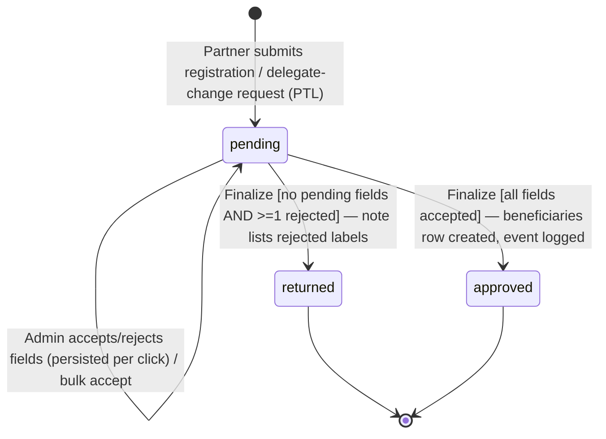
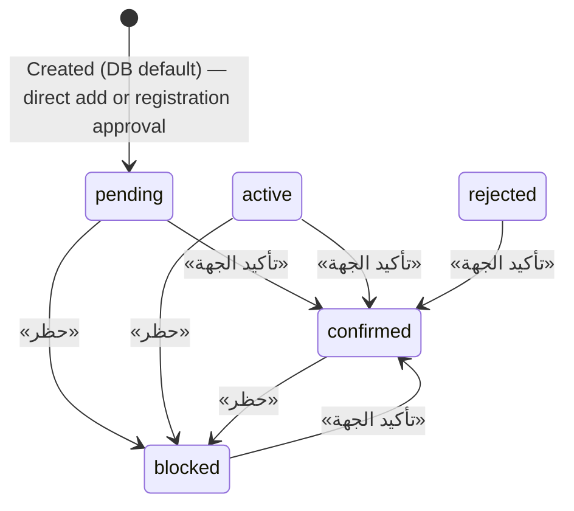
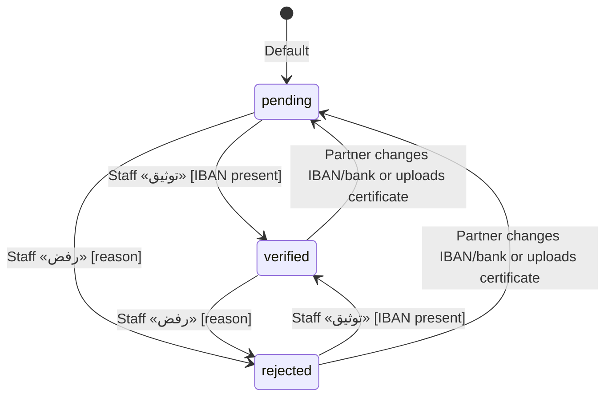
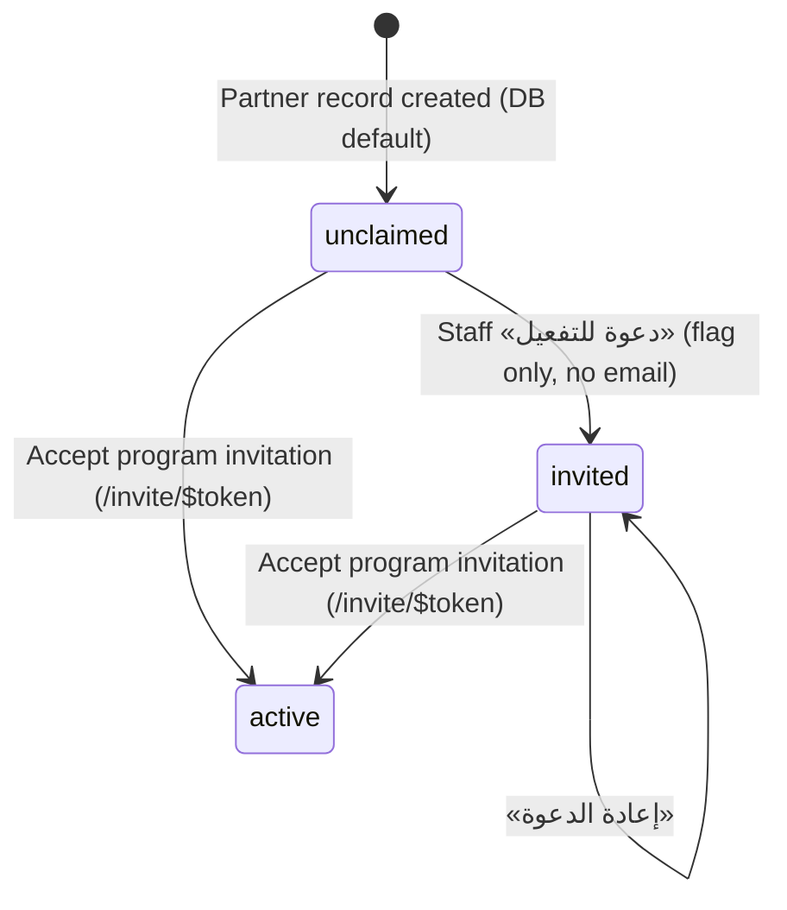
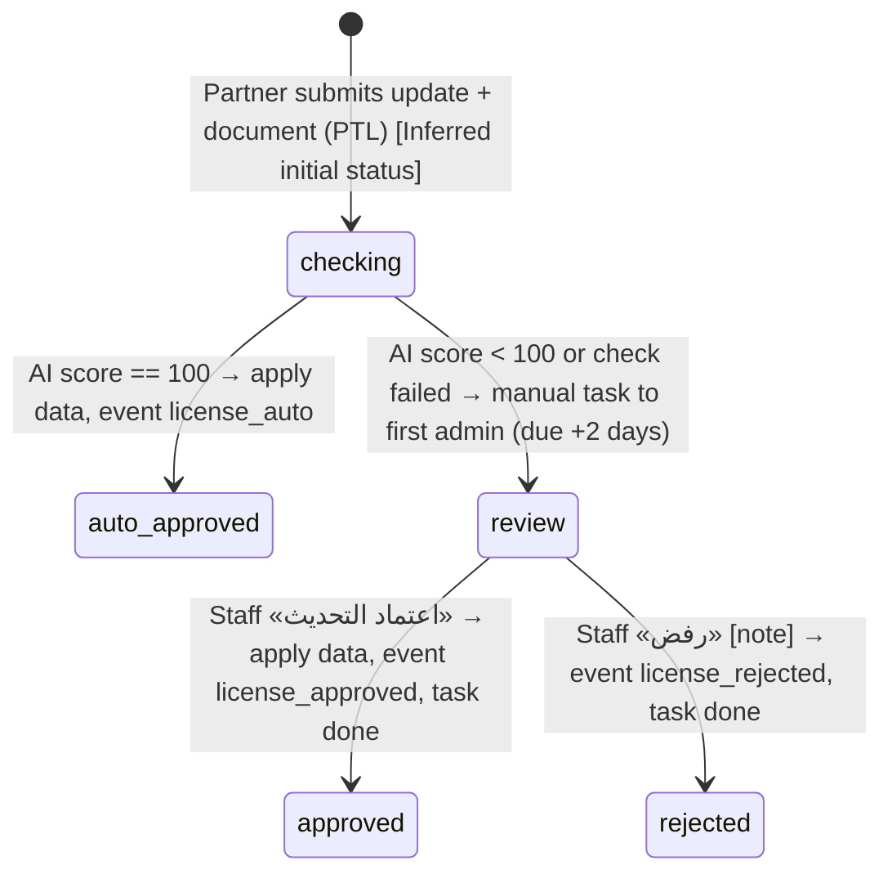
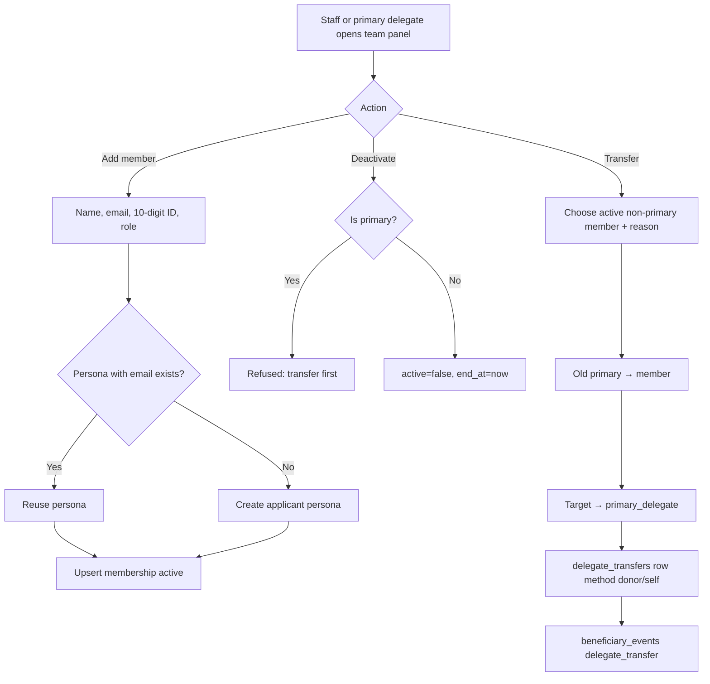

# BEN — Partner Organizations Management (Beneficiaries)

## 1. Scope & Coverage

Staff-side management of partner organizations ("الجهات الشريكة" / beneficiaries): directory, 360 profile, entity and bank decisions, license-update review, registration approval, account invitation, team & delegation, partner groups and the `beneficiary_events` audit log. Partner-side self-service profile component is included because it is part of this module's code scope.

**Files analyzed (all under `/home/user/manih`):**

- `src/routes/beneficiaries.tsx (layout outlet only)`
- `src/routes/beneficiaries.index.tsx`
- `src/routes/beneficiaries.$id.tsx`
- `src/components/EntityProfile.tsx`
- `src/components/BeneficiaryTeam.tsx`
- `src/components/PartnerGroups.tsx`
- `src/components/RegistrationReview.tsx`
- `src/components/LicenseUpdate.tsx (LicenseReviewCard staff side; LicenseUpdateDialog partner side — referenced)`
- `src/components/DocAiCheck.tsx (checked — not used by any BEN screen; used by PLN/CFG/REV dialogs)`
- `src/lib/beneficiaryActions.ts`
- `src/lib/registrations.ts`
- `src/lib/entityUpdates.ts`
- `src/lib/entityUpdates.functions.ts`
- `src/lib/memberships.ts (team, delegate transfer, invite)`
- `src/lib/queries.ts (useBeneficiaries, usePartnerGroups)`
- `src/lib/data.ts (Beneficiary type, ACCOUNT_TYPES, REGIONS, status labels)`
- `src/lib/eligibility.ts (group resolution — read only)`
- `src/routes/admin.tsx (AdminGate + registrations tab)`
- `src/routes/invite.$token.tsx (account activation — read only)`
- `src/routes/portal.tsx (EntityProfile host, bank update call — read only)`
- `src/components/DataTable.tsx, OtpVerifiedInput.tsx, AppShell.tsx, DemoGuide.tsx (supporting)`
- `src/integrations/supabase/types.ts (beneficiaries, beneficiary_events, entity_registrations, entity_update_requests)`
- `supabase/migrations: 20261004093306, 20261004104437, 20261005111034, 20261005115630, 20261005120658, 20261006060307, 20261006140739`

**Coverage notes and limitations**

- Analysis is from source code only; the live demo was not inspected. [Observed]
- Personas are switched on one shared demo account; all permission differences in this module are UI-level only (sidebar visibility, `AdminGate`, `isPrimary`). RLS (migration 20261006140739) allows any signed-in user to read/write, except `beneficiary_events` and `delegate_transfers` which are insert/select-only. [Observed]
- `entity_registrations` and `entity_update_requests` have no migration file in the repository; their structure is taken from generated types only (ISS-BEN-20). [Observed]
- Partner self-registration, license-update submission, bank-update dialog and the portal are owned by module PTL; program targeting by PRG; manual tasks by TSK; payments/commitments chart by FIN; projects by PRJ; application review by REV; personas/invitations landing/global search by PLT. They are referenced, not duplicated.
- The National Center (NCNP) registry is simulated with two demo licenses (`7781`, `8890`) in `registrations.ts:28-31`. Identity verification (Nafath) and OTP delivery are simulated.

## 2. Screen Inventory

| Screen ID | Name (EN + Arabic label) | Route / Component | Roles | Purpose | Entry points | Exits / Navigates to |
|---|---|---|---|---|---|---|
| SCR-BEN-01 | Partner Directory — «الجهات الشريكة — دليل الجهات» | /beneficiaries (tab "list") — routes/beneficiaries.index.tsx | admin, grants_manager, reviewer | List all partner organizations of the tenant with status KPIs, filters, export, and entry to profile, invite and team actions. | Sidebar "الجهات الشريكة" (AppShell NAV `bens`); Global search "الشركاء"; WorkshopDeck link; back link from SCR-BEN-03 | SCR-BEN-03 (row click / name link); Add-partner dialog; Invite dialog; Team dialog (SCR-BEN-05); SCR-BEN-02 (tab) |
| SCR-BEN-02 | Partner Groups — «المجموعات» | /beneficiaries (tab "groups") — components/PartnerGroups.tsx | admin, grants_manager, reviewer | Maintain reusable named groups of partner organizations used for opportunity targeting. | Tab "المجموعات" on /beneficiaries | Group create/edit dialog; consumed by program targeting (see module PRG) |
| SCR-BEN-03 | Partner Organization Profile (staff 360) — «ملف الجهة الشريكة» | /beneficiaries/$id — routes/beneficiaries.$id.tsx | admin, grants_manager, reviewer | Single view of a partner: statuses, KPIs, pending license reviews, projects/payments, applications, bank account verification, entity data, team and audit timeline; hosts staff decisions. | SCR-BEN-01 row/name; links from /projects/$id, /reviewer, /reviewer/$id, /reports (bens), global search, license-review manual task description | /projects/$id; /reviewer/$id; back to SCR-BEN-01; signed URL of IBAN certificate / license document (new tab) |
| SCR-BEN-04 | Registration Requests Review — «طلبات تسجيل الجهات» | /admin (tab "registrations") — components/RegistrationReview.tsx | admin | Field-by-field verification of partner self-registration and delegate-change requests; final decision creates the partner or returns the request. | Settings → /admin, tab "طلبات تسجيل الجهات" (AdminGate: persona role admin only) | Stays on page; approved partner appears in SCR-BEN-01 |
| SCR-BEN-05 | Partner Team & Delegate Panel — «فريق عمل الجمعية» | components/BeneficiaryTeam.tsx — embedded in SCR-BEN-03, in the Team dialog of SCR-BEN-01 (mode donor) and in SCR-BEN-06 (mode self) | admin, grants_manager, reviewer, applicant | Show partner team members and primary delegate; add members, deactivate members, transfer the primary delegation, and show transfer history. | SCR-BEN-03 sidebar card; SCR-BEN-01 column "حساب الجمعية" → "الفريق والمفوض"; SCR-BEN-06 | Add-member dialog; Transfer dialog |
| SCR-BEN-06 | Entity Profile (partner self-service) — «البيانات الرسمية / بيانات التواصل والمقر / الحساب البنكي» | components/EntityProfile.tsx — rendered inside /portal (see module PTL) | applicant | Partner-side view of official data (changed only through license update), directly editable contact data (OTP-verified), bank data and team. | Partner portal profile tab (routes/portal.tsx:113, see module PTL) | License update dialog and bank update dialog (owned by PTL); SCR-BEN-05 (self mode) |

## 3. Screen Details

### SCR-BEN-01 — Partner Directory («الجهات الشريكة», tab «دليل الجهات»)
- **Header:** title «الجهات الشريكة», description «الجهات المسجلة وملفاتها», primary action «إضافة جهة». [Observed] beneficiaries.index.tsx:119-120
- **KPI cards (clickable filters):** «إجمالي الجهات» (all), «مؤكدة» (status=confirmed), «قيد الانتظار» (status=pending), «حسابات غير مفعّلة» (account_status≠active). Active card highlighted. [Observed] :121-126
- **Tabs:** «دليل الجهات» (list) and «المجموعات» (SCR-BEN-02). [Observed] :127-133
- **Table columns (DataTable `partners`):** الجهة (name link + license no.), نوع الحساب, المنطقة (+governorate/city), الطلبات (count of applications), الحساب البنكي (pill), حالة الجهة (pill); hidden by default: حساب الجمعية (account status pill + action link), تصنيف المركز الوطني, الحوكمة, التواصل. [Observed] :96-115
- **Filters:** select «نوع الحساب» (ACCOUNT_TYPES); «المزيد» panel with «المنطقة» (REGIONS) and «الحساب البنكي» (pending/verified/rejected); chips with clear. Free-text search, column chooser, saved view, page size, XLSX/CSV export come from DataTable. [Observed] :135-144; DataTable.tsx
- **Row actions:** row click → profile; in «حساب الجمعية»: «الفريق والمفوض» (when active) opens team dialog (SCR-BEN-05, donor mode, canManage), otherwise «دعوة للتفعيل» / «إعادة الدعوة». [Observed] :105-111
- **Dialog «إضافة جهة مستفيدة»:** AI assist block; fields اسم الجهة * (required), نوع الحساب (select, default first type), رقم الترخيص, المنطقة (select), المدينة, الجوال, البريد (email), البنك, رقم الـIBAN (placeholder SA...). Button حفظ. [Observed] :148-175
- **Dialog «دعوة <name> لتفعيل حسابها»:** explanatory text (representative verifies identity — Nafath later — then becomes primary delegate); field «البريد الرسمي الموثّق للجمعية» (required, prefilled invited_email or email); button «إرسال الدعوة». [Observed] :182-191
- **States:** success toasts «تمت إضافة الجهة», «سُجّلت الدعوة (تجريبي — لا يُرسل بريد فعلي)»; DB errors as toast; empty table state from DataTable «لا توجد بيانات». No explicit loading state (list renders empty until loaded). [Observed]/[Inferred]

### SCR-BEN-02 — Partner Groups («المجموعات»)
- **Intro text:** groups are selected directly when targeting a grant opportunity; editing members affects all linked opportunities. Button «مجموعة جديدة». [Observed] PartnerGroups.tsx:44-47
- **Cards:** name, description, up to 6 member-name chips + «+n», «<n> جهة», «مستخدمة في <n> فرصة» (count of programs whose target_group_ids include the group); edit and delete icons. [Observed] :49-75
- **Dialog «مجموعة جديدة» / «تعديل المجموعة»:** اسم المجموعة * ; الوصف (textarea); «الجهات الأعضاء (n)» chips with remove ×, and «إضافة جهة» select listing partners not yet chosen (all partners, any status). Button حفظ. [Observed] :77-105
- **States:** empty «لا توجد مجموعات بعد.»; validation «اسم المجموعة مطلوب»; success «تم حفظ المجموعة»; delete uses browser `confirm()` «حذف مجموعة «…»؟» (no success toast). [Observed]

### SCR-BEN-03 — Partner Organization Profile («ملف الجهة الشريكة»)
- **Back link** «الجهات الشريكة». **Header:** name, account type, pills: account status (unclaimed/invited/active), entity status, «البنك: <status>». [Observed] beneficiaries.$id.tsx:84-94
- **Header actions:** «دعوة للتفعيل» (account_status≠active), «تأكيد الجهة» (status≠confirmed), «حظر» (status≠blocked). No confirmation dialogs for status actions. [Observed] :95-99
- **KPI cards:** الطلبات, المعتمدة, المبالغ المعتمدة (sum requested_amount of approved), المصروف (sum of paid payments on partner projects), مشاريع جارية (in_progress). [Observed] :102-108
- **Main column:** (1) License review card «طلبات تحديث بانتظار تدقيقك (n)» — only when requests in `review`: AI score, document button, AI summary, comparison table الحقل / الحالي / المطلوب / في المستند with green/red row marks, criteria list, note textarea «ملاحظة للجهة (مطلوبة عند الرفض)», buttons «اعتماد التحديث» and «رفض». [Observed] LicenseUpdate.tsx:64-125. (2) Commitments chart (see module FIN). (3) «المشاريع والدفعات (n)» table: المشروع (link + ref), الميزانية, الإنجاز %, الدفعات (pills amount · status), الحالة; empty «لا توجد مشاريع». (4) «الطلبات (n)» table: الرقم (link to /reviewer/$id), المشروع, الفترة, المبلغ, المرحلة, الحالة; empty «لا توجد طلبات». [Observed] :112-153
- **Side column:** (1) «الحساب البنكي» card: البنك, آخر توثيق (date — verifier), IBAN, certificate link or «لم تُرفع شهادة الآيبان بعد», buttons «توثيق» (disabled if verified or no IBAN) and «رفض» (disabled if rejected). (2) «بيانات الجهة» card: رقم الترخيص, رقم الكيان, المنطقة, المحافظة / المدينة, التصنيف النوعي, التصنيف الفرعي, درجة الحوكمة, التواصل. (3) Team panel (SCR-BEN-05, donor mode, canManage always true). (4) «السجل» timeline (events + application submissions, newest first; label, before ← after, «السبب: …», actor; empty «لا توجد أحداث»). [Observed] :156-216
- **Dialogs:** «رفض الحساب البنكي» (السبب textarea required, «تأكيد الرفض»); «دعوة <name> للتفعيل» (email required, «إرسال»). [Observed] :219-237
- **States:** loading skeleton; not found «الجهة غير موجودة»; error component shows message; toasts for each action success/failure. [Observed] :44-45,64,71-73

### SCR-BEN-04 — Registration Requests Review («طلبات تسجيل الجهات»)
- **Access:** /admin is wrapped by AdminGate — non-admin personas see «هذه الصفحة خاصة بإدارة المنصة» with a link to Settings → team. [Observed] admin.tsx:58-71
- **List:** one card per entity_registrations row (all statuses, newest first). Card title: entity name · «ترخيص <license>» · date; status badge «بانتظار التدقيق» / «معتمد» / «أعيد للمسجّل». [Observed] RegistrationReview.tsx:17-27,48-56
- **Field rows:** label, value (registry value struck through when edited), provenance badge «من السجل — أكّده المسجّل» / «عدّله المسجّل عن السجل» / «أدخله المسجّل»; for pending requests ✓ / ✗ toggle buttons, otherwise text «مقبول» / «مرفوض». Request note shown below. [Observed] :57-74
- **Actions (pending only):** «قبول جماعي» (disabled when nothing pending), «اعتماد القرار» (disabled while busy or pending>0). [Observed] :53-54
- **States:** empty «لا توجد طلبات تسجيل بعد — جرّب التسجيل من صفحة «سجّل جهتك».»; toasts «اعتُمدت الجهة وأُضيفت للشركاء» / «أعيد الطلب للمسجّل لتصحيح الحقول المرفوضة» / error. [Observed]
- **Registration fields (REG_FIELDS):** اسم الجهة*, نوع الكيان*, الرقم الموحد, المنطقة*, المدينة*, التصنيف, البريد الرسمي*, هاتف الجهة*, اسم المفوض*, هوية المفوض*, جوال المفوض*, البنك, الآيبان (required flags apply on the partner form — see module PTL). Delegate-change requests contain اسم الجهة (pre-accepted) and the new delegate's name, ID and mobile. [Observed] registrations.ts:11-25,84-97

### SCR-BEN-05 — Partner Team & Delegate Panel («فريق عمل الجمعية»)
- **Header actions (canManage):** «إضافة عضو», «نقل التفويض» (disabled with no active non-primary member). [Observed] BeneficiaryTeam.tsx:63-71
- **Member rows:** crown for primary, name, email, role pill (مفوض رئيسي / مدير مشاريع / مسؤول مالي / عضو), badge «هوية موثقة (تجريبي)», inactive rows dimmed with «موقوف <date>», deactivate icon for active non-primary members. Empty «لا يوجد أعضاء — الجمعية لم تفعّل حسابها بعد». [Observed] :73-93
- **Transfer history «سجل نقل التفويض»:** date — من X إلى **Y** (بقرار من المانح / من الجمعية) · reason. [Observed] :95-104
- **Dialog «إضافة عضو لفريق الجمعية»:** AI assist; الاسم, البريد (email), رقم الهوية (10 digits pattern), الدور (project_manager / finance / member). [Observed] :107-126
- **Dialog «نقل التفويض الرئيسي»:** current delegate shown; المفوض الجديد (select from active non-primary members); السبب / المستند (required; placeholder differs for donor vs self). [Observed] :128-143
- **Modes:** `donor` (staff pages, canManage=true) and `self` (portal, canManage = isPrimary). Mode is stored as transfer method. [Observed]

### SCR-BEN-06 — Entity Profile, partner self-service (rendered in /portal — see module PTL)
- **«البيانات الرسمية» card:** الاسم الرسمي, النوع, رقم الترخيص / السجل, تاريخ انتهاء الترخيص, رقم الكيان, التصنيف, حالة الجهة, الحوكمة; note that changes go through AI-checked update requests; button «تحديث الترخيص» (primary only). [Observed] EntityProfile.tsx:42-58
- **«بيانات التواصل والمقر» card:** view الجوال, البريد, المنطقة, المحافظة, المدينة; «تعديل» (primary only) switches to edit with OTP-verified phone/email inputs, region select, governorate, city; note «تُحفظ مباشرة دون موافقة، ويُسجَّل التغيير في سجل الجهة باسمك»; حفظ / إلغاء. [Observed] :60-94
- **«الحساب البنكي» card:** البنك, IBAN, الحالة, شهادة الآيبان; «تحديث الحساب / شهادة الآيبان» (primary only). [Observed] :96-107
- **Team panel** in self mode (SCR-BEN-05). [Observed] :109
- **States:** validation «وثّق الجوال والبريد برمز التحقق قبل الحفظ»; success «حُفظت بيانات التواصل»; DB error toast. [Observed]

## 4. Interaction Inventory

| INT ID | Screen | Trigger (control) | System response | Data written | Evidence |
|---|---|---|---|---|---|
| INT-BEN-001 | SCR-BEN-01 | KPI card "إجمالي الجهات" / "مؤكدة" / "قيد الانتظار" / "حسابات غير مفعّلة" | Sets status filter (all / confirmed / pending / inactive) and highlights the active card | None (UI state) | [Observed] beneficiaries.index.tsx:122-125 |
| INT-BEN-002 | SCR-BEN-01 | Select "نوع الحساب"; More filters: "المنطقة", "الحساب البنكي" | Filters rows client-side; shows removable filter chips | None | [Observed] beneficiaries.index.tsx:86-94,136-143 |
| INT-BEN-003 | SCR-BEN-01 | Search box "بحث…" | Free-text match across column values; resets to page 1 | None | [Observed] DataTable.tsx:51-57,84 |
| INT-BEN-004 | SCR-BEN-01 | "الأعمدة" menu / Save view | Shows/hides columns (4 hidden by default); saves per-user view | user_view_prefs (see module PLT) | [Observed] beneficiaries.index.tsx:105-114; DataTable.tsx:43,89 |
| INT-BEN-005 | SCR-BEN-01 | Export menu XLSX / CSV | Downloads visible columns of filtered rows as partners.xlsx / partners.csv | None (file download) | [Observed] DataTable.tsx:64-77,116-117 |
| INT-BEN-006 | SCR-BEN-01 | Row click or partner name link | Navigates to /beneficiaries/$id | None | [Observed] beneficiaries.index.tsx:98,134 |
| INT-BEN-007 | SCR-BEN-01 | Button "إضافة جهة" → form → "حفظ" | Opens dialog; inserts partner; toast "تمت إضافة الجهة"; refreshes list; on DB error shows message | beneficiaries (insert) | [Observed] beneficiaries.index.tsx:55-67,120,148-175 |
| INT-BEN-008 | SCR-BEN-01 | AI assist inside Add dialog (paste text / attach certificate) | AI proposes field values; user applies them into the form (no auto-save) | None until save | [Observed] beneficiaries.index.tsx:152-156; AGENTS.md (AiAssist only proposes) |
| INT-BEN-009 | SCR-BEN-01 | Column "حساب الجمعية" link "دعوة للتفعيل" / "إعادة الدعوة" → email → "إرسال الدعوة" | Records invitation (demo — no email sent); toast; refreshes | beneficiaries.account_status='invited', invited_email, invited_at; beneficiary_events kind 'invited' | [Observed] beneficiaries.index.tsx:69-78,110,182-191; memberships.ts:103-107 |
| INT-BEN-010 | SCR-BEN-01 | Column "حساب الجمعية" link "الفريق والمفوض" (only when account active) | Opens dialog with SCR-BEN-05 in donor mode | None | [Observed] beneficiaries.index.tsx:108-109,176-181 |
| INT-BEN-011 | SCR-BEN-02 | Button "مجموعة جديدة" / pencil icon | Opens create/edit dialog pre-filled for edit | None | [Observed] PartnerGroups.tsx:46,60 |
| INT-BEN-012 | SCR-BEN-02 | Dialog: "إضافة جهة" select / chip × ; "حفظ" | Adds/removes member partners; saves; name required error "اسم المجموعة مطلوب" | partner_groups (insert/update: name, description, member_ids) | [Observed] PartnerGroups.tsx:25-33,82-103 |
| INT-BEN-013 | SCR-BEN-02 | Trash icon | Browser confirm "حذف مجموعة «…»؟" then deletes | partner_groups (delete) | [Observed] PartnerGroups.tsx:34-39,61 |
| INT-BEN-014 | SCR-BEN-03 | Button "تأكيد الجهة" (shown when status ≠ confirmed) | Sets status confirmed; toast "تم تأكيد الجهة"; refreshes profile, events, list | beneficiaries.status; beneficiary_events kind 'status' | [Observed] beneficiaries.$id.tsx:97; beneficiaryActions.ts:36-40 |
| INT-BEN-015 | SCR-BEN-03 | Button "حظر" (shown when status ≠ blocked) | Sets status blocked immediately (no confirmation, no reason); toast "تم حظر الجهة" | beneficiaries.status; beneficiary_events kind 'status' | [Observed] beneficiaries.$id.tsx:98 |
| INT-BEN-016 | SCR-BEN-03 | Button "دعوة للتفعيل" (account_status ≠ active) → email → "إرسال" | Same as INT-BEN-009 | As INT-BEN-009 | [Observed] beneficiaries.$id.tsx:96,229-237 |
| INT-BEN-017 | SCR-BEN-03 | IBAN certificate link | Opens a 300-second signed URL in a new tab; error toast on failure | None | [Observed] beneficiaries.$id.tsx:167-169; beneficiaryActions.ts:73-77 |
| INT-BEN-018 | SCR-BEN-03 | Button "توثيق" (disabled if already verified or no IBAN) | Verifies bank account; toast "تم توثيق الحساب البنكي" | beneficiaries.bank_status='verified', bank_verified_at, bank_verified_by; beneficiary_events 'bank_verified' | [Observed] beneficiaries.$id.tsx:172; beneficiaryActions.ts:42-46 |
| INT-BEN-019 | SCR-BEN-03 | Button "رفض" (disabled if already rejected) → reason → "تأكيد الرفض" | Rejects bank account with mandatory reason; closes dialog | beneficiaries.bank_status='rejected', clears verified_at/by; beneficiary_events 'bank_rejected' with note | [Observed] beneficiaries.$id.tsx:173,219-227; beneficiaryActions.ts:48-53 |
| INT-BEN-020 | SCR-BEN-03 | License review card: document button | Opens license document via signed URL | None | [Observed] LicenseUpdate.tsx:94 |
| INT-BEN-021 | SCR-BEN-03 | License review card: "اعتماد التحديث" | Applies new name/license/expiry; marks request approved; logs event; closes linked task; toast "اعتُمد التحديث" | beneficiaries (name, license_no, license_expiry); entity_update_requests (status, decided_by/at, decision_note); beneficiary_events 'license_approved'; manual_tasks.status='done' | [Observed] LicenseUpdate.tsx:85-89,120; entityUpdates.ts:40-50 |
| INT-BEN-022 | SCR-BEN-03 | License review card: note + "رفض" | Requires note ("اكتب سبب الرفض ليصل للجهة"); marks rejected; logs event; closes task | entity_update_requests; beneficiary_events 'license_rejected'; manual_tasks | [Observed] LicenseUpdate.tsx:118-121; entityUpdates.ts:41,47-49 |
| INT-BEN-023 | SCR-BEN-03 | Project title / application ref links | Navigate to /projects/$id or /reviewer/$id | None | [Observed] beneficiaries.$id.tsx:123,142 |
| INT-BEN-024 | SCR-BEN-04 | Per-field ✓ / ✗ buttons | Sets field decision accepted/rejected and persists immediately | entity_registrations.fields (JSON) | [Observed] RegistrationReview.tsx:35-36,65-69; registrations.ts:99-102 |
| INT-BEN-025 | SCR-BEN-04 | Button "قبول جماعي" (enabled while pending fields exist) | Marks all pending fields accepted and persists | entity_registrations.fields | [Observed] RegistrationReview.tsx:37,53 |
| INT-BEN-026 | SCR-BEN-04 | Button "اعتماد القرار" (enabled when no pending fields) | If any field rejected → request 'returned' with note listing rejected labels; else creates partner, marks 'approved', logs event. Toasts accordingly | entity_registrations (status, decided_by, decided_at, note, beneficiary_id); beneficiaries (insert); beneficiary_events 'status' | [Observed] RegistrationReview.tsx:38-45,54; registrations.ts:104-123 |
| INT-BEN-027 | SCR-BEN-05 | Button "إضافة عضو" → name/email/national ID/role (+AI assist) → "إضافة" | Creates persona if email new, upserts membership; toast notes identity check is a demo (Nafath later) | personas (insert when new); beneficiary_memberships (upsert) | [Observed] BeneficiaryTeam.tsx:39-47,107-126; memberships.ts:61-78 |
| INT-BEN-028 | SCR-BEN-05 | UserX icon on an active non-primary member | Deactivates membership (no confirmation) | beneficiary_memberships.active=false, end_at | [Observed] BeneficiaryTeam.tsx:84-89; memberships.ts:80-84 |
| INT-BEN-029 | SCR-BEN-05 | Button "نقل التفويض" (disabled with no candidates) → new delegate + reason → "تأكيد النقل" | Demotes current primary to 'member', promotes target to primary_delegate, records transfer; toast "تم نقل التفويض الرئيسي" | beneficiary_memberships (2 updates); delegate_transfers (insert, method donor/self); beneficiary_events 'delegate_transfer' | [Observed] BeneficiaryTeam.tsx:49-59,128-143; memberships.ts:86-101 |
| INT-BEN-030 | SCR-BEN-06 | Button "تعديل" on contact card (primary delegate only) → edit → "حفظ" | Requires OTP verification for changed phone/email; saves only if something changed; logs changed fields | beneficiaries (phone, email, region, city, governorate); beneficiary_events 'contact_updated' | [Observed] EntityProfile.tsx:23-38,63,76-91 |
| INT-BEN-031 | SCR-BEN-06 | Button "تحديث الترخيص" (primary only) | Opens license update dialog (see module PTL); AI processing per BR-BEN-14 | entity_update_requests (via PTL) | [Observed] EntityProfile.tsx:45; LicenseUpdate.tsx:20-62 |
| INT-BEN-032 | SCR-BEN-06 | Button "تحديث الحساب / شهادة الآيبان" (primary only) | Opens bank update dialog (see module PTL); change resets bank verification | beneficiaries bank fields; beneficiary_events 'iban_changed' / 'iban_doc' | [Observed] EntityProfile.tsx:99; portal.tsx:223; beneficiaryActions.ts:55-71 |

## 5. Shared Components & Dependencies

| Component / lib | Used for | Owner / note |
|---|---|---|
| `lib/beneficiaryActions.ts` | `logEvent`, `fetchEvents`, `setEntityStatus`, `verifyBank`, `rejectBank`, `updateBankDetails`, `openDoc`, color maps, `EVENT_LABELS` | BEN (central audit + decision API) [Observed] |
| `lib/memberships.ts` | Team fetch/add/deactivate, delegate transfer, `inviteEntity`, account status labels | BEN (shared with PLT memberships for staff) [Observed] |
| `lib/registrations.ts` | Registry lookup, submission (PTL), field decisions & finalize (BEN) | Shared PTL/BEN [Observed] |
| `lib/entityUpdates.ts` / `entityUpdates.functions.ts` | License update submit (PTL), AI processing + auto-approval + task creation, manual decision (BEN) | Shared PTL/BEN; AI via `projectAi.server.checkLicenseDoc` [Observed] |
| `components/LicenseUpdate.tsx` | `LicenseReviewCard` (staff, SCR-BEN-03), `LicenseUpdateDialog` (partner, PTL) | [Observed] |
| `components/BeneficiaryTeam.tsx` | Team panel in staff and partner contexts | [Observed] |
| `components/DataTable.tsx`, `FilterBar`, `viewPrefs` | Directory table, filters, saved views, export | PLT [Observed] |
| `components/AiAssist.tsx` | Prefill add-partner and add-member forms (proposal only) | PLT/PTL [Observed] |
| `components/OtpVerifiedInput.tsx` | Demo OTP for phone/email changes (code shown on screen) | PTL [Observed] |
| `components/CommitmentsChart.tsx` | Partner payment commitments chart on profile | FIN [Observed] |
| `lib/eligibility.ts`, `TargetingSection.tsx`, `RfpTabs.tsx` | Consume `partner_groups` for opportunity targeting | PRG [Observed] |
| `manual_tasks` | License review task for admin | TSK [Observed] |
| Storage bucket `attachments` | IBAN certificates (`beneficiaries/<id>/iban-*`), license documents (`beneficiaries/<id>/license-*`); viewed via 300 s signed URLs | [Observed] |
| `components/DocAiCheck.tsx` | Not used in BEN screens (used in MinuteDialog, PlanEditors, AdjustmentDialog, EditSession) | Listed for completeness [Observed] |
| `routes/invite.$token.tsx` | Sets account_status=active on program-invitation acceptance | PLT/PRG [Observed] |

## 6. Business Process Workflows

### 6.1 Registration approval (admin)
Actors: partner applicant (PTL), platform admin (persona role admin).

Guards: finalize requires zero `pending` decisions (BR-BEN-08). Gaps: delegate-change requests follow the same path and create a duplicate partner (ISS-BEN-03); delegate data not used (ISS-BEN-04). Resubmission of `returned` requests is not visible in BEN (ISS-BEN-21). [Observed]

### 6.2 Entity status (staff)

`active` and `rejected` exist as labels/seed values but no BEN action sets them (except the approval event text, ISS-BEN-05). No reason or confirmation required (ISS-BEN-08). Every transition logs a `status` event. [Observed]

### 6.3 Bank account verification

Events: bank_verified, bank_rejected (note), iban_changed, iban_doc. [Observed] beneficiaryActions.ts

### 6.4 Partner account status

[Observed] memberships.ts:103-107; invite.$token.tsx:50. The intended activation (identity verification → primary delegate) is described in the invite dialog text but not implemented (ISS-BEN-15).

### 6.5 License / official data update

[Observed] entityUpdates.functions.ts; entityUpdates.ts. Initial `checking` value is inferred from UPDATE_STATUS (migration not in repo).

### 6.6 Team & delegation

[Observed] memberships.ts; BeneficiaryTeam.tsx. Steps are separate writes (ISS-BEN-09).

### 6.7 Partner groups
Staff create/edit groups (name required, member_ids array) → opportunities reference groups via `grant_programs.target_group_ids` → eligibility resolves group members at evaluation time, so membership edits propagate (BR-BEN-23). Delete is unconditional after confirm (ISS-BEN-13). [Observed]

## 7. Business Rules

| BR ID | Rule | Evidence label + reference |
|---|---|---|
| BR-BEN-01 | Every sensitive partner decision (entity status, bank verification/rejection, IBAN change, IBAN certificate upload, invitation, delegate transfer, license decision, contact update, registration approval) writes an append-only row to beneficiary_events with kind, before/after values, note, actor and optional document path. | [Observed] beneficiaryActions.ts:1-2,24-29; AGENTS.md; migration 20261006140739 (SELECT/INSERT-only policy on beneficiary_events) |
| BR-BEN-02 | Rejecting a partner bank account requires a non-empty reason. | [Observed] beneficiaryActions.ts:49; beneficiaries.$id.tsx:223 (required textarea) |
| BR-BEN-03 | A bank account can be verified only when an IBAN exists and it is not already verified; rejection is unavailable when already rejected. | [Observed] beneficiaries.$id.tsx:172-173 (UI disabling only) |
| BR-BEN-04 | Verification stamps bank_verified_at and bank_verified_by (actor); rejection clears both. | [Observed] beneficiaryActions.ts:43,50 |
| BR-BEN-05 | Any partner change to IBAN or bank name, or upload of a new IBAN certificate, resets bank_status to 'pending' and clears verification stamps. | [Observed] beneficiaryActions.ts:55-71 |
| BR-BEN-06 | Staff may set entity status to 'confirmed' (when not confirmed) or 'blocked' (when not blocked); no reason or confirmation is required in the prototype. | [Observed] beneficiaries.$id.tsx:97-98; beneficiaryActions.ts:36-40 |
| BR-BEN-07 | Partner organizations are to be created only on admin approval of a registration request. The prototype also allows direct staff creation from the directory, contradicting this rule. | [Observed] AGENTS.md (Registration line); registrations.ts:104-123; beneficiaries.index.tsx:55-67 |
| BR-BEN-08 | A registration can be finalized only when every field has a decision (no 'pending'). | [Observed] registrations.ts:107; RegistrationReview.tsx:54 |
| BR-BEN-09 | If any registration field is rejected, the request becomes 'returned' with a note listing rejected field labels (unless a note is supplied) and no partner is created. | [Observed] registrations.ts:106-111 |
| BR-BEN-10 | If all fields are accepted, a partner is created from the field values (account_type defaults to 'جمعية أهلية'), the request becomes 'approved' and is linked to the new partner, and a 'status' event is logged. | [Observed] registrations.ts:113-122 |
| BR-BEN-11 | Each registration field carries a provenance: 'registry' (equals registry value), 'registry_edited' (differs from registry; registry value shown struck through) or 'manual' (no registry value). | [Observed] registrations.ts:4,70-74; RegistrationReview.tsx:12-16,62-64 |
| BR-BEN-12 | Registration review is accessible only to personas with role 'admin' (UI gate). | [Observed] admin.tsx:58-71 |
| BR-BEN-13 | Official data (name, license number, license expiry) changes only through a license update request; partners cannot edit it directly. | [Observed] EntityProfile.tsx:56; entityUpdates.ts:26-38 |
| BR-BEN-14 | A license update is auto-approved and applied only when the AI match score is exactly 100%; otherwise the request goes to 'review' and a manual task (due in 2 days) is assigned to the tenant's first active admin (persona_memberships role admin, fallback personas role admin). | [Observed] entityUpdates.functions.ts:28-43; AGENTS.md |
| BR-BEN-15 | If the AI check cannot run (unsupported file type, unreadable document, error), the score is 0 and the request goes to manual review. | [Observed] entityUpdates.functions.ts:18-27 |
| BR-BEN-16 | Rejecting a license update requires a note, which is shown to the partner. | [Observed] entityUpdates.ts:41; LicenseUpdate.tsx:33,118 |
| BR-BEN-17 | Approving a license update overwrites name, license_no and license_expiry; both decisions log a beneficiary event with the document path and close the linked manual task. | [Observed] entityUpdates.ts:42-49 |
| BR-BEN-18 | Each partner has exactly one active primary delegate; the primary delegate cannot be deactivated before the delegation is transferred. | [Observed] memberships.ts:1-2,80-84; BeneficiaryTeam.tsx:84 |
| BR-BEN-19 | A delegate transfer requires a target chosen among active non-primary members and a reason; the previous primary becomes role 'member'; the transfer is recorded with method 'donor' (staff) or 'self' (partner). | [Observed] BeneficiaryTeam.tsx:37,49-59; memberships.ts:86-101 |
| BR-BEN-20 | Team members are added with name, email, 10-digit national ID and a role among project_manager, finance, member; an existing persona with the same email is reused; one membership per persona and partner. | [Observed] BeneficiaryTeam.tsx:114-121; memberships.ts:61-78; migration 20261005115630 (UNIQUE persona_id, beneficiary_id) |
| BR-BEN-21 | Staff invitation marks the partner account 'invited' with invited_email and invited_at; no email is actually sent in the prototype. | [Observed] memberships.ts:103-107; beneficiaries.index.tsx:74 |
| BR-BEN-22 | Partner account status values: unclaimed (approved record, not activated) → invited → active (activated and verified). Activation is performed on the invitation landing page. | [Observed] memberships.ts:13-17; migration 20261005115630; invite.$token.tsx:50 |
| BR-BEN-23 | A partner group requires a name; group membership changes take effect for every opportunity that targets the group (resolved at eligibility time). | [Observed] PartnerGroups.tsx:26,45; eligibility.ts:33 |
| BR-BEN-24 | Contact data (phone, email, region, city, governorate) is edited directly by the primary delegate without approval; changed phone/email must be OTP-verified; changes are logged under the editor's name. | [Observed] EntityProfile.tsx:27-38,89 |
| BR-BEN-25 | On the partner side only the primary delegate can edit contact data, request license or bank updates, and manage the team. | [Observed] EntityProfile.tsx:45,63,99,109 |
| BR-BEN-26 | "Inactive accounts" means account_status ≠ 'active'. | [Observed] beneficiaries.index.tsx:87,125 |
| BR-BEN-27 | Staff decisions on partners must be restricted by role and tenant (not only by sidebar visibility). | [Recommended] Gap: no enforcement in beneficiaries.$id.tsx / beneficiaryActions.ts; AGENTS.md (RLS any signed-in user) |

## 8. Data Requirements

### beneficiaries (partner organization)
| Field | Type | Required | Meaning |
|---|---|---|---|
| id | uuid | PK | Partner identifier |
| tenant_id | uuid → tenants | Yes | Owning donor organization |
| name | text | Yes | Official name (changes via license update) |
| account_type | text | Yes | Entity type (ACCOUNT_TYPES list / taxonomies) |
| license_no | text | No | License / registration number (no uniqueness constraint found) |
| license_expiry | date | No | License expiry |
| entity_number | text | No | Unified entity number |
| region, governorate, city | text | No | Location (region values inconsistent — ISS-BEN-11) |
| classification_group, classification_sub | text | No | NCNP classification |
| governance_score | numeric | No | Governance score (used by eligibility min_governance) |
| phone, email | text | No | Official contacts (OTP-verified on partner edits) |
| bank_name, iban | text | No | Bank account |
| iban_doc_path, iban_doc_name | text | No | IBAN certificate in storage |
| bank_status | text | Yes, default 'pending' | pending / verified / rejected |
| bank_verified_at, bank_verified_by (→ personas) | timestamptz, uuid | No | Verification stamp |
| status | text | Yes, default 'pending' | pending / active / confirmed / blocked / rejected |
| account_status | text | Yes, default 'unclaimed' | unclaimed / invited / active |
| invited_email, invited_at, activated_at | text, timestamptz | No | Invitation & activation |
| hub_synced_at | timestamptz | No | [Inferred] last sync with an external hub — not used in BEN UI |
| created_at | timestamptz | Yes | Creation time |

### beneficiary_events (audit log — insert/select only)
| Field | Type | Required | Meaning |
|---|---|---|---|
| id | uuid | PK | |
| beneficiary_id | uuid → beneficiaries (cascade) | Yes | Partner |
| kind | text | Yes | status, bank_verified, bank_rejected, iban_changed, iban_doc, invited, delegate_transfer, license_auto, license_approved, license_rejected, contact_updated |
| before_value, after_value | text | No | Values before/after |
| note | text | No | Reason / comment |
| actor_id | uuid → personas | No (should be Yes — FR-BEN-024) | Who acted |
| doc_path | text | No | Supporting document in storage |
| created_at | timestamptz | Yes | |

### entity_registrations (from generated types; no migration in repo)
| Field | Type | Required | Meaning |
|---|---|---|---|
| id | uuid | PK | |
| tenant_id | uuid | Yes | Target tenant (ignored at approval — uses TENANT_ID constant) |
| license_no | text | Yes | License looked up |
| fields | json array of RegField {key, label, value, registry_value, source: registry/registry_edited/manual, decision: pending/accepted/rejected} | Yes | Field values and admin decisions |
| status | text | Yes | pending / approved / returned |
| note | text | No | Return reason, or «طلب تغيير مفوض — السبب: …» for delegate-change requests |
| beneficiary_id | uuid | No | Partner created on approval |
| decided_by, decided_at | uuid, timestamptz | No | Decision stamp |
| created_at | timestamptz | Yes | |

### entity_update_requests (from generated types; no migration in repo)
| Field | Type | Required | Meaning |
|---|---|---|---|
| id, tenant_id, beneficiary_id | uuid | Yes | |
| kind | text | Yes | [Inferred] request type (not set by code) |
| status | text | Yes | checking / auto_approved / review / approved / rejected |
| before_values, new_values | json {name, license_no, license_expiry} | Yes | Current vs requested official data |
| doc_name, doc_path | text | Yes | License document |
| ai_check | json {score, summary, criteria[{key,label,ok,found,note}], checked_at} | No | AI result |
| task_id | uuid → manual_tasks | No | Manual review task |
| requested_by, decided_by, decided_at, decision_note | | No | Request/decision stamps; note shown to partner |

### beneficiary_memberships
| Field | Type | Required | Meaning |
|---|---|---|---|
| id | uuid | PK | |
| persona_id | uuid → personas (cascade) | Yes | Person |
| beneficiary_id | uuid → beneficiaries (cascade) | Yes | Partner; UNIQUE(persona_id, beneficiary_id) |
| role | text | Yes, default 'member' | primary_delegate / project_manager / finance / member |
| is_primary | boolean | Yes | One active primary per partner (enforced in code only) |
| active | boolean | Yes | Membership active |
| national_id | text | No | 10-digit national ID |
| verified_via | text | Yes | [Inferred] identity verification method (not displayed) |
| start_at, end_at | timestamptz | | Period |

### delegate_transfers (insert/select only)
id, beneficiary_id, from_persona_id (nullable), to_persona_id (required), reason (required), method ('self' default / 'donor'), created_at. [Observed] migration 20261005115630

### partner_groups
id, tenant_id (required), name (required), description, member_ids uuid[] (default {}), created_at. Referenced by grant_programs.target_group_ids uuid[] (no FK — arrays). [Observed] migration 20261006060307

**Relationships:** tenants 1—* beneficiaries; beneficiaries 1—* beneficiary_events / beneficiary_memberships / delegate_transfers / entity_update_requests / applications / projects (beneficiary_id, executor_beneficiary_id); entity_registrations 0..1—1 beneficiaries; personas *—* beneficiaries via beneficiary_memberships; partner_groups *—* beneficiaries via member_ids; grant_programs *—* partner_groups via target_group_ids.

## 9. Product Structure

- **EP-BEN-01 — Partner Directory & 360 Profile**: Find, list, export and inspect partner organizations with their applications, projects, payments and statuses.
  - FT-BEN-01 — Partner directory with KPIs, filters and export
  - FT-BEN-02 — Manual partner creation (staff)
  - FT-BEN-03 — Partner 360 profile
- **EP-BEN-02 — Partner Verification & Governance Decisions**: Staff decisions on entity status, bank account and official (license) data, all recorded in an attributable audit log.
  - FT-BEN-04 — Entity status decisions
  - FT-BEN-05 — Bank account verification
  - FT-BEN-06 — License / official data update review
  - FT-BEN-07 — Partner audit log (beneficiary_events)
- **EP-BEN-03 — Partner Onboarding**: Admin field-by-field approval of registration requests and invitation of approved partners to activate their accounts.
  - FT-BEN-08 — Registration request review & approval
  - FT-BEN-09 — Partner account activation invitation
- **EP-BEN-04 — Partner Team & Delegation**: Management of a partner's team memberships and the single primary delegate, including transfer history.
  - FT-BEN-10 — Team membership management
  - FT-BEN-11 — Primary delegate transfer
- **EP-BEN-05 — Partner Segmentation**: Reusable partner groups for targeting grant opportunities.
  - FT-BEN-12 — Partner groups
- **EP-BEN-06 — Partner Self-Service Profile**: Partner-side view and maintenance of its own profile (contact data, official data and bank entry points).
  - FT-BEN-13 — Partner self-service profile

## 10. Features

### FT-BEN-01 — Partner directory with KPIs, filters and export
- **Feature ID:** FT-BEN-01 (Epic EP-BEN-01)
- **Name:** Partner directory with KPIs, filters and export
- **Description:** Tenant-wide list of partner organizations with status KPI cards, type/region/bank filters, free-text search, configurable columns, saved views and XLSX/CSV export.
- **Business Objective:** Give staff a single searchable register of partner organizations and their verification state.
- **Expected Business Value:** [To Confirm] Faster identification of partners needing action (pending, unverified bank, inactive account).
- **Primary User Roles:** admin, grants_manager, reviewer
- **Scope:** List, KPI cards, filters, chips, search, column visibility, saved view, export, navigation to profile.
- **Out of Scope:** Server-side paging; cross-tenant lists; partner-side views.
- **Functional Requirements:** FR-BEN-001, FR-BEN-002, FR-BEN-003, FR-BEN-004
- **Business Rules:** BR-BEN-26
- **Dependencies:** DataTable / viewPrefs (see module PLT); useBeneficiaries, useApplications (lib/queries.ts)
- **Related Screens:** SCR-BEN-01
- **Acceptance Criteria:**
  - KPI cards show total, confirmed, pending and inactive-account counts and filter the list on click.
  - Type, region and bank-status filters combine and each shows a removable chip.
  - Export produces XLSX/CSV of visible columns of the filtered rows.
- **Open Questions:** OQ-BEN-03
- **Assumptions:** Applications count per partner is computed from all applications loaded client-side.
- **Priority Recommendation (MoSCoW):** Must

### FT-BEN-02 — Manual partner creation (staff)
- **Feature ID:** FT-BEN-02 (Epic EP-BEN-01)
- **Name:** Manual partner creation (staff)
- **Description:** Staff dialog to add a partner organization directly with optional AI-assisted prefill from pasted text or an attached certificate.
- **Business Objective:** [To Confirm] Allow staff to register partners that do not self-register (e.g. legacy or government partners).
- **Expected Business Value:** [To Confirm]
- **Primary User Roles:** admin, grants_manager, reviewer
- **Scope:** Add dialog with name (required), account type, license no., region, city, phone, email, bank, IBAN; AI assist prefill.
- **Out of Scope:** Duplicate detection, registry lookup, approval workflow (not in prototype).
- **Functional Requirements:** FR-BEN-005, FR-BEN-006
- **Business Rules:** BR-BEN-07
- **Dependencies:** AiAssist (see module PTL / PLT); ACCOUNT_TYPES, REGIONS (lib/data.ts)
- **Related Screens:** SCR-BEN-01
- **Acceptance Criteria:**
  - A partner can be saved with only a name; it appears in the directory immediately.
  - AI assist only fills the form; nothing is saved until the user presses حفظ.
- **Open Questions:** OQ-BEN-02
- **Assumptions:** Direct creation conflicts with BR-BEN-07; kept as documented prototype behaviour.
- **Priority Recommendation (MoSCoW):** Could

### FT-BEN-03 — Partner 360 profile
- **Feature ID:** FT-BEN-03 (Epic EP-BEN-01)
- **Name:** Partner 360 profile
- **Description:** Profile page combining header statuses, KPIs (applications, approved, approved amounts, paid, running projects), commitments chart, projects & payments table, applications table, entity data and bank card.
- **Business Objective:** Give staff the full relationship history of a partner in one place.
- **Expected Business Value:** [To Confirm] Reduced time to assess a partner before decisions.
- **Primary User Roles:** admin, grants_manager, reviewer
- **Scope:** Header, KPIs, projects (as beneficiary or executor) with payments, applications, entity data, links to projects and applications.
- **Out of Scope:** Editing entity master data by staff (not in prototype).
- **Functional Requirements:** FR-BEN-007, FR-BEN-008, FR-BEN-009
- **Business Rules:** —
- **Dependencies:** FIN CommitmentsChart (see module FIN); PRJ initiativeProgress (see module PRJ); REV application list (see module REV)
- **Related Screens:** SCR-BEN-03
- **Acceptance Criteria:**
  - Profile shows the 5 KPIs computed from the partner's applications, projects and paid payments.
  - Projects include those where the partner is beneficiary or executor.
  - Unknown id shows "الجهة غير موجودة".
- **Open Questions:** —
- **Assumptions:** 'Approved amount' uses requested_amount of approved applications.
- **Priority Recommendation (MoSCoW):** Must

### FT-BEN-04 — Entity status decisions
- **Feature ID:** FT-BEN-04 (Epic EP-BEN-02)
- **Name:** Entity status decisions
- **Description:** Staff confirm or block a partner organization; each change is logged with before/after values and actor.
- **Business Objective:** Control which partners are trusted to participate.
- **Expected Business Value:** [To Confirm]
- **Primary User Roles:** admin, grants_manager, reviewer
- **Scope:** Confirm, block, audit event.
- **Out of Scope:** Downstream effects of blocking on applications/payments (not implemented), unblock workflow.
- **Functional Requirements:** FR-BEN-010, FR-BEN-011, FR-BEN-012
- **Business Rules:** BR-BEN-01, BR-BEN-06, BR-BEN-27
- **Dependencies:** FT-BEN-07
- **Related Screens:** SCR-BEN-03
- **Acceptance Criteria:**
  - Confirm is hidden when already confirmed; Block hidden when already blocked.
  - Each status change creates a 'status' event with before/after and actor.
- **Open Questions:** OQ-BEN-01, OQ-BEN-03
- **Assumptions:** —
- **Priority Recommendation (MoSCoW):** Must

### FT-BEN-05 — Bank account verification
- **Feature ID:** FT-BEN-05 (Epic EP-BEN-02)
- **Name:** Bank account verification
- **Description:** Staff view bank name, IBAN and IBAN certificate and verify or reject the account (reason required); partner bank changes reset verification.
- **Business Objective:** Ensure grant payments go only to verified partner bank accounts.
- **Expected Business Value:** [To Confirm] Reduced payment-fraud and misdirected-transfer risk.
- **Primary User Roles:** admin, grants_manager, reviewer
- **Scope:** Display, certificate viewing, verify, reject with reason, automatic reset on partner change.
- **Out of Scope:** Automated IBAN ownership checks; four-eyes approval.
- **Functional Requirements:** FR-BEN-013, FR-BEN-014, FR-BEN-015, FR-BEN-016
- **Business Rules:** BR-BEN-01, BR-BEN-02, BR-BEN-03, BR-BEN-04, BR-BEN-05
- **Dependencies:** attachments storage bucket; Partner bank update dialog (see module PTL); Payments use of bank_status (see module FIN) [To Confirm]
- **Related Screens:** SCR-BEN-03, SCR-BEN-06
- **Acceptance Criteria:**
  - Verify is disabled without IBAN or when verified; stamps date and verifier.
  - Reject requires a reason and clears verification stamps.
  - A partner IBAN/bank change sets status back to 'pending'.
- **Open Questions:** OQ-BEN-04
- **Assumptions:** —
- **Priority Recommendation (MoSCoW):** Must

### FT-BEN-06 — License / official data update review
- **Feature ID:** FT-BEN-06 (Epic EP-BEN-02)
- **Name:** License / official data update review
- **Description:** Partner license update requests are AI-checked; exact (100%) matches are applied automatically, others create a manual review task and appear on the partner profile for staff approve/reject with side-by-side comparison.
- **Business Objective:** Keep official partner data current while letting humans decide uncertain cases.
- **Expected Business Value:** [To Confirm] Less manual effort for clean renewals.
- **Primary User Roles:** admin, grants_manager, reviewer
- **Scope:** AI processing outcome, manual task, review card, approve, reject with note, event, task closure.
- **Out of Scope:** Partner submission form (see module PTL); AI model internals.
- **Functional Requirements:** FR-BEN-017, FR-BEN-018, FR-BEN-019, FR-BEN-020, FR-BEN-021
- **Business Rules:** BR-BEN-13, BR-BEN-14, BR-BEN-15, BR-BEN-16, BR-BEN-17
- **Dependencies:** entityUpdates.functions.ts / projectAi.server checkLicenseDoc; manual_tasks (see module TSK); LicenseUpdateDialog (see module PTL)
- **Related Screens:** SCR-BEN-03
- **Acceptance Criteria:**
  - Only score 100 auto-approves.
  - Requests in 'review' show on the partner profile with current/requested/document values.
  - Rejecting requires a note; decisions close the linked task.
- **Open Questions:** OQ-BEN-07
- **Assumptions:** —
- **Priority Recommendation (MoSCoW):** Must

### FT-BEN-07 — Partner audit log (beneficiary_events)
- **Feature ID:** FT-BEN-07 (Epic EP-BEN-02)
- **Name:** Partner audit log (beneficiary_events)
- **Description:** Append-only log of partner decisions shown as a timeline on the profile, merged with application submissions.
- **Business Objective:** Make every partner decision attributable and reviewable.
- **Expected Business Value:** [To Confirm] Audit and compliance readiness.
- **Primary User Roles:** admin, grants_manager, reviewer
- **Scope:** Event logging API, labels, timeline with before → after, reason, actor, date.
- **Out of Scope:** Exporting the log; partner-side view of the log.
- **Functional Requirements:** FR-BEN-022, FR-BEN-023, FR-BEN-024
- **Business Rules:** BR-BEN-01, BR-BEN-27
- **Dependencies:** All decision features of this module
- **Related Screens:** SCR-BEN-03
- **Acceptance Criteria:**
  - Timeline lists events newest first with label, values, reason and actor.
  - beneficiary_events accepts only select/insert (no update/delete).
- **Open Questions:** OQ-BEN-11
- **Assumptions:** —
- **Priority Recommendation (MoSCoW):** Must

### FT-BEN-08 — Registration request review & approval
- **Feature ID:** FT-BEN-08 (Epic EP-BEN-03)
- **Name:** Registration request review & approval
- **Description:** Admin reviews each registration field (with registry provenance), accepts/rejects individually or in bulk, and finalizes: all accepted creates the partner; any rejection returns the request.
- **Business Objective:** Admit only verified partner organizations.
- **Expected Business Value:** [To Confirm]
- **Primary User Roles:** admin
- **Scope:** Request list, per-field decisions, bulk accept, finalize approve/return, event.
- **Out of Scope:** Partner registration form and license lookup (see module PTL); registry integration.
- **Functional Requirements:** FR-BEN-025, FR-BEN-026, FR-BEN-027, FR-BEN-028, FR-BEN-029, FR-BEN-030, FR-BEN-031
- **Business Rules:** BR-BEN-07, BR-BEN-08, BR-BEN-09, BR-BEN-10, BR-BEN-11, BR-BEN-12
- **Dependencies:** Partner registration (see module PTL); Admin page (see module PLT/CFG)
- **Related Screens:** SCR-BEN-04
- **Acceptance Criteria:**
  - Finalize is disabled while any field is pending.
  - Any rejected field returns the request with a note; no partner is created.
  - All accepted creates the partner and links it to the request.
- **Open Questions:** OQ-BEN-05, OQ-BEN-10
- **Assumptions:** Registry data is simulated (two demo licenses).
- **Priority Recommendation (MoSCoW):** Must

### FT-BEN-09 — Partner account activation invitation
- **Feature ID:** FT-BEN-09 (Epic EP-BEN-03)
- **Name:** Partner account activation invitation
- **Description:** Staff invite a partner (not yet active) to activate its account using the official verified email; status becomes 'invited'.
- **Business Objective:** Bring approved partners onto the platform.
- **Expected Business Value:** [To Confirm]
- **Primary User Roles:** admin, grants_manager, reviewer
- **Scope:** Invite/re-invite from directory and profile, status/email/date recording, event.
- **Out of Scope:** Email delivery, activation token, Nafath verification (not in prototype).
- **Functional Requirements:** FR-BEN-032, FR-BEN-033, FR-BEN-034
- **Business Rules:** BR-BEN-21, BR-BEN-22
- **Dependencies:** Invitation landing / activation (see module PLT)
- **Related Screens:** SCR-BEN-01, SCR-BEN-03
- **Acceptance Criteria:**
  - Invite is offered only when account_status ≠ active.
  - Invitation stores email and time and logs an 'invited' event.
- **Open Questions:** OQ-BEN-06
- **Assumptions:** —
- **Priority Recommendation (MoSCoW):** Should

### FT-BEN-10 — Team membership management
- **Feature ID:** FT-BEN-10 (Epic EP-BEN-04)
- **Name:** Team membership management
- **Description:** View a partner's team (primary delegate first), add members with role and national ID, deactivate non-primary members.
- **Business Objective:** Control who may act on behalf of a partner organization.
- **Expected Business Value:** [To Confirm]
- **Primary User Roles:** admin, grants_manager, reviewer, applicant
- **Scope:** Team list, add member, deactivate member, donor and self modes.
- **Out of Scope:** Identity verification via Nafath (simulated).
- **Functional Requirements:** FR-BEN-035, FR-BEN-036, FR-BEN-037
- **Business Rules:** BR-BEN-18, BR-BEN-20, BR-BEN-25
- **Dependencies:** personas (see module PLT); lib/memberships.ts
- **Related Screens:** SCR-BEN-05
- **Acceptance Criteria:**
  - New member requires name, email and a 10-digit national ID.
  - The primary delegate cannot be deactivated.
- **Open Questions:** OQ-BEN-01
- **Assumptions:** —
- **Priority Recommendation (MoSCoW):** Must

### FT-BEN-11 — Primary delegate transfer
- **Feature ID:** FT-BEN-11 (Epic EP-BEN-04)
- **Name:** Primary delegate transfer
- **Description:** Transfer the primary delegation to another active member with a reason, keeping history in delegate_transfers and the audit log.
- **Business Objective:** Keep exactly one accountable delegate per partner.
- **Expected Business Value:** [To Confirm]
- **Primary User Roles:** admin, grants_manager, reviewer, applicant
- **Scope:** Transfer dialog, demotion/promotion, transfer history list, event.
- **Out of Scope:** Delegate-change requests from unregistered persons (see ISS-BEN-03).
- **Functional Requirements:** FR-BEN-038, FR-BEN-039
- **Business Rules:** BR-BEN-18, BR-BEN-19
- **Dependencies:** FT-BEN-10; FT-BEN-07
- **Related Screens:** SCR-BEN-05
- **Acceptance Criteria:**
  - Transfer requires a target and a reason.
  - History shows date, from, to, method (donor/self) and reason.
- **Open Questions:** OQ-BEN-08
- **Assumptions:** —
- **Priority Recommendation (MoSCoW):** Must

### FT-BEN-12 — Partner groups
- **Feature ID:** FT-BEN-12 (Epic EP-BEN-05)
- **Name:** Partner groups
- **Description:** Create, edit and delete named groups of partners, shown as cards with member preview and number of opportunities using the group.
- **Business Objective:** Speed up and standardize targeting of grant opportunities.
- **Expected Business Value:** [To Confirm]
- **Primary User Roles:** admin, grants_manager, reviewer
- **Scope:** Group CRUD, member picker, usage count.
- **Out of Scope:** Targeting configuration on opportunities (see module PRG).
- **Functional Requirements:** FR-BEN-040, FR-BEN-041, FR-BEN-042
- **Business Rules:** BR-BEN-23
- **Dependencies:** grant_programs.target_group_ids, TargetingSection, eligibility.ts (see module PRG)
- **Related Screens:** SCR-BEN-02
- **Acceptance Criteria:**
  - Group requires a name.
  - Card shows member count and number of opportunities using the group.
  - Delete asks for confirmation.
- **Open Questions:** OQ-BEN-09
- **Assumptions:** —
- **Priority Recommendation (MoSCoW):** Should

### FT-BEN-13 — Partner self-service profile
- **Feature ID:** FT-BEN-13 (Epic EP-BEN-06)
- **Name:** Partner self-service profile
- **Description:** Partner-side component showing official data (read-only, license update entry), contact data editable by the primary delegate with OTP verification, bank data with update entry, and the team panel.
- **Business Objective:** Let partners keep contact data current without staff effort while protecting official and bank data.
- **Expected Business Value:** [To Confirm]
- **Primary User Roles:** applicant
- **Scope:** Official data card, contact edit with OTP and logging, bank card, team (self mode).
- **Out of Scope:** License and bank update dialogs (see module PTL).
- **Functional Requirements:** FR-BEN-043, FR-BEN-044, FR-BEN-045
- **Business Rules:** BR-BEN-13, BR-BEN-24, BR-BEN-25
- **Dependencies:** Portal (see module PTL); OtpVerifiedInput (demo OTP)
- **Related Screens:** SCR-BEN-06
- **Acceptance Criteria:**
  - Only the primary delegate sees edit/update buttons.
  - Changed phone/email cannot be saved before OTP verification.
- **Open Questions:** —
- **Assumptions:** OTP codes are shown on screen in the prototype (no SMS/email).
- **Priority Recommendation (MoSCoW):** Should

## 11. Functional Requirements

### FR-BEN-001
- **Statement:** The system shall list all partner organizations with columns: name (+license no.), account type, region (+governorate/city), applications count, bank status, entity status, and optional hidden columns account status, NCNP classification, governance score, contact.
- **Description:** Default visible and hidden columns; status pills colored by status.
- **Type:** UI
- **Source/Prototype reference:** beneficiaries.index.tsx:96-115
- **Related Feature:** FT-BEN-01
- **Related Story:** US-BEN-001
- **Priority:** Must
- **Dependencies:** useBeneficiaries
- **Acceptance Criteria:**
  - Given partners exist When the directory opens Then each row shows the listed columns
  - Given the columns menu When a hidden column is enabled Then it appears and can be saved in the view
- **Validation Rules:** N/A
- **Exceptions & Alternative Flows:** Empty list shows the table empty state.
- **Open Questions:** —
- **Evidence label:** [Observed]

### FR-BEN-002
- **Statement:** The system shall show KPI cards (total, confirmed, pending, inactive accounts) that act as status filters.
- **Description:** Inactive = account_status ≠ active.
- **Type:** UI
- **Source/Prototype reference:** beneficiaries.index.tsx:80,121-126
- **Related Feature:** FT-BEN-01
- **Related Story:** US-BEN-001
- **Priority:** Should
- **Dependencies:** —
- **Acceptance Criteria:**
  - Given the directory When 'مؤكدة' is clicked Then only confirmed partners are listed and the card is highlighted
  - Given 'حسابات غير مفعّلة' When clicked Then partners with account_status ≠ active are listed
- **Validation Rules:** N/A
- **Exceptions & Alternative Flows:** None
- **Open Questions:** OQ-BEN-03
- **Evidence label:** [Observed]

### FR-BEN-003
- **Statement:** The system shall filter the directory by account type, region and bank status, show active filters as removable chips, and support free-text search across column values.
- **Description:** Client-side filtering.
- **Type:** UI
- **Source/Prototype reference:** beneficiaries.index.tsx:82-94,135-144; DataTable.tsx:51-57
- **Related Feature:** FT-BEN-01
- **Related Story:** US-BEN-001
- **Priority:** Must
- **Dependencies:** —
- **Acceptance Criteria:**
  - Given type and region filters When both set Then rows match both
  - Given a chip When its clear control is used Then that filter resets to 'all'
- **Validation Rules:** Filter options come from ACCOUNT_TYPES, REGIONS, BANK_STATUS_LABELS.
- **Exceptions & Alternative Flows:** None
- **Open Questions:** —
- **Evidence label:** [Observed]

### FR-BEN-004
- **Statement:** The system shall export the filtered directory (visible columns) to XLSX and CSV and open the partner profile on row click.
- **Description:** File name 'partners'.
- **Type:** Reporting
- **Source/Prototype reference:** DataTable.tsx:64-77,116-117; beneficiaries.index.tsx:134
- **Related Feature:** FT-BEN-01
- **Related Story:** US-BEN-001
- **Priority:** Should
- **Dependencies:** DataTable
- **Acceptance Criteria:**
  - Given a filtered list When XLSX is chosen Then partners.xlsx contains the filtered rows
  - Given a row When clicked Then /beneficiaries/$id opens
- **Validation Rules:** N/A
- **Exceptions & Alternative Flows:** None
- **Open Questions:** —
- **Evidence label:** [Observed]

### FR-BEN-005
- **Statement:** The system shall allow staff to create a partner with name (required), account type, license no., region, city, phone, email, bank name and IBAN.
- **Description:** Insert into beneficiaries with tenant; status/bank_status/account_status take DB defaults (pending/pending/unclaimed).
- **Type:** Functional
- **Source/Prototype reference:** beneficiaries.index.tsx:55-67,148-175
- **Related Feature:** FT-BEN-02
- **Related Story:** US-BEN-002
- **Priority:** Could
- **Dependencies:** beneficiaries table
- **Acceptance Criteria:**
  - Given the add dialog When a name is entered and saved Then the partner is created and listed
  - Given a DB error When saving Then the error message is shown and the dialog stays open
- **Validation Rules:** Name required (HTML); email type. No IBAN/license validation.
- **Exceptions & Alternative Flows:** DB error → toast.
- **Open Questions:** OQ-BEN-02
- **Evidence label:** [Observed]

### FR-BEN-006
- **Statement:** The system shall offer AI-assisted prefill of the add-partner form from pasted text or an attached document, without saving automatically.
- **Description:** AiAssist fields map to form inputs and selects.
- **Type:** AI
- **Source/Prototype reference:** beneficiaries.index.tsx:152-156
- **Related Feature:** FT-BEN-02
- **Related Story:** US-BEN-002
- **Priority:** Could
- **Dependencies:** AiAssist
- **Acceptance Criteria:**
  - Given pasted association data When AI proposals are applied Then the form fields are filled
  - Given applied proposals When the user does not press حفظ Then nothing is stored
- **Validation Rules:** N/A
- **Exceptions & Alternative Flows:** AI failure leaves the form unchanged.
- **Open Questions:** —
- **Evidence label:** [Observed]

### FR-BEN-007
- **Statement:** The system shall display the partner header (name, account type, account status, entity status, bank status) and KPIs: applications, approved applications, approved amounts, paid amount, running projects.
- **Description:** Paid = sum of payments with status paid on the partner's projects.
- **Type:** UI
- **Source/Prototype reference:** beneficiaries.$id.tsx:75-108
- **Related Feature:** FT-BEN-03
- **Related Story:** US-BEN-003
- **Priority:** Must
- **Dependencies:** useApplications; useProjects; usePayments
- **Acceptance Criteria:**
  - Given a partner with approved applications When the profile opens Then 'المعتمدة' and 'المبالغ المعتمدة' reflect them
  - Given an unknown id When opened Then 'الجهة غير موجودة' is shown
- **Validation Rules:** N/A
- **Exceptions & Alternative Flows:** Loading shows skeleton; error shows message.
- **Open Questions:** —
- **Evidence label:** [Observed]

### FR-BEN-008
- **Statement:** The system shall list the partner's projects (as beneficiary or executor) with budget, progress, payment pills and status, and its applications with ref, title, program, amount, stage and status, linking to their detail pages.
- **Description:** Also renders the commitments chart for the partner's payments.
- **Type:** UI
- **Source/Prototype reference:** beneficiaries.$id.tsx:76-78,112-153
- **Related Feature:** FT-BEN-03
- **Related Story:** US-BEN-003
- **Priority:** Must
- **Dependencies:** PRJ; REV; FIN
- **Acceptance Criteria:**
  - Given a partner executing a project When the profile opens Then the project is listed
  - Given no applications When opened Then 'لا توجد طلبات' is shown
- **Validation Rules:** N/A
- **Exceptions & Alternative Flows:** Empty states for projects and applications.
- **Open Questions:** —
- **Evidence label:** [Observed]

### FR-BEN-009
- **Statement:** The system shall display entity data: license no., entity number, region, governorate/city, classification group and sub-group, governance score and contact.
- **Description:** Read-only on staff side.
- **Type:** UI
- **Source/Prototype reference:** beneficiaries.$id.tsx:178-190
- **Related Feature:** FT-BEN-03
- **Related Story:** US-BEN-003
- **Priority:** Must
- **Dependencies:** —
- **Acceptance Criteria:**
  - Given a partner When the profile opens Then the entity data card shows the fields with '—' for blanks
  - Given a governorate When present Then it is shown instead of city
- **Validation Rules:** N/A
- **Exceptions & Alternative Flows:** None
- **Open Questions:** —
- **Evidence label:** [Observed]

### FR-BEN-010
- **Statement:** The system shall allow staff to confirm a partner whose status is not 'confirmed'.
- **Description:** Sets beneficiaries.status = confirmed.
- **Type:** Functional
- **Source/Prototype reference:** beneficiaries.$id.tsx:97; beneficiaryActions.ts:36-40
- **Related Feature:** FT-BEN-04
- **Related Story:** US-BEN-004
- **Priority:** Must
- **Dependencies:** FT-BEN-07
- **Acceptance Criteria:**
  - Given a pending partner When 'تأكيد الجهة' is pressed Then status becomes confirmed and a toast confirms
  - Given a confirmed partner When the profile opens Then the confirm button is hidden
- **Validation Rules:** N/A
- **Exceptions & Alternative Flows:** DB error → toast with message; status unchanged.
- **Open Questions:** OQ-BEN-01, OQ-BEN-03
- **Evidence label:** [Observed]

### FR-BEN-011
- **Statement:** The system shall allow staff to block a partner whose status is not 'blocked'.
- **Description:** Prototype: no confirmation or reason.
- **Type:** Functional
- **Source/Prototype reference:** beneficiaries.$id.tsx:98
- **Related Feature:** FT-BEN-04
- **Related Story:** US-BEN-005
- **Priority:** Must
- **Dependencies:** FT-BEN-07
- **Acceptance Criteria:**
  - Given a confirmed partner When 'حظر' is pressed Then status becomes blocked
  - Given a blocked partner When the profile opens Then 'حظر' is hidden and 'تأكيد الجهة' is shown
- **Validation Rules:** N/A
- **Exceptions & Alternative Flows:** DB error → toast.
- **Open Questions:** OQ-BEN-03
- **Evidence label:** [Observed]

### FR-BEN-012
- **Statement:** The system shall require a confirmation and a reason when blocking or unblocking a partner and record the reason in the status event.
- **Description:** Gap fix for ISS-BEN-08.
- **Type:** Functional
- **Source/Prototype reference:** Gap — beneficiaries.$id.tsx:98
- **Related Feature:** FT-BEN-04
- **Related Story:** US-BEN-004, US-BEN-005
- **Priority:** Should
- **Dependencies:** FT-BEN-07
- **Acceptance Criteria:**
  - Given 'حظر' When pressed Then a dialog requires a reason before blocking
  - Given a reason When confirmed Then the status event note contains it
- **Validation Rules:** Reason non-empty.
- **Exceptions & Alternative Flows:** Cancel leaves status unchanged.
- **Open Questions:** OQ-BEN-03
- **Evidence label:** [Recommended]

### FR-BEN-013
- **Statement:** The system shall display bank name, IBAN, bank status, last verification (date and verifier) and a link to the IBAN certificate opened via a short-lived signed URL.
- **Description:** Signed URL valid 300 s.
- **Type:** UI
- **Source/Prototype reference:** beneficiaries.$id.tsx:157-170; beneficiaryActions.ts:73-77
- **Related Feature:** FT-BEN-05
- **Related Story:** US-BEN-006
- **Priority:** Must
- **Dependencies:** attachments bucket
- **Acceptance Criteria:**
  - Given an uploaded certificate When its link is clicked Then it opens in a new tab
  - Given no certificate Then 'لم تُرفع شهادة الآيبان بعد' is shown
- **Validation Rules:** N/A
- **Exceptions & Alternative Flows:** Signed URL error → toast.
- **Open Questions:** —
- **Evidence label:** [Observed]

### FR-BEN-014
- **Statement:** The system shall allow staff to verify a bank account that has an IBAN and is not verified, stamping verification date and verifier and logging 'bank_verified'.
- **Type:** Functional
- **Source/Prototype reference:** beneficiaries.$id.tsx:172; beneficiaryActions.ts:42-46
- **Related Feature:** FT-BEN-05
- **Related Story:** US-BEN-006
- **Priority:** Must
- **Dependencies:** FT-BEN-07
- **Acceptance Criteria:**
  - Given an account with IBAN pending When 'توثيق' is pressed Then status is verified with date and verifier shown
  - Given no IBAN Then 'توثيق' is disabled
- **Validation Rules:** IBAN present.
- **Exceptions & Alternative Flows:** DB error → toast.
- **Open Questions:** OQ-BEN-04
- **Evidence label:** [Observed]

### FR-BEN-015
- **Statement:** The system shall allow staff to reject a bank account with a mandatory reason, clearing verification stamps and logging 'bank_rejected' with the reason.
- **Type:** Functional
- **Source/Prototype reference:** beneficiaries.$id.tsx:173,219-227; beneficiaryActions.ts:48-53
- **Related Feature:** FT-BEN-05
- **Related Story:** US-BEN-007
- **Priority:** Must
- **Dependencies:** FT-BEN-07
- **Acceptance Criteria:**
  - Given the reject dialog When the reason is empty Then rejection is refused ('سبب الرفض مطلوب')
  - Given a reason When confirmed Then bank status is rejected and the event shows the reason
- **Validation Rules:** Reason non-empty (trimmed).
- **Exceptions & Alternative Flows:** DB error → toast; dialog closes after attempt.
- **Open Questions:** —
- **Evidence label:** [Observed]

### FR-BEN-016
- **Statement:** The system shall reset bank status to 'pending' and clear verification whenever the partner changes IBAN or bank name or uploads a new IBAN certificate, logging 'iban_changed' and/or 'iban_doc'.
- **Description:** Partner-side action (dialog in PTL), rule in this module's lib.
- **Type:** Data
- **Source/Prototype reference:** beneficiaryActions.ts:55-71; portal.tsx:223
- **Related Feature:** FT-BEN-05
- **Related Story:** US-BEN-008
- **Priority:** Must
- **Dependencies:** PTL bank dialog
- **Acceptance Criteria:**
  - Given a verified account When the partner changes the IBAN Then status becomes pending and an 'iban_changed' event records old → new
  - Given only a new certificate When uploaded Then status becomes pending and 'iban_doc' is logged with the document path
- **Validation Rules:** File name sanitized for storage path.
- **Exceptions & Alternative Flows:** Upload error aborts without DB change.
- **Open Questions:** —
- **Evidence label:** [Observed]

### FR-BEN-017
- **Statement:** The system shall AI-check each license update request against the entered name, license no. and expiry, auto-apply it when the score is 100, and otherwise set it to 'review'.
- **Description:** Supported types pdf/png/jpg/jpeg/webp/txt; failures produce score 0.
- **Type:** AI
- **Source/Prototype reference:** entityUpdates.functions.ts:9-44
- **Related Feature:** FT-BEN-06
- **Related Story:** US-BEN-011
- **Priority:** Must
- **Dependencies:** checkLicenseDoc (projectAi.server)
- **Acceptance Criteria:**
  - Given a document matching 100% When processed Then partner data is updated, status auto_approved and a 'license_auto' event logged
  - Given an unsupported file When processed Then the score is 0 and the request goes to review
- **Validation Rules:** Request must exist.
- **Exceptions & Alternative Flows:** AI error → score 0 → review.
- **Open Questions:** —
- **Evidence label:** [Observed]

### FR-BEN-018
- **Statement:** The system shall create a manual task 'تدقيق تحديث ترخيص: <partner>' due in 2 days, assigned to the tenant's first active admin, for each request sent to review, and link it to the request.
- **Description:** Task description includes AI score and profile path.
- **Type:** Integration
- **Source/Prototype reference:** entityUpdates.functions.ts:34-42
- **Related Feature:** FT-BEN-06
- **Related Story:** US-BEN-011
- **Priority:** Must
- **Dependencies:** manual_tasks (see module TSK)
- **Acceptance Criteria:**
  - Given a 70% match When processed Then a todo task is created for an admin and task_id stored
  - Given no admin persona Then the request goes to review without a task
- **Validation Rules:** N/A
- **Exceptions & Alternative Flows:** No admin → no task.
- **Open Questions:** OQ-BEN-07
- **Evidence label:** [Observed]

### FR-BEN-019
- **Statement:** The system shall show, on the partner profile, every request in 'review' with AI score, summary, document link, a comparison table (current / requested / found in document with match marks) and AI criteria notes.
- **Description:** Card hidden when nothing is pending.
- **Type:** UI
- **Source/Prototype reference:** LicenseUpdate.tsx:64-117
- **Related Feature:** FT-BEN-06
- **Related Story:** US-BEN-009, US-BEN-010
- **Priority:** Must
- **Dependencies:** —
- **Acceptance Criteria:**
  - Given a request in review When the profile opens Then the card 'طلبات تحديث بانتظار تدقيقك (n)' lists it
  - Given no request in review Then no card is shown
- **Validation Rules:** N/A
- **Exceptions & Alternative Flows:** None
- **Open Questions:** —
- **Evidence label:** [Observed]

### FR-BEN-020
- **Statement:** The system shall, on approval, apply the requested name, license no. and expiry to the partner, mark the request approved with decider and time, log 'license_approved' with the document, and close the linked task.
- **Type:** Functional
- **Source/Prototype reference:** entityUpdates.ts:40-50
- **Related Feature:** FT-BEN-06
- **Related Story:** US-BEN-009
- **Priority:** Must
- **Dependencies:** FT-BEN-07; TSK
- **Acceptance Criteria:**
  - Given a request in review When 'اعتماد التحديث' is pressed Then partner official data equals the requested values
  - Given a linked task When approved Then the task status is done
- **Validation Rules:** Request should be in 'review' (not enforced — ISS-BEN-10).
- **Exceptions & Alternative Flows:** DB error on partner update → toast; request unchanged.
- **Open Questions:** —
- **Evidence label:** [Observed]

### FR-BEN-021
- **Statement:** The system shall, on rejection, require a note, mark the request rejected with the note, log 'license_rejected', close the linked task and expose the note to the partner.
- **Type:** Functional
- **Source/Prototype reference:** entityUpdates.ts:41,47-49; LicenseUpdate.tsx:33
- **Related Feature:** FT-BEN-06
- **Related Story:** US-BEN-010
- **Priority:** Must
- **Dependencies:** FT-BEN-07
- **Acceptance Criteria:**
  - Given an empty note When 'رفض' is pressed Then 'اكتب سبب الرفض ليصل للجهة' is shown
  - Given a note When rejected Then the partner's last request shows the reviewer note
- **Validation Rules:** Note non-empty.
- **Exceptions & Alternative Flows:** None
- **Open Questions:** —
- **Evidence label:** [Observed]

### FR-BEN-022
- **Statement:** The system shall record partner events with kind, before value, after value, note, actor and document path, with insert/select-only access.
- **Description:** Kinds: status, bank_verified, bank_rejected, iban_changed, iban_doc, invited, delegate_transfer, license_auto, license_approved, license_rejected, contact_updated.
- **Type:** Data
- **Source/Prototype reference:** beneficiaryActions.ts:5-29; migration 20261005120658; 20261006140739
- **Related Feature:** FT-BEN-07
- **Related Story:** US-BEN-012
- **Priority:** Must
- **Dependencies:** —
- **Acceptance Criteria:**
  - Given any decision of this module When executed Then one beneficiary_events row exists for it
  - Given an event When an update/delete is attempted Then the database refuses it
- **Validation Rules:** beneficiary_id and kind required.
- **Exceptions & Alternative Flows:** Insert errors are currently ignored (ISS-BEN-09).
- **Open Questions:** OQ-BEN-11
- **Evidence label:** [Observed]

### FR-BEN-023
- **Statement:** The system shall show a profile timeline merging partner events and application submissions, newest first, with Arabic labels, before ← after values (status/bank values translated), reason and actor name.
- **Description:** Scrollable list, max height.
- **Type:** UI
- **Source/Prototype reference:** beneficiaries.$id.tsx:194-215,242-246
- **Related Feature:** FT-BEN-07
- **Related Story:** US-BEN-012
- **Priority:** Must
- **Dependencies:** —
- **Acceptance Criteria:**
  - Given events and applications When the profile opens Then items are sorted by date descending
  - Given no events and no applications Then 'لا توجد أحداث' is shown
- **Validation Rules:** N/A
- **Exceptions & Alternative Flows:** Unknown kind shows raw kind.
- **Open Questions:** —
- **Evidence label:** [Observed]

### FR-BEN-024
- **Statement:** The system shall require an actor on every partner event and log team-member additions and deactivations.
- **Description:** Fixes ISS-BEN-06 / ISS-BEN-07.
- **Type:** Security
- **Source/Prototype reference:** Gap — memberships.ts:61-106
- **Related Feature:** FT-BEN-07
- **Related Story:** US-BEN-012
- **Priority:** Must
- **Dependencies:** —
- **Acceptance Criteria:**
  - Given an invitation When sent Then the event has the inviting persona as actor
  - Given a member deactivation When done Then a member event is logged
- **Validation Rules:** actor_id NOT NULL for staff/partner actions.
- **Exceptions & Alternative Flows:** System actions use a system actor.
- **Open Questions:** OQ-BEN-11
- **Evidence label:** [Recommended]

### FR-BEN-025
- **Statement:** The system shall list registration requests (newest first) with entity name, license no., date and status (بانتظار التدقيق / معتمد / أعيد للمسجّل), and show an empty-state hint when none exist.
- **Description:** Admin-only tab.
- **Type:** UI
- **Source/Prototype reference:** RegistrationReview.tsx:17-27,48-56; admin.tsx:149-155
- **Related Feature:** FT-BEN-08
- **Related Story:** US-BEN-013
- **Priority:** Must
- **Dependencies:** —
- **Acceptance Criteria:**
  - Given registrations When the tab opens Then each shows name, license, date and status
  - Given none Then the hint to try 'سجّل جهتك' is shown
- **Validation Rules:** N/A
- **Exceptions & Alternative Flows:** None
- **Open Questions:** —
- **Evidence label:** [Observed]

### FR-BEN-026
- **Statement:** The system shall show each registration field with value, provenance badge and, for registry-edited fields, the original registry value struck through.
- **Type:** UI
- **Source/Prototype reference:** RegistrationReview.tsx:12-16,58-64
- **Related Feature:** FT-BEN-08
- **Related Story:** US-BEN-013
- **Priority:** Must
- **Dependencies:** —
- **Acceptance Criteria:**
  - Given a field edited from the registry Then the registry value is shown struck through with 'عدّله المسجّل عن السجل'
  - Given a manual field Then the badge 'أدخله المسجّل' is shown
- **Validation Rules:** N/A
- **Exceptions & Alternative Flows:** None
- **Open Questions:** OQ-BEN-10
- **Evidence label:** [Observed]

### FR-BEN-027
- **Statement:** The system shall let the admin accept or reject each field of a pending request, and accept all pending fields at once, persisting decisions immediately.
- **Type:** Functional
- **Source/Prototype reference:** RegistrationReview.tsx:35-37,53,65-69; registrations.ts:99-102
- **Related Feature:** FT-BEN-08
- **Related Story:** US-BEN-013
- **Priority:** Must
- **Dependencies:** —
- **Acceptance Criteria:**
  - Given a pending request When ✗ is pressed on a field Then it is saved as rejected
  - Given pending fields When 'قبول جماعي' is pressed Then all become accepted
- **Validation Rules:** Only on status 'pending'.
- **Exceptions & Alternative Flows:** Save errors are not surfaced (await without catch) [Inferred].
- **Open Questions:** —
- **Evidence label:** [Observed]

### FR-BEN-028
- **Statement:** The system shall allow finalizing a request only when no field is pending.
- **Type:** Functional
- **Source/Prototype reference:** RegistrationReview.tsx:54; registrations.ts:107
- **Related Feature:** FT-BEN-08
- **Related Story:** US-BEN-014, US-BEN-015
- **Priority:** Must
- **Dependencies:** —
- **Acceptance Criteria:**
  - Given a pending field Then 'اعتماد القرار' is disabled
  - Given a direct call with pending fields Then 'بقيت حقول لم يُبت فيها' is raised
- **Validation Rules:** No pending decisions.
- **Exceptions & Alternative Flows:** Error toast.
- **Open Questions:** —
- **Evidence label:** [Observed]

### FR-BEN-029
- **Statement:** The system shall, when all fields are accepted, create the partner from field values, mark the request approved with decider/time and link, and log a status event.
- **Description:** account_type defaults to 'جمعية أهلية'.
- **Type:** Functional
- **Source/Prototype reference:** registrations.ts:113-122
- **Related Feature:** FT-BEN-08
- **Related Story:** US-BEN-014
- **Priority:** Must
- **Dependencies:** FT-BEN-07
- **Acceptance Criteria:**
  - Given all accepted When finalized Then a partner with the license no. appears in the directory
  - Given approval Then the request shows 'معتمد' and decisions are read-only
- **Validation Rules:** N/A
- **Exceptions & Alternative Flows:** Insert error → toast; request stays pending.
- **Open Questions:** OQ-BEN-05
- **Evidence label:** [Observed]

### FR-BEN-030
- **Statement:** The system shall, when any field is rejected, set the request to 'returned' with a note listing rejected field labels and create no partner.
- **Type:** Functional
- **Source/Prototype reference:** registrations.ts:106-111
- **Related Feature:** FT-BEN-08
- **Related Story:** US-BEN-015
- **Priority:** Must
- **Dependencies:** PTL resubmission
- **Acceptance Criteria:**
  - Given one rejected field When finalized Then status is 'أعيد للمسجّل' and note lists the field
  - Given a returned request Then no partner is created
- **Validation Rules:** N/A
- **Exceptions & Alternative Flows:** None
- **Open Questions:** —
- **Evidence label:** [Observed]

### FR-BEN-031
- **Statement:** The system shall distinguish delegate-change requests from new registrations and, on approval, transfer the primary delegation of the existing partner instead of creating a new partner; it shall also create the primary delegate membership for new registrations.
- **Description:** Fixes ISS-BEN-03 / ISS-BEN-04.
- **Type:** Functional
- **Source/Prototype reference:** Gap — registrations.ts:84-123
- **Related Feature:** FT-BEN-08
- **Related Story:** US-BEN-016
- **Priority:** Must
- **Dependencies:** FT-BEN-11
- **Acceptance Criteria:**
  - Given an approved delegate-change request Then no new partner row exists and the delegate is changed with history
  - Given an approved new registration Then the delegate becomes primary member (or is invited)
- **Validation Rules:** License no. must match an existing partner for change requests.
- **Exceptions & Alternative Flows:** Unknown license → reject.
- **Open Questions:** OQ-BEN-05
- **Evidence label:** [Recommended]

### FR-BEN-032
- **Statement:** The system shall offer 'دعوة للتفعيل' (or 'إعادة الدعوة' when invited) for partners whose account is not active, from the directory and the profile, prefilled with the invited or official email.
- **Type:** UI
- **Source/Prototype reference:** beneficiaries.index.tsx:108-110,182-191; beneficiaries.$id.tsx:96,229-237
- **Related Feature:** FT-BEN-09
- **Related Story:** US-BEN-017
- **Priority:** Should
- **Dependencies:** —
- **Acceptance Criteria:**
  - Given an unclaimed partner Then the directory shows 'دعوة للتفعيل'
  - Given an active partner Then no invite action is shown
- **Validation Rules:** Email required, email format.
- **Exceptions & Alternative Flows:** None
- **Open Questions:** —
- **Evidence label:** [Observed]

### FR-BEN-033
- **Statement:** The system shall record an invitation by setting account_status 'invited', invited_email and invited_at and logging an 'invited' event.
- **Description:** Demo: no email sent.
- **Type:** Data
- **Source/Prototype reference:** memberships.ts:103-107
- **Related Feature:** FT-BEN-09
- **Related Story:** US-BEN-017
- **Priority:** Should
- **Dependencies:** FT-BEN-07
- **Acceptance Criteria:**
  - Given an invite When sent Then account status shows 'تمت دعوته'
  - Given an invite Then the timeline shows 'دعوة للتفعيل — <email>'
- **Validation Rules:** N/A
- **Exceptions & Alternative Flows:** DB error → toast.
- **Open Questions:** OQ-BEN-06
- **Evidence label:** [Observed]

### FR-BEN-034
- **Statement:** The system shall send an activation message containing a single-use token to the invited email and activate the account only after delegate identity verification.
- **Type:** Integration
- **Source/Prototype reference:** Gap — memberships.ts:103-107; invite dialog text beneficiaries.index.tsx:186
- **Related Feature:** FT-BEN-09
- **Related Story:** US-BEN-017
- **Priority:** Should
- **Dependencies:** Email/SMS service; Nafath
- **Acceptance Criteria:**
  - Given an invite When sent Then an email with an activation link is delivered
  - Given an expired token When used Then activation is refused
- **Validation Rules:** Token single-use, expiring.
- **Exceptions & Alternative Flows:** Delivery failure is reported to staff.
- **Open Questions:** OQ-BEN-06
- **Evidence label:** [Recommended]

### FR-BEN-035
- **Statement:** The system shall list partner team members (primary first) with name, email, role, identity badge and, for inactive members, the end date; and an empty state when none.
- **Type:** UI
- **Source/Prototype reference:** BeneficiaryTeam.tsx:61-93; memberships.ts:47-52
- **Related Feature:** FT-BEN-10
- **Related Story:** US-BEN-018, US-BEN-019
- **Priority:** Must
- **Dependencies:** —
- **Acceptance Criteria:**
  - Given a team Then the primary delegate is first with a crown
  - Given no members Then 'لا يوجد أعضاء — الجمعية لم تفعّل حسابها بعد' is shown
- **Validation Rules:** N/A
- **Exceptions & Alternative Flows:** None
- **Open Questions:** —
- **Evidence label:** [Observed]

### FR-BEN-036
- **Statement:** The system shall add a team member with name, email, 10-digit national ID and role (project manager, finance, member), creating an applicant persona when the email is new and upserting the membership.
- **Description:** AI assist available.
- **Type:** Functional
- **Source/Prototype reference:** BeneficiaryTeam.tsx:39-47,107-126; memberships.ts:61-78
- **Related Feature:** FT-BEN-10
- **Related Story:** US-BEN-018
- **Priority:** Must
- **Dependencies:** personas
- **Acceptance Criteria:**
  - Given valid data When 'إضافة' is pressed Then the member appears in the team
  - Given a 9-digit ID Then the form refuses submission
- **Validation Rules:** nid pattern [0-9]{10}; email format; all required.
- **Exceptions & Alternative Flows:** DB error → toast.
- **Open Questions:** OQ-BEN-01
- **Evidence label:** [Observed]

### FR-BEN-037
- **Statement:** The system shall deactivate an active non-primary member, recording end_at, and refuse deactivation of the primary delegate.
- **Type:** Functional
- **Source/Prototype reference:** BeneficiaryTeam.tsx:84-89; memberships.ts:80-84
- **Related Feature:** FT-BEN-10
- **Related Story:** US-BEN-019
- **Priority:** Must
- **Dependencies:** —
- **Acceptance Criteria:**
  - Given a non-primary member When deactivated Then it shows dimmed with 'موقوف <date>'
  - Given the primary Then no deactivate control is shown and the lib refuses it
- **Validation Rules:** Not primary.
- **Exceptions & Alternative Flows:** Error toast.
- **Open Questions:** —
- **Evidence label:** [Observed]

### FR-BEN-038
- **Statement:** The system shall transfer the primary delegation to a chosen active non-primary member with a mandatory reason, demoting the current primary to 'member', recording a delegate_transfers row (method donor/self) and logging 'delegate_transfer'.
- **Type:** Functional
- **Source/Prototype reference:** BeneficiaryTeam.tsx:49-59,128-143; memberships.ts:86-101
- **Related Feature:** FT-BEN-11
- **Related Story:** US-BEN-020
- **Priority:** Must
- **Dependencies:** FT-BEN-07
- **Acceptance Criteria:**
  - Given a candidate and reason When confirmed Then the candidate becomes primary and the former primary is a member
  - Given no candidate or reason Then 'اختر المفوض الجديد واذكر السبب' is shown
- **Validation Rules:** Target active and non-primary; reason non-empty.
- **Exceptions & Alternative Flows:** Partial failure possible (ISS-BEN-09).
- **Open Questions:** OQ-BEN-08
- **Evidence label:** [Observed]

### FR-BEN-039
- **Statement:** The system shall show the delegate transfer history with date, from, to, method ('بقرار من المانح' / 'من الجمعية') and reason.
- **Type:** UI
- **Source/Prototype reference:** BeneficiaryTeam.tsx:95-104; memberships.ts:54-59
- **Related Feature:** FT-BEN-11
- **Related Story:** US-BEN-020
- **Priority:** Should
- **Dependencies:** —
- **Acceptance Criteria:**
  - Given a transfer Then the history lists it newest first
  - Given no transfer Then the history block is hidden
- **Validation Rules:** N/A
- **Exceptions & Alternative Flows:** None
- **Open Questions:** —
- **Evidence label:** [Observed]

### FR-BEN-040
- **Statement:** The system shall list partner groups as cards with name, description, up to 6 member names (+n), member count and number of opportunities that target the group.
- **Type:** UI
- **Source/Prototype reference:** PartnerGroups.tsx:42-75
- **Related Feature:** FT-BEN-12
- **Related Story:** US-BEN-021
- **Priority:** Should
- **Dependencies:** usePrograms
- **Acceptance Criteria:**
  - Given a group used by 2 opportunities Then the card shows 'مستخدمة في 2 فرصة'
  - Given no groups Then 'لا توجد مجموعات بعد.' is shown
- **Validation Rules:** N/A
- **Exceptions & Alternative Flows:** None
- **Open Questions:** —
- **Evidence label:** [Observed]

### FR-BEN-041
- **Statement:** The system shall create and edit groups with a required name, optional description and a member picker of partners not yet selected.
- **Type:** Functional
- **Source/Prototype reference:** PartnerGroups.tsx:25-33,77-105
- **Related Feature:** FT-BEN-12
- **Related Story:** US-BEN-021
- **Priority:** Should
- **Dependencies:** —
- **Acceptance Criteria:**
  - Given an empty name When saving Then 'اسم المجموعة مطلوب' is shown
  - Given members added When saved Then the card reflects them and targeting opportunities use the new membership
- **Validation Rules:** Name trimmed non-empty.
- **Exceptions & Alternative Flows:** DB error → toast.
- **Open Questions:** OQ-BEN-09
- **Evidence label:** [Observed]

### FR-BEN-042
- **Statement:** The system shall delete a group after confirmation and should warn or block when the group is used by opportunities.
- **Description:** Prototype deletes after browser confirm without usage check.
- **Type:** Functional
- **Source/Prototype reference:** PartnerGroups.tsx:34-39
- **Related Feature:** FT-BEN-12
- **Related Story:** US-BEN-022
- **Priority:** Should
- **Dependencies:** PRG targeting
- **Acceptance Criteria:**
  - Given confirmation When deleting Then the group disappears
  - Given a group used by opportunities When deleting Then a warning with the count is shown [Recommended]
- **Validation Rules:** N/A
- **Exceptions & Alternative Flows:** Cancel keeps the group.
- **Open Questions:** OQ-BEN-09
- **Evidence label:** [Observed]

### FR-BEN-043
- **Statement:** The system shall show the partner its official data (name, type, license, expiry, entity number, classification, status, governance) read-only with a 'تحديث الترخيص' entry for the primary delegate.
- **Description:** Explains AI check and donor review.
- **Type:** UI
- **Source/Prototype reference:** EntityProfile.tsx:42-58
- **Related Feature:** FT-BEN-13
- **Related Story:** US-BEN-024
- **Priority:** Should
- **Dependencies:** PTL license dialog
- **Acceptance Criteria:**
  - Given a primary delegate Then 'تحديث الترخيص' is visible
  - Given a non-primary member Then it is hidden
- **Validation Rules:** N/A
- **Exceptions & Alternative Flows:** None
- **Open Questions:** —
- **Evidence label:** [Observed]

### FR-BEN-044
- **Statement:** The system shall let the primary delegate edit phone, email, region, governorate and city directly, requiring OTP verification of changed phone/email, saving only changed data and logging 'contact_updated' with before/after.
- **Type:** Functional
- **Source/Prototype reference:** EntityProfile.tsx:23-38,60-94
- **Related Feature:** FT-BEN-13
- **Related Story:** US-BEN-023
- **Priority:** Should
- **Dependencies:** OtpVerifiedInput
- **Acceptance Criteria:**
  - Given a changed phone not verified When saving Then 'وثّق الجوال والبريد برمز التحقق قبل الحفظ' is shown
  - Given verified changes When saved Then the timeline shows the changed fields under the editor's name
- **Validation Rules:** Phone/email required; OTP match.
- **Exceptions & Alternative Flows:** No change → closes edit without saving.
- **Open Questions:** —
- **Evidence label:** [Observed]

### FR-BEN-045
- **Statement:** The system shall show the partner its bank name, IBAN, bank status and IBAN certificate name with an update entry for the primary delegate, and the team panel in self mode.
- **Type:** UI
- **Source/Prototype reference:** EntityProfile.tsx:96-110
- **Related Feature:** FT-BEN-13
- **Related Story:** US-BEN-024
- **Priority:** Should
- **Dependencies:** PTL bank dialog
- **Acceptance Criteria:**
  - Given a rejected bank account Then the status pill shows 'مرفوض'
  - Given a non-primary member Then team management controls are hidden
- **Validation Rules:** N/A
- **Exceptions & Alternative Flows:** None
- **Open Questions:** —
- **Evidence label:** [Observed]

## 12. User Stories

### US-BEN-001
- **Parent Epic:** EP-BEN-01 · **Parent Feature:** FT-BEN-01 · **User Role:** grants_manager
- **Story:** As a grants manager I want to browse, filter, search and export the partner directory so that I can quickly find partners that need attention.
- **Preconditions:** Signed in with a staff persona; partners exist.
- **Main Flow:**
  1. Open الجهات الشريكة.
  2. Read KPI cards; click one to filter.
  3. Apply type/region/bank filters or search.
  4. Optionally show hidden columns and save the view.
  5. Export XLSX/CSV or open a partner.
- **Alternative Flows:** Clear a filter via its chip.; Switch to the Groups tab.
- **Exception Flows:** No matching rows → empty state.
- **Business Rules:** BR-BEN-26
- **Acceptance Criteria:**
  - Given 10 partners of which 3 confirmed When I click 'مؤكدة' Then 3 rows are listed
  - Given filters type='وقف' and bank='موثّق' When applied Then only matching rows remain and two chips are shown
  - Given a filtered list When I export CSV Then the file contains only those rows
- **Required Data:** beneficiaries (name, license_no, account_type, region, governorate, city, bank_status, status, account_status, classification_group, governance_score, email, phone); applications.beneficiary_id
- **Field Validations:** N/A
- **Permissions:** Staff roles with sidebar access (admin, grants_manager, reviewer) — UI-level only; no server enforcement [Observed]. Final matrix [To Confirm] (OQ-BEN-01).
- **Error Handling:** Query errors surface through React Query (no custom message) [Inferred].
- **Dependencies:** DataTable; viewPrefs; Requirements: FR-BEN-001, FR-BEN-002, FR-BEN-003, FR-BEN-004
- **Definition of Ready:**
  - [x] Story statement and role defined
  - [x] Acceptance criteria (Given/When/Then) defined
  - [x] Business rules identified
  - [x] Required data identified
  - [x] UI reference available in prototype
  - [x] Dependencies identified
  - [ ] Open questions resolved
  - [ ] Permissions confirmed by stakeholders
- **Suggested Priority:** Must
- **Open Questions:** OQ-BEN-03

### US-BEN-002
- **Parent Epic:** EP-BEN-01 · **Parent Feature:** FT-BEN-02 · **User Role:** grants_manager
- **Story:** As a grants manager I want to add a partner organization manually, optionally prefilled by AI, so that partners outside self-registration can be recorded.
- **Preconditions:** Staff persona on SCR-BEN-01.
- **Main Flow:**
  1. Press 'إضافة جهة'.
  2. Optionally paste data/attach certificate and apply AI proposals.
  3. Complete fields.
  4. Press حفظ.
- **Alternative Flows:** Edit AI-proposed values before saving.
- **Exception Flows:** DB error → message, dialog stays open.
- **Business Rules:** BR-BEN-07
- **Acceptance Criteria:**
  - Given only a name When I save Then the partner is created with pending status and listed
  - Given AI proposals When applied Then the form fields are filled but nothing is saved until حفظ
- **Required Data:** name, account_type, license_no, region, city, phone, email, bank_name, iban
- **Field Validations:** name required; email format. [Recommended] license uniqueness, IBAN SA format (24 chars).
- **Permissions:** Staff roles with sidebar access (admin, grants_manager, reviewer) — UI-level only; no server enforcement [Observed]. Final matrix [To Confirm] (OQ-BEN-01). Direct creation itself [To Confirm] (OQ-BEN-02).
- **Error Handling:** Toast with DB error message.
- **Dependencies:** AiAssist; Requirements: FR-BEN-005, FR-BEN-006
- **Definition of Ready:**
  - [x] Story statement and role defined
  - [x] Acceptance criteria (Given/When/Then) defined
  - [x] Business rules identified
  - [x] Required data identified
  - [x] UI reference available in prototype
  - [x] Dependencies identified
  - [ ] Open questions resolved
  - [ ] Permissions confirmed by stakeholders
- **Suggested Priority:** Could
- **Open Questions:** OQ-BEN-02

### US-BEN-003
- **Parent Epic:** EP-BEN-01 · **Parent Feature:** FT-BEN-03 · **User Role:** grants_manager
- **Story:** As a grants manager I want a 360 profile of a partner so that I can assess its history, projects and payments before taking decisions.
- **Preconditions:** Partner exists.
- **Main Flow:**
  1. Open the profile from the directory or another page.
  2. Review header statuses and KPIs.
  3. Review projects/payments, applications, entity and bank data.
  4. Navigate to a project or application.
- **Alternative Flows:** Partner as executor of a project is included.
- **Exception Flows:** Unknown id → 'الجهة غير موجودة'.; Load error → error message.
- **Business Rules:** —
- **Acceptance Criteria:**
  - Given a partner with 2 approved applications totaling 500,000 When I open the profile Then 'المعتمدة'=2 and 'المبالغ المعتمدة'=500,000
  - Given a project where the partner is executor When I open the profile Then the project is listed
  - Given an invalid id When I open the profile Then 'الجهة غير موجودة' is shown
- **Required Data:** beneficiaries, applications, projects (beneficiary_id, executor_beneficiary_id), payments
- **Field Validations:** N/A
- **Permissions:** Staff roles with sidebar access (admin, grants_manager, reviewer) — UI-level only; no server enforcement [Observed]. Final matrix [To Confirm] (OQ-BEN-01).
- **Error Handling:** Not-found and error components.
- **Dependencies:** PRJ; REV; FIN; Requirements: FR-BEN-007, FR-BEN-008, FR-BEN-009
- **Definition of Ready:**
  - [x] Story statement and role defined
  - [x] Acceptance criteria (Given/When/Then) defined
  - [ ] Business rules identified
  - [x] Required data identified
  - [x] UI reference available in prototype
  - [x] Dependencies identified
  - [x] Open questions resolved
  - [ ] Permissions confirmed by stakeholders
- **Suggested Priority:** Must
- **Open Questions:** —

### US-BEN-004
- **Parent Epic:** EP-BEN-02 · **Parent Feature:** FT-BEN-04 · **User Role:** grants_manager
- **Story:** As a grants manager I want to confirm a partner organization so that it is recognised as a verified partner.
- **Preconditions:** Partner status ≠ confirmed.
- **Main Flow:**
  1. Open profile.
  2. Press 'تأكيد الجهة'.
  3. See toast and updated pill; timeline shows the status event.
- **Alternative Flows:** [Recommended] Enter a reason/note.
- **Exception Flows:** DB error → toast, no change.
- **Business Rules:** BR-BEN-01, BR-BEN-06, BR-BEN-27
- **Acceptance Criteria:**
  - Given a pending partner When I press 'تأكيد الجهة' Then status is 'مؤكد' and the button disappears
  - Given the confirmation When done Then the timeline shows 'تغيير حالة الجهة — بانتظار التفعيل ← مؤكد' with my name
- **Required Data:** beneficiaries.status; beneficiary_events
- **Field Validations:** N/A
- **Permissions:** Staff roles with sidebar access (admin, grants_manager, reviewer) — UI-level only; no server enforcement [Observed]. Final matrix [To Confirm] (OQ-BEN-01).
- **Error Handling:** Toast.
- **Dependencies:** FT-BEN-07; Requirements: FR-BEN-010, FR-BEN-012
- **Definition of Ready:**
  - [x] Story statement and role defined
  - [x] Acceptance criteria (Given/When/Then) defined
  - [x] Business rules identified
  - [x] Required data identified
  - [x] UI reference available in prototype
  - [x] Dependencies identified
  - [ ] Open questions resolved
  - [ ] Permissions confirmed by stakeholders
- **Suggested Priority:** Must
- **Open Questions:** OQ-BEN-01, OQ-BEN-03

### US-BEN-005
- **Parent Epic:** EP-BEN-02 · **Parent Feature:** FT-BEN-04 · **User Role:** grants_manager
- **Story:** As a grants manager I want to block a partner organization, with a recorded reason, so that it can no longer be treated as a trusted partner.
- **Preconditions:** Partner status ≠ blocked.
- **Main Flow:**
  1. Press 'حظر'.
  2. [Recommended] Confirm and enter a reason.
  3. Status becomes blocked and is logged.
- **Alternative Flows:** Unblock by pressing 'تأكيد الجهة'.
- **Exception Flows:** DB error → toast.
- **Business Rules:** BR-BEN-01, BR-BEN-06, BR-BEN-27
- **Acceptance Criteria:**
  - Given a confirmed partner When I block it Then status is 'محظور' and 'حظر' is hidden
  - Given a block [Recommended] When no reason is entered Then blocking is refused
- **Required Data:** beneficiaries.status; beneficiary_events (note)
- **Field Validations:** [Recommended] reason non-empty.
- **Permissions:** Staff roles with sidebar access (admin, grants_manager, reviewer) — UI-level only; no server enforcement [Observed]. Final matrix [To Confirm] (OQ-BEN-01).
- **Error Handling:** Toast.
- **Dependencies:** FT-BEN-07; Requirements: FR-BEN-011, FR-BEN-012
- **Definition of Ready:**
  - [x] Story statement and role defined
  - [x] Acceptance criteria (Given/When/Then) defined
  - [x] Business rules identified
  - [x] Required data identified
  - [x] UI reference available in prototype
  - [x] Dependencies identified
  - [ ] Open questions resolved
  - [ ] Permissions confirmed by stakeholders
- **Suggested Priority:** Must
- **Open Questions:** OQ-BEN-03

### US-BEN-006
- **Parent Epic:** EP-BEN-02 · **Parent Feature:** FT-BEN-05 · **User Role:** grants_manager
- **Story:** As a grants manager I want to inspect the IBAN certificate and verify the bank account so that payments go to a confirmed account.
- **Preconditions:** Partner has an IBAN; bank status ≠ verified.
- **Main Flow:**
  1. Open the IBAN certificate.
  2. Compare with IBAN and name.
  3. Press 'توثيق'.
  4. See verified status with date and my name.
- **Alternative Flows:** No certificate uploaded — verification still possible in prototype (ISS-BEN-17).
- **Exception Flows:** Signed URL failure → toast.; DB error → toast.
- **Business Rules:** BR-BEN-03, BR-BEN-04, BR-BEN-01
- **Acceptance Criteria:**
  - Given a pending account with IBAN When I press 'توثيق' Then status is 'موثّق' and 'آخر توثيق' shows today and my name
  - Given no IBAN Then 'توثيق' is disabled
  - Given verification Then a 'توثيق الحساب البنكي' event is logged
- **Required Data:** beneficiaries (bank_name, iban, iban_doc_path, iban_doc_name, bank_status, bank_verified_at, bank_verified_by)
- **Field Validations:** IBAN present.
- **Permissions:** Staff roles with sidebar access (admin, grants_manager, reviewer) — UI-level only; no server enforcement [Observed]. Final matrix [To Confirm] (OQ-BEN-01).
- **Error Handling:** Toast.
- **Dependencies:** attachments bucket; Requirements: FR-BEN-013, FR-BEN-014
- **Definition of Ready:**
  - [x] Story statement and role defined
  - [x] Acceptance criteria (Given/When/Then) defined
  - [x] Business rules identified
  - [x] Required data identified
  - [x] UI reference available in prototype
  - [x] Dependencies identified
  - [ ] Open questions resolved
  - [ ] Permissions confirmed by stakeholders
- **Suggested Priority:** Must
- **Open Questions:** OQ-BEN-04

### US-BEN-007
- **Parent Epic:** EP-BEN-02 · **Parent Feature:** FT-BEN-05 · **User Role:** grants_manager
- **Story:** As a grants manager I want to reject a partner bank account with a reason so that the partner knows what to correct.
- **Preconditions:** Bank status ≠ rejected.
- **Main Flow:**
  1. Press 'رفض'.
  2. Enter reason.
  3. Press 'تأكيد الرفض'.
- **Alternative Flows:** Close dialog without action.
- **Exception Flows:** Empty reason → 'سبب الرفض مطلوب'.
- **Business Rules:** BR-BEN-02, BR-BEN-04
- **Acceptance Criteria:**
  - Given an empty reason When I confirm Then rejection is refused
  - Given a reason When I confirm Then status is 'مرفوض', verification stamps are cleared and the event shows 'السبب: …'
- **Required Data:** beneficiaries.bank_status; beneficiary_events.note
- **Field Validations:** Reason required (trimmed).
- **Permissions:** Staff roles with sidebar access (admin, grants_manager, reviewer) — UI-level only; no server enforcement [Observed]. Final matrix [To Confirm] (OQ-BEN-01).
- **Error Handling:** Toast.
- **Dependencies:** —; Requirements: FR-BEN-015
- **Definition of Ready:**
  - [x] Story statement and role defined
  - [x] Acceptance criteria (Given/When/Then) defined
  - [x] Business rules identified
  - [x] Required data identified
  - [x] UI reference available in prototype
  - [x] Dependencies identified
  - [x] Open questions resolved
  - [ ] Permissions confirmed by stakeholders
- **Suggested Priority:** Must
- **Open Questions:** —

### US-BEN-008
- **Parent Epic:** EP-BEN-02 · **Parent Feature:** FT-BEN-05 · **User Role:** finance
- **Story:** As a finance officer I want any partner change to bank details to reset verification so that no payment goes to an unverified account.
- **Preconditions:** Partner primary delegate updates bank data in the portal (see module PTL).
- **Main Flow:**
  1. Partner saves new IBAN/bank or certificate.
  2. System sets bank status pending and clears stamps.
  3. Events iban_changed / iban_doc are logged.
  4. Staff re-verify (US-BEN-006).
- **Alternative Flows:** Only certificate uploaded → still reset.
- **Exception Flows:** Upload failure → nothing changes.
- **Business Rules:** BR-BEN-05
- **Acceptance Criteria:**
  - Given a verified account When the partner changes the IBAN Then status becomes 'قيد التحقق'
  - Given a new certificate When uploaded Then an 'رفع شهادة الآيبان' event with document path exists
- **Required Data:** beneficiaries bank fields; beneficiary_events; storage attachments/beneficiaries/<id>/iban-*
- **Field Validations:** File name sanitized.
- **Permissions:** Partner primary delegate (UI-level) [Observed]; finance role relevance [To Confirm].
- **Error Handling:** Toast in portal.
- **Dependencies:** PTL bank dialog; FIN payment checks [To Confirm]; Requirements: FR-BEN-016
- **Definition of Ready:**
  - [x] Story statement and role defined
  - [x] Acceptance criteria (Given/When/Then) defined
  - [x] Business rules identified
  - [x] Required data identified
  - [x] UI reference available in prototype
  - [x] Dependencies identified
  - [ ] Open questions resolved
  - [ ] Permissions confirmed by stakeholders
- **Suggested Priority:** Must
- **Open Questions:** OQ-BEN-04

### US-BEN-009
- **Parent Epic:** EP-BEN-02 · **Parent Feature:** FT-BEN-06 · **User Role:** admin
- **Story:** As a tenant admin I want to review and approve a license update that the AI could not fully match so that official partner data stays correct.
- **Preconditions:** Request in 'review'; manual task assigned.
- **Main Flow:**
  1. Open the task / partner profile.
  2. Open the document.
  3. Compare current, requested and found values and AI notes.
  4. Optionally write a note.
  5. Press 'اعتماد التحديث'.
- **Alternative Flows:** Approve from a profile reached without the task.
- **Exception Flows:** DB error → toast; request unchanged.
- **Business Rules:** BR-BEN-14, BR-BEN-17
- **Acceptance Criteria:**
  - Given a request at 80% When I approve Then partner name/license/expiry equal the requested values and the card disappears
  - Given a linked task When I approve Then the task is done
  - Given approval Then a 'تحديث ترخيص — اعتماد يدوي' event with the document exists
- **Required Data:** entity_update_requests (before_values, new_values, ai_check, doc_path, task_id); beneficiaries; manual_tasks
- **Field Validations:** N/A
- **Permissions:** Staff roles with sidebar access (admin, grants_manager, reviewer) — UI-level only; no server enforcement [Observed]. Final matrix [To Confirm] (OQ-BEN-01). Task assignee is an admin.
- **Error Handling:** Toast.
- **Dependencies:** TSK; Requirements: FR-BEN-019, FR-BEN-020
- **Definition of Ready:**
  - [x] Story statement and role defined
  - [x] Acceptance criteria (Given/When/Then) defined
  - [x] Business rules identified
  - [x] Required data identified
  - [x] UI reference available in prototype
  - [x] Dependencies identified
  - [ ] Open questions resolved
  - [ ] Permissions confirmed by stakeholders
- **Suggested Priority:** Must
- **Open Questions:** OQ-BEN-07

### US-BEN-010
- **Parent Epic:** EP-BEN-02 · **Parent Feature:** FT-BEN-06 · **User Role:** admin
- **Story:** As a tenant admin I want to reject a license update with a note so that the partner understands why and can resubmit.
- **Preconditions:** Request in 'review'.
- **Main Flow:**
  1. Write the note.
  2. Press 'رفض'.
- **Alternative Flows:** —
- **Exception Flows:** Empty note → 'اكتب سبب الرفض ليصل للجهة'.
- **Business Rules:** BR-BEN-16, BR-BEN-17
- **Acceptance Criteria:**
  - Given an empty note When I reject Then the action is refused
  - Given a note When I reject Then the request is 'رُفض' and the partner sees 'ملاحظة المراجع: <note>'
- **Required Data:** entity_update_requests.decision_note, status
- **Field Validations:** Note required.
- **Permissions:** Staff roles with sidebar access (admin, grants_manager, reviewer) — UI-level only; no server enforcement [Observed]. Final matrix [To Confirm] (OQ-BEN-01).
- **Error Handling:** Toast.
- **Dependencies:** PTL; Requirements: FR-BEN-019, FR-BEN-021
- **Definition of Ready:**
  - [x] Story statement and role defined
  - [x] Acceptance criteria (Given/When/Then) defined
  - [x] Business rules identified
  - [x] Required data identified
  - [x] UI reference available in prototype
  - [x] Dependencies identified
  - [x] Open questions resolved
  - [ ] Permissions confirmed by stakeholders
- **Suggested Priority:** Must
- **Open Questions:** —

### US-BEN-011
- **Parent Epic:** EP-BEN-02 · **Parent Feature:** FT-BEN-06 · **User Role:** admin
- **Story:** As a tenant admin I want license updates that match 100% to be applied automatically and all others routed to me as a task so that I only handle uncertain cases.
- **Preconditions:** Partner submitted a license update (see module PTL).
- **Main Flow:**
  1. System AI-checks the document.
  2. Score 100 → apply and log 'license_auto'.
  3. Otherwise → status review, task created for an admin.
- **Alternative Flows:** No admin found → review without task.
- **Exception Flows:** Unsupported/unreadable file → score 0 → review.
- **Business Rules:** BR-BEN-14, BR-BEN-15
- **Acceptance Criteria:**
  - Given a 100% match When processed Then the partner data is updated and status is 'اعتُمد آلياً'
  - Given a 95% match When processed Then a task 'تدقيق تحديث ترخيص: …' due in 2 days is assigned to an admin
- **Required Data:** entity_update_requests.ai_check {score, summary, criteria[]}; manual_tasks
- **Field Validations:** Supported types pdf/png/jpg/jpeg/webp/txt.
- **Permissions:** Server function under caller session (requireSupabaseAuth) [Observed].
- **Error Handling:** Errors captured in ai_check.summary.
- **Dependencies:** AI service; TSK; Requirements: FR-BEN-017, FR-BEN-018
- **Definition of Ready:**
  - [x] Story statement and role defined
  - [x] Acceptance criteria (Given/When/Then) defined
  - [x] Business rules identified
  - [x] Required data identified
  - [x] UI reference available in prototype
  - [x] Dependencies identified
  - [ ] Open questions resolved
  - [ ] Permissions confirmed by stakeholders
- **Suggested Priority:** Must
- **Open Questions:** OQ-BEN-07

### US-BEN-012
- **Parent Epic:** EP-BEN-02 · **Parent Feature:** FT-BEN-07 · **User Role:** grants_manager
- **Story:** As a grants manager I want to see an attributable timeline of all decisions on a partner so that I can audit who changed what and why.
- **Preconditions:** Partner profile open.
- **Main Flow:**
  1. Read the 'السجل' card: date, label, before ← after, reason, actor; plus application submissions.
- **Alternative Flows:** —
- **Exception Flows:** Missing actor shows '—' (ISS-BEN-06).
- **Business Rules:** BR-BEN-01, BR-BEN-27
- **Acceptance Criteria:**
  - Given a bank rejection with reason When I open the timeline Then it shows 'رفض الحساب البنكي — قيد التحقق ← مرفوض' and 'السبب: …'
  - Given no events or applications Then 'لا توجد أحداث' is shown
  - Given any staff action [Recommended] Then its event has a non-empty actor
- **Required Data:** beneficiary_events (kind, before_value, after_value, note, actor_id→personas.name, doc_path, created_at)
- **Field Validations:** N/A
- **Permissions:** Staff roles with sidebar access (admin, grants_manager, reviewer) — UI-level only; no server enforcement [Observed]. Final matrix [To Confirm] (OQ-BEN-01).
- **Error Handling:** N/A
- **Dependencies:** —; Requirements: FR-BEN-022, FR-BEN-023, FR-BEN-024
- **Definition of Ready:**
  - [x] Story statement and role defined
  - [x] Acceptance criteria (Given/When/Then) defined
  - [x] Business rules identified
  - [x] Required data identified
  - [x] UI reference available in prototype
  - [x] Dependencies identified
  - [ ] Open questions resolved
  - [ ] Permissions confirmed by stakeholders
- **Suggested Priority:** Must
- **Open Questions:** OQ-BEN-11

### US-BEN-013
- **Parent Epic:** EP-BEN-03 · **Parent Feature:** FT-BEN-08 · **User Role:** admin
- **Story:** As a platform admin I want to verify each field of a registration request against the registry so that only correct data enters the partner register.
- **Preconditions:** Persona role admin; request pending.
- **Main Flow:**
  1. Open Settings → admin → 'طلبات تسجيل الجهات'.
  2. Review each field value and provenance.
  3. Accept/reject each field or use 'قبول جماعي'.
- **Alternative Flows:** Change a decision before finalizing.
- **Exception Flows:** Non-admin persona → admin-only message.
- **Business Rules:** BR-BEN-11, BR-BEN-12
- **Acceptance Criteria:**
  - Given a field edited from registry Then the registry value appears struck through
  - Given I press ✗ on a field When I reload Then it remains rejected
  - Given 3 pending fields When I press 'قبول جماعي' Then all are accepted
- **Required Data:** entity_registrations (license_no, fields[{key,label,value,registry_value,source,decision}], status, note)
- **Field Validations:** Decisions only while status pending.
- **Permissions:** admin persona only (UI gate admin.tsx:61) [Observed].
- **Error Handling:** Save errors not surfaced [Inferred].
- **Dependencies:** PTL registration; Requirements: FR-BEN-025, FR-BEN-026, FR-BEN-027
- **Definition of Ready:**
  - [x] Story statement and role defined
  - [x] Acceptance criteria (Given/When/Then) defined
  - [x] Business rules identified
  - [x] Required data identified
  - [x] UI reference available in prototype
  - [x] Dependencies identified
  - [ ] Open questions resolved
  - [ ] Permissions confirmed by stakeholders
- **Suggested Priority:** Must
- **Open Questions:** OQ-BEN-10

### US-BEN-014
- **Parent Epic:** EP-BEN-03 · **Parent Feature:** FT-BEN-08 · **User Role:** admin
- **Story:** As a platform admin I want to approve a fully verified registration so that the organization becomes a partner.
- **Preconditions:** All fields accepted.
- **Main Flow:**
  1. Press 'اعتماد القرار'.
  2. Partner is created and request marked 'معتمد'.
- **Alternative Flows:** —
- **Exception Flows:** Pending fields → button disabled / 'بقيت حقول لم يُبت فيها'.; Insert error → toast.
- **Business Rules:** BR-BEN-08, BR-BEN-10
- **Acceptance Criteria:**
  - Given all fields accepted When I finalize Then a partner with the license no. exists and the toast says 'اعتُمدت الجهة وأُضيفت للشركاء'
  - Given a pending field Then 'اعتماد القرار' is disabled
- **Required Data:** beneficiaries (insert); entity_registrations (status, beneficiary_id, decided_by, decided_at); beneficiary_events
- **Field Validations:** No pending decisions.
- **Permissions:** admin persona only (UI) [Observed].
- **Error Handling:** Toast.
- **Dependencies:** FT-BEN-07; Requirements: FR-BEN-028, FR-BEN-029
- **Definition of Ready:**
  - [x] Story statement and role defined
  - [x] Acceptance criteria (Given/When/Then) defined
  - [x] Business rules identified
  - [x] Required data identified
  - [x] UI reference available in prototype
  - [x] Dependencies identified
  - [ ] Open questions resolved
  - [ ] Permissions confirmed by stakeholders
- **Suggested Priority:** Must
- **Open Questions:** OQ-BEN-05

### US-BEN-015
- **Parent Epic:** EP-BEN-03 · **Parent Feature:** FT-BEN-08 · **User Role:** admin
- **Story:** As a platform admin I want to return a registration with rejected fields so that the applicant corrects them.
- **Preconditions:** All fields decided, at least one rejected.
- **Main Flow:**
  1. Press 'اعتماد القرار'.
  2. Request becomes 'أعيد للمسجّل' with note listing rejected fields.
- **Alternative Flows:** —
- **Exception Flows:** DB error → toast.
- **Business Rules:** BR-BEN-08, BR-BEN-09
- **Acceptance Criteria:**
  - Given 'الآيبان' rejected When I finalize Then the status is 'أعيد للمسجّل' and the note reads 'حقول مرفوضة: الآيبان'
  - Given a returned request Then no partner is created
- **Required Data:** entity_registrations.status, note
- **Field Validations:** N/A
- **Permissions:** admin persona only (UI) [Observed].
- **Error Handling:** Toast.
- **Dependencies:** PTL resubmission; Requirements: FR-BEN-028, FR-BEN-030
- **Definition of Ready:**
  - [x] Story statement and role defined
  - [x] Acceptance criteria (Given/When/Then) defined
  - [x] Business rules identified
  - [x] Required data identified
  - [x] UI reference available in prototype
  - [x] Dependencies identified
  - [x] Open questions resolved
  - [ ] Permissions confirmed by stakeholders
- **Suggested Priority:** Must
- **Open Questions:** —

### US-BEN-016
- **Parent Epic:** EP-BEN-03 · **Parent Feature:** FT-BEN-08 · **User Role:** admin
- **Story:** As a platform admin I want delegate-change requests handled as delegation changes on the existing partner, and approved registrations to get their primary delegate, so that no duplicate partners are created and every partner has an accountable delegate.
- **Preconditions:** Request type known.
- **Main Flow:**
  1. Review delegate fields.
  2. Approve.
  3. System transfers/creates the primary delegate membership and logs it.
- **Alternative Flows:** —
- **Exception Flows:** License not found → reject.
- **Business Rules:** BR-BEN-18, BR-BEN-19
- **Acceptance Criteria:**
  - Given an approved delegate-change request Then the partner count is unchanged and the new delegate is primary
  - Given an approved new registration Then the delegate is the primary member or has a pending activation invite
- **Required Data:** entity_registrations (+ request type [Recommended]); beneficiary_memberships; delegate_transfers
- **Field Validations:** License must exist for change requests.
- **Permissions:** admin [To Confirm].
- **Error Handling:** Toast.
- **Dependencies:** FT-BEN-11; Requirements: FR-BEN-031
- **Definition of Ready:**
  - [x] Story statement and role defined
  - [x] Acceptance criteria (Given/When/Then) defined
  - [x] Business rules identified
  - [x] Required data identified
  - [ ] UI reference available in prototype
  - [x] Dependencies identified
  - [ ] Open questions resolved
  - [ ] Permissions confirmed by stakeholders
- **Suggested Priority:** Must
- **Open Questions:** OQ-BEN-05

### US-BEN-017
- **Parent Epic:** EP-BEN-03 · **Parent Feature:** FT-BEN-09 · **User Role:** grants_manager
- **Story:** As a grants manager I want to invite a non-activated partner using its verified official email so that its delegate can activate the account.
- **Preconditions:** Partner account_status ≠ active.
- **Main Flow:**
  1. Press 'دعوة للتفعيل' / 'إعادة الدعوة'.
  2. Confirm or edit the prefilled email.
  3. Press send.
- **Alternative Flows:** Re-invite an invited partner.
- **Exception Flows:** Invalid email → browser validation.; DB error → toast.
- **Business Rules:** BR-BEN-21, BR-BEN-22
- **Acceptance Criteria:**
  - Given an unclaimed partner When I invite Then account status is 'تمت دعوته' and invited_email is stored
  - Given the invite Then the timeline shows 'دعوة للتفعيل'
  - Given [Recommended] delivery Then an activation link is emailed
- **Required Data:** beneficiaries (account_status, invited_email, invited_at); beneficiary_events
- **Field Validations:** Email required/format.
- **Permissions:** Staff roles with sidebar access (admin, grants_manager, reviewer) — UI-level only; no server enforcement [Observed]. Final matrix [To Confirm] (OQ-BEN-01).
- **Error Handling:** Toast 'سُجّلت الدعوة (تجريبي — لا يُرسل بريد فعلي)'.
- **Dependencies:** PLT invitation/activation; Requirements: FR-BEN-032, FR-BEN-033, FR-BEN-034
- **Definition of Ready:**
  - [x] Story statement and role defined
  - [x] Acceptance criteria (Given/When/Then) defined
  - [x] Business rules identified
  - [x] Required data identified
  - [x] UI reference available in prototype
  - [x] Dependencies identified
  - [ ] Open questions resolved
  - [ ] Permissions confirmed by stakeholders
- **Suggested Priority:** Should
- **Open Questions:** OQ-BEN-06

### US-BEN-018
- **Parent Epic:** EP-BEN-04 · **Parent Feature:** FT-BEN-10 · **User Role:** grants_manager
- **Story:** As a grants manager (or the partner's primary delegate) I want to add a team member with a role so that the right people can work on the partner's applications and projects.
- **Preconditions:** Partner exists; donor mode on staff pages, self mode for primary delegate.
- **Main Flow:**
  1. Press 'إضافة عضو'.
  2. Fill name, email, national ID (or use AI assist), choose role.
  3. Press 'إضافة'.
- **Alternative Flows:** Existing persona email → membership added to that persona.
- **Exception Flows:** Invalid national ID → form refuses.; DB error → toast.
- **Business Rules:** BR-BEN-20, BR-BEN-25
- **Acceptance Criteria:**
  - Given valid data When I add a finance member Then it appears with 'مسؤول مالي'
  - Given an ID of 9 digits Then the form cannot be submitted
- **Required Data:** personas (name, email, role applicant, beneficiary_id); beneficiary_memberships (role, national_id, active)
- **Field Validations:** nid 10 digits; email format; all required.
- **Permissions:** Staff roles with sidebar access (admin, grants_manager, reviewer) — UI-level only; no server enforcement [Observed]. Final matrix [To Confirm] (OQ-BEN-01). Partner side: primary delegate only.
- **Error Handling:** Toast.
- **Dependencies:** PLT personas; Requirements: FR-BEN-035, FR-BEN-036
- **Definition of Ready:**
  - [x] Story statement and role defined
  - [x] Acceptance criteria (Given/When/Then) defined
  - [x] Business rules identified
  - [x] Required data identified
  - [x] UI reference available in prototype
  - [x] Dependencies identified
  - [ ] Open questions resolved
  - [ ] Permissions confirmed by stakeholders
- **Suggested Priority:** Must
- **Open Questions:** OQ-BEN-01

### US-BEN-019
- **Parent Epic:** EP-BEN-04 · **Parent Feature:** FT-BEN-10 · **User Role:** grants_manager
- **Story:** As a grants manager (or primary delegate) I want to deactivate a team member so that people who left the organization lose access.
- **Preconditions:** Member active and not primary.
- **Main Flow:**
  1. Press the deactivate icon on the member.
- **Alternative Flows:** —
- **Exception Flows:** Primary → refused 'لا يمكن إيقاف المفوض الرئيسي قبل نقل التفويض'.
- **Business Rules:** BR-BEN-18
- **Acceptance Criteria:**
  - Given a project manager member When deactivated Then it shows dimmed with 'موقوف <date>'
  - Given the primary delegate Then no deactivate control is shown
- **Required Data:** beneficiary_memberships.active, end_at
- **Field Validations:** Not primary.
- **Permissions:** Staff roles with sidebar access (admin, grants_manager, reviewer) — UI-level only; no server enforcement [Observed]. Final matrix [To Confirm] (OQ-BEN-01). Partner side: primary delegate only.
- **Error Handling:** Toast.
- **Dependencies:** —; Requirements: FR-BEN-035, FR-BEN-037
- **Definition of Ready:**
  - [x] Story statement and role defined
  - [x] Acceptance criteria (Given/When/Then) defined
  - [x] Business rules identified
  - [x] Required data identified
  - [x] UI reference available in prototype
  - [x] Dependencies identified
  - [x] Open questions resolved
  - [ ] Permissions confirmed by stakeholders
- **Suggested Priority:** Must
- **Open Questions:** —

### US-BEN-020
- **Parent Epic:** EP-BEN-04 · **Parent Feature:** FT-BEN-11 · **User Role:** grants_manager
- **Story:** As a grants manager I want to transfer the primary delegation to another team member on the basis of the partner's letter so that the partner always has one accountable delegate.
- **Preconditions:** At least one active non-primary member.
- **Main Flow:**
  1. Press 'نقل التفويض'.
  2. Choose the new delegate.
  3. Enter reason/letter reference.
  4. Press 'تأكيد النقل'.
- **Alternative Flows:** Partner primary delegate performs it in self mode (method 'self').
- **Exception Flows:** No candidate/reason → 'اختر المفوض الجديد واذكر السبب'.; DB error → toast.
- **Business Rules:** BR-BEN-18, BR-BEN-19
- **Acceptance Criteria:**
  - Given member X and a reason When I confirm Then X is 'مفوض رئيسي' and the former primary is 'عضو'
  - Given the transfer Then history shows '… (بقرار من المانح) · <reason>'
  - Given no candidates Then 'نقل التفويض' is disabled
- **Required Data:** beneficiary_memberships; delegate_transfers (from, to, reason, method); beneficiary_events
- **Field Validations:** Target active, non-primary; reason required.
- **Permissions:** Staff roles with sidebar access (admin, grants_manager, reviewer) — UI-level only; no server enforcement [Observed]. Final matrix [To Confirm] (OQ-BEN-01).
- **Error Handling:** Toast.
- **Dependencies:** FT-BEN-07; Requirements: FR-BEN-038, FR-BEN-039
- **Definition of Ready:**
  - [x] Story statement and role defined
  - [x] Acceptance criteria (Given/When/Then) defined
  - [x] Business rules identified
  - [x] Required data identified
  - [x] UI reference available in prototype
  - [x] Dependencies identified
  - [ ] Open questions resolved
  - [ ] Permissions confirmed by stakeholders
- **Suggested Priority:** Must
- **Open Questions:** OQ-BEN-08

### US-BEN-021
- **Parent Epic:** EP-BEN-05 · **Parent Feature:** FT-BEN-12 · **User Role:** grants_manager
- **Story:** As a grants manager I want to create and edit named partner groups so that I can target opportunities to a predefined set of partners.
- **Preconditions:** Partners exist.
- **Main Flow:**
  1. Open 'المجموعات'.
  2. Press 'مجموعة جديدة' or edit.
  3. Enter name/description, add/remove partners.
  4. Save.
- **Alternative Flows:** —
- **Exception Flows:** Empty name → 'اسم المجموعة مطلوب'.; DB error → toast.
- **Business Rules:** BR-BEN-23
- **Acceptance Criteria:**
  - Given a name and 3 partners When saved Then a card shows '3 جهة'
  - Given a group used by an opportunity When I add a partner Then that partner becomes eligible for the opportunity
- **Required Data:** partner_groups (name, description, member_ids uuid[]); grant_programs.target_group_ids
- **Field Validations:** Name required.
- **Permissions:** Staff roles with sidebar access (admin, grants_manager, reviewer) — UI-level only; no server enforcement [Observed]. Final matrix [To Confirm] (OQ-BEN-01).
- **Error Handling:** Toast.
- **Dependencies:** PRG targeting; Requirements: FR-BEN-040, FR-BEN-041
- **Definition of Ready:**
  - [x] Story statement and role defined
  - [x] Acceptance criteria (Given/When/Then) defined
  - [x] Business rules identified
  - [x] Required data identified
  - [x] UI reference available in prototype
  - [x] Dependencies identified
  - [ ] Open questions resolved
  - [ ] Permissions confirmed by stakeholders
- **Suggested Priority:** Should
- **Open Questions:** OQ-BEN-09

### US-BEN-022
- **Parent Epic:** EP-BEN-05 · **Parent Feature:** FT-BEN-12 · **User Role:** grants_manager
- **Story:** As a grants manager I want to delete an obsolete partner group, warned if opportunities use it, so that targeting is not silently changed.
- **Preconditions:** Group exists.
- **Main Flow:**
  1. Press the trash icon.
  2. Confirm.
- **Alternative Flows:** Cancel.
- **Exception Flows:** DB error → toast.
- **Business Rules:** BR-BEN-23
- **Acceptance Criteria:**
  - Given confirmation When I delete Then the card disappears
  - Given a group used by 2 opportunities [Recommended] Then the confirmation states it is used by 2 opportunities
- **Required Data:** partner_groups; grant_programs.target_group_ids
- **Field Validations:** N/A
- **Permissions:** Staff roles with sidebar access (admin, grants_manager, reviewer) — UI-level only; no server enforcement [Observed]. Final matrix [To Confirm] (OQ-BEN-01).
- **Error Handling:** Toast.
- **Dependencies:** PRG; Requirements: FR-BEN-042
- **Definition of Ready:**
  - [x] Story statement and role defined
  - [x] Acceptance criteria (Given/When/Then) defined
  - [x] Business rules identified
  - [x] Required data identified
  - [x] UI reference available in prototype
  - [x] Dependencies identified
  - [ ] Open questions resolved
  - [ ] Permissions confirmed by stakeholders
- **Suggested Priority:** Should
- **Open Questions:** OQ-BEN-09

### US-BEN-023
- **Parent Epic:** EP-BEN-06 · **Parent Feature:** FT-BEN-13 · **User Role:** applicant
- **Story:** As a partner's primary delegate I want to update our contact and location data myself, verifying new phone/email by code, so that the donor can reach us without waiting for approval.
- **Preconditions:** Primary delegate in the portal.
- **Main Flow:**
  1. Press 'تعديل'.
  2. Change fields; send and enter OTP for changed phone/email.
  3. Press 'حفظ'.
- **Alternative Flows:** No change → closes edit.
- **Exception Flows:** Unverified phone/email → 'وثّق الجوال والبريد برمز التحقق قبل الحفظ'.; DB error → toast.
- **Business Rules:** BR-BEN-24, BR-BEN-25
- **Acceptance Criteria:**
  - Given a new phone not verified When I save Then saving is refused
  - Given verified changes When I save Then 'حُفظت بيانات التواصل' and a 'تحديث بيانات التواصل' event lists old and new values
- **Required Data:** beneficiaries (phone, email, region, city, governorate); beneficiary_events
- **Field Validations:** Phone/email required; OTP must match.
- **Permissions:** Primary delegate only (UI) [Observed].
- **Error Handling:** Toast.
- **Dependencies:** PTL portal; OtpVerifiedInput; Requirements: FR-BEN-044
- **Definition of Ready:**
  - [x] Story statement and role defined
  - [x] Acceptance criteria (Given/When/Then) defined
  - [x] Business rules identified
  - [x] Required data identified
  - [x] UI reference available in prototype
  - [x] Dependencies identified
  - [x] Open questions resolved
  - [ ] Permissions confirmed by stakeholders
- **Suggested Priority:** Should
- **Open Questions:** —

### US-BEN-024
- **Parent Epic:** EP-BEN-06 · **Parent Feature:** FT-BEN-13 · **User Role:** applicant
- **Story:** As a partner user I want to see our official, bank and team data with clear update paths so that I know what the donor holds and how to change it.
- **Preconditions:** Partner user in the portal.
- **Main Flow:**
  1. Open the profile tab.
  2. View official data, bank data and team.
  3. Primary delegate: use 'تحديث الترخيص' or 'تحديث الحساب / شهادة الآيبان'.
- **Alternative Flows:** —
- **Exception Flows:** N/A
- **Business Rules:** BR-BEN-13, BR-BEN-25
- **Acceptance Criteria:**
  - Given a non-primary member Then update and edit buttons are hidden
  - Given the bank status is rejected Then the pill shows 'مرفوض'
- **Required Data:** beneficiaries; beneficiary_memberships
- **Field Validations:** N/A
- **Permissions:** Any partner member views; primary delegate acts (UI) [Observed].
- **Error Handling:** N/A
- **Dependencies:** PTL; Requirements: FR-BEN-043, FR-BEN-045
- **Definition of Ready:**
  - [x] Story statement and role defined
  - [x] Acceptance criteria (Given/When/Then) defined
  - [x] Business rules identified
  - [x] Required data identified
  - [x] UI reference available in prototype
  - [x] Dependencies identified
  - [x] Open questions resolved
  - [ ] Permissions confirmed by stakeholders
- **Suggested Priority:** Should
- **Open Questions:** —

## 13. Issues, Inconsistencies & Prototype Gaps

| ISS ID | Description | Location | Severity (High/Med/Low) | Recommendation |
|---|---|---|---|---|
| ISS-BEN-01 | No role enforcement on partner decisions: any persona reaching /beneficiaries (sidebar shows it to reviewer too) can confirm/block, verify/reject bank accounts, invite, and manage team/delegation; RLS allows any signed-in user; personas are switched on one shared demo account. | beneficiaries.$id.tsx:95-99,171-174,192; AppShell.tsx:55; migration 20261006140739 | High | Define a permission matrix (OQ-BEN-01) and enforce it server-side (RLS / server functions) with per-user authentication. |
| ISS-BEN-02 | Direct "إضافة جهة" creates partners without registration approval, without license-number uniqueness, IBAN format validation or any beneficiary_events entry — contradicts the 'partners created only on admin approval' decision and the attributable-actions rule. | beneficiaries.index.tsx:55-67 | High | Remove or restrict direct creation (e.g. admin-only, logged, with duplicate-license check), or route it through entity_registrations. |
| ISS-BEN-03 | Delegate-change requests (submitDelegateChangeRequest) are stored in entity_registrations and finalized by the same finalizeRegistration, which inserts a NEW beneficiaries row for an already-registered license — creating a duplicate partner while the delegate is never changed. | registrations.ts:84-97,104-123; RegistrationReview.tsx | High | Add a request type to entity_registrations and a dedicated finalize path that performs a delegate transfer on the existing partner. |
| ISS-BEN-04 | Registration approval ignores the delegate fields (delegate_name, delegate_id, delegate_mobile): no persona or primary membership is created, so the approved partner has no delegate and remains account_status 'unclaimed'. | registrations.ts:113-118 | High | On approval create (or invite) the primary delegate membership from verified delegate data, or define the activation path explicitly. |
| ISS-BEN-05 | Registration approval logs a 'status' event with after_value 'active' but the partner row is inserted without status, so the DB default 'pending' applies — the audit log disagrees with the record. | registrations.ts:114-121; migration 20261004093306 (status DEFAULT 'pending') | Medium | Set the intended status explicitly at insert and log the actual value. |
| ISS-BEN-06 | 'invited' and 'delegate_transfer' events are logged without actor_id, so these actions are not attributable (contradicts AGENTS.md). | memberships.ts:100,106 | Medium | Pass the acting persona to inviteEntity / transferPrimary and require actor_id on beneficiary_events. |
| ISS-BEN-07 | Team member additions and deactivations are not written to beneficiary_events (only delegate transfers are). | memberships.ts:61-84 | Medium | Log member_added / member_deactivated events with actor. |
| ISS-BEN-08 | "حظر" blocks immediately with no confirmation and no reason; there is no explicit unblock (only "تأكيد الجهة") and no way to set 'pending', 'active' or 'rejected'. Effects of 'blocked' on applications/payments are not implemented in this module. | beneficiaries.$id.tsx:97-98 | Medium | Add confirmation + mandatory reason for block/unblock; define the full entity status machine and downstream effects (OQ-BEN-03). |
| ISS-BEN-09 | Multi-step writes are not atomic and audit inserts ignore errors (finalizeRegistration, transferPrimary, decideUpdate, verifyBank/rejectBank + logEvent). A partial failure can leave e.g. two primaries, none, or an unlogged decision. | registrations.ts:113-121; memberships.ts:87-101; entityUpdates.ts:40-50; beneficiaryActions.ts:24-29 | Medium | Move each decision into a single DB transaction (RPC/server function) including the audit row. |
| ISS-BEN-10 | decideUpdate does not re-check that the request is still in 'review' (double decision possible from two sessions); a request stays in 'checking' forever if AI processing fails after insert. | entityUpdates.ts:40-50; LicenseUpdate.tsx:41-42 | Medium | Guard updates with status='review'; add a retry/timeout for 'checking' requests. |
| ISS-BEN-11 | Region values are inconsistent: registry demo data and tenant-2 seed use 'الرياض' while REGIONS uses 'منطقة الرياض'; registration region is free text, so region filter misses such partners. | registrations.ts:29-30; data.ts:274; migration 20261004104437:45 | Low | Use a controlled region list in registration and normalize existing data. |
| ISS-BEN-12 | Directory KPI cards count only 'confirmed' and 'pending'; 'active' and 'blocked' partners have no card and cannot be filtered by status (only via KPI cards). | beneficiaries.index.tsx:121-126 | Low | Add a status filter covering all status values and align KPIs with the agreed status model. |
| ISS-BEN-13 | Deleting a partner group does not check or clean up grant_programs.target_group_ids (dangling IDs, silently changes targeting); group changes are not audited; blocked partners can be group members. | PartnerGroups.tsx:34-39,41,94-97 | Medium | Block or warn on delete when used; log group changes; exclude blocked partners or flag them. |
| ISS-BEN-14 | Every team member is shown as "هوية موثقة (تجريبي)" regardless of any check; Nafath identity verification is not integrated. | BeneficiaryTeam.tsx:82,116; memberships.ts:33 (verified_via) | Low | Integrate identity verification and display the real verified_via value. |
| ISS-BEN-15 | Staff "دعوة للتفعيل" only sets a flag: no email and no token are produced; activation in the prototype happens only through program invitations (/invite/$token). | memberships.ts:103-107; invite.$token.tsx:50 | Medium | Generate an activation token/email for account invitations, or clarify that activation is tied to program invitations (OQ-BEN-06). |
| ISS-BEN-16 | Registration list shows all requests (pending, approved, returned) with no filter/search; created partners use the constant TENANT_ID rather than the registration's tenant_id. | RegistrationReview.tsx:21-26; registrations.ts:115 | Low | Default to pending, add status filter; use reg.tenant_id. |
| ISS-BEN-17 | Bank verification has no evidence requirement (verification is allowed with no IBAN certificate) and no segregation of duties. | beneficiaries.$id.tsx:172; beneficiaryActions.ts:42-46 | Medium | Require an IBAN certificate before verification; consider four-eyes for bank changes (OQ-BEN-04). |
| ISS-BEN-18 | addTeamMember reuses any persona with the same email (including staff personas) and the 10-digit national ID is validated only by an HTML pattern. | memberships.ts:62-77; BeneficiaryTeam.tsx:116 | Low | Restrict reuse to applicant personas and validate national ID server-side. |
| ISS-BEN-19 | Delegate transfer demotes the previous primary to role 'member', losing any functional role; when no primary exists, from is null. | memberships.ts:90 | Low | Confirm desired post-transfer role (OQ-BEN-08). |
| ISS-BEN-20 | Tables entity_registrations and entity_update_requests have no migration in the repository (only generated types), so their constraints, defaults (e.g. initial 'checking'/'pending') and policies could not be verified. | src/integrations/supabase/types.ts; supabase/migrations | Low | Add the missing migrations to source control. |
| ISS-BEN-21 | A 'returned' registration shows the note only on the admin card; no notification or resubmission flow is visible from the staff side. | registrations.ts:108-111; RegistrationReview.tsx:73 | Low | Define partner notification and resubmission (see module PTL). |

## 14. Open Questions & Assumptions

### Open Questions

| OQ ID | Question | Related |
|---|---|---|
| OQ-BEN-01 | Which staff roles may confirm/block partners, verify/reject bank accounts, review license updates, invite partners, manage partner teams and transfer delegation? (reviewer currently has full access via sidebar) | FT-BEN-04, FT-BEN-05, FT-BEN-06, FT-BEN-10, FT-BEN-11, ISS-BEN-01 |
| OQ-BEN-02 | Should direct staff creation of partners be allowed at all? If yes, for which role and with what verification? | FT-BEN-02, ISS-BEN-02, BR-BEN-07 |
| OQ-BEN-03 | What is the authoritative entity status model (pending / active / confirmed / blocked / rejected), its transitions, and the effect of 'blocked' on applications, contracts and payments? | FT-BEN-04, ISS-BEN-08 |
| OQ-BEN-04 | Must bank verification require an IBAN certificate and/or a second approver? Is an external bank/IBAN-ownership check expected? | FT-BEN-05, ISS-BEN-17 |
| OQ-BEN-05 | What should registration approval create: partner only, or partner + primary delegate membership + activation invite? Which status/account_status should the new partner get? | FT-BEN-08, ISS-BEN-04, ISS-BEN-05 |
| OQ-BEN-06 | How is a partner account activated after a staff invitation (email with token, Nafath)? Is account activation separate from program invitations? | FT-BEN-09, ISS-BEN-15 |
| OQ-BEN-07 | Who should receive license manual-review tasks (first admin only, a role queue, grants managers)? Is the 2-day due date the agreed SLA? | FT-BEN-06, BR-BEN-14 |
| OQ-BEN-08 | After a delegate transfer, what role should the former primary keep? Must the transfer by staff require an uploaded letter rather than free text? | FT-BEN-11, ISS-BEN-19 |
| OQ-BEN-09 | Can partner groups include blocked/unverified partners, and what happens to opportunities when a group is deleted? | FT-BEN-12, ISS-BEN-13 |
| OQ-BEN-10 | Is the National Center registry (NCNP) integration in scope for production, and which fields are authoritative from it? | FT-BEN-08, BR-BEN-11 |
| OQ-BEN-11 | Retention and visibility of beneficiary_events: should partners see their own audit log? Is a reason mandatory for every staff decision? | FT-BEN-07 |
| OQ-BEN-12 | Business value / KPIs for partner management (e.g. time to verify a partner, % verified bank accounts) — not evident in the prototype. | EP-BEN-01, EP-BEN-02 |

### Assumptions
- A1 [Inferred] The staff "partner" is the same entity as the partner-side "جمعية" (association) and the data term "beneficiary"; the UI uses «الجهات الشريكة».
- A2 [Inferred] `entity_update_requests.status` starts at `checking` (first key of UPDATE_STATUS; no migration available).
- A3 [Inferred] `verified_via` and `hub_synced_at` are reserved for future identity verification / registry sync; not used by BEN UI.
- A4 [To Confirm] Blocking a partner is intended to prevent new applications and payments; not implemented in BEN code.
- A5 [Observed] Demo-only behaviours (no email, on-screen OTP, simulated registry, "هوية موثقة (تجريبي)") are placeholders for production integrations (email/SMS, Nafath, NCNP).

