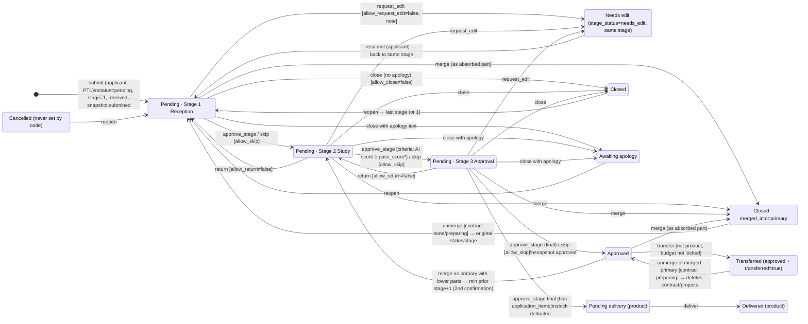
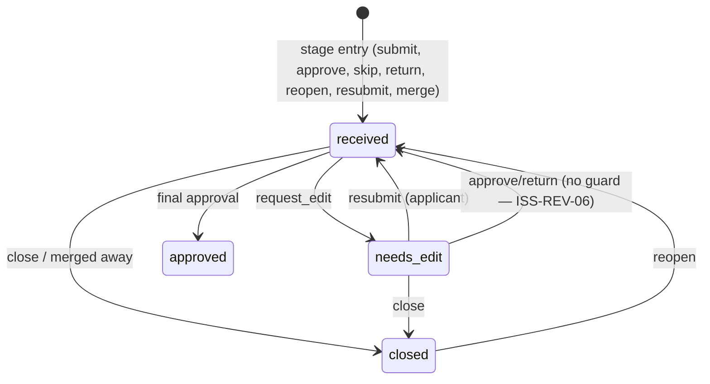
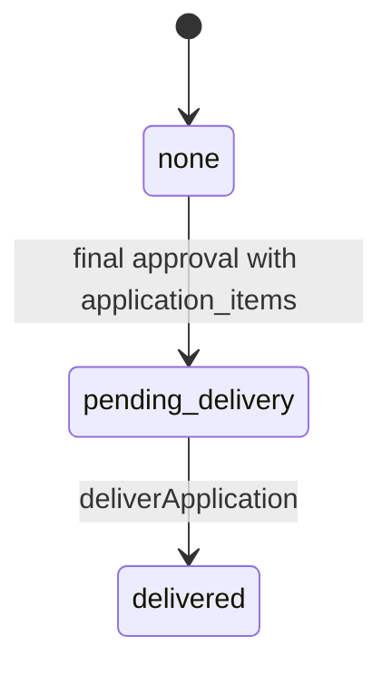

# REV — Application Review & Decision

## 1. Scope & Coverage

**Module purpose.** The core grant workflow after an applicant submits: queueing, studying and deciding grant applications through a three-stage approval workflow (Reception → Study → Approval), committee decisions by minute, AI-assisted evaluation, staff adjustments (numeric proposals, relocation, merge/unmerge), application-stage co-funding and indicator commitments, and the hand-over of approved applications to contracts/projects (the contract and project lifecycle itself is in **PRJ**, payments in **FIN**).

**Files analysed (source of truth, `/home/user/manih`):**

| Area | Files |
|---|---|
| Routes | `src/routes/reviewer.tsx` (outlet), `src/routes/reviewer.index.tsx` (list), `src/routes/reviewer.$id.tsx` (detail, evaluation panel, approval chain) |
| Workflow library | `src/lib/workflow.ts` (all transitions, snapshot, transfer, merge/unmerge, proposals, relocation), `src/lib/minutes.ts` (committee bulk decisions) |
| AI | `src/components/AiScore.tsx`, `src/routes/api/public/ai-report.ts` (agent intake), `src/components/CompareApplications.tsx`, `src/lib/docAi.functions.ts`, `src/components/DocAiCheck.tsx`, `src/lib/attachmentAi.functions.ts` |
| Adjustments | `src/components/ApplicationEdits.tsx`, `src/components/MergeApplications.tsx` |
| Committee | `src/components/MinuteDialog.tsx`, `src/lib/minutes.ts`; selection UI in `src/routes/tasks.tsx:306-326,390` (TSK) |
| Evidence | `src/lib/attachments.ts`, `src/components/FileSlots.tsx` |
| Funding & indicators | `src/components/CoFunding.tsx`, `src/components/Indicators.tsx` (application-stage linking) |
| Eligibility | `src/lib/eligibility.ts` (review side — see finding ISS-REV-18) |
| Context read (not owned) | `src/lib/data.ts` (types, labels, CLOSE_REASONS), `src/lib/tasks.ts` (derived application tasks), `src/routes/portal.tsx` (submit, resubmit, proposal response), `src/lib/rfp.ts` (award), `src/components/BoqSchedule.tsx` (TransferDialog, ContractCard), `src/lib/stageStats.ts`, `src/components/common.tsx` (StageTracker), `src/integrations/supabase/types.ts`, `supabase/migrations/*.sql` |

**Coverage notes & limitations**
- Analysis is from source code only; the live demo was not inspected. Arabic UI labels are quoted verbatim.
- Personas are switched on one shared demo account; every permission described is **UI-level only** unless stated. All relevant tables have open RLS policies (`poc_open_*`, `FOR ALL USING (true)`), so any signed-in user can perform any write (AGENTS.md; migrations).
- The migration history is incomplete relative to `types.ts`: the original `application_status` enum (`submitted/under_review/approved/rejected`) was later replaced by a text column (`types.ts` shows `status: string`); columns such as `merge_parts`, `proposed_changes`, `external_ai_*`, `co_fundings`, `project_indicators`, `attachment_files` appear in `types.ts` but their DDL is not in `supabase/migrations`. Data definitions below are therefore taken from `types.ts` + code.
- BOQ/payment-schedule editing (`BoqSchedule`) and plan allocations (`ProjectAllocations`) are rendered on the review page but belong to **PRJ**; they are referenced only.
- `src/components/FileSlots.tsx` and `src/lib/attachmentAi.functions.ts` are shared components owned here but **used only by PRJ (activities) and FIN (payments)**; applications themselves still use the legacy `attachments` table.

## 2. Screen Inventory

| Screen ID | Name (EN + Arabic label) | Route / Component | Roles | Purpose | Entry points | Exits / Navigates to |
|---|---|---|---|---|---|---|
| SCR-REV-01 | Grant Applications List («طلبات المنح») | /reviewer (routes/reviewer.index.tsx) | reviewer, committee_secretary, grants_manager, ceo, admin | Cross-program queue of all applications with stage, status, AI score and filters. | Sidebar «طلبات المنح»; GRANTS_TABS «الطلبات»; global search (PLT) | SCR-REV-02 (row/title click); /beneficiaries/$id (partner link, see BEN) |
| SCR-REV-02 | Application Detail & Decision Workspace («تفاصيل طلب منحة») | /reviewer/$id (routes/reviewer.$id.tsx) | reviewer, committee_secretary, grants_manager, ceo, admin, finance*, project_manager* | Full dossier, AI study, funding/indicators, stage decision panel, partner card, attachments, approval chain and history. | SCR-REV-01; Tasks (TSK) application cards; merge-part links; MergedInto banner | /projects/$id after transfer (PRJ); /beneficiaries/$id (BEN); other /reviewer/$id (merge parts); /reviewer back link |
| SCR-REV-03 | Decision Dialog (Reject / Return for Edit / Note / AI Feedback) («رفض الطلب / إرجاع للتعديل / إضافة ملاحظة / تغذية راجعة للوكيل») | Dialog in reviewer.$id.tsx | staff (non-applicant) | Single dialog whose mode selects the action and required inputs. | Decision card / sticky bar / post-decision action card / AI card buttons | Back to SCR-REV-02 (refreshed) |
| SCR-REV-04 | AI Agent Report Dialog («تقرير وكيل التقييم») | AiReportCard dialog (components/AiScore.tsx) | staff (non-applicant) | Detailed external-agent evaluation: conditions, strengths, risks, criteria table, markdown report. | «عرض التقرير التفصيلي ودراسة المعايير» on SCR-REV-02 | Close |
| SCR-REV-05 | Compare Applications Dialog («مقارنة الطلب») | components/CompareApplications.tsx | staff (non-applicant) | Side-by-side comparison with another application of the same program and a disagreement list. | «مقارنة بطلب آخر» on SCR-REV-02 | Close |
| SCR-REV-06 | Merge Applications Dialog («دمج الطلبات في طلب موحد») | MergeButton (components/MergeApplications.tsx) | staff (non-applicant) | Select same-partner requests to merge into the current one, pick program/plan item, confirm stage impact. | «دمج مع طلب آخر لنفس الجهة» on SCR-REV-02 | SCR-REV-02 refreshed |
| SCR-REV-07 | Unmerge Dialog («فك الدمج») | UnmergeButton (components/MergeApplications.tsx) | staff (non-applicant) | Restore original requests and delete an unsigned contract/projects. | «فك الدمج» on a merged request | SCR-REV-02 refreshed |
| SCR-REV-08 | Propose Numeric Changes Dialog («تعديل أرقام الطلب») | ProposeNumbersButton (components/ApplicationEdits.tsx) | staff (non-applicant) | Propose new amount/duration or product quantities for partner acceptance. | «تعديل الأرقام» inside the Return-for-Edit dialog (SCR-REV-03) when status=pending | SCR-REV-02 refreshed; partner portal banner (PTL) |
| SCR-REV-09 | Initiative Relocation Dialog («إعادة تسكين الطلب») | InitiativeField (components/ApplicationEdits.tsx) | staff (non-applicant) | Move the application to another initiative/plan item with a logged reason. | «إعادة تسكين» in the Project card of SCR-REV-02 | SCR-REV-02 refreshed |
| SCR-REV-10 | Transfer to Contract & Projects Dialog («اعتماد العقد وترحيله إلى مشاريع») | TransferDialog (components/BoqSchedule.tsx) | staff (non-applicant) | Approve contract and transfer an approved application into one or several projects (BOQ split). | «اعتماد العقد وترحيله» in the post-decision action card | /projects/$id of the first project (PRJ) |
| SCR-REV-11 | Add Co-funder / Funding Condition Dialog («اعتماد مشروط بمساهمة مانح آخر») | AddDialog (components/CoFunding.tsx) | staff (non-applicant) | Register a co-funder contribution or an approval condition on the application. | «إضافة مانح شريك أو شرط مساهمة» in decision card | SCR-REV-02 refreshed |
| SCR-REV-12 | Committee Minute Bulk Decision Dialog («قرار بمحضر واحد») | components/MinuteDialog.tsx (opened from /tasks) | committee_secretary | Apply one committee decision (approve/reject/return) to many same-stage applications with one minute document. | Tasks page «قرار بمحضر» after selecting committee items (see TSK) | Tasks page refreshed; per-item failure list |

`*` finance / project_manager do not have the menu entry but can open `/reviewer/$id` by URL and, being non-applicant personas, see decision controls (ISS-REV-01).

## 3. Screen Details

### SCR-REV-01 — Grant Applications List («طلبات المنح»)
- **Header**: title «طلبات المنح», description «كل الطلبات عبر فرص المنح ومراحل سير الإجراء», action «تصدير Excel» (CSV). [Observed] `reviewer.index.tsx:131-139`
- **Section tabs** (GRANTS_TABS): الطلبات · فرص المنح · منتجات المنح · محركات سير الإجراء (other tabs belong to PRG). [Observed] `SectionTabs.tsx:22`
- **Stat cards** (clickable status filters): إجمالي الطلبات · قيد الانتظار · معتمدة · مغلقة (= closed + awaiting_apology + cancelled). [Observed] `:141-146`
- **Filter bar**: search «بحث برقم الطلب أو المشروع أو الجهة»; stage select (كل المراحل / 1-3 by STAGE_NAMES); status select (كل الحالات / المغلقة (كلها) / each status); column chooser «الأعمدة»; Save-view button; «More filters» with الفرصة, النوع (مشروع/منتجات/مشروع مطروح), المنطقة, نوع الحساب, each shown as a removable chip. [Observed] `:148-219`
- **Table columns**: المشروع (title link + ref), الجهة (link to partner), المرحلة (stage label, sub-status, red «متأخر» if pending > 3 days), الحالة (pill), التقييم (AI badge), القيمة, الفرصة (hidden by default), تاريخ الإضافة (hidden by default). Whole row navigates to detail except inner links/buttons. [Observed] `:60-86,229-233`
- **States**: empty → «لا توجد طلبات مطابقة» [Observed] `:234-236`; no loading skeleton or error state (list renders empty while loading) [Inferred].
- **Persistence**: filters + hidden columns saved explicitly per user under `applications.v2`; search not saved. [Observed] `:51`

### SCR-REV-02 — Application Detail & Decision Workspace («تفاصيل طلب منحة»)
Loading shows `PageSkeleton` [Observed] `:121`. Data loaded in parallel: application (+program title/pass_score/form_id, applicant), partner, workflow_stages, evaluation_criteria, form fields (library form or legacy), status history (+persona names), product items, evaluations, attachments, partner's projects. [Observed] `:71-105`

Sections (top to bottom):
1. **Back link** «طلبات المنح». [Observed] `:168-170`
2. **Header card**: title + AiScoreBadge + IneligibleBadge, status pill, ref/opportunity/partner, StageTracker (استقبال/دراسة/اعتماد), current stage name + stage sub-status + SLA clock («x من y أيام» or red «متأخر n أيام (المستهدف y)»), requested amount. [Observed] `:173-203`
3. **Post-decision action card** (staff only; shown when closed/awaiting_apology/cancelled, or approved & not transferred & no products, or approved product awaiting delivery): «إعادة فتح الطلب», «اعتماد العقد وترحيله» (SCR-REV-10), «تسجيل تسليم المنتجات», «ملاحظة». [Observed] `:206-230`
4. **Project card «المشروع»**: description; duration, region, total beneficiaries, opportunity; product table (product, unit price, quantity, delivered, total) with fulfillment pill; «المبادرة» with «إعادة تسكين» (SCR-REV-09); expander «تفاصيل إضافية» with target groups and dynamic form answers. [Observed] `:234-293`
5. **Study card «دراسة وتقييم الطلب»**: «تقييم وكيل المنح الذكي» (AiReportCard: badge, ineligible, last update, recommendation, summary, «عرض التقرير التفصيلي…» → SCR-REV-04); BOQ & payment schedule editor (PRJ component, editable by staff until transferred); «مقارنة بطلب آخر» (SCR-REV-05); amber disagreement banner; «تغذية راجعة للوكيل» (SCR-REV-03 mode ai). [Observed] `:295-325`
6. **Merge area**: MergedInto banner, MergeParts list, «فك الدمج» (SCR-REV-07), «دمج مع طلب آخر لنفس الجهة» (SCR-REV-06; staff, not transferred, pending/approved). [Observed] `:327-332`
7. **Funding & indicators card «التمويل والمؤشرات»** (staff, status ≠ closed): plan allocations (PRJ component) and application indicators (link/unlink, FT-REV-17). [Observed] `:333-346`
8. **Decision card «القرار — <stage>»** (id `decision`; staff, status pending, stage configured): EvaluationPanel when approval_type=criteria («رأيك كمقيّم», note, «قبول»/«رفض»); action row «اعتماد»/«اعتماد نهائي», «إرجاع للتعديل» (allow_request_edit≠false), «رفض» (allow_close≠false), «تخطي» (allow_skip), «إرجاع للسابقة» (stage>1, allow_return≠false), «ملاحظة»; co-funding panel in condition mode (SCR-REV-11). [Observed] `:348-371`
9. **Partner card «الجهة»**: name link, status and bank pills, running projects; expander «بيانات الجهة الكاملة» (account type, licence, region, city, phone, email, bank, IBAN, previous projects, last grant year, snapshots «عند التقديم»/«عند الاعتماد»). Contract card shown above when transferred (PRJ). [Observed] `:375-416`
10. **Attachments card «المرفقات (n)»**: list (open), «إرفاق ملف» for staff. [Observed] `:418-437`
11. **Approval chain card «سلسلة الموافقة»** + expander «سجل العمليات (n)». [Observed] `:439-458`
12. **Sticky decision bar** when the decision card is off-screen. [Observed] `:502-509`

States: action buttons disabled while `busy`; success toasts per action; errors: Arabic library messages shown verbatim, otherwise «تعذّر تنفيذ الإجراء، حاول مرة أخرى». [Observed] `:138-143`

### SCR-REV-03 — Decision Dialog (modes: close / edit / note / ai)
| Mode | Title | Inputs | Confirm enabled when | Calls |
|---|---|---|---|---|
| close | «رفض الطلب» | «سبب الإغلاق *» select (CLOSE_REASONS: عدم توفر ميزانية مخصصة / لم يجتز نسبة التقييم / خارج نطاق الفرصة / نقص في المتطلبات / اخرى), «رسالة الاعتذار (اختياري)» | always | `closeApplication(a, by, reason, text)` |
| edit | «إرجاع للتعديل إلى مقدم الطلب» | «النص» (required); inline «تعديل الأرقام» (SCR-REV-08) when status pending | text non-empty | `requestEdit` |
| note | «إضافة ملاحظة» | «النص» | text non-empty | `addNote` |
| ai | «تغذية راجعة لوكيل المنح لإعادة التقييم» | «النص» | text non-empty | `addNote("تغذية راجعة للوكيل: …")` |
[Observed] `reviewer.$id.tsx:462-501`

### SCR-REV-04 — AI Agent Report Dialog («تقرير وكيل التقييم — <ref>»)
Badge (large, with label), ineligible flag, recommendation; «الشروط» table (icon, name, «إلزامي», note, مستوفى/غير مستوفى/غير قابل للتحقق); lists نقاط القوة / المخاطر / النواقص / أسئلة مقترحة للجنة; «الميزانية والتكلفة» (beneficiaries, cost per beneficiary, per day, budget note); «جدول الدفعات المقترح» (title, %, amount, condition; «اقتراح فقط — يُعتمد عند إنشاء المشروع»); «المبادرة المقترحة» (name, remaining, quote); suggested track («لا ينقله تلقائياً»); policy version; criteria table (المعيار, الوزن, درجة الوكيل /10, الملاحظة); markdown report. [Observed] `AiScore.tsx:54-165`

### SCR-REV-05 — Compare Applications Dialog
Select «اختر الطلب الآخر من نفس المسار…» (same program, newest first, label ref — partner (amount)); comparison table rows: درجة الوكيل, الأهلية, التوصية, المبلغ المطلوب, المدة, المنطقة, المستفيدون, التكلفة للمستفيد, one row per criterion; amber highlight on significant differences; «نقاط الخلاف للمدير (n)» list or «لا توجد فروقات جوهرية بين الطلبين». [Observed] `CompareApplications.tsx:11-151`

### SCR-REV-06 — Merge Applications Dialog («دمج الطلبات في طلب موحد»)
Explanation text; loading «جارٍ التحميل…»; empty «لا توجد طلبات أخرى مؤهلة لهذه الجهة»; checkbox list (ref · title, amount · prior-approval text · opportunity); conditional selects «فرصة المنح للطلب الموحد» and «بند الخطة للطلب الموحد»; impact box (target stage or «كل الأجزاء معتمدة نهائياً», amber when lowered, merged value); destructive note listing requests to be closed; second-confirmation box; button «دمج» → «تأكيد الدمج». [Observed] `MergeApplications.tsx:75-137`

### SCR-REV-07 — Unmerge Dialog («فك الدمج»)
Text listing the parts that will be restored, plus «سيُحذف العقد (بانتظار الإعداد) ومشاريعه.» when a contract exists; destructive button «فك الدمج». Button hidden if any contract status ≠ preparing. [Observed] `MergeApplications.tsx:140-173`

### SCR-REV-08 — Propose Numeric Changes Dialog («تعديل أرقام الطلب»)
Hint «يرجع الطلب للجهة لتوافق على التعديل قبل اعتماده»; product grants: quantity per product (min 0) and «الإجمالي الجديد»; project grants: «القيمة المطلوبة (ر.س)» (AmountInput), «مدة المشروع (أيام)»; «ملاحظة للجهة»; buttons «إلغاء» / «إرسال للجهة». Pending proposal replaces the trigger with badge «تعديل أرقام بانتظار موافقة الجهة». [Observed] `ApplicationEdits.tsx:49-95`

### SCR-REV-09 — Initiative Relocation Dialog («إعادة تسكين الطلب»)
«المبادرة الجديدة» (InitiativeSelect, PLN), «السبب *»; «إلغاء» / «حفظ». Current initiative label or «غير محددة». [Observed] `ApplicationEdits.tsx:19-46`

### SCR-REV-10 — Transfer Dialog («اعتماد العقد وترحيله إلى مشاريع»)
Toggle «مشروع واحد» / «تقسيم إلى عدة مشاريع» (disabled with <2 BOQ items, hint «التقسيم يحتاج جدول كميات من بندين أو أكثر»); in split mode: editable project names (default = largest item), per-project total, «+ مشروع», delete project (>2), item → project select; note «عقد واحد بقيمة … ؛ ميزانية كل مشروع = مجموع بنوده، ويأخذ جدول الدفعات بنفس النسب»; validation «كل مشروع يحتاج بنداً واحداً على الأقل»; button «اعتماد وترحيل». [Observed] `BoqSchedule.tsx:101-158`

### SCR-REV-11 — Co-funder / Condition Dialog
Title «اعتماد مشروط بمساهمة مانح آخر» (condition mode); «المانح» (datalist of existing co-funders or new name), «بريد التحديثات (اختياري)», «مبلغ المساهمة», radio «مساهمة مؤكدة» / «شرط اعتماد (بانتظار موافقته)», hint about attaching approval later; «حفظ». Rows on the panel: funder, amount, «شرط (مرحلة n)», «موافقة مثبتة» / «بانتظار الموافقة», «إرفاق الموافقة». [Observed] `CoFunding.tsx:29-151`

### SCR-REV-12 — Committee Minute Dialog («قرار بمحضر واحد»)
Description «سيُطبَّق القرار على n طلب ويُرفق المحضر نفسه في سجل كل منها»; «رقم المحضر *», «تاريخ المحضر *» (today), «اسم اللجنة» (prefilled from stage committee_name), «القرار *» (اعتماد/رفض/إرجاع; إرجاع hidden for payments), «ملاحظة» (* when reject), «مرفق المحضر *» + DocAiCheck; buttons «إلغاء» / «تطبيق على n» (disabled without file or minute no.). Result view: «نجح: x · تعذّر: y» + failure list + «إغلاق». [Observed] `MinuteDialog.tsx:13-55`

## 4. Interaction Inventory

| INT ID | Screen | Trigger (control) | System response | Data written | Evidence |
|---|---|---|---|---|---|
| INT-REV-001 | SCR-REV-01 | Type in search | Client-side filter on ref/title/partner | — | `reviewer.index.tsx:100-103` |
| INT-REV-002 | SCR-REV-01 | Stat card click | Sets status filter | user view state | `:141-146` |
| INT-REV-003 | SCR-REV-01 | Stage / status / more filters | Filters rows; chips appear | — | `:90-115,153-218` |
| INT-REV-004 | SCR-REV-01 | «الأعمدة» checkbox | Toggles column visibility | view state | `:168-189` |
| INT-REV-005 | SCR-REV-01 | Save view | Persists filters/columns | `user_view_prefs` (PLT) | `:189` |
| INT-REV-006 | SCR-REV-01 | «تصدير Excel» | Downloads applications.csv | — | `:119-127` |
| INT-REV-007 | SCR-REV-01 | Row / title click | Navigate to /reviewer/$id | — | `:63,230` |
| INT-REV-008 | SCR-REV-02 | «اعتماد» / «اعتماد نهائي» | Criteria gate (stage 2), then approveStage | applications, history, (grant_products) | `reviewer.$id.tsx:145-151,358` |
| INT-REV-009 | SCR-REV-02 | «تخطي» | skipStage | applications, history | `:363` |
| INT-REV-010 | SCR-REV-02 | «إرجاع للسابقة» | returnStage | applications, history | `:364` |
| INT-REV-011 | SCR-REV-02/03 | «إرجاع للتعديل» → تأكيد | requestEdit | applications.stage_status/reviewer_note, history | `:361,493` |
| INT-REV-012 | SCR-REV-02/03 | «رفض» → تأكيد | closeApplication | applications.status/close_reason, history | `:362,492` |
| INT-REV-013 | SCR-REV-02/03 | «ملاحظة» → تأكيد | addNote | history | `:225,365,495` |
| INT-REV-014 | SCR-REV-02 | «إعادة فتح الطلب» | reopenApplication | applications, history | `:212` |
| INT-REV-015 | SCR-REV-02 | «قبول» / «رفض» (evaluation) | Conflict check, upsert evaluation | evaluations, history(evaluate) | `:534-548` |
| INT-REV-016 | SCR-REV-02 | Sticky bar buttons | Same as INT-008/011/012 | as above | `:502-509` |
| INT-REV-017 | SCR-REV-02 | Attachment click | Open signed URL (300 s) | — | `:161-164` |
| INT-REV-018 | SCR-REV-02 | «إرفاق ملف» | Upload to storage + row | storage, attachments | `:153-160` |
| INT-REV-019 | SCR-REV-02 | Approval chain step | Expand/collapse details | — | `:614-633` |
| INT-REV-020 | SCR-REV-02 | «سجل العمليات» | Expand history list | — | `:443-456` |
| INT-REV-021 | SCR-REV-04 | «عرض التقرير التفصيلي…» | Open report dialog | — | `AiScore.tsx:124-128` |
| INT-REV-022 | SCR-REV-03 | «تغذية راجعة للوكيل» → تأكيد | addNote with prefix | history | `reviewer.$id.tsx:319,494` |
| INT-REV-023 | SCR-REV-05 | «مقارنة بطلب آخر» + select | Load peers, render comparison | — | `CompareApplications.tsx:15-27` |
| INT-REV-024 | SCR-REV-06 | «دمج مع طلب آخر…» | Load eligible candidates | — | `MergeApplications.tsx:26-44` |
| INT-REV-025 | SCR-REV-06 | «دمج» / «تأكيد الدمج» | Second confirmation if needed; mergeApplications | applications (primary + others), project_indicators, co_fundings, project_plan_allocations, history | `:59-73` |
| INT-REV-026 | SCR-REV-07 | «فك الدمج» | unmergeApplications | deletes contracts/projects/payments/activities/reports; restores applications; history | `:152-157` |
| INT-REV-027 | SCR-REV-08 | «إرسال للجهة» | proposeChanges | applications.proposed_changes, history | `ApplicationEdits.tsx:59-74` |
| INT-REV-028 | SCR-REV-09 | «حفظ» | relocateApplication | applications.plan_level_id, history | `:27-33` |
| INT-REV-029 | SCR-REV-10 | «اعتماد وترحيل» | transferApplication; navigate to project | contracts, projects, payments, co_fundings, project_plan_allocations, project_indicators, applications.transferred, history | `reviewer.$id.tsx:217` |
| INT-REV-030 | SCR-REV-02 | «تسجيل تسليم المنتجات» | deliverApplication | application_items, applications.fulfillment_status, history | `:219-224` |
| INT-REV-031 | SCR-REV-11 | «حفظ» | Create/update co_funder, insert co_funding, history note if condition | co_funders, co_fundings, history | `CoFunding.tsx:107-126` |
| INT-REV-032 | SCR-REV-02 | «إرفاق الموافقة» | Upload evidence; confirm row | storage, co_fundings | `:37-44` |
| INT-REV-033 | SCR-REV-02 | Indicator «ربط» | Remaining check; insert link | project_indicators | `Indicators.tsx:163-175` |
| INT-REV-034 | SCR-REV-02 | Indicator trash | Delete link | project_indicators | `Indicators.tsx:211` |
| INT-REV-035 | Tasks (TSK) | Checkbox on committee tasks | Enable/disable compatible items | — | `tasks.tsx:306-316` |
| INT-REV-036 | SCR-REV-12 | Pick minute file | Advisory AI check | — (server call) | `MinuteDialog.tsx:46-50` |
| INT-REV-037 | SCR-REV-12 | «تطبيق على n» | createMinute + per-item workflow call | storage, committee_minutes, minute_items, applications, history | `minutes.ts:32-52` |
| INT-REV-038 | DocAiCheck | Re-check icon | Re-run advisory check | — | `DocAiCheck.tsx:44` |
| INT-REV-039 | FileSlots (PRJ/FIN) | «إرفاق» in slot | Upload ≤10MB, insert row, per-file AI check | storage, attachment_files(.ai_check) | `FileSlots.tsx:165-185` |
| INT-REV-040 | FileSlots | «فحص الخانة كاملة» | Collective slot AI check | <owner>.evidence_ai | `:136-148` |
| INT-REV-041 | FileSlots | Delete file | Remove row and object | attachment_files, storage | `:186-190` |
| INT-REV-042 | External agent | POST /api/public/ai-report | Validate token/body; update AI fields | applications.external_ai_* | `ai-report.ts:24-45` |
| INT-REV-043 | Portal (PTL) | «تم التعديل — إعادة الإرسال» | resubmitEdit | applications.stage_status, history | `portal.tsx:143` |
| INT-REV-044 | Portal (PTL) | Accept/reject proposal | respondToProposal | applications, application_items, history | `portal.tsx:442-449` |

## 5. Shared Components & Dependencies

| Component / lib | Used by | Notes |
|---|---|---|
| `lib/workflow.ts` | REV detail, Tasks/Focus (TSK), minutes, portal (PTL), rfp (PRG) | Single source of grant transitions [Observed] AGENTS.md |
| `lib/minutes.ts` | Tasks (TSK) | Also `bulkDecidePayments` → `payments.approvePayment` (FIN) |
| `AiScore.tsx` (AiScoreBadge, IneligibleBadge, AiReportCard, aiDetails, failedMandatory) | list, detail, compare, Tasks info | |
| `DocAiCheck.tsx` / `docAi.functions.ts` | MinuteDialog (REV), AdjustmentDialog & PlanEditors (PLN), EditSession (CFG/PRG) | Advisory only |
| `FileSlots.tsx` / `attachmentAi.functions.ts` / `attachments.ts` | ProjectTree (PRJ), PaymentActions (FIN), payments.ts `requireSlot` | Owner tables: project_activities, payments |
| `CoFunding.tsx` | REV (condition mode), projects.$id (PRJ, project mode) | |
| `Indicators.tsx` (`ProjectIndicators`, `LevelIndicators`) | REV (application mode), PRJ (project mode), PLN (level indicators) | |
| `ApplicationEdits.tsx` | REV | Uses `InitiativeSelect` / `usePlanData` (PLN) |
| `BoqSchedule.tsx` (BoqSchedule, TransferDialog, ContractCard), `ProjectAllocations.tsx` | REV page | Owned by PRJ |
| `lib/eligibility.ts` | Portal (PTL) only | Not called on review side (ISS-REV-18) |
| `lib/tasks.ts`, `routes/tasks.tsx` | TSK | Derives application tasks; hosts minute selection |
| `lib/stageStats.ts` | analytics/engine pages | Reads application_status_history |
| External | Claude/AI provider via `projectAi.server` (checkSlotFile/checkSlotFiles), external grants agent (bearer `AI_AGENT_TOKEN`), Supabase Storage bucket `attachments` | |

## 6. Business Process Workflows

### 6.1 Application status state machine

The application state is the combination of `applications.status` (pending · approved · closed · awaiting_apology · cancelled), `current_stage` (1-3 or null), `stage_status` (received · needs_edit · approved · closed; also defined but unused: waiting, in_progress, in_approval) plus the flags `transferred`, `merged_into`, `fulfillment_status` and `proposed_changes`.



Notes on the diagram: `reopen`, `resubmit`, `return` and merge targets land on the *recorded* stage (drawn to S1 for readability). `*` the pass-score guard is applied only from the detail page (ISS-REV-02). From any pending stage a merge as **primary** sets the merged request to `min(prior approved stage)+1`.

### 6.2 Transition table (from `src/lib/workflow.ts` unless stated)

| # | Transition (history `action`) | Function | From → To (status / stage / stage_status) | Guards (UI = page condition; LIB = enforced in function) | Actor (as implemented) | Extra writes |
|---|---|---|---|---|---|---|
| T1 | submit | portal insert (`portal.tsx:303-320`, PTL) | — → pending / 1 / received | Required fields, eligibility & quotas in portal (PTL) | applicant | snapshot.submitted; attachments; history stage 1 |
| T2 | receive | `receiveApplication` (40-43) | stage_status → received | none — **never called** (ISS-REV-12) | — | history |
| T3 | approve_stage | `approveStage` (45-81) | pending / n<3 / * → pending / n+1 / received | UI: staff, status pending, stage configured; stage 2 + approval_type criteria ⇒ AI score present and ≥ pass_score (`reviewer.$id.tsx:145-149`) | Any non-applicant persona (detail); stage supervisors/secretary/admin/grants_manager (Tasks, Focus); stage secretary (minute) | stage_entered_at=now; history(status pending, stage=n, minute_id) |
| T4 | approve_stage (final) | `approveStage` | pending / 3 → approved / null / approved | as T3 | as T3 | snapshot.approved; product: stock −qty (floor 0), fulfillment pending_delivery; history(status approved, stage 3) |
| T5 | skip | `skipStage` (84-89) | as T3 (stage 3 ⇒ T4 with note «تخطي مرحلة الاعتماد», logged as approve_stage) | UI: stage.allow_skip | staff (detail) | history |
| T6 | return | `returnStage` (91-100) | pending / n → pending / max(1,n−1) / received | UI: stage>1, allow_return≠false (detail); Tasks/minute: no stage>1 check (at stage 1 stays 1) | staff, Tasks, minute | history(stage=n) |
| T7 | request_edit | `requestEdit` (125-128) | stage_status → needs_edit (status/stage unchanged) | UI: allow_request_edit≠false; note required | staff | reviewer_note |
| T8 | resubmit | `resubmitEdit` (130-133) | needs_edit → received | UI (portal): status pending & needs_edit | applicant | history |
| T9 | close | `closeApplication` (102-112) | pending → closed or awaiting_apology (if apology) / stage kept / closed | UI: allow_close≠false (detail); reason from CLOSE_REASONS; Tasks/minute: note used as reason | staff, Tasks, minute | close_reason; history note «reason — apology» |
| T10 | reopen | `reopenApplication` (114-123) | closed/awaiting_apology/cancelled → pending / same or 1 / received | UI only: status in those three; **no merged_into check** (ISS-REV-07) | staff | close_reason=null; stage_entered_at |
| T11 | note / evaluate | `addNote`; EvaluationPanel | no state change | note non-empty; evaluation conflict needs comment | staff | evaluations (evaluate) |
| T12 | propose_changes / accept_changes / reject_changes | `proposeChanges`, `respondToProposal` (249-269) | no status change; proposed_changes set/cleared; on accept amount/duration/item qty applied | UI: status pending (inside edit dialog), one pending proposal; LIB: proposal must exist to respond | staff / applicant | application_items.quantity |
| T13 | relocate | `relocateApplication` (271-274) | plan_level_id changed | UI: different initiative + reason | staff | — |
| T14 | merge (primary) | `mergeApplications` (289-338) | pending or approved → approved (all parts final) or pending / min prior+1 / received | LIB: same beneficiary; each part not transferred and status pending/approved. UI: same kind, merged_into null, program/plan choice, 2nd confirmation when lowering an approved request | staff | requested_amount, boq, payment_schedule, merge_parts, program_id?, plan_level_id? |
| T15 | merge (absorbed) | `mergeApplications` | pending or approved → closed / null / closed; merged_into=primary | as T14 | staff | moves project_indicators, co_fundings, project_plan_allocations to primary |
| T16 | unmerge | `unmergeApplications` (342-367) | merged primary & parts → original stored values; merged_into=null; transferred=false | LIB: merge_parts non-empty; all contracts preparing. UI hides otherwise | staff | deletes payments, project_reports, project_activities, projects, contracts; restores moved rows |
| T17 | transfer | `transferApplication` (140-205) | approved → approved + transferred=true | UI: approved, not transferred, no product items; LIB: plan not budget_locked (no status check in LIB) | staff (detail); `rfp.awardOffer` (PRG) | contract (preparing), projects (planning), payments, moves co_fundings/allocations/indicators to first project, rfp seed plan |
| T18 | deliver | `deliverApplication` (208-218) | fulfillment pending_delivery → delivered | UI: approved & items & pending_delivery | staff | application_items.delivered_quantity |
| T19 | award | `rfp.awardOffer` (rfp.ts:54-62, PRG) | winner pending → approved (award_status awarded) then T17; other pending offers → closed (not_awarded) | — | staff (PRG page) | auto-apology close_reason |

### 6.3 `stage_status` and fulfillment sub-states





### 6.4 Committee bulk decision (one minute)

```mermaid
flowchart TD
    A[Committee secretary on /tasks] --> B{Task is application at a committee stage\nwhere secretary_id = me?}
    B -- no --> X[No checkbox]
    B -- yes --> C[Select items with same committee + stage]
    C --> D[«قرار بمحضر» → MinuteDialog]
    D --> E[Enter minute no*, date*, committee, decision*, note (*reject), file*]
    E --> F[DocAiCheck advisory opinion]
    F --> G[«تطبيق على n»]
    G --> H{All same current_stage?\nreject has note?}
    H -- no --> Err[Error toast, nothing written]
    H -- yes --> I[Upload file once → committee_minutes row]
    I --> J[For each application:\napprove→approveStage / return→returnStage / reject→closeApplication\nwith note «محضر no — note» and minute_id]
    J --> K{success?}
    K -- yes --> L[minute_items ok=true]
    K -- no --> M[minute_items ok=false + error]
    L --> N[Result: all ok → toast & close; else list failures]
    M --> N
```

### 6.5 Merge & unmerge

```mermaid
flowchart TD
    P[Primary request pending/approved, not transferred] --> Q[Load same-partner candidates:\npending/approved, not transferred, not merged, same kind]
    Q --> R[Select parts; pick opportunity/plan item if they differ]
    R --> S{Would lower a finally approved request?}
    S -- yes --> S2[Second confirmation]
    S -- no --> T
    S2 --> T[mergeApplications]
    T --> U[Primary: amount Σ, BOQ concat with ref tags, first schedule,\nmerge_parts(prior stage, orig values, moved row ids)]
    U --> V{min prior stage = 3?}
    V -- yes --> W[status approved]
    V -- no --> Y[status pending at stage min+1]
    T --> Z[Each other part: closed, merged_into, rows moved, history merge]
    W --> TR[Transfer → one contract]
    Y --> FLOW[Normal stage flow]
    TR --> UM{Contract still preparing?}
    UM -- yes --> UN[Unmerge: delete contract/projects/payments/activities/reports,\nrestore original values & rows]
    UM -- no --> LOCK[Unmerge not allowed]
```

### 6.6 Transfer to contract & projects (hand-over to PRJ/FIN)

```mermaid
flowchart LR
    A[Approved, not transferred, no product items] --> B[TransferDialog: single or split by BOQ items]
    B --> C[Resolve manager, has_contract, plan level]
    C --> D{Plan budget_locked?}
    D -- yes --> E[Error, stop]
    D -- no --> F[Contract (preparing) if has_contract]
    F --> G[For each part: project (planning), budget, dates, BOQ items]
    G --> H{Program kind = rfp?}
    H -- no --> I[Payments from schedule %]
    H -- yes --> J[seedRfpPlan activities/payments]
    I --> K[Move co_fundings, allocations, indicators to first project]
    J --> K
    K --> L[transferred=true, history transfer] --> M[Navigate to /projects/$id (PRJ)]
```

### 6.7 Staff numeric proposal ↔ partner acceptance

```mermaid
sequenceDiagram
    participant S as Staff (REV)
    participant W as workflow.ts
    participant P as Partner (portal, PTL)
    S->>W: proposeChanges(amount/duration/items, note)
    W-->>W: proposed_changes = {changes, before, by, at}; history propose_changes
    P->>W: respondToProposal(accept | reject, note)
    alt accept
        W-->>W: apply item quantities, amount, duration; clear proposal; history accept_changes
    else reject
        W-->>W: clear proposal; history reject_changes (with note)
    end
```

## 7. Business Rules

| BR ID | Rule | Evidence label + reference |
|---|---|---|
| BR-REV-01 | Application status/stage transitions are executed only by functions in lib/workflow.ts (and rfp.awardOffer); pages hold no transition rules. | [Observed] AGENTS.md; src/lib/workflow.ts |
| BR-REV-02 | The review lifecycle has three fixed stages: 1 «استقبال الطلبات», 2 «دراسة الطلبات», 3 «اعتماد الطلبات»; approving at stage ≥3 is final approval. | [Observed] src/lib/data.ts:246-250; src/lib/workflow.ts:47 |
| BR-REV-03 | Final approval sets status=approved, current_stage=null, stage_status=approved and freezes snapshot.approved. | [Observed] src/lib/workflow.ts:64-72 |
| BR-REV-04 | Return moves to the previous stage (never below 1), is not offered at stage 1 and only when the stage's allow_return is not false. | [Observed] src/lib/workflow.ts:91-100; reviewer.$id.tsx:364 |
| BR-REV-05 | A stage can be skipped only if allow_skip is true; skipping stage 3 equals final approval. | [Observed] src/lib/workflow.ts:84-89; reviewer.$id.tsx:363 |
| BR-REV-06 | Rejection requires a reason from CLOSE_REASONS; an apology text sets status awaiting_apology, otherwise closed; current_stage is preserved. | [Observed] src/lib/workflow.ts:102-112; src/lib/data.ts:315-321 |
| BR-REV-07 | Return-for-edit requires a note and keeps status and stage; only stage_status becomes needs_edit until the applicant resubmits. | [Observed] src/lib/workflow.ts:125-133 |
| BR-REV-08 | Only closed, awaiting_apology or cancelled applications can be reopened; they return to pending at their last stage (or 1). | [Observed] src/lib/workflow.ts:114-123; reviewer.$id.tsx:206-215 |
| BR-REV-09 | On the detail page, stage-2 approval of a criteria stage requires an AI score ≥ the opportunity pass score (default 80). | [Observed] reviewer.$id.tsx:145-149 |
| BR-REV-10 | A reviewer decision contradicting the AI recommendation (score vs pass score) requires a justification note. | [Observed] reviewer.$id.tsx:534-536 |
| BR-REV-11 | One evaluation per reviewer per application (unique application_id+reviewer_id; upsert). | [Observed] supabase/migrations/20261004093306…sql:88-95; reviewer.$id.tsx:537-540 |
| BR-REV-12 | Every workflow action writes an application_status_history row with actor, stage, action, note and optional minute. | [Observed] src/lib/workflow.ts:12-30 |
| BR-REV-13 | An application is late when days in the current stage exceed the stage's sla_days (detail/chain/tasks); the list uses a fixed 3-day threshold. | [Observed] reviewer.$id.tsx:191-192; reviewer.index.tsx:75; tasks.ts:103-104 |
| BR-REV-14 | External AI output is advisory: colour/label come from the agent; an unmet mandatory condition flags «غير مؤهل» without changing the score; suggested track is never applied automatically. | [Observed] src/components/AiScore.tsx:9,40-47,99; AGENTS.md |
| BR-REV-15 | AI document checks are advisory only and never block a slot, a save or a workflow action; any uploaded file satisfies its slot. | [Observed] src/lib/attachments.ts:3-12; DocAiCheck.tsx:47 |
| BR-REV-16 | Committee bulk decisions: only the stage secretary can select; all items must share committee and stage; minute number, date and file (pdf/doc/docx/xls/xlsx/png/jpg/jpeg ≤10MB) are mandatory; reject requires a note. | [Observed] tasks.tsx:308-314; minutes.ts:9,15-20,33-35 |
| BR-REV-17 | One minute document per bulk decision; each item reuses the single-item workflow function and is linked via minute_items and history.minute_id. | [Observed] AGENTS.md; minutes.ts:32-52 |
| BR-REV-18 | Bulk payment minutes allow only approve/reject (no return). | [Observed] minutes.ts:55 (see FIN) |
| BR-REV-19 | Staff numeric edits are stored as a single pending proposal and applied only after the partner accepts. | [Observed] AGENTS.md; workflow.ts:239-269; ApplicationEdits.tsx:75 |
| BR-REV-20 | For product grants, proposed amount = Σ(quantity × unit price) and duration is not editable. | [Observed] ApplicationEdits.tsx:58-66 |
| BR-REV-21 | Relocation requires a different initiative and a reason. | [Observed] ApplicationEdits.tsx:28-29 |
| BR-REV-22 | Merge candidates: same partner, same grant kind, status pending or approved, not transferred, not merged into another request. | [Observed] MergeApplications.tsx:33-39; workflow.ts:291-294 |
| BR-REV-23 | A merged request restarts at (lowest prior approved stage + 1); it stays approved only if every part was finally approved. | [Observed] workflow.ts:283-285,309,323-326 |
| BR-REV-24 | Merging that lowers a finally approved request requires a second confirmation. | [Observed] MergeApplications.tsx:54,60,126-130 |
| BR-REV-25 | Unmerge is allowed only before a contract exists or while all its contracts are «preparing»; it deletes those contracts and their projects, payments, activities and reports. | [Observed] workflow.ts:340-357 |
| BR-REV-26 | When merged parts differ in opportunity or plan item, the user must pick the merged request's opportunity/plan item. | [Observed] MergeApplications.tsx:50,56 |
| BR-REV-27 | A co-funding condition is tied to the stage at which it was added and becomes confirmed only when donor approval evidence is attached. | [Observed] CoFunding.tsx:37-44,117 |
| BR-REV-28 | Indicators are linked only at application stage; a quantitative link cannot exceed the indicator's remaining target; milestone links have target 1. | [Observed] Indicators.tsx:163-171; AGENTS.md |
| BR-REV-29 | Transfer is available only for approved, non-transferred applications without product lines; one contract per application. | [Observed] reviewer.$id.tsx:216; workflow.ts:160-168; AGENTS.md |
| BR-REV-30 | Transfer is refused when the target plan is budget-locked. | [Observed] workflow.ts:154-158 |
| BR-REV-31 | Project manager defaults: explicit → opportunity default_manager_id → first project_manager persona. | [Observed] workflow.ts:147-151 |
| BR-REV-32 | On split transfer each project's budget = sum of its BOQ items and payments follow the schedule percentages; RFP opportunities get the pre-defined RFP plan instead of schedule payments. | [Observed] workflow.ts:172-201; BoqSchedule.tsx:149 |
| BR-REV-33 | Final approval of a product application deducts stock (not below 0) and sets fulfillment pending_delivery. | [Observed] workflow.ts:48-69 |
| BR-REV-34 | Delivery marks all requested quantities as delivered. | [Observed] workflow.ts:208-218 |
| BR-REV-35 | Partner/opportunity snapshots are frozen at submission and final approval. | [Observed] workflow.ts:4-10,70; portal.tsx:315 |
| BR-REV-36 | Application tasks are derived for pending applications not awaiting edits, assigned to stage supervisors/secretary, admin and grants managers. | [Observed] tasks.ts:98-107 (see TSK) |
| BR-REV-37 | Decision controls are shown to any non-applicant persona; there is no server-side role or stage-supervisor enforcement in the prototype. | [Observed] reviewer.$id.tsx:124; AGENTS.md (open RLS) |
| BR-REV-38 | Absorbed requests are closed with reason «مُدمج ضمن الطلب <ref>» and link to the merged request. | [Observed] workflow.ts:332; MergeApplications.tsx:199-207 |
| BR-REV-39 | RFP award approves the winning offer, closes other pending offers with an automatic apology and transfers the winner. | [Observed] src/lib/rfp.ts:54-62 (see PRG) |

## 8. Data Requirements

### applications (owned jointly with PTL; REV-relevant fields)
| Field | Type | Req. | Meaning |
|---|---|---|---|
| id, tenant_id, program_id, applicant_id, beneficiary_id | uuid | Y (beneficiary nullable) | Keys; program = grant opportunity (PRG), beneficiary = partner (BEN) |
| ref_no | text | auto | `REQ` + YYMM + 5-digit sequence (trigger `set_ref_no`) |
| project_title, project_description | text | title Y | Project identity |
| requested_amount | numeric(14,2) | Y | Amount requested / merged sum / accepted proposal |
| duration_days, region, target_groups (jsonb), answers (jsonb) | | N | Dossier data; answers keyed by form field id |
| status | text | Y | pending · approved · closed · awaiting_apology · cancelled |
| current_stage | int | N | 1-3 while pending; null when approved/merged-away |
| stage_status | text | Y | received · needs_edit · approved · closed (waiting/in_progress/in_approval unused) |
| stage_entered_at | timestamptz | Y | Stage SLA clock start |
| reviewer_note | text | N | Last request-edit note |
| close_reason | text | N | Reason on close/merge; cleared on reopen |
| transferred | boolean | Y | Set by transfer; reset by unmerge |
| plan_level_id | uuid | N | Initiative / plan item (PLN) |
| boq, payment_schedule | jsonb | N | BOQ items {id,title,qty,unit_cost}; schedule {title,percent,due_days} (PRJ editor) |
| proposed_changes | jsonb | N | {requested_amount?, duration_days?, items?, before, note?, by, at} |
| merge_parts | jsonb | N | [{id, ref_no, title, amount, prior_stage, orig, rows}] on merged primary |
| merged_into | uuid | N | Primary that absorbed this request |
| snapshot | jsonb | Y | {submitted?, approved?} each {at, beneficiary{…}, program{title, pass_score, has_contract}, requested_amount} |
| fulfillment_status | text | Y | none · pending_delivery · delivered (product grants) |
| external_ai_score (0-100), _color, _label, _summary, _report, _recommendation, _criteria (jsonb), _details (jsonb), _at | | N | External agent output |
| award_status, technical_offer | text | N | RFP offers (PRG) |

### application_status_history
| Field | Type | Req. | Meaning |
|---|---|---|---|
| id | uuid | Y | |
| application_id | uuid FK→applications (cascade) | Y | |
| status | text | Y | Status after (or during) the action |
| stage | int | N | Stage the action applied to (from-stage for approve/return) |
| action | text | N | submit, receive, approve_stage, skip, return, close, reopen, request_edit, resubmit, note, evaluate, transfer, deliver, merge, unmerge, propose_changes, accept_changes, reject_changes, relocate, award |
| note | text | N | Free text / generated message |
| changed_by | uuid FK→personas | N | Actor persona |
| minute_id | uuid FK→committee_minutes (set null) | N | Committee minute behind the decision |
| created_at | timestamptz | Y | |
Lifecycle: append-only by convention (no update/delete in code); used by approval chain, stage stats (`stageStats.ts`) and audit.

### evaluations
| Field | Type | Req. | Meaning |
|---|---|---|---|
| application_id, reviewer_id | uuid | Y | UNIQUE pair |
| scores | jsonb | Y | `{decision: "accept" or "reject"}` (legacy rows hold criterion scores) |
| total | numeric | Y | 100 accept / 0 reject (legacy: weighted score) |
| comment | text | N | Justification |

### attachments (legacy application files)
id, application_id (FK cascade), project_id, name, path (storage key `<app_id>/<ts>-<name>`), stage, uploaded_by, created_at.

### attachment_files (FileSlots — shared)
id, owner_type (`activity` or `payment`), owner_id, slot (required-document name or «مرفقات أخرى»), name, path, uploaded_by, ai_check jsonb {verdict pass, warn, fail, skip or error, score, summary, issues[], checked_at}, created_at. Collective slot opinions stored on owner `evidence_ai` map.

### committee_minutes / minute_items
- committee_minutes: id, tenant_id, minute_no (Y), minute_date (Y), committee_name, decision (approve, reject or return; Y), note, evidence_name (Y), evidence_path (Y, `committee-minutes/<uuid>/<file>`), created_by, created_at.
- minute_items: id, minute_id (FK cascade, Y), application_id or payment_id, ok (bool, default true), error, created_at.

### co_funders / co_fundings
- co_funders: id, tenant_id, name, email, created_at (reused by name match).
- co_fundings: id, application_id and/or project_id, funder_id, amount, is_condition, stage (when condition), status (pending default [Inferred] → confirmed), evidence_name/path, note, created_by. Moved to project on transfer; to primary on merge.

### project_indicators (application stage)
id, application_id, project_id (null until transfer), indicator_id → plan_indicators, target, achieved, created_at.

### application_items (product grants)
id, application_id, product_id → grant_products, quantity, delivered_quantity.

### Referenced entities (other modules)
workflow_stages & evaluation_criteria (PRG), grant_programs (PRG: pass_score, has_contract, kind, default_manager_id, default_plan_level_id, form_id), beneficiaries (BEN), plan_levels/plans/plan_indicators/project_plan_allocations (PLN/PRJ), contracts/projects/payments/project_activities/project_reports (PRJ/FIN).

## 9. Product Structure

- **EP-REV-01 — Review Queue & Application Dossier**: List, detail workspace, attachments, approval chain and audit history for grant applications.
  - FT-REV-01 — Applications List & Filtering (Must)
  - FT-REV-02 — Application Detail Workspace (Must)
  - FT-REV-03 — Application Attachments (Should)
  - FT-REV-04 — Approval Chain & Audit History (Must)
- **EP-REV-02 — Stage Workflow & Decisions**: Application status state machine: approve, skip, return, request edit, reject/close, reopen, evaluations and pass-score gate.
  - FT-REV-05 — Stage Transitions (Approve, Skip, Return) (Must)
  - FT-REV-06 — Request Edit & Resubmission (Must)
  - FT-REV-07 — Reject / Close & Reopen (Must)
  - FT-REV-08 — Reviewer Evaluations & Pass-Score Gate (Must)
- **EP-REV-03 — AI-Assisted Evaluation**: External AI agent report, eligibility flag, comparison and advisory AI checks of documents.
  - FT-REV-09 — External AI Evaluation Report (Should)
  - FT-REV-10 — Compare Applications (Could)
  - FT-REV-11 — Advisory AI Document Checks (Should)
- **EP-REV-04 — Committee Bulk Decisions**: One committee minute applied to many same-stage applications with full traceability.
  - FT-REV-12 — Committee Minute Bulk Decision (Must)
- **EP-REV-05 — Application Adjustments**: Staff-proposed numeric changes with partner acceptance, initiative relocation, merge and unmerge.
  - FT-REV-13 — Staff-Proposed Numeric Changes (Should)
  - FT-REV-14 — Initiative Relocation (Should)
  - FT-REV-15 — Merge & Unmerge Applications (Should)
- **EP-REV-06 — Funding Conditions & Indicators at Application Stage**: Co-funders/conditional approval and plan-indicator linking before transfer.
  - FT-REV-16 — Co-funding & Conditional Approval (Could)
  - FT-REV-17 — Application Indicator Linking (Should)
- **EP-REV-07 — Post-Approval Handover**: Transfer to contract/projects, product-grant delivery and decision snapshots.
  - FT-REV-18 — Transfer to Contract & Projects (Must)
  - FT-REV-19 — Product Grant Approval & Delivery (Should)
  - FT-REV-20 — Decision Snapshots (Should)

## 10. Features

### FT-REV-01 — Applications List & Filtering
- **Feature ID**: FT-REV-01 (Epic EP-REV-01)
- **Name**: Applications List & Filtering
- **Description**: Tabular list of all applications in the tenant with configurable columns, stat cards, search, stage/status filters, extra filters (opportunity, kind, region, account type), saved view and CSV export.
- **Business Objective**: Give grants staff one queue to locate and prioritise applications across opportunities.
- **Expected Business Value**: [To Confirm] Faster triage and visibility of backlog/late items (inferred from late flag and stat cards).
- **Primary User Roles**: reviewer, committee_secretary, grants_manager, ceo, admin
- **Scope**: Read-only list, filters, column visibility, saved view, CSV export, navigation to detail.
- **Out of Scope**: Bulk actions from the list (bulk decisions live in Tasks, see TSK); server-side paging.
- **Functional Requirements**: FR-REV-001, FR-REV-002, FR-REV-003, FR-REV-004, FR-REV-005
- **Business Rules**: BR-REV-13
- **Dependencies**: PLT saved views (useSavedView); lib/queries.useApplications; FilterBar
- **Related Screens**: SCR-REV-01
- **User Stories**: US-REV-001, US-REV-002
- **Acceptance Criteria**:
  - List shows every tenant application with project/ref, partner, stage, status, AI score, amount (opportunity and date columns hidden by default).
  - Clicking a stat card filters by that status; «مغلقة» covers closed, awaiting_apology and cancelled.
  - Export produces a CSV of the currently filtered rows with 8 columns.
- **Open Questions**: OQ-REV-13
- **Assumptions**: Data volume is small enough for client-side filtering (prototype loads all rows).
- **Priority Recommendation (MoSCoW)**: Must

### FT-REV-02 — Application Detail Workspace
- **Feature ID**: FT-REV-02 (Epic EP-REV-01)
- **Name**: Application Detail Workspace
- **Description**: Single page combining header (status, stage tracker, SLA), project data incl. dynamic form answers and product lines, partner card, sticky decision bar.
- **Business Objective**: Provide everything a decision-maker needs on one page.
- **Expected Business Value**: [To Confirm] Fewer context switches per decision.
- **Primary User Roles**: reviewer, committee_secretary, grants_manager, ceo, admin
- **Scope**: Read views of application, partner, product items, initiative, form answers, SLA indicator.
- **Out of Scope**: Editing of applicant-entered free-text answers (not supported).
- **Functional Requirements**: FR-REV-006, FR-REV-007, FR-REV-008, FR-REV-009
- **Business Rules**: BR-REV-13
- **Dependencies**: PRG (workflow_stages, form library); BEN (beneficiary data); PLN (initiative labels)
- **Related Screens**: SCR-REV-02
- **User Stories**: US-REV-003
- **Acceptance Criteria**:
  - Header shows SLA as «x من y أيام» or «متأخر n أيام» based on the current stage's sla_days.
  - Dynamic answers use the opportunity's form (form_id) and fall back to legacy program fields.
- **Open Questions**: OQ-REV-13
- **Assumptions**: —
- **Priority Recommendation (MoSCoW)**: Must

### FT-REV-03 — Application Attachments
- **Feature ID**: FT-REV-03 (Epic EP-REV-01)
- **Name**: Application Attachments
- **Description**: List and upload of application files (legacy attachments table) tagged with the stage at upload; files open through 5-minute signed URLs.
- **Business Objective**: Keep supporting documents with the application.
- **Expected Business Value**: [To Confirm]
- **Primary User Roles**: staff (non-applicant)
- **Scope**: List, open, upload (staff).
- **Out of Scope**: Deletion, slots per required document, AI check (not wired for applications).
- **Functional Requirements**: FR-REV-010, FR-REV-011
- **Business Rules**: —
- **Dependencies**: Supabase storage bucket «attachments»
- **Related Screens**: SCR-REV-02
- **User Stories**: US-REV-004
- **Acceptance Criteria**:
  - Uploaded file appears with stage tag «م<stage>».
  - Only staff see the «إرفاق ملف» control.
- **Open Questions**: —
- **Assumptions**: Partner files uploaded at submission are stored in the same table (PTL).
- **Priority Recommendation (MoSCoW)**: Should

### FT-REV-04 — Approval Chain & Audit History
- **Feature ID**: FT-REV-04 (Epic EP-REV-01)
- **Name**: Approval Chain & Audit History
- **Description**: Every workflow action is appended to application_status_history; the page shows a per-stage approval chain with durations vs SLA and a full operations log.
- **Business Objective**: Auditability of every decision and its actor.
- **Expected Business Value**: Every action attributable (AGENTS.md).
- **Primary User Roles**: staff (non-applicant)
- **Scope**: History writes in workflow.ts, chain computation, log rendering.
- **Out of Scope**: Editing/deleting history.
- **Functional Requirements**: FR-REV-012, FR-REV-013, FR-REV-014
- **Business Rules**: BR-REV-12
- **Dependencies**: lib/stageStats.ts (analytics, see FIN/PLT dashboards)
- **Related Screens**: SCR-REV-02
- **User Stories**: US-REV-005
- **Acceptance Criteria**:
  - Each workflow function inserts exactly one history row per affected application with changed_by.
  - Chain step shows «استغرقت … · متأخرة n يوم» when the stage exceeded its SLA.
- **Open Questions**: —
- **Assumptions**: —
- **Priority Recommendation (MoSCoW)**: Must

### FT-REV-05 — Stage Transitions (Approve, Skip, Return)
- **Feature ID**: FT-REV-05 (Epic EP-REV-02)
- **Name**: Stage Transitions (Approve, Skip, Return)
- **Description**: Advance an application through its 3-stage workflow, skip a stage when allowed, or return it to the previous stage, honouring per-stage flags.
- **Business Objective**: Controlled, configurable progression of applications.
- **Expected Business Value**: [To Confirm]
- **Primary User Roles**: reviewer, committee_secretary, grants_manager, admin
- **Scope**: approveStage, skipStage, returnStage, decision-card visibility, notes.
- **Out of Scope**: Per-user authorisation (only UI-level in prototype); parallel stages.
- **Functional Requirements**: FR-REV-015, FR-REV-016, FR-REV-017, FR-REV-018, FR-REV-019, FR-REV-020, FR-REV-071, FR-REV-072
- **Business Rules**: BR-REV-01, BR-REV-02, BR-REV-03, BR-REV-12, BR-REV-04, BR-REV-05, BR-REV-36, BR-REV-37
- **Dependencies**: PRG workflow_stages (allow_* flags, sla_days)
- **Related Screens**: SCR-REV-02
- **User Stories**: US-REV-006, US-REV-007
- **Acceptance Criteria**:
  - Approving stage 1 or 2 moves the application to the next stage with stage_status «received».
  - Approving stage 3 sets status «approved» and current_stage null.
  - «إرجاع للسابقة» is hidden at stage 1 and when allow_return=false.
- **Open Questions**: OQ-REV-01, OQ-REV-04, OQ-REV-05
- **Assumptions**: Workflow always has 3 stages.
- **Priority Recommendation (MoSCoW)**: Must

### FT-REV-06 — Request Edit & Resubmission
- **Feature ID**: FT-REV-06 (Epic EP-REV-02)
- **Name**: Request Edit & Resubmission
- **Description**: Return an application to the partner for edits with a mandatory note; the partner resubmits from the portal.
- **Business Objective**: Fix incomplete applications without rejecting them.
- **Expected Business Value**: [To Confirm]
- **Primary User Roles**: reviewer, grants_manager, applicant
- **Scope**: requestEdit, resubmitEdit, task suppression while awaiting edit.
- **Out of Scope**: Field-level edit form for the partner (PTL scope).
- **Functional Requirements**: FR-REV-021, FR-REV-022, FR-REV-023
- **Business Rules**: BR-REV-07
- **Dependencies**: PTL portal banner
- **Related Screens**: SCR-REV-02, SCR-REV-03
- **User Stories**: US-REV-008
- **Acceptance Criteria**:
  - Confirm is disabled until the note is non-empty.
  - After resubmission stage_status returns to «received» and the task reappears.
- **Open Questions**: OQ-REV-04
- **Assumptions**: —
- **Priority Recommendation (MoSCoW)**: Must

### FT-REV-07 — Reject / Close & Reopen
- **Feature ID**: FT-REV-07 (Epic EP-REV-02)
- **Name**: Reject / Close & Reopen
- **Description**: Reject with a reason from a fixed list and an optional apology message; reopen closed requests back to their stage.
- **Business Objective**: Formal closure with recorded reason; reversible mistakes.
- **Expected Business Value**: [To Confirm]
- **Primary User Roles**: reviewer, grants_manager, admin
- **Scope**: closeApplication, reopenApplication.
- **Out of Scope**: Sending the apology letter (no channel implemented).
- **Functional Requirements**: FR-REV-024, FR-REV-025
- **Business Rules**: BR-REV-06, BR-REV-08
- **Dependencies**: data.CLOSE_REASONS
- **Related Screens**: SCR-REV-02, SCR-REV-03
- **User Stories**: US-REV-009, US-REV-010
- **Acceptance Criteria**:
  - Reject with apology text → status «awaiting_apology»; without → «closed».
  - Reopen sets status pending and clears close_reason.
- **Open Questions**: OQ-REV-03, OQ-REV-15
- **Assumptions**: —
- **Priority Recommendation (MoSCoW)**: Must

### FT-REV-08 — Reviewer Evaluations & Pass-Score Gate
- **Feature ID**: FT-REV-08 (Epic EP-REV-02)
- **Name**: Reviewer Evaluations & Pass-Score Gate
- **Description**: On criteria-type stages each staff persona records accept/reject with a note (mandatory when contradicting the AI); approval of stage 2 is blocked when the AI score is missing or below the pass score.
- **Business Objective**: Ensure study-stage approvals meet the opportunity pass score.
- **Expected Business Value**: [To Confirm]
- **Primary User Roles**: reviewer, grants_manager
- **Scope**: EvaluationPanel, evalDecision, disagreement banner, approve guard.
- **Out of Scope**: Weighted human scoring per criterion (legacy rows only).
- **Functional Requirements**: FR-REV-026, FR-REV-027, FR-REV-028, FR-REV-029
- **Business Rules**: BR-REV-10, BR-REV-11, BR-REV-09
- **Dependencies**: PRG pass_score, evaluation_criteria; FT-REV-09
- **Related Screens**: SCR-REV-02
- **User Stories**: US-REV-011, US-REV-012
- **Acceptance Criteria**:
  - A reviewer saving «رفض» while the AI score ≥ pass score without a note gets an error.
  - Approve at stage 2 (criteria) with AI score 70 and pass score 80 shows «متوسط التقييم 70.0% أقل من نسبة الاجتياز 80%».
- **Open Questions**: OQ-REV-02
- **Assumptions**: —
- **Priority Recommendation (MoSCoW)**: Must

### FT-REV-09 — External AI Evaluation Report
- **Feature ID**: FT-REV-09 (Epic EP-REV-03)
- **Name**: External AI Evaluation Report
- **Description**: Results posted by the client's external grants agent are stored on applications.external_ai_* and shown as a coloured score badge, a «not eligible» flag, a detailed report dialog and a feedback note.
- **Business Objective**: Decision support with explainable AI output.
- **Expected Business Value**: [To Confirm]
- **Primary User Roles**: reviewer, grants_manager, ceo
- **Scope**: /api/public/ai-report intake, badge, report dialog, ineligible flag, feedback note, recommended eligibility re-check.
- **Out of Scope**: Running the agent (external).
- **Functional Requirements**: FR-REV-030, FR-REV-031, FR-REV-032, FR-REV-033, FR-REV-034, FR-REV-035
- **Business Rules**: BR-REV-14
- **Dependencies**: AI_AGENT_TOKEN; evaluation_criteria (PRG)
- **Related Screens**: SCR-REV-02, SCR-REV-04
- **User Stories**: US-REV-013, US-REV-014
- **Acceptance Criteria**:
  - POST with valid bearer and ref_no updates the application and returns {ok:true}.
  - Any mandatory condition with status unmet shows «غير مؤهل» without altering the score.
- **Open Questions**: OQ-REV-10, OQ-REV-12
- **Assumptions**: Thresholds/colours vary per organisation, hence supplied by the agent.
- **Priority Recommendation (MoSCoW)**: Should

### FT-REV-10 — Compare Applications
- **Feature ID**: FT-REV-10 (Epic EP-REV-03)
- **Name**: Compare Applications
- **Description**: Side-by-side comparison of the current application with another one from the same opportunity, with highlighted gaps and a «نقاط الخلاف للمدير» list.
- **Business Objective**: Consistency between similar decisions.
- **Expected Business Value**: [To Confirm]
- **Primary User Roles**: staff (non-applicant)
- **Scope**: Peer selection and comparison table.
- **Out of Scope**: Comparing >2 applications.
- **Functional Requirements**: FR-REV-036, FR-REV-037
- **Business Rules**: —
- **Dependencies**: FT-REV-09 data
- **Related Screens**: SCR-REV-05
- **User Stories**: US-REV-015
- **Acceptance Criteria**:
  - Only applications with the same program_id are listed.
  - Score gap ≥15 points is listed as a disagreement.
- **Open Questions**: —
- **Assumptions**: —
- **Priority Recommendation (MoSCoW)**: Could

### FT-REV-11 — Advisory AI Document Checks
- **Feature ID**: FT-REV-11 (Epic EP-REV-03)
- **Name**: Advisory AI Document Checks
- **Description**: Shared advisory checks: DocAiCheck for official documents (e.g. committee minutes) and FileSlots per-file/per-slot checks stored on attachment_files; never block.
- **Business Objective**: Early warning on wrong or mismatched documents.
- **Expected Business Value**: [To Confirm]
- **Primary User Roles**: committee_secretary, finance, project_manager
- **Scope**: DocAiCheck, checkOfficialDoc, FileSlots, checkAttachment, checkSlotAttachments, confirmIfFlagged, requireSlot.
- **Out of Scope**: Use on application attachments (not wired).
- **Functional Requirements**: FR-REV-038, FR-REV-039, FR-REV-040
- **Business Rules**: BR-REV-15
- **Dependencies**: projectAi.server checkSlotFile/checkSlotFiles (AI provider); PRJ/FIN usages
- **Related Screens**: SCR-REV-12
- **User Stories**: US-REV-016
- **Acceptance Criteria**:
  - A «fail» verdict shows «غير مطابق» but the save/approve button stays enabled.
  - Unsupported types show «نوع الملف غير مدعوم للفحص الذكي».
- **Open Questions**: —
- **Assumptions**: —
- **Priority Recommendation (MoSCoW)**: Should

### FT-REV-12 — Committee Minute Bulk Decision
- **Feature ID**: FT-REV-12 (Epic EP-REV-04)
- **Name**: Committee Minute Bulk Decision
- **Description**: Committee secretary selects same-committee/same-stage application tasks, uploads one minute and applies approve/reject/return to all, with per-item results.
- **Business Objective**: Record committee decisions once with evidence and apply them consistently.
- **Expected Business Value**: Single minute document per decision (AGENTS.md).
- **Primary User Roles**: committee_secretary
- **Scope**: Selection constraints, MinuteDialog, createMinute, bulkDecideApplications, minute_items.
- **Out of Scope**: Bulk payments (see FIN); committee meeting scheduling (TSK manual meetings).
- **Functional Requirements**: FR-REV-041, FR-REV-042, FR-REV-043, FR-REV-044
- **Business Rules**: BR-REV-16, BR-REV-17, BR-REV-18
- **Dependencies**: TSK selection UI; workflow approve/return/close
- **Related Screens**: SCR-REV-12
- **User Stories**: US-REV-017, US-REV-018
- **Acceptance Criteria**:
  - Apply is disabled until a minute number and file are provided.
  - Every successfully decided application gets a history row with minute_id and a minute_items row ok=true.
- **Open Questions**: OQ-REV-06
- **Assumptions**: —
- **Priority Recommendation (MoSCoW)**: Must

### FT-REV-13 — Staff-Proposed Numeric Changes
- **Feature ID**: FT-REV-13 (Epic EP-REV-05)
- **Name**: Staff-Proposed Numeric Changes
- **Description**: Staff propose new amount/duration (or product quantities); values apply only after the partner accepts in the portal.
- **Business Objective**: Negotiate figures transparently with partner consent.
- **Expected Business Value**: Staff numeric edits wait for partner acceptance (AGENTS.md).
- **Primary User Roles**: reviewer, grants_manager, applicant
- **Scope**: proposeChanges, respondToProposal, pending badge.
- **Out of Scope**: Editing BOQ/payment schedule via proposal.
- **Functional Requirements**: FR-REV-045, FR-REV-046, FR-REV-047, FR-REV-048
- **Business Rules**: BR-REV-19, BR-REV-20
- **Dependencies**: PTL ProposalBanner
- **Related Screens**: SCR-REV-08
- **User Stories**: US-REV-019, US-REV-020
- **Acceptance Criteria**:
  - Submitting with no changed number shows «لم تغيّر أي رقم».
  - While a proposal is pending the button is replaced by «تعديل أرقام بانتظار موافقة الجهة».
- **Open Questions**: OQ-REV-04
- **Assumptions**: —
- **Priority Recommendation (MoSCoW)**: Should

### FT-REV-14 — Initiative Relocation
- **Feature ID**: FT-REV-14 (Epic EP-REV-05)
- **Name**: Initiative Relocation
- **Description**: Staff move an application to a different initiative (plan level) with a mandatory reason recorded in history.
- **Business Objective**: Correct plan placement while keeping an audit trail.
- **Expected Business Value**: [To Confirm]
- **Primary User Roles**: grants_manager, reviewer
- **Scope**: InitiativeField, relocateApplication.
- **Out of Scope**: Budget availability check on target initiative (not implemented).
- **Functional Requirements**: FR-REV-049
- **Business Rules**: BR-REV-21
- **Dependencies**: PLN plan levels
- **Related Screens**: SCR-REV-09
- **User Stories**: US-REV-021
- **Acceptance Criteria**:
  - Saving with the same initiative shows «اختر مبادرة مختلفة».
  - A «relocate» history row contains the reason.
- **Open Questions**: OQ-REV-09
- **Assumptions**: —
- **Priority Recommendation (MoSCoW)**: Should

### FT-REV-15 — Merge & Unmerge Applications
- **Feature ID**: FT-REV-15 (Epic EP-REV-05)
- **Name**: Merge & Unmerge Applications
- **Description**: Merge pending/approved requests of the same partner and grant kind into one request (one future contract) restarting at the lowest prior approved stage; unmerge restores originals while the contract is still «preparing».
- **Business Objective**: One contract per partner bundle without losing prior approvals.
- **Expected Business Value**: [To Confirm]
- **Primary User Roles**: grants_manager, reviewer
- **Scope**: MergeButton, mergeApplications, MergeParts, MergedInto, UnmergeButton, unmergeApplications.
- **Out of Scope**: Merging across partners; partial unmerge.
- **Functional Requirements**: FR-REV-050, FR-REV-051, FR-REV-052, FR-REV-053, FR-REV-054, FR-REV-055, FR-REV-056
- **Business Rules**: BR-REV-22, BR-REV-23, BR-REV-24, BR-REV-26, BR-REV-38, BR-REV-25
- **Dependencies**: PRJ contracts/projects (deletion on unmerge)
- **Related Screens**: SCR-REV-06, SCR-REV-07
- **User Stories**: US-REV-022, US-REV-023
- **Acceptance Criteria**:
  - Merging an approved request with one at stage 2 (prior 1) sets the result to stage 2 after a second confirmation.
  - Unmerge is hidden once any contract of the request is past «preparing».
- **Open Questions**: OQ-REV-07
- **Assumptions**: —
- **Priority Recommendation (MoSCoW)**: Should

### FT-REV-16 — Co-funding & Conditional Approval
- **Feature ID**: FT-REV-16 (Epic EP-REV-06)
- **Name**: Co-funding & Conditional Approval
- **Description**: Register co-funders (new or existing) with contribution amounts, either confirmed or as approval conditions tied to the current stage; attach donor approval evidence to confirm.
- **Business Objective**: Track multi-funder deals and conditions.
- **Expected Business Value**: [To Confirm]
- **Primary User Roles**: grants_manager, reviewer
- **Scope**: CoFundingPanel (condition mode), AddDialog, evidence attach.
- **Out of Scope**: Project-mode co-funding updates (PRJ).
- **Functional Requirements**: FR-REV-057, FR-REV-058, FR-REV-059
- **Business Rules**: BR-REV-27
- **Dependencies**: co_funders, co_fundings; transferApplication moves rows (FT-REV-18)
- **Related Screens**: SCR-REV-02, SCR-REV-11
- **User Stories**: US-REV-024
- **Acceptance Criteria**:
  - Adding a condition writes a history note «اعتماد مشروط بمساهمة …».
  - Attaching evidence switches the row to «موافقة مثبتة».
- **Open Questions**: OQ-REV-04
- **Assumptions**: —
- **Priority Recommendation (MoSCoW)**: Could

### FT-REV-17 — Application Indicator Linking
- **Feature ID**: FT-REV-17 (Epic EP-REV-06)
- **Name**: Application Indicator Linking
- **Description**: Staff link plan indicators (quantitative or milestone) to the application with a required quantity, capped by the indicator's remaining target; links move to the project on transfer.
- **Business Objective**: Commit measurable outcomes before contracting.
- **Expected Business Value**: Indicators link only at application stage (AGENTS.md).
- **Primary User Roles**: grants_manager, reviewer
- **Scope**: ProjectIndicators (application mode).
- **Out of Scope**: Distribution to activities and achievement (PRJ).
- **Functional Requirements**: FR-REV-060, FR-REV-061, FR-REV-062
- **Business Rules**: BR-REV-28
- **Dependencies**: PLN plan_indicators
- **Related Screens**: SCR-REV-02
- **User Stories**: US-REV-025
- **Acceptance Criteria**:
  - Linking more than the remaining target shows «المتبقي من المؤشر … فقط — خفّض العدد المطلوب».
  - Milestone indicators link with target 1 and no quantity input.
- **Open Questions**: —
- **Assumptions**: —
- **Priority Recommendation (MoSCoW)**: Should

### FT-REV-18 — Transfer to Contract & Projects
- **Feature ID**: FT-REV-18 (Epic EP-REV-07)
- **Name**: Transfer to Contract & Projects
- **Description**: Convert an approved project-type application into one contract (status preparing) and one or several projects (BOQ split), seed payments from the payment schedule, move co-funding/allocations/indicators.
- **Business Objective**: Hand over approved grants to execution.
- **Expected Business Value**: One contract per approved application (AGENTS.md).
- **Primary User Roles**: grants_manager, admin
- **Scope**: TransferDialog trigger, transferApplication.
- **Out of Scope**: Contract lifecycle, project planning and payments (PRJ, FIN).
- **Functional Requirements**: FR-REV-063, FR-REV-064, FR-REV-065, FR-REV-066
- **Business Rules**: BR-REV-29, BR-REV-30, BR-REV-31, BR-REV-32, BR-REV-39
- **Dependencies**: PRJ contracts/projects; FIN payments; PLN budget lock; PRG program defaults
- **Related Screens**: SCR-REV-10
- **User Stories**: US-REV-026
- **Acceptance Criteria**:
  - Transfer is blocked with «ميزانية «X» مقفلة …» when the plan is budget_locked.
  - After success the user lands on the first project page and the application shows the contract card.
- **Open Questions**: OQ-REV-08, OQ-REV-11
- **Assumptions**: —
- **Priority Recommendation (MoSCoW)**: Must

### FT-REV-19 — Product Grant Approval & Delivery
- **Feature ID**: FT-REV-19 (Epic EP-REV-07)
- **Name**: Product Grant Approval & Delivery
- **Description**: Final approval of product applications reserves stock and sets fulfillment to pending_delivery; staff record delivery afterwards.
- **Business Objective**: Track in-kind grants to delivery.
- **Expected Business Value**: [To Confirm]
- **Primary User Roles**: grants_manager, admin
- **Scope**: approveStage product branch, deliverApplication.
- **Out of Scope**: Partial deliveries.
- **Functional Requirements**: FR-REV-067, FR-REV-068
- **Business Rules**: BR-REV-33, BR-REV-34
- **Dependencies**: PRG grant_products
- **Related Screens**: SCR-REV-02
- **User Stories**: US-REV-027
- **Acceptance Criteria**:
  - Final approval reduces grant_products.quantity_available by each line quantity (not below 0).
  - Delivery sets every delivered_quantity = quantity and fulfillment «delivered».
- **Open Questions**: OQ-REV-07
- **Assumptions**: —
- **Priority Recommendation (MoSCoW)**: Should

### FT-REV-20 — Decision Snapshots
- **Feature ID**: FT-REV-20 (Epic EP-REV-07)
- **Name**: Decision Snapshots
- **Description**: Freeze partner and opportunity data at submission and at final approval in applications.snapshot and show them on the partner card.
- **Business Objective**: Decisions remain auditable even if master data changes.
- **Expected Business Value**: applications.snapshot freezes data (AGENTS.md).
- **Primary User Roles**: staff (non-applicant)
- **Scope**: buildSnapshot, snapshot display.
- **Out of Scope**: Snapshots for other events.
- **Functional Requirements**: FR-REV-069, FR-REV-070
- **Business Rules**: BR-REV-35
- **Dependencies**: PTL submit
- **Related Screens**: SCR-REV-02
- **User Stories**: US-REV-028
- **Acceptance Criteria**:
  - After final approval snapshot.approved exists with timestamp, partner bank status and pass score.
  - Partner card shows «عند التقديم» and «عند الاعتماد» blocks when present.
- **Open Questions**: —
- **Assumptions**: —
- **Priority Recommendation (MoSCoW)**: Should

## 11. Functional Requirements

### FR-REV-001
- **Statement**: The system shall list all applications of the tenant with columns project title + reference, partner, stage (+sub-status and late flag), status, AI score, requested amount, opportunity and date added.
- **Description**: Columns rendered by a column config; stage text uses stageLabel() (status label for non-pending).
- **Type**: UI
- **Source/Prototype reference**: `src/routes/reviewer.index.tsx:60-86`
- **Related Feature**: FT-REV-01
- **Related Story**: US-REV-001
- **Priority**: Must
- **Dependencies**: useApplications
- **Acceptance Criteria**:
  - Opportunity and date columns are hidden by default (saved view default hidden=[program,date]).
  - A pending application whose stage_entered_at is more than 3 days old shows «متأخر».
- **Validation Rules**: —
- **Exceptions & Alternative Flows**: —
- **Open Questions**: —
- **Evidence label**: [Observed]

### FR-REV-002
- **Statement**: The system shall filter the list by free-text (ref/title/partner), stage (1-3), status (incl. «المغلقة (كلها)»), opportunity, grant kind, region and partner account type, showing active extra filters as removable chips.
- **Description**: The system shall filter the list by free-text (ref/title/partner), stage (1-3), status (incl. «المغلقة (كلها)»), opportunity, grant kind, region and partner account type, showing active extra filters as removable chips.
- **Type**: Functional
- **Source/Prototype reference**: `src/routes/reviewer.index.tsx:90-120,148-218`
- **Related Feature**: FT-REV-01
- **Related Story**: US-REV-001
- **Priority**: Must
- **Dependencies**: —
- **Acceptance Criteria**:
  - Selecting «المغلقة (كلها)» shows closed, awaiting_apology and cancelled.
  - Clearing a chip resets that filter to «all».
- **Validation Rules**: Search is a case-sensitive substring match.
- **Exceptions & Alternative Flows**: No match → «لا توجد طلبات مطابقة».
- **Open Questions**: —
- **Evidence label**: [Observed]

### FR-REV-003
- **Statement**: The system shall show stat cards (total, pending, approved, closed) that act as status filters.
- **Description**: The system shall show stat cards (total, pending, approved, closed) that act as status filters.
- **Type**: UI
- **Source/Prototype reference**: `src/routes/reviewer.index.tsx:117,141-146`
- **Related Feature**: FT-REV-01
- **Related Story**: US-REV-001
- **Priority**: Should
- **Dependencies**: —
- **Acceptance Criteria**:
  - Closed card counts closed + awaiting_apology + cancelled.
  - Active card is highlighted.
- **Validation Rules**: —
- **Exceptions & Alternative Flows**: —
- **Open Questions**: —
- **Evidence label**: [Observed]

### FR-REV-004
- **Statement**: The system shall let users show/hide columns and save filters and column choices as a personal saved view (key applications.v2).
- **Description**: The system shall let users show/hide columns and save filters and column choices as a personal saved view (key applications.v2).
- **Type**: Functional
- **Source/Prototype reference**: `src/routes/reviewer.index.tsx:51-57,168-189`
- **Related Feature**: FT-REV-01
- **Related Story**: US-REV-002
- **Priority**: Could
- **Dependencies**: PLT saved views
- **Acceptance Criteria**:
  - Saved view restores filters on next visit.
  - Search text is not saved.
- **Validation Rules**: —
- **Exceptions & Alternative Flows**: —
- **Open Questions**: —
- **Evidence label**: [Observed]

### FR-REV-005
- **Statement**: The system shall export the currently filtered applications to applications.csv (ref, project, partner, opportunity, stage, status, requested amount, date).
- **Description**: The system shall export the currently filtered applications to applications.csv (ref, project, partner, opportunity, stage, status, requested amount, date).
- **Type**: Reporting
- **Source/Prototype reference**: `src/routes/reviewer.index.tsx:119-127`
- **Related Feature**: FT-REV-01
- **Related Story**: US-REV-002
- **Priority**: Should
- **Dependencies**: —
- **Acceptance Criteria**:
  - Exported row count equals visible row count.
  - Stage column shows «—» for applications without current stage.
- **Validation Rules**: —
- **Exceptions & Alternative Flows**: —
- **Open Questions**: —
- **Evidence label**: [Observed]

### FR-REV-006
- **Statement**: The system shall display an application header with title, AI badge, ineligible badge, status, reference, opportunity, partner, 3-step stage tracker, current stage name, stage sub-status, SLA progress and requested amount.
- **Description**: The system shall display an application header with title, AI badge, ineligible badge, status, reference, opportunity, partner, 3-step stage tracker, current stage name, stage sub-status, SLA progress and requested amount.
- **Type**: UI
- **Source/Prototype reference**: `src/routes/reviewer.$id.tsx:173-203`
- **Related Feature**: FT-REV-02
- **Related Story**: US-REV-003
- **Priority**: Must
- **Dependencies**: —
- **Acceptance Criteria**:
  - SLA turns red with «متأخر n أيام (المستهدف s)» when days in stage > stage.sla_days.
  - Stage line is shown only when status is pending and a stage config exists.
- **Validation Rules**: —
- **Exceptions & Alternative Flows**: —
- **Open Questions**: —
- **Evidence label**: [Observed]

### FR-REV-007
- **Statement**: The system shall display project data: description, duration, region, total beneficiaries, opportunity, initiative, product lines with fulfillment status, target groups and dynamic form answers.
- **Description**: The system shall display project data: description, duration, region, total beneficiaries, opportunity, initiative, product lines with fulfillment status, target groups and dynamic form answers.
- **Type**: UI
- **Source/Prototype reference**: `src/routes/reviewer.$id.tsx:81-91,234-293`
- **Related Feature**: FT-REV-02
- **Related Story**: US-REV-003
- **Priority**: Must
- **Dependencies**: —
- **Acceptance Criteria**:
  - Form fields come from grant_programs.form_id, else legacy form_fields.program_id.
  - Product table shows unit price, quantity, delivered and line total.
- **Validation Rules**: —
- **Exceptions & Alternative Flows**: —
- **Open Questions**: —
- **Evidence label**: [Observed]

### FR-REV-008
- **Statement**: The system shall display a partner card with status, bank verification status, running projects (count and budget) and on expansion full profile, previous projects and last grant year.
- **Description**: The system shall display a partner card with status, bank verification status, running projects (count and budget) and on expansion full profile, previous projects and last grant year.
- **Type**: UI
- **Source/Prototype reference**: `src/routes/reviewer.$id.tsx:376-416`
- **Related Feature**: FT-REV-02
- **Related Story**: US-REV-003
- **Priority**: Must
- **Dependencies**: BEN
- **Acceptance Criteria**:
  - Running = projects in planning/in_progress; previous = completed/closed.
  - When no partner is linked «لا توجد جهة مرتبطة» is shown.
- **Validation Rules**: —
- **Exceptions & Alternative Flows**: —
- **Open Questions**: —
- **Evidence label**: [Observed]

### FR-REV-009
- **Statement**: The system shall show a sticky decision bar (approve/return for edit/reject) when the decision card is scrolled out of view.
- **Description**: The system shall show a sticky decision bar (approve/return for edit/reject) when the decision card is scrolled out of view.
- **Type**: UI
- **Source/Prototype reference**: `src/routes/reviewer.$id.tsx:111-119,502-509`
- **Related Feature**: FT-REV-02
- **Related Story**: US-REV-003
- **Priority**: Could
- **Dependencies**: —
- **Acceptance Criteria**:
  - Bar disappears when the decision card is ≥15% visible.
  - Bar buttons honour the same stage flags as the card.
- **Validation Rules**: —
- **Exceptions & Alternative Flows**: —
- **Open Questions**: —
- **Evidence label**: [Observed]

### FR-REV-010
- **Statement**: The system shall list application attachments with their stage tag and open them via a signed URL valid for 300 seconds.
- **Description**: The system shall list application attachments with their stage tag and open them via a signed URL valid for 300 seconds.
- **Type**: Functional
- **Source/Prototype reference**: `src/routes/reviewer.$id.tsx:161-164,418-428`
- **Related Feature**: FT-REV-03
- **Related Story**: US-REV-004
- **Priority**: Should
- **Dependencies**: —
- **Acceptance Criteria**:
  - Clicking a file opens it in a new tab.
  - Empty list shows «لا توجد مرفقات».
- **Validation Rules**: —
- **Exceptions & Alternative Flows**: —
- **Open Questions**: —
- **Evidence label**: [Observed]

### FR-REV-011
- **Statement**: The system shall allow staff to upload a file (pdf, doc(x), xls(x), ppt(x), jpg, jpeg, png, gif) stored under <application_id>/ in the attachments bucket and recorded with the current stage and uploader.
- **Description**: The system shall allow staff to upload a file (pdf, doc(x), xls(x), ppt(x), jpg, jpeg, png, gif) stored under <application_id>/ in the attachments bucket and recorded with the current stage and uploader.
- **Type**: Functional
- **Source/Prototype reference**: `src/routes/reviewer.$id.tsx:153-160,429-434`
- **Related Feature**: FT-REV-03
- **Related Story**: US-REV-004
- **Priority**: Should
- **Dependencies**: —
- **Acceptance Criteria**:
  - Successful upload shows «تم رفع المرفق».
  - Storage error shows «تعذّر الحفظ، حاول مرة أخرى» and no row is inserted.
- **Validation Rules**: Accept list enforced by the file picker only.
- **Exceptions & Alternative Flows**: —
- **Open Questions**: —
- **Evidence label**: [Observed]

### FR-REV-012
- **Statement**: The system shall append an application_status_history row (status, stage, action, note, changed_by, minute_id) for every workflow action.
- **Description**: The system shall append an application_status_history row (status, stage, action, note, changed_by, minute_id) for every workflow action.
- **Type**: Data
- **Source/Prototype reference**: `src/lib/workflow.ts:12-30`
- **Related Feature**: FT-REV-04
- **Related Story**: US-REV-005
- **Priority**: Must
- **Dependencies**: —
- **Acceptance Criteria**:
  - Actions: submit, receive, approve_stage, skip, return, close, reopen, request_edit, resubmit, note, evaluate, transfer, deliver, merge, unmerge, propose_changes, accept_changes, reject_changes, relocate, award.
  - changed_by is the current persona id.
- **Validation Rules**: —
- **Exceptions & Alternative Flows**: —
- **Open Questions**: —
- **Evidence label**: [Observed]

### FR-REV-013
- **Statement**: The system shall render an approval chain per configured stage showing not started / current sub-status / approved, time taken vs SLA, approver and stage notes.
- **Description**: The system shall render an approval chain per configured stage showing not started / current sub-status / approved, time taken vs SLA, approver and stage notes.
- **Type**: UI
- **Source/Prototype reference**: `src/routes/reviewer.$id.tsx:567-639`
- **Related Feature**: FT-REV-04
- **Related Story**: US-REV-005
- **Priority**: Should
- **Dependencies**: —
- **Acceptance Criteria**:
  - Last visit per stage is reconstructed from submit/approve_stage/skip/return/close events.
  - Clicking a step toggles its details.
- **Validation Rules**: —
- **Exceptions & Alternative Flows**: —
- **Open Questions**: —
- **Evidence label**: [Observed]

### FR-REV-014
- **Statement**: The system shall show the full operations log (newest first) with action label, stage, note, actor and date.
- **Description**: The system shall show the full operations log (newest first) with action label, stage, note, actor and date.
- **Type**: UI
- **Source/Prototype reference**: `src/routes/reviewer.$id.tsx:443-456; src/lib/workflow.ts:220-236`
- **Related Feature**: FT-REV-04
- **Related Story**: US-REV-005
- **Priority**: Must
- **Dependencies**: —
- **Acceptance Criteria**:
  - Unknown actions fall back to the raw action key.
  - Count is shown in the expander label.
- **Validation Rules**: —
- **Exceptions & Alternative Flows**: —
- **Open Questions**: —
- **Evidence label**: [Observed]

### FR-REV-015
- **Statement**: The system shall, on approval of stage 1 or 2, increment current_stage, set stage_status=received and stage_entered_at=now, and log approve_stage with the from-stage.
- **Description**: The system shall, on approval of stage 1 or 2, increment current_stage, set stage_status=received and stage_entered_at=now, and log approve_stage with the from-stage.
- **Type**: Functional
- **Source/Prototype reference**: `src/lib/workflow.ts:73-80`
- **Related Feature**: FT-REV-05
- **Related Story**: US-REV-006
- **Priority**: Must
- **Dependencies**: —
- **Acceptance Criteria**:
  - Status remains pending.
  - Toast «تم اعتماد المرحلة ونقل الطلب للمرحلة التالية».
- **Validation Rules**: —
- **Exceptions & Alternative Flows**: —
- **Open Questions**: —
- **Evidence label**: [Observed]

### FR-REV-016
- **Statement**: The system shall, on approval at stage 3 (final), set status=approved, current_stage=null, stage_status=approved, stage_entered_at=now and store snapshot.approved.
- **Description**: The system shall, on approval at stage 3 (final), set status=approved, current_stage=null, stage_status=approved, stage_entered_at=now and store snapshot.approved.
- **Type**: Functional
- **Source/Prototype reference**: `src/lib/workflow.ts:45-72`
- **Related Feature**: FT-REV-05
- **Related Story**: US-REV-006
- **Priority**: Must
- **Dependencies**: —
- **Acceptance Criteria**:
  - History row status=approved, stage=3, note «اعتماد نهائي للطلب» unless a note is given.
  - Button label is «اعتماد نهائي» at stage 3.
- **Validation Rules**: —
- **Exceptions & Alternative Flows**: —
- **Open Questions**: —
- **Evidence label**: [Observed]

### FR-REV-017
- **Statement**: The system shall allow skipping the current stage only when the stage config has allow_skip, applying the same transition as approval and logging action skip (stage 3 skip = final approval).
- **Description**: The system shall allow skipping the current stage only when the stage config has allow_skip, applying the same transition as approval and logging action skip (stage 3 skip = final approval).
- **Type**: Functional
- **Source/Prototype reference**: `src/lib/workflow.ts:84-89; src/routes/reviewer.$id.tsx:363`
- **Related Feature**: FT-REV-05
- **Related Story**: US-REV-007
- **Priority**: Could
- **Dependencies**: —
- **Acceptance Criteria**:
  - Skip button absent when allow_skip is false/undefined.
  - Skip at stage 3 results in status approved with note «تخطي مرحلة الاعتماد».
- **Validation Rules**: —
- **Exceptions & Alternative Flows**: —
- **Open Questions**: —
- **Evidence label**: [Observed]

### FR-REV-018
- **Statement**: The system shall return an application to the previous stage (minimum 1) when current_stage>1 and allow_return is not false, logging action return with the from-stage.
- **Description**: The system shall return an application to the previous stage (minimum 1) when current_stage>1 and allow_return is not false, logging action return with the from-stage.
- **Type**: Functional
- **Source/Prototype reference**: `src/lib/workflow.ts:91-100; src/routes/reviewer.$id.tsx:364`
- **Related Feature**: FT-REV-05
- **Related Story**: US-REV-007
- **Priority**: Must
- **Dependencies**: —
- **Acceptance Criteria**:
  - Return from stage 3 → stage 2 with stage_status received.
  - Button hidden at stage 1.
- **Validation Rules**: —
- **Exceptions & Alternative Flows**: —
- **Open Questions**: —
- **Evidence label**: [Observed]

### FR-REV-019
- **Statement**: The system shall display the stage decision card only to non-applicant personas, only for pending applications whose current stage exists in workflow_stages, with buttons governed by allow_request_edit, allow_close, allow_skip and allow_return.
- **Description**: The system shall display the stage decision card only to non-applicant personas, only for pending applications whose current stage exists in workflow_stages, with buttons governed by allow_request_edit, allow_close, allow_skip and allow_return.
- **Type**: Security
- **Source/Prototype reference**: `src/routes/reviewer.$id.tsx:124,348-371`
- **Related Feature**: FT-REV-05
- **Related Story**: US-REV-006
- **Priority**: Must
- **Dependencies**: —
- **Acceptance Criteria**:
  - Applicant persona never sees decision controls.
  - allow_close=false hides «رفض».
- **Validation Rules**: —
- **Exceptions & Alternative Flows**: —
- **Open Questions**: OQ-REV-01
- **Evidence label**: [Observed]

### FR-REV-020
- **Statement**: The system shall let staff add a free-text note to the history at any status.
- **Description**: The system shall let staff add a free-text note to the history at any status.
- **Type**: Functional
- **Source/Prototype reference**: `src/lib/workflow.ts:135-137; src/routes/reviewer.$id.tsx:225,365,495`
- **Related Feature**: FT-REV-05
- **Related Story**: US-REV-006
- **Priority**: Should
- **Dependencies**: —
- **Acceptance Criteria**:
  - Confirm disabled while the note is empty.
  - History row action=note keeps current status/stage.
- **Validation Rules**: —
- **Exceptions & Alternative Flows**: —
- **Open Questions**: —
- **Evidence label**: [Observed]

### FR-REV-021
- **Statement**: The system shall, on «إرجاع للتعديل», require a note, set stage_status=needs_edit and reviewer_note=note without changing status or stage, and log request_edit.
- **Description**: The system shall, on «إرجاع للتعديل», require a note, set stage_status=needs_edit and reviewer_note=note without changing status or stage, and log request_edit.
- **Type**: Functional
- **Source/Prototype reference**: `src/lib/workflow.ts:125-128; src/routes/reviewer.$id.tsx:478-493`
- **Related Feature**: FT-REV-06
- **Related Story**: US-REV-008
- **Priority**: Must
- **Dependencies**: PTL
- **Acceptance Criteria**:
  - Partner portal shows «مطلوب تعديل: <note>».
  - Application disappears from staff derived tasks.
- **Validation Rules**: —
- **Exceptions & Alternative Flows**: —
- **Open Questions**: —
- **Evidence label**: [Observed]

### FR-REV-022
- **Statement**: The system shall let the applicant resubmit an application in needs_edit, setting stage_status=received and logging resubmit.
- **Description**: The system shall let the applicant resubmit an application in needs_edit, setting stage_status=received and logging resubmit.
- **Type**: Functional
- **Source/Prototype reference**: `src/lib/workflow.ts:130-133; src/routes/portal.tsx:141-147`
- **Related Feature**: FT-REV-06
- **Related Story**: US-REV-008
- **Priority**: Must
- **Dependencies**: PTL
- **Acceptance Criteria**:
  - Resubmission is available only while status=pending and stage_status=needs_edit.
  - stage_entered_at is not reset (SLA keeps running).
- **Validation Rules**: —
- **Exceptions & Alternative Flows**: —
- **Open Questions**: —
- **Evidence label**: [Observed]

### FR-REV-023
- **Statement**: The system shall exclude applications awaiting applicant edits from staff derived tasks.
- **Description**: The system shall exclude applications awaiting applicant edits from staff derived tasks.
- **Type**: Functional
- **Source/Prototype reference**: `src/lib/tasks.ts:100`
- **Related Feature**: FT-REV-06
- **Related Story**: US-REV-008
- **Priority**: Should
- **Dependencies**: TSK
- **Acceptance Criteria**:
  - needs_edit applications produce no application task.
  - After resubmission the task is derived again.
- **Validation Rules**: —
- **Exceptions & Alternative Flows**: —
- **Open Questions**: —
- **Evidence label**: [Observed]

### FR-REV-024
- **Statement**: The system shall reject a pending application with a mandatory reason from CLOSE_REASONS and an optional apology message, setting status awaiting_apology when an apology is entered, otherwise closed; stage_status=closed and close_reason stored.
- **Description**: The system shall reject a pending application with a mandatory reason from CLOSE_REASONS and an optional apology message, setting status awaiting_apology when an apology is entered, otherwise closed; stage_status=closed and close_reason stored.
- **Type**: Functional
- **Source/Prototype reference**: `src/lib/workflow.ts:102-112; src/routes/reviewer.$id.tsx:469-477,492; src/lib/data.ts:315-321`
- **Related Feature**: FT-REV-07
- **Related Story**: US-REV-009
- **Priority**: Must
- **Dependencies**: —
- **Acceptance Criteria**:
  - History note concatenates reason — apology.
  - current_stage is preserved for reopen.
- **Validation Rules**: —
- **Exceptions & Alternative Flows**: —
- **Open Questions**: —
- **Evidence label**: [Observed]

### FR-REV-025
- **Statement**: The system shall reopen applications in closed, awaiting_apology or cancelled status to pending at their last stage (or 1) with stage_status received, clearing close_reason and resetting stage_entered_at.
- **Description**: The system shall reopen applications in closed, awaiting_apology or cancelled status to pending at their last stage (or 1) with stage_status received, clearing close_reason and resetting stage_entered_at.
- **Type**: Functional
- **Source/Prototype reference**: `src/lib/workflow.ts:114-123; src/routes/reviewer.$id.tsx:206-215`
- **Related Feature**: FT-REV-07
- **Related Story**: US-REV-010
- **Priority**: Should
- **Dependencies**: —
- **Acceptance Criteria**:
  - Reopen button visible only for those statuses and staff.
  - History action reopen.
- **Validation Rules**: —
- **Exceptions & Alternative Flows**: —
- **Open Questions**: OQ-REV-15
- **Evidence label**: [Observed]

### FR-REV-026
- **Statement**: The system shall show an evaluation panel on stages with approval_type=criteria where each staff persona records one accept/reject decision with an optional comment (upsert on application_id+reviewer_id; total 100/0) and logs evaluate.
- **Description**: The system shall show an evaluation panel on stages with approval_type=criteria where each staff persona records one accept/reject decision with an optional comment (upsert on application_id+reviewer_id; total 100/0) and logs evaluate.
- **Type**: Functional
- **Source/Prototype reference**: `src/routes/reviewer.$id.tsx:521-565`
- **Related Feature**: FT-REV-08
- **Related Story**: US-REV-011
- **Priority**: Must
- **Dependencies**: —
- **Acceptance Criteria**:
  - Second save by the same persona overwrites the first.
  - Current opinion pill shows «قبول»/«رفض».
- **Validation Rules**: —
- **Exceptions & Alternative Flows**: —
- **Open Questions**: —
- **Evidence label**: [Observed]

### FR-REV-027
- **Statement**: The system shall require a justification comment when a reviewer's decision contradicts the AI recommendation (AI score vs pass score).
- **Description**: The system shall require a justification comment when a reviewer's decision contradicts the AI recommendation (AI score vs pass score).
- **Type**: Functional
- **Source/Prototype reference**: `src/routes/reviewer.$id.tsx:534-536`
- **Related Feature**: FT-REV-08
- **Related Story**: US-REV-011
- **Priority**: Must
- **Dependencies**: —
- **Acceptance Criteria**:
  - Error «قرارك يخالف توصية الوكيل — اكتب المبرر في الملاحظة».
  - No AI score → no conflict check.
- **Validation Rules**: —
- **Exceptions & Alternative Flows**: —
- **Open Questions**: —
- **Evidence label**: [Observed]

### FR-REV-028
- **Statement**: The system shall warn when n reviewers decided against the AI recommendation.
- **Description**: The system shall warn when n reviewers decided against the AI recommendation.
- **Type**: UI
- **Source/Prototype reference**: `src/routes/reviewer.$id.tsx:305-316`
- **Related Feature**: FT-REV-08
- **Related Story**: US-REV-012
- **Priority**: Should
- **Dependencies**: —
- **Acceptance Criteria**:
  - Banner hidden when no evaluations or no AI score.
  - Text states count and AI score.
- **Validation Rules**: —
- **Exceptions & Alternative Flows**: —
- **Open Questions**: —
- **Evidence label**: [Observed]

### FR-REV-029
- **Statement**: The system shall block approval at stage 2 when the stage is criteria-based and the AI score is missing or below the opportunity pass score (default 80).
- **Description**: The system shall block approval at stage 2 when the stage is criteria-based and the AI score is missing or below the opportunity pass score (default 80).
- **Type**: Functional
- **Source/Prototype reference**: `src/routes/reviewer.$id.tsx:145-151`
- **Related Feature**: FT-REV-08
- **Related Story**: US-REV-012
- **Priority**: Must
- **Dependencies**: —
- **Acceptance Criteria**:
  - Missing score → «لا يمكن اعتماد مرحلة الدراسة قبل إدخال تقييم واحد على الأقل».
  - Score below pass → error with both percentages.
- **Validation Rules**: —
- **Exceptions & Alternative Flows**: Gate not applied by Tasks quick decision, Focus mode or committee minute (ISS-REV-02).
- **Open Questions**: OQ-REV-02
- **Evidence label**: [Observed]

### FR-REV-030
- **Statement**: The system shall accept external agent results at POST /api/public/ai-report (Bearer AI_AGENT_TOKEN, timing-safe compare) identifying the application by application_id or ref_no, and store score, colour, label, summary, report, recommendation, criteria and details.
- **Description**: The system shall accept external agent results at POST /api/public/ai-report (Bearer AI_AGENT_TOKEN, timing-safe compare) identifying the application by application_id or ref_no, and store score, colour, label, summary, report, recommendation, criteria and details.
- **Type**: Integration
- **Source/Prototype reference**: `src/routes/api/public/ai-report.ts:5-45`
- **Related Feature**: FT-REV-09
- **Related Story**: US-REV-013
- **Priority**: Must
- **Dependencies**: —
- **Acceptance Criteria**:
  - Missing token config → 503; bad token → 401; invalid body → 400; unknown application → 404.
  - external_ai_at set to now.
- **Validation Rules**: score 0-100; colour #RRGGBB; criteria score 0-10, ≤50 rows.
- **Exceptions & Alternative Flows**: —
- **Open Questions**: —
- **Evidence label**: [Observed]

### FR-REV-031
- **Statement**: The system shall display the AI score as a badge using the agent-supplied colour and label, and «—» when no score exists.
- **Description**: The system shall display the AI score as a badge using the agent-supplied colour and label, and «—» when no score exists.
- **Type**: UI
- **Source/Prototype reference**: `src/components/AiScore.tsx:10-21`
- **Related Feature**: FT-REV-09
- **Related Story**: US-REV-013
- **Priority**: Must
- **Dependencies**: —
- **Acceptance Criteria**:
  - Score rounded to integer.
  - Label shown in large variant/tooltip.
- **Validation Rules**: —
- **Exceptions & Alternative Flows**: —
- **Open Questions**: —
- **Evidence label**: [Observed]

### FR-REV-032
- **Statement**: The system shall show a detailed AI report: conditions (met/unmet/unverifiable, mandatory), strengths, risks, gaps, committee questions, cost per beneficiary (and per day), suggested payment schedule, suggested initiative, suggested track, policy version, per-criterion weight/score/note and the markdown report.
- **Description**: The system shall show a detailed AI report: conditions (met/unmet/unverifiable, mandatory), strengths, risks, gaps, committee questions, cost per beneficiary (and per day), suggested payment schedule, suggested initiative, suggested track, policy version, per-criterion weight/score/note and the markdown report.
- **Type**: AI
- **Source/Prototype reference**: `src/components/AiScore.tsx:54-165`
- **Related Feature**: FT-REV-09
- **Related Story**: US-REV-013
- **Priority**: Should
- **Dependencies**: —
- **Acceptance Criteria**:
  - Suggested track is informational («لا ينقله تلقائياً»).
  - Button shown only when a score, report or criteria exist.
- **Validation Rules**: —
- **Exceptions & Alternative Flows**: —
- **Open Questions**: —
- **Evidence label**: [Observed]

### FR-REV-033
- **Statement**: The system shall flag an application «غير مؤهل» when any mandatory AI condition is unmet, without altering the score.
- **Description**: The system shall flag an application «غير مؤهل» when any mandatory AI condition is unmet, without altering the score.
- **Type**: AI
- **Source/Prototype reference**: `src/components/AiScore.tsx:40-47`
- **Related Feature**: FT-REV-09
- **Related Story**: US-REV-013
- **Priority**: Should
- **Dependencies**: —
- **Acceptance Criteria**:
  - Tooltip lists failed condition names.
  - Flag appears in header, report and compare.
- **Validation Rules**: —
- **Exceptions & Alternative Flows**: —
- **Open Questions**: —
- **Evidence label**: [Observed]

### FR-REV-034
- **Statement**: The system shall let staff submit feedback for the AI agent, recorded as a history note prefixed «تغذية راجعة للوكيل».
- **Description**: The system shall let staff submit feedback for the AI agent, recorded as a history note prefixed «تغذية راجعة للوكيل».
- **Type**: AI
- **Source/Prototype reference**: `src/routes/reviewer.$id.tsx:317-323,494`
- **Related Feature**: FT-REV-09
- **Related Story**: US-REV-014
- **Priority**: Could
- **Dependencies**: —
- **Acceptance Criteria**:
  - Available only when an AI score exists.
  - Toast says feedback was sent for re-evaluation.
- **Validation Rules**: —
- **Exceptions & Alternative Flows**: No outbound call to the agent exists (ISS-REV-17).
- **Open Questions**: —
- **Evidence label**: [Observed]

### FR-REV-035
- **Statement**: The system shall evaluate opportunity eligibility rules (checkEligibility) against current partner data on the review page and display reasons.
- **Description**: The system shall evaluate opportunity eligibility rules (checkEligibility) against current partner data on the review page and display reasons.
- **Type**: Functional
- **Source/Prototype reference**: `src/lib/eligibility.ts:38-58 (used only in portal.tsx:162)`
- **Related Feature**: FT-REV-09
- **Related Story**: US-REV-013
- **Priority**: Should
- **Dependencies**: —
- **Acceptance Criteria**:
  - Ineligible partners show rule reasons on SCR-REV-02.
  - Named/group-targeted partners bypass other rules.
- **Validation Rules**: —
- **Exceptions & Alternative Flows**: —
- **Open Questions**: OQ-REV-10
- **Evidence label**: [Recommended]

### FR-REV-036
- **Statement**: The system shall let staff choose another application from the same opportunity to compare.
- **Description**: The system shall let staff choose another application from the same opportunity to compare.
- **Type**: Functional
- **Source/Prototype reference**: `src/components/CompareApplications.tsx:11-60`
- **Related Feature**: FT-REV-10
- **Related Story**: US-REV-015
- **Priority**: Could
- **Dependencies**: —
- **Acceptance Criteria**:
  - Peers are loaded only when the dialog opens.
  - Empty → «لا توجد طلبات أخرى في هذا المسار».
- **Validation Rules**: —
- **Exceptions & Alternative Flows**: —
- **Open Questions**: —
- **Evidence label**: [Observed]

### FR-REV-037
- **Statement**: The system shall compare AI score, eligibility, recommendation, amount, duration, region, beneficiaries, cost per beneficiary and each criterion, highlighting and listing disagreements (score gap ≥15, different recommendations, mandatory-fail mismatch, criterion gap ≥3/10, amount ratio ≥2 or ≤0.5, risks on one side only).
- **Description**: The system shall compare AI score, eligibility, recommendation, amount, duration, region, beneficiaries, cost per beneficiary and each criterion, highlighting and listing disagreements (score gap ≥15, different recommendations, mandatory-fail mismatch, criterion gap ≥3/10, amount ratio ≥2 or ≤0.5, risks on one side only).
- **Type**: Functional
- **Source/Prototype reference**: `src/components/CompareApplications.tsx:72-151`
- **Related Feature**: FT-REV-10
- **Related Story**: US-REV-015
- **Priority**: Could
- **Dependencies**: —
- **Acceptance Criteria**:
  - Differing rows have amber background.
  - No differences → «لا توجد فروقات جوهرية بين الطلبين».
- **Validation Rules**: —
- **Exceptions & Alternative Flows**: —
- **Open Questions**: —
- **Evidence label**: [Observed]

### FR-REV-038
- **Statement**: The system shall run an advisory AI check on a selected official document (pdf/png/jpg/jpeg/webp/txt/csv ≤10MB) with action and context, showing verdict, score, summary and issues with a re-check control, never blocking the save.
- **Description**: The system shall run an advisory AI check on a selected official document (pdf/png/jpg/jpeg/webp/txt/csv ≤10MB) with action and context, showing verdict, score, summary and issues with a re-check control, never blocking the save.
- **Type**: AI
- **Source/Prototype reference**: `src/components/DocAiCheck.tsx:12-50; src/lib/docAi.functions.ts:7-15`
- **Related Feature**: FT-REV-11
- **Related Story**: US-REV-016
- **Priority**: Should
- **Dependencies**: —
- **Acceptance Criteria**:
  - Footer always reads «لا يمنع الحفظ — القرار لك».
  - Unsupported type/oversize → informational message, no call.
- **Validation Rules**: —
- **Exceptions & Alternative Flows**: —
- **Open Questions**: —
- **Evidence label**: [Observed]

### FR-REV-039
- **Statement**: The system shall provide file slots (one per required document plus «مرفقات أخرى») with multi-file upload ≤10MB, per-file AI check saved to attachment_files.ai_check and optional collective slot check saved to the owner's evidence_ai (activities and payments only).
- **Description**: The system shall provide file slots (one per required document plus «مرفقات أخرى») with multi-file upload ≤10MB, per-file AI check saved to attachment_files.ai_check and optional collective slot check saved to the owner's evidence_ai (activities and payments only).
- **Type**: AI
- **Source/Prototype reference**: `src/components/FileSlots.tsx:122-238; src/lib/attachmentAi.functions.ts:40-85`
- **Related Feature**: FT-REV-11
- **Related Story**: US-REV-016
- **Priority**: Should
- **Dependencies**: PRJ activities; FIN payments
- **Acceptance Criteria**:
  - Any uploaded file satisfies the slot regardless of verdict (fileAccepted=true).
  - Check failures are stored as verdict «error» requiring manual verification.
- **Validation Rules**: —
- **Exceptions & Alternative Flows**: —
- **Open Questions**: —
- **Evidence label**: [Observed]

### FR-REV-040
- **Statement**: The system shall warn (confirm dialog) before an action when attached files carry an AI «fail» verdict, and require only the presence of a file for mandatory slots.
- **Description**: The system shall warn (confirm dialog) before an action when attached files carry an AI «fail» verdict, and require only the presence of a file for mandatory slots.
- **Type**: Functional
- **Source/Prototype reference**: `src/components/FileSlots.tsx:46-53; src/lib/attachments.ts:4-12`
- **Related Feature**: FT-REV-11
- **Related Story**: US-REV-016
- **Priority**: Should
- **Dependencies**: —
- **Acceptance Criteria**:
  - User can continue after confirm.
  - Missing slot → «أرفق «slot» أولاً».
- **Validation Rules**: —
- **Exceptions & Alternative Flows**: —
- **Open Questions**: —
- **Evidence label**: [Observed]

### FR-REV-041
- **Statement**: The system shall let a committee secretary multi-select pending application tasks only for committee stages where they are the stage secretary, restricted to the same committee and stage as the first selection.
- **Description**: The system shall let a committee secretary multi-select pending application tasks only for committee stages where they are the stage secretary, restricted to the same committee and stage as the first selection.
- **Type**: Functional
- **Source/Prototype reference**: `src/routes/tasks.tsx:306-318`
- **Related Feature**: FT-REV-12
- **Related Story**: US-REV-017
- **Priority**: Must
- **Dependencies**: TSK
- **Acceptance Criteria**:
  - Checkboxes of non-matching tasks are disabled.
  - Selection bar shows count and «قرار بمحضر».
- **Validation Rules**: —
- **Exceptions & Alternative Flows**: —
- **Open Questions**: —
- **Evidence label**: [Observed]

### FR-REV-042
- **Statement**: The system shall capture minute number*, minute date* (default today), committee name (prefilled), decision* (approve/reject/return), note (mandatory for reject) and minute file* (pdf/doc/docx/xls/xlsx/png/jpg/jpeg ≤10MB) with an advisory AI check.
- **Description**: The system shall capture minute number*, minute date* (default today), committee name (prefilled), decision* (approve/reject/return), note (mandatory for reject) and minute file* (pdf/doc/docx/xls/xlsx/png/jpg/jpeg ≤10MB) with an advisory AI check.
- **Type**: UI
- **Source/Prototype reference**: `src/components/MinuteDialog.tsx:13-55; src/lib/minutes.ts:9,15-20`
- **Related Feature**: FT-REV-12
- **Related Story**: US-REV-018
- **Priority**: Must
- **Dependencies**: —
- **Acceptance Criteria**:
  - Apply disabled until file and minute number provided.
  - Wrong type or >10MB → «المرفق يجب أن يكون PDF أو Word أو Excel أو صورة وبحجم لا يتجاوز 10MB».
- **Validation Rules**: —
- **Exceptions & Alternative Flows**: —
- **Open Questions**: —
- **Evidence label**: [Observed]

### FR-REV-043
- **Statement**: The system shall upload the minute once, create one committee_minutes record and apply approveStage/returnStage/closeApplication to each selected application with the minute id and note «محضر <no> — <note>», recording a minute_items row per application (ok or error).
- **Description**: The system shall upload the minute once, create one committee_minutes record and apply approveStage/returnStage/closeApplication to each selected application with the minute id and note «محضر <no> — <note>», recording a minute_items row per application (ok or error).
- **Type**: Functional
- **Source/Prototype reference**: `src/lib/minutes.ts:15-52`
- **Related Feature**: FT-REV-12
- **Related Story**: US-REV-017, US-REV-018
- **Priority**: Must
- **Dependencies**: —
- **Acceptance Criteria**:
  - All succeed → toast «تم تطبيق القرار على n طلب» and dialog closes.
  - Partial failure → dialog shows succeeded/failed counts and per-item errors.
- **Validation Rules**: —
- **Exceptions & Alternative Flows**: —
- **Open Questions**: —
- **Evidence label**: [Observed]

### FR-REV-044
- **Statement**: The system shall reject a bulk application decision when selected applications are at different stages, and a reject without note.
- **Description**: The system shall reject a bulk application decision when selected applications are at different stages, and a reject without note.
- **Type**: Functional
- **Source/Prototype reference**: `src/lib/minutes.ts:33-35`
- **Related Feature**: FT-REV-12
- **Related Story**: US-REV-017
- **Priority**: Must
- **Dependencies**: —
- **Acceptance Criteria**:
  - Mixed stages → «اختر طلبات في المرحلة نفسها فقط».
  - Reject without note → «اكتب سبب الرفض في الملاحظة».
- **Validation Rules**: —
- **Exceptions & Alternative Flows**: —
- **Open Questions**: —
- **Evidence label**: [Observed]

### FR-REV-045
- **Statement**: The system shall let staff propose a new requested amount and duration (project grants) or new item quantities (product grants, amount = Σ qty × unit price) with a note, stored in applications.proposed_changes with before values, author and timestamp, and logged propose_changes.
- **Description**: The system shall let staff propose a new requested amount and duration (project grants) or new item quantities (product grants, amount = Σ qty × unit price) with a note, stored in applications.proposed_changes with before values, author and timestamp, and logged propose_changes.
- **Type**: Functional
- **Source/Prototype reference**: `src/components/ApplicationEdits.tsx:49-95; src/lib/workflow.ts:239-252`
- **Related Feature**: FT-REV-13
- **Related Story**: US-REV-019
- **Priority**: Should
- **Dependencies**: —
- **Acceptance Criteria**:
  - Only changed values are stored.
  - Duration not editable for product grants.
- **Validation Rules**: —
- **Exceptions & Alternative Flows**: —
- **Open Questions**: —
- **Evidence label**: [Observed]

### FR-REV-046
- **Statement**: The system shall allow only one pending proposal per application and expose the proposal action only from the return-for-edit dialog of pending applications.
- **Description**: The system shall allow only one pending proposal per application and expose the proposal action only from the return-for-edit dialog of pending applications.
- **Type**: UI
- **Source/Prototype reference**: `src/components/ApplicationEdits.tsx:50,75; src/routes/reviewer.$id.tsx:478-483`
- **Related Feature**: FT-REV-13
- **Related Story**: US-REV-019
- **Priority**: Should
- **Dependencies**: —
- **Acceptance Criteria**:
  - Pending proposal shows badge instead of button.
  - Not available for approved applications.
- **Validation Rules**: —
- **Exceptions & Alternative Flows**: —
- **Open Questions**: —
- **Evidence label**: [Observed]

### FR-REV-047
- **Statement**: The system shall reject a proposal in which no number changed.
- **Description**: The system shall reject a proposal in which no number changed.
- **Type**: Functional
- **Source/Prototype reference**: `src/components/ApplicationEdits.tsx:70`
- **Related Feature**: FT-REV-13
- **Related Story**: US-REV-019
- **Priority**: Should
- **Dependencies**: —
- **Acceptance Criteria**:
  - Error «لم تغيّر أي رقم».
  - No history row written.
- **Validation Rules**: —
- **Exceptions & Alternative Flows**: —
- **Open Questions**: —
- **Evidence label**: [Observed]

### FR-REV-048
- **Statement**: The system shall let the partner accept (apply amount, duration, item quantities and clear the proposal) or reject with a note (clear proposal), logging accept_changes or reject_changes.
- **Description**: The system shall let the partner accept (apply amount, duration, item quantities and clear the proposal) or reject with a note (clear proposal), logging accept_changes or reject_changes.
- **Type**: Functional
- **Source/Prototype reference**: `src/lib/workflow.ts:254-269; src/routes/portal.tsx:442-449`
- **Related Feature**: FT-REV-13
- **Related Story**: US-REV-020
- **Priority**: Should
- **Dependencies**: PTL
- **Acceptance Criteria**:
  - Accept updates application_items.quantity per proposed item.
  - No proposal → «لا يوجد تعديل مقترح».
- **Validation Rules**: —
- **Exceptions & Alternative Flows**: —
- **Open Questions**: —
- **Evidence label**: [Observed]

### FR-REV-049
- **Statement**: The system shall let staff relocate an application to a different initiative with a mandatory reason, updating plan_level_id and logging relocate.
- **Description**: The system shall let staff relocate an application to a different initiative with a mandatory reason, updating plan_level_id and logging relocate.
- **Type**: Functional
- **Source/Prototype reference**: `src/components/ApplicationEdits.tsx:19-46; src/lib/workflow.ts:271-274`
- **Related Feature**: FT-REV-14
- **Related Story**: US-REV-021
- **Priority**: Should
- **Dependencies**: —
- **Acceptance Criteria**:
  - Same initiative → «اختر مبادرة مختلفة».
  - Empty reason → «اكتب سبب إعادة التسكين».
- **Validation Rules**: —
- **Exceptions & Alternative Flows**: —
- **Open Questions**: OQ-REV-09
- **Evidence label**: [Observed]

### FR-REV-050
- **Statement**: The system shall offer as merge candidates only other applications of the same partner, status pending or approved, not transferred, not already merged into another, and of the same grant kind.
- **Description**: The system shall offer as merge candidates only other applications of the same partner, status pending or approved, not transferred, not already merged into another, and of the same grant kind.
- **Type**: Functional
- **Source/Prototype reference**: `src/components/MergeApplications.tsx:26-44; src/lib/workflow.ts:291-294`
- **Related Feature**: FT-REV-15
- **Related Story**: US-REV-022
- **Priority**: Should
- **Dependencies**: —
- **Acceptance Criteria**:
  - Different partner/status/transferred → library error «الطلب X غير مؤهل للدمج» or «الطلبات لجهات مختلفة».
  - No candidates → «لا توجد طلبات أخرى مؤهلة لهذه الجهة».
- **Validation Rules**: —
- **Exceptions & Alternative Flows**: —
- **Open Questions**: —
- **Evidence label**: [Observed]

### FR-REV-051
- **Statement**: The system shall require choosing the target opportunity and/or plan item when the selected requests differ in them.
- **Description**: The system shall require choosing the target opportunity and/or plan item when the selected requests differ in them.
- **Type**: UI
- **Source/Prototype reference**: `src/components/MergeApplications.tsx:48-56,94-111`
- **Related Feature**: FT-REV-15
- **Related Story**: US-REV-022
- **Priority**: Should
- **Dependencies**: —
- **Acceptance Criteria**:
  - Merge button disabled until required choices are made.
  - «بدون بند» is a valid plan-item choice.
- **Validation Rules**: —
- **Exceptions & Alternative Flows**: —
- **Open Questions**: —
- **Evidence label**: [Observed]

### FR-REV-052
- **Statement**: The system shall build the merged request: amount = sum, BOQ = concatenation with «[ref]» prefixes and new ids, first non-empty payment schedule, merge_parts with each part's prior approved stage, original values and moved row ids; status/stage = approved if all parts were finally approved, otherwise pending at (lowest prior approved stage + 1) with stage_status received.
- **Description**: The system shall build the merged request: amount = sum, BOQ = concatenation with «[ref]» prefixes and new ids, first non-empty payment schedule, merge_parts with each part's prior approved stage, original values and moved row ids; status/stage = approved if all parts were finally approved, otherwise pending at (lowest prior approved stage + 1) with stage_status received.
- **Type**: Functional
- **Source/Prototype reference**: `src/lib/workflow.ts:283-327`
- **Related Feature**: FT-REV-15
- **Related Story**: US-REV-022
- **Priority**: Should
- **Dependencies**: —
- **Acceptance Criteria**:
  - Approved (3) + part at stage 2 (prior 1) → pending at stage 2.
  - Nested merges keep earlier merge_parts.
- **Validation Rules**: —
- **Exceptions & Alternative Flows**: —
- **Open Questions**: —
- **Evidence label**: [Observed]

### FR-REV-053
- **Statement**: The system shall close each absorbed request (status closed, merged_into, close_reason «مُدمج ضمن الطلب <ref>»), move its project_indicators, co_fundings and project_plan_allocations to the primary, and log merge on all affected requests.
- **Description**: The system shall close each absorbed request (status closed, merged_into, close_reason «مُدمج ضمن الطلب <ref>»), move its project_indicators, co_fundings and project_plan_allocations to the primary, and log merge on all affected requests.
- **Type**: Data
- **Source/Prototype reference**: `src/lib/workflow.ts:328-336`
- **Related Feature**: FT-REV-15
- **Related Story**: US-REV-022
- **Priority**: Should
- **Dependencies**: —
- **Acceptance Criteria**:
  - Absorbed request shows a banner linking to the merged request.
  - Primary log explains the stage it was set to.
- **Validation Rules**: —
- **Exceptions & Alternative Flows**: —
- **Open Questions**: —
- **Evidence label**: [Observed]

### FR-REV-054
- **Statement**: The system shall require a second explicit confirmation when merging would move a finally approved request back into review.
- **Description**: The system shall require a second explicit confirmation when merging would move a finally approved request back into review.
- **Type**: UI
- **Source/Prototype reference**: `src/components/MergeApplications.tsx:54,60,126-132`
- **Related Feature**: FT-REV-15
- **Related Story**: US-REV-022
- **Priority**: Should
- **Dependencies**: —
- **Acceptance Criteria**:
  - First click shows the destructive warning; second click merges.
  - Changing the selection resets the confirmation.
- **Validation Rules**: —
- **Exceptions & Alternative Flows**: —
- **Open Questions**: —
- **Evidence label**: [Observed]

### FR-REV-055
- **Statement**: The system shall list merge parts with a «سبق اعتماده حتى المرحلة n» badge while the merged stage has not passed the part's prior approval.
- **Description**: The system shall list merge parts with a «سبق اعتماده حتى المرحلة n» badge while the merged stage has not passed the part's prior approval.
- **Type**: UI
- **Source/Prototype reference**: `src/components/MergeApplications.tsx:176-196`
- **Related Feature**: FT-REV-15
- **Related Story**: US-REV-022
- **Priority**: Could
- **Dependencies**: —
- **Acceptance Criteria**:
  - Badge disappears once current stage > prior stage.
  - Each part links to its original request.
- **Validation Rules**: —
- **Exceptions & Alternative Flows**: —
- **Open Questions**: —
- **Evidence label**: [Observed]

### FR-REV-056
- **Statement**: The system shall unmerge a merged request only when it has no contract or all its contracts are «preparing», deleting its payments, project reports, activities, projects and contracts, returning moved rows and restoring each part's original values with merged_into cleared and transferred=false, logging unmerge.
- **Description**: The system shall unmerge a merged request only when it has no contract or all its contracts are «preparing», deleting its payments, project reports, activities, projects and contracts, returning moved rows and restoring each part's original values with merged_into cleared and transferred=false, logging unmerge.
- **Type**: Functional
- **Source/Prototype reference**: `src/lib/workflow.ts:340-367; src/components/MergeApplications.tsx:140-173`
- **Related Feature**: FT-REV-15
- **Related Story**: US-REV-023
- **Priority**: Should
- **Dependencies**: —
- **Acceptance Criteria**:
  - Button hidden when any contract is past preparing; library also throws «لا يمكن فك الدمج بعد تجاوز العقد حالة «بانتظار الإعداد»».
  - Dialog warns that the preparing contract and its projects will be deleted.
- **Validation Rules**: —
- **Exceptions & Alternative Flows**: —
- **Open Questions**: —
- **Evidence label**: [Observed]

### FR-REV-057
- **Statement**: The system shall let staff add a co-funder (pick existing by name or create with optional email) and contribution amount as a confirmed contribution or as an approval condition linked to the current stage.
- **Description**: The system shall let staff add a co-funder (pick existing by name or create with optional email) and contribution amount as a confirmed contribution or as an approval condition linked to the current stage.
- **Type**: Functional
- **Source/Prototype reference**: `src/components/CoFunding.tsx:94-151`
- **Related Feature**: FT-REV-16
- **Related Story**: US-REV-024
- **Priority**: Could
- **Dependencies**: —
- **Acceptance Criteria**:
  - Empty name or amount ≤0 → «أدخل اسم المانح والمبلغ».
  - Condition adds history note «اعتماد مشروط بمساهمة <name> بمبلغ <amount>».
- **Validation Rules**: —
- **Exceptions & Alternative Flows**: —
- **Open Questions**: —
- **Evidence label**: [Observed]

### FR-REV-058
- **Statement**: The system shall let staff attach the donor's approval evidence to a pending co-funding row, marking it confirmed, and open it later via signed URL.
- **Description**: The system shall let staff attach the donor's approval evidence to a pending co-funding row, marking it confirmed, and open it later via signed URL.
- **Type**: Functional
- **Source/Prototype reference**: `src/components/CoFunding.tsx:37-48,63-83`
- **Related Feature**: FT-REV-16
- **Related Story**: US-REV-024
- **Priority**: Could
- **Dependencies**: —
- **Acceptance Criteria**:
  - Row shows «موافقة مثبتة» after upload.
  - Upload error shown as toast.
- **Validation Rules**: —
- **Exceptions & Alternative Flows**: —
- **Open Questions**: —
- **Evidence label**: [Observed]

### FR-REV-059
- **Statement**: The system shall block final approval (and transfer) while any co-funding approval condition is unconfirmed.
- **Description**: The system shall block final approval (and transfer) while any co-funding approval condition is unconfirmed.
- **Type**: Functional
- **Source/Prototype reference**: `src/components/CoFunding.tsx:27 (pendingConditions defined but unused)`
- **Related Feature**: FT-REV-16
- **Related Story**: US-REV-024
- **Priority**: Should
- **Dependencies**: —
- **Acceptance Criteria**:
  - Approve shows the pending conditions list.
  - Confirmed conditions do not block.
- **Validation Rules**: —
- **Exceptions & Alternative Flows**: —
- **Open Questions**: OQ-REV-04
- **Evidence label**: [Recommended]

### FR-REV-060
- **Statement**: The system shall let staff link any plan indicator to the application with a required quantity (milestones fixed at 1).
- **Description**: The system shall let staff link any plan indicator to the application with a required quantity (milestones fixed at 1).
- **Type**: Functional
- **Source/Prototype reference**: `src/components/Indicators.tsx:163-175,242-256`
- **Related Feature**: FT-REV-17
- **Related Story**: US-REV-025
- **Priority**: Should
- **Dependencies**: —
- **Acceptance Criteria**:
  - Indicator list shows remaining/target and the initiative name.
  - Missing pick/quantity → «اختر المؤشر وحدد العدد المطلوب».
- **Validation Rules**: —
- **Exceptions & Alternative Flows**: —
- **Open Questions**: —
- **Evidence label**: [Observed]

### FR-REV-061
- **Statement**: The system shall prevent linking a quantitative indicator beyond its remaining target (target minus all links), disabling exhausted indicators.
- **Description**: The system shall prevent linking a quantitative indicator beyond its remaining target (target minus all links), disabling exhausted indicators.
- **Type**: Functional
- **Source/Prototype reference**: `src/components/Indicators.tsx:167-171,246-249`
- **Related Feature**: FT-REV-17
- **Related Story**: US-REV-025
- **Priority**: Should
- **Dependencies**: —
- **Acceptance Criteria**:
  - Exhausted → «المؤشر استنفد مستهدفه …».
  - Over remaining → «المتبقي من المؤشر … فقط».
- **Validation Rules**: —
- **Exceptions & Alternative Flows**: —
- **Open Questions**: —
- **Evidence label**: [Observed]

### FR-REV-062
- **Statement**: The system shall let staff unlink an indicator at application stage and hide the funding & indicators card for closed applications.
- **Description**: The system shall let staff unlink an indicator at application stage and hide the funding & indicators card for closed applications.
- **Type**: Functional
- **Source/Prototype reference**: `src/components/Indicators.tsx:211; src/routes/reviewer.$id.tsx:333`
- **Related Feature**: FT-REV-17
- **Related Story**: US-REV-025
- **Priority**: Should
- **Dependencies**: —
- **Acceptance Criteria**:
  - Unlink deletes the project_indicators row.
  - Card absent when status=closed.
- **Validation Rules**: —
- **Exceptions & Alternative Flows**: —
- **Open Questions**: —
- **Evidence label**: [Observed]

### FR-REV-063
- **Statement**: The system shall offer «اعتماد العقد وترحيله» for approved, non-transferred, non-product applications, optionally splitting BOQ items (≥2) into several named projects, then navigate to the first project.
- **Description**: The system shall offer «اعتماد العقد وترحيله» for approved, non-transferred, non-product applications, optionally splitting BOQ items (≥2) into several named projects, then navigate to the first project.
- **Type**: Functional
- **Source/Prototype reference**: `src/routes/reviewer.$id.tsx:216-217; src/components/BoqSchedule.tsx:101-158`
- **Related Feature**: FT-REV-18
- **Related Story**: US-REV-026
- **Priority**: Must
- **Dependencies**: —
- **Acceptance Criteria**:
  - Split requires every project to have ≥1 item.
  - Single project is the default.
- **Validation Rules**: —
- **Exceptions & Alternative Flows**: —
- **Open Questions**: —
- **Evidence label**: [Observed]

### FR-REV-064
- **Statement**: The system shall resolve the project manager (explicit → program default → first project_manager persona), contract need (explicit → program has_contract → true) and plan level (explicit → application → program default), and refuse transfer when the plan is budget-locked.
- **Description**: The system shall resolve the project manager (explicit → program default → first project_manager persona), contract need (explicit → program has_contract → true) and plan level (explicit → application → program default), and refuse transfer when the plan is budget-locked.
- **Type**: Functional
- **Source/Prototype reference**: `src/lib/workflow.ts:145-158`
- **Related Feature**: FT-REV-18
- **Related Story**: US-REV-026
- **Priority**: Must
- **Dependencies**: —
- **Acceptance Criteria**:
  - Locked plan → «ميزانية «name» مقفلة — لا يمكن اعتماد مشاريع جديدة منها».
  - No PM persona → manager_id null.
- **Validation Rules**: —
- **Exceptions & Alternative Flows**: —
- **Open Questions**: —
- **Evidence label**: [Observed]

### FR-REV-065
- **Statement**: The system shall create one contract (status preparing, amount = requested) when required, and per part a project (status planning, budget = part item sum or requested amount, start today, end = today + duration) and payments from the payment schedule percentages (not for RFP programs, which get the RFP plan seeded).
- **Description**: The system shall create one contract (status preparing, amount = requested) when required, and per part a project (status planning, budget = part item sum or requested amount, start today, end = today + duration) and payments from the payment schedule percentages (not for RFP programs, which get the RFP plan seeded).
- **Type**: Integration
- **Source/Prototype reference**: `src/lib/workflow.ts:159-201`
- **Related Feature**: FT-REV-18
- **Related Story**: US-REV-026
- **Priority**: Must
- **Dependencies**: PRJ; FIN
- **Acceptance Criteria**:
  - Payment amount = round(budget × percent / 100); due = today + due_days.
  - RFP opportunity → seedRfpPlan called.
- **Validation Rules**: —
- **Exceptions & Alternative Flows**: —
- **Open Questions**: —
- **Evidence label**: [Observed]

### FR-REV-066
- **Statement**: The system shall move co_fundings, project_plan_allocations and project_indicators of the application to the (first) project, set applications.transferred=true (and plan_level_id) and log transfer with contract/project references.
- **Description**: The system shall move co_fundings, project_plan_allocations and project_indicators of the application to the (first) project, set applications.transferred=true (and plan_level_id) and log transfer with contract/project references.
- **Type**: Data
- **Source/Prototype reference**: `src/lib/workflow.ts:194-204`
- **Related Feature**: FT-REV-18
- **Related Story**: US-REV-026
- **Priority**: Must
- **Dependencies**: —
- **Acceptance Criteria**:
  - History note «ترحيل إلى عقد … ومشروع …» or «(بدون عقد)».
  - Transfer action disappears after success.
- **Validation Rules**: —
- **Exceptions & Alternative Flows**: —
- **Open Questions**: —
- **Evidence label**: [Observed]

### FR-REV-067
- **Statement**: The system shall, on final approval of an application with product lines, decrease each product's quantity_available by the line quantity (floor 0) and set fulfillment_status=pending_delivery.
- **Description**: The system shall, on final approval of an application with product lines, decrease each product's quantity_available by the line quantity (floor 0) and set fulfillment_status=pending_delivery.
- **Type**: Functional
- **Source/Prototype reference**: `src/lib/workflow.ts:48-69`
- **Related Feature**: FT-REV-19
- **Related Story**: US-REV-027
- **Priority**: Should
- **Dependencies**: —
- **Acceptance Criteria**:
  - Transfer action is not offered for product applications.
  - Delivery action appears.
- **Validation Rules**: —
- **Exceptions & Alternative Flows**: —
- **Open Questions**: —
- **Evidence label**: [Observed]

### FR-REV-068
- **Statement**: The system shall let staff record delivery of an approved product application, setting delivered_quantity=quantity for all lines and fulfillment_status=delivered, logging deliver.
- **Description**: The system shall let staff record delivery of an approved product application, setting delivered_quantity=quantity for all lines and fulfillment_status=delivered, logging deliver.
- **Type**: Functional
- **Source/Prototype reference**: `src/lib/workflow.ts:208-218; src/routes/reviewer.$id.tsx:219-224`
- **Related Feature**: FT-REV-19
- **Related Story**: US-REV-027
- **Priority**: Should
- **Dependencies**: —
- **Acceptance Criteria**:
  - Button visible only when fulfillment is pending_delivery.
  - Status pill changes to «تم التسليم».
- **Validation Rules**: —
- **Exceptions & Alternative Flows**: —
- **Open Questions**: —
- **Evidence label**: [Observed]

### FR-REV-069
- **Statement**: The system shall freeze a snapshot (timestamp, partner name/account type/licence/region/city/status/bank/IBAN/bank status, opportunity title/pass score/has_contract, requested amount) at submission and at final approval.
- **Description**: The system shall freeze a snapshot (timestamp, partner name/account type/licence/region/city/status/bank/IBAN/bank status, opportunity title/pass score/has_contract, requested amount) at submission and at final approval.
- **Type**: Data
- **Source/Prototype reference**: `src/lib/workflow.ts:4-10,70; src/routes/portal.tsx:315`
- **Related Feature**: FT-REV-20
- **Related Story**: US-REV-028
- **Priority**: Should
- **Dependencies**: —
- **Acceptance Criteria**:
  - snapshot.submitted set by portal submit.
  - snapshot.approved set by final approval.
- **Validation Rules**: —
- **Exceptions & Alternative Flows**: —
- **Open Questions**: —
- **Evidence label**: [Observed]

### FR-REV-070
- **Statement**: The system shall display available snapshots (at submission / at approval) in the partner card.
- **Description**: The system shall display available snapshots (at submission / at approval) in the partner card.
- **Type**: UI
- **Source/Prototype reference**: `src/routes/reviewer.$id.tsx:401-411`
- **Related Feature**: FT-REV-20
- **Related Story**: US-REV-028
- **Priority**: Could
- **Dependencies**: —
- **Acceptance Criteria**:
  - Each block shows date, partner status, bank status, pass score, amount.
  - Missing snapshot → block not rendered.
- **Validation Rules**: —
- **Exceptions & Alternative Flows**: —
- **Open Questions**: —
- **Evidence label**: [Observed]

### FR-REV-071
- **Statement**: The system shall enforce server-side that only the stage's supervisors/secretary (or admin/grants manager) can execute stage transitions.
- **Description**: The system shall enforce server-side that only the stage's supervisors/secretary (or admin/grants manager) can execute stage transitions.
- **Type**: Security
- **Source/Prototype reference**: `src/lib/tasks.ts:102 (task scoping only); RLS open policies`
- **Related Feature**: FT-REV-05
- **Related Story**: US-REV-006
- **Priority**: Must
- **Dependencies**: —
- **Acceptance Criteria**:
  - Unauthorised persona receives an error and no history row.
  - Authorised supervisor can approve.
- **Validation Rules**: —
- **Exceptions & Alternative Flows**: —
- **Open Questions**: OQ-REV-01
- **Evidence label**: [Recommended]

### FR-REV-072
- **Statement**: The system shall prevent stage approval while the application awaits applicant edits (needs_edit) or a staff proposal awaits partner acceptance, and apply the pass-score gate inside the workflow library for all entry points.
- **Description**: The system shall prevent stage approval while the application awaits applicant edits (needs_edit) or a staff proposal awaits partner acceptance, and apply the pass-score gate inside the workflow library for all entry points.
- **Type**: Functional
- **Source/Prototype reference**: `src/routes/reviewer.$id.tsx:145-151; src/routes/tasks.tsx:331-347; src/lib/minutes.ts:41`
- **Related Feature**: FT-REV-05
- **Related Story**: US-REV-006
- **Priority**: Must
- **Dependencies**: —
- **Acceptance Criteria**:
  - Approve on needs_edit shows an explanatory error.
  - Committee minute approval below pass score fails per item.
- **Validation Rules**: —
- **Exceptions & Alternative Flows**: —
- **Open Questions**: OQ-REV-02, OQ-REV-04
- **Evidence label**: [Recommended]

## 12. User Stories

### US-REV-001 — Search and filter all applications by stage, status, opportunity, kind, region and account type
- **Parent Epic**: EP-REV-01 · **Parent Feature**: FT-REV-01 · **User Role**: Reviewer
- **Story**: As a reviewer I want to search and filter all applications by stage, status, opportunity, kind, region and account type so that I can find the requests that need my attention.
- **Related FRs**: FR-REV-001, FR-REV-002, FR-REV-003
- **Preconditions**:
  - Persona with access to «طلبات المنح».
- **Main Flow**:
  1. Open /reviewer.
  2. Use search box or stat cards / selects / «More filters».
  3. Click a row to open details.
- **Alternative Flows**:
  - Choose «المغلقة (كلها)» to view all closed variants.
  - Clear an extra filter via its chip.
- **Exception Flows**:
  - No results → «لا توجد طلبات مطابقة».
- **Business Rules**: BR-REV-13
- **Acceptance Criteria**:
  - Given 10 applications of which 3 are pending, When I click «قيد الانتظار», Then exactly the 3 pending applications are listed.
  - Given a pending application in its stage for 5 days, When the list renders, Then its stage cell shows «متأخر».
  - Given I type a partner name, When matching, Then rows whose ref, title or partner contain the text remain.
- **Required Data**: applications; beneficiaries.name/account_type; grant_programs.title/kind
- **Field Validations**: None (free text).
- **Permissions**: UI-level: nav for reviewer, committee_secretary, grants_manager, ceo, admin.
- **Error Handling**: Load failure not handled explicitly (empty list).
- **Dependencies**: useApplications
- **Definition of Ready**:
  - [x] Story statement and acceptance criteria defined
  - [x] Prototype reference available (source code)
  - [x] Data fields identified
  - [x] Dependencies identified
  - [ ] Business value confirmed by stakeholders
  - [ ] Permissions confirmed (prototype enforces UI-level only)
  - [x] Open questions resolved
- **Suggested Priority**: Must
- **Open Questions**: —

### US-REV-002 — Save my column/filter layout and export the filtered list
- **Parent Epic**: EP-REV-01 · **Parent Feature**: FT-REV-01 · **User Role**: Grants manager
- **Story**: As a grants manager I want to save my column/filter layout and export the filtered list so that I can reuse my working view and report outside the system.
- **Related FRs**: FR-REV-004, FR-REV-005
- **Preconditions**:
  - List loaded.
- **Main Flow**:
  1. Toggle columns in «الأعمدة».
  2. Click save view.
  3. Click «تصدير Excel».
- **Alternative Flows**:
  - Restore defaults by changing filters.
- **Exception Flows**:
  - Saving view fails → handled by PLT saved-view component.
- **Business Rules**: —
- **Acceptance Criteria**:
  - Given I hide «القيمة» and save, When I return later, Then «القيمة» stays hidden.
  - Given 4 rows are filtered, When I export, Then applications.csv has a header plus 4 rows.
- **Required Data**: user_view_prefs
- **Field Validations**: —
- **Permissions**: Any list user.
- **Error Handling**: —
- **Dependencies**: PLT saved views
- **Definition of Ready**:
  - [x] Story statement and acceptance criteria defined
  - [x] Prototype reference available (source code)
  - [x] Data fields identified
  - [x] Dependencies identified
  - [ ] Business value confirmed by stakeholders
  - [ ] Permissions confirmed (prototype enforces UI-level only)
  - [x] Open questions resolved
- **Suggested Priority**: Could
- **Open Questions**: —

### US-REV-003 — See the full application dossier, partner profile and SLA status on one page
- **Parent Epic**: EP-REV-01 · **Parent Feature**: FT-REV-02 · **User Role**: Reviewer
- **Story**: As a reviewer I want to see the full application dossier, partner profile and SLA status on one page so that I can decide without switching screens.
- **Related FRs**: FR-REV-006, FR-REV-007, FR-REV-008, FR-REV-009
- **Preconditions**:
  - Application exists.
- **Main Flow**:
  1. Open /reviewer/$id.
  2. Read header, project card, AI study, partner card.
  3. Expand «تفاصيل إضافية» / «بيانات الجهة الكاملة».
- **Alternative Flows**:
  - Scroll down — sticky decision bar appears.
- **Exception Flows**:
  - Loading → skeleton.
  - Invalid id → query error (no friendly page) [Inferred].
- **Business Rules**: BR-REV-13
- **Acceptance Criteria**:
  - Given the current stage SLA is 5 days and 7 days have passed, When I open the page, Then the header shows «متأخر 2 أيام (المستهدف 5)».
  - Given the program uses a form from the library, When I expand details, Then answers are labelled with that form's fields.
- **Required Data**: applications; workflow_stages; form_fields; beneficiaries; projects (prior); application_items
- **Field Validations**: —
- **Permissions**: Read for all personas reaching the route.
- **Error Handling**: Unhandled query error [Inferred].
- **Dependencies**: PRG; BEN
- **Definition of Ready**:
  - [x] Story statement and acceptance criteria defined
  - [x] Prototype reference available (source code)
  - [x] Data fields identified
  - [x] Dependencies identified
  - [ ] Business value confirmed by stakeholders
  - [ ] Permissions confirmed (prototype enforces UI-level only)
  - [ ] Open questions resolved
- **Suggested Priority**: Must
- **Open Questions**: OQ-REV-13

### US-REV-004 — Open and add supporting files on an application
- **Parent Epic**: EP-REV-01 · **Parent Feature**: FT-REV-03 · **User Role**: Reviewer
- **Story**: As a reviewer I want to open and add supporting files on an application so that evidence collected during review is kept with it.
- **Related FRs**: FR-REV-010, FR-REV-011
- **Preconditions**:
  - Staff persona.
- **Main Flow**:
  1. Click a file to open (signed URL).
  2. Click «إرفاق ملف», pick a file.
- **Alternative Flows**:
  - —
- **Exception Flows**:
  - Upload error → «تعذّر الحفظ، حاول مرة أخرى».
- **Business Rules**: —
- **Acceptance Criteria**:
  - Given I upload «study.pdf» at stage 2, When the list refreshes, Then «study.pdf» appears tagged «م2».
  - Given I am the applicant persona, When I view the page, Then the upload control is not shown.
- **Required Data**: attachments(application_id,name,path,stage,uploaded_by)
- **Field Validations**: Extensions per picker accept list.
- **Permissions**: Upload: non-applicant personas (UI-level).
- **Error Handling**: Toast on storage error.
- **Dependencies**: Storage bucket attachments
- **Definition of Ready**:
  - [x] Story statement and acceptance criteria defined
  - [x] Prototype reference available (source code)
  - [x] Data fields identified
  - [x] Dependencies identified
  - [ ] Business value confirmed by stakeholders
  - [ ] Permissions confirmed (prototype enforces UI-level only)
  - [x] Open questions resolved
- **Suggested Priority**: Should
- **Open Questions**: —

### US-REV-005 — See who approved each stage, how long it took versus SLA and every action taken
- **Parent Epic**: EP-REV-01 · **Parent Feature**: FT-REV-04 · **User Role**: CEO
- **Story**: As a CEO I want to see who approved each stage, how long it took versus SLA and every action taken so that decisions are auditable.
- **Related FRs**: FR-REV-012, FR-REV-013, FR-REV-014
- **Preconditions**:
  - Application has history.
- **Main Flow**:
  1. Open approval chain card.
  2. Click a stage to see dates, approver and notes.
  3. Expand «سجل العمليات».
- **Alternative Flows**:
  - —
- **Exception Flows**:
  - No history → chain shows «لم تبدأ» / targets only.
- **Business Rules**: BR-REV-12
- **Acceptance Criteria**:
  - Given stage 1 was approved 2 days after submission with SLA 3, When I open the chain, Then stage 1 shows «معتمد» and «استغرقت 2 يوم».
  - Given any workflow action, When it completes, Then a history row with my persona name appears at the top of the log.
- **Required Data**: application_status_history; personas.name; workflow_stages.sla_days
- **Field Validations**: —
- **Permissions**: Read.
- **Error Handling**: —
- **Dependencies**: —
- **Definition of Ready**:
  - [x] Story statement and acceptance criteria defined
  - [x] Prototype reference available (source code)
  - [x] Data fields identified
  - [x] Dependencies identified
  - [ ] Business value confirmed by stakeholders
  - [ ] Permissions confirmed (prototype enforces UI-level only)
  - [x] Open questions resolved
- **Suggested Priority**: Must
- **Open Questions**: —

### US-REV-006 — Approve the current stage
- **Parent Epic**: EP-REV-02 · **Parent Feature**: FT-REV-05 · **User Role**: Stage supervisor (reviewer / grants manager)
- **Story**: As a stage supervisor I want to approve the current stage so that the application moves to the next stage or is finally approved.
- **Related FRs**: FR-REV-015, FR-REV-016, FR-REV-019, FR-REV-020, FR-REV-071, FR-REV-072
- **Preconditions**:
  - status=pending
  - current stage configured
  - non-applicant persona
- **Main Flow**:
  1. Open decision card «القرار — <stage>».
  2. Optionally add note.
  3. Click «اعتماد» / «اعتماد نهائي».
  4. System applies transition and logs it.
- **Alternative Flows**:
  - Use sticky bar approve.
  - Approve from Tasks quick action (TSK).
- **Exception Flows**:
  - Criteria gate fails at stage 2 (US-REV-012).
  - Network error → «تعذّر تنفيذ الإجراء، حاول مرة أخرى».
- **Business Rules**: BR-REV-01, BR-REV-02, BR-REV-03, BR-REV-12
- **Acceptance Criteria**:
  - Given an application at stage 1, When I approve, Then current_stage=2, stage_status=received and a history row approve_stage stage 1 exists.
  - Given an application at stage 3, When I approve, Then status=approved, current_stage is empty and snapshot.approved is stored.
  - Given I am the applicant persona, When I open the page, Then no decision card is shown.
- **Required Data**: applications.status/current_stage/stage_status/stage_entered_at/snapshot; application_status_history
- **Field Validations**: Stage must exist in workflow_stages for the card to show.
- **Permissions**: UI: any non-applicant persona (no stage-supervisor enforcement — ISS-REV-01).
- **Error Handling**: Arabic library errors shown verbatim; others generic.
- **Dependencies**: PRG workflow_stages
- **Definition of Ready**:
  - [x] Story statement and acceptance criteria defined
  - [x] Prototype reference available (source code)
  - [x] Data fields identified
  - [x] Dependencies identified
  - [ ] Business value confirmed by stakeholders
  - [ ] Permissions confirmed (prototype enforces UI-level only)
  - [ ] Open questions resolved
- **Suggested Priority**: Must
- **Open Questions**: OQ-REV-01, OQ-REV-05

### US-REV-007 — Skip a stage (when the engine allows it) or send the application back to the previous stage
- **Parent Epic**: EP-REV-02 · **Parent Feature**: FT-REV-05 · **User Role**: Stage supervisor
- **Story**: As a stage supervisor I want to skip a stage (when the engine allows it) or send the application back to the previous stage so that the flow adapts to the case.
- **Related FRs**: FR-REV-017, FR-REV-018
- **Preconditions**:
  - status=pending
- **Main Flow**:
  1. Click «تخطي» (allow_skip) or «إرجاع للسابقة» (stage>1, allow_return≠false).
  2. System updates stage and logs skip/return.
- **Alternative Flows**:
  - Skip at stage 3 performs final approval.
- **Exception Flows**:
  - Button hidden when flags disallow.
- **Business Rules**: BR-REV-04, BR-REV-05
- **Acceptance Criteria**:
  - Given stage 2 with allow_return true, When I click «إرجاع للسابقة», Then current_stage=1 and history action=return stage=2.
  - Given a stage with allow_skip false, When I view the decision card, Then no «تخطي» button exists.
- **Required Data**: workflow_stages.allow_skip/allow_return
- **Field Validations**: —
- **Permissions**: As US-REV-006.
- **Error Handling**: Generic error toast.
- **Dependencies**: —
- **Definition of Ready**:
  - [x] Story statement and acceptance criteria defined
  - [x] Prototype reference available (source code)
  - [x] Data fields identified
  - [x] Dependencies identified
  - [ ] Business value confirmed by stakeholders
  - [ ] Permissions confirmed (prototype enforces UI-level only)
  - [x] Open questions resolved
- **Suggested Priority**: Should
- **Open Questions**: —

### US-REV-008 — Return an application to the partner with a note describing required edits
- **Parent Epic**: EP-REV-02 · **Parent Feature**: FT-REV-06 · **User Role**: Reviewer
- **Story**: As a reviewer I want to return an application to the partner with a note describing required edits so that they can complete it without rejection.
- **Related FRs**: FR-REV-021, FR-REV-022, FR-REV-023
- **Preconditions**:
  - status=pending
  - allow_request_edit≠false
- **Main Flow**:
  1. Click «إرجاع للتعديل».
  2. Write note (required).
  3. Optionally propose numbers (US-REV-019).
  4. Confirm.
- **Alternative Flows**:
  - Partner resubmits from portal → stage_status received.
- **Exception Flows**:
  - Empty note → confirm disabled.
- **Business Rules**: BR-REV-07
- **Acceptance Criteria**:
  - Given a pending application, When I confirm return-for-edit with note «أرفق الميزانية», Then stage_status=needs_edit and reviewer_note=«أرفق الميزانية».
  - Given stage_status=needs_edit, When the partner clicks «تم التعديل — إعادة الإرسال», Then stage_status=received and a resubmit history row exists.
- **Required Data**: applications.stage_status/reviewer_note
- **Field Validations**: Note non-empty.
- **Permissions**: Staff (request); applicant (resubmit).
- **Error Handling**: Generic toast.
- **Dependencies**: PTL
- **Definition of Ready**:
  - [x] Story statement and acceptance criteria defined
  - [x] Prototype reference available (source code)
  - [x] Data fields identified
  - [x] Dependencies identified
  - [ ] Business value confirmed by stakeholders
  - [ ] Permissions confirmed (prototype enforces UI-level only)
  - [ ] Open questions resolved
- **Suggested Priority**: Must
- **Open Questions**: OQ-REV-04

### US-REV-009 — Reject an application with a standard reason and optional apology message
- **Parent Epic**: EP-REV-02 · **Parent Feature**: FT-REV-07 · **User Role**: Reviewer
- **Story**: As a reviewer I want to reject an application with a standard reason and optional apology message so that the closure is documented and communicated.
- **Related FRs**: FR-REV-024
- **Preconditions**:
  - status=pending
  - allow_close≠false
- **Main Flow**:
  1. Click «رفض».
  2. Select reason (default first).
  3. Optionally type apology.
  4. Confirm.
- **Alternative Flows**:
  - Reject via Tasks/committee minute (note used as reason).
- **Exception Flows**:
  - Error toast on failure.
- **Business Rules**: BR-REV-06
- **Acceptance Criteria**:
  - Given I reject with reason «خارج نطاق الفرصة» and an apology text, When saved, Then status=awaiting_apology and close_reason=«خارج نطاق الفرصة».
  - Given I reject without apology, When saved, Then status=closed.
- **Required Data**: applications.status/stage_status/close_reason
- **Field Validations**: Reason from CLOSE_REASONS.
- **Permissions**: Staff.
- **Error Handling**: —
- **Dependencies**: —
- **Definition of Ready**:
  - [x] Story statement and acceptance criteria defined
  - [x] Prototype reference available (source code)
  - [x] Data fields identified
  - [x] Dependencies identified
  - [ ] Business value confirmed by stakeholders
  - [ ] Permissions confirmed (prototype enforces UI-level only)
  - [ ] Open questions resolved
- **Suggested Priority**: Must
- **Open Questions**: OQ-REV-03

### US-REV-010 — Reopen a closed application
- **Parent Epic**: EP-REV-02 · **Parent Feature**: FT-REV-07 · **User Role**: Grants manager
- **Story**: As a grants manager I want to reopen a closed application so that a wrongful or premature closure can be corrected.
- **Related FRs**: FR-REV-025
- **Preconditions**:
  - status in closed/awaiting_apology/cancelled
- **Main Flow**:
  1. Click «إعادة فتح الطلب».
  2. System sets pending at the last stage.
- **Alternative Flows**:
  - —
- **Exception Flows**:
  - Error toast.
- **Business Rules**: BR-REV-08
- **Acceptance Criteria**:
  - Given a request closed at stage 2, When I reopen, Then status=pending, current_stage=2, close_reason empty.
  - Given an approved request, When I view actions, Then no reopen button exists.
- **Required Data**: applications
- **Field Validations**: —
- **Permissions**: Staff (UI-level).
- **Error Handling**: —
- **Dependencies**: —
- **Definition of Ready**:
  - [x] Story statement and acceptance criteria defined
  - [x] Prototype reference available (source code)
  - [x] Data fields identified
  - [x] Dependencies identified
  - [ ] Business value confirmed by stakeholders
  - [ ] Permissions confirmed (prototype enforces UI-level only)
  - [ ] Open questions resolved
- **Suggested Priority**: Should
- **Open Questions**: OQ-REV-15

### US-REV-011 — Record my accept/reject opinion with a justification
- **Parent Epic**: EP-REV-02 · **Parent Feature**: FT-REV-08 · **User Role**: Reviewer (study committee member)
- **Story**: As a reviewer I want to record my accept/reject opinion with a justification so that my assessment is part of the study stage.
- **Related FRs**: FR-REV-026, FR-REV-027
- **Preconditions**:
  - Current stage approval_type=criteria
  - status=pending
- **Main Flow**:
  1. Write note.
  2. Click «قبول» or «رفض».
  3. System upserts evaluation and logs evaluate.
- **Alternative Flows**:
  - Change opinion later (overwrite).
- **Exception Flows**:
  - Conflict with AI without note → error.
- **Business Rules**: BR-REV-10, BR-REV-11
- **Acceptance Criteria**:
  - Given AI score 85 and pass score 80, When I click «رفض» with empty note, Then I see «قرارك يخالف توصية الوكيل — اكتب المبرر في الملاحظة» and nothing is saved.
  - Given I already accepted, When I reject with a note, Then my single evaluation row now has decision reject.
- **Required Data**: evaluations(scores.decision,total,comment)
- **Field Validations**: Note mandatory on conflict.
- **Permissions**: Any staff persona can evaluate (UI).
- **Error Handling**: «تعذّر الحفظ، حاول مرة أخرى».
- **Dependencies**: FT-REV-09
- **Definition of Ready**:
  - [x] Story statement and acceptance criteria defined
  - [x] Prototype reference available (source code)
  - [x] Data fields identified
  - [x] Dependencies identified
  - [ ] Business value confirmed by stakeholders
  - [ ] Permissions confirmed (prototype enforces UI-level only)
  - [ ] Open questions resolved
- **Suggested Priority**: Must
- **Open Questions**: OQ-REV-02

### US-REV-012 — The system to stop approval when the evaluation score is missing or below the pass score
- **Parent Epic**: EP-REV-02 · **Parent Feature**: FT-REV-08 · **User Role**: Study-stage approver
- **Story**: As a study-stage approver I want the system to stop approval when the evaluation score is missing or below the pass score so that weak applications don't advance by mistake.
- **Related FRs**: FR-REV-028, FR-REV-029
- **Preconditions**:
  - current_stage=2
  - approval_type=criteria
- **Main Flow**:
  1. Click «اعتماد».
  2. System checks AI score vs pass score.
  3. Pass → transition (US-REV-006).
- **Alternative Flows**:
  - Reviewers' disagreement banner informs before approval.
- **Exception Flows**:
  - No score → error.
  - Score < pass → error with values.
- **Business Rules**: BR-REV-09
- **Acceptance Criteria**:
  - Given no AI score, When I approve stage 2, Then «لا يمكن اعتماد مرحلة الدراسة قبل إدخال تقييم واحد على الأقل» appears and stage stays 2.
  - Given AI score 82 and pass score 80, When I approve, Then the application moves to stage 3.
- **Required Data**: external_ai_score; grant_programs.pass_score
- **Field Validations**: —
- **Permissions**: Staff.
- **Error Handling**: —
- **Dependencies**: —
- **Definition of Ready**:
  - [x] Story statement and acceptance criteria defined
  - [x] Prototype reference available (source code)
  - [x] Data fields identified
  - [x] Dependencies identified
  - [ ] Business value confirmed by stakeholders
  - [ ] Permissions confirmed (prototype enforces UI-level only)
  - [ ] Open questions resolved
- **Suggested Priority**: Must
- **Open Questions**: OQ-REV-02

### US-REV-013 — Read the external AI agent's score, eligibility conditions and detailed report
- **Parent Epic**: EP-REV-03 · **Parent Feature**: FT-REV-09 · **User Role**: Reviewer
- **Story**: As a reviewer I want to read the external AI agent's score, eligibility conditions and detailed report so that I can base my study on structured evidence.
- **Related FRs**: FR-REV-030, FR-REV-031, FR-REV-032, FR-REV-033, FR-REV-035
- **Preconditions**:
  - Agent posted a report.
- **Main Flow**:
  1. See badge and recommendation on the study card.
  2. Open detailed report.
  3. Review conditions, risks, criteria table, markdown.
- **Alternative Flows**:
  - No report → «لم يصل تقرير وكيل التقييم بعد».
- **Exception Flows**:
  - Agent post rejected (401/400/404).
- **Business Rules**: BR-REV-14
- **Acceptance Criteria**:
  - Given the agent posts score 72 with colour #d97706 for ref REQ…, When I open the application, Then a badge «72» in that colour is shown.
  - Given a mandatory condition is unmet, When the page renders, Then «غير مؤهل» appears next to the title.
- **Required Data**: applications.external_ai_*
- **Field Validations**: Agent payload schema.
- **Permissions**: Agent: bearer token; read: staff.
- **Error Handling**: HTTP error codes to agent.
- **Dependencies**: External agent
- **Definition of Ready**:
  - [x] Story statement and acceptance criteria defined
  - [x] Prototype reference available (source code)
  - [x] Data fields identified
  - [x] Dependencies identified
  - [ ] Business value confirmed by stakeholders
  - [ ] Permissions confirmed (prototype enforces UI-level only)
  - [ ] Open questions resolved
- **Suggested Priority**: Should
- **Open Questions**: OQ-REV-10

### US-REV-014 — Send feedback to the AI agent
- **Parent Epic**: EP-REV-03 · **Parent Feature**: FT-REV-09 · **User Role**: Grants manager
- **Story**: As a grants manager I want to send feedback to the AI agent so that it can re-evaluate with my remarks.
- **Related FRs**: FR-REV-034
- **Preconditions**:
  - AI score exists
- **Main Flow**:
  1. Click «تغذية راجعة للوكيل».
  2. Write text.
  3. Confirm.
- **Alternative Flows**:
  - —
- **Exception Flows**:
  - Empty text → disabled.
- **Business Rules**: BR-REV-14
- **Acceptance Criteria**:
  - Given an AI-scored application, When I submit feedback «راجع الميزانية», Then the log shows a note «تغذية راجعة للوكيل: راجع الميزانية».
  - Given no AI score, When I view the study card, Then the feedback button is hidden.
- **Required Data**: application_status_history
- **Field Validations**: Non-empty.
- **Permissions**: Staff.
- **Error Handling**: —
- **Dependencies**: (Recommended) agent callback API
- **Definition of Ready**:
  - [x] Story statement and acceptance criteria defined
  - [x] Prototype reference available (source code)
  - [x] Data fields identified
  - [x] Dependencies identified
  - [ ] Business value confirmed by stakeholders
  - [ ] Permissions confirmed (prototype enforces UI-level only)
  - [ ] Open questions resolved
- **Suggested Priority**: Could
- **Open Questions**: OQ-REV-12

### US-REV-015 — Compare an application with another in the same opportunity
- **Parent Epic**: EP-REV-03 · **Parent Feature**: FT-REV-10 · **User Role**: Grants manager
- **Story**: As a grants manager I want to compare an application with another in the same opportunity so that I can spot inconsistent scoring or pricing.
- **Related FRs**: FR-REV-036, FR-REV-037
- **Preconditions**:
  - Staff persona.
- **Main Flow**:
  1. Click «مقارنة بطلب آخر».
  2. Pick a peer.
  3. Read table and «نقاط الخلاف للمدير».
- **Alternative Flows**:
  - —
- **Exception Flows**:
  - No peers → disabled option.
- **Business Rules**: —
- **Acceptance Criteria**:
  - Given two applications scored 90 and 70, When compared, Then «فجوة كبيرة في الدرجة الإجمالية (90 مقابل 70)» is listed.
  - Given amounts 100,000 and 300,000, When compared, Then an amount-difference item is listed.
- **Required Data**: applications.external_ai_*; evaluation_criteria
- **Field Validations**: —
- **Permissions**: Staff.
- **Error Handling**: —
- **Dependencies**: —
- **Definition of Ready**:
  - [x] Story statement and acceptance criteria defined
  - [x] Prototype reference available (source code)
  - [x] Data fields identified
  - [x] Dependencies identified
  - [ ] Business value confirmed by stakeholders
  - [ ] Permissions confirmed (prototype enforces UI-level only)
  - [x] Open questions resolved
- **Suggested Priority**: Could
- **Open Questions**: —

### US-REV-016 — An advisory AI opinion on the document I attach
- **Parent Epic**: EP-REV-03 · **Parent Feature**: FT-REV-11 · **User Role**: Committee secretary
- **Story**: As a committee secretary I want an advisory AI opinion on the document I attach so that I notice a wrong or mismatched file before saving, without being blocked.
- **Related FRs**: FR-REV-038, FR-REV-039, FR-REV-040
- **Preconditions**:
  - A file is picked in a dialog that embeds DocAiCheck or FileSlots.
- **Main Flow**:
  1. Pick file.
  2. System sends it for advisory check.
  3. Verdict, score, summary and issues displayed.
  4. User proceeds regardless.
- **Alternative Flows**:
  - Re-run check.
  - Collective slot check for ≥2 files (activities/payments).
- **Exception Flows**:
  - Unsupported type/oversize → message.
  - Check error → «تعذر الفحص الذكي» / verdict error.
- **Business Rules**: BR-REV-15
- **Acceptance Criteria**:
  - Given I pick a PDF minute, When the check returns «fail», Then «غير مطابق» is shown and «تطبيق على n» remains enabled.
  - Given I pick a .docx, When the check would run, Then «نوع الملف غير مدعوم للفحص الذكي» is shown and no request is made.
- **Required Data**: attachment_files.ai_check; <owner>.evidence_ai
- **Field Validations**: ≤10MB per file; ≤20MB per slot.
- **Permissions**: Authenticated server function (requireSupabaseAuth).
- **Error Handling**: Errors non-blocking.
- **Dependencies**: AI provider via projectAi.server
- **Definition of Ready**:
  - [x] Story statement and acceptance criteria defined
  - [x] Prototype reference available (source code)
  - [x] Data fields identified
  - [x] Dependencies identified
  - [ ] Business value confirmed by stakeholders
  - [ ] Permissions confirmed (prototype enforces UI-level only)
  - [x] Open questions resolved
- **Suggested Priority**: Should
- **Open Questions**: —

### US-REV-017 — Select several applications awaiting my committee at the same stage and apply one decision
- **Parent Epic**: EP-REV-04 · **Parent Feature**: FT-REV-12 · **User Role**: Committee secretary
- **Story**: As a committee secretary I want to select several applications awaiting my committee at the same stage and apply one decision so that a meeting's outcome is recorded at once.
- **Related FRs**: FR-REV-041, FR-REV-043, FR-REV-044
- **Preconditions**:
  - Applications at a committee stage where I am secretary.
  - Tasks page.
- **Main Flow**:
  1. Tick application tasks (same committee+stage).
  2. Click «قرار بمحضر».
  3. Choose decision and fill minute.
  4. Click «تطبيق على n».
- **Alternative Flows**:
  - Return decision sends all back one stage.
  - Reject requires note used as close reason.
- **Exception Flows**:
  - Mixed stages → error.
  - Some items fail → result list.
- **Business Rules**: BR-REV-16, BR-REV-17
- **Acceptance Criteria**:
  - Given 3 committee applications at stage 3, When I apply «اعتماد» with minute 12/1447, Then all 3 become approved and each history row references the minute.
  - Given one selected application was already decided elsewhere and fails, When I apply, Then the dialog shows «نجح: 2 · تعذّر: 1» with the error.
- **Required Data**: committee_minutes; minute_items; application_status_history.minute_id
- **Field Validations**: Same stage; note for reject.
- **Permissions**: Secretary of the stage (UI-level selection).
- **Error Handling**: Per-item error capture.
- **Dependencies**: TSK; FT-REV-05
- **Definition of Ready**:
  - [x] Story statement and acceptance criteria defined
  - [x] Prototype reference available (source code)
  - [x] Data fields identified
  - [x] Dependencies identified
  - [ ] Business value confirmed by stakeholders
  - [ ] Permissions confirmed (prototype enforces UI-level only)
  - [ ] Open questions resolved
- **Suggested Priority**: Must
- **Open Questions**: OQ-REV-06

### US-REV-018 — The minute number, date, committee and signed minute file stored once and linked to every decided item
- **Parent Epic**: EP-REV-04 · **Parent Feature**: FT-REV-12 · **User Role**: Committee secretary
- **Story**: As a committee secretary I want the minute number, date, committee and signed minute file stored once and linked to every decided item so that any decision can be traced to its minute.
- **Related FRs**: FR-REV-042, FR-REV-043
- **Preconditions**:
  - Minute dialog open.
- **Main Flow**:
  1. Enter minute no., date, committee name.
  2. Attach minute file (advisory AI check shown).
  3. Apply.
- **Alternative Flows**:
  - Committee name prefilled from stage config.
- **Exception Flows**:
  - Missing no./file → button disabled.
  - Bad type/size → error.
  - DB insert fails → uploaded file removed.
- **Business Rules**: BR-REV-16, BR-REV-17
- **Acceptance Criteria**:
  - Given a 12MB PDF, When I apply, Then «المرفق يجب أن يكون PDF أو Word أو Excel أو صورة وبحجم لا يتجاوز 10MB» is shown and nothing is decided.
  - Given a valid minute, When applied to 4 items, Then one committee_minutes row and 4 minute_items rows exist.
- **Required Data**: committee_minutes(minute_no,minute_date,committee_name,decision,note,evidence_name,evidence_path,created_by)
- **Field Validations**: Required: minute_no, minute_date, file.
- **Permissions**: Secretary.
- **Error Handling**: Storage cleanup on insert failure.
- **Dependencies**: FT-REV-11
- **Definition of Ready**:
  - [x] Story statement and acceptance criteria defined
  - [x] Prototype reference available (source code)
  - [x] Data fields identified
  - [x] Dependencies identified
  - [ ] Business value confirmed by stakeholders
  - [ ] Permissions confirmed (prototype enforces UI-level only)
  - [x] Open questions resolved
- **Suggested Priority**: Must
- **Open Questions**: —

### US-REV-019 — Propose adjusted amount, duration or product quantities
- **Parent Epic**: EP-REV-05 · **Parent Feature**: FT-REV-13 · **User Role**: Reviewer
- **Story**: As a reviewer I want to propose adjusted amount, duration or product quantities so that the partner can accept the revised figures before approval.
- **Related FRs**: FR-REV-045, FR-REV-046, FR-REV-047
- **Preconditions**:
  - status=pending
  - No pending proposal.
- **Main Flow**:
  1. Open «إرجاع للتعديل».
  2. Click «تعديل الأرقام».
  3. Change values, add note.
  4. Click «إرسال للجهة».
- **Alternative Flows**:
  - Product grant: edit quantities; total recalculated.
- **Exception Flows**:
  - No change → «لم تغيّر أي رقم».
- **Business Rules**: BR-REV-19, BR-REV-20
- **Acceptance Criteria**:
  - Given requested 500,000, When I propose 400,000, Then proposed_changes.requested_amount=400000 and before.requested_amount=500000.
  - Given a pending proposal, When I open the edit dialog, Then I see «تعديل أرقام بانتظار موافقة الجهة» instead of the button.
- **Required Data**: applications.proposed_changes
- **Field Validations**: Amount via AmountInput; quantities ≥0.
- **Permissions**: Staff.
- **Error Handling**: Toast with library message.
- **Dependencies**: PTL
- **Definition of Ready**:
  - [x] Story statement and acceptance criteria defined
  - [x] Prototype reference available (source code)
  - [x] Data fields identified
  - [x] Dependencies identified
  - [ ] Business value confirmed by stakeholders
  - [ ] Permissions confirmed (prototype enforces UI-level only)
  - [ ] Open questions resolved
- **Suggested Priority**: Should
- **Open Questions**: OQ-REV-04

### US-REV-020 — Accept or object to the figures proposed by the grant staff
- **Parent Epic**: EP-REV-05 · **Parent Feature**: FT-REV-13 · **User Role**: Applicant (partner)
- **Story**: As a partner I want to accept or object to the figures proposed by the grant staff so that changes to my request only apply with my consent.
- **Related FRs**: FR-REV-048
- **Preconditions**:
  - proposed_changes present.
- **Main Flow**:
  1. See proposal banner in portal.
  2. Accept or reject with note.
- **Alternative Flows**:
  - —
- **Exception Flows**:
  - Proposal already cleared → «لا يوجد تعديل مقترح».
- **Business Rules**: BR-REV-19
- **Acceptance Criteria**:
  - Given a proposal of 400,000, When I accept, Then requested_amount=400000 and proposed_changes is empty.
  - Given a proposal, When I reject with note «المبلغ لا يكفي», Then values stay and a reject_changes history row contains the note.
- **Required Data**: applications; application_items.quantity
- **Field Validations**: —
- **Permissions**: Applicant (portal, see PTL).
- **Error Handling**: Toast.
- **Dependencies**: PTL
- **Definition of Ready**:
  - [x] Story statement and acceptance criteria defined
  - [x] Prototype reference available (source code)
  - [x] Data fields identified
  - [x] Dependencies identified
  - [ ] Business value confirmed by stakeholders
  - [ ] Permissions confirmed (prototype enforces UI-level only)
  - [x] Open questions resolved
- **Suggested Priority**: Should
- **Open Questions**: —

### US-REV-021 — Relocate an application to a different initiative with a reason
- **Parent Epic**: EP-REV-05 · **Parent Feature**: FT-REV-14 · **User Role**: Grants manager
- **Story**: As a grants manager I want to relocate an application to a different initiative with a reason so that plan consumption is attributed correctly.
- **Related FRs**: FR-REV-049
- **Preconditions**:
  - Staff persona.
- **Main Flow**:
  1. Click «إعادة تسكين».
  2. Select initiative.
  3. Enter reason.
  4. Save.
- **Alternative Flows**:
  - —
- **Exception Flows**:
  - Same initiative / empty reason → error.
- **Business Rules**: BR-REV-21
- **Acceptance Criteria**:
  - Given initiative A, When I relocate to B with reason, Then plan_level_id=B and a relocate history row includes the reason.
  - Given I select A again, When saving, Then «اختر مبادرة مختلفة» is shown.
- **Required Data**: applications.plan_level_id
- **Field Validations**: Reason required.
- **Permissions**: Staff.
- **Error Handling**: —
- **Dependencies**: PLN
- **Definition of Ready**:
  - [x] Story statement and acceptance criteria defined
  - [x] Prototype reference available (source code)
  - [x] Data fields identified
  - [x] Dependencies identified
  - [ ] Business value confirmed by stakeholders
  - [ ] Permissions confirmed (prototype enforces UI-level only)
  - [ ] Open questions resolved
- **Suggested Priority**: Should
- **Open Questions**: OQ-REV-09

### US-REV-022 — Merge several eligible requests of the same partner into one request
- **Parent Epic**: EP-REV-05 · **Parent Feature**: FT-REV-15 · **User Role**: Grants manager
- **Story**: As a grants manager I want to merge several eligible requests of the same partner into one request so that they are contracted once while prior approvals stay visible.
- **Related FRs**: FR-REV-050, FR-REV-051, FR-REV-052, FR-REV-053, FR-REV-054, FR-REV-055
- **Preconditions**:
  - Primary not transferred; status pending/approved.
- **Main Flow**:
  1. Click «دمج مع طلب آخر لنفس الجهة».
  2. Tick candidates.
  3. Choose opportunity/plan item if they differ.
  4. Review target stage and impact.
  5. Click «دمج» (and confirm again if an approved request is lowered).
- **Alternative Flows**:
  - All parts approved → stays approved.
- **Exception Flows**:
  - Ineligible part → error message.
  - Different partners → «الطلبات لجهات مختلفة».
- **Business Rules**: BR-REV-22, BR-REV-23, BR-REV-24, BR-REV-26, BR-REV-38
- **Acceptance Criteria**:
  - Given an approved request and a candidate at stage 2, When I merge and confirm twice, Then the primary is pending at stage 2 with amount = sum and the candidate is closed with merged_into set.
  - Given candidates from two opportunities, When I have not chosen the opportunity, Then «دمج» is disabled.
- **Required Data**: applications.merge_parts/merged_into/boq/payment_schedule; project_indicators; co_fundings; project_plan_allocations
- **Field Validations**: Same partner/kind/status.
- **Permissions**: Staff.
- **Error Handling**: Arabic error toasts.
- **Dependencies**: FT-REV-05
- **Definition of Ready**:
  - [x] Story statement and acceptance criteria defined
  - [x] Prototype reference available (source code)
  - [x] Data fields identified
  - [x] Dependencies identified
  - [ ] Business value confirmed by stakeholders
  - [ ] Permissions confirmed (prototype enforces UI-level only)
  - [ ] Open questions resolved
- **Suggested Priority**: Should
- **Open Questions**: OQ-REV-07

### US-REV-023 — Undo a merge while the contract is still being prepared
- **Parent Epic**: EP-REV-05 · **Parent Feature**: FT-REV-15 · **User Role**: Grants manager
- **Story**: As a grants manager I want to undo a merge while the contract is still being prepared so that wrongly merged requests regain their original state.
- **Related FRs**: FR-REV-056
- **Preconditions**:
  - merge_parts present
  - No contract or contract status preparing.
- **Main Flow**:
  1. Click «فك الدمج».
  2. Read warning.
  3. Confirm.
- **Alternative Flows**:
  - —
- **Exception Flows**:
  - Contract past preparing → button hidden / error.
- **Business Rules**: BR-REV-25
- **Acceptance Criteria**:
  - Given a merged request with a preparing contract and 1 project, When I unmerge, Then the contract, project and its payments are deleted and each part regains its original status and stage.
  - Given the contract is «بانتظار التوقيع», When I view the request, Then no «فك الدمج» button is shown.
- **Required Data**: contracts; projects; payments; project_activities; project_reports
- **Field Validations**: —
- **Permissions**: Staff.
- **Error Handling**: Toast «تعذّر فك الدمج».
- **Dependencies**: PRJ
- **Definition of Ready**:
  - [x] Story statement and acceptance criteria defined
  - [x] Prototype reference available (source code)
  - [x] Data fields identified
  - [x] Dependencies identified
  - [ ] Business value confirmed by stakeholders
  - [ ] Permissions confirmed (prototype enforces UI-level only)
  - [x] Open questions resolved
- **Suggested Priority**: Should
- **Open Questions**: —

### US-REV-024 — Register a co-funder's contribution, optionally as an approval condition, and attach their approval
- **Parent Epic**: EP-REV-06 · **Parent Feature**: FT-REV-16 · **User Role**: Grants manager
- **Story**: As a grants manager I want to register a co-funder's contribution, optionally as an approval condition, and attach their approval so that joint funding is tracked.
- **Related FRs**: FR-REV-057, FR-REV-058, FR-REV-059
- **Preconditions**:
  - Pending application decision card.
- **Main Flow**:
  1. Click «إضافة مانح شريك أو شرط مساهمة».
  2. Choose/enter funder, email, amount, condition or confirmed.
  3. Save.
  4. Later attach approval evidence.
- **Alternative Flows**:
  - Existing funder email updated if changed.
- **Exception Flows**:
  - Missing name/amount → error.
- **Business Rules**: BR-REV-27
- **Acceptance Criteria**:
  - Given I add funder «صندوق X» 100,000 as condition at stage 3, When saved, Then a co_fundings row is_condition=true stage=3 and a history note exist.
  - Given a pending condition, When I attach the approval letter, Then the row status is confirmed.
- **Required Data**: co_funders; co_fundings
- **Field Validations**: Amount > 0.
- **Permissions**: Staff.
- **Error Handling**: Toast.
- **Dependencies**: FT-REV-18
- **Definition of Ready**:
  - [x] Story statement and acceptance criteria defined
  - [x] Prototype reference available (source code)
  - [x] Data fields identified
  - [x] Dependencies identified
  - [ ] Business value confirmed by stakeholders
  - [ ] Permissions confirmed (prototype enforces UI-level only)
  - [ ] Open questions resolved
- **Suggested Priority**: Could
- **Open Questions**: OQ-REV-04

### US-REV-025 — Link plan indicators with required quantities to the application
- **Parent Epic**: EP-REV-06 · **Parent Feature**: FT-REV-17 · **User Role**: Grants manager
- **Story**: As a grants manager I want to link plan indicators with required quantities to the application so that the resulting project inherits measurable commitments.
- **Related FRs**: FR-REV-060, FR-REV-061, FR-REV-062
- **Preconditions**:
  - Application not closed.
- **Main Flow**:
  1. Pick an indicator (shows remaining).
  2. Enter quantity (not for milestones).
  3. Click «ربط».
- **Alternative Flows**:
  - Unlink with trash icon.
- **Exception Flows**:
  - Exceeds remaining → error.
- **Business Rules**: BR-REV-28
- **Acceptance Criteria**:
  - Given indicator target 1000 with 800 already linked, When I link 300, Then «المتبقي من المؤشر 200 … فقط — خفّض العدد المطلوب» is shown.
  - Given a milestone indicator, When I link it, Then target=1 is stored.
- **Required Data**: project_indicators(application_id,indicator_id,target); plan_indicators
- **Field Validations**: Quantity > 0 and ≤ remaining.
- **Permissions**: Staff.
- **Error Handling**: «تعذّر الحفظ، حاول مرة أخرى».
- **Dependencies**: PLN
- **Definition of Ready**:
  - [x] Story statement and acceptance criteria defined
  - [x] Prototype reference available (source code)
  - [x] Data fields identified
  - [x] Dependencies identified
  - [ ] Business value confirmed by stakeholders
  - [ ] Permissions confirmed (prototype enforces UI-level only)
  - [x] Open questions resolved
- **Suggested Priority**: Should
- **Open Questions**: —

### US-REV-026 — Approve the contract and transfer an approved application into one or more projects
- **Parent Epic**: EP-REV-07 · **Parent Feature**: FT-REV-18 · **User Role**: Grants manager
- **Story**: As a grants manager I want to approve the contract and transfer an approved application into one or more projects so that execution can start.
- **Related FRs**: FR-REV-063, FR-REV-064, FR-REV-065, FR-REV-066
- **Preconditions**:
  - status=approved
  - transferred=false
  - no product lines
- **Main Flow**:
  1. Click «اعتماد العقد وترحيله».
  2. Choose single project or split BOQ items into named projects.
  3. Click «اعتماد وترحيل».
  4. System creates contract/projects/payments, moves links, navigates to project.
- **Alternative Flows**:
  - Program without contract → project only.
  - RFP award path (PRG) calls the same transfer.
- **Exception Flows**:
  - Budget-locked plan → error.
  - Split with empty project → button disabled.
- **Business Rules**: BR-REV-29, BR-REV-30, BR-REV-31, BR-REV-32
- **Acceptance Criteria**:
  - Given an approved application of 300,000 with a 3-row schedule (30/40/30), When I transfer as one project, Then one contract (preparing), one project (planning, budget 300,000) and payments 90,000/120,000/90,000 exist.
  - Given the plan is budget-locked, When I transfer, Then the error message names the plan and nothing is created.
- **Required Data**: contracts; projects; payments; applications.transferred
- **Field Validations**: Each split part ≥1 BOQ item.
- **Permissions**: Staff (UI-level).
- **Error Handling**: Arabic error toast; partial writes possible (ISS-REV-24).
- **Dependencies**: PRJ; FIN; PLN
- **Definition of Ready**:
  - [x] Story statement and acceptance criteria defined
  - [x] Prototype reference available (source code)
  - [x] Data fields identified
  - [x] Dependencies identified
  - [ ] Business value confirmed by stakeholders
  - [ ] Permissions confirmed (prototype enforces UI-level only)
  - [ ] Open questions resolved
- **Suggested Priority**: Must
- **Open Questions**: OQ-REV-08, OQ-REV-11

### US-REV-027 — Final approval of a product request to reserve stock and then record delivery
- **Parent Epic**: EP-REV-07 · **Parent Feature**: FT-REV-19 · **User Role**: Grants manager
- **Story**: As a grants manager I want final approval of a product request to reserve stock and then record delivery so that in-kind grants are tracked to handover.
- **Related FRs**: FR-REV-067, FR-REV-068
- **Preconditions**:
  - Product application at stage 3.
- **Main Flow**:
  1. Final approve → stock deducted, fulfillment pending_delivery.
  2. Click «تسجيل تسليم المنتجات».
- **Alternative Flows**:
  - —
- **Exception Flows**:
  - Stock insufficient → clamped to 0 silently (ISS-REV-05).
- **Business Rules**: BR-REV-33, BR-REV-34
- **Acceptance Criteria**:
  - Given stock 50 and a line of 20, When final approval completes, Then quantity_available=30 and fulfillment=pending_delivery.
  - Given pending_delivery, When I record delivery, Then delivered quantities equal requested and the pill shows «تم التسليم».
- **Required Data**: grant_products.quantity_available; application_items.delivered_quantity; applications.fulfillment_status
- **Field Validations**: —
- **Permissions**: Staff.
- **Error Handling**: —
- **Dependencies**: PRG products
- **Definition of Ready**:
  - [x] Story statement and acceptance criteria defined
  - [x] Prototype reference available (source code)
  - [x] Data fields identified
  - [x] Dependencies identified
  - [ ] Business value confirmed by stakeholders
  - [ ] Permissions confirmed (prototype enforces UI-level only)
  - [ ] Open questions resolved
- **Suggested Priority**: Should
- **Open Questions**: OQ-REV-07

### US-REV-028 — See the partner and opportunity data as they were at submission and at approval
- **Parent Epic**: EP-REV-07 · **Parent Feature**: FT-REV-20 · **User Role**: Auditor / CEO
- **Story**: As an auditor I want to see the partner and opportunity data as they were at submission and at approval so that later master-data changes do not obscure the basis of the decision.
- **Related FRs**: FR-REV-069, FR-REV-070
- **Preconditions**:
  - Snapshots stored.
- **Main Flow**:
  1. Expand «بيانات الجهة الكاملة».
  2. Read «عند التقديم» and «عند الاعتماد» blocks.
- **Alternative Flows**:
  - —
- **Exception Flows**:
  - No snapshot → block hidden.
- **Business Rules**: BR-REV-35
- **Acceptance Criteria**:
  - Given a partner's bank status changed after approval, When I view the snapshot, Then «عند الاعتماد» shows the bank status at approval time.
  - Given final approval, When saved, Then snapshot.approved.at equals the approval timestamp.
- **Required Data**: applications.snapshot
- **Field Validations**: —
- **Permissions**: Read.
- **Error Handling**: —
- **Dependencies**: PTL submit
- **Definition of Ready**:
  - [x] Story statement and acceptance criteria defined
  - [x] Prototype reference available (source code)
  - [x] Data fields identified
  - [x] Dependencies identified
  - [ ] Business value confirmed by stakeholders
  - [ ] Permissions confirmed (prototype enforces UI-level only)
  - [x] Open questions resolved
- **Suggested Priority**: Should
- **Open Questions**: —

## 13. Issues, Inconsistencies & Prototype Gaps

| ISS ID | Description | Location | Severity (High/Med/Low) | Recommendation |
|---|---|---|---|---|
| ISS-REV-01 | No stage-level or role authorisation: any non-applicant persona (incl. finance, project_manager) can approve/reject/transfer on the detail page; RLS policies are fully open. | `reviewer.$id.tsx:124; migrations poc_open_* policies` | High | Enforce stage supervisors/secretary and roles in a server function or RLS (FR-REV-071). |
| ISS-REV-02 | Pass-score gate exists only in the detail page; Tasks quick decision, Focus mode and committee minute call approveStage directly and bypass it. | `reviewer.$id.tsx:145-151; tasks.tsx:331-347; minutes.ts:41` | High | Move the gate into workflow.approveStage (FR-REV-072). |
| ISS-REV-03 | Gate checks the external AI score, not human evaluations, yet the message says «قبل إدخال تقييم واحد على الأقل»; reviewers' accept/reject never influences approval; variable named avg is the AI score. | `reviewer.$id.tsx:129,145-148` | Medium | Confirm gate source and quorum (OQ-REV-02); align message. |
| ISS-REV-04 | Merge ignores application_items: product parts' lines stay on the closed requests while amounts are summed; re-approving a merged request deducts stock again for parts already approved. | `workflow.ts:280,289-327,48-63` | High | Move/merge application_items and avoid double deduction, or disallow product merges. |
| ISS-REV-05 | Stock deduction clamps to 0 without validating availability at final approval. | `workflow.ts:58-60` | Medium | Validate stock before final approval and fail clearly. |
| ISS-REV-06 | Approval is possible while stage_status=needs_edit, while a numeric proposal awaits the partner, and while co-funding conditions are unconfirmed (pendingConditions is never used). | `reviewer.$id.tsx:348-371; CoFunding.tsx:27` | High | Add guards (FR-REV-059, FR-REV-072). |
| ISS-REV-07 | Reopen does not check merged_into: an absorbed request can be reopened and become an active duplicate while its indicators/co-funding stay on the primary. | `workflow.ts:114-123; reviewer.$id.tsx:211` | Medium | Block reopen for merged requests (use unmerge). |
| ISS-REV-08 | Split transfer moves all co_fundings, allocations and indicators to the first project only. | `workflow.ts:192-197` | Medium | Distribute per part or ask user (OQ-REV-08). |
| ISS-REV-09 | After transfer, indicator links keep application_id so they remain unlinkable (deletable) from the application page, affecting the project. | `Indicators.tsx:158,211; reviewer.$id.tsx:333` | Medium | Hide unlink when transferred or filter by project_id null. |
| ISS-REV-10 | Relocation is allowed after approval/transfer; the project's plan level is not updated, splitting plan attribution. | `reviewer.$id.tsx:274; ApplicationEdits.tsx` | Medium | Lock relocation after transfer or propagate to projects (OQ-REV-09). |
| ISS-REV-11 | ACTION_LABELS lacks propose_changes, accept_changes, reject_changes, relocate and award, so the log shows raw keys. | `workflow.ts:220-236` | Low | Add labels. |
| ISS-REV-12 | receiveApplication is never called; stage_status values waiting/in_progress/in_approval are defined but unused (every stage entry sets received). | `workflow.ts:40-43; data.ts:252-260` | Low | Remove or implement a «receive» step. |
| ISS-REV-13 | Three-stage lifecycle hard-coded (approveStage stage>=3, STAGE_NAMES, StageTracker, list stage filter) although stages come from configurable engines. | `workflow.ts:47; common.tsx:115; reviewer.index.tsx:157` | Medium | Derive final stage from workflow_stages (OQ-REV-05). |
| ISS-REV-14 | List «متأخر» uses a fixed 3 days while detail and tasks use stage.sla_days. | `reviewer.index.tsx:75` | Low | Use stage SLA everywhere. |
| ISS-REV-15 | Committee stages can be decided individually on the detail page without any minute; the minute flow exists only in Tasks. | `reviewer.$id.tsx:348-371; tasks.tsx:390` | Medium | Require minute for committee stages (OQ-REV-06). |
| ISS-REV-16 | Bulk minute is non-transactional: the minute is created/uploaded even if every item fails; items are processed sequentially from the client. | `minutes.ts:36-52` | Medium | Server-side transaction or compensation. |
| ISS-REV-17 | «تغذية راجعة للوكيل» only writes a history note; no call to the external agent, though the toast says it was sent for re-evaluation. | `reviewer.$id.tsx:494` | Low | Implement callback/webhook to agent (OQ-REV-12). |
| ISS-REV-18 | Rule-based eligibility (checkEligibility) is evaluated only in the portal although AGENTS.md says portal+review. | `eligibility.ts:38; portal.tsx:162` | Medium | Show eligibility on review (FR-REV-035). |
| ISS-REV-19 | Application attachments use the legacy attachments table (no slots, no AI check, no delete), unlike the FileSlots standard used elsewhere. | `reviewer.$id.tsx:153-160,418-437` | Low | Migrate to attachment_files/FileSlots. |
| ISS-REV-20 | Status «cancelled» is displayed, filtered and reopenable but no code ever sets it. | `data.ts:234; reviewer.index.tsx:94` | Low | Define cancellation (e.g. applicant withdrawal) or remove (OQ-REV-03). |
| ISS-REV-21 | awaiting_apology has no follow-up action (no «apology sent» transition); its meaning is unclear. | `workflow.ts:109` | Low | Define apology delivery process (OQ-REV-03). |
| ISS-REV-22 | Snapshots are not refreshed on merge/reopen, and the RFP award path does not take snapshot.approved. | `workflow.ts:316-327; rfp.ts:55` | Low | Snapshot at every approval path. |
| ISS-REV-23 | Approval chain and stage statistics ignore reopen/merge/unmerge events, so durations after those events can be wrong. | `reviewer.$id.tsx:567-584; stageStats.ts:6` | Low | Treat reopen/merge as stage entries. |
| ISS-REV-24 | Transfer, merge and unmerge are long sequences of client-side writes without a transaction; a mid-way failure leaves partial contracts/projects/rows. | `workflow.ts:140-205,289-367` | Medium | Move to a database function / server transaction. |
| ISS-REV-25 | List search is a case-sensitive substring match; export button says «Excel» but produces CSV. | `reviewer.index.tsx:100-103,135-137` | Low | Normalise search; rename or produce XLSX. |
| ISS-REV-26 | Funding & indicators card is hidden only for status closed; still editable for awaiting_apology and cancelled. | `reviewer.$id.tsx:333` | Low | Hide for all closed variants. |
| ISS-REV-27 | Final approval and transfer do not check partner status or bank verification, although both are displayed. | `workflow.ts:45-81,140-205; reviewer.$id.tsx:383-384` | Medium | Confirm requirement (OQ-REV-11). |

## 14. Open Questions & Assumptions

### Open Questions

| OQ ID | Question | Related |
|---|---|---|
| OQ-REV-01 | Who may decide at each stage — only configured supervisors/secretary, or any grants staff? Which roles may transfer, merge, reopen? | FT-REV-05, FR-REV-019, FR-REV-071, ISS-REV-01 |
| OQ-REV-02 | Should the study-stage gate use the AI score, human evaluations (quorum/majority), or both? Is 80 the right default pass score? | FT-REV-08, FR-REV-029, ISS-REV-03 |
| OQ-REV-03 | What do «بانتظار الاعتذار» and «ملغي» mean operationally; who sends the apology letter and through which channel; who cancels? | FT-REV-07, ISS-REV-20, ISS-REV-21 |
| OQ-REV-04 | Must approval be blocked while edits are requested, a numeric proposal is pending, or co-funding conditions are unconfirmed? | FR-REV-059, FR-REV-072, ISS-REV-06 |
| OQ-REV-05 | Are all workflows strictly three stages, or can engines have more/fewer stages? | FT-REV-05, ISS-REV-13 |
| OQ-REV-06 | Must every decision at a committee stage be backed by a minute, including single-item decisions on the detail page? | FT-REV-12, ISS-REV-15 |
| OQ-REV-07 | Are merges of product-grant requests allowed, and how should stock already reserved be handled? | FT-REV-15, FT-REV-19, ISS-REV-04 |
| OQ-REV-08 | On split transfer, how are co-funding, plan allocations and indicators distributed across the resulting projects? | FT-REV-18, ISS-REV-08 |
| OQ-REV-09 | Should initiative relocation be locked after approval/transfer, and should it check the target initiative's available budget? | FT-REV-14, ISS-REV-10 |
| OQ-REV-10 | Should rule-based eligibility be re-checked at review/approval time against current partner data? | FR-REV-035, ISS-REV-18 |
| OQ-REV-11 | Is a verified bank account / active partner status required before final approval or transfer? | FT-REV-18, ISS-REV-27 |
| OQ-REV-12 | What should «تغذية راجعة للوكيل» trigger in the external agent (API, webhook, manual)? | FR-REV-034, ISS-REV-17 |
| OQ-REV-13 | Are SLAs measured in calendar or working days, and should the list use per-stage SLAs? | FT-REV-01, FT-REV-02, ISS-REV-14 |
| OQ-REV-14 | Should evaluations/reviewer comments ever be visible to applicants (e.g. on rejection)? | FT-REV-08 |
| OQ-REV-15 | Should reopen be restricted (role, time window, merged requests, RFP non-awarded offers)? | FT-REV-07, ISS-REV-07 |

### Assumptions

- A1 [Inferred] Every grant workflow engine produces exactly three stages numbered 1-3 (code hard-codes this; see OQ-REV-05).
- A2 [Inferred] `pending` is the operative status for all in-review applications; legacy enum values (submitted/under_review/rejected) only exist in seed history.
- A3 [Inferred] Persona-based permissions observed in the UI reflect the intended role model, to be enforced server-side in production (AGENTS.md).
- A4 [Inferred] The external AI agent is operated by the client organisation and posts results asynchronously after submission.
- A5 [Observed] Contract lifecycle after «preparing», project planning and payments are specified in PRJ and FIN.
