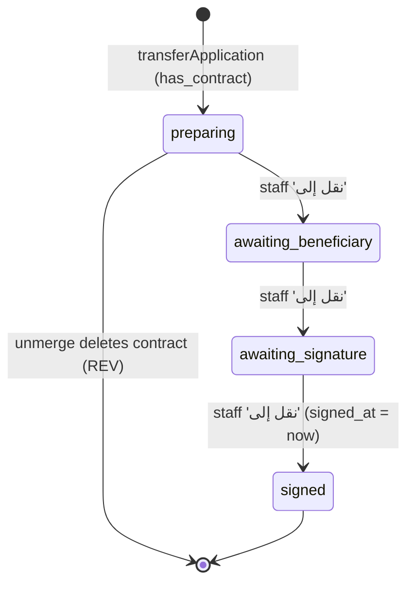
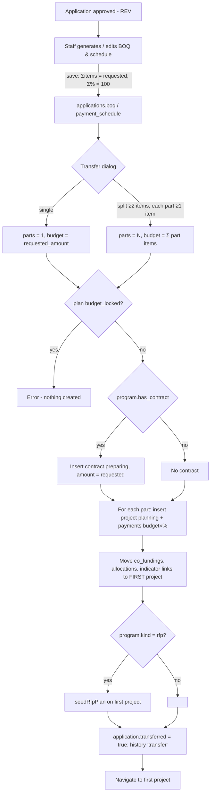
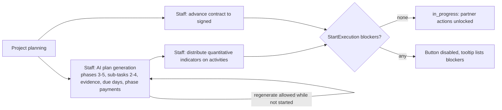
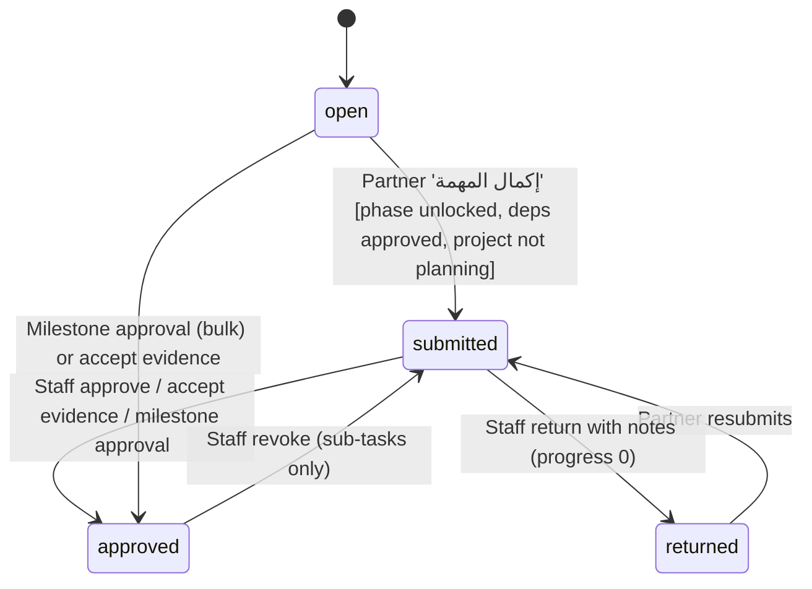
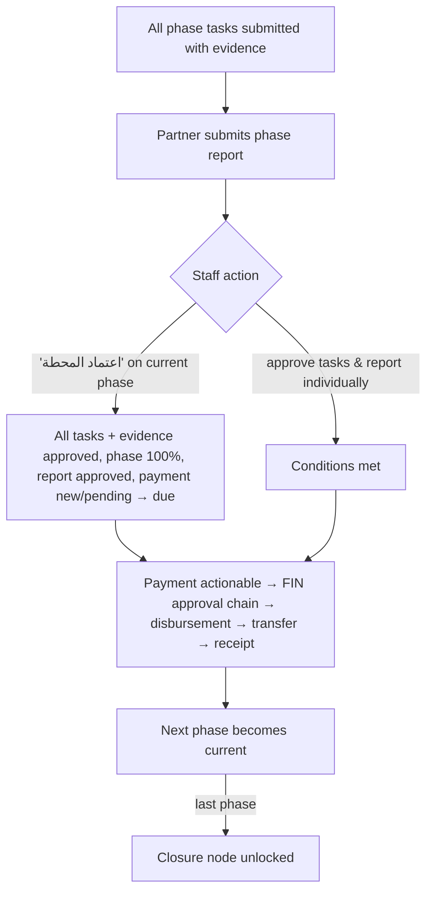

# PRJ — Projects & Contracts

> Source: Lovable prototype "Manih" (`/home/user/manih`), analysed from source code only (live demo not inspected). Evidence labels: **[Observed]** implemented in code · **[Inferred]** reading of intent · **[Recommended]** analyst proposal · **[To Confirm]** stakeholder decision needed.

## 1. Scope & Coverage

**Module purpose.** Converts approved grant applications into contracts and one or more executable projects, and manages internal initiatives, project planning (AI-generated phases/tasks/dependencies/payments), the StartExecution gate, partner execution with evidence, milestone approvals that release payments, plan revisions with four-eyes approval, indicator spread & achievement, and closure.

**Files analysed (all read in full):**
- `src/routes/projects.tsx (layout outlet)`
- `src/routes/projects.index.tsx (list + InitiativeDialog)`
- `src/routes/projects.$id.tsx (detail, StartExecution, ContractAdvance, deriveProjectStatus, closure)`
- `src/routes/contracts.tsx (register)`
- `src/routes/initiatives.tsx (legacy redirect)`
- `src/components/ContractDocument.tsx`
- `src/components/BoqSchedule.tsx (BoqSchedule, TransferDialog, ContractCard)`
- `src/components/ProjectTree.tsx (timeline, AI plan, SubTask, MilestoneSummary, PhaseReport, PhasePayment)`
- `src/components/ProjectReplan.tsx`
- `src/components/ProjectAllocations.tsx`
- `src/components/Indicators.tsx (ProjectIndicators, useIndicators; LevelIndicators referenced for PLN)`
- `src/lib/projectPlan.ts`
- `src/lib/projectAi.functions.ts`
- `src/lib/projectAi.server.ts`
- `src/lib/workflow.ts (transferApplication, unmergeApplications — contract/project parts)`

**Related files consulted (partially):** `src/lib/data.ts` (status labels/flows, lines 323-349), `src/lib/queries.ts` (useProjects, ProjectRow, projectProgress), `src/lib/plans.ts` (projectBreakdown, initiativeProgress), `src/lib/rfp.ts` (awardOffer, seedRfpPlan), `src/lib/tasks.ts` (derived tasks), `src/components/FileSlots.tsx` (confirmIfFlagged), `src/components/SectionTabs.tsx` (PROJECT_TABS), `src/components/AppShell.tsx` (NAV_BY_ROLE), `src/routes/reviewer.$id.tsx` (transfer & BOQ embedding), `src/routes/portal.tsx` (partner 'مشاريعي'), `src/integrations/supabase/types.ts` (projects, contracts, project_activities, project_reports, project_plan_revisions, project_indicators, project_plan_allocations), `supabase/migrations/20261004093306_*.sql`, `20261004141320_*.sql`, `20261007111454_*.sql`, `20261007112526_*.sql`, `20261007114003_*.sql`.

**Coverage notes & limitations.**
- Payments (approval chain, disbursement order, transfer, receipt) are only referenced — see module **FIN**. Indicator definition and plan roll-ups — module **PLN**. Indicator linking at application stage, co-funding, merge/unmerge — module **REV**. Task inbox — module **TSK**. File slots & AI attachment check internals — shared (REV/PLT).
- Permissions: the prototype distinguishes only *staff* (any non-`applicant` persona) vs *partner* (`applicant`) on project pages; the persona switcher runs on one shared demo account and RLS allows any signed-in user, so every guard below is UI-level unless stated otherwise [Observed, AGENTS.md].
- The migrations folder lacks DDL for `project_indicators`, `project_plan_allocations`, `plan_indicators`, `projects.boq` and `project_activities.indicator_*`; their structure is taken from `types.ts` (ISS-PRJ-26).
- AI outputs (plan, BOQ, re-plan) come from a Lovable AI gateway model; quality could not be assessed.
- `DemoControls` (shown for the demo project) belongs to PLT and is not analysed here.

## 2. Screen Inventory

| Screen ID | Name (EN + Arabic label) | Route / Component | Roles | Purpose | Entry points | Exits / Navigates to |
|---|---|---|---|---|---|---|
| SCR-PRJ-01 | Projects list (المشاريع) | `/projects (routes/projects.index.tsx); legacy /initiatives redirects here with ?source=initiative` | grants_manager, project_manager, finance, ceo, admin | Portfolio of grant projects and internal initiatives with status counters, filters and progress. | Sidebar 'المشاريع'; SectionTabs (المشاريع/العقود/الدفعات); /initiatives redirect; global search | SCR-PRJ-03 (row click / title link); SCR-PRJ-02 (مبادرة جديدة); SCR-PRJ-08 & Finance (tabs) |
| SCR-PRJ-02 | New initiative dialog (مبادرة جديدة) | `InitiativeDialog in routes/projects.index.tsx` | grants_manager, project_manager, finance, ceo, admin | Create an internal initiative (project with source='initiative') linked to a plan item. | SCR-PRJ-01 header button 'مبادرة جديدة' | Back to SCR-PRJ-01 (list refreshed) |
| SCR-PRJ-03 | Project detail (تفاصيل المشروع) | `/projects/$id (routes/projects.$id.tsx)` | grants_manager, project_manager, finance, ceo, admin, applicant | Single project workspace: header, status, contract, finance, indicators, execution tree, closure. | SCR-PRJ-01, SCR-PRJ-08, SCR-PRJ-11, Tasks (payment tasks), Finance, Reports, Plans, Endowments, Staff page, Beneficiary page, Portal 'مشاريعي', post-transfer redirect | SCR-PRJ-01 (back link, staff only); application detail /reviewer/$id (REV); /beneficiaries/$id (BEN); /staff/$id; SCR-PRJ-08 (sibling badge); SCR-PRJ-07 dialog |
| SCR-PRJ-04 | Project indicators panel (مؤشرات المشروع) | `ProjectIndicators in components/Indicators.tsx (embedded in SCR-PRJ-03)` | grants_manager, project_manager, finance, ceo, admin, applicant | Show linked indicators, distribute quantitative targets onto plan activities (planning), confirm milestone indicators (closing). | SCR-PRJ-03 (rendered only when the project has indicator links) | None (in-page) |
| SCR-PRJ-05 | Project execution tree / timeline (خطة المشروع) | `ProjectTree in components/ProjectTree.tsx (embedded in SCR-PRJ-03)` | grants_manager, project_manager, finance, ceo, admin, applicant | Phases (milestones), sub-tasks, evidence, phase reports, phase payments, closure node; AI plan generation. | SCR-PRJ-03 | SCR-PRJ-06 (replan); payment actions (FIN); closure node (SCR-PRJ-03) |
| SCR-PRJ-06 | Re-plan request / pending banner / history (طلب إعادة تخطيط · سجل إعادة التخطيط) | `ProjectReplan in components/ProjectReplan.tsx` | grants_manager, project_manager, finance, ceo, admin | Request AI-assisted re-planning of remaining work after execution started; approve/reject by another person; view history. | SCR-PRJ-05 toolbar (visible to staff once execution has started) | Back to SCR-PRJ-05 |
| SCR-PRJ-07 | Contract document dialog (عقد منحة) | `ContractDocument in components/ContractDocument.tsx` | grants_manager, project_manager, finance, ceo, admin, applicant | Render a printable grant contract generated live from project/application/partner/payment data. | SCR-PRJ-03 header 'عرض العقد' (only if the project has a contract) | Browser print / PDF; close |
| SCR-PRJ-08 | Contracts register (العقود) | `/contracts (routes/contracts.tsx)` | grants_manager, project_manager, finance, ceo, admin | List all contracts with status counters, partner, application, amount and projects split from each contract. | SectionTabs 'العقود'; global search; SCR-PRJ-03 sibling badge; SCR-PRJ-11 contract number | SCR-PRJ-03 (project links); /reviewer/$id (application link, REV) |
| SCR-PRJ-09 | BOQ & payment schedule panel (جدول الكميات والدفعات) | `BoqSchedule in components/BoqSchedule.tsx (embedded in /reviewer/$id, REV)` | grants_manager, reviewer, committee_secretary, ceo, admin | AI-proposed, staff-edited bill of quantities and payment schedule for an application prior to transfer. | Application detail (REV) budget section | None (in-page) |
| SCR-PRJ-10 | Approve contract & transfer dialog (اعتماد العقد وترحيله إلى مشاريع) | `TransferDialog in components/BoqSchedule.tsx (embedded in /reviewer/$id)` | grants_manager, ceo, admin | Approve the contract and transfer an approved application into one project or split its BOQ into several projects. | Application detail action bar when status=approved, not transferred, not a product grant | SCR-PRJ-03 of the (first) created project |
| SCR-PRJ-11 | Contract card on application (العقد) | `ContractCard in components/BoqSchedule.tsx (embedded in /reviewer/$id)` | grants_manager, reviewer, committee_secretary, ceo, admin | Summary of the application's contract: number, status, amount, projects split from it. | Application detail when application.transferred=true | SCR-PRJ-08; SCR-PRJ-03 |

Role visibility comes from the sidebar (`AppShell.tsx:45,54-61`): Projects is shown to grants_manager, project_manager, finance, ceo, admin; `/contracts` is reached via the SectionTabs inside Projects. The applicant reaches SCR-PRJ-03 only through portal project cards (`portal.tsx:191-208`) [Observed].

## 3. Screen Details

### SCR-PRJ-01 — Projects list (المشاريع)
- **Header:** title 'المشاريع', description, info tip, action **'مبادرة جديدة'** opening SCR-PRJ-02 [Observed `projects.index.tsx:80-81`]. SectionTabs: المشاريع / العقود / الدفعات [Observed `SectionTabs.tsx:36`].
- **Source toggle:** الكل / منح / مبادرات, stored in URL `?source=` (zod-validated) [Observed `:28,82-84`]. Missing `source` on a project is treated as 'grant' [Observed `:58`].
- **Stat cards (clickable filters):** إجمالي المشاريع; قيد الإعداد (planning); قيد التنفيذ (in_progress + active); متعثرة (stalled); مكتملة / مغلقة (completed + closed) [Observed `:85-91`]. Note: counts use the *stored* status, so 'متعثرة' is always 0 (ISS-PRJ-09).
- **Filter:** status-group select (كل الحالات + 4 groups) and a removable FilterChip [Observed `:93-95`].
- **Table (DataTable):** المشروع (title link + ref_no), الجهة المنفّذة (partner name, 'داخلياً' for internal initiatives), القيمة (SAR), الإنجاز (progress bar + %), الحالة (pill); hidden by default: المصدر, مدير المشروع, حالة العقد, المدة [Observed `:63-75`]. DataTable provides column visibility, page size, saved view per user and CSV/XLSX export [Observed `DataTable.tsx:43,77,117`]. Row click → SCR-PRJ-03.
- **States:** empty 'لا توجد مشاريع بعد' [Observed `:92`]; no explicit loading/error state (query returns empty array while loading) [Observed].

### SCR-PRJ-02 — New initiative dialog (مبادرة جديدة)
- **AI assist** box with example prompt; proposes title, description, budget, dates, plan item, department, executor [Observed `:133-144`].
- **Fields:** اسم المبادرة* (≤200), الوصف (≤2000), بند الخطة (select: non-root levels of active plans), التنفيذ (داخلياً | 'مع: <partner>'; hint that the partner logs in and updates progress), الإدارة (tenant departments), مدير المشروع (tenant staff personas, default current user), البداية, النهاية, الميزانية (ر.س)* (AmountInput) [Observed `:145-156`].
- **Validation (toasts):** 'اسم المبادرة مطلوب'; 'أدخل ميزانية صحيحة' (empty/≤0); 'تاريخ النهاية قبل البداية' [Observed `:113-115`].
- **Actions:** إلغاء, حفظ (disabled while busy). On success toast 'تمت إضافة المبادرة', dialog closes, projects & plan-data caches refreshed [Observed `:124-128,158`].

### SCR-PRJ-03 — Project detail (تفاصيل المشروع)
- **Back link** 'المشاريع' (staff only) [Observed `projects.$id.tsx:113-117`].
- **Header:** title; status pill 'المشروع: <derived status>' with reason tooltip (see §6.1); pill 'العقد: <status>' if a contract exists; partner name (link to /beneficiaries/$id), ref_no, 'مبادرة داخلية' marker [Observed `:122-134`].
- **Header actions:** 'اعتماد الخطة وبدء التنفيذ' (staff, status planning; disabled with blocker list tooltip) [Observed `:137,238-260`]; 'طلب المنحة' (link to application, tooltip ref) [Observed `:138-147`]; 'عرض العقد' (SCR-PRJ-07); sibling badge 'مشروع i من N — عقد CON…' linking to /contracts when a contract has >1 project [Observed `:151`]; 'نقل إلى: <next contract status>' (staff) [Observed `:152,214-225`].
- **Meters:** الإنجاز الفعلي (weighted %) with 'x من y محطات معتمدة' [Observed `:158`]; قيمة المشروع + FinanceBreakdown (approved/due/paid; pending hidden) [Observed `:159`, `plans.ts:385-389`]; ProjectAllocations read-only (only visible when ≥2 initiatives) [Observed]; CoFundingPanel in project mode read-only [Observed].
- **Meta line:** المدة (start ← end), مدير المشروع (link /staff/$id), بند الخطة (code · name) [Observed `:161-165`].
- **Sections below:** SCR-PRJ-04 indicators; DemoControls for the demo project only; SCR-PRJ-05 tree with a closure node.
- **Closure node (الإغلاق والتقييم النهائي):** locked icon + 'يُفتح بعد اعتماد كل المراحل' until all phases approved; then evaluation textarea, 'حفظ التقييم' and 'اعتماد إغلاق المشروع' (disabled if evaluation empty); after closure shows 'مغلق' pill and read-only evaluation [Observed `:172-199`].
- **States:** loading PageSkeleton [Observed `:98`]; DB errors as toasts; no not-found handling [Observed].
- **Partner mode:** same page with staff actions hidden (`isStaff = role !== 'applicant'`) [Observed `:102`].

### SCR-PRJ-04 — Project indicators panel (مؤشرات المشروع)
- Shown only if the project has indicator links [Observed `Indicators.tsx:161`]. Per link: indicator name, kind (كمي/كلي), plan item name, progress bar; quantitative: 'المطلوب N unit · المحقق M (p%)'; milestone: 'تحقق' or 'يُتحقق عند إغلاق المشروع' [Observed `:197-213`].
- **Distribution block (quantitative):** list of activities with assigned qty and state ('تحقق بقبول الشاهد' / 'بانتظار الشاهد'); warnings for under-/over-distribution; in planning (staff): activity select (non-payment activities without an indicator), qty input, 'توزيع'; trash icon to remove [Observed `:215-236`].
- **Milestone confirmation:** 'تأكيد التحقق' / 'إلغاء التحقق' for staff when status ∈ {closing, completed, closed} [Observed `:212`].
- **Errors:** 'اختر النشاط وحدد الكمية', 'تعذّر الحفظ، حاول مرة أخرى' [Observed `:157,183`].

### SCR-PRJ-05 — Project execution tree / timeline
- **Toolbar:** item filters الكل / مهمة / تقرير / دفعة with counts (toggle back to الكل) [Observed `ProjectTree.tsx:114-148`]; detail toggle 'تفاصيل مهام الجمعية' / 'عرض المحطات فقط' [Observed `:150-152`]; staff: 'بناء الخطة بالذكاء الاصطناعي' / 'إعادة بناء الخطة (قبل البدء)' before start, or the ReplanProject controls after start [Observed `:153-157`].
- **Empty state:** 'لا توجد خطة بعد.' [Observed `:159`].
- **Timeline:** unlinked non-retention payments first (LoosePayNode), then phases, then retention payments, then the closure node [Observed `:162-208`].
- **Phase card:** title, 'المحطة الحالية' pill, 'n بانتظار اعتمادك' (staff), weight %, lock hint 'تُفتح بعد إتمام «…»', paid summary when done, progress bar; expandable (current phase expanded by default) [Observed `:164-193`].
- **Milestone summary (default view):** 'أعمال الجمعية: x/y منجزة', evidence count and eye-icons opening signed URLs; staff on current phase: 'اعتماد المحطة' (disabled until a report exists) [Observed `:235-271`].
- **Sub-task (detail view):** state icon (مفتوحة / بانتظار اعتماد المانح / أُعيدت / معتمدة), title, indicator chip, due date; partner: 'إكمال المهمة ورفعها لاعتماد المانح'; staff: approve / return / revoke; dependency hint 'بعد: …'; FileSlots evidence slots; staff AI pre-check panel with accept / send AI notes / edit notes; notes editor; feedback box [Observed `:288-407`].
- **Phase report line:** label (لم يُرفع / بانتظار اعتماد المانح / مُعاد للجمعية / معتمد); staff approve/return; partner submit/edit with textarea and 'إرسال' [Observed `:409-444`].
- **Phase payment line:** title, amount, status pill; FIN PaymentActions when ready, else 'معلقة' with missing conditions tooltip [Observed `:446-465`].

### SCR-PRJ-06 — Re-plan request, pending banner and history
- **Buttons:** 'طلب إعادة تخطيط' (hidden while a revision is pending); history icon when revisions exist [Observed `ProjectReplan.tsx:96-99`].
- **Request dialog:** explanatory note (only remaining work changes; approved tasks and started payments stay; applied after another person approves); reason textarea (mandatory); optional evidence file; 'اقتراح التعديلات' (enabled when reason ≥5 chars) → AI rationale, diff (add/change/remove with counts, 'عرض كل التغييرات' beyond 6), new payments total vs budget; 'تعديل السبب' / 'رفع للاعتماد' [Observed `:121-145`].
- **Pending banner:** requester, date, evidence link, reason, diff; for the requester 'بانتظار اعتماد شخص آخر — العمل مستمر على الخطة الحالية'; for others: decision note input, 'اعتماد وتطبيق', 'رفض' (disabled until a note is entered) [Observed `:101-119`].
- **History dialog:** status chip (معتمد/مرفوض/بانتظار الاعتماد), requester/date, decider/date, reason, decision note, diff [Observed `:147-165`].

### SCR-PRJ-07 — Contract document dialog (عقد منحة)
- Title 'عقد منحة <ref>' and 'طباعة / PDF' (window.print) [Observed `ContractDocument.tsx:33-39`]. Loading 'جارٍ إعداد العقد…'.
- Sections: header (number, status); أولاً الطرفان (tenant name; partner name, license, region-city); ثانياً موضوع العقد (project, program, application number, description); ثالثاً المدة (dates, duration days); رابعاً القيمة والدفعات (amount, payments table #/title/amount/due, IBAN/bank); خامساً الالتزامات (4 fixed obligations incl. re-plan via approved request, evidence before payment, receipt per payment, grantor may stop disbursement); signature blocks (e-signature stamp + date when signed, else 'بانتظار التوقيع') [Observed `:41-92`].

### SCR-PRJ-08 — Contracts register (العقود)
- Header 'العقود' ('عقد واحد لكل طلب معتمد، وقد ينبثق منه أكثر من مشروع'), SectionTabs, 4 counters (one per CONTRACT_FLOW status) [Observed `contracts.tsx:43-47`].
- Table: رقم العقد, الجهة الشريكة, الطلب (link to application), القيمة, المشاريع (links 'ref · budget'), الحالة, التاريخ (signed_at or created_at) [Observed `:50-66`]. Empty: 'لا توجد عقود بعد'. Loading: PageSkeleton. No filters, search, or export [Observed].

### SCR-PRJ-09 — BOQ & payment schedule panel
- Generate button (staff, not transferred), skeleton while generating, empty 'لم يُولَّد جدول بعد.' [Observed `BoqSchedule.tsx:55-60`].
- BOQ table: البند, الكمية, تكلفة الوحدة, الإجمالي, delete; total row (red note with requested amount on mismatch); '+ بند' [Observed `:62-78`].
- Schedule table: الدفعة, النسبة %, بعد (يوم), المبلغ; total % (red if ≠100) [Observed `:79-94`]. Note: schedule rows cannot be added/removed manually, only edited [Observed].
- 'حفظ الجدولين' shown when dirty [Observed `:95`].

### SCR-PRJ-10 — Approve contract & transfer dialog
- Trigger 'اعتماد العقد وترحيله'; mode buttons 'مشروع واحد' / 'تقسيم إلى عدة مشاريع' (disabled when <2 items, with hint) [Observed `:119-127`].
- Split mode: numbered editable project titles with subtotal and delete (when >2); '+ مشروع'; item list with project selector; note on one contract and pro-rata schedule; validation 'كل مشروع يحتاج بنداً واحداً على الأقل' [Observed `:128-151`].
- 'اعتماد وترحيل' (disabled while busy or invalid) [Observed `:153`].

### SCR-PRJ-11 — Contract card on application
- Card 'العقد': contract ref (link to /contracts), status pill, 'قيمة العقد', list of projects (ref · title · budget) linking to SCR-PRJ-03 [Observed `BoqSchedule.tsx:160-182`]. Hidden when no contract.

## 4. Interaction Inventory

| INT ID | Screen | Trigger (control) | System response | Data written | Evidence |
|---|---|---|---|---|---|
| INT-PRJ-001 | SCR-PRJ-01 | Source toggle button | Navigates to /projects with ?source; counters and table re-filter | — (URL) | [Observed] `projects.index.tsx:82-84` |
| INT-PRJ-002 | SCR-PRJ-01 | Stat card click | Sets status-group filter; card shows active | — | [Observed] `projects.index.tsx:76,85-91` |
| INT-PRJ-003 | SCR-PRJ-01 | Status select / chip clear | Filters table by status group / resets | — | [Observed] `projects.index.tsx:93-95` |
| INT-PRJ-004 | SCR-PRJ-01 | Row click / title link | Opens SCR-PRJ-03 | — | [Observed] `projects.index.tsx:65,92` |
| INT-PRJ-005 | SCR-PRJ-01 | Export / columns (DataTable) | CSV/XLSX export; column visibility; saved view | user_view_prefs (explicit save) | [Observed] `DataTable.tsx:43,77,117` |
| INT-PRJ-006 | SCR-PRJ-02 | 'مبادرة جديدة' | Opens dialog with empty draft (executor internal) | — | [Observed] `projects.index.tsx:81` |
| INT-PRJ-007 | SCR-PRJ-02 | AI assist apply | Fills matching fields; unknown options ignored | — | [Observed] `projects.index.tsx:138-144` |
| INT-PRJ-008 | SCR-PRJ-02 | 'حفظ' | Validates; inserts project source=initiative, status planning; toast; closes | projects | [Observed] `projects.index.tsx:111-129` |
| INT-PRJ-009 | SCR-PRJ-03 | 'اعتماد الخطة وبدء التنفيذ' | If no blockers: status → in_progress; toast 'بدأ تنفيذ المشروع' | projects.status | [Observed] `projects.$id.tsx:249-253` |
| INT-PRJ-010 | SCR-PRJ-03 | 'نقل إلى: <next>' | Advances contract status one step; signed_at on signed | contracts.status, signed_at | [Observed] `projects.$id.tsx:218-224` |
| INT-PRJ-011 | SCR-PRJ-03 | 'طلب المنحة' | Opens application detail (REV) | — | [Observed] `projects.$id.tsx:138-147` |
| INT-PRJ-012 | SCR-PRJ-03 | Sibling badge | Opens contracts register | — | [Observed] `projects.$id.tsx:151` |
| INT-PRJ-013 | SCR-PRJ-03 | 'حفظ التقييم' | Saves evaluation text | projects.evaluation | [Observed] `projects.$id.tsx:190` |
| INT-PRJ-014 | SCR-PRJ-03 | 'اعتماد إغلاق المشروع' | Saves evaluation and status completed; toast | projects.evaluation, status | [Observed] `projects.$id.tsx:191-192` |
| INT-PRJ-015 | SCR-PRJ-04 | 'توزيع' | Assigns indicator link + qty to activity | project_activities.indicator_link_id, indicator_qty | [Observed] `Indicators.tsx:181-187` |
| INT-PRJ-016 | SCR-PRJ-04 | Trash (distribution) | Removes assignment | project_activities.indicator_link_id=null, indicator_qty=0 | [Observed] `Indicators.tsx:188-192` |
| INT-PRJ-017 | SCR-PRJ-04 | 'تأكيد التحقق' / 'إلغاء التحقق' | Sets achieved = target / 0 | project_indicators.achieved | [Observed] `Indicators.tsx:176-180,212` |
| INT-PRJ-018 | SCR-PRJ-05 | Filter buttons | Shows only tasks/reports/payments; re-click returns to all | — | [Observed] `ProjectTree.tsx:126,133-147` |
| INT-PRJ-019 | SCR-PRJ-05 | Detail toggle | Switches milestone summary ↔ sub-task detail | — | [Observed] `ProjectTree.tsx:150-152` |
| INT-PRJ-020 | SCR-PRJ-05 | 'بناء الخطة بالذكاء الاصطناعي' / 'إعادة بناء…' | Guard not started; confirm if replacing; AI plan; delete old activities & unpaid linked payments; insert phases, sub-tasks, payments; toast rationale | project_activities, payments | [Observed] `ProjectTree.tsx:75-111` |
| INT-PRJ-021 | SCR-PRJ-05 | Phase header click | Expand/collapse phase | — | [Observed] `ProjectTree.tsx:178` |
| INT-PRJ-022 | SCR-PRJ-05 | 'اعتماد المحطة' | Confirm on AI-failed files; approve tasks & evidence; phase 100; report approved; payment → due | project_activities, project_reports, payments.status | [Observed] `ProjectTree.tsx:244-253` |
| INT-PRJ-023 | SCR-PRJ-05 | Evidence eye icon | Opens 5-min signed URL in new tab | — | [Observed] `ProjectTree.tsx:239-243` |
| INT-PRJ-024 | SCR-PRJ-05 | Partner 'إكمال المهمة…' | task_status → submitted; phase progress recomputed | project_activities.task_status | [Observed] `ProjectTree.tsx:337-339` |
| INT-PRJ-025 | SCR-PRJ-05 | Partner file upload (FileSlots) | Stores file(s); per-file AI check; task evidence_status → submitted | attachment_files; project_activities.evidence_* | [Observed] `ProjectTree.tsx:307-313,360-363` |
| INT-PRJ-026 | SCR-PRJ-05 | Staff 'اعتماد إكمال المهمة' | task approved, progress 100 | project_activities | [Observed] `ProjectTree.tsx:343` |
| INT-PRJ-027 | SCR-PRJ-05 | Staff 'إعادة المهمة للجمعية' → 'إرسال للجمعية' | Returns with notes; progress 0 | project_activities.evidence_feedback(_at), evidence_status, task_status | [Observed] `ProjectTree.tsx:315,344,392` |
| INT-PRJ-028 | SCR-PRJ-05 | Staff 'إلغاء الاعتماد' | Approved sub-task → submitted, progress 0 | project_activities | [Observed] `ProjectTree.tsx:347-349` |
| INT-PRJ-029 | SCR-PRJ-05 | Staff 'قبول الشاهد' | Evidence approved; task approved; progress 100 (indicator achieved) | project_activities | [Observed] `ProjectTree.tsx:380` |
| INT-PRJ-030 | SCR-PRJ-05 | Staff send AI notes / edit notes | Returns task with AI notes (as-is or edited) | project_activities | [Observed] `ProjectTree.tsx:381-382` |
| INT-PRJ-031 | SCR-PRJ-05 | Partner 'رفع تقرير المرحلة' → 'إرسال' | Insert report (or update to pending when returned) | project_reports | [Observed] `ProjectTree.tsx:427-440` |
| INT-PRJ-032 | SCR-PRJ-05 | Staff approve / return report | Report status approved / returned | project_reports.status | [Observed] `ProjectTree.tsx:421-426` |
| INT-PRJ-033 | SCR-PRJ-05 | Payment actions (when ready) | Delegates to FIN PaymentActions | payments, payment_approvals (FIN) | [Observed] `ProjectTree.tsx:461` |
| INT-PRJ-034 | SCR-PRJ-06 | 'طلب إعادة تخطيط' | Opens request dialog | — | [Observed] `ProjectReplan.tsx:97` |
| INT-PRJ-035 | SCR-PRJ-06 | 'اقتراح التعديلات' | AI proposal → enforceLocks → budget check → draft diff | — | [Observed] `ProjectReplan.tsx:60-68` |
| INT-PRJ-036 | SCR-PRJ-06 | 'رفع للاعتماد' | Uploads evidence (optional); inserts revision pending | attachments bucket; project_plan_revisions | [Observed] `ProjectReplan.tsx:69-84` |
| INT-PRJ-037 | SCR-PRJ-06 | 'اعتماد وتطبيق' | Guards; applies plan changes; revision approved | project_activities, payments, project_plan_revisions | [Observed] `ProjectReplan.tsx:85-90; projectPlan.ts:86-127` |
| INT-PRJ-038 | SCR-PRJ-06 | 'رفض' | Revision rejected with note | project_plan_revisions | [Observed] `ProjectReplan.tsx:115` |
| INT-PRJ-039 | SCR-PRJ-06 | History icon | Opens history dialog | — | [Observed] `ProjectReplan.tsx:98` |
| INT-PRJ-040 | SCR-PRJ-07 | 'عرض العقد' | Loads tenant, partner, application, payments; renders document | — | [Observed] `ContractDocument.tsx:14-25` |
| INT-PRJ-041 | SCR-PRJ-07 | 'طباعة / PDF' | window.print() | — | [Observed] `ContractDocument.tsx:37` |
| INT-PRJ-042 | SCR-PRJ-08 | Application / project links | Navigate to REV detail / SCR-PRJ-03 | — | [Observed] `contracts.tsx:56-61` |
| INT-PRJ-043 | SCR-PRJ-09 | 'توليد بالوكيل الذكي' | AI BOQ + schedule into editable tables | — | [Observed] `BoqSchedule.tsx:36-42` |
| INT-PRJ-044 | SCR-PRJ-09 | Edit cells / '+ بند' / delete | Local edit; marks dirty | — | [Observed] `BoqSchedule.tsx:50-78` |
| INT-PRJ-045 | SCR-PRJ-09 | 'حفظ الجدولين' | Validates totals; saves | applications.boq, payment_schedule | [Observed] `BoqSchedule.tsx:43-49` |
| INT-PRJ-046 | SCR-PRJ-10 | Mode / '+ مشروع' / title / item project select | Builds split parts | — | [Observed] `BoqSchedule.tsx:104-147` |
| INT-PRJ-047 | SCR-PRJ-10 | 'اعتماد وترحيل' | transferApplication; navigate to first project; toast 'تم اعتماد العقد وترحيل الطلب' | contracts, projects, payments, co_fundings, project_plan_allocations, project_indicators, applications, application_status_history | [Observed] `BoqSchedule.tsx:153; reviewer.$id.tsx:217; workflow.ts:140-205` |
| INT-PRJ-048 | SCR-PRJ-11 | Contract ref / project link | Navigate to register / project | — | [Observed] `BoqSchedule.tsx:174-177` |

## 5. Shared Components & Dependencies

| Component / lib | Used for | Owner module |
|---|---|---|
| `DataTable`, `FilterChips`, `StatCard`, `Pill`, `PageHeader`, `SectionTabs (PROJECT_TABS)`, `PageSkeleton` | List layout, export, saved views, tabs | PLT |
| `AiAssist` | Initiative form proposal | PLT |
| `AmountInput` | Initiative budget | PLT |
| `FinanceBreakdown` + `projectBreakdown` (plans.ts) | Project money split (approved/due/paid) | FIN / PLN |
| `PaymentActions` | Payment approval chain, disbursement, transfer, receipt on phase and loose payments | FIN |
| `ProjectAllocations` | Multi-initiative funding (editable at application stage, read-only on project) | PRJ (shared with REV/PLN) |
| `CoFundingPanel` (mode project) | Co-funders read-only | REV |
| `ProjectIndicators`, `useIndicators`, `LevelIndicators` | Indicator link display/distribution/achievement; plan roll-up | PRJ / PLN / REV |
| `FileSlots`, `useFiles`, `splitRequirements`, `confirmIfFlagged` | Multi-file evidence per slot, AI per-file check, warning before bulk approval | Shared (REV/PLT) |
| `lib/projectPlan.ts` | hasStarted, snapshotPlan, diffPlan, enforceLocks, decideRevision | PRJ |
| `lib/projectAi.functions.ts` / `.server.ts` | Server functions: generateProjectPlan, proposeReplan, generateBoq, checkEvidence (Lovable AI gateway, `LOVABLE_API_KEY`) | PRJ (AI) |
| `lib/workflow.ts` transferApplication / unmergeApplications | Contract & project creation; removal on unmerge | REV / PRJ |
| `lib/rfp.ts` awardOffer / seedRfpPlan | RFP award reuses transfer; seeds plan | PRG |
| `lib/tasks.ts` | Derived payment tasks link to projects (no project-activity tasks) | TSK |
| `DemoControls`, `DEMO_PROJECT_ID` | Demo script on one project | PLT |
| DB triggers `set_ref_no` | CON / PRJ / PAY references | Platform DB |

## 6. Business Process Workflows

### 6.1 Project status lifecycle

```mermaid
stateDiagram-v2
    [*] --> planning: transferApplication / initiative created / RFP award
    planning --> in_progress: StartExecution (staff)\n[≥1 non-payment activity AND contract signed (if any)\nAND every quantitative indicator fully distributed]
    in_progress --> stalled_display: any activity overdue & not approved\n(derived, display only)
    stalled_display --> in_progress: overdue items approved
    in_progress --> completed: Approve closure (staff)\n[all phases approved AND evaluation not empty]
    completed --> [*]
    note right of stalled_display: 'stalled' is never stored;\n'active', 'closing', 'closed' are referenced\nin UI but never set (ISS-PRJ-09)
```

Stored values in use: `planning`, `in_progress`, `completed` [Observed]. Labels exist for `closed` and `stalled` [Observed `data.ts:336-342`]. There is no cancel/suspend state [Observed] (OQ-PRJ-13). Transitions are client-side updates without server guard [Observed] (ISS-PRJ-01).

### 6.2 Contract lifecycle



All steps are performed by staff with one button; there is no partner action for 'بانتظار الجهة الشريكة' and no signature capture [Observed] (ISS-PRJ-17).

### 6.3 Contracting & transfer (BOQ split)



Actors: grants staff (UI shows to any staff persona). Not transactional (ISS-PRJ-06).

### 6.4 Planning → StartExecution



### 6.5 Activity (task) & evidence lifecycle



Evidence status (`project_activities.evidence_status`): none → submitted (upload) → approved (accept / milestone) | returned (notes). AI check verdicts are advisory [Observed].

### 6.6 Milestone & payment release



### 6.7 Plan revision (re-plan) with four-eyes approval

```mermaid
sequenceDiagram
    actor Req as Requester (staff)
    participant UI as ProjectReplan
    participant AI as proposeReplan (AI)
    participant DB as project_plan_revisions
    actor App as Approver (≠ requester)
    Req->>UI: reason (≥5 chars) + optional evidence
    UI->>AI: current snapshot (locked flags), budget, reason, today
    AI-->>UI: proposed phases
    UI->>UI: enforceLocks; check Σ phase payments ≤ budget; diff
    Req->>DB: insert status=pending (before, proposed, requested_by)
    App->>UI: review banner diff
    alt approve
        UI->>UI: decideRevision: pending? approver≠requester?
        UI->>DB: apply changes to activities/payments, then status=approved
    else reject (note required)
        UI->>DB: status=rejected, decision_note
    end
```

### 6.8 Closure
All phases approved → closure node unlocks → staff writes evaluation → 'اعتماد إغلاق المشروع' sets `completed` → milestone indicators can then be confirmed (ISS-PRJ-07). No payment/receipt checks [Observed] (ISS-PRJ-08).

## 7. Business Rules

| BR ID | Rule | Evidence label + reference |
|---|---|---|
| BR-PRJ-01 | One contract is created per approved application when the program requires a contract (grant_programs.has_contract, default true); one contract may produce several projects. | [Observed] `lib/workflow.ts:152,159-168; routes/contracts.tsx:43` |
| BR-PRJ-02 | Contract amount equals the application's requested_amount at transfer time; contract starts in status 'preparing'. | [Observed] `lib/workflow.ts:163` |
| BR-PRJ-03 | Contract status advances strictly forward along preparing → awaiting_beneficiary → awaiting_signature → signed; signed_at is stamped when reaching 'signed'. No backward or cancel transition exists. | [Observed] `lib/data.ts:323-334; routes/projects.$id.tsx:214-225` |
| BR-PRJ-04 | BOQ can be saved only if the (rounded) sum of qty × unit_cost equals the requested amount, and, when schedule rows exist, their percentages total exactly 100%. | [Observed] `components/BoqSchedule.tsx:43-46` |
| BR-PRJ-05 | AI-generated BOQ is auto-corrected so the item total equals the requested amount (rounding drift absorbed by the last item). | [Observed] `lib/projectAi.server.ts:178-181` |
| BR-PRJ-06 | Splitting into several projects requires at least 2 BOQ items, and every project must receive at least one item; each split project's budget = sum of its items; a single (unsplit) project's budget = requested_amount. | [Observed] `components/BoqSchedule.tsx:116,125-127,150; lib/workflow.ts:172,177` |
| BR-PRJ-07 | For non-RFP programs each created project receives payments from the application payment schedule: amount = round(project budget × percent / 100), due date = transfer date + due_days. RFP programs seed activities and payments from the program instead. | [Observed] `lib/workflow.ts:187-190,198-201; lib/rfp.ts:65-73` |
| BR-PRJ-08 | Transfer is refused when the plan owning the resolved plan level is budget_locked. | [Observed] `lib/workflow.ts:154-158` |
| BR-PRJ-09 | Project manager on transfer resolves as: explicit option → program default_manager_id → first persona with role project_manager (no tenant filter). | [Observed] `lib/workflow.ts:147-151` |
| BR-PRJ-10 | Application-stage co-funding, initiative allocations and indicator links are moved to the first created project only. | [Observed] `lib/workflow.ts:192-197` |
| BR-PRJ-11 | New projects (grant or initiative) start in status 'planning'; grant projects get start_date = transfer date and end_date = start + application duration_days. | [Observed] `lib/workflow.ts:178-184; routes/projects.index.tsx:118-123` |
| BR-PRJ-12 | Initiative creation requires a title and a budget > 0; end date may not precede start date; executor is 'internal' (null) or a partner (stored in beneficiary_id and executor_beneficiary_id); manager defaults to the current persona. | [Observed] `routes/projects.index.tsx:111-123` |
| BR-PRJ-13 | The AI plan may be (re)generated only while execution has not started; replacing an existing plan requires confirmation. After start, changes go only through a plan revision. | [Observed] `components/ProjectTree.tsx:75-77,153-157` |
| BR-PRJ-14 | Execution is considered 'started' when any activity is approved, has a task_status other than 'open', or has evidence, or when any payment has a status other than new/pending. | [Observed] `lib/projectPlan.ts:21-27` |
| BR-PRJ-15 | Phases are sequential: an AI-generated phase depends on the previous phase; only the first not-fully-approved phase is 'current'; later phases are locked. A sub-task cannot be acted on while any task listed in its depends_on is not approved. | [Observed] `components/ProjectTree.tsx:70-71,98,164,186-188,294,317` |
| BR-PRJ-16 | StartExecution (planning → in_progress) is a manual staff action enabled only when: (a) the plan contains at least one non-payment activity; (b) the contract, if one exists, is 'signed'; (c) each quantitative indicator link is distributed over activities exactly equal to its target. | [Observed] `routes/projects.$id.tsx:137,237-253` |
| BR-PRJ-17 | While the project is in 'planning', partner task actions are locked, and indicator distribution can be edited only by staff. | [Observed] `components/ProjectTree.tsx:197; components/Indicators.tsx:221,226` |
| BR-PRJ-18 | Indicators are linked to an application only at application stage; at project stage no new indicator can be linked (only distributed / confirmed). | [Observed] `components/Indicators.tsx:139-143,211,242` |
| BR-PRJ-19 | Quantitative indicator achievement = sum of indicator_qty of the project activities whose evidence_status is 'approved'. Milestone (كلي) indicators are achieved when staff confirm them at closing (achieved = target). | [Observed] `components/Indicators.tsx:33-37,176-180,212` |
| BR-PRJ-20 | Task status lifecycle: open → submitted (partner) → approved (grantor) | returned (grantor, with notes, progress reset to 0) → submitted; grantor may revoke an approved sub-task back to submitted. | [Observed] `components/ProjectTree.tsx:281-286,315,337-349` |
| BR-PRJ-21 | AI evidence checks are advisory only: they never block upload or approval; bulk milestone approval warns (confirm dialog) when any file has verdict 'fail'. | [Observed] `components/ProjectTree.tsx:246,366-386; components/FileSlots.tsx:46-53` |
| BR-PRJ-22 | Milestone (phase) approval is offered only on the current phase and only once a phase report exists; it approves all tasks and their evidence, sets the phase to 100%, approves the report and moves the linked payment from new/pending to 'due'. | [Observed] `components/ProjectTree.tsx:244-253,264-267` |
| BR-PRJ-23 | A phase payment is actionable only when all phase tasks are approved, all uploaded evidence is accepted and the phase report is approved (or the payment is already past new/pending). Payment processing itself follows FIN rules. | [Observed] `components/ProjectTree.tsx:200,446-463` |
| BR-PRJ-24 | Only one pending plan revision may exist per project; the request button is hidden while one is pending. | [Observed] `components/ProjectReplan.tsx:49,97` |
| BR-PRJ-25 | A plan revision requires a reason (≥5 characters in UI, ≥3 server-side); an evidence document is optional. The AI may change only unlocked items: approved tasks/phases and payments past new/pending are preserved verbatim; total proposed payments may not exceed the project budget. | [Observed] `components/ProjectReplan.tsx:60-66,126-138; lib/projectAi.functions.ts:21; lib/projectPlan.ts:69-81` |
| BR-PRJ-26 | A plan revision can be decided only while 'pending' and only by a persona different from the requester; rejection requires a decision note. | [Observed] `lib/projectPlan.ts:85-88,125; components/ProjectReplan.tsx:92,111-116` |
| BR-PRJ-27 | Displayed project status: stored completed/closed and planning are shown as-is; otherwise the project is shown as 'stalled' (متعثر) if any activity is past its due date and not approved. 'Stalled' is derived for display only and never stored. | [Observed] `routes/projects.$id.tsx:227-235` |
| BR-PRJ-28 | The closure step unlocks only when every phase is fully approved; closure approval requires a non-empty evaluation and sets status 'completed'; evaluation becomes read-only afterwards. | [Observed] `components/ProjectTree.tsx:208; routes/projects.$id.tsx:172-199` |
| BR-PRJ-29 | Project progress = weighted average of activity progress by weight; falls back to the stored projects.progress when no weighted activities exist. Phase progress = average of its sub-tasks' progress. | [Observed] `lib/plans.ts:462-468; components/ProjectTree.tsx:273-279` |
| BR-PRJ-30 | Reference numbers are generated by DB trigger: contracts CON+YYMM+5-digit sequence; projects PRJ+YYMM+sequence. | [Observed] `supabase/migrations/20261004093306_*.sql:78-86,113,127` |
| BR-PRJ-31 | Payments whose title matches retention/closing keywords (احتجاز|محتجز|ختام|إغلاق|نهائي) and are not linked to a phase are displayed at the end of the timeline; other unlinked payments at the start. | [Observed] `components/ProjectTree.tsx:162,207,215-216` |
| BR-PRJ-32 | Grantor payment policies (advance ≤20%, final ≥10% retained for closure, each payment conditional on an approved phase report and evidence, payments >200,000 SAR require a field visit) are passed to the AI plan prompt only and are not validated by the system. | [Observed] `components/ProjectTree.tsx:30,87` |
| BR-PRJ-33 | A merged application can be unmerged only while its contract is still 'preparing'; unmerge deletes the created projects, activities, reports and payments (see module REV). | [Observed] `lib/workflow.ts:340-357` |
| BR-PRJ-34 | Funding from several initiatives: the first allocation row is the main initiative; an added initiative's amount is deducted from the main share and must be lower than it; the project total stays unchanged. On the project page allocations are read-only. | [Observed] `components/ProjectAllocations.tsx:42-62; routes/projects.$id.tsx:159` |

## 8. Data Requirements

### projects
One executable project (grant or internal initiative). [Observed migrations 20261004093306 l.115-127, 20261004141320; types.ts]

| Field | Type | Required | Meaning |
|---|---|---|---|
| id | uuid | Y | PK |
| tenant_id | uuid → tenants | Y | Owning grantor organization |
| ref_no | text, unique | auto | PRJ+YYMM+seq (trigger) |
| source | text | Y (default 'grant') | 'grant' | 'initiative' |
| application_id | uuid → applications | N | Source application (null for initiatives) |
| contract_id | uuid → contracts | N | Contract; several projects may share one |
| beneficiary_id | uuid → beneficiaries | N | Partner organization |
| executor_beneficiary_id | uuid → beneficiaries | N | Executing partner for initiatives |
| manager_id | uuid → personas | N | Project manager |
| department_id | uuid → departments | N | Owning department |
| plan_level_id | uuid → plan_levels | N | Main plan item / initiative |
| title | text | Y | Name |
| description | text | N | Description |
| budget | numeric | Y | Project value (BOQ part sum or requested amount) |
| boq | jsonb | N | BOQ items assigned at transfer |
| status | text | Y (default planning) | planning | in_progress | completed (stalled/closed labels) |
| start_date / end_date | date | N | Duration |
| progress | int | Y (0) | Fallback progress |
| spent | numeric | Y (0) | Not written by module code [Observed] |
| evaluation | text | N | Final evaluation |
| created_at | timestamptz | Y |  |

Relationships / notes: 1–N contracts→projects; 1 project → N project_activities, payments, project_reports, project_plan_revisions, project_indicators, project_plan_allocations, co_fundings.

### contracts
Grant contract per approved application. [Observed migration l.105-113]

| Field | Type | Required | Meaning |
|---|---|---|---|
| id | uuid | Y | PK |
| tenant_id | uuid | Y |  |
| application_id | uuid → applications | Y | One per application (not DB-unique) [Observed] |
| ref_no | text, unique | auto | CON+YYMM+seq |
| amount | numeric | Y | = requested_amount |
| status | text | Y (preparing) | preparing | awaiting_beneficiary | awaiting_signature | signed |
| signed_at | timestamptz | N | Set when signed |
| created_at | timestamptz | Y |  |

Relationships / notes: 1 contract → N projects.

### project_activities
Phases (parent_id null) and sub-tasks (parent_id = phase). [Observed migrations 20261004093306 l.130-135, 20261007111454, 20261007112526; types.ts]

| Field | Type | Required | Meaning |
|---|---|---|---|
| id | uuid | Y | PK |
| project_id | uuid → projects (cascade) | Y |  |
| parent_id | uuid → project_activities (cascade) | N | Phase of a sub-task |
| title | text | Y |  |
| weight | int | Y (10) | Phase weight % (sub-tasks 0) |
| progress | int | Y (0) | 0–100 |
| is_payment | bool | Y | Phase carries a payment |
| due_date | date | N |  |
| sort_order | int | Y |  |
| depends_on | uuid[] | Y ({}) | Predecessor activities |
| evidence_required | text | N | Required evidence (split into slots) |
| evidence_name / evidence_path | text | N | Last uploaded evidence |
| evidence_status | text | Y (none) | none | submitted | approved | returned |
| ai_check / evidence_ai | jsonb | N | Legacy task-level AI check |
| task_status | text | Y (open) | open | submitted | returned | approved |
| evidence_feedback / evidence_feedback_at | text / timestamptz | N | Grantor notes on return |
| indicator_link_id | uuid → project_indicators | N | Indicator distributed on this activity |
| indicator_qty | numeric | Y (0) | Quantity of the indicator |

Relationships / notes: Payments.activity_id and project_reports.activity_id reference the phase (ON DELETE SET NULL).

### project_reports
One report per phase. [Observed migration l.155-160, 20261007111454]

| Field | Type | Required | Meaning |
|---|---|---|---|
| id | uuid | Y |  |
| project_id | uuid | Y |  |
| activity_id | uuid → project_activities | N | Phase |
| title | text | Y | 'تقرير: <phase>' |
| body | text | N | Summary (required in UI) |
| status | text | Y (submitted) | submitted | pending | approved | returned |
| created_at | timestamptz | Y |  |

### project_plan_revisions
Re-plan requests. [Observed migration 20261007114003]

| Field | Type | Required | Meaning |
|---|---|---|---|
| id | uuid | Y |  |
| project_id | uuid (cascade) | Y |  |
| reason | text | Y |  |
| evidence_name / evidence_path | text | N | Optional document (attachments bucket) |
| proposed | jsonb | Y | {phases, rationale} |
| before | jsonb | Y | {phases} snapshot |
| status | text | Y (pending) | pending | approved | rejected |
| requested_by / decided_by | uuid → personas | N | Must differ (client check) |
| decision_note | text | N | Required for rejection (UI) |
| created_at / decided_at | timestamptz | Y / N |  |

Relationships / notes: RLS: any signed-in user may read/insert/update [Observed].

### project_indicators
Indicator link of an application/project with required count. [Observed types.ts:2557]

| Field | Type | Required | Meaning |
|---|---|---|---|
| id | uuid | Y |  |
| indicator_id | uuid → plan_indicators | Y |  |
| application_id | uuid | N | Set at application stage |
| project_id | uuid | N | Set on transfer |
| target | numeric | Y | Required count (1 for milestone) |
| achieved | numeric | Y | Milestone: set by staff; quantitative: computed from activities (stored value ignored when distributed) |

Relationships / notes: plan_indicators (PLN): kind quantitative | milestone, unit, target.

### project_plan_allocations
Multi-initiative funding split. [Observed types.ts:2609]

| Field | Type | Required | Meaning |
|---|---|---|---|
| id | uuid | Y |  |
| plan_level_id | uuid | Y | Initiative |
| amount | numeric | Y | Share |
| application_id / project_id | uuid | N | Owner (moved on transfer) |

Relationships / notes: First row = main initiative [Observed AGENTS.md, ProjectAllocations.tsx:52].

### applications (BOQ fields)
Fields owned by REV, used here. [Observed BoqSchedule.tsx; workflow.ts]

| Field | Type | Required | Meaning |
|---|---|---|---|
| boq | jsonb | N | [{id, title, qty, unit_cost}] |
| payment_schedule | jsonb | N | [{title, percent, due_days}] |
| transferred | bool | Y | Set by transfer |
| requested_amount | numeric | Y | Contract amount |
| duration_days | int | N | Project end date |

### payments (reference)
Owned by module FIN. Created here by transfer, AI plan, revision and RFP seeding.

| Field | Type | Required | Meaning |
|---|---|---|---|
| project_id | uuid | Y |  |
| activity_id | uuid | N | Phase link (null = loose) |
| title | text | Y |  |
| amount | numeric | Y |  |
| due_date | date | N |  |
| status | text | Y (new) | new | pending → due (milestone) → … (FIN) |

Relationships / notes: See module FIN for statuses beyond 'due'.

## 9. Product Structure

- **EP-PRJ-01 — Contracting & Project Creation**: Bill of quantities and payment schedule, contract approval and transfer of approved applications into one or more projects, contract lifecycle, register and generated contract document.
  - FT-PRJ-01 — BOQ & payment schedule preparation (Must)
  - FT-PRJ-02 — Contract approval & transfer to project(s) (BOQ split) (Must)
  - FT-PRJ-03 — Contract lifecycle & register (Must)
  - FT-PRJ-04 — Generated contract document (Should)
- **EP-PRJ-02 — Project Portfolio & Initiatives**: Portfolio list of grant projects and internal initiatives, initiative creation and the project overview (header, finance, funding split).
  - FT-PRJ-05 — Project portfolio list (Must)
  - FT-PRJ-06 — Internal initiative creation (Should)
  - FT-PRJ-07 — Project overview (header, finance, funding) (Must)
- **EP-PRJ-03 — Project Planning & Start of Execution**: AI-generated execution plan (phases, tasks, dependencies, evidence, payments), indicator spread over activities and the manual StartExecution gate.
  - FT-PRJ-08 — AI project plan (phases, tasks, dependencies, payments) (Must)
  - FT-PRJ-09 — Indicator spread over activities (Must)
  - FT-PRJ-10 — Start execution gate (Must)
- **EP-PRJ-04 — Execution Monitoring**: Partner task completion and evidence, grantor review with AI pre-check, phase reports, milestone approval that releases phase payments, progress and stalled status.
  - FT-PRJ-11 — Task execution & evidence review (Must)
  - FT-PRJ-12 — Phase reports & milestone approval (Must)
  - FT-PRJ-13 — Project status & progress derivation (Should)
- **EP-PRJ-05 — Plan Revisions**: Re-planning of remaining work after start, through project_plan_revisions approved by a person other than the requester.
  - FT-PRJ-14 — Plan revision request & approval (Must)
- **EP-PRJ-06 — Closure & Indicator Achievement**: Final evaluation and closure approval, milestone indicator confirmation, quantitative achievement by accepted evidence and roll-up.
  - FT-PRJ-15 — Project closure & final evaluation (Must)
  - FT-PRJ-16 — Indicator achievement tracking (Should)

## 10. Features

### FT-PRJ-01 — BOQ & payment schedule preparation
- **Feature ID:** FT-PRJ-01 (Epic EP-PRJ-01)
- **Name:** BOQ & payment schedule preparation
- **Description:** AI-proposed bill of quantities (items, qty, unit cost) and payment schedule (title, %, due days) for an application, edited and saved by staff before transfer.
- **Business Objective:** Give each approved grant a costed scope and payment plan that drives project budgets and payments. [Inferred]
- **Expected Business Value:** [To Confirm] Faster, more consistent budget breakdowns; basis for splitting into projects and for payments.
- **Primary User Roles:** grants_manager, reviewer, admin
- **Scope:** Generate with AI, inline edit, add/delete items, save with total/percentage validation, read-only after transfer.
- **Out of Scope:** Application review workflow itself (REV); product grants (PRG).
- **Functional Requirements:** FR-PRJ-001, FR-PRJ-002, FR-PRJ-003, FR-PRJ-004
- **User Stories:** US-PRJ-001, US-PRJ-002
- **Business Rules:** BR-PRJ-04, BR-PRJ-05
- **Dependencies:** REV application detail, AI gateway (LOVABLE_API_KEY)
- **Related Screens:** SCR-PRJ-09
- **Acceptance Criteria:**
  - BOQ with total ≠ requested amount cannot be saved.
  - Schedule rows must total 100% to save.
  - Editing is disabled once the application is transferred.
- **Open Questions:** OQ-PRJ-04
- **Assumptions:** Requested amount is final at the time the BOQ is saved (staff numeric edits handled in REV).
- **Priority Recommendation (MoSCoW):** Must

### FT-PRJ-02 — Contract approval & transfer to project(s) (BOQ split)
- **Feature ID:** FT-PRJ-02 (Epic EP-PRJ-01)
- **Name:** Contract approval & transfer to project(s) (BOQ split)
- **Description:** Approve the contract of an approved application and transfer it into one project, or split BOQ items into several projects under one contract.
- **Business Objective:** Turn an approved grant decision into executable, budgeted projects. [Inferred]
- **Expected Business Value:** [To Confirm] Enables large grants to be managed as separate deliverable projects while keeping one contract.
- **Primary User Roles:** grants_manager, ceo, admin
- **Scope:** Transfer dialog, single vs split mode, project titles, item assignment, contract creation, projects with budgets and payments, moving application-stage commitments, history log.
- **Out of Scope:** Product-grant delivery (PRG/REV); RFP award (PRG) which reuses the same transfer.
- **Functional Requirements:** FR-PRJ-005, FR-PRJ-006, FR-PRJ-007, FR-PRJ-008, FR-PRJ-009, FR-PRJ-010, FR-PRJ-055
- **User Stories:** US-PRJ-003, US-PRJ-004, US-PRJ-005
- **Business Rules:** BR-PRJ-01, BR-PRJ-02, BR-PRJ-06, BR-PRJ-07, BR-PRJ-08, BR-PRJ-09, BR-PRJ-10, BR-PRJ-11, BR-PRJ-30
- **Dependencies:** REV (approved application), PLN (plan level budget lock), PRG (program defaults, RFP seeding), FIN (payments)
- **Related Screens:** SCR-PRJ-10, SCR-PRJ-03
- **Acceptance Criteria:**
  - Approved, untransferred, non-product application can be transferred once.
  - Split creates N projects with budget = sum of assigned items and one contract.
  - Transfer is refused when the plan budget is locked.
  - User lands on the (first) created project.
- **Open Questions:** OQ-PRJ-03, OQ-PRJ-04, OQ-PRJ-10
- **Assumptions:** BOQ item totals equal the requested amount (enforced at BOQ save, not at transfer).
- **Priority Recommendation (MoSCoW):** Must

### FT-PRJ-03 — Contract lifecycle & register
- **Feature ID:** FT-PRJ-03 (Epic EP-PRJ-01)
- **Name:** Contract lifecycle & register
- **Description:** Contract status progression to 'signed' and a register of all contracts with counters and linked projects; contract card on the application.
- **Business Objective:** Track contracting status of every approved grant. [Inferred]
- **Expected Business Value:** [To Confirm] Visibility of contracts awaiting partner/signature; signed contract is a precondition to execution.
- **Primary User Roles:** grants_manager, project_manager, finance, ceo, admin
- **Scope:** Advance button on project header, register page, status counters, application contract card.
- **Out of Scope:** E-signature integration, contract templates, amendments (not in prototype).
- **Functional Requirements:** FR-PRJ-011, FR-PRJ-012, FR-PRJ-013, FR-PRJ-014
- **User Stories:** US-PRJ-006, US-PRJ-007
- **Business Rules:** BR-PRJ-01, BR-PRJ-03, BR-PRJ-30, BR-PRJ-33
- **Dependencies:** FT-PRJ-02
- **Related Screens:** SCR-PRJ-03, SCR-PRJ-08, SCR-PRJ-11
- **Acceptance Criteria:**
  - Contract moves only forward one step at a time.
  - Reaching 'signed' stamps signed_at.
  - Register shows counts per status and project links.
- **Open Questions:** OQ-PRJ-01, OQ-PRJ-05, OQ-PRJ-13
- **Assumptions:** Partner acceptance happens outside the system in the prototype.
- **Priority Recommendation (MoSCoW):** Must

### FT-PRJ-04 — Generated contract document
- **Feature ID:** FT-PRJ-04 (Epic EP-PRJ-01)
- **Name:** Generated contract document
- **Description:** Printable Arabic grant contract generated live from tenant, partner, application, project and payment data, with e-signature stamp when signed.
- **Business Objective:** Provide a contract document without manual drafting. [Inferred]
- **Expected Business Value:** [To Confirm] Removes manual contract preparation; always consistent with the plan.
- **Primary User Roles:** grants_manager, project_manager, finance, ceo, admin, applicant (partner)
- **Scope:** View dialog, sections (parties, subject, duration, amount & payments, obligations, signatures), print/PDF.
- **Out of Scope:** Template management, stored signed copy, bilingual contract.
- **Functional Requirements:** FR-PRJ-015, FR-PRJ-016
- **User Stories:** US-PRJ-008
- **Business Rules:** BR-PRJ-03
- **Dependencies:** FT-PRJ-03, BEN (partner data)
- **Related Screens:** SCR-PRJ-07
- **Acceptance Criteria:**
  - Document shows parties, subject, duration, amount, payment table, obligations and signature blocks.
  - Signed contracts show the e-signature stamp with date.
- **Open Questions:** OQ-PRJ-05
- **Assumptions:** Browser print is acceptable for PDF output in POC.
- **Priority Recommendation (MoSCoW):** Should

### FT-PRJ-05 — Project portfolio list
- **Feature ID:** FT-PRJ-05 (Epic EP-PRJ-02)
- **Name:** Project portfolio list
- **Description:** List of grant projects and internal initiatives with source toggle, status counters/filter, configurable columns and export.
- **Business Objective:** Single portfolio view of all projects. [Inferred]
- **Expected Business Value:** [To Confirm] Portfolio oversight of execution and progress.
- **Primary User Roles:** grants_manager, project_manager, finance, ceo, admin
- **Scope:** Source toggle (all/grant/initiative), 5 stat cards, status filter + chip, DataTable (columns, hidden columns, saved view, CSV/XLSX export), progress bar.
- **Out of Scope:** Per-user scoping (e.g. 'my projects') — not implemented.
- **Functional Requirements:** FR-PRJ-017, FR-PRJ-018
- **User Stories:** US-PRJ-009
- **Business Rules:** BR-PRJ-29
- **Dependencies:** PLT DataTable / saved views
- **Related Screens:** SCR-PRJ-01
- **Acceptance Criteria:**
  - Selecting a stat card filters the table.
  - Source toggle persists in the URL (?source).
  - Progress reflects weighted activity progress.
- **Open Questions:** OQ-PRJ-07
- **Assumptions:** All staff roles may view all tenant projects.
- **Priority Recommendation (MoSCoW):** Must

### FT-PRJ-06 — Internal initiative creation
- **Feature ID:** FT-PRJ-06 (Epic EP-PRJ-02)
- **Name:** Internal initiative creation
- **Description:** Create an internal initiative (projects.source='initiative') with plan item, department, manager, executor (internal or partner), dates and budget; optional AI form assist.
- **Business Objective:** Manage grantor-run initiatives in the same project module so plan usage is single-counted. [Inferred]
- **Expected Business Value:** [To Confirm] Unified tracking of internal initiatives and grants against the annual plan.
- **Primary User Roles:** grants_manager, project_manager, finance, ceo, admin
- **Scope:** Dialog, validation, AI assist proposal, insert in planning status.
- **Out of Scope:** Initiative plan budget validation (PLN); legacy initiatives table (unused).
- **Functional Requirements:** FR-PRJ-019, FR-PRJ-020, FR-PRJ-021
- **User Stories:** US-PRJ-010, US-PRJ-011
- **Business Rules:** BR-PRJ-11, BR-PRJ-12
- **Dependencies:** PLN (plan levels), CFG (departments), BEN (partners), PLT AI assist
- **Related Screens:** SCR-PRJ-02, SCR-PRJ-01
- **Acceptance Criteria:**
  - Initiative without title or with budget ≤0 is rejected.
  - End date before start date is rejected.
  - Created initiative appears under source 'مبادرات' in planning status.
- **Open Questions:** OQ-PRJ-11
- **Assumptions:** Partner executor logs in and updates progress like grant partners (per UI hint).
- **Priority Recommendation (MoSCoW):** Should

### FT-PRJ-07 — Project overview (header, finance, funding)
- **Feature ID:** FT-PRJ-07 (Epic EP-PRJ-02)
- **Name:** Project overview (header, finance, funding)
- **Description:** Project header with derived status, contract status, partner, references, links; actual progress meter; value and finance breakdown; read-only initiative allocations and co-funding; partner view of the same page.
- **Business Objective:** Give staff and partner one place to understand a project's state. [Inferred]
- **Expected Business Value:** [To Confirm] Reduced lookup effort; transparency to partner.
- **Primary User Roles:** grants_manager, project_manager, finance, ceo, admin, applicant (partner)
- **Scope:** Header, meters, FinanceBreakdown (paid/due/approved), ProjectAllocations (read-only), CoFundingPanel (read-only), meta (dates, manager, plan item), sibling badge.
- **Out of Scope:** Financial computations (FIN/PLN); co-funding management (REV).
- **Functional Requirements:** FR-PRJ-022, FR-PRJ-023, FR-PRJ-024
- **User Stories:** US-PRJ-012, US-PRJ-013
- **Business Rules:** BR-PRJ-27, BR-PRJ-29, BR-PRJ-34
- **Dependencies:** FIN FinanceBreakdown, PLN allocations, REV co-funding
- **Related Screens:** SCR-PRJ-03
- **Acceptance Criteria:**
  - Status pill shows derived status with reason tooltip.
  - Partner sees no staff actions.
  - Sibling badge 'مشروع i من N' appears for split contracts.
- **Open Questions:** OQ-PRJ-01
- **Assumptions:** None beyond module-level assumptions (§14).
- **Priority Recommendation (MoSCoW):** Must

### FT-PRJ-08 — AI project plan (phases, tasks, dependencies, payments)
- **Feature ID:** FT-PRJ-08 (Epic EP-PRJ-03)
- **Name:** AI project plan (phases, tasks, dependencies, payments)
- **Description:** Generate a sequential execution plan with AI from the project, application offer, external agent output and grantor policies: 3–5 weighted phases, 2–4 sub-tasks each with required evidence and due day, optional payment per phase; displayed as a filterable timeline.
- **Business Objective:** Produce an executable, evidence-based plan quickly. [Inferred]
- **Expected Business Value:** [To Confirm] See OQ-PRJ-14.
- **Primary User Roles:** grants_manager, project_manager, admin
- **Scope:** Generate/regenerate before start, phase/sub-task insert with dependencies, phase payments, timeline view and filters, detail toggle, loose/retention payments.
- **Out of Scope:** Manual activity editor (none in prototype); RFP-seeded plans (PRG).
- **Functional Requirements:** FR-PRJ-025, FR-PRJ-026, FR-PRJ-027, FR-PRJ-028
- **User Stories:** US-PRJ-014, US-PRJ-015
- **Business Rules:** BR-PRJ-13, BR-PRJ-14, BR-PRJ-15, BR-PRJ-31, BR-PRJ-32
- **Dependencies:** AI gateway, FIN payments
- **Related Screens:** SCR-PRJ-05
- **Acceptance Criteria:**
  - Plan generation is refused once execution started.
  - Each generated phase depends on the previous one.
  - Regeneration asks for confirmation and replaces activities.
- **Open Questions:** OQ-PRJ-04, OQ-PRJ-08, OQ-PRJ-14
- **Assumptions:** No manual plan editing is required for the POC.
- **Priority Recommendation (MoSCoW):** Must

### FT-PRJ-09 — Indicator spread over activities
- **Feature ID:** FT-PRJ-09 (Epic EP-PRJ-03)
- **Name:** Indicator spread over activities
- **Description:** Distribute each quantitative indicator linked at application stage over plan activities (quantity per activity) during planning, with under/over-distribution warnings.
- **Business Objective:** Tie plan indicators to verifiable activities so achievement follows accepted evidence. [Inferred]
- **Expected Business Value:** [To Confirm] Measurable outcomes per project, rolled up to plan items.
- **Primary User Roles:** grants_manager, project_manager, admin
- **Scope:** Indicator list with kind/plan item, distribution add/remove (planning only), warnings.
- **Out of Scope:** Linking indicators (application stage, REV); defining indicators (PLN).
- **Functional Requirements:** FR-PRJ-029, FR-PRJ-030, FR-PRJ-031
- **User Stories:** US-PRJ-016
- **Business Rules:** BR-PRJ-17, BR-PRJ-18, BR-PRJ-19
- **Dependencies:** PLN plan_indicators, REV indicator linking
- **Related Screens:** SCR-PRJ-04
- **Acceptance Criteria:**
  - Distribution is editable only in planning.
  - Each activity can carry one indicator distribution.
  - Under- and over-distribution are flagged.
- **Open Questions:** OQ-PRJ-03
- **Assumptions:** None beyond module-level assumptions (§14).
- **Priority Recommendation (MoSCoW):** Must

### FT-PRJ-10 — Start execution gate
- **Feature ID:** FT-PRJ-10 (Epic EP-PRJ-03)
- **Name:** Start execution gate
- **Description:** Manual 'اعتماد الخطة وبدء التنفيذ' action moving a project from planning to in_progress when plan, signed contract and full indicator spread exist.
- **Business Objective:** Prevent execution and payments before a complete plan and signed contract. [Inferred]
- **Expected Business Value:** [To Confirm] Governance: no work/payment without contract and measurable plan.
- **Primary User Roles:** grants_manager, project_manager, admin
- **Scope:** Blocker evaluation and tooltip, status update; partner actions locked while planning.
- **Out of Scope:** Plan approval workflow beyond a single click.
- **Functional Requirements:** FR-PRJ-032, FR-PRJ-033, FR-PRJ-054
- **User Stories:** US-PRJ-017
- **Business Rules:** BR-PRJ-16, BR-PRJ-17
- **Dependencies:** FT-PRJ-03, FT-PRJ-08, FT-PRJ-09
- **Related Screens:** SCR-PRJ-03
- **Acceptance Criteria:**
  - Button disabled with listed blockers if any condition fails.
  - On success status becomes in_progress.
- **Open Questions:** OQ-PRJ-01, OQ-PRJ-10
- **Assumptions:** None beyond module-level assumptions (§14).
- **Priority Recommendation (MoSCoW):** Must

### FT-PRJ-11 — Task execution & evidence review
- **Feature ID:** FT-PRJ-11 (Epic EP-PRJ-04)
- **Name:** Task execution & evidence review
- **Description:** Partner uploads evidence per required slot and submits tasks; grantor reviews with an advisory AI pre-check, accepts evidence, approves, returns with notes or revokes approval.
- **Business Objective:** Verify each unit of work with evidence before payment. [Inferred]
- **Expected Business Value:** [To Confirm] Evidence-based disbursement, less manual document checking.
- **Primary User Roles:** applicant (partner), grants_manager, project_manager, admin
- **Scope:** Sub-task view, FileSlots, task state machine, AI notes send/edit, dependency blockers, phase progress average.
- **Out of Scope:** AI check implementation (shared attachments, REV/PLT); task inbox (TSK).
- **Functional Requirements:** FR-PRJ-034, FR-PRJ-035, FR-PRJ-036, FR-PRJ-037, FR-PRJ-038, FR-PRJ-056
- **User Stories:** US-PRJ-018, US-PRJ-019, US-PRJ-020, US-PRJ-031
- **Business Rules:** BR-PRJ-15, BR-PRJ-17, BR-PRJ-20, BR-PRJ-21
- **Dependencies:** FileSlots / attachment_files, AI evidence check
- **Related Screens:** SCR-PRJ-05
- **Acceptance Criteria:**
  - Partner cannot act on locked phases or blocked tasks.
  - Return requires notes and resets progress.
  - Accepting evidence approves the task.
- **Open Questions:** OQ-PRJ-09, OQ-PRJ-01
- **Assumptions:** None beyond module-level assumptions (§14).
- **Priority Recommendation (MoSCoW):** Must

### FT-PRJ-12 — Phase reports & milestone approval
- **Feature ID:** FT-PRJ-12 (Epic EP-PRJ-04)
- **Name:** Phase reports & milestone approval
- **Description:** Partner submits one report per phase; grantor approves/returns it; one-click milestone approval approves the phase and makes its payment due; phase payment stays locked until conditions are met.
- **Business Objective:** Link payments to approved milestones. [Inferred]
- **Expected Business Value:** [To Confirm] Payments released only for verified progress.
- **Primary User Roles:** applicant (partner), grants_manager, project_manager, admin
- **Scope:** Report submit/resubmit, approve/return, milestone summary & approval, payment lock and hand-off to FIN actions.
- **Out of Scope:** Payment approval chain, disbursement, transfer and receipt (FIN).
- **Functional Requirements:** FR-PRJ-039, FR-PRJ-040, FR-PRJ-041, FR-PRJ-042
- **User Stories:** US-PRJ-021, US-PRJ-022, US-PRJ-023
- **Business Rules:** BR-PRJ-21, BR-PRJ-22, BR-PRJ-23
- **Dependencies:** FIN PaymentActions
- **Related Screens:** SCR-PRJ-05
- **Acceptance Criteria:**
  - Milestone approval unavailable until a report exists.
  - After approval the phase payment is 'due'.
  - Payment shows 'معلقة' with missing conditions until ready.
- **Open Questions:** OQ-PRJ-08
- **Assumptions:** None beyond module-level assumptions (§14).
- **Priority Recommendation (MoSCoW):** Must

### FT-PRJ-13 — Project status & progress derivation
- **Feature ID:** FT-PRJ-13 (Epic EP-PRJ-04)
- **Name:** Project status & progress derivation
- **Description:** Stored lifecycle (planning, in_progress, completed) plus a derived 'stalled' display status for overdue unapproved activities; execution 'started' detection.
- **Business Objective:** Early warning on delayed projects. [Inferred]
- **Expected Business Value:** [To Confirm] Timely intervention on stalled projects.
- **Primary User Roles:** grants_manager, project_manager, finance, ceo, admin, applicant (partner)
- **Scope:** Derived status with reason tooltip, hasStarted logic.
- **Out of Scope:** Notifications/escalation (not in prototype).
- **Functional Requirements:** FR-PRJ-043, FR-PRJ-044
- **User Stories:** US-PRJ-024
- **Business Rules:** BR-PRJ-14, BR-PRJ-27, BR-PRJ-29
- **Dependencies:** —
- **Related Screens:** SCR-PRJ-03, SCR-PRJ-01
- **Acceptance Criteria:**
  - A project with an overdue unapproved activity shows 'متعثر' with the count in the tooltip.
- **Open Questions:** OQ-PRJ-07, OQ-PRJ-13
- **Assumptions:** None beyond module-level assumptions (§14).
- **Priority Recommendation (MoSCoW):** Should

### FT-PRJ-14 — Plan revision request & approval
- **Feature ID:** FT-PRJ-14 (Epic EP-PRJ-05)
- **Name:** Plan revision request & approval
- **Description:** After execution starts, staff request a re-plan with a reason (and optional evidence); AI proposes changes to remaining work only; another person approves (applied) or rejects with a note; full history with diffs.
- **Business Objective:** Controlled change of an approved plan with segregation of duties. [Inferred]
- **Expected Business Value:** [To Confirm] Auditability of plan changes; four-eyes control.
- **Primary User Roles:** grants_manager, project_manager, admin
- **Scope:** Request dialog, AI proposal & diff, single pending revision banner, approve/reject, apply, history.
- **Out of Scope:** Contract amendment; budget increase (payments total capped at budget).
- **Functional Requirements:** FR-PRJ-045, FR-PRJ-046, FR-PRJ-047, FR-PRJ-048, FR-PRJ-049
- **User Stories:** US-PRJ-025, US-PRJ-026, US-PRJ-027
- **Business Rules:** BR-PRJ-14, BR-PRJ-24, BR-PRJ-25, BR-PRJ-26
- **Dependencies:** AI gateway, attachments bucket
- **Related Screens:** SCR-PRJ-06, SCR-PRJ-05
- **Acceptance Criteria:**
  - Requester cannot decide own request.
  - Locked items unchanged after apply.
  - Rejection requires a note.
  - Only one pending revision at a time.
- **Open Questions:** OQ-PRJ-02, OQ-PRJ-12, OQ-PRJ-14
- **Assumptions:** Persona identity is trustworthy (in POC it is a demo switcher).
- **Priority Recommendation (MoSCoW):** Must

### FT-PRJ-15 — Project closure & final evaluation
- **Feature ID:** FT-PRJ-15 (Epic EP-PRJ-06)
- **Name:** Project closure & final evaluation
- **Description:** Closure node unlocked after all phases are approved: staff write and save an evaluation and approve closure (status completed); milestone indicators confirmed.
- **Business Objective:** Formal end of the project with an evaluation record. [Inferred]
- **Expected Business Value:** [To Confirm] Lessons learned and impact recorded per project.
- **Primary User Roles:** grants_manager, project_manager, admin, applicant (partner)
- **Scope:** Evaluation text save, closure approval, milestone indicator confirmation, read-only after closure.
- **Out of Scope:** Final financial settlement (FIN).
- **Functional Requirements:** FR-PRJ-050, FR-PRJ-051, FR-PRJ-057
- **User Stories:** US-PRJ-028, US-PRJ-029
- **Business Rules:** BR-PRJ-19, BR-PRJ-28
- **Dependencies:** FT-PRJ-12, FIN
- **Related Screens:** SCR-PRJ-03, SCR-PRJ-04
- **Acceptance Criteria:**
  - Closure locked until all phases approved.
  - Closure requires a non-empty evaluation.
  - After closure evaluation is read-only.
- **Open Questions:** OQ-PRJ-06
- **Assumptions:** None beyond module-level assumptions (§14).
- **Priority Recommendation (MoSCoW):** Must

### FT-PRJ-16 — Indicator achievement tracking
- **Feature ID:** FT-PRJ-16 (Epic EP-PRJ-06)
- **Name:** Indicator achievement tracking
- **Description:** Automatic quantitative achievement from accepted evidence, displayed per project link, per activity chip and rolled up per plan item.
- **Business Objective:** Measure outcomes against plan targets. [Inferred]
- **Expected Business Value:** [To Confirm] Outcome reporting to leadership/board.
- **Primary User Roles:** grants_manager, project_manager, ceo, admin, applicant (partner)
- **Scope:** Achieved computation, progress bars, task indicator chip, plan-level roll-up (displayed in PLN).
- **Out of Scope:** Indicator definition (PLN), analytics dashboards (FIN/PLT).
- **Functional Requirements:** FR-PRJ-052, FR-PRJ-053
- **User Stories:** US-PRJ-030
- **Business Rules:** BR-PRJ-19
- **Dependencies:** PLN LevelIndicators
- **Related Screens:** SCR-PRJ-04, SCR-PRJ-05
- **Acceptance Criteria:**
  - Accepting evidence on an activity with indicator qty increases achieved by that qty.
  - Achievement % capped at 100%.
- **Open Questions:** OQ-PRJ-09
- **Assumptions:** None beyond module-level assumptions (§14).
- **Priority Recommendation (MoSCoW):** Should

## 11. Functional Requirements

### FR-PRJ-001
- **Statement:** The system shall generate a proposed bill of quantities (4–8 items) and payment schedule (2–4 rows) for an application using AI, from project title, description, requested amount and duration.
- **Description:** Button 'توليد بالوكيل الذكي' / 'إعادة التوليد' calls generateBoq; results replace unsaved table content and mark it dirty.
- **Type:** AI
- **Source / Prototype reference:** `components/BoqSchedule.tsx:36-42; lib/projectAi.server.ts:170-184`
- **Related Feature:** FT-PRJ-01
- **Related Story:** US-PRJ-001
- **Priority:** Must
- **Dependencies:** AI gateway
- **Acceptance Criteria:**
  - Given an application with requested amount X, when staff generate, then items total exactly X (last item adjusted).
  - Generated content is not saved until 'حفظ الجدولين'.
- **Validation Rules:** Duration defaults to 180 days when empty.
- **Exceptions & Alternative Flows:** AI failure → toast 'تعذّر توليد الجدول، حاول مرة أخرى'.
- **Open Questions:** —
- **Evidence:** [Observed]

### FR-PRJ-002
- **Statement:** The system shall allow staff to edit BOQ item title, quantity and unit cost, add and delete items, and edit schedule title, percentage and due days inline, showing line totals and sums.
- **Description:** Line total = qty × unit_cost; schedule amount = requested × % ; total row highlights mismatch in red.
- **Type:** UI
- **Source / Prototype reference:** `components/BoqSchedule.tsx:50-94`
- **Related Feature:** FT-PRJ-01
- **Related Story:** US-PRJ-002
- **Priority:** Must
- **Dependencies:** FR-PRJ-001
- **Acceptance Criteria:**
  - Given an edited quantity, the line total and sum update immediately.
- **Validation Rules:** Numeric inputs (LTR).
- **Exceptions & Alternative Flows:** —
- **Open Questions:** —
- **Evidence:** [Observed]

### FR-PRJ-003
- **Statement:** The system shall save the BOQ and schedule to the application only when the rounded item total equals the requested amount and, if schedule rows exist, their percentages total 100%.
- **Description:** The system shall save the BOQ and schedule to the application only when the rounded item total equals the requested amount and, if schedule rows exist, their percentages total 100%.
- **Type:** Data
- **Source / Prototype reference:** `components/BoqSchedule.tsx:43-49`
- **Related Feature:** FT-PRJ-01
- **Related Story:** US-PRJ-002
- **Priority:** Must
- **Dependencies:** —
- **Acceptance Criteria:**
  - Given total ≠ requested, when saving, then error 'مجموع البنود … لا يساوي قيمة الطلب' is shown and nothing is saved.
  - Given schedule % = 90, then error 'مجموع نسب الدفعات يجب أن يكون 100%'.
- **Validation Rules:** Sum(qty×unit_cost) = requested_amount; Σ% = 100.
- **Exceptions & Alternative Flows:** DB error → 'تعذّر الحفظ، حاول مرة أخرى'.
- **Open Questions:** —
- **Evidence:** [Observed]

### FR-PRJ-004
- **Statement:** The system shall make the BOQ and schedule read-only for non-staff users and for transferred applications.
- **Description:** The system shall make the BOQ and schedule read-only for non-staff users and for transferred applications.
- **Type:** Security
- **Source / Prototype reference:** `routes/reviewer.$id.tsx:301`
- **Related Feature:** FT-PRJ-01
- **Related Story:** US-PRJ-002
- **Priority:** Must
- **Dependencies:** —
- **Acceptance Criteria:**
  - Given a transferred application, the BOQ shows no edit controls.
- **Validation Rules:** —
- **Exceptions & Alternative Flows:** —
- **Open Questions:** OQ-PRJ-01
- **Evidence:** [Observed]

### FR-PRJ-005
- **Statement:** The system shall offer 'اعتماد العقد وترحيله' on an approved, not yet transferred, non-product application and, on confirmation, create the contract (if required) and the project(s), then navigate to the first project.
- **Description:** transferApplication; button hidden for product grants (application_items present).
- **Type:** Functional
- **Source / Prototype reference:** `routes/reviewer.$id.tsx:205-217; lib/workflow.ts:140-205`
- **Related Feature:** FT-PRJ-02
- **Related Story:** US-PRJ-003
- **Priority:** Must
- **Dependencies:** REV approval
- **Acceptance Criteria:**
  - Given an approved application, when staff confirm transfer in single mode, then one contract and one project in 'planning' are created and the user is redirected to it.
- **Validation Rules:** status=approved AND transferred=false AND no application_items.
- **Exceptions & Alternative Flows:** Any insert error aborts with toast; earlier writes are not rolled back (ISS-PRJ-06).
- **Open Questions:** —
- **Evidence:** [Observed]

### FR-PRJ-006
- **Statement:** The system shall allow splitting the BOQ into two or more projects: editable project titles (default = largest item's title), add/remove projects, assign each BOQ item to a project, and show each project's subtotal.
- **Description:** Default assignment: largest item → project 2, others → project 1. Removing a project resets assignments.
- **Type:** UI
- **Source / Prototype reference:** `components/BoqSchedule.tsx:101-158`
- **Related Feature:** FT-PRJ-02
- **Related Story:** US-PRJ-004
- **Priority:** Must
- **Dependencies:** FR-PRJ-001
- **Acceptance Criteria:**
  - Given a BOQ with <2 items, the split option is disabled with an explanation.
  - Given a project with no items, confirmation is disabled with 'كل مشروع يحتاج بنداً واحداً على الأقل'.
- **Validation Rules:** ≥2 items; each part ≥1 item.
- **Exceptions & Alternative Flows:** —
- **Open Questions:** OQ-PRJ-03
- **Evidence:** [Observed]

### FR-PRJ-007
- **Statement:** The system shall set each created project's budget to the sum of its assigned BOQ items (single project: requested amount) and create its payments from the application payment schedule by percentage (non-RFP programs).
- **Description:** Payment due date = transfer date + due_days; amount rounded.
- **Type:** Functional
- **Source / Prototype reference:** `lib/workflow.ts:172-190`
- **Related Feature:** FT-PRJ-02
- **Related Story:** US-PRJ-003, US-PRJ-004
- **Priority:** Must
- **Dependencies:** FIN payments
- **Acceptance Criteria:**
  - Given a split 60/40 of 1,000,000 and schedule 30/70, then project A gets payments 180,000/420,000 and project B 120,000/280,000.
- **Validation Rules:** —
- **Exceptions & Alternative Flows:** Empty schedule → no payments created.
- **Open Questions:** OQ-PRJ-04
- **Evidence:** [Observed]

### FR-PRJ-008
- **Statement:** The system shall resolve project manager, contract requirement and plan level from transfer options, program defaults and application, and refuse the transfer if the plan level's plan is budget-locked.
- **Description:** The system shall resolve project manager, contract requirement and plan level from transfer options, program defaults and application, and refuse the transfer if the plan level's plan is budget-locked.
- **Type:** Functional
- **Source / Prototype reference:** `lib/workflow.ts:145-158`
- **Related Feature:** FT-PRJ-02
- **Related Story:** US-PRJ-003
- **Priority:** Must
- **Dependencies:** PLN, PRG
- **Acceptance Criteria:**
  - Given a budget-locked plan, transfer fails with 'ميزانية «…» مقفلة — لا يمكن اعتماد مشاريع جديدة منها'.
- **Validation Rules:** —
- **Exceptions & Alternative Flows:** No project_manager persona → manager null.
- **Open Questions:** OQ-PRJ-01
- **Evidence:** [Observed]

### FR-PRJ-009
- **Statement:** The system shall move application-stage co-funding, initiative allocations and indicator links to the (first) created project and, for RFP programs, seed activities and payments from the program definition.
- **Description:** The system shall move application-stage co-funding, initiative allocations and indicator links to the (first) created project and, for RFP programs, seed activities and payments from the program definition.
- **Type:** Integration
- **Source / Prototype reference:** `lib/workflow.ts:192-201; lib/rfp.ts:65-73`
- **Related Feature:** FT-PRJ-02
- **Related Story:** US-PRJ-005
- **Priority:** Must
- **Dependencies:** REV co-funding/indicators, PLN allocations, PRG RFP
- **Acceptance Criteria:**
  - Given indicator links on the application, after transfer they are linked to the first project.
- **Validation Rules:** —
- **Exceptions & Alternative Flows:** Split projects 2..N receive none (ISS-PRJ-04).
- **Open Questions:** OQ-PRJ-03
- **Evidence:** [Observed]

### FR-PRJ-010
- **Statement:** The system shall mark the application as transferred and log a 'transfer' entry in the application status history with contract and project references.
- **Description:** The system shall mark the application as transferred and log a 'transfer' entry in the application status history with contract and project references.
- **Type:** Data
- **Source / Prototype reference:** `lib/workflow.ts:202-203`
- **Related Feature:** FT-PRJ-02
- **Related Story:** US-PRJ-003
- **Priority:** Must
- **Dependencies:** REV history
- **Acceptance Criteria:**
  - After transfer, application history shows 'ترحيل إلى عقد CON… ومشروع PRJ…' (or 'N مشاريع').
- **Validation Rules:** —
- **Exceptions & Alternative Flows:** —
- **Open Questions:** —
- **Evidence:** [Observed]

### FR-PRJ-011
- **Statement:** The system shall create one contract per transferred application (when required) with status 'preparing', amount = requested amount and an auto-generated CON reference.
- **Description:** The system shall create one contract per transferred application (when required) with status 'preparing', amount = requested amount and an auto-generated CON reference.
- **Type:** Data
- **Source / Prototype reference:** `lib/workflow.ts:159-168; supabase/migrations/20261004093306_*.sql:105-113`
- **Related Feature:** FT-PRJ-03
- **Related Story:** US-PRJ-006
- **Priority:** Must
- **Dependencies:** —
- **Acceptance Criteria:**
  - Given has_contract=false, no contract is created and the history says 'بدون عقد'.
- **Validation Rules:** —
- **Exceptions & Alternative Flows:** —
- **Open Questions:** —
- **Evidence:** [Observed]

### FR-PRJ-012
- **Statement:** The system shall let staff advance a contract one step along preparing → awaiting_beneficiary → awaiting_signature → signed from the project header, stamping signed_at on 'signed'.
- **Description:** Button 'نقل إلى: <next>'; hidden at 'signed'.
- **Type:** Functional
- **Source / Prototype reference:** `routes/projects.$id.tsx:152,214-225`
- **Related Feature:** FT-PRJ-03
- **Related Story:** US-PRJ-006
- **Priority:** Must
- **Dependencies:** —
- **Acceptance Criteria:**
  - Given status awaiting_signature, when staff click advance, then status = signed and signed_at = now.
  - Given status signed, no advance button is shown.
- **Validation Rules:** —
- **Exceptions & Alternative Flows:** DB error → toast with message.
- **Open Questions:** OQ-PRJ-05
- **Evidence:** [Observed]

### FR-PRJ-013
- **Statement:** The system shall list all contracts newest first with counters per status, contract number, partner, application (link), amount, linked projects (links with budget), status and signed/created date.
- **Description:** The system shall list all contracts newest first with counters per status, contract number, partner, application (link), amount, linked projects (links with budget), status and signed/created date.
- **Type:** Reporting
- **Source / Prototype reference:** `routes/contracts.tsx:28-73`
- **Related Feature:** FT-PRJ-03
- **Related Story:** US-PRJ-007
- **Priority:** Should
- **Dependencies:** —
- **Acceptance Criteria:**
  - Empty register shows 'لا توجد عقود بعد'.
- **Validation Rules:** —
- **Exceptions & Alternative Flows:** Query error → error thrown (no friendly message).
- **Open Questions:** —
- **Evidence:** [Observed]

### FR-PRJ-014
- **Statement:** The system shall show a contract card on a transferred application with contract number (link to register), status, amount and the projects split from it.
- **Description:** The system shall show a contract card on a transferred application with contract number (link to register), status, amount and the projects split from it.
- **Type:** UI
- **Source / Prototype reference:** `components/BoqSchedule.tsx:160-182; routes/reviewer.$id.tsx:375`
- **Related Feature:** FT-PRJ-03
- **Related Story:** US-PRJ-007
- **Priority:** Should
- **Dependencies:** —
- **Acceptance Criteria:**
  - Given a transferred application with 2 projects, the card lists both with budgets.
- **Validation Rules:** —
- **Exceptions & Alternative Flows:** —
- **Open Questions:** —
- **Evidence:** [Observed]

### FR-PRJ-015
- **Statement:** The system shall generate a printable contract document from live data: parties (grantor tenant, partner license/region/city), subject (project, program, application number, description), duration, amount, payment table, IBAN, obligations and signature blocks.
- **Description:** No stored copy; regenerated on view.
- **Type:** Reporting
- **Source / Prototype reference:** `components/ContractDocument.tsx:12-97`
- **Related Feature:** FT-PRJ-04
- **Related Story:** US-PRJ-008
- **Priority:** Should
- **Dependencies:** BEN partner data
- **Acceptance Criteria:**
  - Given a project without payments, the table says 'تُحدد الدفعات عند اعتماد خطة المشروع'.
  - 'طباعة / PDF' opens the browser print dialog.
- **Validation Rules:** —
- **Exceptions & Alternative Flows:** Loading state 'جارٍ إعداد العقد…'.
- **Open Questions:** OQ-PRJ-05
- **Evidence:** [Observed]

### FR-PRJ-016
- **Statement:** The system shall show an electronic signature stamp with the signing date on both party blocks when the contract is signed, otherwise 'بانتظار التوقيع'.
- **Description:** The system shall show an electronic signature stamp with the signing date on both party blocks when the contract is signed, otherwise 'بانتظار التوقيع'.
- **Type:** UI
- **Source / Prototype reference:** `components/ContractDocument.tsx:26,82-91`
- **Related Feature:** FT-PRJ-04
- **Related Story:** US-PRJ-008
- **Priority:** Should
- **Dependencies:** —
- **Acceptance Criteria:**
  - Given status signed, both blocks show 'تم التوقيع إلكترونياً · <date>'.
- **Validation Rules:** —
- **Exceptions & Alternative Flows:** —
- **Open Questions:** OQ-PRJ-05
- **Evidence:** [Observed]

### FR-PRJ-017
- **Statement:** The system shall list projects with a source toggle (all/grant/initiative, kept in URL), five clickable status counters, a status-group filter with clear chip, and a table (project+ref link, executing org, value, progress, status; optional source, manager, contract status, duration) supporting column selection, saved view and export.
- **Description:** Status groups: planning; running = in_progress|active; stalled; done = completed|closed.
- **Type:** UI
- **Source / Prototype reference:** `routes/projects.index.tsx:28-99; components/DataTable.tsx`
- **Related Feature:** FT-PRJ-05
- **Related Story:** US-PRJ-009
- **Priority:** Must
- **Dependencies:** PLT DataTable
- **Acceptance Criteria:**
  - Given source=initiative, only initiatives are counted and listed.
  - Clicking 'متعثرة' filters to stalled projects.
- **Validation Rules:** —
- **Exceptions & Alternative Flows:** Empty → 'لا توجد مشاريع بعد'.
- **Open Questions:** OQ-PRJ-07
- **Evidence:** [Observed]

### FR-PRJ-018
- **Statement:** The system shall compute project progress as the weight-weighted average of activity progress, falling back to stored progress.
- **Description:** The system shall compute project progress as the weight-weighted average of activity progress, falling back to stored progress.
- **Type:** Functional
- **Source / Prototype reference:** `lib/plans.ts:462-468; routes/projects.index.tsx:50`
- **Related Feature:** FT-PRJ-05
- **Related Story:** US-PRJ-009
- **Priority:** Must
- **Dependencies:** —
- **Acceptance Criteria:**
  - Given activities (weight 50, 100%) and (weight 50, 0%), progress = 50%.
- **Validation Rules:** —
- **Exceptions & Alternative Flows:** —
- **Open Questions:** —
- **Evidence:** [Observed]

### FR-PRJ-019
- **Statement:** The system shall let staff create an internal initiative with title*, description, plan item (non-root levels of active plans), executor (internal or partner), department, project manager (default current user), start/end dates and budget*, saved as a project in 'planning'.
- **Description:** The system shall let staff create an internal initiative with title*, description, plan item (non-root levels of active plans), executor (internal or partner), department, project manager (default current user), start/end dates and budget*, saved as a project in 'planning'.
- **Type:** Functional
- **Source / Prototype reference:** `routes/projects.index.tsx:101-160`
- **Related Feature:** FT-PRJ-06
- **Related Story:** US-PRJ-010
- **Priority:** Should
- **Dependencies:** PLN, CFG, BEN
- **Acceptance Criteria:**
  - Given no title, error 'اسم المبادرة مطلوب'.
  - Given budget empty/≤0, error 'أدخل ميزانية صحيحة'.
  - Given end < start, error 'تاريخ النهاية قبل البداية'.
- **Validation Rules:** Title ≤200, description ≤2000 chars.
- **Exceptions & Alternative Flows:** DB error → toast message.
- **Open Questions:** OQ-PRJ-11
- **Evidence:** [Observed]

### FR-PRJ-020
- **Statement:** The system shall offer AI assist on the initiative dialog that proposes values from free text for title, description, budget, dates, plan item, department and executor; values are applied only when the user accepts.
- **Description:** The system shall offer AI assist on the initiative dialog that proposes values from free text for title, description, budget, dates, plan item, department and executor; values are applied only when the user accepts.
- **Type:** AI
- **Source / Prototype reference:** `routes/projects.index.tsx:133-144; AGENTS.md (AI form assist only proposes)`
- **Related Feature:** FT-PRJ-06
- **Related Story:** US-PRJ-011
- **Priority:** Could
- **Dependencies:** PLT AiAssist
- **Acceptance Criteria:**
  - Given a proposal with an unknown department name, the department is left unchanged.
- **Validation Rules:** —
- **Exceptions & Alternative Flows:** —
- **Open Questions:** —
- **Evidence:** [Observed]

### FR-PRJ-021
- **Statement:** The system shall redirect the legacy /initiatives route to /projects?source=initiative.
- **Description:** The system shall redirect the legacy /initiatives route to /projects?source=initiative.
- **Type:** UI
- **Source / Prototype reference:** `routes/initiatives.tsx:1-6`
- **Related Feature:** FT-PRJ-06
- **Related Story:** US-PRJ-010
- **Priority:** Could
- **Dependencies:** —
- **Acceptance Criteria:**
  - Opening /initiatives lands on the projects list filtered to initiatives.
- **Validation Rules:** —
- **Exceptions & Alternative Flows:** —
- **Open Questions:** —
- **Evidence:** [Observed]

### FR-PRJ-022
- **Statement:** The system shall display a project header with title, derived status pill with reason tooltip, contract status pill, partner link, reference, initiative marker, link to the source application, contract document, sibling badge ('مشروع i من N') and staff-only actions.
- **Description:** The system shall display a project header with title, derived status pill with reason tooltip, contract status pill, partner link, reference, initiative marker, link to the source application, contract document, sibling badge ('مشروع i من N') and staff-only actions.
- **Type:** UI
- **Source / Prototype reference:** `routes/projects.$id.tsx:113-166`
- **Related Feature:** FT-PRJ-07
- **Related Story:** US-PRJ-012
- **Priority:** Must
- **Dependencies:** —
- **Acceptance Criteria:**
  - Given a split contract of 3 projects, the second shows 'مشروع 2 من 3 — عقد CON…'.
- **Validation Rules:** —
- **Exceptions & Alternative Flows:** Loading → PageSkeleton.
- **Open Questions:** —
- **Evidence:** [Observed]

### FR-PRJ-023
- **Statement:** The system shall show actual progress (approved milestones of total), project value with finance breakdown (approved/due/paid), read-only multi-initiative allocations and read-only co-funding, plus duration, manager and plan item.
- **Description:** The system shall show actual progress (approved milestones of total), project value with finance breakdown (approved/due/paid), read-only multi-initiative allocations and read-only co-funding, plus duration, manager and plan item.
- **Type:** Reporting
- **Source / Prototype reference:** `routes/projects.$id.tsx:157-165; lib/plans.ts:385-389`
- **Related Feature:** FT-PRJ-07
- **Related Story:** US-PRJ-012
- **Priority:** Must
- **Dependencies:** FIN, PLN, REV
- **Acceptance Criteria:**
  - Given paid payments of 200,000 on a 1,000,000 project, the breakdown shows paid 200,000.
- **Validation Rules:** —
- **Exceptions & Alternative Flows:** —
- **Open Questions:** —
- **Evidence:** [Observed]

### FR-PRJ-024
- **Statement:** The system shall render the project page for partner users without staff actions (no back link, start, contract advance, plan generation, replan, approvals), while allowing partner task, evidence and report actions.
- **Description:** The system shall render the project page for partner users without staff actions (no back link, start, contract advance, plan generation, replan, approvals), while allowing partner task, evidence and report actions.
- **Type:** Security
- **Source / Prototype reference:** `routes/projects.$id.tsx:102,113,137,152; components/ProjectTree.tsx`
- **Related Feature:** FT-PRJ-07
- **Related Story:** US-PRJ-013
- **Priority:** Must
- **Dependencies:** —
- **Acceptance Criteria:**
  - Given an applicant persona, the 'اعتماد الخطة وبدء التنفيذ' button is not shown.
- **Validation Rules:** —
- **Exceptions & Alternative Flows:** No ownership check (ISS-PRJ-03).
- **Open Questions:** OQ-PRJ-01
- **Evidence:** [Observed]

### FR-PRJ-025
- **Statement:** The system shall generate an execution plan with AI using project title/description, application offer and answers, external agent output, grantor policies, budget and duration: 3–5 phases with weights summing 100, 2–4 sub-tasks per phase with required evidence and due day, and an optional payment (percent of budget) per phase.
- **Description:** Phases and sub-tasks are inserted into project_activities; payments inserted with activity_id; dates = project start + day offset; rationale shown in toast.
- **Type:** AI
- **Source / Prototype reference:** `components/ProjectTree.tsx:75-111; lib/projectAi.server.ts:31-46`
- **Related Feature:** FT-PRJ-08
- **Related Story:** US-PRJ-014
- **Priority:** Must
- **Dependencies:** AI gateway
- **Acceptance Criteria:**
  - Given a project in planning with no activities, when 'بناء الخطة بالذكاء الاصطناعي' is clicked, then phases and sub-tasks appear in the timeline.
- **Validation Rules:** Duration = max(30, end−start) days, default 365.
- **Exceptions & Alternative Flows:** Empty plan → 'لم تُولد خطة'; AI error → toast.
- **Open Questions:** OQ-PRJ-04
- **Evidence:** [Observed]

### FR-PRJ-026
- **Statement:** The system shall allow regenerating the plan only before execution has started, after user confirmation, deleting existing activities and unpaid phase-linked payments.
- **Description:** The system shall allow regenerating the plan only before execution has started, after user confirmation, deleting existing activities and unpaid phase-linked payments.
- **Type:** Functional
- **Source / Prototype reference:** `components/ProjectTree.tsx:76-77,91-92,153-157`
- **Related Feature:** FT-PRJ-08
- **Related Story:** US-PRJ-014
- **Priority:** Must
- **Dependencies:** FR-PRJ-044
- **Acceptance Criteria:**
  - Given execution started, generation shows 'بدأ التنفيذ — استخدم طلب إعادة التخطيط'.
- **Validation Rules:** —
- **Exceptions & Alternative Flows:** User cancels confirm → nothing changes.
- **Open Questions:** —
- **Evidence:** [Observed]

### FR-PRJ-027
- **Statement:** The system shall enforce sequential phases and task dependencies: each generated phase depends on the previous; only the first incomplete phase is current; later phases are locked with 'تُفتح بعد إتمام «…»'; sub-tasks with unapproved depends_on show 'بعد: …' and cannot be acted on.
- **Description:** The system shall enforce sequential phases and task dependencies: each generated phase depends on the previous; only the first incomplete phase is current; later phases are locked with 'تُفتح بعد إتمام «…»'; sub-tasks with unapproved depends_on show 'بعد: …' and cannot be acted on.
- **Type:** Functional
- **Source / Prototype reference:** `components/ProjectTree.tsx:67-71,98,164-188,294,317,352`
- **Related Feature:** FT-PRJ-08
- **Related Story:** US-PRJ-015
- **Priority:** Must
- **Dependencies:** —
- **Acceptance Criteria:**
  - Given phase 1 incomplete, phase 2 shows a lock and its partner actions are disabled.
- **Validation Rules:** —
- **Exceptions & Alternative Flows:** —
- **Open Questions:** —
- **Evidence:** [Observed]

### FR-PRJ-028
- **Statement:** The system shall present the plan as a vertical timeline with item filters (all/task/report/payment with counts), a toggle between milestone summary and partner task details, unlinked payments at start and retention payments at end, and a closure node.
- **Description:** The system shall present the plan as a vertical timeline with item filters (all/task/report/payment with counts), a toggle between milestone summary and partner task details, unlinked payments at start and retention payments at end, and a closure node.
- **Type:** UI
- **Source / Prototype reference:** `components/ProjectTree.tsx:113-209,215-216`
- **Related Feature:** FT-PRJ-08
- **Related Story:** US-PRJ-015
- **Priority:** Should
- **Dependencies:** —
- **Acceptance Criteria:**
  - Selecting 'دفعة' shows only phases with payments and loose payments.
- **Validation Rules:** —
- **Exceptions & Alternative Flows:** No plan → 'لا توجد خطة بعد.'
- **Open Questions:** —
- **Evidence:** [Observed]

### FR-PRJ-029
- **Statement:** The system shall show each indicator linked to the project with kind (كمي/كلي), plan item, target, achieved and progress; no new indicator links can be added at project stage.
- **Description:** The system shall show each indicator linked to the project with kind (كمي/كلي), plan item, target, achieved and progress; no new indicator links can be added at project stage.
- **Type:** UI
- **Source / Prototype reference:** `components/Indicators.tsx:144-241`
- **Related Feature:** FT-PRJ-09
- **Related Story:** US-PRJ-016
- **Priority:** Must
- **Dependencies:** PLN, REV
- **Acceptance Criteria:**
  - Given a project without links, the panel is hidden.
- **Validation Rules:** —
- **Exceptions & Alternative Flows:** —
- **Open Questions:** —
- **Evidence:** [Observed]

### FR-PRJ-030
- **Statement:** The system shall allow staff, while the project is in planning, to assign a quantity of a quantitative indicator to a non-payment plan activity not yet carrying an indicator, and to remove such an assignment.
- **Description:** The system shall allow staff, while the project is in planning, to assign a quantity of a quantitative indicator to a non-payment plan activity not yet carrying an indicator, and to remove such an assignment.
- **Type:** Functional
- **Source / Prototype reference:** `components/Indicators.tsx:181-192,226-235`
- **Related Feature:** FT-PRJ-09
- **Related Story:** US-PRJ-016
- **Priority:** Must
- **Dependencies:** FT-PRJ-08
- **Acceptance Criteria:**
  - Given no activity or qty, error 'اختر النشاط وحدد الكمية'.
  - After start the distribution controls are hidden.
- **Validation Rules:** qty > 0; one indicator per activity.
- **Exceptions & Alternative Flows:** DB error → 'تعذّر الحفظ'.
- **Open Questions:** —
- **Evidence:** [Observed]

### FR-PRJ-031
- **Statement:** The system shall warn when the distributed quantity of an indicator is below its target ('يجب توزيع المؤشر كاملاً') or above it ('تجاوز').
- **Description:** The system shall warn when the distributed quantity of an indicator is below its target ('يجب توزيع المؤشر كاملاً') or above it ('تجاوز').
- **Type:** UI
- **Source / Prototype reference:** `components/Indicators.tsx:224-225`
- **Related Feature:** FT-PRJ-09
- **Related Story:** US-PRJ-016
- **Priority:** Should
- **Dependencies:** —
- **Acceptance Criteria:**
  - Given target 100 and distributed 120, a red over-distribution message shows 20.
- **Validation Rules:** —
- **Exceptions & Alternative Flows:** —
- **Open Questions:** —
- **Evidence:** [Observed]

### FR-PRJ-032
- **Statement:** The system shall provide 'اعتماد الخطة وبدء التنفيذ' to staff on planning projects, disabled with a list of blockers unless: the plan has ≥1 non-payment activity; any contract is signed; every quantitative indicator link is distributed exactly to its target. On click the project status becomes in_progress.
- **Description:** The system shall provide 'اعتماد الخطة وبدء التنفيذ' to staff on planning projects, disabled with a list of blockers unless: the plan has ≥1 non-payment activity; any contract is signed; every quantitative indicator link is distributed exactly to its target. On click the project status becomes in_progress.
- **Type:** Functional
- **Source / Prototype reference:** `routes/projects.$id.tsx:137,237-260`
- **Related Feature:** FT-PRJ-10
- **Related Story:** US-PRJ-017
- **Priority:** Must
- **Dependencies:** FT-PRJ-03, FT-PRJ-09
- **Acceptance Criteria:**
  - Given an unsigned contract, the tooltip lists 'العقد لم يُوقّع بعد' and the button is disabled.
  - Given all conditions met, clicking sets status in_progress and shows 'بدأ تنفيذ المشروع'.
- **Validation Rules:** —
- **Exceptions & Alternative Flows:** Save error → 'تعذّر الحفظ، حاول مرة أخرى'.
- **Open Questions:** OQ-PRJ-01
- **Evidence:** [Observed]

### FR-PRJ-033
- **Statement:** The system shall lock partner task actions (submit, upload) while the project is in planning.
- **Description:** The system shall lock partner task actions (submit, upload) while the project is in planning.
- **Type:** Functional
- **Source / Prototype reference:** `components/ProjectTree.tsx:197,317,362`
- **Related Feature:** FT-PRJ-10
- **Related Story:** US-PRJ-017
- **Priority:** Must
- **Dependencies:** —
- **Acceptance Criteria:**
  - Given status planning, partner sees no submit icon on tasks.
- **Validation Rules:** —
- **Exceptions & Alternative Flows:** —
- **Open Questions:** —
- **Evidence:** [Observed]

### FR-PRJ-034
- **Statement:** The system shall let the partner upload multiple files per required evidence slot (parsed from evidence_required, default 'ما يثبت الإنجاز') plus 'other', marking the task evidence as submitted; AI checks run per file.
- **Description:** The system shall let the partner upload multiple files per required evidence slot (parsed from evidence_required, default 'ما يثبت الإنجاز') plus 'other', marking the task evidence as submitted; AI checks run per file.
- **Type:** Functional
- **Source / Prototype reference:** `components/ProjectTree.tsx:307-313,354-364; components/FileSlots.tsx`
- **Related Feature:** FT-PRJ-11
- **Related Story:** US-PRJ-018
- **Priority:** Must
- **Dependencies:** attachment_files, AI check
- **Acceptance Criteria:**
  - Given an approved task, upload is disabled.
- **Validation Rules:** —
- **Exceptions & Alternative Flows:** Upload error → toast.
- **Open Questions:** OQ-PRJ-09
- **Evidence:** [Observed]

### FR-PRJ-035
- **Statement:** The system shall let the partner mark an open or returned task as completed (task_status=submitted) when the phase is not locked and its dependencies are approved.
- **Description:** The system shall let the partner mark an open or returned task as completed (task_status=submitted) when the phase is not locked and its dependencies are approved.
- **Type:** Functional
- **Source / Prototype reference:** `components/ProjectTree.tsx:337-339`
- **Related Feature:** FT-PRJ-11
- **Related Story:** US-PRJ-018
- **Priority:** Must
- **Dependencies:** —
- **Acceptance Criteria:**
  - Given a returned task, the partner can resubmit it.
  - Given a blocked task, no submit action shows.
- **Validation Rules:** —
- **Exceptions & Alternative Flows:** —
- **Open Questions:** OQ-PRJ-09
- **Evidence:** [Observed]

### FR-PRJ-036
- **Statement:** The system shall let staff approve a submitted task (approved, progress 100), return it with mandatory notes (returned, progress 0, feedback timestamp) or revoke approval of an approved sub-task (back to submitted, progress 0).
- **Description:** The system shall let staff approve a submitted task (approved, progress 100), return it with mandatory notes (returned, progress 0, feedback timestamp) or revoke approval of an approved sub-task (back to submitted, progress 0).
- **Type:** Functional
- **Source / Prototype reference:** `components/ProjectTree.tsx:315,341-349,388-396`
- **Related Feature:** FT-PRJ-11
- **Related Story:** US-PRJ-020
- **Priority:** Must
- **Dependencies:** —
- **Acceptance Criteria:**
  - Given empty notes, 'إرسال للجمعية' is disabled.
  - Partner sees the returned notes under 'ملاحظات المانح'.
- **Validation Rules:** —
- **Exceptions & Alternative Flows:** —
- **Open Questions:** OQ-PRJ-01
- **Evidence:** [Observed]

### FR-PRJ-037
- **Statement:** The system shall show staff an AI pre-check (worst per-file verdict, minimum score, summary and issues) for submitted evidence and allow accepting the evidence (approves task), sending AI notes as-is, or editing notes before sending.
- **Description:** The system shall show staff an AI pre-check (worst per-file verdict, minimum score, summary and issues) for submitted evidence and allow accepting the evidence (approves task), sending AI notes as-is, or editing notes before sending.
- **Type:** AI
- **Source / Prototype reference:** `components/ProjectTree.tsx:295-299,366-386`
- **Related Feature:** FT-PRJ-11
- **Related Story:** US-PRJ-019
- **Priority:** Should
- **Dependencies:** AI evidence check
- **Acceptance Criteria:**
  - Given a 'fail' verdict, the panel is red but acceptance remains possible.
  - Accepting sets evidence_status=approved, task approved, progress 100.
- **Validation Rules:** —
- **Exceptions & Alternative Flows:** Check pending → 'جارٍ الفحص الذكي…'.
- **Open Questions:** —
- **Evidence:** [Observed]

### FR-PRJ-038
- **Statement:** The system shall recompute a phase's progress as the average of its sub-tasks' progress whenever a sub-task is updated.
- **Description:** The system shall recompute a phase's progress as the average of its sub-tasks' progress whenever a sub-task is updated.
- **Type:** Functional
- **Source / Prototype reference:** `components/ProjectTree.tsx:273-279,304`
- **Related Feature:** FT-PRJ-11
- **Related Story:** US-PRJ-020
- **Priority:** Should
- **Dependencies:** —
- **Acceptance Criteria:**
  - Given 2 of 4 tasks approved, phase progress = 50%.
- **Validation Rules:** —
- **Exceptions & Alternative Flows:** —
- **Open Questions:** —
- **Evidence:** [Observed]

### FR-PRJ-039
- **Statement:** The system shall let the partner submit one report per unlocked phase (title 'تقرير: <phase>', body required) and edit/resubmit it when returned.
- **Description:** The system shall let the partner submit one report per unlocked phase (title 'تقرير: <phase>', body required) and edit/resubmit it when returned.
- **Type:** Functional
- **Source / Prototype reference:** `components/ProjectTree.tsx:409-444`
- **Related Feature:** FT-PRJ-12
- **Related Story:** US-PRJ-021
- **Priority:** Must
- **Dependencies:** —
- **Acceptance Criteria:**
  - Given an empty body, 'إرسال' is disabled.
  - Resubmission sets status pending.
- **Validation Rules:** —
- **Exceptions & Alternative Flows:** —
- **Open Questions:** —
- **Evidence:** [Observed]

### FR-PRJ-040
- **Statement:** The system shall let staff approve or return a submitted phase report.
- **Description:** The system shall let staff approve or return a submitted phase report.
- **Type:** Functional
- **Source / Prototype reference:** `components/ProjectTree.tsx:421-426`
- **Related Feature:** FT-PRJ-12
- **Related Story:** US-PRJ-022
- **Priority:** Must
- **Dependencies:** —
- **Acceptance Criteria:**
  - Given an approved report, the report line shows 'معتمد' with a badge.
- **Validation Rules:** —
- **Exceptions & Alternative Flows:** —
- **Open Questions:** —
- **Evidence:** [Observed]

### FR-PRJ-041
- **Statement:** The system shall let staff approve the current milestone in one click once its report exists: approve all tasks and evidence, set phase progress 100, approve the report and move the phase payment from new/pending to due, after warning about AI-failed files.
- **Description:** The system shall let staff approve the current milestone in one click once its report exists: approve all tasks and evidence, set phase progress 100, approve the report and move the phase payment from new/pending to due, after warning about AI-failed files.
- **Type:** Functional
- **Source / Prototype reference:** `components/ProjectTree.tsx:235-271; components/FileSlots.tsx:46-53`
- **Related Feature:** FT-PRJ-12
- **Related Story:** US-PRJ-023
- **Priority:** Must
- **Dependencies:** FIN
- **Acceptance Criteria:**
  - Given no report, the button is disabled with 'بانتظار تقرير الجمعية'.
  - After approval, toast 'اعتُمدت المحطة — الدفعة جاهزة للصرف'.
- **Validation Rules:** —
- **Exceptions & Alternative Flows:** User declines AI warning → no change.
- **Open Questions:** —
- **Evidence:** [Observed]

### FR-PRJ-042
- **Statement:** The system shall keep a phase payment locked ('معلقة' with missing conditions) until all phase tasks are approved, uploaded evidence accepted and the phase report approved, then expose the FIN payment actions.
- **Description:** The system shall keep a phase payment locked ('معلقة' with missing conditions) until all phase tasks are approved, uploaded evidence accepted and the phase report approved, then expose the FIN payment actions.
- **Type:** Integration
- **Source / Prototype reference:** `components/ProjectTree.tsx:200,446-465`
- **Related Feature:** FT-PRJ-12
- **Related Story:** US-PRJ-023
- **Priority:** Must
- **Dependencies:** FIN PaymentActions
- **Acceptance Criteria:**
  - Given 2 open tasks, hover shows 'بانتظار اعتماد 2 مهام'.
- **Validation Rules:** —
- **Exceptions & Alternative Flows:** —
- **Open Questions:** OQ-PRJ-08
- **Evidence:** [Observed]

### FR-PRJ-043
- **Statement:** The system shall derive the displayed project status: completed/closed and planning as stored; otherwise 'stalled' when any activity is overdue and not approved (with count), else the stored status.
- **Description:** The system shall derive the displayed project status: completed/closed and planning as stored; otherwise 'stalled' when any activity is overdue and not approved (with count), else the stored status.
- **Type:** Functional
- **Source / Prototype reference:** `routes/projects.$id.tsx:103,124-127,227-235`
- **Related Feature:** FT-PRJ-13
- **Related Story:** US-PRJ-024
- **Priority:** Should
- **Dependencies:** —
- **Acceptance Criteria:**
  - Given an in-progress project with 2 overdue unapproved tasks, the pill shows 'متعثر' with tooltip '2 مهام تجاوزت موعدها دون اعتماد'.
- **Validation Rules:** —
- **Exceptions & Alternative Flows:** —
- **Open Questions:** OQ-PRJ-07
- **Evidence:** [Observed]

### FR-PRJ-044
- **Statement:** The system shall consider execution started when any activity is approved, submitted/returned or has evidence, or any payment is past new/pending, and switch the plan toolbar from 'generate plan' to 'request re-plan'.
- **Description:** The system shall consider execution started when any activity is approved, submitted/returned or has evidence, or any payment is past new/pending, and switch the plan toolbar from 'generate plan' to 'request re-plan'.
- **Type:** Functional
- **Source / Prototype reference:** `lib/projectPlan.ts:21-27; components/ProjectTree.tsx:73,153-157`
- **Related Feature:** FT-PRJ-13
- **Related Story:** US-PRJ-024
- **Priority:** Must
- **Dependencies:** —
- **Acceptance Criteria:**
  - Given one task submitted, the toolbar shows 'طلب إعادة تخطيط'.
- **Validation Rules:** —
- **Exceptions & Alternative Flows:** —
- **Open Questions:** —
- **Evidence:** [Observed]

### FR-PRJ-045
- **Statement:** The system shall let staff request a re-plan of a started project with a mandatory reason (≥5 chars) and optional evidence file, generate an AI proposal for remaining work only, enforce locks, reject proposals whose payments exceed the budget, and preview a diff and new payments total before submitting.
- **Description:** The system shall let staff request a re-plan of a started project with a mandatory reason (≥5 chars) and optional evidence file, generate an AI proposal for remaining work only, enforce locks, reject proposals whose payments exceed the budget, and preview a diff and new payments total before submitting.
- **Type:** AI
- **Source / Prototype reference:** `components/ProjectReplan.tsx:60-84,121-145; lib/projectPlan.ts:30-83; lib/projectAi.server.ts:121-132`
- **Related Feature:** FT-PRJ-14
- **Related Story:** US-PRJ-025
- **Priority:** Must
- **Dependencies:** AI gateway, attachments bucket
- **Acceptance Criteria:**
  - Given payments total > budget, error 'مجموع الدفعات المقترحة يتجاوز قيمة المنحة…'.
  - Submitted revision is stored with before snapshot, proposed plan, requester and evidence path.
- **Validation Rules:** Reason 5–2000 chars.
- **Exceptions & Alternative Flows:** Upload/insert error → toast.
- **Open Questions:** OQ-PRJ-12
- **Evidence:** [Observed]

### FR-PRJ-046
- **Statement:** The system shall allow only one pending revision per project and show a pending banner with requester, date, evidence link, reason and diff; work continues on the current plan meanwhile.
- **Description:** The system shall allow only one pending revision per project and show a pending banner with requester, date, evidence link, reason and diff; work continues on the current plan meanwhile.
- **Type:** UI
- **Source / Prototype reference:** `components/ProjectReplan.tsx:49,96-119`
- **Related Feature:** FT-PRJ-14
- **Related Story:** US-PRJ-025
- **Priority:** Must
- **Dependencies:** —
- **Acceptance Criteria:**
  - Given a pending revision, the request button is hidden.
- **Validation Rules:** —
- **Exceptions & Alternative Flows:** —
- **Open Questions:** —
- **Evidence:** [Observed]

### FR-PRJ-047
- **Statement:** The system shall let a staff persona other than the requester approve (with optional note) or reject (note required) a pending revision, recording decider, note and time.
- **Description:** The system shall let a staff persona other than the requester approve (with optional note) or reject (note required) a pending revision, recording decider, note and time.
- **Type:** Security
- **Source / Prototype reference:** `components/ProjectReplan.tsx:85-117; lib/projectPlan.ts:86-88,125`
- **Related Feature:** FT-PRJ-14
- **Related Story:** US-PRJ-026
- **Priority:** Must
- **Dependencies:** —
- **Acceptance Criteria:**
  - Given the requester views the banner, decision controls are replaced by 'بانتظار اعتماد شخص آخر'.
  - If the requester calls decide, error 'لا يمكن لمقدم الطلب اعتماده بنفسه'.
- **Validation Rules:** —
- **Exceptions & Alternative Flows:** Already decided → 'تم البت في الطلب مسبقاً'.
- **Open Questions:** OQ-PRJ-02
- **Evidence:** [Observed]

### FR-PRJ-048
- **Statement:** The system shall apply an approved revision: re-enforce locks against the current plan, delete unlocked removed tasks/phases/payments, update or insert phases (order, weight, due date = last task date), sub-tasks and payments.
- **Description:** The system shall apply an approved revision: re-enforce locks against the current plan, delete unlocked removed tasks/phases/payments, update or insert phases (order, weight, due date = last task date), sub-tasks and payments.
- **Type:** Data
- **Source / Prototype reference:** `lib/projectPlan.ts:89-124`
- **Related Feature:** FT-PRJ-14
- **Related Story:** US-PRJ-026
- **Priority:** Must
- **Dependencies:** —
- **Acceptance Criteria:**
  - Given an approved task in the proposal changed by AI, after apply it is unchanged.
- **Validation Rules:** —
- **Exceptions & Alternative Flows:** Partial failure leaves a half-applied plan (ISS-PRJ-06).
- **Open Questions:** —
- **Evidence:** [Observed]

### FR-PRJ-049
- **Statement:** The system shall show a revision history with status, requester/date, decider/date, reason, decision note and diff (add/change/remove counts).
- **Description:** The system shall show a revision history with status, requester/date, decider/date, reason, decision note and diff (add/change/remove counts).
- **Type:** Reporting
- **Source / Prototype reference:** `components/ProjectReplan.tsx:98,147-165; lib/projectPlan.ts:45-67`
- **Related Feature:** FT-PRJ-14
- **Related Story:** US-PRJ-027
- **Priority:** Should
- **Dependencies:** —
- **Acceptance Criteria:**
  - Given 3 revisions, the history lists all newest first.
- **Validation Rules:** —
- **Exceptions & Alternative Flows:** —
- **Open Questions:** —
- **Evidence:** [Observed]

### FR-PRJ-050
- **Statement:** The system shall unlock the closure step when all phases are approved, let staff save an evaluation and approve closure (requires non-empty evaluation) setting status 'completed', after which the evaluation is read-only.
- **Description:** The system shall unlock the closure step when all phases are approved, let staff save an evaluation and approve closure (requires non-empty evaluation) setting status 'completed', after which the evaluation is read-only.
- **Type:** Functional
- **Source / Prototype reference:** `routes/projects.$id.tsx:172-199; components/ProjectTree.tsx:208`
- **Related Feature:** FT-PRJ-15
- **Related Story:** US-PRJ-028
- **Priority:** Must
- **Dependencies:** —
- **Acceptance Criteria:**
  - Given an incomplete phase, closure shows 'يُفتح بعد اعتماد كل المراحل'.
  - Given an empty evaluation, 'اعتماد إغلاق المشروع' is disabled.
- **Validation Rules:** —
- **Exceptions & Alternative Flows:** —
- **Open Questions:** OQ-PRJ-06
- **Evidence:** [Observed]

### FR-PRJ-051
- **Statement:** The system shall let staff confirm or un-confirm a milestone (كلي) indicator when the project is closing/completed/closed (achieved = target or 0).
- **Description:** The system shall let staff confirm or un-confirm a milestone (كلي) indicator when the project is closing/completed/closed (achieved = target or 0).
- **Type:** Functional
- **Source / Prototype reference:** `components/Indicators.tsx:176-180,212`
- **Related Feature:** FT-PRJ-15
- **Related Story:** US-PRJ-029
- **Priority:** Should
- **Dependencies:** —
- **Acceptance Criteria:**
  - Given a completed project, staff click 'تأكيد التحقق' and the indicator shows 'تحقق'.
- **Validation Rules:** —
- **Exceptions & Alternative Flows:** Only reachable after closure (ISS-PRJ-07).
- **Open Questions:** OQ-PRJ-06
- **Evidence:** [Observed]

### FR-PRJ-052
- **Statement:** The system shall compute quantitative achievement per project indicator link as the sum of indicator_qty of activities whose evidence is approved, show it per link and as a chip on each task ('مؤشر: +qty').
- **Description:** The system shall compute quantitative achievement per project indicator link as the sum of indicator_qty of activities whose evidence is approved, show it per link and as a chip on each task ('مؤشر: +qty').
- **Type:** Reporting
- **Source / Prototype reference:** `components/Indicators.tsx:33-37,215-223; components/ProjectTree.tsx:329-333`
- **Related Feature:** FT-PRJ-16
- **Related Story:** US-PRJ-030
- **Priority:** Should
- **Dependencies:** —
- **Acceptance Criteria:**
  - Given evidence accepted on a task with qty 20, achieved increases by 20.
- **Validation Rules:** —
- **Exceptions & Alternative Flows:** —
- **Open Questions:** OQ-PRJ-09
- **Evidence:** [Observed]

### FR-PRJ-053
- **Statement:** The system shall roll up, per plan indicator, the targets assigned and achieved across all linked projects and flag over-assignment (displayed in the plan module).
- **Description:** The system shall roll up, per plan indicator, the targets assigned and achieved across all linked projects and flag over-assignment (displayed in the plan module).
- **Type:** Integration
- **Source / Prototype reference:** `components/Indicators.tsx:44-137 (see module PLN)`
- **Related Feature:** FT-PRJ-16
- **Related Story:** US-PRJ-030
- **Priority:** Should
- **Dependencies:** PLN
- **Acceptance Criteria:**
  - Given two projects achieving 30 and 40, the plan indicator shows achieved 70.
- **Validation Rules:** —
- **Exceptions & Alternative Flows:** —
- **Open Questions:** —
- **Evidence:** [Observed]

### FR-PRJ-054
- **Statement:** The system shall enforce project, contract, task, report, revision and closure transitions and role permissions server-side (state preconditions, approver ≠ requester, partner ownership).
- **Description:** The system shall enforce project, contract, task, report, revision and closure transitions and role permissions server-side (state preconditions, approver ≠ requester, partner ownership).
- **Type:** Security
- **Source / Prototype reference:** `ISS-PRJ-01, ISS-PRJ-02, ISS-PRJ-03`
- **Related Feature:** FT-PRJ-10
- **Related Story:** US-PRJ-017
- **Priority:** Must
- **Dependencies:** PLT auth
- **Acceptance Criteria:**
  - Given a direct API call to set in_progress on a project with an unsigned contract, the server rejects it.
- **Validation Rules:** —
- **Exceptions & Alternative Flows:** —
- **Open Questions:** OQ-PRJ-01
- **Evidence:** [Recommended]

### FR-PRJ-055
- **Statement:** The system shall perform transfer (contract, projects, payments, moved commitments, history) and revision application atomically.
- **Description:** The system shall perform transfer (contract, projects, payments, moved commitments, history) and revision application atomically.
- **Type:** Data
- **Source / Prototype reference:** `ISS-PRJ-06`
- **Related Feature:** FT-PRJ-02
- **Related Story:** US-PRJ-005
- **Priority:** Must
- **Dependencies:** —
- **Acceptance Criteria:**
  - Given a failure creating the second project, no contract or project remains.
- **Validation Rules:** —
- **Exceptions & Alternative Flows:** —
- **Open Questions:** —
- **Evidence:** [Recommended]

### FR-PRJ-056
- **Statement:** The system shall surface project items awaiting action (submitted tasks/evidence, submitted reports, pending revisions for eligible approvers, returned items for the partner) in the task inbox.
- **Description:** The system shall surface project items awaiting action (submitted tasks/evidence, submitted reports, pending revisions for eligible approvers, returned items for the partner) in the task inbox.
- **Type:** Integration
- **Source / Prototype reference:** `ISS-PRJ-18; lib/tasks.ts`
- **Related Feature:** FT-PRJ-11
- **Related Story:** US-PRJ-031
- **Priority:** Should
- **Dependencies:** TSK
- **Acceptance Criteria:**
  - Given a submitted report, the project manager sees a task linking to the project.
- **Validation Rules:** —
- **Exceptions & Alternative Flows:** —
- **Open Questions:** OQ-PRJ-01
- **Evidence:** [Recommended]

### FR-PRJ-057
- **Statement:** The system shall require a closure checklist before closure approval: all payments settled (incl. retention), receipts uploaded, milestone indicators confirmed.
- **Description:** The system shall require a closure checklist before closure approval: all payments settled (incl. retention), receipts uploaded, milestone indicators confirmed.
- **Type:** Functional
- **Source / Prototype reference:** `ISS-PRJ-07, ISS-PRJ-08`
- **Related Feature:** FT-PRJ-15
- **Related Story:** US-PRJ-028
- **Priority:** Should
- **Dependencies:** FIN
- **Acceptance Criteria:**
  - Given an unpaid retention payment, closure approval is blocked with the reason.
- **Validation Rules:** —
- **Exceptions & Alternative Flows:** —
- **Open Questions:** OQ-PRJ-06
- **Evidence:** [Recommended]

## 12. User Stories

### US-PRJ-001 — US-PRJ-001
- **Parent Epic:** EP-PRJ-01 · **Parent Feature:** FT-PRJ-01
- **User Role:** Grants manager
- **Story:** As a grants manager I want the AI agent to propose a bill of quantities and payment schedule for an application so that I start from a costed breakdown instead of a blank table.
- **Related Requirements:** FR-PRJ-001
- **Preconditions:** Application open in review; user is staff; application not transferred.
- **Main Flow:**
  1. Open the budget section of the application.
  2. Click 'توليد بالوكيل الذكي'.
  3. Review the proposed items and schedule rows.
- **Alternative Flows:** Click 'إعادة التوليد' to replace an earlier unsaved/saved proposal.
- **Exception Flows:** AI unavailable → toast 'تعذّر توليد الجدول، حاول مرة أخرى'; table unchanged.
- **Business Rules:** BR-PRJ-05
- **Acceptance Criteria:**
  - Given an application of 500,000 SAR, When I generate, Then the item total equals 500,000 SAR.
  - Given a generated proposal, When I leave without saving, Then nothing is stored on the application.
- **Required Data:** applications.project_title, project_description, requested_amount, duration_days
- **Field Validations:** —
- **Permissions:** Staff (non-applicant), application not transferred. UI-level only (persona switcher on a shared demo account; no server enforcement).
- **Error Handling:** Arabic toast; details in console.
- **Dependencies:** AI gateway
- **Definition of Ready:**
  - [ ] Business value confirmed
  - [x] Acceptance criteria defined (≥2 Given/When/Then)
  - [x] Dependencies identified
  - [x] Required data identified
  - [ ] Roles & permissions confirmed
  - [x] Prototype/UX reference available
  - [x] Open questions resolved
- **Suggested Priority:** Must
- **Open Questions:** —

### US-PRJ-002 — edit and save the BOQ and payment schedule with automatic consistency checks
- **Parent Epic:** EP-PRJ-01 · **Parent Feature:** FT-PRJ-01
- **User Role:** Grants manager
- **Story:** As a grants manager I want to edit and save the BOQ and payment schedule with automatic consistency checks so that the approved budget and payment percentages are correct before contracting.
- **Related Requirements:** FR-PRJ-002, FR-PRJ-003, FR-PRJ-004
- **Preconditions:** BOQ exists or generated.
- **Main Flow:**
  1. Edit item title/qty/unit cost; add or delete items.
  2. Edit schedule title/%/due days.
  3. Click 'حفظ الجدولين'.
- **Alternative Flows:** Schedule left empty → only the BOQ total is validated.
- **Exception Flows:** Total ≠ requested amount → error, not saved.; Σ% ≠ 100 → error, not saved.; DB error → 'تعذّر الحفظ'.
- **Business Rules:** BR-PRJ-04
- **Acceptance Criteria:**
  - Given items totalling 480,000 for a 500,000 request, When I save, Then I see the mismatch error and nothing is saved.
  - Given items totalling 500,000 and schedule 30/70, When I save, Then 'حُفظ جدول الكميات والدفعات' is shown and the data is stored.
  - Given the application is transferred, When I open it, Then the tables are read-only.
- **Required Data:** applications.boq[{id,title,qty,unit_cost}], applications.payment_schedule[{title,percent,due_days}]
- **Field Validations:** qty, unit_cost, percent, due_days numeric; Σ(qty×unit_cost)=requested; Σ%=100.
- **Permissions:** Staff; not transferred. UI-level only (persona switcher on a shared demo account; no server enforcement).
- **Error Handling:** Inline red total; toast errors.
- **Dependencies:** US-PRJ-001
- **Definition of Ready:**
  - [ ] Business value confirmed
  - [x] Acceptance criteria defined (≥2 Given/When/Then)
  - [x] Dependencies identified
  - [x] Required data identified
  - [ ] Roles & permissions confirmed
  - [x] Prototype/UX reference available
  - [x] Open questions resolved
- **Suggested Priority:** Must
- **Open Questions:** —

### US-PRJ-003 — approve the contract and transfer an approved application into a project
- **Parent Epic:** EP-PRJ-01 · **Parent Feature:** FT-PRJ-02
- **User Role:** Grants manager
- **Story:** As a grants manager I want to approve the contract and transfer an approved application into a project so that execution and payments can be managed.
- **Related Requirements:** FR-PRJ-005, FR-PRJ-007, FR-PRJ-008, FR-PRJ-010
- **Preconditions:** Application status approved, not transferred, not a product grant; plan budget not locked.
- **Main Flow:**
  1. Click 'اعتماد العقد وترحيله'.
  2. Keep 'مشروع واحد'.
  3. Click 'اعتماد وترحيل'.
  4. System creates the contract (if required), the project in planning with payments from the schedule, logs the transfer and opens the project.
- **Alternative Flows:** Program without contract → project only, history 'بدون عقد'.; RFP program → activities and payments seeded from program.
- **Exception Flows:** Plan budget locked → error naming the plan; nothing created.; Insert failure → error toast; partial data may remain (ISS-PRJ-06).
- **Business Rules:** BR-PRJ-01, BR-PRJ-02, BR-PRJ-07, BR-PRJ-08, BR-PRJ-09, BR-PRJ-11, BR-PRJ-30
- **Acceptance Criteria:**
  - Given an approved 1,000,000 SAR application with schedule 20/80, When I transfer as one project, Then one contract (preparing, 1,000,000) and one project with payments 200,000 and 800,000 are created.
  - Given the plan is budget-locked, When I transfer, Then I see 'ميزانية «…» مقفلة' and nothing is created.
  - Given a successful transfer, When it completes, Then I land on the new project page and the application is marked transferred.
- **Required Data:** applications, grant_programs(has_contract, default_manager_id, default_plan_level_id, kind), contracts, projects, payments, application_status_history
- **Field Validations:** —
- **Permissions:** Staff. UI-level only (persona switcher on a shared demo account; no server enforcement).
- **Error Handling:** Toast with error message.
- **Dependencies:** REV final approval, PLN
- **Definition of Ready:**
  - [ ] Business value confirmed
  - [x] Acceptance criteria defined (≥2 Given/When/Then)
  - [x] Dependencies identified
  - [x] Required data identified
  - [ ] Roles & permissions confirmed
  - [x] Prototype/UX reference available
  - [ ] Open questions resolved
- **Suggested Priority:** Must
- **Open Questions:** OQ-PRJ-04, OQ-PRJ-10

### US-PRJ-004 — split an application's BOQ items into several projects under one contract
- **Parent Epic:** EP-PRJ-01 · **Parent Feature:** FT-PRJ-02
- **User Role:** Grants manager
- **Story:** As a grants manager I want to split an application's BOQ items into several projects under one contract so that distinct deliverables are planned, executed and paid separately.
- **Related Requirements:** FR-PRJ-006, FR-PRJ-007
- **Preconditions:** As US-PRJ-003; BOQ with ≥2 items.
- **Main Flow:**
  1. Open the transfer dialog; choose 'تقسيم إلى عدة مشاريع'.
  2. Add projects as needed; edit titles.
  3. Assign each BOQ item to a project.
  4. Confirm 'اعتماد وترحيل'.
- **Alternative Flows:** Accept suggested titles (largest item per project).
- **Exception Flows:** A project with no items → confirmation disabled.; BOQ with <2 items → split disabled.
- **Business Rules:** BR-PRJ-06, BR-PRJ-07, BR-PRJ-10
- **Acceptance Criteria:**
  - Given BOQ items A=600,000 and B=400,000, When I assign A to project 1 and B to project 2, Then two projects with budgets 600,000 and 400,000 are created under one contract of 1,000,000.
  - Given project 3 has no items, When I try to confirm, Then the button is disabled with 'كل مشروع يحتاج بنداً واحداً على الأقل'.
- **Required Data:** applications.boq; projects.boq (assigned items), projects.contract_id
- **Field Validations:** ≥2 items; each part ≥1 item; titles free text.
- **Permissions:** Staff. UI-level only (persona switcher on a shared demo account; no server enforcement).
- **Error Handling:** Inline red message.
- **Dependencies:** US-PRJ-002
- **Definition of Ready:**
  - [ ] Business value confirmed
  - [x] Acceptance criteria defined (≥2 Given/When/Then)
  - [x] Dependencies identified
  - [x] Required data identified
  - [ ] Roles & permissions confirmed
  - [x] Prototype/UX reference available
  - [ ] Open questions resolved
- **Suggested Priority:** Must
- **Open Questions:** OQ-PRJ-03

### US-PRJ-005 — US-PRJ-005
- **Parent Epic:** EP-PRJ-01 · **Parent Feature:** FT-PRJ-02
- **User Role:** Grants manager
- **Story:** As a grants manager I want indicator links, initiative allocations and co-funding agreed at application stage to carry over to the project, atomically, so that commitments are not lost or duplicated.
- **Related Requirements:** FR-PRJ-009, FR-PRJ-055
- **Preconditions:** Application has indicator links / allocations / co-funding.
- **Main Flow:**
  1. Transfer the application.
  2. System moves the records to the (first) project.
- **Alternative Flows:** Split transfer → records go to first project only (current behaviour; see OQ-PRJ-03).
- **Exception Flows:** Failure mid-transfer must leave no partial data [Recommended].
- **Business Rules:** BR-PRJ-10
- **Acceptance Criteria:**
  - Given an application with 2 indicator links, When transferred, Then the project indicators panel shows both links.
  - Given a failure while creating a project [Recommended], When the transfer aborts, Then no contract or project remains.
- **Required Data:** project_indicators, project_plan_allocations, co_fundings (application_id → project_id)
- **Field Validations:** —
- **Permissions:** Staff.
- **Error Handling:** Rollback on error [Recommended].
- **Dependencies:** REV, PLN
- **Definition of Ready:**
  - [ ] Business value confirmed
  - [x] Acceptance criteria defined (≥2 Given/When/Then)
  - [x] Dependencies identified
  - [x] Required data identified
  - [ ] Roles & permissions confirmed
  - [x] Prototype/UX reference available
  - [ ] Open questions resolved
- **Suggested Priority:** Must
- **Open Questions:** OQ-PRJ-03

### US-PRJ-006 — advance a contract through its preparation and signature steps
- **Parent Epic:** EP-PRJ-01 · **Parent Feature:** FT-PRJ-03
- **User Role:** Grants manager
- **Story:** As a grants manager I want to advance a contract through its preparation and signature steps so that the project can start only once the contract is signed.
- **Related Requirements:** FR-PRJ-011, FR-PRJ-012
- **Preconditions:** Project with a contract not yet signed.
- **Main Flow:**
  1. Open the project.
  2. Click 'نقل إلى: <next status>'.
  3. Repeat until 'موقّع'.
- **Alternative Flows:** —
- **Exception Flows:** DB error → toast.
- **Business Rules:** BR-PRJ-03
- **Acceptance Criteria:**
  - Given a contract in 'بانتظار التوقيع', When I advance, Then it becomes 'موقّع' and signed_at is set.
  - Given a signed contract, When I open the project, Then no advance button is shown.
- **Required Data:** contracts.status, signed_at
- **Field Validations:** Next status from fixed flow only.
- **Permissions:** Staff. UI-level only (persona switcher on a shared demo account; no server enforcement).
- **Error Handling:** Toast.
- **Dependencies:** US-PRJ-003
- **Definition of Ready:**
  - [ ] Business value confirmed
  - [x] Acceptance criteria defined (≥2 Given/When/Then)
  - [x] Dependencies identified
  - [x] Required data identified
  - [ ] Roles & permissions confirmed
  - [x] Prototype/UX reference available
  - [ ] Open questions resolved
- **Suggested Priority:** Must
- **Open Questions:** OQ-PRJ-05, OQ-PRJ-01

### US-PRJ-007 — US-PRJ-007
- **Parent Epic:** EP-PRJ-01 · **Parent Feature:** FT-PRJ-03
- **User Role:** Grants manager
- **Story:** As a grants manager I want a contracts register and a contract card on the application so that I can see every contract's status and the projects split from it.
- **Related Requirements:** FR-PRJ-013, FR-PRJ-014
- **Preconditions:** Contracts exist.
- **Main Flow:**
  1. Open 'العقود' tab.
  2. Read counters per status.
  3. Follow links to application or projects.
- **Alternative Flows:** Open the application → contract card.
- **Exception Flows:** No contracts → 'لا توجد عقود بعد'.
- **Business Rules:** BR-PRJ-01
- **Acceptance Criteria:**
  - Given 3 signed contracts, When I open the register, Then the 'موقّع' counter shows 3.
  - Given a contract split into 2 projects, When I view its row, Then both project references with budgets are listed.
- **Required Data:** contracts, applications, beneficiaries, projects
- **Field Validations:** —
- **Permissions:** Staff with access to projects section.
- **Error Handling:** Loading skeleton.
- **Dependencies:** US-PRJ-003
- **Definition of Ready:**
  - [ ] Business value confirmed
  - [x] Acceptance criteria defined (≥2 Given/When/Then)
  - [x] Dependencies identified
  - [x] Required data identified
  - [ ] Roles & permissions confirmed
  - [x] Prototype/UX reference available
  - [x] Open questions resolved
- **Suggested Priority:** Should
- **Open Questions:** —

### US-PRJ-008 — view and print the grant contract generated from current data
- **Parent Epic:** EP-PRJ-01 · **Parent Feature:** FT-PRJ-04
- **User Role:** Grants manager / Partner
- **Story:** As a grants manager or partner I want to view and print the grant contract generated from current data so that both parties have a contract document without manual drafting.
- **Related Requirements:** FR-PRJ-015, FR-PRJ-016
- **Preconditions:** Project has a contract.
- **Main Flow:**
  1. Click 'عرض العقد'.
  2. Review sections.
  3. Click 'طباعة / PDF'.
- **Alternative Flows:** —
- **Exception Flows:** No payments yet → table note 'تُحدد الدفعات عند اعتماد خطة المشروع'.
- **Business Rules:** BR-PRJ-03
- **Acceptance Criteria:**
  - Given a signed contract, When I open the document, Then both signature blocks show the e-signature stamp with date.
  - Given an unsigned contract, When I open it, Then blocks show 'بانتظار التوقيع'.
- **Required Data:** tenants.name, beneficiaries(name, license_no, region, city, bank_name, iban), applications(ref_no, project_description, duration_days, program title), payments
- **Field Validations:** —
- **Permissions:** Any user who can open the project.
- **Error Handling:** Loading text.
- **Dependencies:** BEN
- **Definition of Ready:**
  - [ ] Business value confirmed
  - [x] Acceptance criteria defined (≥2 Given/When/Then)
  - [x] Dependencies identified
  - [x] Required data identified
  - [ ] Roles & permissions confirmed
  - [x] Prototype/UX reference available
  - [ ] Open questions resolved
- **Suggested Priority:** Should
- **Open Questions:** OQ-PRJ-05

### US-PRJ-009 — browse, filter and export the project portfolio
- **Parent Epic:** EP-PRJ-02 · **Parent Feature:** FT-PRJ-05
- **User Role:** Grants manager / CEO
- **Story:** As a grants manager I want to browse, filter and export the project portfolio so that I can monitor execution across grants and initiatives.
- **Related Requirements:** FR-PRJ-017, FR-PRJ-018
- **Preconditions:** Projects exist.
- **Main Flow:**
  1. Open 'المشاريع'.
  2. Choose source (all/منح/مبادرات).
  3. Click a status counter or choose a status filter.
  4. Configure columns / export.
- **Alternative Flows:** Clear filter chip.
- **Exception Flows:** No projects → 'لا توجد مشاريع بعد'.
- **Business Rules:** BR-PRJ-29
- **Acceptance Criteria:**
  - Given 4 initiatives and 10 grants, When I select 'مبادرات', Then the total counter shows 4.
  - Given a status filter 'قيد الإعداد', When applied, Then only planning projects are listed and a clear chip appears.
- **Required Data:** projects, beneficiaries, personas, project_activities(weight, progress), contracts(status)
- **Field Validations:** —
- **Permissions:** Roles with Projects in sidebar.
- **Error Handling:** —
- **Dependencies:** PLT DataTable
- **Definition of Ready:**
  - [ ] Business value confirmed
  - [x] Acceptance criteria defined (≥2 Given/When/Then)
  - [x] Dependencies identified
  - [x] Required data identified
  - [ ] Roles & permissions confirmed
  - [x] Prototype/UX reference available
  - [ ] Open questions resolved
- **Suggested Priority:** Must
- **Open Questions:** OQ-PRJ-07

### US-PRJ-010 — create an internal initiative linked to a plan item
- **Parent Epic:** EP-PRJ-02 · **Parent Feature:** FT-PRJ-06
- **User Role:** Grants manager
- **Story:** As a grants manager I want to create an internal initiative linked to a plan item so that grantor-run work is tracked like grant projects.
- **Related Requirements:** FR-PRJ-019, FR-PRJ-021
- **Preconditions:** Active plan with items exists.
- **Main Flow:**
  1. Click 'مبادرة جديدة'.
  2. Fill title, budget and optional fields.
  3. Click 'حفظ'.
- **Alternative Flows:** Executor = partner → partner can log in and update progress.
- **Exception Flows:** Missing title / invalid budget / end before start → error toast.
- **Business Rules:** BR-PRJ-11, BR-PRJ-12
- **Acceptance Criteria:**
  - Given a title and 300,000 budget, When I save, Then an initiative in 'إعداد الخطة' appears under 'مبادرات'.
  - Given an end date before the start date, When I save, Then 'تاريخ النهاية قبل البداية' is shown.
- **Required Data:** projects(source='initiative', title, description, plan_level_id, department_id, manager_id, beneficiary_id, executor_beneficiary_id, budget, status, dates)
- **Field Validations:** Title required ≤200; description ≤2000; budget >0; end ≥ start.
- **Permissions:** Staff. UI-level only (persona switcher on a shared demo account; no server enforcement).
- **Error Handling:** Toast.
- **Dependencies:** PLN, CFG
- **Definition of Ready:**
  - [ ] Business value confirmed
  - [x] Acceptance criteria defined (≥2 Given/When/Then)
  - [x] Dependencies identified
  - [x] Required data identified
  - [ ] Roles & permissions confirmed
  - [x] Prototype/UX reference available
  - [ ] Open questions resolved
- **Suggested Priority:** Should
- **Open Questions:** OQ-PRJ-11

### US-PRJ-011 — US-PRJ-011
- **Parent Epic:** EP-PRJ-02 · **Parent Feature:** FT-PRJ-06
- **User Role:** Grants manager
- **Story:** As a grants manager I want AI to prefill the initiative form from a short description so that I create initiatives faster while keeping control of the values.
- **Related Requirements:** FR-PRJ-020
- **Preconditions:** Initiative dialog open.
- **Main Flow:**
  1. Type a free-text description in AI assist.
  2. Review proposed values.
  3. Apply.
- **Alternative Flows:** Ignore the proposal.
- **Exception Flows:** Proposed option not matching a list value → field unchanged.
- **Business Rules:** —
- **Acceptance Criteria:**
  - Given 'تدريب 50 شاباً بميزانية 300 ألف', When I apply, Then title and budget 300,000 are filled.
  - Given a proposed department not in the list, When I apply, Then the department stays empty.
- **Required Data:** Same as US-PRJ-010
- **Field Validations:** —
- **Permissions:** Staff.
- **Error Handling:** —
- **Dependencies:** PLT AiAssist
- **Definition of Ready:**
  - [ ] Business value confirmed
  - [x] Acceptance criteria defined (≥2 Given/When/Then)
  - [x] Dependencies identified
  - [x] Required data identified
  - [ ] Roles & permissions confirmed
  - [x] Prototype/UX reference available
  - [x] Open questions resolved
- **Suggested Priority:** Could
- **Open Questions:** —

### US-PRJ-012 — US-PRJ-012
- **Parent Epic:** EP-PRJ-02 · **Parent Feature:** FT-PRJ-07
- **User Role:** Project manager
- **Story:** As a project manager I want a project overview showing status, contract, partner, progress and finance so that I understand the project at a glance.
- **Related Requirements:** FR-PRJ-022, FR-PRJ-023
- **Preconditions:** Project exists.
- **Main Flow:**
  1. Open the project.
  2. Read header, meters, finance breakdown, allocations, co-funding, meta.
- **Alternative Flows:** Split contract → sibling badge links to the register.
- **Exception Flows:** Project not found → skeleton/empty (no explicit error).
- **Business Rules:** BR-PRJ-27, BR-PRJ-29, BR-PRJ-34
- **Acceptance Criteria:**
  - Given 2 of 4 phases approved, When I open the project, Then the meter text shows '2 من 4 محطات معتمدة'.
  - Given paid payments, When I open the project, Then the finance breakdown shows the paid amount.
- **Required Data:** projects + relations, project_activities, payments, project_plan_allocations, co_fundings
- **Field Validations:** —
- **Permissions:** Staff.
- **Error Handling:** —
- **Dependencies:** FIN, PLN
- **Definition of Ready:**
  - [ ] Business value confirmed
  - [x] Acceptance criteria defined (≥2 Given/When/Then)
  - [x] Dependencies identified
  - [x] Required data identified
  - [ ] Roles & permissions confirmed
  - [x] Prototype/UX reference available
  - [x] Open questions resolved
- **Suggested Priority:** Must
- **Open Questions:** —

### US-PRJ-013 — open my project from the portal in a partner view
- **Parent Epic:** EP-PRJ-02 · **Parent Feature:** FT-PRJ-07
- **User Role:** Partner (applicant)
- **Story:** As a partner I want to open my project from the portal in a partner view so that I can execute my tasks without seeing grantor controls.
- **Related Requirements:** FR-PRJ-024
- **Preconditions:** Partner persona; project linked to partner organization.
- **Main Flow:**
  1. Open 'مشاريعي' in portal.
  2. Open the project.
- **Alternative Flows:** —
- **Exception Flows:** Partner opens another organization's project by URL → currently allowed (ISS-PRJ-03); should be denied [Recommended].
- **Business Rules:** BR-PRJ-17
- **Acceptance Criteria:**
  - Given an applicant persona, When I open my project, Then I see no start, contract advance, plan generation or approval buttons.
  - Given another organization's project [Recommended], When I open it by URL, Then access is denied.
- **Required Data:** projects.beneficiary_id / executor_beneficiary_id
- **Field Validations:** —
- **Permissions:** Applicant restricted to own organization's projects [Recommended].
- **Error Handling:** Access denied page [Recommended].
- **Dependencies:** PTL portal
- **Definition of Ready:**
  - [ ] Business value confirmed
  - [x] Acceptance criteria defined (≥2 Given/When/Then)
  - [x] Dependencies identified
  - [x] Required data identified
  - [ ] Roles & permissions confirmed
  - [x] Prototype/UX reference available
  - [ ] Open questions resolved
- **Suggested Priority:** Must
- **Open Questions:** OQ-PRJ-01

### US-PRJ-014 — US-PRJ-014
- **Parent Epic:** EP-PRJ-03 · **Parent Feature:** FT-PRJ-08
- **User Role:** Project manager
- **Story:** As a project manager I want AI to build the project plan from the application and grantor policies so that a sequenced, evidence-based plan with payments is ready quickly.
- **Related Requirements:** FR-PRJ-025, FR-PRJ-026
- **Preconditions:** Project in planning; execution not started.
- **Main Flow:**
  1. Click 'بناء الخطة بالذكاء الاصطناعي'.
  2. Wait for generation.
  3. Review phases, tasks, evidence and payments; rationale toast.
- **Alternative Flows:** Existing plan → 'إعادة بناء الخطة (قبل البدء)' with confirmation.
- **Exception Flows:** Execution started → refusal message.; AI returns no phases → 'لم تُولد خطة'.
- **Business Rules:** BR-PRJ-13, BR-PRJ-14, BR-PRJ-32
- **Acceptance Criteria:**
  - Given a planning project without activities, When I generate, Then 3–5 phases with sub-tasks and due dates appear.
  - Given an existing plan, When I regenerate and cancel the confirmation, Then the plan is unchanged.
  - Given a submitted task exists, When I try to generate, Then I am told to use a re-plan request.
- **Required Data:** project_activities (title, weight, parent_id, depends_on, evidence_required, due_date, is_payment, sort_order), payments(activity_id)
- **Field Validations:** Weights sum 100 (AI rule, not validated).
- **Permissions:** Staff. UI-level only (persona switcher on a shared demo account; no server enforcement).
- **Error Handling:** Toast.
- **Dependencies:** AI gateway
- **Definition of Ready:**
  - [ ] Business value confirmed
  - [x] Acceptance criteria defined (≥2 Given/When/Then)
  - [x] Dependencies identified
  - [x] Required data identified
  - [ ] Roles & permissions confirmed
  - [x] Prototype/UX reference available
  - [ ] Open questions resolved
- **Suggested Priority:** Must
- **Open Questions:** OQ-PRJ-04, OQ-PRJ-08

### US-PRJ-015 — US-PRJ-015
- **Parent Epic:** EP-PRJ-03 · **Parent Feature:** FT-PRJ-08
- **User Role:** Project manager / Partner
- **Story:** As a project manager or partner I want a sequential timeline with locked future phases, dependency hints and item filters so that everyone knows what is current and what comes next.
- **Related Requirements:** FR-PRJ-027, FR-PRJ-028
- **Preconditions:** Plan exists.
- **Main Flow:**
  1. Open the project timeline.
  2. Expand phases; use filters; toggle task details.
- **Alternative Flows:** —
- **Exception Flows:** No plan → 'لا توجد خطة بعد.'
- **Business Rules:** BR-PRJ-15, BR-PRJ-31
- **Acceptance Criteria:**
  - Given phase 1 incomplete, When I view phase 2, Then it shows a lock and 'تُفتح بعد إتمام «phase 1»'.
  - Given filter 'تقرير', When selected, Then only phase report lines are shown.
- **Required Data:** project_activities, project_reports, payments
- **Field Validations:** —
- **Permissions:** Any project viewer.
- **Error Handling:** —
- **Dependencies:** US-PRJ-014
- **Definition of Ready:**
  - [ ] Business value confirmed
  - [x] Acceptance criteria defined (≥2 Given/When/Then)
  - [x] Dependencies identified
  - [x] Required data identified
  - [ ] Roles & permissions confirmed
  - [x] Prototype/UX reference available
  - [x] Open questions resolved
- **Suggested Priority:** Should
- **Open Questions:** —

### US-PRJ-016 — distribute each quantitative indicator over plan activities during planning
- **Parent Epic:** EP-PRJ-03 · **Parent Feature:** FT-PRJ-09
- **User Role:** Project manager
- **Story:** As a project manager I want to distribute each quantitative indicator over plan activities during planning so that achievement is measured by accepted evidence.
- **Related Requirements:** FR-PRJ-029, FR-PRJ-030, FR-PRJ-031
- **Preconditions:** Project in planning with indicator links and a plan.
- **Main Flow:**
  1. Choose an activity and quantity for an indicator.
  2. Click 'توزيع'.
  3. Repeat until distributed equals the target; remove wrong assignments.
- **Alternative Flows:** —
- **Exception Flows:** Missing activity/qty → error.; Over-distribution → red warning.
- **Business Rules:** BR-PRJ-17, BR-PRJ-18, BR-PRJ-19
- **Acceptance Criteria:**
  - Given target 100, When I assign 60 and 40 to two activities, Then the under-distribution warning disappears.
  - Given the project is in progress, When I view indicators, Then distribution controls are hidden.
- **Required Data:** project_indicators(target), project_activities.indicator_link_id, indicator_qty
- **Field Validations:** qty > 0; activity without existing indicator; non-payment activity.
- **Permissions:** Staff. UI-level only (persona switcher on a shared demo account; no server enforcement).
- **Error Handling:** Toast 'تعذّر الحفظ'.
- **Dependencies:** US-PRJ-005, US-PRJ-014
- **Definition of Ready:**
  - [ ] Business value confirmed
  - [x] Acceptance criteria defined (≥2 Given/When/Then)
  - [x] Dependencies identified
  - [x] Required data identified
  - [ ] Roles & permissions confirmed
  - [x] Prototype/UX reference available
  - [ ] Open questions resolved
- **Suggested Priority:** Must
- **Open Questions:** OQ-PRJ-03

### US-PRJ-017 — approve the plan and start execution only when the plan, signed contract and full indicator spread are in place
- **Parent Epic:** EP-PRJ-03 · **Parent Feature:** FT-PRJ-10
- **User Role:** Project manager
- **Story:** As a project manager I want to approve the plan and start execution only when the plan, signed contract and full indicator spread are in place so that partners do not execute or get paid prematurely.
- **Related Requirements:** FR-PRJ-032, FR-PRJ-033, FR-PRJ-054
- **Preconditions:** Project in planning.
- **Main Flow:**
  1. Hover the disabled button to see blockers; resolve them.
  2. Click 'اعتماد الخطة وبدء التنفيذ'.
- **Alternative Flows:** Project without contract (initiative / no-contract program) → contract check skipped.
- **Exception Flows:** Blockers exist → button disabled with list.; Save error → 'تعذّر الحفظ، حاول مرة أخرى'.
- **Business Rules:** BR-PRJ-16, BR-PRJ-17
- **Acceptance Criteria:**
  - Given an unsigned contract, When I hover, Then 'العقد لم يُوقّع بعد' is listed and the button is disabled.
  - Given an indicator distributed 80 of 100, When I hover, Then 'المؤشر «…» موزّع 80 من 100' is listed.
  - Given all conditions met, When I click, Then status becomes 'قيد التنفيذ' and partner task actions unlock.
- **Required Data:** projects.status, contracts.status, project_indicators, project_activities
- **Field Validations:** Exact equality of distributed qty and target.
- **Permissions:** Staff; server-side enforcement [Recommended FR-PRJ-054].
- **Error Handling:** Toast.
- **Dependencies:** US-PRJ-006, US-PRJ-016
- **Definition of Ready:**
  - [ ] Business value confirmed
  - [x] Acceptance criteria defined (≥2 Given/When/Then)
  - [x] Dependencies identified
  - [x] Required data identified
  - [ ] Roles & permissions confirmed
  - [x] Prototype/UX reference available
  - [ ] Open questions resolved
- **Suggested Priority:** Must
- **Open Questions:** OQ-PRJ-01, OQ-PRJ-10

### US-PRJ-018 — upload evidence for each required document and mark my task complete
- **Parent Epic:** EP-PRJ-04 · **Parent Feature:** FT-PRJ-11
- **User Role:** Partner (applicant)
- **Story:** As a partner I want to upload evidence for each required document and mark my task complete so that the grantor can verify and approve my work.
- **Related Requirements:** FR-PRJ-034, FR-PRJ-035
- **Preconditions:** Project in progress; phase current/unlocked; task dependencies approved.
- **Main Flow:**
  1. Expand the task details.
  2. Upload files into each evidence slot.
  3. Click 'إكمال المهمة ورفعها لاعتماد المانح'.
- **Alternative Flows:** Task returned → read notes, re-upload, resubmit.
- **Exception Flows:** Upload error → toast.; Phase locked/dependency pending → actions hidden.
- **Business Rules:** BR-PRJ-15, BR-PRJ-17, BR-PRJ-20
- **Acceptance Criteria:**
  - Given an open task in the current phase, When I upload a file, Then the task evidence shows as submitted.
  - Given a returned task, When I resubmit, Then its status becomes 'بانتظار اعتماد المانح'.
  - Given an approved task, When I view it, Then upload is disabled.
- **Required Data:** attachment_files(owner_type='activity'), project_activities(evidence_name, evidence_path, evidence_status, task_status)
- **Field Validations:** Slots from evidence_required; evidence mandatory? (OQ-PRJ-09).
- **Permissions:** Partner of the project.
- **Error Handling:** Toast.
- **Dependencies:** FileSlots
- **Definition of Ready:**
  - [ ] Business value confirmed
  - [x] Acceptance criteria defined (≥2 Given/When/Then)
  - [x] Dependencies identified
  - [x] Required data identified
  - [ ] Roles & permissions confirmed
  - [x] Prototype/UX reference available
  - [ ] Open questions resolved
- **Suggested Priority:** Must
- **Open Questions:** OQ-PRJ-09

### US-PRJ-019 — US-PRJ-019
- **Parent Epic:** EP-PRJ-04 · **Parent Feature:** FT-PRJ-11
- **User Role:** Project manager
- **Story:** As a project manager I want an AI pre-check of submitted evidence with ready-to-send notes so that I review documents faster while keeping the final decision.
- **Related Requirements:** FR-PRJ-037
- **Preconditions:** Task evidence submitted.
- **Main Flow:**
  1. Read verdict, score, summary and issues.
  2. Accept evidence, or send AI notes as-is, or edit notes then send.
- **Alternative Flows:** —
- **Exception Flows:** AI check pending → 'جارٍ الفحص الذكي…'.
- **Business Rules:** BR-PRJ-21
- **Acceptance Criteria:**
  - Given a 'fail' verdict, When I click 'قبول الشاهد', Then the evidence and task are approved (advisory AI).
  - Given AI notes, When I click send as-is, Then the task is returned with those notes.
- **Required Data:** attachment_files.ai_check, project_activities.ai_check, evidence_feedback
- **Field Validations:** —
- **Permissions:** Staff.
- **Error Handling:** —
- **Dependencies:** AI evidence check
- **Definition of Ready:**
  - [ ] Business value confirmed
  - [x] Acceptance criteria defined (≥2 Given/When/Then)
  - [x] Dependencies identified
  - [x] Required data identified
  - [ ] Roles & permissions confirmed
  - [x] Prototype/UX reference available
  - [x] Open questions resolved
- **Suggested Priority:** Should
- **Open Questions:** —

### US-PRJ-020 — approve, return with notes or revoke approval of partner tasks
- **Parent Epic:** EP-PRJ-04 · **Parent Feature:** FT-PRJ-11
- **User Role:** Project manager
- **Story:** As a project manager I want to approve, return with notes or revoke approval of partner tasks so that only verified work counts toward progress and payments.
- **Related Requirements:** FR-PRJ-036, FR-PRJ-038
- **Preconditions:** Task submitted or approved.
- **Main Flow:**
  1. Click approve, or return and type notes then send, or revoke.
- **Alternative Flows:** —
- **Exception Flows:** Empty notes → send disabled.
- **Business Rules:** BR-PRJ-20, BR-PRJ-29
- **Acceptance Criteria:**
  - Given a submitted task, When I approve, Then it shows 'معتمدة من المانح' and phase progress updates.
  - Given I return a task with notes, When the partner opens it, Then the notes appear under 'ملاحظات المانح' and progress is 0.
- **Required Data:** project_activities.task_status, progress, evidence_feedback, evidence_feedback_at
- **Field Validations:** Notes required on return.
- **Permissions:** Staff. UI-level only (persona switcher on a shared demo account; no server enforcement).
- **Error Handling:** Toast.
- **Dependencies:** US-PRJ-018
- **Definition of Ready:**
  - [ ] Business value confirmed
  - [x] Acceptance criteria defined (≥2 Given/When/Then)
  - [x] Dependencies identified
  - [x] Required data identified
  - [ ] Roles & permissions confirmed
  - [x] Prototype/UX reference available
  - [ ] Open questions resolved
- **Suggested Priority:** Must
- **Open Questions:** OQ-PRJ-01

### US-PRJ-021 — submit a report for each phase
- **Parent Epic:** EP-PRJ-04 · **Parent Feature:** FT-PRJ-12
- **User Role:** Partner (applicant)
- **Story:** As a partner I want to submit a report for each phase so that the grantor can approve the milestone and release the payment.
- **Related Requirements:** FR-PRJ-039
- **Preconditions:** Phase not locked.
- **Main Flow:**
  1. Click 'رفع تقرير المرحلة'.
  2. Write the summary.
  3. Click 'إرسال'.
- **Alternative Flows:** Returned report → edit and resend.
- **Exception Flows:** Empty body → send disabled.
- **Business Rules:** BR-PRJ-22
- **Acceptance Criteria:**
  - Given a current phase without report, When I submit a summary, Then the line shows 'بانتظار اعتماد المانح'.
  - Given a returned report, When I resubmit, Then its status returns to pending.
- **Required Data:** project_reports(project_id, activity_id, title, body, status)
- **Field Validations:** Body required.
- **Permissions:** Partner.
- **Error Handling:** —
- **Dependencies:** —
- **Definition of Ready:**
  - [ ] Business value confirmed
  - [x] Acceptance criteria defined (≥2 Given/When/Then)
  - [x] Dependencies identified
  - [x] Required data identified
  - [ ] Roles & permissions confirmed
  - [x] Prototype/UX reference available
  - [x] Open questions resolved
- **Suggested Priority:** Must
- **Open Questions:** —

### US-PRJ-022 — approve or return phase reports
- **Parent Epic:** EP-PRJ-04 · **Parent Feature:** FT-PRJ-12
- **User Role:** Project manager
- **Story:** As a project manager I want to approve or return phase reports so that each payment is backed by an approved progress report.
- **Related Requirements:** FR-PRJ-040
- **Preconditions:** Report submitted.
- **Main Flow:**
  1. Click approve or return.
- **Alternative Flows:** —
- **Exception Flows:** —
- **Business Rules:** BR-PRJ-23
- **Acceptance Criteria:**
  - Given a submitted report, When I approve, Then it shows 'معتمد'.
  - Given I return it, When the partner opens the phase, Then the edit/resubmit action is available.
- **Required Data:** project_reports.status
- **Field Validations:** Return reason [Recommended].
- **Permissions:** Staff.
- **Error Handling:** —
- **Dependencies:** US-PRJ-021
- **Definition of Ready:**
  - [ ] Business value confirmed
  - [x] Acceptance criteria defined (≥2 Given/When/Then)
  - [x] Dependencies identified
  - [x] Required data identified
  - [ ] Roles & permissions confirmed
  - [x] Prototype/UX reference available
  - [x] Open questions resolved
- **Suggested Priority:** Must
- **Open Questions:** —

### US-PRJ-023 — approve a whole milestone in one click
- **Parent Epic:** EP-PRJ-04 · **Parent Feature:** FT-PRJ-12
- **User Role:** Project manager
- **Story:** As a project manager I want to approve a whole milestone in one click so that the phase is closed and its payment becomes due for the finance chain.
- **Related Requirements:** FR-PRJ-041, FR-PRJ-042
- **Preconditions:** Current phase; report submitted.
- **Main Flow:**
  1. Open milestone summary.
  2. Review evidence links.
  3. Click 'اعتماد المحطة'; confirm AI warning if shown.
- **Alternative Flows:** Approve tasks individually instead.
- **Exception Flows:** No report → button disabled.; AI-failed files → confirm dialog; cancel aborts.
- **Business Rules:** BR-PRJ-21, BR-PRJ-22, BR-PRJ-23
- **Acceptance Criteria:**
  - Given a current phase with a report, When I approve the milestone, Then all tasks are approved, the report is approved and the phase payment status becomes 'due'.
  - Given open tasks and an unapproved report, When I hover the phase payment, Then 'معلقة' lists the missing conditions.
- **Required Data:** project_activities, project_reports, payments.status
- **Field Validations:** —
- **Permissions:** Staff. UI-level only (persona switcher on a shared demo account; no server enforcement).
- **Error Handling:** Toast.
- **Dependencies:** FIN payment chain
- **Definition of Ready:**
  - [ ] Business value confirmed
  - [x] Acceptance criteria defined (≥2 Given/When/Then)
  - [x] Dependencies identified
  - [x] Required data identified
  - [ ] Roles & permissions confirmed
  - [x] Prototype/UX reference available
  - [ ] Open questions resolved
- **Suggested Priority:** Must
- **Open Questions:** OQ-PRJ-08

### US-PRJ-024 — US-PRJ-024
- **Parent Epic:** EP-PRJ-04 · **Parent Feature:** FT-PRJ-13
- **User Role:** Grants manager
- **Story:** As a grants manager I want projects with overdue unapproved tasks shown as stalled so that I can intervene early.
- **Related Requirements:** FR-PRJ-043, FR-PRJ-044
- **Preconditions:** Project in progress.
- **Main Flow:**
  1. Open project; read status pill and tooltip.
  2. Use the 'متعثرة' counter on the list.
- **Alternative Flows:** —
- **Exception Flows:** —
- **Business Rules:** BR-PRJ-27
- **Acceptance Criteria:**
  - Given an in-progress project with an overdue unapproved task, When I open it, Then the pill shows 'متعثر' with the count.
  - Given the same project [Recommended], When I open the list, Then it is counted under 'متعثرة'.
- **Required Data:** project_activities.due_date, task_status
- **Field Validations:** —
- **Permissions:** Any viewer.
- **Error Handling:** —
- **Dependencies:** —
- **Definition of Ready:**
  - [ ] Business value confirmed
  - [x] Acceptance criteria defined (≥2 Given/When/Then)
  - [x] Dependencies identified
  - [x] Required data identified
  - [ ] Roles & permissions confirmed
  - [x] Prototype/UX reference available
  - [ ] Open questions resolved
- **Suggested Priority:** Should
- **Open Questions:** OQ-PRJ-07

### US-PRJ-025 — request an AI-assisted re-plan of the remaining work with a reason and supporting document
- **Parent Epic:** EP-PRJ-05 · **Parent Feature:** FT-PRJ-14
- **User Role:** Project manager
- **Story:** As a project manager I want to request an AI-assisted re-plan of the remaining work with a reason and supporting document so that the plan reflects reality without altering completed or paid items.
- **Related Requirements:** FR-PRJ-045, FR-PRJ-046
- **Preconditions:** Execution started; no pending revision.
- **Main Flow:**
  1. Click 'طلب إعادة تخطيط'.
  2. Enter reason (≥5 chars); optionally attach a document.
  3. Click 'اقتراح التعديلات'; review diff and payments total.
  4. Click 'رفع للاعتماد'.
- **Alternative Flows:** 'تعديل السبب' → back to reason, discard draft.
- **Exception Flows:** Proposed payments > budget → error.; AI/upload/insert failure → toast.
- **Business Rules:** BR-PRJ-24, BR-PRJ-25
- **Acceptance Criteria:**
  - Given a reason of 4 characters, When I try to propose, Then the button is disabled.
  - Given a proposal changing an approved task, When the draft is built, Then the approved task is unchanged.
  - Given I submit, When done, Then a pending banner appears and the request button is hidden.
- **Required Data:** project_plan_revisions(project_id, reason, proposed, before, requested_by, evidence_name, evidence_path, status)
- **Field Validations:** Reason 5–2000 chars; payments total ≤ budget.
- **Permissions:** Staff. UI-level only (persona switcher on a shared demo account; no server enforcement).
- **Error Handling:** Toast.
- **Dependencies:** AI gateway
- **Definition of Ready:**
  - [ ] Business value confirmed
  - [x] Acceptance criteria defined (≥2 Given/When/Then)
  - [x] Dependencies identified
  - [x] Required data identified
  - [ ] Roles & permissions confirmed
  - [x] Prototype/UX reference available
  - [ ] Open questions resolved
- **Suggested Priority:** Must
- **Open Questions:** OQ-PRJ-12

### US-PRJ-026 — approve or reject a pending re-plan with a note
- **Parent Epic:** EP-PRJ-05 · **Parent Feature:** FT-PRJ-14
- **User Role:** Grants manager (approver)
- **Story:** As an approver different from the requester I want to approve or reject a pending re-plan with a note so that plan changes follow four-eyes control.
- **Related Requirements:** FR-PRJ-047, FR-PRJ-048
- **Preconditions:** Pending revision requested by someone else.
- **Main Flow:**
  1. Read reason, evidence and diff.
  2. Approve and apply, or enter a note and reject.
- **Alternative Flows:** —
- **Exception Flows:** Requester views → only 'بانتظار اعتماد شخص آخر'.; Already decided → error.; Reject without note → disabled.
- **Business Rules:** BR-PRJ-26
- **Acceptance Criteria:**
  - Given I am the requester, When I view the banner, Then I cannot approve or reject.
  - Given another approver approves, When applied, Then unlocked items change per the proposal and the revision is 'معتمد' with decider and date.
  - Given I reject without a note, Then the reject button is disabled.
- **Required Data:** project_plan_revisions(status, decided_by, decision_note, decided_at); project_activities; payments
- **Field Validations:** Note required for rejection.
- **Permissions:** Approver ≠ requester (client check); eligible approver roles To Confirm.
- **Error Handling:** Toast.
- **Dependencies:** US-PRJ-025
- **Definition of Ready:**
  - [ ] Business value confirmed
  - [x] Acceptance criteria defined (≥2 Given/When/Then)
  - [x] Dependencies identified
  - [x] Required data identified
  - [ ] Roles & permissions confirmed
  - [x] Prototype/UX reference available
  - [ ] Open questions resolved
- **Suggested Priority:** Must
- **Open Questions:** OQ-PRJ-02

### US-PRJ-027 — see the history of plan revisions with their diffs
- **Parent Epic:** EP-PRJ-05 · **Parent Feature:** FT-PRJ-14
- **User Role:** Grants manager
- **Story:** As a grants manager I want to see the history of plan revisions with their diffs so that plan changes are auditable.
- **Related Requirements:** FR-PRJ-049
- **Preconditions:** At least one revision.
- **Main Flow:**
  1. Click the history icon.
  2. Review entries.
- **Alternative Flows:** —
- **Exception Flows:** —
- **Business Rules:** BR-PRJ-26
- **Acceptance Criteria:**
  - Given an approved and a rejected revision, When I open history, Then both appear with status, requester, decider, note and diff.
  - Given a diff with more than 6 lines, When I click 'عرض كل التغييرات', Then all lines show.
- **Required Data:** project_plan_revisions
- **Field Validations:** —
- **Permissions:** Staff.
- **Error Handling:** —
- **Dependencies:** US-PRJ-025
- **Definition of Ready:**
  - [ ] Business value confirmed
  - [x] Acceptance criteria defined (≥2 Given/When/Then)
  - [x] Dependencies identified
  - [x] Required data identified
  - [ ] Roles & permissions confirmed
  - [x] Prototype/UX reference available
  - [x] Open questions resolved
- **Suggested Priority:** Should
- **Open Questions:** —

### US-PRJ-028 — record a final evaluation and approve the project closure once all milestones are approved
- **Parent Epic:** EP-PRJ-06 · **Parent Feature:** FT-PRJ-15
- **User Role:** Project manager
- **Story:** As a project manager I want to record a final evaluation and approve the project closure once all milestones are approved so that the project is formally completed.
- **Related Requirements:** FR-PRJ-050, FR-PRJ-057
- **Preconditions:** All phases approved.
- **Main Flow:**
  1. Write evaluation; optionally 'حفظ التقييم'.
  2. Click 'اعتماد إغلاق المشروع'.
- **Alternative Flows:** [Recommended] Closure checklist shows pending payments/indicators.
- **Exception Flows:** Empty evaluation → closure disabled.; Phases incomplete → node locked.
- **Business Rules:** BR-PRJ-28
- **Acceptance Criteria:**
  - Given an incomplete phase, When I view the closure node, Then it shows 'يُفتح بعد اعتماد كل المراحل'.
  - Given an evaluation, When I approve closure, Then status becomes 'مكتمل' and the evaluation is read-only.
  - Given an unpaid retention payment [Recommended], When I approve closure, Then it is blocked with the reason.
- **Required Data:** projects.evaluation, status
- **Field Validations:** Evaluation non-empty.
- **Permissions:** Staff. UI-level only (persona switcher on a shared demo account; no server enforcement).
- **Error Handling:** Toast.
- **Dependencies:** FIN
- **Definition of Ready:**
  - [ ] Business value confirmed
  - [x] Acceptance criteria defined (≥2 Given/When/Then)
  - [x] Dependencies identified
  - [x] Required data identified
  - [ ] Roles & permissions confirmed
  - [x] Prototype/UX reference available
  - [ ] Open questions resolved
- **Suggested Priority:** Must
- **Open Questions:** OQ-PRJ-06

### US-PRJ-029 — confirm milestone (كلي) indicators at closure
- **Parent Epic:** EP-PRJ-06 · **Parent Feature:** FT-PRJ-15
- **User Role:** Project manager
- **Story:** As a project manager I want to confirm milestone (كلي) indicators at closure so that non-quantitative outcomes are recorded.
- **Related Requirements:** FR-PRJ-051
- **Preconditions:** Project closing/completed with milestone indicator links.
- **Main Flow:**
  1. Click 'تأكيد التحقق' (or 'إلغاء التحقق').
- **Alternative Flows:** —
- **Exception Flows:** Project in progress → button not shown (ISS-PRJ-07).
- **Business Rules:** BR-PRJ-19
- **Acceptance Criteria:**
  - Given a completed project, When I confirm a milestone indicator, Then it shows 'تحقق' and counts at plan level.
  - Given a confirmed indicator, When I click 'إلغاء التحقق', Then achieved resets to 0.
- **Required Data:** project_indicators.achieved
- **Field Validations:** —
- **Permissions:** Staff.
- **Error Handling:** Toast.
- **Dependencies:** US-PRJ-028
- **Definition of Ready:**
  - [ ] Business value confirmed
  - [x] Acceptance criteria defined (≥2 Given/When/Then)
  - [x] Dependencies identified
  - [x] Required data identified
  - [ ] Roles & permissions confirmed
  - [x] Prototype/UX reference available
  - [ ] Open questions resolved
- **Suggested Priority:** Should
- **Open Questions:** OQ-PRJ-06

### US-PRJ-030 — US-PRJ-030
- **Parent Epic:** EP-PRJ-06 · **Parent Feature:** FT-PRJ-16
- **User Role:** CEO / Grants manager
- **Story:** As a CEO I want indicator achievement to update automatically from accepted evidence and roll up to plan items so that I can report outcomes against targets.
- **Related Requirements:** FR-PRJ-052, FR-PRJ-053
- **Preconditions:** Indicators distributed; evidence accepted.
- **Main Flow:**
  1. Open project indicators or plan item indicators.
  2. Read achieved and %.
- **Alternative Flows:** —
- **Exception Flows:** —
- **Business Rules:** BR-PRJ-19
- **Acceptance Criteria:**
  - Given evidence accepted on an activity with qty 25, When I view the indicator, Then achieved increases by 25.
  - Given achieved exceeds target, When displayed, Then % is capped at 100.
- **Required Data:** plan_indicators, project_indicators, project_activities(indicator_qty, evidence_status)
- **Field Validations:** —
- **Permissions:** Any viewer.
- **Error Handling:** —
- **Dependencies:** PLN
- **Definition of Ready:**
  - [ ] Business value confirmed
  - [x] Acceptance criteria defined (≥2 Given/When/Then)
  - [x] Dependencies identified
  - [x] Required data identified
  - [ ] Roles & permissions confirmed
  - [x] Prototype/UX reference available
  - [ ] Open questions resolved
- **Suggested Priority:** Should
- **Open Questions:** OQ-PRJ-09

### US-PRJ-031 — US-PRJ-031
- **Parent Epic:** EP-PRJ-04 · **Parent Feature:** FT-PRJ-11
- **User Role:** Project manager / Partner
- **Story:** As a project manager or partner I want project items awaiting my action to appear in my task inbox so that nothing waits unnoticed.
- **Related Requirements:** FR-PRJ-056
- **Preconditions:** Submitted tasks/reports, pending revisions or returned items exist.
- **Main Flow:**
  1. Open Tasks.
  2. Open the item → navigates to the project.
- **Alternative Flows:** —
- **Exception Flows:** —
- **Business Rules:** BR-PRJ-26
- **Acceptance Criteria:**
  - Given a submitted report on my project, When I open Tasks, Then I see an item linking to the project [Recommended].
  - Given a pending revision I requested, When I open Tasks, Then it is not assigned to me [Recommended].
- **Required Data:** Derived from project_activities, project_reports, project_plan_revisions
- **Field Validations:** —
- **Permissions:** Manager of the project / eligible approver / partner.
- **Error Handling:** —
- **Dependencies:** TSK
- **Definition of Ready:**
  - [ ] Business value confirmed
  - [x] Acceptance criteria defined (≥2 Given/When/Then)
  - [x] Dependencies identified
  - [x] Required data identified
  - [ ] Roles & permissions confirmed
  - [ ] Prototype/UX reference available
  - [ ] Open questions resolved
- **Suggested Priority:** Should
- **Open Questions:** OQ-PRJ-01

## 13. Issues, Inconsistencies & Prototype Gaps

| ISS ID | Description | Location | Severity | Recommendation |
|---|---|---|---|---|
| ISS-PRJ-01 | All project/contract transitions (StartExecution, contract advance, closure, task/report approvals, revision decision) are client-side updates through the open `db` client; guards exist only as disabled buttons or JS checks. RLS allows any signed-in user, so guards can be bypassed. | `routes/projects.$id.tsx:214-260; lib/projectPlan.ts:86-127; AGENTS.md` | High | Move transitions into server functions / DB RPCs with role checks and state guards (e.g. status='planning' precondition, approver ≠ requester constraint). |
| ISS-PRJ-02 | No role differentiation among staff: any non-applicant persona (finance, ceo, project_manager…) can create initiatives, advance contracts, start execution, approve tasks/milestones and close projects. | `routes/projects.$id.tsx:102; routes/projects.index.tsx:81` | High | Define a permission matrix per action (see OQ-PRJ-01) and enforce it server-side. |
| ISS-PRJ-03 | Partner (applicant) can open any /projects/$id by URL; there is no ownership check of beneficiary_id/executor against the partner's organization. | `routes/projects.$id.tsx:59-102; routes/portal.tsx:86` | High | Restrict the project page to the owning partner organization (RLS + route guard). |
| ISS-PRJ-04 | With a BOQ split, indicators, allocations and co-funding move only to the first project; sibling projects get none. StartExecution's indicator gate therefore only applies to the first project, and plan usage/indicator roll-ups may be skewed. | `lib/workflow.ts:192-197` | High | Define how indicator targets, allocations and co-funding are apportioned across split projects (e.g. pro-rata by budget or explicit assignment in the split dialog). |
| ISS-PRJ-05 | AI plan generation deletes only phase-linked new/pending payments, but payments created at transfer from the payment schedule have no activity_id; they remain as 'loose' payments while the AI adds new phase payments, so total payments can exceed the project budget (no total check on generation). | `components/ProjectTree.tsx:91,105; lib/workflow.ts:187-190` | High | Decide the single source of payment schedule (transfer schedule vs AI plan); validate total payments = budget before saving a plan. |
| ISS-PRJ-06 | Transfer and revision application are multi-step, non-transactional writes (contract, projects, payments, moves, logs; deletes/updates/inserts). A failure midway leaves orphan contracts/projects or a half-applied plan. Revision status is set to approved only after all changes are applied. | `lib/workflow.ts:140-205; lib/projectPlan.ts:89-126` | High | Implement as a single DB transaction / RPC; set revision status atomically with the plan change. |
| ISS-PRJ-07 | Milestone indicators can only be confirmed when status ∈ {closing, completed, closed}; 'closing' is never set by any code, so confirmation is only possible after closure has already been approved. Closure therefore cannot depend on milestone confirmation. | `routes/projects.$id.tsx:169; components/Indicators.tsx:212` | Medium | Introduce an explicit 'closing' state (all phases approved) or show confirmation when the closure node is unlocked; require milestone confirmation before closure. |
| ISS-PRJ-08 | Closure approval does not check that all payments are paid/settled (incl. retention), that receipts are uploaded, or that indicators are achieved. | `routes/projects.$id.tsx:188-193` | Medium | Add a closure checklist (see FR-PRJ-057). |
| ISS-PRJ-09 | 'stalled' is derived only on the detail page; the list page counts stored status='stalled', which is never written, so the 'متعثرة' counter is always 0 and list/detail statuses disagree. Statuses 'active', 'closing' and 'closed' are referenced but never set. | `routes/projects.index.tsx:46-49,89; routes/projects.$id.tsx:227-235; lib/data.ts:336-342` | Medium | Define one canonical status model; compute 'stalled' consistently (stored flag or shared derivation) and remove unused statuses. |
| ISS-PRJ-10 | Approving a task (✓) without accepting its evidence leaves evidence_status unchanged, so its indicator quantity is not counted; conversely bulk milestone approval sets evidence_status='approved' even for tasks with no uploaded evidence, counting indicator achievement without evidence. | `components/ProjectTree.tsx:247,343; components/Indicators.tsx:36` | Medium | Count achievement only when evidence files exist and are accepted; align single and bulk approval semantics. |
| ISS-PRJ-11 | Revoking a task approval resets task_status/progress but does not revert evidence_status or a payment already moved to 'due'. | `components/ProjectTree.tsx:347-349,250` | Medium | On revoke, revert evidence status and re-lock the phase payment if not yet in the approval chain. |
| ISS-PRJ-12 | Partner can mark a task complete (submitted) without uploading any evidence. | `components/ProjectTree.tsx:337-339` | Medium | Require at least one file in each required evidence slot before submission (To Confirm). |
| ISS-PRJ-13 | Applying a revision re-links dependencies only for newly inserted phases; existing phases keep old depends_on that may reference deleted phases. Deleted tasks silently lose their indicator distribution, after start, without re-validation of the indicator spread. | `lib/projectPlan.ts:95-123` | Medium | Rebuild dependency chain on apply; block approval when indicator distribution becomes incomplete. |
| ISS-PRJ-14 | The payment-total check (≤ budget) is done only when the AI proposal is generated and considers only phase-linked payments; loose (transfer-schedule/retention) payments are ignored and the check is not repeated on approval. | `components/ProjectReplan.tsx:65; lib/projectPlan.ts:83` | Medium | Validate total of all project payments against budget at decision time. |
| ISS-PRJ-15 | Contract document lists only the current project's payments while showing the total contract amount; for split contracts the payment table does not reconcile with the amount. Partner name/address comes from the current project only. | `components/ContractDocument.tsx:20,62-70` | Medium | For split contracts, list payments of all sibling projects grouped by project. |
| ISS-PRJ-16 | Contract document fetches the grantor name with `tenants.select('name').limit(1)` (first tenant, not the contract's tenant); transferApplication inserts contracts/projects with the constant TENANT_ID instead of the application's tenant; default manager lookup is not tenant-filtered. | `components/ContractDocument.tsx:21; lib/workflow.ts:149,163,179` | Medium | Use the application's tenant_id throughout. |
| ISS-PRJ-17 | Contract status 'awaiting_beneficiary' has no partner-side action in the portal; staff advance every step with one button, and 'signed' is a status flag only (no signature capture, no signed document stored). The contract document is regenerated live, so a signed contract can change after signature when the plan/payments change. | `routes/projects.$id.tsx:214-225; components/ContractDocument.tsx:12` | Medium | Add partner acceptance/e-signature and freeze a signed contract version (snapshot or stored PDF). |
| ISS-PRJ-18 | Project items requiring grantor action (submitted tasks, submitted reports, pending revisions, StartExecution readiness) are not derived as tasks; only payment approvals are (lib/tasks.ts). | `lib/tasks.ts:105-117` | Medium | Derive project tasks in the task inbox (see module TSK). |
| ISS-PRJ-19 | Grantor payment policies (advance ≤20%, retention ≥10%, report per payment, field visit >200k) are given to the AI as text only; neither the AI plan nor the transfer schedule is validated against them. | `components/ProjectTree.tsx:30` | Medium | Enforce configurable payment policies on plan save/transfer (To Confirm). |
| ISS-PRJ-20 | Phase report 'return' requires no reason, unlike task return; partner sees no grantor feedback on a returned report. | `components/ProjectTree.tsx:424` | Low | Require and display a return note. |
| ISS-PRJ-21 | Initiative creation does not validate the budget against the plan item's available amount, nor require a plan item. | `routes/projects.index.tsx:111-123` | Low | Validate against plan availability (see PLN) and require plan_level_id (To Confirm). |
| ISS-PRJ-22 | Project start/end dates are set from the transfer date, not the contract signature or execution start; StartExecution does not reset dates. | `lib/workflow.ts:181-183` | Low | Confirm whether dates should be anchored on signature / start of execution. |
| ISS-PRJ-23 | Dead code in project detail: unused state (act/pay/rep), unused interfaces and imports (Approval, PAYMENT_APPROVAL_CHAIN, Table, Checkbox…) suggest removed activity/payment/report editors. | `routes/projects.$id.tsx:55-57,93-95` | Low | Clean up during hardening. |
| ISS-PRJ-24 | In the split dialog, removing a project resets all item assignments and edited titles. | `components/BoqSchedule.tsx:134` | Low | Reassign only the removed project's items to project 1. |
| ISS-PRJ-25 | Revision reason min length differs between UI (5) and server (3); AI-proposed due dates 'not before today' are not validated. | `components/ProjectReplan.tsx:138; lib/projectAi.functions.ts:21` | Low | Align validation; validate dates server-side. |
| ISS-PRJ-26 | The schema in supabase/migrations does not contain project_indicators, project_plan_allocations, plan_indicators or projects.boq / project_activities.indicator_* columns (present only in the generated types.ts) — migrations are incomplete for this module. | `supabase/migrations/*; src/integrations/supabase/types.ts:2463-2800` | Low | Regenerate the migration set from the live schema before production. |

## 14. Open Questions & Assumptions

### Open questions

| OQ ID | Question | Related |
|---|---|---|
| OQ-PRJ-01 | Which roles may perform each project action (create initiative, advance contract, start execution, approve task/evidence/report/milestone, request/approve revision, close project)? Is the project_manager restricted to projects where projects.manager_id = self? | FT-PRJ-03, FT-PRJ-10, FT-PRJ-11, FT-PRJ-14, FT-PRJ-15 |
| OQ-PRJ-02 | Who is the eligible approver of a plan revision (any other staff, the grants manager, a committee)? Should approval thresholds depend on budget/payment impact? | FT-PRJ-14 |
| OQ-PRJ-03 | How should indicator targets, initiative allocations and co-funding be divided among projects created by a BOQ split? | FT-PRJ-02, FT-PRJ-09 |
| OQ-PRJ-04 | Which payment schedule is authoritative for grant projects: the application payment schedule created at transfer, or the AI plan's phase payments? Should one replace the other? | FT-PRJ-02, FT-PRJ-08 |
| OQ-PRJ-05 | What is the real contract signing process (partner acceptance, e-signature provider, wet signature upload)? Should a signed version be frozen? | FT-PRJ-03, FT-PRJ-04 |
| OQ-PRJ-06 | What are the closure preconditions (all payments paid incl. retention, receipts received, milestone indicators confirmed, final report)? Is there a distinct 'closed' state after 'completed'? | FT-PRJ-15 |
| OQ-PRJ-07 | Should 'stalled' be a stored status with notification/escalation, and what tolerance (days overdue) applies? | FT-PRJ-13 |
| OQ-PRJ-08 | Are the grantor payment policies (advance ≤20%, retention ≥10%, report per payment, field visit >200k SAR) mandatory and configurable per organization/program? | FT-PRJ-08, FT-PRJ-12 |
| OQ-PRJ-09 | Is evidence mandatory before a partner submits a task? Can staff approve a task without evidence? | FT-PRJ-11 |
| OQ-PRJ-10 | Should project dates be anchored on transfer, contract signature, or StartExecution? | FT-PRJ-02, FT-PRJ-10 |
| OQ-PRJ-11 | Must initiatives always be linked to a plan item, and must their budget be within the item's available amount? Can initiatives have a contract? | FT-PRJ-06 |
| OQ-PRJ-12 | Should a revision evidence document be mandatory (AGENTS.md states every financial plan operation requires evidence for plans; revisions changing payments are financial)? | FT-PRJ-14 |
| OQ-PRJ-13 | Can a project be cancelled/suspended (e.g. grantor stops disbursement per contract clause 'يحق للمانح إيقاف الصرف')? No such state exists. | FT-PRJ-13, FT-PRJ-03 |
| OQ-PRJ-14 | What is the business value / KPI expected from AI plan generation and AI re-planning (time saved, plan quality)? | FT-PRJ-08, FT-PRJ-14 |

### Assumptions
- A1 [Inferred] 'Staff' on project pages means any non-applicant persona; role-specific restrictions are to be defined (OQ-PRJ-01).
- A2 [Inferred] The project manager persona is the primary operator of planning, evidence review and closure, as suggested by AGENTS.md, the sidebar (project_manager sees Tasks + Projects) and payment-step routing by manager_id in tasks.ts.
- A3 [Inferred] Partner users reach projects only through the portal; staff and partner share the same project page in two modes.
- A4 [Inferred] Payment amounts/approvals beyond status 'due' are governed by FIN; this module only creates payments and makes them due.
- A5 [To Confirm] AI-generated outputs (BOQ, plan, re-plan, evidence check) are always proposals reviewed by humans; no AI output is auto-approved in this module.
- A6 [Observed] Contract document is not stored; it reflects current data at viewing time.

