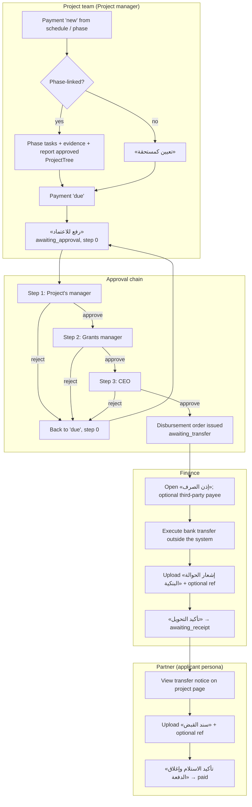
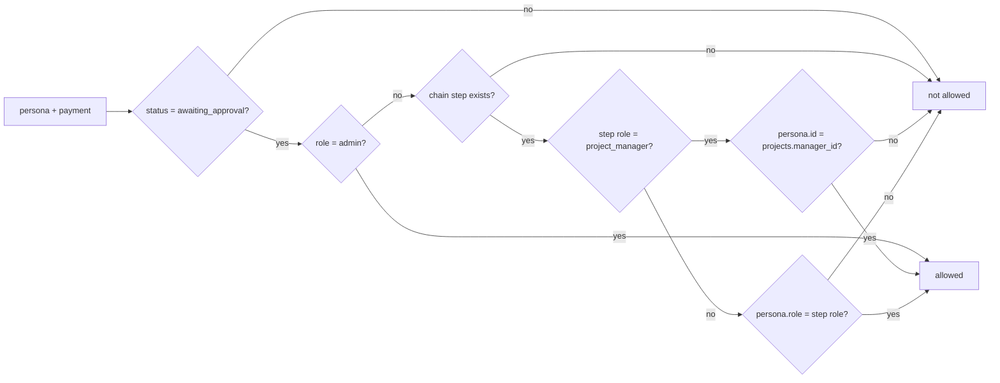

# FIN — Finance, Payments, Reporting & Analytics

## 1. Scope & Coverage

**Module boundary.** FIN covers the life of a project payment from the moment it is due, through the three-level approval chain, the disbursement order (إذن الصرف), the bank-transfer notice and the partner's receipt voucher, up to the payment being marked paid. It also covers the optional third-party payee, the payments register (`/finance`), the indicators dashboard (`/analytics`), the reports center (`/reports`), the per-partner commitments widget, and the money-split widget. FIN uses the money-split helpers in `src/lib/plans.ts` but does not own them: the plan budget rules belong to PLN.

**Files analyzed (all under `/home/user/manih`)**

| Area | Files |
|---|---|
| In scope (primary) | `src/routes/finance.tsx`, `src/lib/payments.ts`, `src/components/PaymentActions.tsx`, `src/components/DisbursementOrder.tsx`, `src/routes/reports.tsx`, `src/routes/analytics.tsx`, `src/components/CommitmentsChart.tsx`, `src/components/FinanceBreakdown.tsx` |
| Consumed helpers | `src/lib/plans.ts` (`usePlanData`, `splitByAllocations`, `projectBreakdown`, `buildPlanIndex`, `spendProgress`, `spendOfApproved`, `pct`), `src/lib/data.ts` (`PAYMENT_STATUS_LABELS/COLORS`, `PAYMENT_APPROVAL_CHAIN`, `formatSAR`, `formatDate`, `daysSince`, `downloadCSV`, `normalizeRegion`), `src/lib/queries.ts` (`usePayments`, `PaymentRow`) |
| Related / cross-module (read for behaviour) | `src/lib/attachments.ts` (`requireSlot`), `src/components/FileSlots.tsx` (`confirmIfFlagged`, slots), `src/lib/attachmentAi.functions.ts` (payment AI check), `src/lib/tasks.ts` (derived payment tasks), `src/lib/navCounts.ts`, `src/routes/tasks.tsx` (payment decisions from My Tasks), `src/lib/minutes.ts` (`bulkDecidePayments`), `src/lib/workflow.ts` (payment creation on transfer, deletion on unmerge), `src/components/ProjectTree.tsx` (phase payments and gating), `src/lib/projectPlan.ts` (payment locking on replan), `src/routes/projects.$id.tsx`, `src/routes/beneficiaries.$id.tsx`, `src/routes/plans.$id.summary.tsx`, `src/routes/plans.$id.index.tsx`, `src/components/AppShell.tsx`, `src/components/SectionTabs.tsx`, `src/components/DataTable.tsx`, `src/components/SmartFlow.tsx`, `src/lib/demoScript.ts`, `src/components/DemoGuide.tsx` |
| Schema | `src/integrations/supabase/types.ts` (`payments`, `payment_approvals`), `supabase/migrations/20261004093306_*.sql` (payments, payment_approvals, open RLS, seed), `20261004132647_*.sql` (minute_items, payment_approvals.minute_id), `20261007111454_*.sql` (payments.activity_id) |

**Coverage notes and limitations**
- This analysis comes from the source code only. The live demo was not inspected.
- Permissions are enforced in the UI only. Everyone signs in to one shared demo account and switches personas, and the RLS policies on `payments` and `payment_approvals` are `poc_open`, which allows everything. Role statements below therefore describe what the prototype UI does, not real access control.
- The generated types contain several `payments` columns that no repository migration creates: `payee_*`, `has_tax`, `disbursement_no`, `disbursement_at`, `transferred_at`, `received_at` and `evidence_ai` (ISS-FIN-12). Their DB constraints could not be verified.
- Host screens that belong to other modules are covered only for what FIN embeds in them: project detail and project tree (PRJ), partner profile (BEN), plan summary and plan levels (PLN), and My Tasks (TSK).
- The AI copilot `list_payments` tool (`src/routes/api/chat.ts:93-97`) is read-only and owned by PLT.

## 2. Screen Inventory

| Screen ID | Name (EN + Arabic label) | Route / Component | Roles | Purpose | Entry points | Exits / Navigates to |
|---|---|---|---|---|---|---|
| SCR-FIN-01 | Project Payments register — «دفعات المشاريع» (sidebar «الإدارة المالية», tab «الدفعات») | `/finance` — `src/routes/finance.tsx` | grants_manager, project_manager, finance, ceo, admin (via Projects section tab); no route guard | Follow every payment's status, amounts, due band and next actor; act on it | Projects › tab «الدفعات» (`PROJECT_TABS`); Projects nav item highlights for `/finance` (`AppShell.tsx:45`); Global search «المالية»; Workshop deck | `/projects/$id` (project link); SCR-FIN-02 actions; SCR-FIN-04 |
| SCR-FIN-02 | Payment Actions panel — «الإجراء» cell / payment node (embedded) | `src/components/PaymentActions.tsx` inside SCR-FIN-01 and PRJ project tree (`ProjectTree.tsx:200, 228`) | Staff by status (see §3); applicant on awaiting_receipt/paid | Next-step controls per status and persona | Register row; project detail timeline | SCR-FIN-03, SCR-FIN-04, file preview |
| SCR-FIN-03 | Payment approval dialog — «اعتماد صرف دفعة» | SmartFlow in `PaymentActions.tsx:59-80` | Eligible approver: project's manager (step 1), grants_manager (2), ceo (3), admin (any) | Review and approve or reject one chain step | «اعتماد (<role>)» button | Closes back to the host screen |
| SCR-FIN-04 | Disbursement order dialog — «إقرار صرف دفعة» / «إذن الصرف», with the payee editor «المستفيد من الصرف» | `src/components/DisbursementOrder.tsx` | Any staff persona viewing a payment after final approval | Show and print the authorized instruction to finance; set the payee | «إذن الصرف» button (status awaiting_transfer / awaiting_receipt / paid) | Browser print |
| SCR-FIN-05 | Indicators dashboard — «البيانات والتقارير» (tab «المؤشرات») | `/analytics` — `src/routes/analytics.tsx` | reviewer, grants_manager, finance, ceo, admin (sidebar «dashboard»); home page of ceo and committee_secretary (`persona.tsx:112-113`) | Executive KPIs and status charts; grant-opportunities table | Sidebar; role home; Global search «لوحة المؤشرات» | `/reports` (tab) |
| SCR-FIN-06 | Reports center — «البيانات والتقارير» (tab «التقارير التفصيلية») | `/reports` — `src/routes/reports.tsx` | Same as SCR-FIN-05 (reached through `DATA_TABS`); no route guard | Five ready-made reports with export and print | Tab on `/analytics`; Global search «التقارير» | `/reviewer/$id`, `/projects/$id`, `/beneficiaries/$id` (row click) |
| SCR-FIN-07 | Monthly commitments widget — «الالتزامات الشهرية: المخطط مقابل المصروف» (embedded) | `src/components/CommitmentsChart.tsx` on `/beneficiaries/$id` | Personas with access to partner profiles (reviewer, grants_manager, admin) | Planned versus paid by month, and the partner's arrears | Partner profile (BEN) | — |
| SCR-FIN-08 | Money split widget — «المصروف / المستحق / المعتمد / المتاح / محجوز مؤقتاً» (embedded) | `src/components/FinanceBreakdown.tsx` on `/plans/$id/summary`, `/plans/$id`, `/projects/$id` | Viewers of those pages (incl. applicant on own project detail) | Five-way money split bar | Host pages (PLN, PRJ) | — |

## 3. Screen Details

### SCR-FIN-01 — Project Payments register (`/finance`)
- **Header** [Observed `finance.tsx:85-92`]: the SectionTabs show Projects / Contracts / Payments. The title is «دفعات المشاريع» and the description restates the flow: «استحقاق ← اعتماد (مدير المشروع، مدير المنح، الرئيس التنفيذي) ← التحويل ← سند القبض». The action is «تصدير Excel», which actually produces a CSV file (ISS-FIN-14).
- **Status cards (5, clickable, toggle filter)** [Observed `finance.tsx:72-101`]:

| Card | Label | Value | Tone |
|---|---|---|---|
| overdue | «متأخرة (n)» | Σ amount of payments with a due band of *overdue*: status ≠ paid, due_date set, ceil((due − now)/day) < 0 | bad |
| open | «جديدة / مستحقة» | Σ amount where status ∈ {new, due} | — |
| approval | «بانتظار الاعتماد» | Σ amount where status = awaiting_approval | warn |
| transfer | «بانتظار التحويل/السند» | Σ amount where status ∈ {awaiting_transfer, awaiting_receipt} | — |
| paid | «مدفوعة» | Σ amount where status = paid | good |

- **Filters** [Observed `finance.tsx:63-71, 102-113`]: a status select with «كل الحالات» plus the 7 status labels, persisted by a saved view under the key `finance`. A card filter overrides the select, and changing the select clears the card filter. «إلغاء فلتر البطاقة» appears while a card filter is active. A row counter «N دفعة» is shown.
- **Table columns** [Observed `finance.tsx:116-142`]: رقم الدفعة (ref_no), المشروع (link), الجهة (partner name), الدفعة (title), المبلغ (SAR), الاستحقاق (date plus due-band pill), الحالة (status pill), بانتظار (waiting-on), الإجراء (SCR-FIN-02).
- **Due band** [Observed `finance.tsx:42-49`]: «متأخرة N يوم» (red) · «اليوم» / «خلال N أيام» (≤7, accent) · «خلال N يوم» (≤30) · «أكثر من شهر». No band is shown when the payment is paid or has no due date.
- **Waiting-on** [Observed `finance.tsx:51-59`]: new/due → «الجهة الشريكة / مدير المشروع»; awaiting_approval → the label of the current chain step; awaiting_transfer → «المالية (التحويل)»; awaiting_receipt → «الجهة الشريكة (سند القبض)»; otherwise «—».
- **States**: there is no loading skeleton or empty-state message; an empty list shows only the headers [Observed]. Query errors are not surfaced [Observed `queries.ts:88` throws; the page does not handle it]. Every row is shown regardless of tenant (ISS-FIN-08).

### SCR-FIN-02 — Payment Actions panel
The controls depend on persona and status [Observed `PaymentActions.tsx:33-105`]. "Finance" below means a persona with role finance or admin.

| Status | Partner (applicant) | Finance / admin | Other staff |
|---|---|---|---|
| new | nothing | «تعيين كمستحقة» | «تعيين كمستحقة» |
| due | nothing | «رفع للاعتماد» | «رفع للاعتماد» |
| awaiting_approval | nothing | approve button if eligible (admin always), else «بانتظار اعتماد <role>» | same, with eligibility per `canApprovePayment` |
| awaiting_transfer | nothing | «إذن الصرف» · «نفّذ التحويل ثم أرفق الحوالة» · transfer slot (upload) · transfer no. input · «تأكيد التحويل» | «إذن الصرف» · «لدى الإدارة المالية للتحويل» · transfer slot read-only |
| awaiting_receipt | transfer slot (read-only) · receipt slot (upload) · receipt no. input · «تأكيد الاستلام وإغلاق الدفعة» | «إذن الصرف» · «بانتظار سند القبض من الجهة الشريكة» · both slots read-only | same as finance |
| paid | both slots read-only | «إذن الصرف» · both slots read-only | same |
| cancelled / other | nothing | nothing | nothing |

- **Guard dialogs** [Observed `PaymentActions.tsx:29-32`]: before approval, transfer or receipt confirmation, a browser `confirm` lists any payment file (restricted to the relevant slot) or linked milestone (`activity_id`) evidence that the AI pre-check flagged `fail`. The user may continue.
- **Feedback**: success toasts are «أصبحت الدفعة مستحقة», «تم رفع الدفعة للاعتماد», «تم الاعتماد», «اعتُمدت وصدر إذن الصرف للمالية», «تم رفض الدفعة», «سُجل التحويل — بانتظار سند القبض من الجهة» and «أُغلقت الدفعة». Errors appear as a toast carrying the error message, for example «أرفق «إشعار الحوالة البنكية» أولاً» [Observed].
- **Embedded in the project tree**: a phase-linked payment shows «معلقة» with a hint naming the missing approvals until the phase is ready (`ProjectTree.tsx:446-463`) [Observed]. Advance and retention payments show as loose nodes (`ProjectTree.tsx:162, 207, 216`) [Observed].

### SCR-FIN-03 — Payment approval dialog
- Rows: payment title, المبلغ, الاستحقاق, «مستوى الاعتماد n من 3 (<role>)», and the AI evidence opinion labelled «(استشاري)». At the final step it adds «بعد الاعتماد يصدر إذن الصرف ويُحال للإدارة المالية.» [Observed `PaymentActions.tsx:71-78`].
- Buttons: finish «اعتماد», or «اعتماد وإصدار إذن الصرف» at the final step, plus «رفض». There is no note or reason field (ISS-FIN-04) [Observed].
- The AI opinion never renders because of a data-shape mismatch (ISS-FIN-09) [Observed].

### SCR-FIN-04 — Disbursement Order dialog
- **Header**: «إقرار صرف دفعة», then «رقم الإذن <disbursement_no> · <disbursement_at> · موجّه إلى الإدارة المالية» [Observed `DisbursementOrder.tsx:64-67`].
- **Sections** [Observed `DisbursementOrder.tsx:47-61`]:

| Section | Fields (source) |
|---|---|
| بيانات المستفيد | اسم الجهة, رقم الترخيص (license_no), الرقم الموحد (700) (entity_number), المنطقة, ممثل الجهة (primary active beneficiary_membership persona), رقم الجوال, البريد الإلكتروني (beneficiary email else rep email). Beneficiary = `projects.executor_beneficiary_id` ?? `beneficiary_id` |
| بيانات المشروع | رقم المشروع, اسم المشروع, المسؤول (manager persona), المنطقة, المجال (classification_group), البند (plan level «code - name») |
| بيانات الدفعة | [third-party only: المستفيد من الصرف = طرف ثالث; سبب الصرف لطرف ثالث] · المصرف · مسمى الحساب · رقم الآيبان (LTR) · لصالح (payment title) · رقم الدفعة · المبلغ · هل يوجد ضريبة؟ (has_tax) |

- **Approvals grid**: one box per chain step showing the role label, approver name and date, or «لم يعتمد» [Observed `DisbursementOrder.tsx:79-93`].
- **Payee editor** (hidden in print, and not shown when status is awaiting_receipt, paid or cancelled): toggle «الجهة الشريكة» / «طرف ثالث (مورّد / مشغّل)». The third-party fields are name, bank, IBAN (LTR, placeholder «SA.. الآيبان») and reason. «حفظ» validates that name, IBAN and reason are present, otherwise it shows «أكمل اسم المستفيد والآيبان والسبب»; on success it shows «حُفظ المستفيد من الصرف» [Observed `DisbursementOrder.tsx:103-129`].
- **Print**: «طباعة» calls `window.print()`, and print CSS strips the dialog chrome [Observed].
- **Loading**: compact `PageSkeleton` [Observed].

### SCR-FIN-05 — Indicators dashboard (`/analytics`)
- **Header**: «البيانات والتقارير», with the description «نظرة شاملة على دورة المنح من التقديم حتى الصرف» and the action «تقرير الفرص (Excel)», which downloads a CSV [Observed `analytics.tsx:89-90`].
- **KPI tiles, charts and table**: see the calculation catalogue in §6.4 (K-01…K-04, C-01…C-05, T-01).
- **States**: a donut with no data renders a grey ring labelled «لا توجد بيانات» with a total of 0. There is no loading state; the page renders with empty arrays [Observed `analytics.tsx:185-186`].
- **Filters**: none (no date, plan or tenant filter) [Observed].

### SCR-FIN-06 — Reports center (`/reports`)
- **Header**: «البيانات والتقارير» / «تقارير جاهزة قابلة للتصدير والطباعة», with the action «طباعة». In print, the selected report's title is shown and the selector buttons are hidden [Observed `reports.tsx:60-62`].
- **Report selector buttons**: «تنفيذ الخطة والموازنة» (default), «الطلبات حسب المرحلة», «تأخر المهام», «المشاريع والدفعات», «الجهات الشريكة» [Observed `reports.tsx:27-33`].
- **Plan selector** (plan report only): lists the organization's plans as «name (year)», defaulting to the active plan or else the first one [Observed `reports.tsx:41-43, 65`].
- **Shared DataTable features** [Observed `DataTable.tsx`]: search («بحث…»), column chooser «الأعمدة», saved view (hidden columns and page size), pagination, «تصدير» → XLSX (RTL) or CSV of the visible columns and filtered rows. File names: plan-execution, applications-by-stage, overdue-tasks, projects-payments, beneficiaries.
- **Empty state**: «لا توجد بيانات», or «لا توجد مهام متأخرة» for the tasks report.
- Columns and calculations: see §6.4 (R-01…R-05).

### SCR-FIN-07 — Monthly commitments widget
- Four tiles («إجمالي الالتزامات», «المصروف», «المتبقي», «مستحق ومتأخر») and a grouped bar chart «المخطط» against «المصروف» by month (Gregorian month labels in Arabic, Y axis in thousands). The empty state is «لا توجد دفعات مجدولة» [Observed `CommitmentsChart.tsx:29-56`]. Calculations: §6.4 (W-01).

### SCR-FIN-08 — Money split widget
- A stacked bar with segments paid (green), due (amber), approved (blue) and available (grey); width base = max(total, paid + due + approved, 1). Negative available is shown in red. Pending «محجوز مؤقتاً» is shown aside with a dashed violet marker and the tooltip «عليه موافقات — لا يلتزم بسقف البند ولا يُخصم من المتاح». The widget has default, `compact`, `bare` (amounts only, with `FinanceLegend` shared) and `hidePending` modes; `hidePending` also hides «المتاح» [Observed `FinanceBreakdown.tsx`]. Calculations: §6.4 (S-01…S-03).

## 4. Interaction Inventory

| INT ID | Screen | Trigger (control) | System response | Data written | Evidence |
|---|---|---|---|---|---|
| INT-FIN-001 | SCR-FIN-01 | Click a status card | Toggles the card filter; the active card gets a ring | — | `finance.tsx:94-100` [Observed] |
| INT-FIN-002 | SCR-FIN-01 | Status select | Filters by status and clears the card filter | — (until saved) | `finance.tsx:104-110` [Observed] |
| INT-FIN-003 | SCR-FIN-01 | SaveViewButton | Saves the status filter as a personal view | `user_view_prefs` | `finance.tsx:63, 103`; `viewPrefs.tsx` [Observed] |
| INT-FIN-004 | SCR-FIN-01 | «إلغاء فلتر البطاقة» | Clears the card filter | — | `finance.tsx:111` [Observed] |
| INT-FIN-005 | SCR-FIN-01 | «تصدير Excel» | Downloads payments.csv of the filtered list | — (file) | `finance.tsx:88-91` [Observed] |
| INT-FIN-006 | SCR-FIN-01 | Project title link | Navigates to `/projects/$id` | — | `finance.tsx:129` [Observed] |
| INT-FIN-007 | SCR-FIN-02 | «تعيين كمستحقة» | Status new → due; toast; payments and project queries invalidated | `payments.status` | `PaymentActions.tsx:55-56` [Observed] |
| INT-FIN-008 | SCR-FIN-02 | «رفع للاعتماد» | Status due → awaiting_approval at step 0; a derived task appears for the step-1 approver | `payments.status, approval_step` | `PaymentActions.tsx:57-58` [Observed] |
| INT-FIN-009 | SCR-FIN-02 | «اعتماد (<role>)» | Opens SCR-FIN-03 (only if eligible) | — | `PaymentActions.tsx:61-68` [Observed] |
| INT-FIN-010 | SCR-FIN-02 | Upload in «إشعار الحوالة البنكية» slot (finance/admin) | Stores the file | `attachment_files` (owner_type payment), storage bucket `attachments` | `PaymentActions.tsx:86`; `FileSlots.tsx` [Observed] |
| INT-FIN-011 | SCR-FIN-02 | AI check icon on a payment slot | Runs the advisory AI check for the slot | `payments.evidence_ai[slot]`, `attachment_files.ai_check` | `attachmentAi.functions.ts:60-84` [Observed] |
| INT-FIN-012 | SCR-FIN-02 | «تأكيد التحويل» (+ optional «رقم الحوالة») | Checks the transfer slot has a file; asks for confirmation if any file is AI-flagged; status → awaiting_receipt | `payments.status, transfer_ref, transferred_at` | `PaymentActions.tsx:87-91`; `payments.ts:37-40` [Observed] |
| INT-FIN-013 | SCR-FIN-02 | Upload in «سند القبض» slot (partner) | Stores the receipt file | `attachment_files` | `PaymentActions.tsx:44` [Observed] |
| INT-FIN-014 | SCR-FIN-02 | «تأكيد الاستلام وإغلاق الدفعة» (+ optional «رقم سند القبض») | Checks the receipt slot has a file; asks for confirmation if flagged; status → paid | `payments.status, receipt_ref, received_at` | `PaymentActions.tsx:45-50`; `payments.ts:43-46` [Observed] |
| INT-FIN-015 | SCR-FIN-02 | «إذن الصرف» | Opens SCR-FIN-04 | — | `DisbursementOrder.tsx:28-40` [Observed] |
| INT-FIN-016 | SCR-FIN-03 | «اعتماد» / «اعتماد وإصدار إذن الصرف» | Asks for confirmation if flagged; logs the decision; advances the step; at the final step sets awaiting_transfer and issues the disbursement number | `payment_approvals` (insert); `payments.approval_step, status, disbursement_no, disbursement_at` | `PaymentActions.tsx:65, 69`; `payments.ts:20-34` [Observed] |
| INT-FIN-017 | SCR-FIN-03 | «رفض» | Logs the rejection; status → due, step 0 | `payment_approvals`; `payments.status, approval_step` | `PaymentActions.tsx:65, 70`; `payments.ts:25` [Observed] |
| INT-FIN-018 | SCR-FIN-04 | Payee toggle «الجهة الشريكة» / «طرف ثالث» | Shows or hides the third-party fields | — | `DisbursementOrder.tsx:118-126` [Observed] |
| INT-FIN-019 | SCR-FIN-04 | «حفظ» (payee) | Validates, saves and refreshes the order | `payments.payee_type, payee_name, payee_bank, payee_iban, payee_reason` | `DisbursementOrder.tsx:107-113` [Observed] |
| INT-FIN-020 | SCR-FIN-04 | «طباعة» | Opens the browser print dialog | — | `DisbursementOrder.tsx:96` [Observed] |
| INT-FIN-021 | SCR-FIN-05 | «تقرير الفرص (Excel)» | Downloads periods-report.csv | — | `analytics.tsx:80-84` [Observed] |
| INT-FIN-022 | SCR-FIN-05 / 07 | Hover a chart | Shows an RTL tooltip with name and value (SAR in the commitments chart) | — | `analytics.tsx:159-176`; `CommitmentsChart.tsx:46` [Observed] |
| INT-FIN-023 | SCR-FIN-06 | Report selector button | Switches the report | — | `reports.tsx:61` [Observed] |
| INT-FIN-024 | SCR-FIN-06 | Plan select | Recomputes the plan report for the selected plan | — | `reports.tsx:65` [Observed] |
| INT-FIN-025 | SCR-FIN-06 | DataTable search / «الأعمدة» / «تصدير» XLSX or CSV / save view / paging | Filters, hides columns, exports or saves the view | `user_view_prefs` (on save) | `DataTable.tsx:40-150` [Observed] |
| INT-FIN-026 | SCR-FIN-06 | Row click (apps / projects / partners) | Navigates to `/reviewer/$id`, `/projects/$id` or `/beneficiaries/$id` | — | `reports.tsx:77, 94, 102` [Observed] |
| INT-FIN-027 | SCR-FIN-06 | «طباعة» | Prints the current report | — | `reports.tsx:60` [Observed] |

## 5. Shared Components & Dependencies

| Component / lib | Used for | Owner |
|---|---|---|
| `lib/payments.ts` | The only place payment transitions live (`canApprovePayment`, `approvePayment`, `recordTransfer`, `recordReceipt`, `setPayment`, slot names) | FIN |
| `PAYMENT_APPROVAL_CHAIN`, `PAYMENT_STATUS_LABELS/COLORS` (`lib/data.ts:351-375`) | Chain definition, labels and pill colors | FIN (constants in shared data file) |
| `PaymentActions.tsx` | Reused in `/finance` and the PRJ project tree | FIN |
| `DisbursementOrder.tsx` | Order dialog and payee editor | FIN |
| `FileSlots.tsx` + `lib/attachments.ts` + `attachmentAi.functions.ts` | Payment file slots, the required-slot check and the advisory AI check | PRJ / PLT (shared evidence infrastructure) |
| `SmartFlow.tsx` | Approval decision dialog | PLT |
| `lib/tasks.ts`, `lib/navCounts.ts`, `routes/tasks.tsx` | Derived payment approval tasks, badge counts, approve/reject from My Tasks | TSK |
| `lib/minutes.ts` (`bulkDecidePayments`) | Committee-minute bulk decision (unreachable in the UI) | REV / TSK |
| `lib/plans.ts` breakdown helpers + `FinanceBreakdown.tsx` | Money split and spend rates | PLN (rules), FIN (consumer and widget) |
| `lib/workflow.ts` `transferApplication` / `unmergeApplications` | Creates or deletes payments | REV / PRJ |
| `ProjectTree.tsx`, `lib/projectPlan.ts` | Phase-linked payments, milestone gating, replan locking | PRJ |
| `DataTable.tsx`, `viewPrefs.tsx`, `SectionTabs.tsx` (`PROJECT_TABS`, `DATA_TABS`) | Report tables, saved views, section tabs | PLT |
| `CommitmentsChart.tsx` | Widget on the partner profile | FIN (widget), BEN (host) |
| Recharts (`PieChart`, `BarChart`) | Dashboard and commitments charts | external lib |

## 6. Business Process Workflows

### 6.1 Payment state machine

```mermaid
stateDiagram-v2
    direction LR
    [*] --> new : transferApplication creates schedule payments\n(or ProjectTree/RFP phase payments)
    new --> due : Staff «تعيين كمستحقة»\nOR phase (milestone) approved in ProjectTree
    due --> awaiting_approval : Staff «رفع للاعتماد»\n[approval_step := 0]

    state awaiting_approval {
        direction LR
        [*] --> step1_PM
        step1_PM --> step2_GM : approve\n[actor = projects.manager_id OR admin]
        step2_GM --> step3_CEO : approve\n[role = grants_manager OR admin]
    }
    awaiting_approval --> due : reject at any step\n[approval_step := 0; payment_approvals 'rejected']
    awaiting_approval --> awaiting_transfer : approve step 3\n[role = ceo OR admin]\nissue disbursement order DSB-… (disbursement_no, disbursement_at)

    awaiting_transfer --> awaiting_transfer : Payee set/changed (partner ↔ third party)\n[name+IBAN+reason required for third party]
    awaiting_transfer --> awaiting_receipt : Finance «تأكيد التحويل»\n[≥1 file in «إشعار الحوالة البنكية»; role finance/admin (UI)]\ntransfer_ref?, transferred_at
    awaiting_receipt --> paid : Partner «تأكيد الاستلام وإغلاق الدفعة»\n[≥1 file in «سند القبض»; applicant persona (UI)]\nreceipt_ref?, received_at
    paid --> [*]

    note right of awaiting_approval
      Every decision → payment_approvals (step, approver, decision, note, minute_id)
      Derived task for the eligible approver (tasks.ts)
      AI-flagged files → confirm only (advisory)
    end note
    note left of new
      'cancelled' exists as a label but no transition sets it (ISS-FIN-11)
      'pending' used by demo data ≈ 'new'
    end note
```

Evidence: `payments.ts:6-49`, `PaymentActions.tsx:55-103`, `DisbursementOrder.tsx:94-113`, `ProjectTree.tsx:250`, `workflow.ts:187-190` [Observed]. All guards are enforced in the UI or the lib only; there is no DB or RLS enforcement (ISS-FIN-01).

### 6.2 End-to-end disbursement process (actors)

[Observed] The physical bank transfer happens outside the system [Inferred from `PaymentActions.tsx:85` «نفّذ التحويل ثم أرفق الحوالة»].

### 6.3 Approval eligibility decision (`canApprovePayment`)

Evidence: `payments.ts:6-13`; the same logic is duplicated in `tasks.ts:110-113` [Observed].

### 6.4 KPI, chart and report calculation catalogue (as observed)

Notation: Σ means the sum of `Number(amount)` or `requested_amount`. The status sets are PAID = {awaiting_receipt, paid} and DUE = {due, awaiting_approval, awaiting_transfer} (`plans.ts:380-381`).

**Money split and spend rates (consumed from PLN `plans.ts`)**

| ID | Indicator | Calculation | Where shown | Evidence |
|---|---|---|---|---|
| S-01 | Project split | paid = Σ PAID payments; due = Σ DUE payments; approved = max(0, budget − paid − due); available = 0; pending = 0 | Project detail «قيمة المشروع» (hidePending) | `plans.ts:385-389`; `projects.$id.tsx:159` |
| S-02 | Plan / level split | Per project under the level (and its descendants), split by allocation share sh: paid += PAID × sh; due += DUE × sh; approved += max(0, budget − (PAID+DUE) × sh). Then approved += Σ requested of applications with status approved that are not transferred; pending = Σ requested where status ∈ {submitted, under_review} (always 0, ISS-FIN-07); available = total − approved − due − paid. total = level amount, or plan budget for planBreakdown | Plan summary, plan levels, analytics hint, reports | `plans.ts:184-191, 425-443` |
| S-03 | Used / available (ceiling) | used = Σ project budgets under level + Σ requested of approved, non-transferred applications; available = level amount − used | Reports R-01, plan screens | `plans.ts:416-419` |
| S-04 | «الصرف من الموازنة» | min(100, planBreakdown.paid ÷ plan.budget × 100); 0 if budget = 0 | Plan summary, plans list | `plans.ts:448-452` |
| S-05 | «الصرف من المعتمد» | min(100, paid ÷ (approved + due + paid) × 100); 0 if base = 0 | Plan summary; analytics K-04 hint (all plans) | `plans.ts:454-459` |

**Payments register (SCR-FIN-01)**: cards F-01…F-05 as tabulated in §3 (`finance.tsx:35-81`).

**Dashboard (SCR-FIN-05, `analytics.tsx`)**. None of these are filtered by tenant or period (ISS-FIN-08).

| ID | Indicator | Calculation | Evidence |
|---|---|---|---|
| K-01 | «إجمالي الطلبات» (hint «N قيد الانتظار») | count(applications); hint = count(status = pending) | `analytics.tsx:92` |
| K-02 | «المبالغ المعتمدة» (hint «من ميزانيات X») | Σ requested_amount where status = approved; hint = Σ grant_programs.budget | `analytics.tsx:42-43, 51, 93` |
| K-03 | «المشاريع القائمة» | count(projects where status ∈ {planning, in_progress}) | `analytics.tsx:94` |
| K-04 | «المصروف فعلياً» (hint «الصرف من المعتمد — كل الخطط: P%») | Σ payments where status = paid; hint P = round(Σ over all plans of planBreakdown.paid ÷ Σ (approved + due + paid) × 100), shown only when the base > 0 | `analytics.tsx:44-50, 95` |
| C-01 | «حالة الطلبات» donut | count of applications per APPLICATION_STATUS_LABELS key, zero counts removed; centre = total | `analytics.tsx:53-58, 99` |
| C-02 | «الطلبات قيد الإجراء حسب المرحلة» bar | for stages 1, 2, 3: count(status = pending and current_stage = s) | `analytics.tsx:59-62, 100-110` |
| C-03 | «حالة المشاريع» donut | count per PROJECT_STATUS_LABELS | `analytics.tsx:63, 111` |
| C-04 | «حالة الدفعات المالية» donut | count per PAYMENT_STATUS_LABELS (counts, not amounts) | `analytics.tsx:64, 112` |
| C-05 | «الطلبات حسب منطقة التنفيذ» bar | count(applications) per normalizeRegion(region); blank regions skipped | `analytics.tsx:76-78, 113-123` |
| T-01 | «تقرير فرص المنح» table and CSV | per program: الميزانية = budget; الطلبات = count(apps of program); المعتمدة = count(approved) with rate = round(approved ÷ total × 100); قيمة المعتمد = Σ requested of approved; استهلاك الميزانية = round(approvedSum ÷ budget × 100), 0 if budget is 0. The CSV has 6 columns (no consumption column, but it has «نسبة الاعتماد %») | `analytics.tsx:66-74, 80-84, 126-145` |

**Reports (SCR-FIN-06, `reports.tsx`)**

| ID | Report | Rows | Columns and calculations | Evidence |
|---|---|---|---|---|
| R-01 | «تنفيذ الخطة والموازنة» (plan-execution) | Levels of the selected plan of the current tenant (bold if root; deeper levels are not indented) | الرمز; البند; المعتمد = level amount; المستخدم = used (S-03); المتاح = available (S-03, red if < 0); المصروف = breakdown.paid (S-02); الصرف من الموازنة = paid ÷ amount × 100; الصرف من المعتمد = paid ÷ (approved + due + paid) × 100 (rounded in export) | `reports.tsx:52-56, 64-75` |
| R-02 | «الطلبات حسب المرحلة» (applications-by-stage) | Applications of the tenant | رقم الطلب; المشروع; الجهة; المرحلة (STAGE_NAMES); أيام في المرحلة = daysSince(stage_entered_at), pending only; الحالة; القيمة = requested_amount | `reports.tsx:77-85` |
| R-03 | «تأخر المهام» (overdue-tasks) | manual_tasks of the tenant with status ≠ done and due_date < today | المهمة; المكلّف; الاستحقاق; أيام التأخير = daysSince(due_date) | `reports.tsx:48, 87-92` |
| R-04 | «المشاريع والدفعات» (projects-payments) | Projects of the tenant | رقم المشروع; المشروع; الميزانية; المدفوع = Σ payments where status = paid (excludes awaiting_receipt, unlike S-01); دفعات قيد الاعتماد = count(status = awaiting_approval) | `reports.tsx:94-100` |
| R-05 | «الجهات الشريكة» (beneficiaries) | All beneficiaries returned by useBeneficiaries (not tenant-filtered here) | الجهة; النوع (account_type); المنطقة; الطلبات = count(tenant apps of partner); المعتمد = Σ requested of approved tenant apps | `reports.tsx:102-108` |

**Commitments widget (SCR-FIN-07)**

| ID | Indicator | Calculation | Evidence |
|---|---|---|---|
| W-01a | «إجمالي الالتزامات» | Σ payments of the partner's projects (beneficiary or executor) with status ≠ cancelled | `CommitmentsChart.tsx:13, 23`; `beneficiaries.$id.tsx:75-77` |
| W-01b | «المصروف» | Σ where status = paid | `CommitmentsChart.tsx:24` |
| W-01c | «المتبقي» | total − paid | `CommitmentsChart.tsx:36` |
| W-01d | «مستحق ومتأخر» | Σ where status ≠ paid and due_date < today (string compare, UTC date) | `CommitmentsChart.tsx:25-26` |
| W-01e | Monthly bars | «المخطط»[month(due_date)] += amount; «المصروف»[month(received_at ?? transferred_at ?? due_date ?? created_at)] += amount for paid; months sorted ascending | `CommitmentsChart.tsx:14-22` |

**Navigation badge**: `/finance` and `/projects` badge = the number of derived payment-approval tasks for the current persona (`navCounts.ts:16-19`) [Observed].

## 7. Business Rules

| BR ID | Rule | Evidence label + reference |
|---|---|---|
| BR-FIN-01 | Payment status values: new, due, awaiting_approval, awaiting_transfer, awaiting_receipt, paid, cancelled (status is free text; default 'new'). Demo data also uses an undocumented 'pending' treated like 'new'. | [Observed] `src/lib/data.ts:351-359; migration 20261004093306:141; src/lib/demoScript.ts:84-86; src/components/ProjectTree.tsx:250` |
| BR-FIN-02 | Approval chain is fixed and sequential: step 1 Project manager → step 2 Grants manager → step 3 CEO. approval_step holds the index of the next step (0-3). | [Observed] `src/lib/data.ts:371-375` |
| BR-FIN-03 | Step 1 may be approved only by the persona who is the project's manager (projects.manager_id); steps 2-3 by any persona with the step role. | [Observed] `src/lib/payments.ts:9-12` |
| BR-FIN-04 | Admin may approve or reject at any step (bypass). | [Observed] `src/lib/payments.ts:8; src/lib/tasks.ts:113` |
| BR-FIN-05 | Rejection at any step returns the payment to 'due' with approval_step 0; resubmission restarts the full chain. | [Observed] `src/lib/payments.ts:25` |
| BR-FIN-06 | Every approve/reject decision is recorded in payment_approvals (step = approval_step + 1, approver, decision, note, minute_id). | [Observed] `src/lib/payments.ts:21-24` |
| BR-FIN-07 | Final approval sets status awaiting_transfer and issues the disbursement order: disbursement_no = 'DSB-' + ref_no without 'PAY-' (fallback id prefix), disbursement_at = now. | [Observed] `src/lib/payments.ts:26-33` |
| BR-FIN-08 | A transfer can be confirmed only if at least one file exists in slot 'إشعار الحوالة البنكية'; transfer_ref is optional. | [Observed] `src/lib/payments.ts:37-40; src/lib/attachments.ts:9-12` |
| BR-FIN-09 | Only finance or admin personas can upload the transfer notice and confirm the transfer (UI-level). | [Observed] `src/components/PaymentActions.tsx:35, 86-91` |
| BR-FIN-10 | Receipt can be confirmed only if at least one file exists in slot 'سند القبض'; confirming closes the payment (paid, received_at). | [Observed] `src/lib/payments.ts:43-46` |
| BR-FIN-11 | The partner (applicant persona) sees payment controls only when status is awaiting_receipt (upload + confirm) or paid (read-only). | [Observed] `src/components/PaymentActions.tsx:39-53` |
| BR-FIN-12 | AI pre-checks of payment files and milestone evidence are advisory: a flagged 'fail' triggers a confirmation but never blocks. | [Observed] `src/components/PaymentActions.tsx:28-32; src/components/FileSlots.tsx:45-53; AGENTS.md` |
| BR-FIN-13 | A third-party payee requires account name, IBAN and reason; bank name optional. | [Observed] `src/components/DisbursementOrder.tsx:108` |
| BR-FIN-14 | The payee can be changed only while the payment is not awaiting_receipt, paid or cancelled (effectively during awaiting_transfer). | [Observed] `src/components/DisbursementOrder.tsx:94` |
| BR-FIN-15 | The disbursement order's bank data is the third party's when payee_type = third_party, otherwise the paid entity's (project executor beneficiary if set, else contracting beneficiary). | [Observed] `src/components/DisbursementOrder.tsx:15, 46-58` |
| BR-FIN-16 | On transfer of an approved application to a project, one 'new' payment per payment-schedule line is created: amount = round(budget × percent/100), due = today + due_days; not for RFP programs (RFP payments are seeded per plan phase). | [Observed] `src/lib/workflow.ts:187-190; src/components/ProjectTree.tsx:105` |
| BR-FIN-17 | A phase-linked payment becomes 'due' when the phase is approved; its actions are locked until all phase tasks are approved, evidence accepted and the phase report approved. | [Observed] `src/components/ProjectTree.tsx:250, 446-463` |
| BR-FIN-18 | Payments past 'new'/'pending' are locked and cannot be changed by project replanning. | [Observed] `src/lib/projectPlan.ts:25, 118-121` |
| BR-FIN-19 | A payment approval task is derived (not stored) for each awaiting_approval payment of the user's tenant where the user is the eligible approver; due date = payment due date. | [Observed] `src/lib/tasks.ts:109-117` |
| BR-FIN-20 | Overdue = status ≠ paid and due date before now; due bands: today, ≤7 days, ≤30 days, > 1 month. | [Observed] `src/routes/finance.tsx:42-49` |
| BR-FIN-21 | Money split: paid = awaiting_receipt + paid; due = due + awaiting_approval + awaiting_transfer; approved = max(0, budget − paid − due) (+ approved, not-yet-transferred applications at plan level); available = total − approved − due − paid; pending (applications under review) is informational and never reduces the ceiling. | [Observed] `src/lib/plans.ts:376-389, 425-437; AGENTS.md` |
| BR-FIN-22 | Projects funded by several initiatives are split per project_plan_allocations; payments are attributed by allocation share (single-counted). | [Observed] `src/lib/plans.ts:184-191, 427-433` |
| BR-FIN-23 | Spend from budget = paid ÷ plan budget (cap 100%); spend from approved = paid ÷ (approved + due + paid) (cap 100%). | [Observed] `src/lib/plans.ts:448-459` |
| BR-FIN-24 | Commitments: cancelled payments excluded; planned by due month; paid by received_at → transferred_at → due_date → created_at month; overdue = unpaid with due date < today. | [Observed] `src/components/CommitmentsChart.tsx:13-26` |
| BR-FIN-25 | Payment decisions in My Tasks are approve or reject only (no 'return'); rejection requires a reason. | [Observed] `src/routes/tasks.tsx:83, 396` |
| BR-FIN-26 | Committee-minute bulk decisions on payments allow approve/reject only and record minute_id and minute_items per payment. | [Observed] `src/lib/minutes.ts:54-70` |
| BR-FIN-27 | Dashboard 'approved amounts' and opportunity 'approved value' use applications.requested_amount of approved applications; approval rate = approved ÷ total applications per program. | [Observed] `src/routes/analytics.tsx:42-43, 66-74` |
| BR-FIN-28 | Reports 'projects & payments' and partner 'paid' use status = 'paid' only, whereas the money split counts awaiting_receipt as paid. | [Observed] `src/routes/reports.tsx:98; src/routes/beneficiaries.$id.tsx:80; src/lib/plans.ts:380` |
| BR-FIN-29 | Approval authority, payee changes and state transitions must be enforced server-side with per-user identity; an approver cannot approve two steps of the same payment. | [Recommended] `Analyst proposal (see ISS-FIN-01, ISS-FIN-03)` |

## 8. Data Requirements

### 8.1 `payments` (owned by FIN; created by PRJ/REV flows)
Source: `migrations/20261004093306_*.sql:137-145`, `20261007111454_*.sql:9`, and `types.ts:1941-1966` for the columns that have no migration (ISS-FIN-12).

| Field | Type | Required | Meaning |
|---|---|---|---|
| id | uuid | Yes (PK) | Payment identifier |
| project_id | uuid → projects.id (cascade) | Yes | Project being paid |
| activity_id | uuid → project_activities.id (set null) | No | Phase/milestone the payment is linked to |
| ref_no | text unique | Auto | «PAY-…» set by the `set_ref_no('PAY', pay_seq)` trigger |
| title | text | Yes | Payment name, e.g. «الدفعة الأولى» |
| amount | numeric (default 0) | Yes | Payment amount in SAR |
| due_date | date | No | Date the payment falls due |
| status | text (default 'new') | Yes | new · due · awaiting_approval · awaiting_transfer · awaiting_receipt · paid · cancelled (and 'pending' in demo data) |
| approval_step | int (default 0) | Yes | Index of the next chain step (0-3) |
| disbursement_no / disbursement_at | text / timestamptz | Set at final approval | Disbursement order number and date |
| payee_type | text (default observed 'partner') | Yes | partner \| third_party |
| payee_name, payee_bank, payee_iban, payee_reason | text | Required (except bank) when third_party | Third-party payee details |
| has_tax | boolean | Yes | Shown on the order; no setter in the UI |
| transfer_ref / transferred_at | text / timestamptz | ref optional | Bank transfer reference and time |
| receipt_ref / received_at | text / timestamptz | ref optional | Partner receipt voucher number and time |
| evidence_ai | jsonb | No | Map {slot: AI check result} |
| created_at | timestamptz | Auto | Creation time |

**Relationships**: N:1 projects (and through it beneficiaries, contracts, plan_levels); 1:N payment_approvals; 1:N attachment_files (owner_type = 'payment'); 1:N minute_items.
**Lifecycle**: see §6.1.

### 8.2 `payment_approvals`
| Field | Type | Required | Meaning |
|---|---|---|---|
| id | uuid | PK | — |
| payment_id | uuid → payments (cascade) | Yes | Payment decided |
| step | int | Yes | 1-based chain step decided |
| approver_id | uuid → personas | No | Who decided |
| decision | text | Yes | approved \| rejected |
| note | text | No | Reason or comment (minute reference when bulk) |
| minute_id | uuid → committee_minutes (set null) | No | Committee minute, when the decision was taken in bulk |
| created_at | timestamptz | Auto | Decision time |

### 8.3 `attachment_files` (payment usage)
Rows with owner_type = 'payment' and owner_id = payments.id. The slots are «إشعار الحوالة البنكية» (TRANSFER_SLOT) and «سند القبض» (RECEIPT_SLOT). Each row carries an `ai_check` verdict (pass/warn/fail/skip/error). The bucket is `attachments` (`payments.ts:48-49`, `FileSlots.tsx`).

### 8.4 Derived (not stored)
- **Payment task** (`TaskItem` kind = 'payment'): id `payment:<id>:<step>`, title, description «<project> · اعتماد <role>», reference = ref_no, dueDate = payment due date (`tasks.ts:109-117`).
- **Breakdown** {total, pending, approved, due, paid, available} (`plans.ts:379`).

### 8.5 Read-only entities used by reports and the dashboard
applications (status, current_stage, stage_entered_at, requested_amount, region, program_id, plan_level_id, transferred), projects (budget, status, plan_level_id, manager_id, executor_beneficiary_id), project_plan_allocations, plans, plan_levels, grant_programs (budget), beneficiaries (name, license_no, entity_number, region, phone, email, bank_name, iban, classification_group, account_type), beneficiary_memberships, personas, manual_tasks, committee_minutes / minute_items.

## 9. Product Structure

**EP-FIN-01 — Payment Lifecycle & Approval**: Preparing project payments and taking them through the three-level approval chain (project manager, grants manager, CEO) with an auditable decision trail.

- FT-FIN-02 — Payment preparation (new → due → submitted for approval) (Must)
- FT-FIN-03 — Multi-level payment approval chain (Must)

**EP-FIN-02 — Disbursement & Settlement**: Issuing the disbursement order after final approval, choosing the payee (partner or third party), recording the bank transfer with its notice file and closing the payment with the partner's receipt voucher.

- FT-FIN-04 — Disbursement order (إذن الصرف) (Must)
- FT-FIN-05 — Third-party payee (Should)
- FT-FIN-06 — Bank transfer recording (Must)
- FT-FIN-07 — Partner receipt & payment closure (Must)

**EP-FIN-03 — Financial Monitoring**: Operational follow-up of payments (register, status cards, overdue tracking) and consistent money splits (available / pending / approved / due / paid) and commitments per partner.

- FT-FIN-01 — Payment register & status tracking (Must)
- FT-FIN-08 — Money split breakdown (consumer of PLN rules) (Must)
- FT-FIN-09 — Partner monthly commitments (Should)

**EP-FIN-04 — Reporting & Analytics**: Executive indicators dashboard and ready-made, exportable/printable reports on plan execution, applications, tasks, projects/payments and partners.

- FT-FIN-10 — Indicators dashboard (Should)
- FT-FIN-11 — Reports center (Should)

## 10. Features

### FT-FIN-01 — Payment register & status tracking

- **Feature ID:** FT-FIN-01 (Epic EP-FIN-03)
- **Name:** Payment register & status tracking
- **Description:** Single list of all project payments with status cards (amount sums), card/status filtering, due-date band, 'waiting on' actor, row-level next action and CSV export.
- **Business Objective:** Give finance and management one place to see where every payment sits in the lifecycle and who must act next.
- **Expected Business Value:** [To Confirm] Reduced payment delays and fewer follow-up calls; measurable via overdue amount trend.
- **Primary User Roles:** finance, grants_manager, project_manager, ceo, admin
- **Scope:** Payments list, 5 status cards, status filter with saved view, overdue/due-soon bands, waiting-on column, CSV export of current filtered list.
- **Out of Scope:** Payment creation/editing of amounts (PRJ), project budgets (PRJ), plan ceilings (PLN).
- **Functional Requirements:** FR-FIN-001, FR-FIN-002, FR-FIN-003, FR-FIN-004, FR-FIN-005, FR-FIN-006, FR-FIN-007
- **Business Rules:** BR-FIN-01, BR-FIN-20, BR-FIN-21
- **Dependencies:** PRJ (payments are created by project/contract flows), PLT (saved views, SectionTabs, navigation counts)
- **Related Screens:** SCR-FIN-01, SCR-FIN-02
- **User Stories:** US-FIN-001, US-FIN-002
- **Acceptance Criteria:**
  - Register lists every payment ordered by due date with ref, project, partner, title, amount, due date + band, status, waiting-on and action.
  - Clicking a status card filters the list to that card's statuses; clicking again clears it.
  - Export produces a CSV of exactly the rows currently shown with 11 columns.
- **Open Questions:** OQ-FIN-06, OQ-FIN-11
- **Assumptions:** Users see payments of their own organization only (not enforced in prototype — see ISS-FIN-08).
- **Priority Recommendation (MoSCoW):** Must

### FT-FIN-02 — Payment preparation (new → due → submitted for approval)

- **Feature ID:** FT-FIN-02 (Epic EP-FIN-01)
- **Name:** Payment preparation (new → due → submitted for approval)
- **Description:** Payments are generated from the contract payment schedule (or project plan phases) as 'new'; they become 'due' manually or automatically when the linked milestone is approved, then are submitted into the approval chain.
- **Business Objective:** Ensure only earned (due) payments enter the approval chain.
- **Expected Business Value:** [To Confirm] Payments tied to verified milestone delivery.
- **Primary User Roles:** project_manager, grants_manager, admin
- **Scope:** new→due manual action, milestone-approval auto-due, phase-payment gating in the project tree, due→awaiting_approval submission.
- **Out of Scope:** Payment schedule definition at application stage (REV/PRJ), replanning of payments (PRJ).
- **Functional Requirements:** FR-FIN-008, FR-FIN-009, FR-FIN-010, FR-FIN-011, FR-FIN-012
- **Business Rules:** BR-FIN-16, BR-FIN-17, BR-FIN-18
- **Dependencies:** PRJ (transferApplication, ProjectTree milestones, projectPlan replanning)
- **Related Screens:** SCR-FIN-01, SCR-FIN-02
- **User Stories:** US-FIN-003, US-FIN-004
- **Acceptance Criteria:**
  - A 'new' payment shows 'تعيين كمستحقة' to staff and moves to 'due' when clicked.
  - A 'due' payment shows 'رفع للاعتماد' and moves to 'awaiting_approval' with approval_step 0.
  - A phase-linked payment in the project tree stays locked until phase tasks are approved, evidence accepted and the phase report approved.
- **Open Questions:** OQ-FIN-01, OQ-FIN-02
- **Assumptions:** Project manager is the actor who submits payments (header text of /finance lists the chain starting at project manager).
- **Priority Recommendation (MoSCoW):** Must

### FT-FIN-03 — Multi-level payment approval chain

- **Feature ID:** FT-FIN-03 (Epic EP-FIN-01)
- **Name:** Multi-level payment approval chain
- **Description:** Sequential approval by project manager (of that project), grants manager and CEO. Approve advances the step; final approval moves to awaiting transfer and issues the disbursement order; reject returns the payment to 'due' and restarts the chain. Decisions are logged and surfaced as derived tasks.
- **Business Objective:** Enforce delegated financial authority before money leaves the organization.
- **Expected Business Value:** [To Confirm] Governance / audit compliance for disbursements.
- **Primary User Roles:** project_manager, grants_manager, ceo, admin, committee_secretary
- **Scope:** Eligibility check, approval dialog with advisory AI opinion, approve/reject, decision log, derived tasks + nav badge, approve/reject from My Tasks, committee-minute bulk decision (code present).
- **Out of Scope:** Configurable chains/thresholds per amount (not in prototype).
- **Functional Requirements:** FR-FIN-013, FR-FIN-014, FR-FIN-015, FR-FIN-016, FR-FIN-017, FR-FIN-018, FR-FIN-019, FR-FIN-020, FR-FIN-021, FR-FIN-022
- **Business Rules:** BR-FIN-02, BR-FIN-03, BR-FIN-04, BR-FIN-05, BR-FIN-06, BR-FIN-07, BR-FIN-12, BR-FIN-19, BR-FIN-25, BR-FIN-26, BR-FIN-29
- **Dependencies:** TSK (derived payment tasks, My Tasks decision sheet), REV (committee minutes infrastructure), PLT (personas)
- **Related Screens:** SCR-FIN-02, SCR-FIN-03
- **User Stories:** US-FIN-005, US-FIN-006, US-FIN-007, US-FIN-008, US-FIN-009
- **Acceptance Criteria:**
  - Only the persona matching the current step (or admin) sees the approve button; others see 'بانتظار اعتماد <role>'.
  - Approving step 3 of 3 sets status awaiting_transfer and generates a disbursement number DSB-….
  - Rejecting at any step sets status 'due' and approval_step 0 and logs a 'rejected' decision.
- **Open Questions:** OQ-FIN-03, OQ-FIN-04, OQ-FIN-05
- **Assumptions:** Chain is fixed for all amounts and programs.
- **Priority Recommendation (MoSCoW):** Must

### FT-FIN-04 — Disbursement order (إذن الصرف)

- **Feature ID:** FT-FIN-04 (Epic EP-FIN-02)
- **Name:** Disbursement order (إذن الصرف)
- **Description:** Printable disbursement order addressed to finance, generated at final approval, combining beneficiary, project, payment/bank data and the three approvals.
- **Business Objective:** Provide finance with an authorized, complete instruction to execute the transfer.
- **Expected Business Value:** [To Confirm] Replaces manual paper disbursement forms.
- **Primary User Roles:** finance, grants_manager, project_manager, ceo, admin
- **Scope:** Order number/date, three data sections, approvals grid, print.
- **Out of Scope:** Digital signature, PDF archiving of the order (not in prototype).
- **Functional Requirements:** FR-FIN-023, FR-FIN-024, FR-FIN-025, FR-FIN-026, FR-FIN-027
- **Business Rules:** BR-FIN-07, BR-FIN-15
- **Dependencies:** BEN (beneficiary bank/licence data, memberships), PLN (plan level code/name), PRJ (project manager, executor)
- **Related Screens:** SCR-FIN-04
- **User Stories:** US-FIN-010
- **Acceptance Criteria:**
  - 'إذن الصرف' button is visible only in awaiting_transfer, awaiting_receipt and paid.
  - Order shows number, date, beneficiary, project and payment sections and one approval box per chain step with approver name and date.
  - Print opens the browser print dialog with the order only.
- **Open Questions:** OQ-FIN-07, OQ-FIN-08
- **Assumptions:** Executor beneficiary (if any) is the paid entity rather than the contracting beneficiary.
- **Priority Recommendation (MoSCoW):** Must

### FT-FIN-05 — Third-party payee

- **Feature ID:** FT-FIN-05 (Epic EP-FIN-02)
- **Name:** Third-party payee
- **Description:** On the disbursement order, the payee can be switched from the partner to a third party (supplier/operator), capturing account name, bank, IBAN and justification; the order then prints those bank details.
- **Business Objective:** Support government-partnership and operator arrangements where funds go to a party other than the partner.
- **Expected Business Value:** [To Confirm]
- **Primary User Roles:** finance, grants_manager, admin
- **Scope:** Payee type toggle, mandatory name/IBAN/reason, save, order rendering.
- **Out of Scope:** Third-party vendor master data, IBAN validation service.
- **Functional Requirements:** FR-FIN-028, FR-FIN-029, FR-FIN-030, FR-FIN-031
- **Business Rules:** BR-FIN-13, BR-FIN-14, BR-FIN-15
- **Dependencies:** FT-FIN-04
- **Related Screens:** SCR-FIN-04
- **User Stories:** US-FIN-011
- **Acceptance Criteria:**
  - Saving a third-party payee without name, IBAN or reason shows 'أكمل اسم المستفيد والآيبان والسبب' and saves nothing.
  - After saving a third-party payee, the order shows 'المستفيد من الصرف: طرف ثالث', the reason, and the third party's bank, account name and IBAN.
  - The payee editor is hidden once the payment is awaiting_receipt, paid or cancelled.
- **Open Questions:** OQ-FIN-09, OQ-FIN-10
- **Assumptions:** Third-party payee is decided by finance/grants staff, not by the partner.
- **Priority Recommendation (MoSCoW):** Should

### FT-FIN-06 — Bank transfer recording

- **Feature ID:** FT-FIN-06 (Epic EP-FIN-02)
- **Name:** Bank transfer recording
- **Description:** Finance uploads the bank transfer notice (إشعار الحوالة البنكية) into a dedicated file slot, optionally enters the transfer reference and confirms the transfer, handing the payment to the partner for the receipt voucher.
- **Business Objective:** Evidence every transfer with a bank document.
- **Expected Business Value:** [To Confirm]
- **Primary User Roles:** finance, admin
- **Scope:** Transfer slot upload, optional transfer ref, confirm transfer, advisory AI check.
- **Out of Scope:** Bank integration / payment file generation (not in prototype).
- **Functional Requirements:** FR-FIN-032, FR-FIN-033, FR-FIN-034
- **Business Rules:** BR-FIN-08, BR-FIN-09, BR-FIN-12
- **Dependencies:** PLT/PRJ shared FileSlots + attachments (attachment_files), AI attachment check (attachmentAi.functions.ts)
- **Related Screens:** SCR-FIN-02
- **User Stories:** US-FIN-012
- **Acceptance Criteria:**
  - Confirming the transfer without a file in the transfer slot fails with 'أرفق «إشعار الحوالة البنكية» أولاً'.
  - With a file attached, confirming sets status awaiting_receipt, transfer_ref (or null) and transferred_at.
  - Non-finance staff see the transfer slot read-only and the text 'لدى الإدارة المالية للتحويل'.
- **Open Questions:** OQ-FIN-08, OQ-FIN-12
- **Assumptions:** Transfer amount equals the payment amount (no partial transfers).
- **Priority Recommendation (MoSCoW):** Must

### FT-FIN-07 — Partner receipt & payment closure

- **Feature ID:** FT-FIN-07 (Epic EP-FIN-02)
- **Name:** Partner receipt & payment closure
- **Description:** The partner (applicant persona) sees the transfer notice, uploads the receipt voucher (سند القبض), optionally enters its number and confirms receipt, which closes the payment as paid.
- **Business Objective:** Close the loop with the partner's acknowledgement of funds received.
- **Expected Business Value:** [To Confirm]
- **Primary User Roles:** applicant, finance, grants_manager
- **Scope:** Partner view of transfer notice, receipt slot upload, confirm receipt, post-settlement read-only file view for staff.
- **Out of Scope:** Partner-side payment list in the portal (partner reaches payments through project detail only).
- **Functional Requirements:** FR-FIN-035, FR-FIN-036, FR-FIN-037
- **Business Rules:** BR-FIN-10, BR-FIN-11, BR-FIN-12
- **Dependencies:** PTL (portal → project detail), PRJ (ProjectTree hosts PaymentActions)
- **Related Screens:** SCR-FIN-02
- **User Stories:** US-FIN-013, US-FIN-014
- **Acceptance Criteria:**
  - Partner sees no payment actions before awaiting_receipt.
  - Confirming receipt without a receipt file fails with 'أرفق «سند القبض» أولاً'.
  - With a receipt file, confirming sets status paid, receipt_ref and received_at and shows 'أُغلقت الدفعة'.
- **Open Questions:** OQ-FIN-13
- **Assumptions:** Receipt must come from the partner even when a third party was paid. [To Confirm]
- **Priority Recommendation (MoSCoW):** Must

### FT-FIN-08 — Money split breakdown (consumer of PLN rules)

- **Feature ID:** FT-FIN-08 (Epic EP-FIN-03)
- **Name:** Money split breakdown (consumer of PLN rules)
- **Description:** Shared five-way money split (available / pending / approved / due / paid) for plans, plan levels and projects, rendered by FinanceBreakdown, plus the two spend-rate indicators.
- **Business Objective:** One consistent financial vocabulary across plans, projects and dashboards.
- **Expected Business Value:** [To Confirm]
- **Primary User Roles:** grants_manager, finance, ceo, project_manager, admin, applicant
- **Scope:** projectBreakdown, plan/level breakdownOf (incl. multi-initiative shares), spendProgress, spendOfApproved, stacked bar + legend + pending aside.
- **Out of Scope:** Plan budget rules, adjustments, endowments (owned by PLN).
- **Functional Requirements:** FR-FIN-038, FR-FIN-039, FR-FIN-040, FR-FIN-041
- **Business Rules:** BR-FIN-21, BR-FIN-22, BR-FIN-23
- **Dependencies:** PLN (plans.ts budget math, plan screens), PRJ (project detail, project_plan_allocations)
- **Related Screens:** SCR-FIN-08
- **User Stories:** US-FIN-015, US-FIN-016
- **Acceptance Criteria:**
  - For a project, paid = Σ awaiting_receipt+paid, due = Σ due+awaiting_approval+awaiting_transfer, approved = max(0, budget − paid − due).
  - Negative available is shown in red.
  - Pending appears separately as 'محجوز مؤقتاً' and never reduces available.
- **Open Questions:** OQ-FIN-14
- **Assumptions:** 'Paid' in the split means 'transferred' (awaiting_receipt counts as paid).
- **Priority Recommendation (MoSCoW):** Must

### FT-FIN-09 — Partner monthly commitments

- **Feature ID:** FT-FIN-09 (Epic EP-FIN-03)
- **Name:** Partner monthly commitments
- **Description:** Per-partner monthly bar chart of planned (by due month) versus paid (by payment month) amounts with four KPI tiles, shown on the partner profile.
- **Business Objective:** Show the financial relationship and arrears with a partner at a glance.
- **Expected Business Value:** [To Confirm]
- **Primary User Roles:** reviewer, grants_manager, admin
- **Scope:** Chart + 4 tiles from the partner's project payments (excluding cancelled).
- **Out of Scope:** Partner profile screen itself (BEN).
- **Functional Requirements:** FR-FIN-042, FR-FIN-043
- **Business Rules:** BR-FIN-24
- **Dependencies:** BEN (/beneficiaries/$id host page)
- **Related Screens:** SCR-FIN-07
- **User Stories:** US-FIN-017
- **Acceptance Criteria:**
  - Planned bars group payments by due-date month; paid bars group paid payments by received_at, else transferred_at, else due date, else created date.
  - Tiles show total commitments, paid, remaining (= total − paid) and overdue (unpaid with due date before today).
  - With no payments, the message 'لا توجد دفعات مجدولة' is shown.
- **Open Questions:** OQ-FIN-14
- **Assumptions:** None
- **Priority Recommendation (MoSCoW):** Should

### FT-FIN-10 — Indicators dashboard

- **Feature ID:** FT-FIN-10 (Epic EP-FIN-04)
- **Name:** Indicators dashboard
- **Description:** Executive dashboard with 4 KPI tiles, application status donut, in-progress applications by stage, project status donut, payment status donut, applications by region and the grant-opportunities table with CSV export.
- **Business Objective:** Give leadership a one-page view of the grant cycle from application to disbursement.
- **Expected Business Value:** [To Confirm]
- **Primary User Roles:** ceo, grants_manager, finance, reviewer, admin
- **Scope:** KPIs, 5 charts, opportunities table, CSV export.
- **Out of Scope:** Drill-down from charts, date-range filters (not in prototype).
- **Functional Requirements:** FR-FIN-044, FR-FIN-045, FR-FIN-046, FR-FIN-047, FR-FIN-048, FR-FIN-049
- **Business Rules:** BR-FIN-23, BR-FIN-27
- **Dependencies:** REV/PRG (applications, programs, stages), PRJ (projects), PLN (plan breakdown)
- **Related Screens:** SCR-FIN-05
- **User Stories:** US-FIN-018, US-FIN-019
- **Acceptance Criteria:**
  - KPI 'المصروف فعلياً' equals Σ amount of payments with status paid.
  - Opportunity row 'نسبة الاعتماد' = approved applications ÷ total applications of the program, rounded.
  - 'تقرير الفرص (Excel)' downloads periods-report.csv with 6 columns.
- **Open Questions:** OQ-FIN-11, OQ-FIN-14, OQ-FIN-15
- **Assumptions:** Dashboard should be organization-scoped (not in prototype).
- **Priority Recommendation (MoSCoW):** Should

### FT-FIN-11 — Reports center

- **Feature ID:** FT-FIN-11 (Epic EP-FIN-04)
- **Name:** Reports center
- **Description:** Five ready-made tabular reports (plan & budget execution, applications by stage, overdue tasks, projects & payments, partners) with search, column chooser, saved view, pagination, XLSX/CSV export and print.
- **Business Objective:** Provide exportable operational and financial reports without ad-hoc data extraction.
- **Expected Business Value:** [To Confirm]
- **Primary User Roles:** grants_manager, finance, ceo, reviewer, admin
- **Scope:** Report switcher, plan selector, 5 report definitions, shared DataTable features, page print.
- **Out of Scope:** Custom report builder, scheduled reports.
- **Functional Requirements:** FR-FIN-050, FR-FIN-051, FR-FIN-052, FR-FIN-053, FR-FIN-054, FR-FIN-055, FR-FIN-056
- **Business Rules:** BR-FIN-21, BR-FIN-23, BR-FIN-28
- **Dependencies:** PLT (DataTable, saved views), PLN (buildPlanIndex), TSK (manual_tasks), BEN (beneficiaries)
- **Related Screens:** SCR-FIN-06
- **User Stories:** US-FIN-020, US-FIN-021, US-FIN-022
- **Acceptance Criteria:**
  - Plan report lists every level of the selected plan with approved, used, available, paid and the two spend percentages.
  - Clicking a row in the applications/projects/partners report opens the corresponding detail page.
  - Each report can be exported to XLSX and CSV with the visible columns and filtered rows.
- **Open Questions:** OQ-FIN-11, OQ-FIN-14
- **Assumptions:** None
- **Priority Recommendation (MoSCoW):** Should

## 11. Functional Requirements

### FR-FIN-001

- **Statement:** The system shall list all project payments ordered by due date with reference, project (link), partner, payment title, amount, due date with due band, status, waiting-on actor and next action.
- **Description:** Rows come from usePayments (payments joined to projects and beneficiaries). Project title links to /projects/$id.
- **Type:** Functional
- **Source / Prototype reference:** `src/routes/finance.tsx:114-145; src/lib/queries.ts:80-92`
- **Related Feature:** FT-FIN-01
- **Related Story:** US-FIN-001
- **Priority:** Must
- **Dependencies:** PRJ payments data
- **Acceptance Criteria:**
  - Given payments exist When the user opens /finance Then each payment is listed once sorted by due_date ascending
  - Given a row When the project title is clicked Then the project detail opens
- **Validation Rules:** Amounts formatted as SAR with no decimals (formatSAR).
- **Exceptions & Alternative Flows:** No loading/empty state is rendered for the table — an empty table body is shown.
- **Open Questions:** None
- **Evidence:** [Observed]

### FR-FIN-002

- **Statement:** The system shall show five clickable status cards with the total amount per group: Overdue (with count), New/Due, Awaiting approval, Awaiting transfer/receipt, Paid.
- **Description:** Groups: open = new+due; approval = awaiting_approval; transfer = awaiting_transfer+awaiting_receipt; paid = paid; overdue = any non-paid payment whose due date has passed. Clicking a card filters the list; clicking the active card clears it.
- **Type:** Reporting
- **Source / Prototype reference:** `src/routes/finance.tsx:35-40, 72-101`
- **Related Feature:** FT-FIN-01
- **Related Story:** US-FIN-001
- **Priority:** Must
- **Dependencies:** None
- **Acceptance Criteria:**
  - Given 2 payments in 'due' of 10,000 and 5,000 When the page loads Then card 'جديدة / مستحقة' shows 15,000 SAR
  - Given the 'paid' card is active When it is clicked again Then all payments are shown
- **Validation Rules:** Card sums use Number(amount).
- **Exceptions & Alternative Flows:** Cancelled payments are not included in any card.
- **Open Questions:** OQ-FIN-06
- **Evidence:** [Observed]

### FR-FIN-003

- **Statement:** The system shall filter the register by payment status and allow the user to save the selected status as a personal view.
- **Description:** Select includes 'كل الحالات' plus all 7 status labels. Changing the select clears any card filter; card filter takes precedence over the select. Row count shown ('N دفعة').
- **Type:** UI
- **Source / Prototype reference:** `src/routes/finance.tsx:63-71, 102-112; src/lib/viewPrefs.tsx`
- **Related Feature:** FT-FIN-01
- **Related Story:** US-FIN-001
- **Priority:** Should
- **Dependencies:** PLT saved views
- **Acceptance Criteria:**
  - Given status 'awaiting_transfer' is selected When the list renders Then only awaiting_transfer payments are shown
  - Given a saved view When the user returns Then the saved status is pre-selected
- **Validation Rules:** None specific
- **Exceptions & Alternative Flows:** None observed
- **Open Questions:** None
- **Evidence:** [Observed]

### FR-FIN-004

- **Statement:** The system shall compute a due band for each unpaid payment: 'متأخرة N يوم' (overdue), 'اليوم', 'خلال N أيام' (≤7), 'خلال N يوم' (≤30) or 'أكثر من شهر'.
- **Description:** days = ceil((due_date − now)/1 day). Paid payments and payments without a due date have no band.
- **Type:** Functional
- **Source / Prototype reference:** `src/routes/finance.tsx:42-49`
- **Related Feature:** FT-FIN-01
- **Related Story:** US-FIN-001
- **Priority:** Should
- **Dependencies:** None
- **Acceptance Criteria:**
  - Given an unpaid payment due 3 days ago When listed Then the band shows 'متأخرة 3 يوم' in destructive color and it counts in the Overdue card
  - Given a paid payment When listed Then no band is shown
- **Validation Rules:** None specific
- **Exceptions & Alternative Flows:** Cancelled payments are treated as unpaid and can appear as overdue (ISS-FIN-18).
- **Open Questions:** None
- **Evidence:** [Observed]

### FR-FIN-005

- **Statement:** The system shall display who the payment is waiting on, derived from its status and approval step.
- **Description:** new/due → partner / project manager; awaiting_approval → label of current chain step; awaiting_transfer → finance (transfer); awaiting_receipt → partner (receipt voucher); otherwise '—'.
- **Type:** UI
- **Source / Prototype reference:** `src/routes/finance.tsx:51-59`
- **Related Feature:** FT-FIN-01
- **Related Story:** US-FIN-001
- **Priority:** Should
- **Dependencies:** None
- **Acceptance Criteria:**
  - Given a payment awaiting approval at step 1 When listed Then 'بانتظار' shows 'مدير المنح'
  - Given a payment awaiting_receipt When listed Then 'بانتظار' shows 'الجهة الشريكة (سند القبض)'
- **Validation Rules:** None specific
- **Exceptions & Alternative Flows:** None observed
- **Open Questions:** None
- **Evidence:** [Observed]

### FR-FIN-006

- **Statement:** The system shall export the currently filtered payment list to a UTF-8 CSV file named payments.csv.
- **Description:** Columns: ref, project, partner, payment, amount, due date, due band, status, waiting-on, transfer ref, receipt ref. File has BOM for Excel Arabic support. Button label says Excel but file is CSV.
- **Type:** Reporting
- **Source / Prototype reference:** `src/routes/finance.tsx:88-91; src/lib/data.ts:411-423`
- **Related Feature:** FT-FIN-01
- **Related Story:** US-FIN-002
- **Priority:** Should
- **Dependencies:** None
- **Acceptance Criteria:**
  - Given a card filter is active When 'تصدير Excel' is clicked Then payments.csv contains only the filtered rows
  - Given any export When opened in Excel Then Arabic text renders correctly
- **Validation Rules:** None specific
- **Exceptions & Alternative Flows:** None observed
- **Open Questions:** None
- **Evidence:** [Observed]

### FR-FIN-007

- **Statement:** The system shall restrict the payment register and its totals to the signed-in user's organization and to roles authorized to view finance data.
- **Description:** Prototype loads all payments without tenant filter and has no route guard.
- **Type:** Security
- **Source / Prototype reference:** `src/lib/queries.ts:80-92; src/routes/finance.tsx:62`
- **Related Feature:** FT-FIN-01
- **Related Story:** US-FIN-001
- **Priority:** Must
- **Dependencies:** PLT authentication / per-user auth
- **Acceptance Criteria:**
  - Given payments of two organizations When a user of org A opens /finance Then only org A payments and sums appear
  - Given an applicant persona When navigating to /finance Then access is denied
- **Validation Rules:** None specific
- **Exceptions & Alternative Flows:** None observed
- **Open Questions:** OQ-FIN-11
- **Evidence:** [Recommended]

### FR-FIN-008

- **Statement:** The system shall generate payments in status 'new' when an approved application is transferred to a project, one per payment-schedule line, with amount = round(project budget × percent / 100) and due date = transfer date + due_days.
- **Description:** Not generated for RFP programs; RFP projects get phase-linked payments seeded from the program's rfp_payments percentages. Projects created by phases (ProjectTree plan apply / replan) also create phase-linked payments.
- **Type:** Integration
- **Source / Prototype reference:** `src/lib/workflow.ts:187-190; src/components/ProjectTree.tsx:91-105; src/lib/projectPlan.ts:117-121`
- **Related Feature:** FT-FIN-02
- **Related Story:** US-FIN-003
- **Priority:** Must
- **Dependencies:** PRJ transferApplication
- **Acceptance Criteria:**
  - Given a schedule of 30%/70% and budget 100,000 When transferred Then two 'new' payments of 30,000 and 70,000 are created
  - Given an RFP program When transferred Then schedule-based payments are not created
- **Validation Rules:** None specific
- **Exceptions & Alternative Flows:** Merging is undone → payments of the removed projects are deleted (workflow.ts:351).
- **Open Questions:** None
- **Evidence:** [Observed]

### FR-FIN-009

- **Statement:** The system shall allow staff to mark a 'new' payment as due.
- **Description:** Button 'تعيين كمستحقة' sets status = due. Available to any non-applicant persona; no role or evidence check.
- **Type:** Functional
- **Source / Prototype reference:** `src/components/PaymentActions.tsx:55-56`
- **Related Feature:** FT-FIN-02
- **Related Story:** US-FIN-003
- **Priority:** Must
- **Dependencies:** None
- **Acceptance Criteria:**
  - Given a 'new' payment When staff click 'تعيين كمستحقة' Then status becomes 'due' and toast 'أصبحت الدفعة مستحقة' is shown
  - Given an applicant persona When viewing a 'new' payment Then no action is shown
- **Validation Rules:** None specific
- **Exceptions & Alternative Flows:** Database error → error toast with message.
- **Open Questions:** OQ-FIN-01
- **Evidence:** [Observed]

### FR-FIN-010

- **Statement:** The system shall make a milestone-linked payment due automatically when its project phase is approved, and lock the payment's actions in the project tree until phase tasks, evidence and phase report are approved.
- **Description:** Phase approval updates payments with activity_id = phase and status in (new, pending) to due. PhasePayment shows 'معلقة' with the missing items otherwise.
- **Type:** Functional
- **Source / Prototype reference:** `src/components/ProjectTree.tsx:250, 446-463`
- **Related Feature:** FT-FIN-02
- **Related Story:** US-FIN-003
- **Priority:** Must
- **Dependencies:** PRJ ProjectTree
- **Acceptance Criteria:**
  - Given a phase with an unapproved report When viewing its payment Then the payment shows locked with 'بانتظار اعتماد تقرير المرحلة'
  - Given all phase items approved When the phase is approved Then the linked payment becomes 'due'
- **Validation Rules:** None specific
- **Exceptions & Alternative Flows:** On /finance the same payment can be marked due manually, bypassing the gating (ISS-FIN-15).
- **Open Questions:** OQ-FIN-02
- **Evidence:** [Observed]

### FR-FIN-011

- **Statement:** The system shall allow staff to submit a due payment for approval, setting status awaiting_approval and approval step 0.
- **Description:** Button 'رفع للاعتماد'. No role check beyond non-applicant.
- **Type:** Functional
- **Source / Prototype reference:** `src/components/PaymentActions.tsx:57-58`
- **Related Feature:** FT-FIN-02
- **Related Story:** US-FIN-004
- **Priority:** Must
- **Dependencies:** None
- **Acceptance Criteria:**
  - Given a 'due' payment When 'رفع للاعتماد' is clicked Then status = awaiting_approval, approval_step = 0
  - Given the submission succeeds Then the project manager of the project receives a derived approval task
- **Validation Rules:** None specific
- **Exceptions & Alternative Flows:** None observed
- **Open Questions:** None
- **Evidence:** [Observed]

### FR-FIN-012

- **Statement:** The system shall restrict marking payments due and submitting them for approval to authorized roles and shall apply the same milestone gating on every screen.
- **Type:** Security
- **Source / Prototype reference:** `Analyst proposal`
- **Related Feature:** FT-FIN-02
- **Related Story:** US-FIN-003, US-FIN-004
- **Priority:** Should
- **Dependencies:** FR-FIN-009, FR-FIN-010, FR-FIN-011
- **Acceptance Criteria:**
  - Given a reviewer persona When viewing a 'new' payment Then no state-changing action is offered
  - Given a phase-linked payment whose phase is not approved When viewed on /finance Then 'تعيين كمستحقة' is not available
- **Validation Rules:** None specific
- **Exceptions & Alternative Flows:** None observed
- **Open Questions:** OQ-FIN-01
- **Evidence:** [Recommended]

### FR-FIN-013

- **Statement:** The system shall apply a fixed three-step payment approval chain: 1 Project manager, 2 Grants manager, 3 CEO.
- **Description:** PAYMENT_APPROVAL_CHAIN; approval_step stores the index of the next step (0..3).
- **Type:** Data
- **Source / Prototype reference:** `src/lib/data.ts:371-375`
- **Related Feature:** FT-FIN-03
- **Related Story:** US-FIN-005, US-FIN-006
- **Priority:** Must
- **Dependencies:** None
- **Acceptance Criteria:**
  - Given a payment at approval_step 0 When listed Then waiting-on shows 'مدير المشروع'
  - Given approval_step 2 When the dialog opens Then it shows 'مستوى الاعتماد 3 من 3 (الرئيس التنفيذي)'
- **Validation Rules:** None specific
- **Exceptions & Alternative Flows:** None observed
- **Open Questions:** OQ-FIN-03
- **Evidence:** [Observed]

### FR-FIN-014

- **Statement:** The system shall allow a persona to act on an awaiting-approval payment only if it is admin, or it is the project's manager at step 1, or its role equals the step role at steps 2-3.
- **Description:** canApprovePayment; non-eligible personas see 'بانتظار اعتماد <label>'. Check is UI-only; approvePayment does not re-check.
- **Type:** Security
- **Source / Prototype reference:** `src/lib/payments.ts:6-13; src/components/PaymentActions.tsx:59-62`
- **Related Feature:** FT-FIN-03
- **Related Story:** US-FIN-005, US-FIN-006
- **Priority:** Must
- **Dependencies:** PLT personas
- **Acceptance Criteria:**
  - Given step 1 and a project_manager who is not the project's manager When viewing Then no approve button is shown
  - Given an admin When viewing at any step Then the approve button is shown
- **Validation Rules:** None specific
- **Exceptions & Alternative Flows:** None observed
- **Open Questions:** OQ-FIN-04
- **Evidence:** [Observed]

### FR-FIN-015

- **Statement:** The system shall present an approval dialog showing payment title, amount, due date, approval level 'n of 3 (role)', the AI evidence opinion marked advisory, and—at the final step—a note that the disbursement order will be issued to finance.
- **Description:** SmartFlow dialog 'اعتماد صرف دفعة' with Approve (finish) and Reject (extra action).
- **Type:** UI
- **Source / Prototype reference:** `src/components/PaymentActions.tsx:63-79`
- **Related Feature:** FT-FIN-03
- **Related Story:** US-FIN-005, US-FIN-006
- **Priority:** Must
- **Dependencies:** None
- **Acceptance Criteria:**
  - Given the final step When the dialog opens Then the finish label is 'اعتماد وإصدار إذن الصرف' and the finance hand-off note is shown
  - Given no AI check When the dialog opens Then it shows 'لا يوجد فحص للشواهد (استشاري)'
- **Validation Rules:** None specific
- **Exceptions & Alternative Flows:** The AI opinion is read from evidence_ai.summary but evidence_ai is stored as a per-slot map, so it never displays (ISS-FIN-09).
- **Open Questions:** None
- **Evidence:** [Observed]

### FR-FIN-016

- **Statement:** The system shall, on approval, increment the approval step; if the chain is complete it shall set status awaiting_transfer and issue the disbursement order (number and timestamp), otherwise keep status awaiting_approval.
- **Description:** Disbursement number = 'DSB-' + ref_no without the 'PAY-' prefix (fallback first 8 chars of id).
- **Type:** Functional
- **Source / Prototype reference:** `src/lib/payments.ts:20-34`
- **Related Feature:** FT-FIN-03
- **Related Story:** US-FIN-005, US-FIN-006
- **Priority:** Must
- **Dependencies:** None
- **Acceptance Criteria:**
  - Given step 0 When the project manager approves Then approval_step = 1 and status stays awaiting_approval
  - Given step 2 and ref PAY-000123 When the CEO approves Then status = awaiting_transfer, disbursement_no = 'DSB-000123', disbursement_at = now
- **Validation Rules:** None specific
- **Exceptions & Alternative Flows:** None observed
- **Open Questions:** None
- **Evidence:** [Observed]

### FR-FIN-017

- **Statement:** The system shall, on rejection at any step, return the payment to status 'due' with approval step 0 so the full chain restarts on resubmission.
- **Description:** From the payment dialog no reason is captured; from My Tasks a reason is mandatory.
- **Type:** Functional
- **Source / Prototype reference:** `src/lib/payments.ts:25; src/routes/tasks.tsx:83, 396`
- **Related Feature:** FT-FIN-03
- **Related Story:** US-FIN-007
- **Priority:** Must
- **Dependencies:** None
- **Acceptance Criteria:**
  - Given step 2 When the CEO rejects Then status = due and approval_step = 0
  - Given rejection from My Tasks When the reason is empty Then 'تأكيد' is disabled
- **Validation Rules:** None specific
- **Exceptions & Alternative Flows:** None observed
- **Open Questions:** OQ-FIN-05
- **Evidence:** [Observed]

### FR-FIN-018

- **Statement:** The system shall record every approval decision in payment_approvals with payment, 1-based step, approver, decision (approved/rejected), note and optional committee minute.
- **Type:** Data
- **Source / Prototype reference:** `src/lib/payments.ts:21-24; supabase/migrations/20261004093306_*.sql:147-153; 20261004132647_*.sql:37`
- **Related Feature:** FT-FIN-03
- **Related Story:** US-FIN-005, US-FIN-006, US-FIN-007
- **Priority:** Must
- **Dependencies:** None
- **Acceptance Criteria:**
  - Given an approval When saved Then a payment_approvals row exists with decision 'approved' and step = previous approval_step + 1
  - Given a rejection When saved Then a row with decision 'rejected' exists
- **Validation Rules:** None specific
- **Exceptions & Alternative Flows:** The insert error is not checked before the status update (payments.ts:21).
- **Open Questions:** None
- **Evidence:** [Observed]

### FR-FIN-019

- **Statement:** The system shall derive a 'payment approval' task for each awaiting-approval payment of the user's organization for which the user is the eligible approver, count them in navigation badges, and allow approve/reject from My Tasks.
- **Description:** Task id payment:<id>:<step>, due date = payment due date. Nav counts for /projects and /finance = number of payment tasks.
- **Type:** Functional
- **Source / Prototype reference:** `src/lib/tasks.ts:109-117; src/lib/navCounts.ts:19; src/routes/tasks.tsx:83, 334-336, 396-416`
- **Related Feature:** FT-FIN-03
- **Related Story:** US-FIN-008
- **Priority:** Must
- **Dependencies:** TSK
- **Acceptance Criteria:**
  - Given a payment at step 1 When the grants manager opens My Tasks Then an 'اعتماد دفعة' task with description '<project> · اعتماد مدير المنح' appears
  - Given the task is approved Then the task disappears and the next approver gets a task
- **Validation Rules:** None specific
- **Exceptions & Alternative Flows:** None observed
- **Open Questions:** None
- **Evidence:** [Observed]

### FR-FIN-020

- **Statement:** The system shall warn (without blocking) before approving, transferring or confirming receipt when any related payment file or linked milestone evidence was flagged 'fail' by the AI pre-check.
- **Description:** confirmIfFlagged shows a browser confirm listing flagged files; user may continue.
- **Type:** AI
- **Source / Prototype reference:** `src/components/PaymentActions.tsx:29-32; src/components/FileSlots.tsx:46-53`
- **Related Feature:** FT-FIN-03
- **Related Story:** US-FIN-005
- **Priority:** Should
- **Dependencies:** Attachment AI check
- **Acceptance Criteria:**
  - Given a flagged transfer notice When finance confirms transfer Then a confirmation listing the flagged file appears
  - Given the user cancels the confirmation Then no state change occurs
- **Validation Rules:** None specific
- **Exceptions & Alternative Flows:** None observed
- **Open Questions:** None
- **Evidence:** [Observed]

### FR-FIN-021

- **Statement:** The system shall allow a committee secretary to approve or reject several payments at once through one committee minute, recording the minute on each decision and a minute item per payment (success or error).
- **Description:** bulkDecidePayments exists, but My Tasks only allows picking application tasks of committee stages, so the payment path is unreachable in the UI.
- **Type:** Functional
- **Source / Prototype reference:** `src/lib/minutes.ts:54-70; src/routes/tasks.tsx:308-322`
- **Related Feature:** FT-FIN-03
- **Related Story:** US-FIN-009
- **Priority:** Could
- **Dependencies:** REV committee minutes
- **Acceptance Criteria:**
  - Given several payment tasks When submitted in one minute with decision approve Then each payment advances one step and minute_items rows are created
  - Given decision 'return' When submitted Then an error 'الدفعات تقبل الاعتماد أو الرفض فقط' is raised
- **Validation Rules:** None specific
- **Exceptions & Alternative Flows:** None observed
- **Open Questions:** OQ-FIN-03
- **Evidence:** [Observed]

### FR-FIN-022

- **Statement:** The system shall enforce approval authority and segregation of duties on the server: the approver must be eligible for the current step and must not have approved an earlier step of the same payment cycle.
- **Type:** Security
- **Source / Prototype reference:** `Analyst proposal`
- **Related Feature:** FT-FIN-03
- **Related Story:** US-FIN-005, US-FIN-006
- **Priority:** Must
- **Dependencies:** Per-user authentication (PLT)
- **Acceptance Criteria:**
  - Given a direct API call by a non-eligible user When approving Then the request is rejected
  - Given the same person approved step 1 When attempting step 2 Then the request is rejected
- **Validation Rules:** None specific
- **Exceptions & Alternative Flows:** None observed
- **Open Questions:** OQ-FIN-04
- **Evidence:** [Recommended]

### FR-FIN-023

- **Statement:** The system shall make the disbursement order available only after final approval (statuses awaiting_transfer, awaiting_receipt, paid).
- **Type:** UI
- **Source / Prototype reference:** `src/components/PaymentActions.tsx:36-37, 85, 99`
- **Related Feature:** FT-FIN-04
- **Related Story:** US-FIN-010
- **Priority:** Must
- **Dependencies:** None
- **Acceptance Criteria:**
  - Given status awaiting_approval When viewing actions Then no 'إذن الصرف' button is shown
  - Given status paid When viewing actions Then 'إذن الصرف' is shown
- **Validation Rules:** None specific
- **Exceptions & Alternative Flows:** None observed
- **Open Questions:** None
- **Evidence:** [Observed]

### FR-FIN-024

- **Statement:** The system shall render the disbursement order with title 'إقرار صرف دفعة', order number, order date, 'موجّه إلى الإدارة المالية', and three sections: beneficiary data, project data and payment data.
- **Description:** Beneficiary = project's executor beneficiary else contracting beneficiary: name, licence no, unified number (700), region, representative (primary active member), phone, email. Project: ref, title, manager, region, field (classification group), plan item (level code - name). Payment: bank, account name, IBAN, for (payment title), payment ref, amount, tax yes/no; third-party rows when applicable.
- **Type:** Functional
- **Source / Prototype reference:** `src/components/DisbursementOrder.tsx:12-26, 46-78`
- **Related Feature:** FT-FIN-04
- **Related Story:** US-FIN-010
- **Priority:** Must
- **Dependencies:** BEN, PLN, PRJ
- **Acceptance Criteria:**
  - Given a payment awaiting transfer When the order opens Then all three sections are shown with '—' for missing values
  - Given the project has an executor beneficiary When the order opens Then the executor's data and bank are shown
- **Validation Rules:** None specific
- **Exceptions & Alternative Flows:** Loading shows a compact skeleton.
- **Open Questions:** OQ-FIN-07
- **Evidence:** [Observed]

### FR-FIN-025

- **Statement:** The system shall show on the order one box per approval-chain step with the approver name and approval date, or 'لم يعتمد'.
- **Description:** Matches approved decisions by step; when several approved rows exist for the same step (after a rejection cycle) the earliest is shown (ISS-FIN-17).
- **Type:** Functional
- **Source / Prototype reference:** `src/components/DisbursementOrder.tsx:20, 79-93`
- **Related Feature:** FT-FIN-04
- **Related Story:** US-FIN-010
- **Priority:** Must
- **Dependencies:** None
- **Acceptance Criteria:**
  - Given three approvals When the order opens Then the three boxes show names and dates
  - Given a step without approval Then the box shows 'لم يعتمد'
- **Validation Rules:** None specific
- **Exceptions & Alternative Flows:** None observed
- **Open Questions:** None
- **Evidence:** [Observed]

### FR-FIN-026

- **Statement:** The system shall allow printing the disbursement order, hiding the payee editor and print button in print output.
- **Type:** UI
- **Source / Prototype reference:** `src/components/DisbursementOrder.tsx:34, 95-97, 115`
- **Related Feature:** FT-FIN-04
- **Related Story:** US-FIN-010
- **Priority:** Should
- **Dependencies:** None
- **Acceptance Criteria:**
  - Given the order is open When 'طباعة' is clicked Then the browser print dialog opens
  - Given print preview Then the payee editor is not printed
- **Validation Rules:** None specific
- **Exceptions & Alternative Flows:** None observed
- **Open Questions:** OQ-FIN-08
- **Evidence:** [Observed]

### FR-FIN-027

- **Statement:** The system shall generate a unique, sequential disbursement order number at final approval.
- **Description:** Prototype derives it from the payment ref without a uniqueness constraint.
- **Type:** Data
- **Source / Prototype reference:** `src/lib/payments.ts:32`
- **Related Feature:** FT-FIN-04
- **Related Story:** US-FIN-010
- **Priority:** Should
- **Dependencies:** None
- **Acceptance Criteria:**
  - Given two payments approved When orders are issued Then their numbers differ
  - Given a payment rejected and re-approved Then the order number is stable or re-issued per policy [To Confirm]
- **Validation Rules:** None specific
- **Exceptions & Alternative Flows:** None observed
- **Open Questions:** OQ-FIN-07
- **Evidence:** [Recommended]

### FR-FIN-028

- **Statement:** The system shall allow choosing the payee of a payment as the partner (default) or a third party, capturing for a third party the account name, bank, IBAN and reason.
- **Description:** Saving partner clears nothing but sets payee_type = partner. Saving third_party requires name, IBAN and reason (bank optional).
- **Type:** Functional
- **Source / Prototype reference:** `src/components/DisbursementOrder.tsx:102-130`
- **Related Feature:** FT-FIN-05
- **Related Story:** US-FIN-011
- **Priority:** Should
- **Dependencies:** None
- **Acceptance Criteria:**
  - Given third party selected with empty IBAN When 'حفظ' is clicked Then error 'أكمل اسم المستفيد والآيبان والسبب' is shown
  - Given complete data When saved Then 'حُفظ المستفيد من الصرف' is shown and the order refreshes
- **Validation Rules:** Name, IBAN, reason non-blank (trim). No IBAN format check.
- **Exceptions & Alternative Flows:** DB error → toast with message.
- **Open Questions:** OQ-FIN-09
- **Evidence:** [Observed]

### FR-FIN-029

- **Statement:** The system shall print the third party's bank, account name and IBAN plus 'المستفيد من الصرف: طرف ثالث' and the reason on the order when payee type is third party; otherwise the partner's bank data.
- **Type:** Functional
- **Source / Prototype reference:** `src/components/DisbursementOrder.tsx:46, 56-60`
- **Related Feature:** FT-FIN-05
- **Related Story:** US-FIN-011
- **Priority:** Should
- **Dependencies:** None
- **Acceptance Criteria:**
  - Given payee_type third_party When the order renders Then the IBAN row shows payee_iban
  - Given payee_type partner Then the IBAN row shows the beneficiary IBAN
- **Validation Rules:** None specific
- **Exceptions & Alternative Flows:** None observed
- **Open Questions:** None
- **Evidence:** [Observed]

### FR-FIN-030

- **Statement:** The system shall allow editing the payee only while the payment is not awaiting receipt, paid or cancelled.
- **Description:** Because the order is only reachable after final approval, the effective window is awaiting_transfer, i.e. after all approvals.
- **Type:** Functional
- **Source / Prototype reference:** `src/components/DisbursementOrder.tsx:94`
- **Related Feature:** FT-FIN-05
- **Related Story:** US-FIN-011
- **Priority:** Should
- **Dependencies:** None
- **Acceptance Criteria:**
  - Given awaiting_transfer When the order opens Then the payee editor is visible
  - Given awaiting_receipt When the order opens Then the editor is hidden
- **Validation Rules:** None specific
- **Exceptions & Alternative Flows:** None observed
- **Open Questions:** OQ-FIN-10
- **Evidence:** [Observed]

### FR-FIN-031

- **Statement:** The system shall capture the payee before approval, validate IBAN format (SA + 22 digits), log every payee change with user and time, and require re-approval if the payee changes after any approval.
- **Type:** Security
- **Source / Prototype reference:** `Analyst proposal`
- **Related Feature:** FT-FIN-05
- **Related Story:** US-FIN-011
- **Priority:** Must
- **Dependencies:** FR-FIN-028
- **Acceptance Criteria:**
  - Given an approved payment When the payee changes Then the payment returns to the approval chain
  - Given IBAN 'SA12' When saved Then a format error is shown
- **Validation Rules:** None specific
- **Exceptions & Alternative Flows:** None observed
- **Open Questions:** OQ-FIN-10
- **Evidence:** [Recommended]

### FR-FIN-032

- **Statement:** The system shall provide, for awaiting-transfer payments, a 'إشعار الحوالة البنكية' file slot that finance and admin can upload to, while other staff see it read-only.
- **Description:** FileSlots compact, no 'other' slot.
- **Type:** UI
- **Source / Prototype reference:** `src/components/PaymentActions.tsx:82-95; src/lib/payments.ts:48`
- **Related Feature:** FT-FIN-06
- **Related Story:** US-FIN-012
- **Priority:** Must
- **Dependencies:** FileSlots / attachment_files
- **Acceptance Criteria:**
  - Given a finance persona When viewing an awaiting-transfer payment Then the transfer slot allows upload and 'نفّذ التحويل ثم أرفق الحوالة' is shown
  - Given a grants manager When viewing Then the slot is read-only and 'لدى الإدارة المالية للتحويل' is shown
- **Validation Rules:** None specific
- **Exceptions & Alternative Flows:** None observed
- **Open Questions:** None
- **Evidence:** [Observed]

### FR-FIN-033

- **Statement:** The system shall confirm a transfer only when at least one transfer-notice file exists, saving the optional transfer reference and transfer timestamp and setting status awaiting_receipt.
- **Type:** Functional
- **Source / Prototype reference:** `src/lib/payments.ts:37-40; src/lib/attachments.ts:9-12`
- **Related Feature:** FT-FIN-06
- **Related Story:** US-FIN-012
- **Priority:** Must
- **Dependencies:** None
- **Acceptance Criteria:**
  - Given no transfer file When 'تأكيد التحويل' is clicked Then error 'أرفق «إشعار الحوالة البنكية» أولاً' is shown
  - Given a file and ref 'TRX-1' When confirmed Then status = awaiting_receipt, transfer_ref = 'TRX-1', transferred_at = now
- **Validation Rules:** Reference optional (empty → null).
- **Exceptions & Alternative Flows:** None observed
- **Open Questions:** OQ-FIN-12
- **Evidence:** [Observed]

### FR-FIN-034

- **Statement:** The system shall allow an advisory AI check of the files in the transfer and receipt slots and store the result per slot on the payment (evidence_ai).
- **Description:** AI result never blocks; context includes payment ref, amount, project and beneficiary bank/IBAN.
- **Type:** AI
- **Source / Prototype reference:** `src/lib/attachmentAi.functions.ts:15-16, 60-84`
- **Related Feature:** FT-FIN-06
- **Related Story:** US-FIN-012
- **Priority:** Could
- **Dependencies:** AI gateway
- **Acceptance Criteria:**
  - Given files in the transfer slot When the check runs Then evidence_ai[slot] holds the verdict and summary
  - Given verdict 'fail' Then transfer confirmation still proceeds after the user confirms
- **Validation Rules:** None specific
- **Exceptions & Alternative Flows:** None observed
- **Open Questions:** None
- **Evidence:** [Observed]

### FR-FIN-035

- **Statement:** The system shall show the partner persona, only for payments awaiting receipt or paid, the transfer notice (read-only) and a receipt-voucher slot that is uploadable while awaiting receipt.
- **Type:** UI
- **Source / Prototype reference:** `src/components/PaymentActions.tsx:39-46`
- **Related Feature:** FT-FIN-07
- **Related Story:** US-FIN-013
- **Priority:** Must
- **Dependencies:** PTL/PRJ project detail
- **Acceptance Criteria:**
  - Given an awaiting_transfer payment When the partner views the project Then no payment actions are shown
  - Given awaiting_receipt Then the partner can download the transfer notice and upload the receipt
- **Validation Rules:** None specific
- **Exceptions & Alternative Flows:** None observed
- **Open Questions:** None
- **Evidence:** [Observed]

### FR-FIN-036

- **Statement:** The system shall close the payment as paid when the partner confirms receipt with at least one receipt-voucher file, saving the optional receipt number and receipt timestamp.
- **Type:** Functional
- **Source / Prototype reference:** `src/lib/payments.ts:43-46; src/components/PaymentActions.tsx:45-50`
- **Related Feature:** FT-FIN-07
- **Related Story:** US-FIN-013
- **Priority:** Must
- **Dependencies:** None
- **Acceptance Criteria:**
  - Given no receipt file When 'تأكيد الاستلام وإغلاق الدفعة' is clicked Then error 'أرفق «سند القبض» أولاً'
  - Given a receipt file When confirmed Then status = paid, received_at = now, toast 'أُغلقت الدفعة'
- **Validation Rules:** Receipt number optional.
- **Exceptions & Alternative Flows:** None observed
- **Open Questions:** OQ-FIN-13
- **Evidence:** [Observed]

### FR-FIN-037

- **Statement:** The system shall show staff, for awaiting-receipt and paid payments, the disbursement order button and both transfer and receipt files read-only.
- **Type:** UI
- **Source / Prototype reference:** `src/components/PaymentActions.tsx:96-103`
- **Related Feature:** FT-FIN-07
- **Related Story:** US-FIN-014
- **Priority:** Should
- **Dependencies:** None
- **Acceptance Criteria:**
  - Given a paid payment When staff view actions Then both files are listed read-only
  - Given awaiting_receipt Then the text 'بانتظار سند القبض من الجهة الشريكة' is shown
- **Validation Rules:** None specific
- **Exceptions & Alternative Flows:** None observed
- **Open Questions:** None
- **Evidence:** [Observed]

### FR-FIN-038

- **Statement:** The system shall compute a project's money split from its payments: paid = Σ(awaiting_receipt, paid), due = Σ(due, awaiting_approval, awaiting_transfer), approved = max(0, budget − paid − due); available and pending are 0.
- **Description:** Shown on project detail with hidePending (available hidden).
- **Type:** Functional
- **Source / Prototype reference:** `src/lib/plans.ts:379-389; src/routes/projects.$id.tsx:159`
- **Related Feature:** FT-FIN-08
- **Related Story:** US-FIN-015
- **Priority:** Must
- **Dependencies:** PRJ
- **Acceptance Criteria:**
  - Given budget 300,000, one paid 100,000 and one awaiting_approval 50,000 When viewing Then paid 100,000, due 50,000, approved 150,000
  - Given payments exceeding budget Then approved is 0 (not negative)
- **Validation Rules:** None specific
- **Exceptions & Alternative Flows:** 'new' and 'cancelled' payments are counted inside 'approved' (remainder).
- **Open Questions:** OQ-FIN-14
- **Evidence:** [Observed]

### FR-FIN-039

- **Statement:** The system shall compute plan and plan-level money splits: for each project under the level (split per initiative allocation share) add paid/due × share and approved = max(0, budget − (paid+due) × share); add approved-but-not-transferred applications to approved; pending = Σ requested of applications under review (informational); available = total − approved − due − paid.
- **Type:** Functional
- **Source / Prototype reference:** `src/lib/plans.ts:184-191, 376-382, 425-443`
- **Related Feature:** FT-FIN-08
- **Related Story:** US-FIN-016
- **Priority:** Must
- **Dependencies:** PLN
- **Acceptance Criteria:**
  - Given a level of 1,000,000 with one project budget 400,000 (100,000 paid) Then paid 100,000, approved 300,000, available 600,000
  - Given a project with two allocations 60/40 Then each level receives 60% / 40% of the project's paid and due
- **Validation Rules:** None specific
- **Exceptions & Alternative Flows:** PENDING_APP statuses ('submitted','under_review') never match application statuses, so pending is always 0 (ISS-FIN-07).
- **Open Questions:** OQ-FIN-14
- **Evidence:** [Observed]

### FR-FIN-040

- **Statement:** The system shall render a money split as a stacked bar (paid green, due amber, approved blue, available grey) with labelled amounts, negative available in red, pending shown aside with a dashed violet marker, and a shared legend for list views.
- **Description:** Bar base = max(total, paid+due+approved, 1). Modes: default, compact, bare (amount-only labels), hidePending (also hides available).
- **Type:** UI
- **Source / Prototype reference:** `src/components/FinanceBreakdown.tsx:5-64`
- **Related Feature:** FT-FIN-08
- **Related Story:** US-FIN-015, US-FIN-016
- **Priority:** Should
- **Dependencies:** None
- **Acceptance Criteria:**
  - Given available < 0 When rendered Then the available amount is red
  - Given pending > 0 and not hidePending Then 'محجوز مؤقتاً' with the amount is shown
- **Validation Rules:** None specific
- **Exceptions & Alternative Flows:** None observed
- **Open Questions:** None
- **Evidence:** [Observed]

### FR-FIN-041

- **Statement:** The system shall compute spend rates: 'الصرف من الموازنة' = paid ÷ plan budget × 100 (capped at 100) and 'الصرف من المعتمد' = paid ÷ (approved + due + paid) × 100 (capped at 100).
- **Type:** Reporting
- **Source / Prototype reference:** `src/lib/plans.ts:448-459`
- **Related Feature:** FT-FIN-08
- **Related Story:** US-FIN-016
- **Priority:** Must
- **Dependencies:** PLN
- **Acceptance Criteria:**
  - Given paid 250,000 and plan budget 1,000,000 Then spend from budget = 25%
  - Given approved 500,000, due 250,000, paid 250,000 Then spend from approved = 25%
- **Validation Rules:** None specific
- **Exceptions & Alternative Flows:** Zero base → 0%.
- **Open Questions:** None
- **Evidence:** [Observed]

### FR-FIN-042

- **Statement:** The system shall chart, per partner, monthly planned amounts (by due-date month) against paid amounts (by received date, else transfer date, else due date, else creation date), excluding cancelled payments, sorted by month.
- **Type:** Reporting
- **Source / Prototype reference:** `src/components/CommitmentsChart.tsx:12-22, 39-53`
- **Related Feature:** FT-FIN-09
- **Related Story:** US-FIN-017
- **Priority:** Should
- **Dependencies:** BEN host page
- **Acceptance Criteria:**
  - Given a payment due 2026-09-15 paid with received_at 2026-10-02 Then it is planned in Sep and paid in Oct
  - Given no payments Then 'لا توجد دفعات مجدولة' is shown
- **Validation Rules:** None specific
- **Exceptions & Alternative Flows:** None observed
- **Open Questions:** None
- **Evidence:** [Observed]

### FR-FIN-043

- **Statement:** The system shall show four commitment tiles: total commitments (Σ non-cancelled), paid (Σ paid), remaining (total − paid) and due & overdue (Σ unpaid with due date before today).
- **Type:** Reporting
- **Source / Prototype reference:** `src/components/CommitmentsChart.tsx:23-37`
- **Related Feature:** FT-FIN-09
- **Related Story:** US-FIN-017
- **Priority:** Should
- **Dependencies:** None
- **Acceptance Criteria:**
  - Given total 300,000 and paid 100,000 Then remaining shows 200,000
  - Given overdue > 0 Then the overdue tile uses the 'bad' tone
- **Validation Rules:** None specific
- **Exceptions & Alternative Flows:** None observed
- **Open Questions:** None
- **Evidence:** [Observed]

### FR-FIN-044

- **Statement:** The system shall show four KPI tiles: total applications (hint: number pending), approved amounts (Σ requested of approved applications; hint: Σ program budgets), active projects (planning + in_progress) and actual spend (Σ paid payments; hint: spend-from-approved across all plans).
- **Type:** Reporting
- **Source / Prototype reference:** `src/routes/analytics.tsx:42-51, 91-96`
- **Related Feature:** FT-FIN-10
- **Related Story:** US-FIN-018
- **Priority:** Should
- **Dependencies:** REV, PRJ, PLN
- **Acceptance Criteria:**
  - Given 3 paid payments of 10,000 Then 'المصروف فعلياً' shows 30,000 SAR
  - Given plans with paid 100 and base 400 Then hint shows 'الصرف من المعتمد — كل الخطط: 25%'
- **Validation Rules:** None specific
- **Exceptions & Alternative Flows:** None observed
- **Open Questions:** OQ-FIN-15
- **Evidence:** [Observed]

### FR-FIN-045

- **Statement:** The system shall chart applications by status (donut, non-zero statuses only, total in centre) and pending applications by stage 1-3 (bar).
- **Type:** Reporting
- **Source / Prototype reference:** `src/routes/analytics.tsx:53-62, 99-110, 178-206`
- **Related Feature:** FT-FIN-10
- **Related Story:** US-FIN-018
- **Priority:** Should
- **Dependencies:** None
- **Acceptance Criteria:**
  - Given no applications Then the donut shows a grey ring 'لا توجد بيانات' with total 0
  - Given 2 pending apps at stage 2 Then the stage-2 bar equals 2
- **Validation Rules:** None specific
- **Exceptions & Alternative Flows:** None observed
- **Open Questions:** None
- **Evidence:** [Observed]

### FR-FIN-046

- **Statement:** The system shall chart projects by status and payments by status as donuts.
- **Type:** Reporting
- **Source / Prototype reference:** `src/routes/analytics.tsx:63-64, 111-112`
- **Related Feature:** FT-FIN-10
- **Related Story:** US-FIN-018
- **Priority:** Should
- **Dependencies:** None
- **Acceptance Criteria:**
  - Given payments in 3 statuses Then the payment donut has 3 segments with counts
  - Given hover Then a tooltip shows status and count
- **Validation Rules:** None specific
- **Exceptions & Alternative Flows:** None observed
- **Open Questions:** None
- **Evidence:** [Observed]

### FR-FIN-047

- **Statement:** The system shall chart applications by normalized execution region (bar).
- **Description:** normalizeRegion strips 'منطقة' prefixes and fixes known misspellings; applications without region are skipped.
- **Type:** Reporting
- **Source / Prototype reference:** `src/routes/analytics.tsx:76-78, 113-123; src/lib/data.ts:426-429`
- **Related Feature:** FT-FIN-10
- **Related Story:** US-FIN-018
- **Priority:** Could
- **Dependencies:** None
- **Acceptance Criteria:**
  - Given regions 'منطقة الرياض' and 'الرياض' Then both count under 'الرياض'
  - Given an application without region Then it is excluded
- **Validation Rules:** None specific
- **Exceptions & Alternative Flows:** None observed
- **Open Questions:** None
- **Evidence:** [Observed]

### FR-FIN-048

- **Statement:** The system shall list grant opportunities with budget, applications, approved count (approval rate %), approved value and budget consumption % (approved value ÷ budget), and export them to periods-report.csv.
- **Type:** Reporting
- **Source / Prototype reference:** `src/routes/analytics.tsx:66-74, 80-84, 126-145`
- **Related Feature:** FT-FIN-10
- **Related Story:** US-FIN-019
- **Priority:** Should
- **Dependencies:** PRG
- **Acceptance Criteria:**
  - Given a program with 10 applications and 4 approved Then the row shows '4 (40%)'
  - Given export Then the CSV has columns الفرصة, الميزانية, عدد الطلبات, المعتمدة, قيمة المعتمد, نسبة الاعتماد %
- **Validation Rules:** None specific
- **Exceptions & Alternative Flows:** Budget 0 → consumption 0%.
- **Open Questions:** None
- **Evidence:** [Observed]

### FR-FIN-049

- **Statement:** The system shall scope all dashboard indicators to the user's organization and use the same 'paid' definition as the money split.
- **Type:** Reporting
- **Source / Prototype reference:** `Analyst proposal`
- **Related Feature:** FT-FIN-10
- **Related Story:** US-FIN-018
- **Priority:** Must
- **Dependencies:** FR-FIN-007
- **Acceptance Criteria:**
  - Given two organizations When org A's CEO views the dashboard Then only org A data is counted
  - Given a payment awaiting_receipt Then it is counted consistently in 'paid' across dashboard and plan summary [To Confirm definition]
- **Validation Rules:** None specific
- **Exceptions & Alternative Flows:** None observed
- **Open Questions:** OQ-FIN-11, OQ-FIN-14
- **Evidence:** [Recommended]

### FR-FIN-050

- **Statement:** The system shall offer five report types selectable by buttons and allow printing the current report (with its title shown in print).
- **Type:** UI
- **Source / Prototype reference:** `src/routes/reports.tsx:27-33, 58-62`
- **Related Feature:** FT-FIN-11
- **Related Story:** US-FIN-020, US-FIN-021, US-FIN-022
- **Priority:** Should
- **Dependencies:** None
- **Acceptance Criteria:**
  - Given the reports page When opened Then 'تنفيذ الخطة والموازنة' is selected by default
  - Given print Then the report title is printed and selector buttons are hidden
- **Validation Rules:** None specific
- **Exceptions & Alternative Flows:** None observed
- **Open Questions:** None
- **Evidence:** [Observed]

### FR-FIN-051

- **Statement:** The system shall produce a plan & budget execution report for a selected plan (default: active plan of the organization) listing each level's code, name, approved amount, used, available (red if negative), paid, spend from budget % and spend from approved %.
- **Description:** used = Σ project budgets under level + approved-not-transferred application amounts; paid and approved base from breakdown(level).
- **Type:** Reporting
- **Source / Prototype reference:** `src/routes/reports.tsx:40-43, 52-56, 64-75`
- **Related Feature:** FT-FIN-11
- **Related Story:** US-FIN-020
- **Priority:** Should
- **Dependencies:** PLN
- **Acceptance Criteria:**
  - Given a level of 500,000 with paid 50,000 Then 'الصرف من الموازنة' shows 10%
  - Given no active plan Then the first plan of the organization is used
- **Validation Rules:** None specific
- **Exceptions & Alternative Flows:** No plans → empty table 'لا توجد بيانات'.
- **Open Questions:** None
- **Evidence:** [Observed]

### FR-FIN-052

- **Statement:** The system shall produce an applications-by-stage report of the organization's applications with ref, project, partner, stage, days in stage (pending only), status and requested value; row click opens the review page.
- **Type:** Reporting
- **Source / Prototype reference:** `src/routes/reports.tsx:77-85`
- **Related Feature:** FT-FIN-11
- **Related Story:** US-FIN-021
- **Priority:** Should
- **Dependencies:** REV
- **Acceptance Criteria:**
  - Given a pending application entered stage 5 days ago Then 'أيام في المرحلة' = 5
  - Given an approved application Then days show '—'
- **Validation Rules:** None specific
- **Exceptions & Alternative Flows:** None observed
- **Open Questions:** None
- **Evidence:** [Observed]

### FR-FIN-053

- **Statement:** The system shall produce an overdue manual tasks report (not done, due date before today) with task, assignee, due date and days late.
- **Description:** Derived (application/payment) tasks are not included.
- **Type:** Reporting
- **Source / Prototype reference:** `src/routes/reports.tsx:48, 87-92`
- **Related Feature:** FT-FIN-11
- **Related Story:** US-FIN-021
- **Priority:** Could
- **Dependencies:** TSK
- **Acceptance Criteria:**
  - Given a manual task due yesterday and open Then it appears with 1 day late
  - Given none Then 'لا توجد مهام متأخرة' is shown
- **Validation Rules:** None specific
- **Exceptions & Alternative Flows:** None observed
- **Open Questions:** None
- **Evidence:** [Observed]

### FR-FIN-054

- **Statement:** The system shall produce a projects & payments report of the organization's projects with ref, title, budget, paid (Σ status paid) and number of payments awaiting approval; row click opens the project.
- **Type:** Reporting
- **Source / Prototype reference:** `src/routes/reports.tsx:94-100`
- **Related Feature:** FT-FIN-11
- **Related Story:** US-FIN-022
- **Priority:** Should
- **Dependencies:** PRJ
- **Acceptance Criteria:**
  - Given a project with one paid payment 50,000 Then 'المدفوع' = 50,000
  - Given two payments awaiting approval Then 'دفعات قيد الاعتماد' = 2
- **Validation Rules:** None specific
- **Exceptions & Alternative Flows:** None observed
- **Open Questions:** OQ-FIN-14
- **Evidence:** [Observed]

### FR-FIN-055

- **Statement:** The system shall produce a partners report with name, type, region, number of the organization's applications and approved value (Σ requested of approved applications); row click opens the partner.
- **Type:** Reporting
- **Source / Prototype reference:** `src/routes/reports.tsx:102-108`
- **Related Feature:** FT-FIN-11
- **Related Story:** US-FIN-022
- **Priority:** Could
- **Dependencies:** BEN
- **Acceptance Criteria:**
  - Given a partner with 3 applications, 1 approved of 80,000 Then apps = 3, approved = 80,000
  - Given row click Then /beneficiaries/$id opens
- **Validation Rules:** None specific
- **Exceptions & Alternative Flows:** Partner list itself is not tenant-filtered (ISS-FIN-08).
- **Open Questions:** None
- **Evidence:** [Observed]

### FR-FIN-056

- **Statement:** The system shall provide on every report free-text search across column values, column show/hide, page size and saved view, pagination, and export of visible columns and filtered rows to XLSX (RTL sheet) and CSV.
- **Type:** Reporting
- **Source / Prototype reference:** `src/components/DataTable.tsx:40-150`
- **Related Feature:** FT-FIN-11
- **Related Story:** US-FIN-020, US-FIN-021, US-FIN-022
- **Priority:** Should
- **Dependencies:** PLT DataTable
- **Acceptance Criteria:**
  - Given search 'الرياض' Then only rows with a column containing it are shown
  - Given a hidden column When exporting Then it is excluded from the file
- **Validation Rules:** None specific
- **Exceptions & Alternative Flows:** None observed
- **Open Questions:** None
- **Evidence:** [Observed]

## 12. User Stories

### US-FIN-001

- **Parent Epic:** EP-FIN-03 · **Parent Feature:** FT-FIN-01 · **User Role:** Finance officer
- **Story:** As a finance officer I want to see all payments with their status, due band and who they are waiting on, and filter them by status card or status, so that I can follow up on delays and my own queue.
- **Preconditions:** Payments exist for projects.
- **Main Flow:**
  1. Open Projects › الدفعات (/finance).
  2. Review the five status cards.
  3. Click 'متأخرة' card to filter overdue payments.
  4. Use the status select / save view.
- **Alternative Flows:**
  - Select a status from the dropdown (clears card filter).
  - Click the active card again to clear.
- **Exception Flows:**
  - Data load error → page shows empty list (no error message) [Observed gap].
- **Business Rules:** BR-FIN-01, BR-FIN-20, BR-FIN-21
- **Acceptance Criteria:**
  - Given payments in several statuses When the page loads Then each card shows the sum of its group
  - Given the 'متأخرة' card is clicked When the list renders Then only unpaid payments past due are shown and the count matches the card label
  - Given a payment awaiting approval at step 2 When listed Then 'بانتظار' shows 'الرئيس التنفيذي'
- **Required Data:** payments.ref_no, title, amount, due_date, status, approval_step, project title, partner name.
- **Field Validations:** N/A (read-only).
- **Permissions:** Prototype: any staff persona reaching /finance (UI only). Target: finance, grants_manager, ceo, admin, project_manager (own projects) [To Confirm].
- **Error Handling:** Empty list shows only headers.
- **Dependencies:** PRJ payments
- **Requirements:** FR-FIN-001, FR-FIN-002, FR-FIN-003, FR-FIN-004, FR-FIN-005, FR-FIN-007
- **Definition of Ready:**
  - [ ] Business value stated
  - [x] Acceptance criteria testable
  - [x] Data fields identified
  - [x] Dependencies identified
  - [ ] Roles/permissions confirmed by stakeholders
  - [x] UX available (prototype)
- **Suggested Priority:** Must
- **Open Questions:** OQ-FIN-06, OQ-FIN-11

### US-FIN-002

- **Parent Epic:** EP-FIN-03 · **Parent Feature:** FT-FIN-01 · **User Role:** Finance officer
- **Story:** As a finance officer I want to export the filtered payment list so that I can share it or reconcile it in Excel.
- **Preconditions:** Register loaded.
- **Main Flow:**
  1. Apply filters.
  2. Click 'تصدير Excel'.
  3. payments.csv downloads.
- **Alternative Flows:**
  - No filter → all payments exported.
- **Exception Flows:**
  - None observed.
- **Business Rules:** BR-FIN-20
- **Acceptance Criteria:**
  - Given a status filter 'paid' When exporting Then the file contains only paid payments
  - Given Arabic text When the CSV is opened in Excel Then it is readable (UTF-8 BOM)
- **Required Data:** 11 export columns (see FR-FIN-006).
- **Field Validations:** N/A
- **Permissions:** Same as register.
- **Error Handling:** N/A
- **Dependencies:** None
- **Requirements:** FR-FIN-006
- **Definition of Ready:**
  - [ ] Business value stated
  - [x] Acceptance criteria testable
  - [x] Data fields identified
  - [x] Dependencies identified
  - [ ] Roles/permissions confirmed by stakeholders
  - [x] UX available (prototype)
- **Suggested Priority:** Should
- **Open Questions:** None

### US-FIN-003

- **Parent Epic:** EP-FIN-01 · **Parent Feature:** FT-FIN-02 · **User Role:** Project manager
- **Story:** As a project manager I want a payment to become due when its milestone is delivered (or mark it due myself) so that only earned payments enter approval.
- **Preconditions:** Payment in status 'new' created from the schedule or plan phases.
- **Main Flow:**
  1. Approve the phase in the project tree (tasks, evidence, phase report approved).
  2. Linked payment switches to 'due'.
- **Alternative Flows:**
  - Payment not linked to a phase: click 'تعيين كمستحقة'.
- **Exception Flows:**
  - Phase not complete → payment shown as 'معلقة' with missing items.
- **Business Rules:** BR-FIN-16, BR-FIN-17
- **Acceptance Criteria:**
  - Given an approved phase When the approval is saved Then its new/pending payment becomes 'due'
  - Given a phase with open tasks When viewing its payment Then it shows 'معلقة' and lists 'اعتماد N مهام'
  - Given a 'new' unlinked payment When 'تعيين كمستحقة' is clicked Then status becomes 'due'
- **Required Data:** payments.status, activity_id; project_activities.task_status/evidence_status; project_reports.status.
- **Field Validations:** Phase gating conditions (FR-FIN-010).
- **Permissions:** Prototype: any staff persona. Target: project manager of the project [To Confirm].
- **Error Handling:** DB error → toast.
- **Dependencies:** PRJ ProjectTree
- **Requirements:** FR-FIN-008, FR-FIN-009, FR-FIN-010, FR-FIN-012
- **Definition of Ready:**
  - [ ] Business value stated
  - [x] Acceptance criteria testable
  - [x] Data fields identified
  - [x] Dependencies identified
  - [ ] Roles/permissions confirmed by stakeholders
  - [x] UX available (prototype)
- **Suggested Priority:** Must
- **Open Questions:** OQ-FIN-01, OQ-FIN-02

### US-FIN-004

- **Parent Epic:** EP-FIN-01 · **Parent Feature:** FT-FIN-02 · **User Role:** Project manager
- **Story:** As a project manager I want to submit a due payment for approval so that the approval chain starts.
- **Preconditions:** Payment in status 'due'.
- **Main Flow:**
  1. Click 'رفع للاعتماد'.
  2. Status becomes awaiting_approval at step 0.
  3. First approver receives a task.
- **Alternative Flows:**
  - None.
- **Exception Flows:**
  - DB error → toast.
- **Business Rules:** BR-FIN-02, BR-FIN-19
- **Acceptance Criteria:**
  - Given a due payment When submitted Then status = awaiting_approval and approval_step = 0
  - Given submission When the project's manager opens My Tasks Then an 'اعتماد دفعة' task exists
- **Required Data:** payments.status, approval_step.
- **Field Validations:** Status must be 'due'.
- **Permissions:** Prototype: any staff persona.
- **Error Handling:** Toast on error.
- **Dependencies:** TSK
- **Requirements:** FR-FIN-011, FR-FIN-012
- **Definition of Ready:**
  - [ ] Business value stated
  - [x] Acceptance criteria testable
  - [x] Data fields identified
  - [x] Dependencies identified
  - [ ] Roles/permissions confirmed by stakeholders
  - [x] UX available (prototype)
- **Suggested Priority:** Must
- **Open Questions:** OQ-FIN-01

### US-FIN-005

- **Parent Epic:** EP-FIN-01 · **Parent Feature:** FT-FIN-03 · **User Role:** Project manager (approver step 1)
- **Story:** As the project's manager I want to review and approve a payment as the first approver so that it moves to the grants manager.
- **Preconditions:** Payment awaiting_approval at step 0; I am projects.manager_id.
- **Main Flow:**
  1. Click 'اعتماد (مدير المشروع)'.
  2. Review amount, due date, level 1 of 3 and AI evidence opinion.
  3. Click 'اعتماد'.
  4. If files are AI-flagged, confirm warning.
  5. Step becomes 1.
- **Alternative Flows:**
  - Reject instead (see US-FIN-007).
- **Exception Flows:**
  - Not the project's manager → only text 'بانتظار اعتماد مدير المشروع'.
  - User cancels AI warning → nothing changes.
- **Business Rules:** BR-FIN-02, BR-FIN-03, BR-FIN-06, BR-FIN-12
- **Acceptance Criteria:**
  - Given I am the project manager and step 0 When I approve Then approval_step = 1 and a payment_approvals row (step 1, approved) is created
  - Given I am another project manager When viewing Then no approve button is shown
  - Given flagged files When approving Then a confirm lists them and cancel aborts
- **Required Data:** payment_approvals (payment_id, step, approver_id, decision, note, minute_id).
- **Field Validations:** Eligibility (FR-FIN-014).
- **Permissions:** Project manager of the project; admin.
- **Error Handling:** Toast with DB error.
- **Dependencies:** PLT personas
- **Requirements:** FR-FIN-013, FR-FIN-014, FR-FIN-015, FR-FIN-016, FR-FIN-018, FR-FIN-020, FR-FIN-022
- **Definition of Ready:**
  - [ ] Business value stated
  - [x] Acceptance criteria testable
  - [x] Data fields identified
  - [x] Dependencies identified
  - [ ] Roles/permissions confirmed by stakeholders
  - [x] UX available (prototype)
- **Suggested Priority:** Must
- **Open Questions:** OQ-FIN-04

### US-FIN-006

- **Parent Epic:** EP-FIN-01 · **Parent Feature:** FT-FIN-03 · **User Role:** Grants manager / CEO
- **Story:** As the grants manager (step 2) or CEO (step 3) I want to approve payments in turn, with the final approval issuing the disbursement order to finance, so that authorized payments reach finance.
- **Preconditions:** Payment awaiting_approval at step 1 (GM) or 2 (CEO).
- **Main Flow:**
  1. Open approval dialog.
  2. Approve.
  3. At step 3: finish label 'اعتماد وإصدار إذن الصرف'; status becomes awaiting_transfer, disbursement number and date set; toast 'اعتُمدت وصدر إذن الصرف للمالية'.
- **Alternative Flows:**
  - Approve from My Tasks (US-FIN-008).
- **Exception Flows:**
  - Wrong role → 'بانتظار اعتماد …'.
- **Business Rules:** BR-FIN-02, BR-FIN-04, BR-FIN-06, BR-FIN-07
- **Acceptance Criteria:**
  - Given step 1 and grants_manager persona When approving Then step = 2, status awaiting_approval
  - Given step 2 and CEO When approving Then status = awaiting_transfer and disbursement_no starts with 'DSB-'
  - Given the CEO approval Then the order shows three approver names and dates
- **Required Data:** payments.approval_step, status, disbursement_no, disbursement_at.
- **Field Validations:** N/A
- **Permissions:** grants_manager at step 2, ceo at step 3, admin any step.
- **Error Handling:** Toast with DB error.
- **Dependencies:** None
- **Requirements:** FR-FIN-013, FR-FIN-014, FR-FIN-015, FR-FIN-016, FR-FIN-018, FR-FIN-022
- **Definition of Ready:**
  - [ ] Business value stated
  - [x] Acceptance criteria testable
  - [x] Data fields identified
  - [x] Dependencies identified
  - [ ] Roles/permissions confirmed by stakeholders
  - [x] UX available (prototype)
- **Suggested Priority:** Must
- **Open Questions:** OQ-FIN-03, OQ-FIN-04

### US-FIN-007

- **Parent Epic:** EP-FIN-01 · **Parent Feature:** FT-FIN-03 · **User Role:** Approver (PM / GM / CEO)
- **Story:** As an approver I want to reject a payment with a reason so that it returns to the project team for correction.
- **Preconditions:** Payment awaiting_approval and I am eligible.
- **Main Flow:**
  1. Open approval dialog.
  2. Click 'رفض'.
  3. Status returns to 'due', step 0; decision logged.
- **Alternative Flows:**
  - From My Tasks: choose 'رفض', enter mandatory reason, confirm.
- **Exception Flows:**
  - From the payment dialog no reason can be entered [Observed gap].
- **Business Rules:** BR-FIN-05, BR-FIN-06, BR-FIN-25
- **Acceptance Criteria:**
  - Given step 2 When the CEO rejects Then status = due and approval_step = 0
  - Given rejection in My Tasks with empty reason Then confirm is disabled
  - Given a rejection Then payment_approvals has a 'rejected' row with the approver
- **Required Data:** payment_approvals.note.
- **Field Validations:** Reason mandatory in Tasks; recommended mandatory everywhere.
- **Permissions:** Eligible approver.
- **Error Handling:** Toast 'تم رفض الدفعة'.
- **Dependencies:** TSK
- **Requirements:** FR-FIN-017, FR-FIN-018
- **Definition of Ready:**
  - [ ] Business value stated
  - [x] Acceptance criteria testable
  - [x] Data fields identified
  - [x] Dependencies identified
  - [ ] Roles/permissions confirmed by stakeholders
  - [x] UX available (prototype)
- **Suggested Priority:** Must
- **Open Questions:** OQ-FIN-05

### US-FIN-008

- **Parent Epic:** EP-FIN-01 · **Parent Feature:** FT-FIN-03 · **User Role:** Approver (PM / GM / CEO)
- **Story:** As an approver I want payment approvals to appear in My Tasks with a badge count so that I can act without searching for payments.
- **Preconditions:** Payments awaiting my step in my organization.
- **Main Flow:**
  1. Open My Tasks; payment tasks labelled 'اعتماد دفعة'.
  2. Approve (optional note) or reject (reason).
  3. Task disappears; next approver's task appears.
- **Alternative Flows:**
  - Open project via task link.
- **Exception Flows:**
  - Payment not found → 'الدفعة غير موجودة'.
- **Business Rules:** BR-FIN-19, BR-FIN-25
- **Acceptance Criteria:**
  - Given a payment at step 0 of my project When I open My Tasks Then one payment task with due date = payment due date appears
  - Given I approve it Then the nav badge count decreases by one
- **Required Data:** Derived TaskItem (id payment:<id>:<step>).
- **Field Validations:** N/A
- **Permissions:** As FR-FIN-014.
- **Error Handling:** Error toast.
- **Dependencies:** TSK
- **Requirements:** FR-FIN-019
- **Definition of Ready:**
  - [ ] Business value stated
  - [x] Acceptance criteria testable
  - [x] Data fields identified
  - [x] Dependencies identified
  - [ ] Roles/permissions confirmed by stakeholders
  - [x] UX available (prototype)
- **Suggested Priority:** Must
- **Open Questions:** None

### US-FIN-009

- **Parent Epic:** EP-FIN-01 · **Parent Feature:** FT-FIN-03 · **User Role:** Committee secretary
- **Story:** As a committee secretary I want to approve or reject several payments with a single committee minute so that committee decisions are recorded once.
- **Preconditions:** Payments awaiting approval; committee minute data available.
- **Main Flow:**
  1. Select payment tasks.
  2. Open minute dialog (approve/reject only).
  3. Submit; each payment processed, minute items recorded.
- **Alternative Flows:**
  - Partial failures listed per payment.
- **Exception Flows:**
  - Decision 'return' → error.
  - UI does not currently allow selecting payment tasks [Observed gap].
- **Business Rules:** BR-FIN-26
- **Acceptance Criteria:**
  - Given 3 selected payments When approved by minute Then each advances one step and has payment_approvals.minute_id set
  - Given one payment fails Then a minute_items row with ok=false and the error is stored
- **Required Data:** committee_minutes, minute_items.payment_id, payment_approvals.minute_id.
- **Field Validations:** N/A
- **Permissions:** Committee secretary [To Confirm whether payments go to committee at all].
- **Error Handling:** Per-item error list.
- **Dependencies:** REV minutes
- **Requirements:** FR-FIN-021
- **Definition of Ready:**
  - [ ] Business value stated
  - [x] Acceptance criteria testable
  - [x] Data fields identified
  - [x] Dependencies identified
  - [ ] Roles/permissions confirmed by stakeholders
  - [x] UX available (prototype)
- **Suggested Priority:** Could
- **Open Questions:** OQ-FIN-03

### US-FIN-010

- **Parent Epic:** EP-FIN-02 · **Parent Feature:** FT-FIN-04 · **User Role:** Finance officer
- **Story:** As a finance officer I want to open and print the disbursement order of an approved payment so that I have an authorized instruction with complete bank details to execute the transfer.
- **Preconditions:** Payment awaiting_transfer, awaiting_receipt or paid.
- **Main Flow:**
  1. Click 'إذن الصرف'.
  2. Review beneficiary, project, payment/bank sections and approvals.
  3. Click 'طباعة'.
- **Alternative Flows:**
  - Third-party payee rows shown when set.
- **Exception Flows:**
  - Missing data → '—'.
- **Business Rules:** BR-FIN-07, BR-FIN-15
- **Acceptance Criteria:**
  - Given an approved payment When the order opens Then number, date and 'موجّه إلى الإدارة المالية' are shown
  - Given the project has an executor beneficiary Then bank and IBAN are the executor's
  - Given print Then the editor and print button are hidden
- **Required Data:** payments.*, projects.*, beneficiaries (name, license_no, entity_number, region, phone, email, bank_name, iban, classification_group), plan_levels (code, name), personas (manager, approvers), beneficiary_memberships (primary rep).
- **Field Validations:** N/A
- **Permissions:** Any staff persona after approval.
- **Error Handling:** Skeleton while loading.
- **Dependencies:** BEN, PLN
- **Requirements:** FR-FIN-023, FR-FIN-024, FR-FIN-025, FR-FIN-026, FR-FIN-027
- **Definition of Ready:**
  - [ ] Business value stated
  - [x] Acceptance criteria testable
  - [x] Data fields identified
  - [x] Dependencies identified
  - [ ] Roles/permissions confirmed by stakeholders
  - [x] UX available (prototype)
- **Suggested Priority:** Must
- **Open Questions:** OQ-FIN-07, OQ-FIN-08

### US-FIN-011

- **Parent Epic:** EP-FIN-02 · **Parent Feature:** FT-FIN-05 · **User Role:** Finance officer / Grants manager
- **Story:** As a finance officer I want to direct a payment to a third party (operator or supplier) with its bank details and justification so that the transfer goes to the correct account.
- **Preconditions:** Payment awaiting_transfer; order open.
- **Main Flow:**
  1. Select 'طرف ثالث (مورّد / مشغّل)'.
  2. Enter account name, bank, IBAN, reason.
  3. Save; order reflects payee.
- **Alternative Flows:**
  - Switch back to 'الجهة الشريكة' and save.
- **Exception Flows:**
  - Missing name/IBAN/reason → 'أكمل اسم المستفيد والآيبان والسبب'.
  - DB error → toast.
- **Business Rules:** BR-FIN-13, BR-FIN-14
- **Acceptance Criteria:**
  - Given missing IBAN When saving Then an error is shown and nothing is saved
  - Given valid data When saved Then the order shows 'طرف ثالث' and the third party's IBAN
  - Given awaiting_receipt Then the editor is hidden
- **Required Data:** payments.payee_type, payee_name, payee_bank, payee_iban, payee_reason.
- **Field Validations:** Name, IBAN, reason required; [Recommended] IBAN format SA + 22 digits.
- **Permissions:** Prototype: any staff persona opening the order. Target: finance with approval [To Confirm].
- **Error Handling:** Toasts.
- **Dependencies:** None
- **Requirements:** FR-FIN-028, FR-FIN-029, FR-FIN-030, FR-FIN-031
- **Definition of Ready:**
  - [ ] Business value stated
  - [x] Acceptance criteria testable
  - [x] Data fields identified
  - [x] Dependencies identified
  - [ ] Roles/permissions confirmed by stakeholders
  - [x] UX available (prototype)
- **Suggested Priority:** Should
- **Open Questions:** OQ-FIN-09, OQ-FIN-10

### US-FIN-012

- **Parent Epic:** EP-FIN-02 · **Parent Feature:** FT-FIN-06 · **User Role:** Finance officer
- **Story:** As a finance officer I want to attach the bank transfer notice and confirm the transfer so that the partner is asked for the receipt voucher.
- **Preconditions:** Payment awaiting_transfer.
- **Main Flow:**
  1. Upload file(s) to 'إشعار الحوالة البنكية'.
  2. Optionally run AI check.
  3. Enter transfer number (optional).
  4. Click 'تأكيد التحويل'.
  5. Status → awaiting_receipt.
- **Alternative Flows:**
  - AI flagged file → confirm warning, continue or cancel.
- **Exception Flows:**
  - No file → 'أرفق «إشعار الحوالة البنكية» أولاً'.
- **Business Rules:** BR-FIN-08, BR-FIN-09, BR-FIN-12
- **Acceptance Criteria:**
  - Given no file When confirming Then the error is shown and status unchanged
  - Given a file When confirming with ref 'TRX-9' Then status = awaiting_receipt, transfer_ref = 'TRX-9', transferred_at set
  - Given a grants manager persona Then the slot is read-only and no confirm button is shown
- **Required Data:** attachment_files (owner_type payment, slot), payments.transfer_ref, transferred_at, evidence_ai.
- **Field Validations:** ≥1 file in slot.
- **Permissions:** finance, admin.
- **Error Handling:** Error toast.
- **Dependencies:** FileSlots, AI check
- **Requirements:** FR-FIN-032, FR-FIN-033, FR-FIN-034
- **Definition of Ready:**
  - [ ] Business value stated
  - [x] Acceptance criteria testable
  - [x] Data fields identified
  - [x] Dependencies identified
  - [ ] Roles/permissions confirmed by stakeholders
  - [x] UX available (prototype)
- **Suggested Priority:** Must
- **Open Questions:** OQ-FIN-12

### US-FIN-013

- **Parent Epic:** EP-FIN-02 · **Parent Feature:** FT-FIN-07 · **User Role:** Partner (applicant)
- **Story:** As a partner I want to see the transfer notice and upload my receipt voucher so that the payment is closed.
- **Preconditions:** Payment awaiting_receipt; partner opened the project from the portal.
- **Main Flow:**
  1. View/download transfer notice.
  2. Upload receipt voucher.
  3. Enter voucher number (optional).
  4. Click 'تأكيد الاستلام وإغلاق الدفعة'.
  5. Status → paid.
- **Alternative Flows:**
  - Flagged receipt → confirm warning.
- **Exception Flows:**
  - No receipt file → 'أرفق «سند القبض» أولاً'.
- **Business Rules:** BR-FIN-10, BR-FIN-11
- **Acceptance Criteria:**
  - Given awaiting_transfer When the partner views the project Then no payment controls are shown
  - Given a receipt file When confirming Then status = paid and received_at set
  - Given paid Then the partner sees both files read-only
- **Required Data:** payments.receipt_ref, received_at; attachment_files slot 'سند القبض'.
- **Field Validations:** ≥1 file in receipt slot.
- **Permissions:** applicant (partner) persona.
- **Error Handling:** Error toast.
- **Dependencies:** PTL portal → project
- **Requirements:** FR-FIN-035, FR-FIN-036
- **Definition of Ready:**
  - [ ] Business value stated
  - [x] Acceptance criteria testable
  - [x] Data fields identified
  - [x] Dependencies identified
  - [ ] Roles/permissions confirmed by stakeholders
  - [x] UX available (prototype)
- **Suggested Priority:** Must
- **Open Questions:** OQ-FIN-13

### US-FIN-014

- **Parent Epic:** EP-FIN-02 · **Parent Feature:** FT-FIN-07 · **User Role:** Finance officer / Auditor
- **Story:** As a finance officer I want to view the order, transfer notice and receipt of settled payments so that I can evidence each disbursement.
- **Preconditions:** Payment awaiting_receipt or paid.
- **Main Flow:**
  1. Open payment actions.
  2. Open 'إذن الصرف' or download files.
- **Alternative Flows:**
  - None.
- **Exception Flows:**
  - None.
- **Business Rules:** BR-FIN-10
- **Acceptance Criteria:**
  - Given a paid payment When viewing actions Then order button and both files (read-only) are shown
  - Given awaiting_receipt Then 'بانتظار سند القبض من الجهة الشريكة' is shown
- **Required Data:** attachment_files, payments.
- **Field Validations:** N/A
- **Permissions:** Staff personas.
- **Error Handling:** N/A
- **Dependencies:** None
- **Requirements:** FR-FIN-037
- **Definition of Ready:**
  - [ ] Business value stated
  - [x] Acceptance criteria testable
  - [x] Data fields identified
  - [x] Dependencies identified
  - [ ] Roles/permissions confirmed by stakeholders
  - [x] UX available (prototype)
- **Suggested Priority:** Should
- **Open Questions:** None

### US-FIN-015

- **Parent Epic:** EP-FIN-03 · **Parent Feature:** FT-FIN-08 · **User Role:** Project manager
- **Story:** As a project manager I want to see my project's value split into paid, due and approved-not-due so that I know how much of the contract remains to be disbursed.
- **Preconditions:** Project with payments.
- **Main Flow:**
  1. Open project detail; split bar shown under 'قيمة المشروع'.
- **Alternative Flows:**
  - No payments → all in 'approved'.
- **Exception Flows:**
  - Payments exceed budget → approved shows 0.
- **Business Rules:** BR-FIN-21
- **Acceptance Criteria:**
  - Given budget 300,000, paid 100,000, awaiting_transfer 50,000 Then bar shows paid 100,000, due 50,000, approved 150,000
  - Given hidePending on project view Then 'المتاح' and pending are not shown
- **Required Data:** projects.budget; payments.amount/status.
- **Field Validations:** N/A
- **Permissions:** Staff and partner viewing the project.
- **Error Handling:** N/A
- **Dependencies:** PRJ
- **Requirements:** FR-FIN-038, FR-FIN-040
- **Definition of Ready:**
  - [ ] Business value stated
  - [x] Acceptance criteria testable
  - [x] Data fields identified
  - [x] Dependencies identified
  - [ ] Roles/permissions confirmed by stakeholders
  - [x] UX available (prototype)
- **Suggested Priority:** Must
- **Open Questions:** OQ-FIN-14

### US-FIN-016

- **Parent Epic:** EP-FIN-03 · **Parent Feature:** FT-FIN-08 · **User Role:** Finance officer / CEO
- **Story:** As a finance officer I want plan and plan-level money splits and spend rates so that I can monitor budget consumption against approved commitments.
- **Preconditions:** Plan with levels, projects and payments.
- **Main Flow:**
  1. Open plan summary / plan levels (PLN screens).
  2. Read split per level and spend rates.
- **Alternative Flows:**
  - Multi-initiative project → split by allocation shares.
- **Exception Flows:**
  - Negative available shown red.
- **Business Rules:** BR-FIN-21, BR-FIN-22, BR-FIN-23
- **Acceptance Criteria:**
  - Given a level with total 1,000,000, approved 300,000, due 100,000, paid 100,000 Then available = 500,000
  - Given spend-from-approved Then value = paid ÷ (approved+due+paid) = 20%
- **Required Data:** plans, plan_levels, projects, project_plan_allocations, applications, payments.
- **Field Validations:** N/A
- **Permissions:** grants_manager, finance, ceo, admin.
- **Error Handling:** Secondary query failure degrades to empty (plans.ts:166-167).
- **Dependencies:** PLN
- **Requirements:** FR-FIN-039, FR-FIN-040, FR-FIN-041
- **Definition of Ready:**
  - [ ] Business value stated
  - [x] Acceptance criteria testable
  - [x] Data fields identified
  - [x] Dependencies identified
  - [ ] Roles/permissions confirmed by stakeholders
  - [x] UX available (prototype)
- **Suggested Priority:** Must
- **Open Questions:** OQ-FIN-14

### US-FIN-017

- **Parent Epic:** EP-FIN-03 · **Parent Feature:** FT-FIN-09 · **User Role:** Grants manager
- **Story:** As a grants manager I want to see a partner's monthly planned versus paid amounts and arrears so that I can assess the financial relationship with the partner.
- **Preconditions:** Partner with projects (as beneficiary or executor) and payments.
- **Main Flow:**
  1. Open partner profile; read 4 tiles and monthly chart.
- **Alternative Flows:**
  - No payments → 'لا توجد دفعات مجدولة'.
- **Exception Flows:**
  - None.
- **Business Rules:** BR-FIN-24
- **Acceptance Criteria:**
  - Given a partner with payments of 100,000 (paid) and 50,000 (due last month, unpaid) Then total 150,000, paid 100,000, remaining 50,000, overdue 50,000
  - Given a cancelled payment Then it is excluded from all tiles and bars
- **Required Data:** payments.amount, status, due_date, received_at, transferred_at, created_at.
- **Field Validations:** N/A
- **Permissions:** Staff with partner access.
- **Error Handling:** N/A
- **Dependencies:** BEN
- **Requirements:** FR-FIN-042, FR-FIN-043
- **Definition of Ready:**
  - [ ] Business value stated
  - [x] Acceptance criteria testable
  - [x] Data fields identified
  - [x] Dependencies identified
  - [ ] Roles/permissions confirmed by stakeholders
  - [x] UX available (prototype)
- **Suggested Priority:** Should
- **Open Questions:** OQ-FIN-14

### US-FIN-018

- **Parent Epic:** EP-FIN-04 · **Parent Feature:** FT-FIN-10 · **User Role:** CEO
- **Story:** As the CEO I want a dashboard of KPIs and status charts across applications, projects and payments so that I can monitor the grant cycle from application to disbursement.
- **Preconditions:** Data exists.
- **Main Flow:**
  1. Open البيانات والتقارير › المؤشرات.
  2. Read 4 KPI tiles and 5 charts.
- **Alternative Flows:**
  - Hover charts for tooltips.
- **Exception Flows:**
  - No data → empty donut 'لا توجد بيانات'.
- **Business Rules:** BR-FIN-23, BR-FIN-27
- **Acceptance Criteria:**
  - Given paid payments total 500,000 Then 'المصروف فعلياً' = 500,000 SAR
  - Given projects in planning and in_progress Then 'المشاريع القائمة' counts both
  - Given no applications Then the status donut shows total 0
- **Required Data:** applications, projects, payments, grant_programs, plan data.
- **Field Validations:** N/A
- **Permissions:** ceo, grants_manager, finance, reviewer, admin (sidebar 'dashboard').
- **Error Handling:** N/A
- **Dependencies:** REV, PRJ, PLN
- **Requirements:** FR-FIN-044, FR-FIN-045, FR-FIN-046, FR-FIN-047, FR-FIN-049
- **Definition of Ready:**
  - [ ] Business value stated
  - [x] Acceptance criteria testable
  - [x] Data fields identified
  - [x] Dependencies identified
  - [ ] Roles/permissions confirmed by stakeholders
  - [x] UX available (prototype)
- **Suggested Priority:** Should
- **Open Questions:** OQ-FIN-11, OQ-FIN-15

### US-FIN-019

- **Parent Epic:** EP-FIN-04 · **Parent Feature:** FT-FIN-10 · **User Role:** Grants manager
- **Story:** As a grants manager I want a per-opportunity table of applications, approvals and budget consumption with export so that I can compare opportunities.
- **Preconditions:** Programs exist.
- **Main Flow:**
  1. Read 'تقرير فرص المنح' table.
  2. Click 'تقرير الفرص (Excel)'.
- **Alternative Flows:**
  - None.
- **Exception Flows:**
  - Budget 0 → 0%.
- **Business Rules:** BR-FIN-27
- **Acceptance Criteria:**
  - Given a program budget 1,000,000 and approved value 250,000 Then consumption = 25%
  - Given export Then periods-report.csv has one row per program
- **Required Data:** grant_programs.title, budget; applications.program_id, status, requested_amount.
- **Field Validations:** N/A
- **Permissions:** As dashboard.
- **Error Handling:** N/A
- **Dependencies:** PRG
- **Requirements:** FR-FIN-048
- **Definition of Ready:**
  - [ ] Business value stated
  - [x] Acceptance criteria testable
  - [x] Data fields identified
  - [x] Dependencies identified
  - [ ] Roles/permissions confirmed by stakeholders
  - [x] UX available (prototype)
- **Suggested Priority:** Should
- **Open Questions:** None

### US-FIN-020

- **Parent Epic:** EP-FIN-04 · **Parent Feature:** FT-FIN-11 · **User Role:** Finance officer
- **Story:** As a finance officer I want a plan and budget execution report per plan level so that I can export and present budget utilization.
- **Preconditions:** Organization has at least one plan.
- **Main Flow:**
  1. Open التقارير التفصيلية.
  2. Select plan (default active).
  3. Review/export/print.
- **Alternative Flows:**
  - Search, hide columns, change page size.
- **Exception Flows:**
  - No plans → 'لا توجد بيانات'.
- **Business Rules:** BR-FIN-21, BR-FIN-23
- **Acceptance Criteria:**
  - Given a level with amount 500,000, used 300,000, paid 50,000 Then available 200,000, spend-from-budget 10%
  - Given XLSX export Then the sheet is RTL and contains visible columns only
- **Required Data:** plans, plan_levels + breakdown.
- **Field Validations:** N/A
- **Permissions:** Users reaching /reports via DATA_TABS.
- **Error Handling:** N/A
- **Dependencies:** PLN, PLT DataTable
- **Requirements:** FR-FIN-050, FR-FIN-051, FR-FIN-056
- **Definition of Ready:**
  - [ ] Business value stated
  - [x] Acceptance criteria testable
  - [x] Data fields identified
  - [x] Dependencies identified
  - [ ] Roles/permissions confirmed by stakeholders
  - [x] UX available (prototype)
- **Suggested Priority:** Should
- **Open Questions:** None

### US-FIN-021

- **Parent Epic:** EP-FIN-04 · **Parent Feature:** FT-FIN-11 · **User Role:** Grants manager
- **Story:** As a grants manager I want operational reports of applications by stage and overdue tasks so that I can chase bottlenecks.
- **Preconditions:** Applications / manual tasks exist.
- **Main Flow:**
  1. Choose 'الطلبات حسب المرحلة' or 'تأخر المهام'.
  2. Click a row to open the application.
- **Alternative Flows:**
  - Export.
- **Exception Flows:**
  - No overdue tasks → 'لا توجد مهام متأخرة'.
- **Business Rules:** BR-FIN-28
- **Acceptance Criteria:**
  - Given a pending application 7 days in stage Then 'أيام في المرحلة' = 7
  - Given an open manual task due 3 days ago Then 'أيام التأخير' = 3
- **Required Data:** applications (ref_no, project_title, current_stage, stage_entered_at, status, requested_amount), manual_tasks.
- **Field Validations:** N/A
- **Permissions:** As reports.
- **Error Handling:** N/A
- **Dependencies:** REV, TSK
- **Requirements:** FR-FIN-050, FR-FIN-052, FR-FIN-053, FR-FIN-056
- **Definition of Ready:**
  - [ ] Business value stated
  - [x] Acceptance criteria testable
  - [x] Data fields identified
  - [x] Dependencies identified
  - [ ] Roles/permissions confirmed by stakeholders
  - [x] UX available (prototype)
- **Suggested Priority:** Should
- **Open Questions:** None

### US-FIN-022

- **Parent Epic:** EP-FIN-04 · **Parent Feature:** FT-FIN-11 · **User Role:** Finance officer
- **Story:** As a finance officer I want projects-and-payments and partners reports so that I can see paid amounts and pending approvals per project and approved value per partner.
- **Preconditions:** Projects/partners exist.
- **Main Flow:**
  1. Choose 'المشاريع والدفعات' or 'الجهات الشريكة'.
  2. Export or open a row.
- **Alternative Flows:**
  - Search.
- **Exception Flows:**
  - None.
- **Business Rules:** BR-FIN-28
- **Acceptance Criteria:**
  - Given a project with a paid payment of 50,000 and one awaiting_receipt of 20,000 Then 'المدفوع' shows 50,000 (status paid only)
  - Given a partner with one approved application of 80,000 Then 'المعتمد' = 80,000
- **Required Data:** projects, payments, beneficiaries, applications.
- **Field Validations:** N/A
- **Permissions:** As reports.
- **Error Handling:** N/A
- **Dependencies:** PRJ, BEN
- **Requirements:** FR-FIN-050, FR-FIN-054, FR-FIN-055, FR-FIN-056
- **Definition of Ready:**
  - [ ] Business value stated
  - [x] Acceptance criteria testable
  - [x] Data fields identified
  - [x] Dependencies identified
  - [ ] Roles/permissions confirmed by stakeholders
  - [x] UX available (prototype)
- **Suggested Priority:** Should
- **Open Questions:** OQ-FIN-14

## 13. Issues, Inconsistencies & Prototype Gaps

| ISS ID | Description | Location | Severity | Recommendation |
|---|---|---|---|---|
| ISS-FIN-01 | Approval authority is enforced only in the UI (canApprovePayment). approvePayment/recordTransfer/recordReceipt/setPayment perform no role or state checks, RLS is 'poc_open' for payments and payment_approvals, and all personas share one demo account. | `src/lib/payments.ts; migration 20261004093306:164-168; AGENTS.md` | High | Move transitions to server functions / DB RPC with per-user auth, state guards and role checks (FR-FIN-022). |
| ISS-FIN-02 | Payee (incl. third-party IBAN) can be changed after all three approvals, by any staff persona that opens the order, with no audit log, no re-approval and no IBAN format check. | `src/components/DisbursementOrder.tsx:94, 102-113` | High | Capture payee before approval; changes after any approval reset the chain; log changes; validate IBAN (FR-FIN-031). |
| ISS-FIN-03 | No segregation of duties: admin can approve all steps; nothing prevents the same person approving several steps (e.g., a persona who is both project manager and grants manager). | `src/lib/payments.ts:6-13` | Medium | Block an approver from approving more than one step per cycle; restrict admin bypass [To Confirm]. |
| ISS-FIN-04 | Rejection from the payment dialog (finance page / project tree) records no reason (note ''), while My Tasks requires a reason. | `src/components/PaymentActions.tsx:65, 70; src/routes/tasks.tsx:396` | Medium | Require a rejection reason in every channel. |
| ISS-FIN-05 | Inconsistent definition of 'paid': money split counts awaiting_receipt as paid, while finance cards, dashboard 'المصروف فعلياً', projects report, partner profile and commitments use status = 'paid' only. The same payment shows as paid in one place and unpaid in another. | `src/lib/plans.ts:380; src/routes/finance.tsx:39; src/routes/analytics.tsx:44; src/routes/reports.tsx:98; src/components/CommitmentsChart.tsx:20` | Medium | Agree one definition (transferred vs receipted) and apply it everywhere; label the other explicitly. |
| ISS-FIN-06 | Status grouping differs between screens: finance 'open' card = new+due and 'transfer' = awaiting_transfer+awaiting_receipt, whereas the money split 'due' = due+awaiting_approval+awaiting_transfer and 'new' payments fall into 'approved'. | `src/routes/finance.tsx:35-40; src/lib/plans.ts:380-381` | Low | Document the mapping or align the card groups with the split vocabulary. |
| ISS-FIN-07 | 'Pending / محجوز مؤقتاً' is never non-zero: PENDING_APP uses 'submitted'/'under_review', but applications.status was converted to text with values pending/approved/closed/cancelled/awaiting_apology. | `src/lib/plans.ts:382, 435; migration 20261004093306:4-6; src/lib/data.ts:230-236` | Medium | Use status 'pending' (or the agreed under-review set) for PENDING_APP (owner: PLN). |
| ISS-FIN-08 | No tenant scoping: /finance lists and sums all payments of all organizations; /analytics counts all applications, projects, payments, programs and plans; reports' partners list is unfiltered while other reports filter by tenant. | `src/lib/queries.ts:80-92; src/routes/finance.tsx:62; src/routes/analytics.tsx:36-51; src/routes/reports.tsx:47, 102` | Medium | Filter by tenant in queries and enforce via RLS (FR-FIN-007, FR-FIN-049). |
| ISS-FIN-09 | Approval dialog reads evidence_ai.summary, but evidence_ai is stored as a map {slot: result}; the AI opinion therefore always shows 'لا يوجد فحص للشواهد'. Also, payment slots are only filled after approval, so there is nothing to check at approval time. | `src/components/PaymentActions.tsx:64, 76; src/lib/attachmentAi.functions.ts:81-83` | Low | Show milestone evidence AI results (activity) at approval, and read the per-slot map correctly. |
| ISS-FIN-10 | Bulk payment decisions by committee minute (bulkDecidePayments) are unreachable: isSecretaryTask returns false for payment tasks. | `src/lib/minutes.ts:54; src/routes/tasks.tsx:308-314` | Low | Confirm whether payments go to committee; remove or enable the path. |
| ISS-FIN-11 | Status 'cancelled' has a label/color and is excluded by some calculations but no transition sets it; status 'pending' is used by demo script and ProjectTree but has no label. | `src/lib/data.ts:358; src/lib/demoScript.ts:84-86; src/components/ProjectTree.tsx:91, 250` | Low | Define a cancel transition (who/when) and remove or document 'pending'. |
| ISS-FIN-12 | Schema drift: columns payee_*, has_tax, disbursement_no/at, transferred_at, received_at, evidence_ai exist in generated types but are not created by any repository migration. | `src/integrations/supabase/types.ts:1941-1966; supabase/migrations/` | Low | Add the missing migration so environments can be rebuilt. |
| ISS-FIN-13 | Order shows 'هل يوجد ضريبة؟' (has_tax) but no screen sets it; VAT handling is undefined. | `src/components/DisbursementOrder.tsx:59` | Low | Define tax rules and capture has_tax (and VAT amount) [To Confirm]. |
| ISS-FIN-14 | Finance and dashboard export buttons are labelled 'Excel' but produce CSV. | `src/routes/finance.tsx:91; src/routes/analytics.tsx:90` | Low | Rename to CSV or reuse DataTable XLSX export. |
| ISS-FIN-15 | Milestone gating is applied only in the project tree; on /finance any staff persona can mark a phase-linked 'new' payment due and submit it, bypassing evidence/report approval. | `src/components/PaymentActions.tsx:55-58; src/components/ProjectTree.tsx:446-463` | Medium | Apply the gating in PaymentActions / lib (FR-FIN-012). |
| ISS-FIN-16 | Payment approval history (payment_approvals) is loaded on project detail but not displayed; rejected decisions are not visible anywhere in the UI. | `src/routes/projects.$id.tsx:76, 99` | Low | Show an approval history timeline per payment. |
| ISS-FIN-17 | Disbursement order matches approvals by step only; after a rejection and re-approval cycle, the earliest (stale) approval for a step is shown. | `src/components/DisbursementOrder.tsx:20, 83` | Low | Show approvals of the latest cycle only (after the last rejection). |
| ISS-FIN-18 | Overdue logic differs: /finance uses ceil of time difference incl. time of day and treats cancelled as unpaid; CommitmentsChart compares date strings and excludes cancelled. | `src/routes/finance.tsx:42-49; src/components/CommitmentsChart.tsx:25-26` | Low | One shared overdue helper (date-only, exclude cancelled). |
| ISS-FIN-19 | Dashboard 'استهلاك الميزانية' per opportunity is approved requested amount ÷ budget (commitment, not spend); 'المبالغ المعتمدة' uses requested_amount, not contract/project budget; stage chart is hard-coded to stages 1-3. | `src/routes/analytics.tsx:42-43, 59-62, 139` | Low | Rename/clarify KPIs and derive stages from workflow configuration [To Confirm]. |
| ISS-FIN-20 | No route-level access control on /finance, /reports, /analytics; nav items ALL.finance and ALL.reports are defined but not assigned to any role; finance persona reaches payments only via Projects › الدفعات. | `src/components/AppShell.tsx:41-62` | Low | Add route guards and a direct 'Finance' entry for the finance role [To Confirm]. |
| ISS-FIN-21 | Partner bank verification status (beneficiaries.bank_status) is not checked before approval or transfer. | `src/components/DisbursementOrder.tsx; src/lib/payments.ts` | Medium | Block or warn on transfer when the bank account is not verified [To Confirm] (BEN owns bank decisions). |
| ISS-FIN-22 | payment_approvals insert errors are ignored before updating the payment, so a status can advance without an audit row. | `src/lib/payments.ts:21-28` | Medium | Check the insert result / perform both writes in one transaction. |

## 14. Open Questions & Assumptions

### Open Questions

| OQ ID | Question | Related |
|---|---|---|
| OQ-FIN-01 | Who is authorized to mark a payment due and submit it for approval (project manager only, finance, partner request)? | FT-FIN-02, FR-FIN-009, FR-FIN-011 |
| OQ-FIN-02 | Must every payment be linked to a milestone/phase, or are advance and retention payments due by date only? | FT-FIN-02, FR-FIN-010 |
| OQ-FIN-03 | Is the approval chain fixed for all amounts, or should thresholds/committee approval apply for large payments? | FT-FIN-03, FR-FIN-013, FR-FIN-021 |
| OQ-FIN-04 | Should admin be allowed to approve on behalf of any step, and should one person be barred from approving more than one step? | FR-FIN-014, FR-FIN-022 |
| OQ-FIN-05 | After rejection, should the chain restart from step 1 or resume at the rejecting step? Is a reason mandatory? | FR-FIN-017 |
| OQ-FIN-06 | Should cancelled payments appear in the register totals / overdue card, and who may cancel a payment? | FT-FIN-01, ISS-FIN-11 |
| OQ-FIN-07 | Required format and numbering sequence of the disbursement order; should the order be archived as a PDF with signatures? | FT-FIN-04, FR-FIN-027 |
| OQ-FIN-08 | Is a bank payment file (e.g., SARIE/bulk upload) or ERP integration required instead of manual transfer recording? | FT-FIN-04, FT-FIN-06 |
| OQ-FIN-09 | Which cases allow a third-party payee, who approves it, and what documents justify it (e.g., government agreement)? | FT-FIN-05 |
| OQ-FIN-10 | Should the payee be fixed before the approval chain starts so approvers see the actual recipient? | FR-FIN-030, FR-FIN-031 |
| OQ-FIN-11 | Which roles may view the finance register, dashboard and reports, and must data be restricted per organization / per project manager? | FR-FIN-007, FR-FIN-049 |
| OQ-FIN-12 | Must the transfer reference be mandatory and must the transferred amount/date be captured separately (partial transfers)? | FR-FIN-033 |
| OQ-FIN-13 | When a third party is paid, who uploads the receipt voucher — the partner or the third party? | FT-FIN-07, FR-FIN-036 |
| OQ-FIN-14 | Official definition of 'paid / المصروف': at transfer (awaiting_receipt) or at receipt (paid)? | FT-FIN-08, ISS-FIN-05 |
| OQ-FIN-15 | Are dashboard KPIs expected per plan year / date range, and should 'approved amounts' be contract values rather than requested amounts? | FT-FIN-10, ISS-FIN-19 |

### Assumptions
- A1 [Inferred] The bank transfer itself is made outside the platform, in the bank or ERP. The platform records only the evidence and the reference.
- A2 [Inferred] "Paid" in the money split means "transferred", because awaiting_receipt counts as paid. This needs confirmation (OQ-FIN-14).
- A3 [Inferred] When a project has an executor beneficiary, the executor is the default payee (`DisbursementOrder.tsx:15`).
- A4 [Inferred] The third-party payee exists for government partnerships, where an operator or contractor receives the funds (code comment `DisbursementOrder.tsx:102` and the reason placeholder).
- A5 [To Confirm] A single fixed approval chain applies regardless of amount, program or organization.
- A6 [To Confirm] Dashboards and reports are meant to be organization-scoped. The prototype does not scope them consistently.
- A7 Role statements reflect UI personas only. Production requires per-user authentication and server-side enforcement (AGENTS.md).
