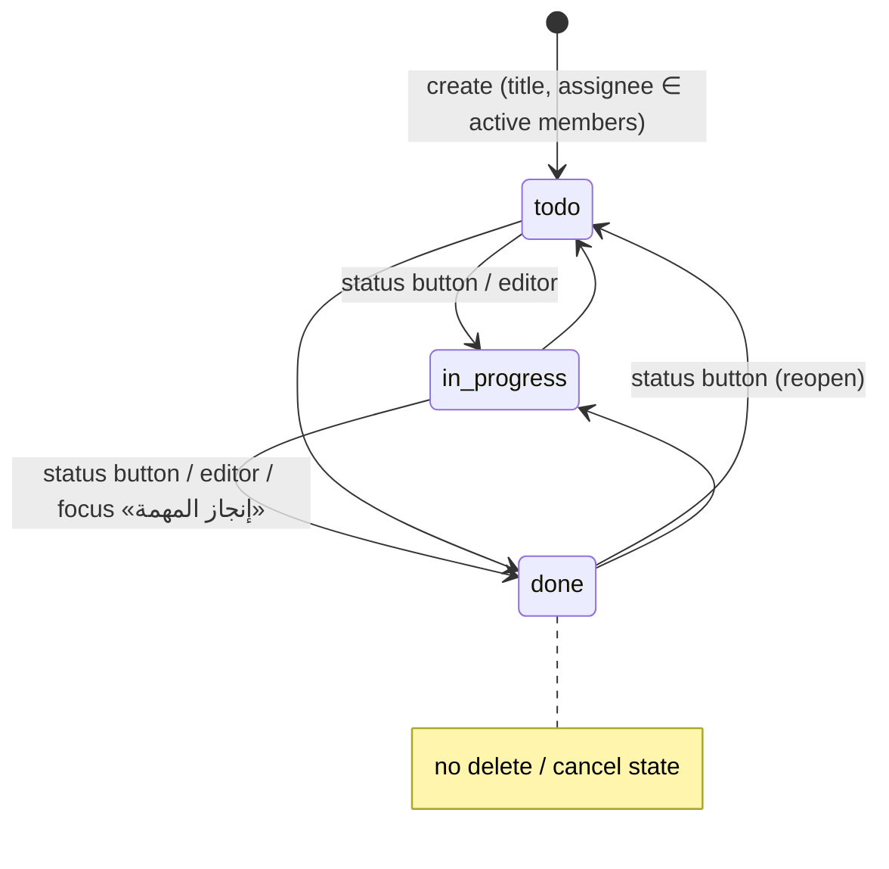

# TSK — Tasks

## 1. Scope & Coverage

**Files analyzed (source `/home/user/manih`):** `src/routes/tasks.tsx`, `src/lib/tasks.ts`, `src/components/FocusMode.tsx`, `src/components/FocusPill.tsx`, `src/lib/focusStore.ts`, `src/components/KindFilterTabs.tsx`, `src/lib/navCounts.ts`.
Supporting reads: `src/lib/data.ts` (PAYMENT_APPROVAL_CHAIN), `src/lib/queries.ts` (useApplications/useStages/usePayments), `src/lib/payments.ts` (approvePayment), `src/components/AppShell.tsx` (nav counts, FocusPill mount, ROLE_HOME via persona.tsx), `src/lib/persona.tsx`, migrations `20261004124427_*` (manual_tasks) and `20261004132647_*` (meeting columns), `types.ts`.

**Coverage notes and limitations**
- Source-only analysis; live demo not inspected. [Observed]
- Decision functions (approveStage, returnStage, closeApplication — REV; approvePayment — FIN; bulkDecide*/MinuteDialog — REV) are invoked from tasks but specified in those modules.
- Personas are switched on one shared demo account; all assignment/visibility rules are client-side filters over unfiltered queries (applications, stages, payments are fetched for all tenants and filtered in the browser). [Observed]
- Task types: (1) manual task, (2) meeting (manual task with kind='meeting'), (3) application stage task (derived), (4) payment approval task (derived).

## 2. Screen Inventory

| Screen ID | Name (EN + Arabic label) | Route / Component | Roles | Purpose | Entry points | Exits / Navigates to |
|---|---|---|---|---|---|---|
| SCR-TSK-01 | My Tasks list — مهامي (قائمة) | `/tasks`, TasksPage/TaskRow | reviewer, committee_secretary, grants_manager, project_manager, finance, ceo, admin | Unified inbox of manual tasks, meetings and system-derived application/payment tasks | Sidebar «مهامي»; ROLE_HOME for admin/GM/reviewer/PM/finance; FocusPill «العودة للتركيز» | /reviewer/$id (REV), /projects/$id (PRJ), /staff/$id (CFG), dialogs |
| SCR-TSK-02 | My Tasks calendar — مهامي (تقويم) | `/tasks` view=calendar | same | Month calendar of tasks by due date; undated list | View toggle «تقويم» | Same links as list; TaskCard actions |
| SCR-TSK-03 | Task/meeting editor — مهمة أو موعد جديد | TaskEditor dialog | same | Create/edit manual tasks and meetings | «مهمة جديدة»; pencil on manual task | Back to list |
| SCR-TSK-04 | Return/reject dialog — إرجاع للتعديل / رفض | Dialog in TasksPage | Stage supervisors/secretaries, GM/admin, payment approvers | Capture mandatory reason | Quick action return/reject | List |
| SCR-TSK-05 | Approve sheet — اعتماد | Sheet in TasksPage | same | Summary, AI risk warning, optional/mandatory note | Quick action approve | /reviewer/$id «فتح الطلب كاملاً» |
| SCR-TSK-06 | Bulk minute bar — قرار بمحضر | Selection bar + MinuteDialog | committee_secretary (stage secretary) | Decide several committee items with one minute | Checkboxes on secretary tasks | MinuteDialog (see REV) |
| SCR-TSK-07 | Focus mode — وضع التركيز | FocusMode overlay | staff | Process tasks one at a time with timer | «وضع التركيز» button; pill | Exit (pill), end, detail links |
| SCR-TSK-08 | Focus pill | FocusPill | staff | Show running focus session while browsing | Exit from focus mode | /tasks with focus open |
| SCR-TSK-09 | Sidebar counts | AppShell nav badges | staff | Open-task counts per destination | Always | — |

## 3. Screen Details

### SCR-TSK-01 My Tasks – list
- Header «مهامي» with «N مهمة مفتوحة · M منجزة» (scope-filtered); actions «وضع التركيز», «مهمة جديدة». [Observed] tasks.tsx:362
- Toolbar: search, scope toggle (مهامي / أسندتُها لغيري), kind tabs with counts, sort select (list only), view toggle (قائمة / تقويم), SaveViewButton. [Observed] tasks.tsx:370-383
- List header columns: icon | المهمة | الاستحقاق (≥sm) | إجراء. Row: kind icon; assignee avatar (link to staff profile); title (link for derived); «تلقائية» chip for derived; kind text (lg; meetings «موعد · HH:MM»); for applications requested amount (SAR) and agent score «/100»; due date or late text (red, «متأخرة N أيام»), "—" when none; actions: pencil for manual, compact approve/return/reject icons (approve/reject for payments). [Observed] tasks.tsx:118-160
- Committee-secretary tasks have a selection checkbox (disabled when incompatible). [Observed] tasks.tsx:316
- States: loading «جارٍ تحميل المهام…» (no persona); error alert «تعذر تحميل المهام اليدوية…»; empty state (list views) «لا توجد مهام لديك الآن» + explanation + link to delegated scope; filtered empty «لا توجد مهام مطابقة». [Observed] tasks.tsx:296,364-369,391
- Note: the empty state replaces the whole toolbar, including when a search returns nothing (ISS-TSK-06).

### SCR-TSK-02 My Tasks – calendar
- Month title (Arabic Gregorian), prev/next. Desktop: 7-column grid (Sun–Sat), today highlighted, up to 3 chips per day (status-coloured; done struck through; avatar; meeting icon; ⚡ for derived; links for derived) and «+N أخرى». Mobile: compact grid with «N مهام» and selected-day card list («لا توجد مهام في هذا اليوم»). «مهام بلا موعد» section lists undated tasks as cards. [Observed] tasks.tsx:217-269
- TaskCard: title/link, pencil (manual), kind/location, due/late, assignee avatar; manual: three status buttons; derived: «تلقائية» chip + quick actions with labels. [Observed] tasks.tsx:90-110

### SCR-TSK-03 Task / meeting editor
- Title «مهمة أو موعد جديد» / «تعديل المهمة» / «تعديل الموعد». AI assist; type toggle مهمة/موعد; عنوان المهمة * (max 200); الوصف; المكلّف (colleagues, «(أنا)» marker, default me); تاريخ الاستحقاق (date); for meetings: الوقت (time), المكان أو الرابط, المدعوون (checkbox list excluding assignee); الحالة select. Save disabled when busy, no title or no assignee. [Observed] tasks.tsx:163-215
- Errors: toast with validation message («عنوان المهمة مطلوب…», «اختر مستخدماً مرتبطاً بالجهة الحالية») or DB error. No delete. [Observed]

### SCR-TSK-04 Return / reject dialog
- Title «<decision> — <task>»; «السبب *» textarea (max 1000; placeholder «ما المطلوب تعديله؟» / «سبب الرفض»); cancel / «تأكيد …» (destructive for reject, disabled until reason). [Observed] tasks.tsx:394-398

### SCR-TSK-05 Approval sheet
- Left sheet «اعتماد — <task>»: rows الجهة, القيمة, تقييم الوكيل, التوصية (hidden if empty); AI summary; risk alert when recommendation «لا يوصى» or score < pass score; «فتح الطلب كاملاً» link; note label «ملاحظة (اختيارية)» or «ملاحظة (إلزامية) *»; «تأكيد الاعتماد» disabled while busy or when risky without note. [Observed] tasks.tsx:399-420

### SCR-TSK-06 Bulk minute bar
- Sticky bar «تم اختيار N طلب|دفعة», «قرار بمحضر», «إلغاء الاختيار», hint «يمكن اختيار طلبات المرحلة نفسها أو دفعات فقط». MinuteDialog receives count, committee name, allowReturn (not for payments). [Observed] tasks.tsx:384-390 (dialog: see REV)

### SCR-TSK-07 Focus mode
- Full-screen dialog (aria-modal). Header: Riyadh 12-hour clock with ص/م, Hijri + Gregorian date; tiles «أنجزت اليوم N», «الوقت في المهمة mm:ss» with pause/resume and «متوقف», «المتبقي N»; «خروج» and «إنهاء وضع التركيز». Kind tabs (no meetings) when open tasks exist. [Observed] FocusMode.tsx:85-104
- Task card: kind badge, reference, due (red «متأخرة»), «(تخطيتها سابقاً)»; title; description; «فتح التفاصيل الكاملة»; note textarea for derived («ملاحظة (إلزامية عند الإرجاع)»); actions تخطي, إنجاز المهمة (manual) or إعادة بملاحظة + اعتماد (derived). [Observed] FocusMode.tsx:112-132
- Empty: «لا مهام متبقية» + «أنجزت N مهمة اليوم.» or «لا مهام في هذا التصنيف» + hint to choose «الكل»; «العودة إلى مهامي». [Observed] FocusMode.tsx:107-111

### SCR-TSK-08 Focus pill
- Bottom-start floating pill (only when session active and overlay closed): pulse/grey dot, task title, mm:ss, pause/resume, «العودة للتركيز». [Observed] FocusPill.tsx

### SCR-TSK-09 Sidebar badges
- Each sidebar item shows `navCounts[item.to]` when > 0 (AppShell.tsx:146). [Observed]

## 4. Interaction Inventory

| INT ID | Screen | Trigger (control) | System response | Data written | Evidence |
|---|---|---|---|---|---|
| INT-TSK-001 | SCR-TSK-01 | Page load | Derives tasks from manual_tasks + applications + workflow_stages + payments (collectTasks) | — | [Observed] tasks.tsx:271-295; tasks.ts:89-120 |
| INT-TSK-002 | SCR-TSK-01 | Search input «بحث في المهام» | Filters by title, description, reference (case-insensitive) | — | [Observed] tasks.tsx:297,371 |
| INT-TSK-003 | SCR-TSK-01 | Scope «مهامي» / «أسندتُها لغيري» | Switches between my tasks and tasks I assigned to others | saved view (draft) | [Observed] tasks.tsx:297,372-375 |
| INT-TSK-004 | SCR-TSK-01 | Kind tabs (الكل/يدوية/المواعيد/طلبات المنح/الدفعات) | Filters by kind; shows counts; zero tabs hidden | saved view (draft) | [Observed] tasks.tsx:300-301,376; KindFilterTabs.tsx |
| INT-TSK-005 | SCR-TSK-01 | Sort select (الأقرب استحقاقاً / الأحدث إضافة) | Re-sorts list | saved view (draft) | [Observed] tasks.tsx:301,377 |
| INT-TSK-006 | SCR-TSK-01/02 | View toggle قائمة/تقويم | Switches view | saved view (draft) | [Observed] tasks.tsx:378-381 |
| INT-TSK-007 | SCR-TSK-01 | SaveViewButton | Persists view, filter, scope, sort for the user | user_view_prefs (see PLT) | [Observed] tasks.tsx:279,382 |
| INT-TSK-008 | SCR-TSK-01 | Task title link | Application → /reviewer/$id; payment → /projects/$id | — | [Observed] tasks.tsx:130-131 |
| INT-TSK-009 | SCR-TSK-01/02 | Assignee avatar | Navigates to /staff/$id | — | [Observed] tasks.tsx:104,148 |
| INT-TSK-010 | SCR-TSK-01 | «مهمة جديدة» | Opens editor (new) | — | [Observed] tasks.tsx:362 |
| INT-TSK-011 | SCR-TSK-01/02 | Pencil on manual task | Opens editor with task | — | [Observed] tasks.tsx:99,141 |
| INT-TSK-012 | SCR-TSK-03 | Type toggle مهمة/موعد | Shows/hides time, location, attendees | — | [Observed] tasks.tsx:194-210 |
| INT-TSK-013 | SCR-TSK-03 | AI assist | Proposes kind, title, description, assignee, date, time, location from text | — (proposal only) | [Observed] tasks.tsx:187-193 |
| INT-TSK-014 | SCR-TSK-03 | «حفظ المهمة» | Validates title and assignee membership; inserts/updates; toast | manual_tasks | [Observed] tasks.tsx:176-183; tasks.ts:72-82 |
| INT-TSK-015 | SCR-TSK-02 | Status buttons on TaskCard | Changes manual task status | manual_tasks.status (updated_at via trigger) | [Observed] tasks.tsx:106-107,302-305; tasks.ts:84-87 |
| INT-TSK-016 | SCR-TSK-01/02 | Quick action اعتماد | Opens approval sheet | — | [Observed] tasks.tsx:82-88,328,399-420 |
| INT-TSK-017 | SCR-TSK-01/02 | Quick action إرجاع للتعديل / رفض | Opens reason dialog | — | [Observed] tasks.tsx:394-398 |
| INT-TSK-018 | SCR-TSK-04 | «تأكيد …» | Application: returnStage / closeApplication; payment reject: approvePayment(false) | applications, application_status_history (REV); payments, payment_approvals (FIN) | [Observed] tasks.tsx:331-353 |
| INT-TSK-019 | SCR-TSK-05 | «تأكيد الاعتماد» | Application: approveStage; payment: approvePayment(true); refresh | see REV/FIN | [Observed] tasks.tsx:334-339,418 |
| INT-TSK-020 | SCR-TSK-01 | Checkbox on secretary task | Adds/removes from selection if compatible | — | [Observed] tasks.tsx:308-316 |
| INT-TSK-021 | SCR-TSK-06 | «قرار بمحضر» | Opens MinuteDialog; submit runs bulkDecideApplications/Payments | committee_minutes, minute_items, workflow tables (REV) | [Observed] tasks.tsx:319-327,384-390 |
| INT-TSK-022 | SCR-TSK-06 | «إلغاء الاختيار» | Clears selection | — | [Observed] tasks.tsx:387 |
| INT-TSK-023 | SCR-TSK-02 | Month arrows / day (mobile) | Changes month (selects day 1) / selects day list | — | [Observed] tasks.tsx:233,243,249 |
| INT-TSK-024 | SCR-TSK-01 | Empty-state link «عرض المهام التي أسندتها لغيري» | Switches scope to delegated | — | [Observed] tasks.tsx:368 |
| INT-TSK-025 | SCR-TSK-01 | «وضع التركيز» | Starts (or reopens) focus session | localStorage focus:session | [Observed] tasks.tsx:362; focusStore.ts:28 |
| INT-TSK-026 | SCR-TSK-07 | Kind tabs (no meetings) | Filters focus queue | — | [Observed] FocusMode.tsx:51-58,104 |
| INT-TSK-027 | SCR-TSK-07 | «تخطي» | Moves task to end of queue (disabled if <2) | focus:session.skipped | [Observed] FocusMode.tsx:76,124 |
| INT-TSK-028 | SCR-TSK-07 | «إنجاز المهمة» (manual) | Sets manual task done; increments done-today | manual_tasks.status; localStorage focus:done:<persona>:<date> | [Observed] FocusMode.tsx:70-75,126; tasks.tsx:354-358 |
| INT-TSK-029 | SCR-TSK-07 | «اعتماد» / «إعادة بملاحظة» (derived) | Calls same decide() as inbox; return requires note | see REV/FIN | [Observed] FocusMode.tsx:128-129 |
| INT-TSK-030 | SCR-TSK-07 | Pause/resume | Toggles pause, accumulating paused time | focus:session | [Observed] focusStore.ts:29-31 |
| INT-TSK-031 | SCR-TSK-07 | «خروج» / Escape | Closes overlay; session keeps running (pill) | focus:session.open=false | [Observed] FocusMode.tsx:49,100; tasks.tsx:363 |
| INT-TSK-032 | SCR-TSK-07 | «إنهاء وضع التركيز» | Clears session | focus:session reset | [Observed] FocusMode.tsx:101; focusStore.ts:27 |
| INT-TSK-033 | SCR-TSK-07 | «فتح التفاصيل الكاملة» | Navigates to source and closes overlay (session continues) | focus:session.open=false | [Observed] FocusMode.tsx:121 |
| INT-TSK-034 | SCR-TSK-08 | «العودة للتركيز» | Opens focus and navigates to /tasks | focus:session.open=true | [Observed] FocusPill.tsx:17 |
| INT-TSK-035 | SCR-TSK-08 | Pause/resume on pill | Toggles pause | focus:session | [Observed] FocusPill.tsx:22 |

## 5. Shared Components & Dependencies

| Component / lib | Role in TSK | Owner |
|---|---|---|
| `lib/tasks.ts` (collectTasks, useManualTasks, useTaskColleagues, saveManualTask, changeManualTaskStatus) | Task derivation and manual CRUD | TSK |
| `KindFilterTabs` (KIND_TABS, matchesKind, isMeeting) | Kind tabs in inbox and focus mode | TSK |
| `focusStore`, `FocusMode`, `FocusPill` | Focus session | TSK |
| `navCounts` | Sidebar badges | TSK (rendered by PLT AppShell) |
| `useApplications`, `useStages`, `usePayments` | Source data | shared (`lib/queries.ts`) |
| `approveStage`, `returnStage`, `closeApplication` (`lib/workflow.ts`) | Application decisions | REV |
| `approvePayment` (`lib/payments.ts`), PAYMENT_APPROVAL_CHAIN | Payment decisions | FIN |
| `MinuteDialog`, `bulkDecideApplications`, `bulkDecidePayments` (`lib/minutes.ts`) | Bulk committee decisions | REV |
| `useSavedView` / `SaveViewButton` | Saved view | PLT |
| `AiAssist` | Editor prefill (proposal only) | PLT |
| `/staff/$id` | Assignee profile | CFG |

## 6. Business Process Workflows

### 6.1 Derivation of system tasks (who gets which task)
```mermaid
flowchart TD
  A[applications] --> B{status=pending AND current_stage AND stage_status≠needs_edit AND same tenant}
  B -- no --> X[no task]
  B -- yes --> C[find workflow_stage (program, stage_no)]
  C --> D{me ∈ supervisor_ids OR me = secretary_id OR role ∈ admin, grants_manager}
  D -- yes --> E[Application task: due = stage_entered_at + sla_days(3)]
  D -- no --> X
  P[payments] --> Q{status=awaiting_approval AND project tenant = mine}
  Q -- yes --> R{chain step}
  R -- 0 project_manager --> R0{project.manager_id = me OR admin}
  R -- 1 grants_manager --> R1{role = grants_manager OR admin}
  R -- 2 ceo --> R2{role = ceo OR admin}
  R0 -- yes --> S[Payment task: due = payment.due_date]
  R1 -- yes --> S
  R2 -- yes --> S
```
Derived tasks vanish when the application leaves the stage (approve/return/reject/needs_edit) or the payment moves to the next step/status. Finance and reviewer roles without stage assignment get no derived tasks; finance gets no task for awaiting_transfer payments (ISS-TSK-13). [Observed]

### 6.2 Manual task lifecycle

Any visible user (assignee, creator, attendee) may transition (BR-TSK-26). updated_at maintained by trigger. [Observed]

### 6.3 Decision from task inbox
```mermaid
flowchart LR
  T[Derived task] --> A{Quick action}
  A -- approve --> S[Approve sheet] --> R{risky?}
  R -- yes, note empty --> S
  R -- no / note given --> W[approveStage or approvePayment(true)]
  A -- return (apps) --> D[Reason dialog] --> W2[returnStage]
  A -- reject --> D2[Reason dialog] --> W3[closeApplication / approvePayment(false) → payment due, step 0]
  W & W2 & W3 --> RF[refresh applications & payments → task disappears]
```

### 6.4 Focus session

```mermaid
stateDiagram-v2
  [*] --> Inactive
  Inactive --> OpenRunning: «وضع التركيز» (startFocus)
  OpenRunning --> ClosedRunning: «خروج» / Escape / open detail link
  ClosedRunning --> OpenRunning: pill «العودة للتركيز» or «وضع التركيز»
  OpenRunning --> OpenRunning: task changes / timer reset; pause ↔ resume
  OpenRunning --> Inactive: «إنهاء وضع التركيز»
  ClosedRunning --> ClosedRunning: reload (persisted)
```


## 7. Business Rules

| BR ID | Rule | Evidence label + reference |
|---|---|---|
| BR-TSK-01 | Only manual tasks are stored (manual_tasks); application and payment tasks are derived on the fly from live workflow/payment state and are never persisted — no duplicated task status. | [Observed] `AGENTS.md; src/lib/tasks.ts:89-120` |
| BR-TSK-02 | An application task exists for an application when status='pending', current_stage is set, stage_status ≠ 'needs_edit', and the application belongs to the user's tenant. | [Observed] `src/lib/tasks.ts:100` |
| BR-TSK-03 | The application task is assigned to the user if they are in the current stage's supervisor_ids, are the stage's committee secretary, or have role admin or grants_manager (elevated: sees all pending stage tasks of the tenant). | [Observed] `src/lib/tasks.ts:98-102` |
| BR-TSK-04 | Application task due date = stage_entered_at + stage.sla_days (default 3 calendar days). | [Observed] `src/lib/tasks.ts:103-104` |
| BR-TSK-05 | Application task identity is application + stage number (a new task per stage); its stageKey groups committee stages by committee name, other stages by program:stage. | [Observed] `src/lib/tasks.ts:105-107` |
| BR-TSK-06 | A payment task exists when payment.status='awaiting_approval' and the project belongs to the user's tenant; it is assigned per PAYMENT_APPROVAL_CHAIN[approval_step]: step 0 project manager (only the project's manager_id), step 1 grants_manager role, step 2 ceo role; admin sees every step. | [Observed] `src/lib/tasks.ts:109-114; src/lib/data.ts:371-375` |
| BR-TSK-07 | Payment task due date = payment.due_date; derived tasks always have status 'todo' and disappear once the underlying item moves on. | [Observed] `src/lib/tasks.ts:107,115-117` |
| BR-TSK-08 | Manual task title is required, 1–200 characters (client and DB CHECK); status ∈ todo, in_progress, done (DB CHECK, default todo). | [Observed] `src/lib/tasks.ts:73-74; supabase/migrations/20261004124427_*.sql:6,8` |
| BR-TSK-09 | A manual task's assignee must have an active persona_membership in the same tenant. | [Observed] `src/lib/tasks.ts:75-76` |
| BR-TSK-10 | A user loads manual tasks of their tenant where they are assignee, creator or meeting attendee. | [Observed] `src/lib/tasks.ts:53` |
| BR-TSK-11 | Scope 'mine' = all derived tasks + manual tasks assigned to me or where I am an attendee; scope 'delegated' = manual tasks I created and assigned to someone else. | [Observed] `src/routes/tasks.tsx:297` |
| BR-TSK-12 | Meeting fields (start time, location/link, attendees) are saved only when kind='meeting'; attendees exclude the assignee; the creator is preserved on edit. | [Observed] `src/routes/tasks.tsx:179,209` |
| BR-TSK-13 | Kind filter tabs are mutually exclusive: meetings count only under «المواعيد», plain manual tasks under «يدوية»; tabs with zero items are hidden except «الكل» and the active tab. | [Observed] `src/components/KindFilterTabs.tsx:14-16; src/routes/tasks.tsx:376` |
| BR-TSK-14 | A task is overdue when not done and due date < today (UTC date); late text shows days late (minimum 1). | [Observed] `src/routes/tasks.tsx:76-77,92,129` |
| BR-TSK-15 | Sort 'due' orders by due date ascending with undated last; 'new' orders by creation date descending (payment tasks use due date as creation date). | [Observed] `src/routes/tasks.tsx:301; src/lib/tasks.ts:117` |
| BR-TSK-16 | Return and reject decisions require a reason (≤1000 chars); approval note is optional unless the application is 'risky' — AI recommendation contains «لا يوصى» or AI score < program pass_score (default 80) — then a justification note is mandatory. | [Observed] `src/routes/tasks.tsx:332,394-418` |
| BR-TSK-17 | Application tasks offer approve / return / reject (approveStage, returnStage, closeApplication); payment tasks offer approve / reject only, where reject sends the payment back to 'due' at step 0. | [Observed] `src/routes/tasks.tsx:83,331-347; src/lib/payments.ts:20-34` |
| BR-TSK-18 | Bulk selection is available only on committee-stage application tasks where the user is the stage's secretary; all selected tasks must share the same stageKey (same committee/stage). | [Observed] `src/routes/tasks.tsx:308-316` |
| BR-TSK-19 | Focus queue = all non-meeting tasks, manual ones only when assigned to me, open only, sorted by due date; skipped tasks go to the end; skip is disabled when fewer than 2 tasks remain. | [Observed] `src/routes/tasks.tsx:359; src/components/FocusMode.tsx:55-58,124` |
| BR-TSK-20 | In focus mode manual tasks can only be completed (→ done); derived tasks can be approved or returned with a note (note mandatory for return); no reject action. | [Observed] `src/components/FocusMode.tsx:122-130` |
| BR-TSK-21 | The focus timer resets only when the current task changes; paused time is excluded; the session (active, open, task, timer, skipped) persists in localStorage 'focus:session' across navigation and reload. | [Observed] `src/lib/focusStore.ts; src/components/FocusMode.tsx:61-67` |
| BR-TSK-22 | Exit (or Escape) hides the overlay and keeps the session running with a floating pill; «إنهاء وضع التركيز» clears the session. | [Observed] `src/components/FocusMode.tsx:49,100-101; src/components/FocusPill.tsx:15` |
| BR-TSK-23 | Focus mode counts tasks done today per persona per device (localStorage key focus:done:<persona>:<date>) and shows a Riyadh-time clock (fixed UTC+3) with Hijri (Umm al-Qura) and Gregorian dates. | [Observed] `src/components/FocusMode.tsx:41,48,81-83` |
| BR-TSK-24 | Sidebar counts use the same derivation: /tasks = all open tasks in scope 'mine'; /reviewer = open application tasks; /projects and /finance = open payment tasks. | [Observed] `src/lib/navCounts.ts:7-20` |
| BR-TSK-25 | Saved view stores view, kind filter, scope and sort per user (never the search text). | [Observed] `src/routes/tasks.tsx:279; AGENTS.md` |
| BR-TSK-26 | Manual status changes are not restricted to the assignee: the update matches on the task's own assigned_to, so any user who sees the task (creator, attendee) can change it or edit it. | [Observed] `src/lib/tasks.ts:84-87; src/routes/tasks.tsx:99,141` |

## 8. Data Requirements

### manual_tasks
| Field | Type | Req | Meaning |
|---|---|---|---|
| id | uuid | Y | PK |
| tenant_id | uuid | Y | FK tenants (cascade) |
| created_by | uuid | Y | FK personas — creator (preserved on edit) |
| assigned_to | uuid | Y | FK personas — assignee (active member) |
| title | text | Y | 1–200 chars (CHECK) |
| description | text | N | |
| status | text | Y | todo (default) / in_progress / done (CHECK) |
| due_date | date | N | Due / meeting date |
| kind | text | Y | 'task' (default) / 'meeting' |
| start_time | time | N | Meeting time |
| location | text | N | Meeting place or link |
| attendees | uuid[] | Y | Meeting invitees (default '{}') |
| created_at / updated_at | timestamptz | Y | updated_at via trigger touch_manual_tasks |
Index (assigned_to, tenant_id, status). [Observed] migrations 20261004124427, 20261004132647

### Derived task (TaskItem — in memory only)
id (`manual:<id>` | `application:<appId>:<stage>` | `payment:<payId>:<step>`), kind (manual|application|payment), title, description, reference (ref_no), status, dueDate, assignee/assigneeAvatar/assigneeId, createdAt, createdBy, sourceId, stageKey, projectId, manual. [Observed] tasks.ts:23-40

### Source entities read (owned elsewhere)
- applications: status, current_stage, stage_status, stage_entered_at, program_id, tenant_id, project_title, ref_no, requested_amount, external_ai_score/recommendation/label/summary, beneficiaries.name, grant_programs.pass_score (REV/PRG)
- workflow_stages: program_id, stage_no, name, supervisor_ids, secretary_id, approval_type ('committee'…), committee_name, sla_days (PRG)
- payments: status, approval_step, due_date, title, ref_no, amount, project_id, projects(tenant_id, manager_id, title, beneficiaries.name) (FIN)
- persona_memberships (active, tenant) for colleagues and assignee validation (CFG)

### Device-local data
localStorage `focus:session` {active, open, taskId, taskTitle, startedAt, pausedAt, pausedTotal, skipped[]}; `focus:done:<personaId>:<YYYY-MM-DD>` count. [Observed]

## 9. Product Structure

**EP-TSK-01 — Unified Task Inbox**: One inbox combining system-derived application and payment tasks with manual tasks, with list/calendar views, filters and sidebar counts.

- FT-TSK-01 — Derived application stage tasks (Must)
- FT-TSK-02 — Derived payment approval tasks (Must)
- FT-TSK-03 — Task inbox views & filters (Must)
- FT-TSK-04 — Sidebar open-task counts (Should)

**EP-TSK-02 — Manual Tasks & Meetings**: Creation, assignment, meetings and status lifecycle of user-created tasks.

- FT-TSK-05 — Manual task creation & assignment (Must)
- FT-TSK-06 — Meetings (appointments) (Should)
- FT-TSK-07 — Manual task status lifecycle (Must)

**EP-TSK-03 — Decisions from Tasks**: Taking workflow and payment decisions directly from the inbox, individually or in bulk by committee minute.

- FT-TSK-08 — Quick decisions from inbox (Must)
- FT-TSK-09 — Bulk committee decision by minute (Should)

**EP-TSK-04 — Focus Mode**: Distraction-free, one-task-at-a-time processing with a persistent timer.

- FT-TSK-10 — Focus mode processing (Could)
- FT-TSK-11 — Focus session persistence & pill (Could)

## 10. Features

### FT-TSK-01 — Derived application stage tasks

- **Feature ID:** FT-TSK-01 (Epic EP-TSK-01)
- **Name:** Derived application stage tasks
- **Description:** Compute a task for each pending application at a stage the user supervises/secretaries (or all for admin/GM), with SLA due date.
- **Business Objective:** Make every pending workflow decision visible to the responsible person without duplicate task records.
- **Expected Business Value:** Inferred: SLA adherence and no lost applications; [To Confirm] — not stated in prototype
- **Primary User Roles:** reviewer, committee_secretary, grants_manager, admin
- **Scope:**
  - Eligibility
  - SLA due date
  - Task content & links
  - Auto-removal
- **Out of Scope:**
  - Stage configuration (PRG)
  - Decision logic (REV)
  - Notifications
- **Functional Requirements:** FR-TSK-001, FR-TSK-002, FR-TSK-003, FR-TSK-004
- **Business Rules:** BR-TSK-01, BR-TSK-02, BR-TSK-03, BR-TSK-04, BR-TSK-05, BR-TSK-07
- **Dependencies:** REV workflow; PRG workflow_stages
- **Related Screens:** SCR-TSK-01, SCR-TSK-02
- **Acceptance Criteria:**
  - Supervisor sees only their stage tasks
  - Due = entered + SLA
  - Task disappears after decision
- **Open Questions:** OQ-TSK-03; OQ-TSK-05
- **Assumptions:**
  - SLA in calendar days
- **Priority Recommendation (MoSCoW):** Must

### FT-TSK-02 — Derived payment approval tasks

- **Feature ID:** FT-TSK-02 (Epic EP-TSK-01)
- **Name:** Derived payment approval tasks
- **Description:** Compute a task for each payment awaiting the user's step in the approval chain.
- **Business Objective:** Timely payment approvals by the right approver.
- **Expected Business Value:** [To Confirm] — not stated in prototype
- **Primary User Roles:** project_manager, grants_manager, ceo, admin
- **Scope:**
  - Chain-step eligibility
  - Content & links
- **Out of Scope:**
  - Transfer/receipt steps for finance (Recommended FR-TSK-007)
  - Approval logic (FIN)
- **Functional Requirements:** FR-TSK-005, FR-TSK-006, FR-TSK-007
- **Business Rules:** BR-TSK-06, BR-TSK-07
- **Dependencies:** FIN payments.ts
- **Related Screens:** SCR-TSK-01, SCR-TSK-02
- **Acceptance Criteria:**
  - PM sees step-0 tasks only for own projects
  - CEO sees step-2 tasks
- **Open Questions:** OQ-TSK-08
- **Assumptions:**
  - None
- **Priority Recommendation (MoSCoW):** Must

### FT-TSK-03 — Task inbox views & filters

- **Feature ID:** FT-TSK-03 (Epic EP-TSK-01)
- **Name:** Task inbox views & filters
- **Description:** List and calendar views with search, scope, kind tabs, sort, saved view, counts and empty/error states.
- **Business Objective:** Help users prioritise their workload.
- **Expected Business Value:** [To Confirm] — not stated in prototype
- **Primary User Roles:** all staff
- **Scope:**
  - List
  - Calendar
  - Search
  - Scope
  - Kind tabs
  - Sort
  - Saved view
- **Out of Scope:**
  - Kanban board (mentioned in meta, not built)
- **Functional Requirements:** FR-TSK-008, FR-TSK-009, FR-TSK-010, FR-TSK-011, FR-TSK-012, FR-TSK-013, FR-TSK-014, FR-TSK-015
- **Business Rules:** BR-TSK-11, BR-TSK-13, BR-TSK-14, BR-TSK-15, BR-TSK-25
- **Dependencies:** PLT saved views
- **Related Screens:** SCR-TSK-01, SCR-TSK-02
- **Acceptance Criteria:**
  - Filters combine correctly
  - Overdue highlighted
  - Saved view restored
- **Open Questions:** OQ-TSK-11
- **Assumptions:**
  - None
- **Priority Recommendation (MoSCoW):** Must

### FT-TSK-04 — Sidebar open-task counts

- **Feature ID:** FT-TSK-04 (Epic EP-TSK-01)
- **Name:** Sidebar open-task counts
- **Description:** Badges on sidebar destinations computed from the same derivation as «مهامي».
- **Business Objective:** Surface pending work everywhere.
- **Expected Business Value:** [To Confirm] — not stated in prototype
- **Primary User Roles:** all staff
- **Scope:**
  - Counts for /tasks, /reviewer, /projects, /finance
- **Out of Scope:**
  - Push/email notifications
- **Functional Requirements:** FR-TSK-016
- **Business Rules:** BR-TSK-24
- **Dependencies:** PLT AppShell
- **Related Screens:** SCR-TSK-09
- **Acceptance Criteria:**
  - Badge equals open tasks in scope 'mine'
- **Open Questions:** None
- **Assumptions:**
  - None
- **Priority Recommendation (MoSCoW):** Should

### FT-TSK-05 — Manual task creation & assignment

- **Feature ID:** FT-TSK-05 (Epic EP-TSK-02)
- **Name:** Manual task creation & assignment
- **Description:** Create and edit manual tasks, assign to an active colleague, set due date and status, with AI prefill.
- **Business Objective:** Track ad-hoc work alongside system tasks.
- **Expected Business Value:** [To Confirm] — not stated in prototype
- **Primary User Roles:** all staff
- **Scope:**
  - Editor dialog
  - Validation
  - Edit
  - AI assist
- **Out of Scope:**
  - Recurring tasks
  - Comments/attachments
  - Notifications
- **Functional Requirements:** FR-TSK-017, FR-TSK-018, FR-TSK-019, FR-TSK-020
- **Business Rules:** BR-TSK-08, BR-TSK-09, BR-TSK-10
- **Dependencies:** CFG persona_memberships
- **Related Screens:** SCR-TSK-03
- **Acceptance Criteria:**
  - Title 1–200 required
  - Assignee must be active member
- **Open Questions:** OQ-TSK-02
- **Assumptions:**
  - None
- **Priority Recommendation (MoSCoW):** Must

### FT-TSK-06 — Meetings (appointments)

- **Feature ID:** FT-TSK-06 (Epic EP-TSK-02)
- **Name:** Meetings (appointments)
- **Description:** Manual task of kind meeting with time, location/link and attendees visible to attendees.
- **Business Objective:** Coordinate meetings (e.g., with partners) within the platform.
- **Expected Business Value:** [To Confirm] — not stated in prototype
- **Primary User Roles:** all staff
- **Scope:**
  - Meeting fields
  - Attendee visibility
  - Meetings tab
- **Out of Scope:**
  - Calendar invitations/integration
  - Focus mode (meetings excluded)
- **Functional Requirements:** FR-TSK-021, FR-TSK-022
- **Business Rules:** BR-TSK-12, BR-TSK-13
- **Dependencies:** None
- **Related Screens:** SCR-TSK-03, SCR-TSK-01, SCR-TSK-02
- **Acceptance Criteria:**
  - Attendees see meeting in their tasks
  - Meeting shows time
- **Open Questions:** OQ-TSK-09
- **Assumptions:**
  - None
- **Priority Recommendation (MoSCoW):** Should

### FT-TSK-07 — Manual task status lifecycle

- **Feature ID:** FT-TSK-07 (Epic EP-TSK-02)
- **Name:** Manual task status lifecycle
- **Description:** Move manual tasks between todo, in progress and done; done tasks feed staff KPIs.
- **Business Objective:** Transparent progress on manual work.
- **Expected Business Value:** [To Confirm] — not stated in prototype
- **Primary User Roles:** all staff
- **Scope:**
  - Status change
  - Timestamps
  - Cancel/delete (Recommended)
- **Out of Scope:**
  - Approval of task completion
- **Functional Requirements:** FR-TSK-023, FR-TSK-024, FR-TSK-025
- **Business Rules:** BR-TSK-08, BR-TSK-26
- **Dependencies:** CFG staff profile
- **Related Screens:** SCR-TSK-02, SCR-TSK-03
- **Acceptance Criteria:**
  - Status persists
  - Done tasks counted in staff KPIs
- **Open Questions:** OQ-TSK-01; OQ-TSK-02
- **Assumptions:**
  - None
- **Priority Recommendation (MoSCoW):** Must

### FT-TSK-08 — Quick decisions from inbox

- **Feature ID:** FT-TSK-08 (Epic EP-TSK-03)
- **Name:** Quick decisions from inbox
- **Description:** Approve / return / reject applications and approve / reject payments from a task, with reason capture and AI-risk guard.
- **Business Objective:** Faster decisions without opening each record.
- **Expected Business Value:** [To Confirm] — not stated in prototype
- **Primary User Roles:** reviewer, committee_secretary, grants_manager, project_manager, ceo, admin
- **Scope:**
  - Quick actions
  - Reason dialog
  - Approve sheet with risk guard
  - Execution via REV/FIN
- **Out of Scope:**
  - Decision rules themselves (REV/FIN)
- **Functional Requirements:** FR-TSK-026, FR-TSK-027, FR-TSK-028, FR-TSK-029
- **Business Rules:** BR-TSK-16, BR-TSK-17
- **Dependencies:** REV workflow.ts; FIN payments.ts
- **Related Screens:** SCR-TSK-01, SCR-TSK-04, SCR-TSK-05
- **Acceptance Criteria:**
  - Reason required for return/reject
  - Risky approvals need justification
- **Open Questions:** OQ-TSK-04
- **Assumptions:**
  - None
- **Priority Recommendation (MoSCoW):** Must

### FT-TSK-09 — Bulk committee decision by minute

- **Feature ID:** FT-TSK-09 (Epic EP-TSK-03)
- **Name:** Bulk committee decision by minute
- **Description:** Committee secretary selects same-stage tasks and records one minute decision for all.
- **Business Objective:** One documented committee minute for many items.
- **Expected Business Value:** Inferred from AGENTS.md (one minute document); [To Confirm] — not stated in prototype
- **Primary User Roles:** committee_secretary
- **Scope:**
  - Selection rules
  - Bar
  - Minute dialog submit
- **Out of Scope:**
  - Minute content/validation (REV)
  - Bulk payments (unreachable)
- **Functional Requirements:** FR-TSK-030, FR-TSK-031, FR-TSK-032
- **Business Rules:** BR-TSK-18
- **Dependencies:** REV minutes.ts, MinuteDialog
- **Related Screens:** SCR-TSK-06
- **Acceptance Criteria:**
  - Only same committee/stage items selectable
- **Open Questions:** OQ-TSK-10
- **Assumptions:**
  - None
- **Priority Recommendation (MoSCoW):** Should

### FT-TSK-10 — Focus mode processing

- **Feature ID:** FT-TSK-10 (Epic EP-TSK-04)
- **Name:** Focus mode processing
- **Description:** Full-screen one-task-at-a-time queue with timer, done-today counter, kind filter, skip, complete/approve/return.
- **Business Objective:** Increase throughput and reduce context switching.
- **Expected Business Value:** [To Confirm] — not stated in prototype
- **Primary User Roles:** all staff
- **Scope:**
  - Queue
  - Header stats & clock
  - Kind filter
  - Actions
  - Parity with inbox (Recommended)
- **Out of Scope:**
  - Meetings
  - Reject (not offered)
- **Functional Requirements:** FR-TSK-033, FR-TSK-034, FR-TSK-035, FR-TSK-036, FR-TSK-037
- **Business Rules:** BR-TSK-19, BR-TSK-20, BR-TSK-23
- **Dependencies:** FT-TSK-08 decide()
- **Related Screens:** SCR-TSK-07
- **Acceptance Criteria:**
  - Queue sorted by due
  - Skip moves to end
  - Return requires note
- **Open Questions:** OQ-TSK-06
- **Assumptions:**
  - None
- **Priority Recommendation (MoSCoW):** Could

### FT-TSK-11 — Focus session persistence & pill

- **Feature ID:** FT-TSK-11 (Epic EP-TSK-04)
- **Name:** Focus session persistence & pill
- **Description:** Persist focus session across navigation/reload; floating pill with timer and return button.
- **Business Objective:** Allow checking details without losing focus context.
- **Expected Business Value:** [To Confirm] — not stated in prototype
- **Primary User Roles:** all staff
- **Scope:**
  - localStorage session
  - Exit vs end
  - Pill
- **Out of Scope:**
  - Server-side time tracking
- **Functional Requirements:** FR-TSK-038, FR-TSK-039, FR-TSK-040
- **Business Rules:** BR-TSK-21, BR-TSK-22
- **Dependencies:** PLT AppShell
- **Related Screens:** SCR-TSK-07, SCR-TSK-08
- **Acceptance Criteria:**
  - Session survives reload
  - End clears
- **Open Questions:** OQ-TSK-12
- **Assumptions:**
  - None
- **Priority Recommendation (MoSCoW):** Could

## 11. Functional Requirements

### FR-TSK-001

- **Statement:** The system shall derive an application task for each pending application at an active (not needs_edit) stage for users who are stage supervisors, the stage committee secretary, or admin/grants manager, within the same tenant.
- **Description:** Computed on every render from live data (no stored task).
- **Type:** Functional
- **Source/Prototype reference:** `src/lib/tasks.ts:98-108`
- **Related Feature:** FT-TSK-01
- **Related Story:** US-TSK-001, US-TSK-002
- **Priority:** Must
- **Dependencies:** None
- **Acceptance Criteria:**
  - Given an application at stage 2 with supervisor U When U opens tasks Then one application task is shown
  - Given stage_status needs_edit Then no task is shown
  - Given another tenant's application Then no task is shown
- **Validation Rules:** None
- **Exceptions & Alternative Flows:** None
- **Open Questions:** None
- **Evidence label:** [Observed]

### FR-TSK-002

- **Statement:** The system shall set the application task due date to stage entry date plus the stage SLA days (default 3).
- **Description:** 
- **Type:** Functional
- **Source/Prototype reference:** `src/lib/tasks.ts:103-104`
- **Related Feature:** FT-TSK-01
- **Related Story:** US-TSK-001
- **Priority:** Must
- **Dependencies:** None
- **Acceptance Criteria:**
  - Given entered 2026-10-01 and sla_days 5 Then due 2026-10-06
  - Given sla_days null Then due = entry + 3 days
- **Validation Rules:** None
- **Exceptions & Alternative Flows:** None
- **Open Questions:** OQ-TSK-05
- **Evidence label:** [Observed]

### FR-TSK-003

- **Statement:** The system shall present application tasks with project title, committee/stage/beneficiary description, reference, requested amount, agent score, «تلقائية» chip and a link to the application.
- **Description:** 
- **Type:** UI
- **Source/Prototype reference:** `src/lib/tasks.ts:105-107; src/routes/tasks.tsx:130,150-152`
- **Related Feature:** FT-TSK-01
- **Related Story:** US-TSK-001
- **Priority:** Must
- **Dependencies:** None
- **Acceptance Criteria:**
  - Given committee stage Then description starts with committee name
  - Given click on title Then /reviewer/$id opens
- **Validation Rules:** None
- **Exceptions & Alternative Flows:** None
- **Open Questions:** None
- **Evidence label:** [Observed]

### FR-TSK-004

- **Statement:** The system shall remove an application task automatically once the application leaves the stage or status changes.
- **Description:** Inherent to derivation.
- **Type:** Functional
- **Source/Prototype reference:** `src/lib/tasks.ts:100; src/routes/tasks.tsx:344`
- **Related Feature:** FT-TSK-01
- **Related Story:** US-TSK-001
- **Priority:** Must
- **Dependencies:** None
- **Acceptance Criteria:**
  - Given approval of stage 2 When data refreshes Then the stage-2 task disappears
  - Given the next stage supervisor Then a new task for stage 3 appears
- **Validation Rules:** None
- **Exceptions & Alternative Flows:** None
- **Open Questions:** None
- **Evidence label:** [Observed]

### FR-TSK-005

- **Statement:** The system shall derive a payment task for payments awaiting approval at the user's chain step (project manager of the project, grants manager, CEO; admin for any step) within the tenant.
- **Description:** 
- **Type:** Functional
- **Source/Prototype reference:** `src/lib/tasks.ts:109-118; src/lib/data.ts:371-375`
- **Related Feature:** FT-TSK-02
- **Related Story:** US-TSK-003
- **Priority:** Must
- **Dependencies:** None
- **Acceptance Criteria:**
  - Given approval_step 0 and I manage the project Then I see the task
  - Given approval_step 1 and I am CEO Then I do not see it
- **Validation Rules:** None
- **Exceptions & Alternative Flows:** None
- **Open Questions:** None
- **Evidence label:** [Observed]

### FR-TSK-006

- **Statement:** The system shall show payment tasks with payment title, project title and step label, reference, due date and a link to the project.
- **Description:** 
- **Type:** UI
- **Source/Prototype reference:** `src/lib/tasks.ts:115-117; src/routes/tasks.tsx:131`
- **Related Feature:** FT-TSK-02
- **Related Story:** US-TSK-003
- **Priority:** Must
- **Dependencies:** None
- **Acceptance Criteria:**
  - Given step 2 Then description ends «اعتماد الرئيس التنفيذي»
  - Given click Then /projects/$id opens
- **Validation Rules:** None
- **Exceptions & Alternative Flows:** None
- **Open Questions:** None
- **Evidence label:** [Observed]

### FR-TSK-007

- **Statement:** The system shall derive finance tasks for payments awaiting transfer and partner-receipt follow-up.
- **Description:** Not implemented: finance role receives no derived tasks.
- **Type:** Functional
- **Source/Prototype reference:** `n/a (absent)`
- **Related Feature:** FT-TSK-02
- **Related Story:** US-TSK-004
- **Priority:** Should
- **Dependencies:** None
- **Acceptance Criteria:**
  - Given payment awaiting_transfer When finance opens tasks Then a transfer task is shown
  - Given transfer recorded Then the task disappears
- **Validation Rules:** None
- **Exceptions & Alternative Flows:** None
- **Open Questions:** OQ-TSK-08
- **Evidence label:** [Recommended]

### FR-TSK-008

- **Statement:** The system shall show tasks in a list with kind icon, assignee avatar, title, auto chip, kind, amount/score, due or late indicator and actions.
- **Description:** 
- **Type:** UI
- **Source/Prototype reference:** `src/routes/tasks.tsx:118-160`
- **Related Feature:** FT-TSK-03
- **Related Story:** US-TSK-005
- **Priority:** Must
- **Dependencies:** None
- **Acceptance Criteria:**
  - Given an overdue task Then «متأخرة N أيام» shows in red
  - Given no due date Then '—'
- **Validation Rules:** None
- **Exceptions & Alternative Flows:** None
- **Open Questions:** None
- **Evidence label:** [Observed]

### FR-TSK-009

- **Statement:** The system shall show tasks in a month calendar by due date with navigation, up to 3 chips per day, a mobile day list and an undated section.
- **Description:** 
- **Type:** UI
- **Source/Prototype reference:** `src/routes/tasks.tsx:217-269`
- **Related Feature:** FT-TSK-03
- **Related Story:** US-TSK-006
- **Priority:** Should
- **Dependencies:** None
- **Acceptance Criteria:**
  - Given 5 tasks on a day Then 3 chips and «+2 أخرى»
  - Given undated tasks Then section «مهام بلا موعد» lists them
- **Validation Rules:** None
- **Exceptions & Alternative Flows:** None
- **Open Questions:** None
- **Evidence label:** [Observed]

### FR-TSK-010

- **Statement:** The system shall filter tasks by free-text search over title, description and reference.
- **Description:** 
- **Type:** Functional
- **Source/Prototype reference:** `src/routes/tasks.tsx:297`
- **Related Feature:** FT-TSK-03
- **Related Story:** US-TSK-005
- **Priority:** Must
- **Dependencies:** None
- **Acceptance Criteria:**
  - Given search 'REQ-12' Then only tasks with that reference show
  - Given no match Then the user can still clear the search (currently not — ISS-TSK-06)
- **Validation Rules:** None
- **Exceptions & Alternative Flows:** None
- **Open Questions:** None
- **Evidence label:** [Observed]

### FR-TSK-011

- **Statement:** The system shall provide scopes «مهامي» and «أسندتُها لغيري».
- **Description:** 
- **Type:** Functional
- **Source/Prototype reference:** `src/routes/tasks.tsx:297,372-375`
- **Related Feature:** FT-TSK-03
- **Related Story:** US-TSK-007
- **Priority:** Must
- **Dependencies:** None
- **Acceptance Criteria:**
  - Given a task I created for a colleague Then it appears only in delegated scope
  - Given I am an attendee Then the meeting appears in mine
- **Validation Rules:** None
- **Exceptions & Alternative Flows:** None
- **Open Questions:** None
- **Evidence label:** [Observed]

### FR-TSK-012

- **Statement:** The system shall provide mutually exclusive kind tabs with counts, hiding zero-count tabs except «الكل» and the active one.
- **Description:** 
- **Type:** UI
- **Source/Prototype reference:** `src/components/KindFilterTabs.tsx; src/routes/tasks.tsx:300,376`
- **Related Feature:** FT-TSK-03
- **Related Story:** US-TSK-005
- **Priority:** Must
- **Dependencies:** None
- **Acceptance Criteria:**
  - Given 2 meetings and 3 manual tasks Then «المواعيد» 2 and «يدوية» 3
  - Given no payment tasks Then «الدفعات» tab hidden
- **Validation Rules:** None
- **Exceptions & Alternative Flows:** None
- **Open Questions:** None
- **Evidence label:** [Observed]

### FR-TSK-013

- **Statement:** The system shall sort by nearest due date (undated last) or newest added.
- **Description:** 
- **Type:** Functional
- **Source/Prototype reference:** `src/routes/tasks.tsx:301,377`
- **Related Feature:** FT-TSK-03
- **Related Story:** US-TSK-005
- **Priority:** Should
- **Dependencies:** None
- **Acceptance Criteria:**
  - Given sort due Then earliest due first
  - Given sort new Then latest createdAt first
- **Validation Rules:** None
- **Exceptions & Alternative Flows:** None
- **Open Questions:** None
- **Evidence label:** [Observed]

### FR-TSK-014

- **Statement:** The system shall let the user save the current view, kind filter, scope and sort as their default.
- **Description:** 
- **Type:** Functional
- **Source/Prototype reference:** `src/routes/tasks.tsx:279-284,382`
- **Related Feature:** FT-TSK-03
- **Related Story:** US-TSK-008
- **Priority:** Should
- **Dependencies:** None
- **Acceptance Criteria:**
  - Given saved calendar view When reopening /tasks Then calendar shows
  - Given search text Then it is not saved
- **Validation Rules:** None
- **Exceptions & Alternative Flows:** None
- **Open Questions:** None
- **Evidence label:** [Observed]

### FR-TSK-015

- **Statement:** The system shall show open/done counts, an empty state with a delegated-scope shortcut, a no-match message and a manual-task load error.
- **Description:** 
- **Type:** UI
- **Source/Prototype reference:** `src/routes/tasks.tsx:362-369,391`
- **Related Feature:** FT-TSK-03
- **Related Story:** US-TSK-005
- **Priority:** Should
- **Dependencies:** None
- **Acceptance Criteria:**
  - Given no tasks Then «لا توجد مهام لديك الآن»
  - Given manual query error Then alert shown
- **Validation Rules:** None
- **Exceptions & Alternative Flows:** None
- **Open Questions:** None
- **Evidence label:** [Observed]

### FR-TSK-016

- **Statement:** The system shall display open-task counts on sidebar items: tasks (all), applications (application tasks), projects/finance (payment tasks).
- **Description:** 
- **Type:** UI
- **Source/Prototype reference:** `src/lib/navCounts.ts; src/components/AppShell.tsx:88,146`
- **Related Feature:** FT-TSK-04
- **Related Story:** US-TSK-009
- **Priority:** Should
- **Dependencies:** None
- **Acceptance Criteria:**
  - Given 3 application and 1 payment open tasks Then «مهامي» 4, «طلبات المنح» 3, «المشاريع» 1
  - Given a delegated task Then it is not counted
- **Validation Rules:** None
- **Exceptions & Alternative Flows:** None
- **Open Questions:** None
- **Evidence label:** [Observed]

### FR-TSK-017

- **Statement:** The system shall allow creating a manual task with title, description, assignee (default me), due date and status.
- **Description:** 
- **Type:** Functional
- **Source/Prototype reference:** `src/routes/tasks.tsx:163-215`
- **Related Feature:** FT-TSK-05
- **Related Story:** US-TSK-010
- **Priority:** Must
- **Dependencies:** None
- **Acceptance Criteria:**
  - Given valid input When «حفظ المهمة» Then task saved and toast «تم إنشاء المهمة»
  - Given empty title Then save disabled
- **Validation Rules:** None
- **Exceptions & Alternative Flows:** None
- **Open Questions:** None
- **Evidence label:** [Observed]

### FR-TSK-018

- **Statement:** The system shall validate title length 1–200 and that the assignee is an active member of the tenant.
- **Description:** 
- **Type:** Data
- **Source/Prototype reference:** `src/lib/tasks.ts:72-82`
- **Related Feature:** FT-TSK-05
- **Related Story:** US-TSK-010
- **Priority:** Must
- **Dependencies:** None
- **Acceptance Criteria:**
  - Given 201 chars Then error «عنوان المهمة مطلوب ويجب ألا يتجاوز 200 حرف»
  - Given non-member assignee Then «اختر مستخدماً مرتبطاً بالجهة الحالية»
- **Validation Rules:** title trimmed 1–200
- **Exceptions & Alternative Flows:** None
- **Open Questions:** None
- **Evidence label:** [Observed]

### FR-TSK-019

- **Statement:** The system shall allow editing a manual task's fields while preserving the original creator.
- **Description:** 
- **Type:** Functional
- **Source/Prototype reference:** `src/routes/tasks.tsx:179; src/lib/tasks.ts:78`
- **Related Feature:** FT-TSK-05
- **Related Story:** US-TSK-011
- **Priority:** Must
- **Dependencies:** None
- **Acceptance Criteria:**
  - Given edit Then created_by unchanged
  - Given reassignment Then new assignee sees it
- **Validation Rules:** None
- **Exceptions & Alternative Flows:** None
- **Open Questions:** None
- **Evidence label:** [Observed]

### FR-TSK-020

- **Statement:** The system shall propose task fields from free text using AI assist without saving automatically.
- **Description:** 
- **Type:** AI
- **Source/Prototype reference:** `src/routes/tasks.tsx:187-193`
- **Related Feature:** FT-TSK-05
- **Related Story:** US-TSK-012
- **Priority:** Could
- **Dependencies:** None
- **Acceptance Criteria:**
  - Given text mentioning a colleague and date Then assignee and date are pre-filled
  - Given unknown name Then assignee unchanged
- **Validation Rules:** None
- **Exceptions & Alternative Flows:** None
- **Open Questions:** None
- **Evidence label:** [Observed]

### FR-TSK-021

- **Statement:** The system shall support meetings with time, location/link and attendees (excluding the assignee), saved only for kind meeting.
- **Description:** 
- **Type:** Functional
- **Source/Prototype reference:** `src/routes/tasks.tsx:171-179,204-210`
- **Related Feature:** FT-TSK-06
- **Related Story:** US-TSK-013
- **Priority:** Should
- **Dependencies:** None
- **Acceptance Criteria:**
  - Given kind task Then time/location/attendees saved empty
  - Given attendees Then they see the meeting in «مهامي»
- **Validation Rules:** None
- **Exceptions & Alternative Flows:** None
- **Open Questions:** None
- **Evidence label:** [Observed]

### FR-TSK-022

- **Statement:** The system shall label meetings «موعد · HH:MM», show location, group them under «المواعيد», and exclude them from focus mode.
- **Description:** 
- **Type:** UI
- **Source/Prototype reference:** `src/routes/tasks.tsx:67,102; src/components/KindFilterTabs.tsx:14-16; src/routes/tasks.tsx:359`
- **Related Feature:** FT-TSK-06
- **Related Story:** US-TSK-013
- **Priority:** Should
- **Dependencies:** None
- **Acceptance Criteria:**
  - Given meeting at 10:00 Then «موعد · 10:00»
  - Given focus mode Then meetings are not queued
- **Validation Rules:** None
- **Exceptions & Alternative Flows:** None
- **Open Questions:** None
- **Evidence label:** [Observed]

### FR-TSK-023

- **Statement:** The system shall allow changing a manual task's status among todo, in progress and done.
- **Description:** 
- **Type:** Functional
- **Source/Prototype reference:** `src/routes/tasks.tsx:106-107,211,302-305; src/lib/tasks.ts:84-87`
- **Related Feature:** FT-TSK-07
- **Related Story:** US-TSK-014
- **Priority:** Must
- **Dependencies:** None
- **Acceptance Criteria:**
  - Given todo When «جارٍ العمل» Then status in_progress
  - Given done task Then header done count increments
- **Validation Rules:** None
- **Exceptions & Alternative Flows:** None
- **Open Questions:** None
- **Evidence label:** [Observed]

### FR-TSK-024

- **Statement:** The system shall maintain created_at/updated_at so completion time can be measured.
- **Description:** 
- **Type:** Data
- **Source/Prototype reference:** `migration 20261004124427 (touch trigger)`
- **Related Feature:** FT-TSK-07
- **Related Story:** US-TSK-014
- **Priority:** Should
- **Dependencies:** None
- **Acceptance Criteria:**
  - Given status change Then updated_at = now
  - Given staff profile Then average completion uses these timestamps
- **Validation Rules:** None
- **Exceptions & Alternative Flows:** None
- **Open Questions:** None
- **Evidence label:** [Observed]

### FR-TSK-025

- **Statement:** The system shall allow the creator to cancel or delete a manual task/meeting and restrict edits to creator/assignee.
- **Description:** Not implemented.
- **Type:** Functional
- **Source/Prototype reference:** `n/a (absent)`
- **Related Feature:** FT-TSK-07
- **Related Story:** US-TSK-015
- **Priority:** Should
- **Dependencies:** None
- **Acceptance Criteria:**
  - Given creator When delete Then task removed for all
  - Given attendee Then edit controls hidden
- **Validation Rules:** None
- **Exceptions & Alternative Flows:** None
- **Open Questions:** OQ-TSK-01
- **Evidence label:** [Recommended]

### FR-TSK-026

- **Statement:** The system shall offer quick actions on derived tasks: approve/return/reject for applications, approve/reject for payments.
- **Description:** 
- **Type:** UI
- **Source/Prototype reference:** `src/routes/tasks.tsx:82-88`
- **Related Feature:** FT-TSK-08
- **Related Story:** US-TSK-016, US-TSK-017
- **Priority:** Must
- **Dependencies:** None
- **Acceptance Criteria:**
  - Given payment task Then no return action
  - Given application task Then three actions
- **Validation Rules:** None
- **Exceptions & Alternative Flows:** None
- **Open Questions:** None
- **Evidence label:** [Observed]

### FR-TSK-027

- **Statement:** The system shall require a reason (≤1000) before confirming return or reject.
- **Description:** 
- **Type:** Functional
- **Source/Prototype reference:** `src/routes/tasks.tsx:332,394-398`
- **Related Feature:** FT-TSK-08
- **Related Story:** US-TSK-017
- **Priority:** Must
- **Dependencies:** None
- **Acceptance Criteria:**
  - Given empty reason Then confirm disabled
  - Given reason When confirmed Then returnStage/closeApplication executes
- **Validation Rules:** None
- **Exceptions & Alternative Flows:** None
- **Open Questions:** None
- **Evidence label:** [Observed]

### FR-TSK-028

- **Statement:** The system shall show an approval sheet with entity, amount, agent score, recommendation and summary, warn when risky and then require a justification.
- **Description:** 
- **Type:** UI
- **Source/Prototype reference:** `src/routes/tasks.tsx:399-420`
- **Related Feature:** FT-TSK-08
- **Related Story:** US-TSK-016
- **Priority:** Must
- **Dependencies:** None
- **Acceptance Criteria:**
  - Given score 70 and pass 80 Then warning and mandatory note
  - Given payment Then entity and amount shown
- **Validation Rules:** None
- **Exceptions & Alternative Flows:** None
- **Open Questions:** None
- **Evidence label:** [Observed]

### FR-TSK-029

- **Statement:** The system shall execute decisions through the workflow/payment services, show success/error toasts, and refresh so the task disappears.
- **Description:** 
- **Type:** Integration
- **Source/Prototype reference:** `src/routes/tasks.tsx:331-353`
- **Related Feature:** FT-TSK-08
- **Related Story:** US-TSK-016, US-TSK-017
- **Priority:** Must
- **Dependencies:** None
- **Acceptance Criteria:**
  - Given success Then toast «تم اعتماد: …» and refresh
  - Given missing record Then «الطلب غير موجود»
- **Validation Rules:** None
- **Exceptions & Alternative Flows:** None
- **Open Questions:** None
- **Evidence label:** [Observed]

### FR-TSK-030

- **Statement:** The system shall show selection checkboxes only on committee-stage tasks where the user is secretary and allow only items with the same stageKey.
- **Description:** 
- **Type:** Functional
- **Source/Prototype reference:** `src/routes/tasks.tsx:308-316`
- **Related Feature:** FT-TSK-09
- **Related Story:** US-TSK-018
- **Priority:** Should
- **Dependencies:** None
- **Acceptance Criteria:**
  - Given first selected from committee A Then items of committee B are disabled
  - Given non-secretary Then no checkbox
- **Validation Rules:** None
- **Exceptions & Alternative Flows:** None
- **Open Questions:** None
- **Evidence label:** [Observed]

### FR-TSK-031

- **Statement:** The system shall show a sticky bar with the selection count, «قرار بمحضر» and clear selection.
- **Description:** 
- **Type:** UI
- **Source/Prototype reference:** `src/routes/tasks.tsx:384-389`
- **Related Feature:** FT-TSK-09
- **Related Story:** US-TSK-018
- **Priority:** Should
- **Dependencies:** None
- **Acceptance Criteria:**
  - Given 3 selected Then «تم اختيار 3 طلب»
  - Given clear Then selection empty
- **Validation Rules:** None
- **Exceptions & Alternative Flows:** None
- **Open Questions:** None
- **Evidence label:** [Observed]

### FR-TSK-032

- **Statement:** The system shall submit the minute decision for all selected items via the bulk minute service and refresh.
- **Description:** 
- **Type:** Integration
- **Source/Prototype reference:** `src/routes/tasks.tsx:319-327,390`
- **Related Feature:** FT-TSK-09
- **Related Story:** US-TSK-018
- **Priority:** Should
- **Dependencies:** REV minutes.ts
- **Acceptance Criteria:**
  - Given minute submitted Then all selected items move per decision
  - Given submit Then selection cleared
- **Validation Rules:** None
- **Exceptions & Alternative Flows:** None
- **Open Questions:** None
- **Evidence label:** [Observed]

### FR-TSK-033

- **Statement:** The system shall open a full-screen focus mode presenting one open task at a time from a due-sorted queue (non-meetings; manual only if assigned to me).
- **Description:** 
- **Type:** UI
- **Source/Prototype reference:** `src/routes/tasks.tsx:359-363; src/components/FocusMode.tsx:33-58`
- **Related Feature:** FT-TSK-10
- **Related Story:** US-TSK-019
- **Priority:** Could
- **Dependencies:** None
- **Acceptance Criteria:**
  - Given 3 tasks Then the earliest due is shown first
  - Given meeting Then excluded
- **Validation Rules:** None
- **Exceptions & Alternative Flows:** None
- **Open Questions:** None
- **Evidence label:** [Observed]

### FR-TSK-034

- **Statement:** The system shall show Riyadh time with Hijri and Gregorian dates, done-today count, time on current task with pause/resume, and remaining count.
- **Description:** 
- **Type:** UI
- **Source/Prototype reference:** `src/components/FocusMode.tsx:81-98`
- **Related Feature:** FT-TSK-10
- **Related Story:** US-TSK-019
- **Priority:** Could
- **Dependencies:** None
- **Acceptance Criteria:**
  - Given pause Then timer stops and «متوقف» shows
  - Given completion Then «أنجزت اليوم» increments
- **Validation Rules:** None
- **Exceptions & Alternative Flows:** None
- **Open Questions:** None
- **Evidence label:** [Observed]

### FR-TSK-035

- **Statement:** The system shall filter the focus queue by kind (excluding meetings) and show specific empty messages.
- **Description:** 
- **Type:** UI
- **Source/Prototype reference:** `src/components/FocusMode.tsx:51-58,104-111`
- **Related Feature:** FT-TSK-10
- **Related Story:** US-TSK-020
- **Priority:** Could
- **Dependencies:** None
- **Acceptance Criteria:**
  - Given filter payments with none Then «لا مهام في هذا التصنيف»
  - Given no tasks Then «لا مهام متبقية»
- **Validation Rules:** None
- **Exceptions & Alternative Flows:** None
- **Open Questions:** None
- **Evidence label:** [Observed]

### FR-TSK-036

- **Statement:** The system shall let the user skip (to end of queue), complete manual tasks, approve derived tasks, return with mandatory note, and open full details.
- **Description:** 
- **Type:** Functional
- **Source/Prototype reference:** `src/components/FocusMode.tsx:70-76,118-130`
- **Related Feature:** FT-TSK-10
- **Related Story:** US-TSK-019, US-TSK-020
- **Priority:** Could
- **Dependencies:** None
- **Acceptance Criteria:**
  - Given skip Then the next task shows and skipped one is last with «(تخطيتها سابقاً)»
  - Given return without note Then button disabled
- **Validation Rules:** None
- **Exceptions & Alternative Flows:** None
- **Open Questions:** None
- **Evidence label:** [Observed]

### FR-TSK-037

- **Statement:** The system shall apply the same decision rules in focus mode as in the inbox: reject available, AI-risk justification enforced, payment actions labelled approve/reject.
- **Description:** Gaps in prototype (ISS-TSK-01..03).
- **Type:** Functional
- **Source/Prototype reference:** `src/components/FocusMode.tsx:128-129`
- **Related Feature:** FT-TSK-10
- **Related Story:** US-TSK-021
- **Priority:** Should
- **Dependencies:** None
- **Acceptance Criteria:**
  - Given risky application When approving in focus Then a justification note is required
  - Given payment task Then the secondary action is labelled «رفض»
- **Validation Rules:** None
- **Exceptions & Alternative Flows:** None
- **Open Questions:** OQ-TSK-06
- **Evidence label:** [Recommended]

### FR-TSK-038

- **Statement:** The system shall persist the focus session (task, timer, pauses, skipped) on the device so it survives navigation and reload.
- **Description:** 
- **Type:** Data
- **Source/Prototype reference:** `src/lib/focusStore.ts`
- **Related Feature:** FT-TSK-11
- **Related Story:** US-TSK-022
- **Priority:** Could
- **Dependencies:** None
- **Acceptance Criteria:**
  - Given reload Then timer continues from start time
  - Given task unchanged on remount Then timer not reset
- **Validation Rules:** None
- **Exceptions & Alternative Flows:** None
- **Open Questions:** None
- **Evidence label:** [Observed]

### FR-TSK-039

- **Statement:** The system shall distinguish exit (hide overlay, keep session; also Escape and opening details) from end (clear session).
- **Description:** 
- **Type:** Functional
- **Source/Prototype reference:** `src/components/FocusMode.tsx:49,100-101,121`
- **Related Feature:** FT-TSK-11
- **Related Story:** US-TSK-022
- **Priority:** Could
- **Dependencies:** None
- **Acceptance Criteria:**
  - Given exit Then pill appears
  - Given end Then pill disappears and timer resets
- **Validation Rules:** None
- **Exceptions & Alternative Flows:** None
- **Open Questions:** None
- **Evidence label:** [Observed]

### FR-TSK-040

- **Statement:** The system shall show a floating pill with task title, timer, pause/resume and «العودة للتركيز» while a session runs with the overlay closed.
- **Description:** 
- **Type:** UI
- **Source/Prototype reference:** `src/components/FocusPill.tsx`
- **Related Feature:** FT-TSK-11
- **Related Story:** US-TSK-022
- **Priority:** Could
- **Dependencies:** None
- **Acceptance Criteria:**
  - Given running session on /projects Then pill visible
  - Given «العودة للتركيز» Then /tasks with focus open
- **Validation Rules:** None
- **Exceptions & Alternative Flows:** None
- **Open Questions:** None
- **Evidence label:** [Observed]

## 12. User Stories

### US-TSK-001

- **Parent Epic:** EP-TSK-01
- **Parent Feature:** FT-TSK-01
- **User Role:** Reviewer / committee secretary
- **Story:** As a stage reviewer I want applications waiting at my stage to appear automatically in my tasks with an SLA due date so that I act on them in time.
- **Preconditions:** I am supervisor or secretary of the stage.
- **Main Flow:**
  1. Open «مهامي»
  2. See application tasks with due dates
  3. Open application or act
- **Alternative Flows:** None
- **Exception Flows:** None
- **Business Rules:** BR-TSK-01, BR-TSK-02, BR-TSK-03, BR-TSK-04, BR-TSK-05
- **Acceptance Criteria:**
  - Given an application entering my stage When I open tasks Then a task with due = entry + SLA appears
  - Given the application is returned for edits Then the task disappears
  - Given another tenant's application Then I do not see it
- **Required Data:** applications, workflow_stages
- **Field Validations:** None
- **Permissions:** All staff roles with «مهامي» in the sidebar (UI-level only; RLS open to any signed-in user)
- **Error Handling:** None
- **Dependencies:** PRG stage supervisors; REV workflow
- **Definition of Ready:**
  - [ ] Business value confirmed by stakeholders
  - [x] Prototype screen / behaviour identified
  - [x] Acceptance criteria defined (Given/When/Then)
  - [x] Business rules identified and referenced
  - [x] Data entities and fields identified
  - [ ] Roles and permissions confirmed
  - [x] Dependencies identified
  - [ ] Open questions resolved
- **Suggested Priority:** Must
- **Requirements:** FR-TSK-001, FR-TSK-002, FR-TSK-003, FR-TSK-004
- **Open Questions:** OQ-TSK-05

### US-TSK-002

- **Parent Epic:** EP-TSK-01
- **Parent Feature:** FT-TSK-01
- **User Role:** Grants manager / admin
- **Story:** As a grants manager I want to see all pending stage tasks of my organization so that I can oversee and unblock the pipeline.
- **Preconditions:** Role grants_manager or admin.
- **Main Flow:**
  1. Open tasks
  2. Review all application tasks
- **Alternative Flows:** None
- **Exception Flows:** None
- **Business Rules:** BR-TSK-03
- **Acceptance Criteria:**
  - Given pending applications at any stage Then each appears in my tasks
  - Given I take a decision Then the task disappears for all
- **Required Data:** applications, workflow_stages
- **Field Validations:** None
- **Permissions:** All staff roles with «مهامي» in the sidebar (UI-level only; RLS open to any signed-in user)
- **Error Handling:** None
- **Dependencies:** None
- **Definition of Ready:**
  - [ ] Business value confirmed by stakeholders
  - [x] Prototype screen / behaviour identified
  - [x] Acceptance criteria defined (Given/When/Then)
  - [x] Business rules identified and referenced
  - [x] Data entities and fields identified
  - [ ] Roles and permissions confirmed
  - [x] Dependencies identified
  - [ ] Open questions resolved
- **Suggested Priority:** Must
- **Requirements:** FR-TSK-001
- **Open Questions:** OQ-TSK-03

### US-TSK-003

- **Parent Epic:** EP-TSK-01
- **Parent Feature:** FT-TSK-02
- **User Role:** Project manager / grants manager / CEO
- **Story:** As a payment approver I want payments awaiting my approval step to appear in my tasks so that disbursements are not delayed.
- **Preconditions:** Payment awaiting_approval at my step.
- **Main Flow:**
  1. Open tasks
  2. See payment task
  3. Open project or act
- **Alternative Flows:** None
- **Exception Flows:** None
- **Business Rules:** BR-TSK-06, BR-TSK-07
- **Acceptance Criteria:**
  - Given step 0 and I manage the project Then I see the task
  - Given step 1 Then only grants managers (and admin) see it
  - Given approval Then task moves to the next approver
- **Required Data:** payments, projects
- **Field Validations:** None
- **Permissions:** All staff roles with «مهامي» in the sidebar (UI-level only; RLS open to any signed-in user)
- **Error Handling:** None
- **Dependencies:** FIN
- **Definition of Ready:**
  - [ ] Business value confirmed by stakeholders
  - [x] Prototype screen / behaviour identified
  - [x] Acceptance criteria defined (Given/When/Then)
  - [x] Business rules identified and referenced
  - [x] Data entities and fields identified
  - [ ] Roles and permissions confirmed
  - [x] Dependencies identified
  - [x] Open questions resolved
- **Suggested Priority:** Must
- **Requirements:** FR-TSK-005, FR-TSK-006
- **Open Questions:** None

### US-TSK-004

- **Parent Epic:** EP-TSK-01
- **Parent Feature:** FT-TSK-02
- **User Role:** Finance officer
- **Story:** As a finance officer I want tasks for payments awaiting transfer so that I know what to pay.
- **Preconditions:** Payment awaiting_transfer.
- **Main Flow:**
  1. Open tasks
  2. See transfer task
  3. Record transfer (FIN)
- **Alternative Flows:** None
- **Exception Flows:** None
- **Business Rules:** BR-TSK-07
- **Acceptance Criteria:**
  - Given awaiting_transfer payment Then a task appears for finance
  - Given transfer recorded Then task disappears
- **Required Data:** payments
- **Field Validations:** None
- **Permissions:** All staff roles with «مهامي» in the sidebar (UI-level only; RLS open to any signed-in user)
- **Error Handling:** None
- **Dependencies:** None
- **Definition of Ready:**
  - [ ] Business value confirmed by stakeholders
  - [ ] Prototype screen / behaviour identified
  - [x] Acceptance criteria defined (Given/When/Then)
  - [x] Business rules identified and referenced
  - [x] Data entities and fields identified
  - [ ] Roles and permissions confirmed
  - [x] Dependencies identified
  - [ ] Open questions resolved
- **Suggested Priority:** Should
- **Requirements:** FR-TSK-007
- **Open Questions:** OQ-TSK-08

### US-TSK-005

- **Parent Epic:** EP-TSK-01
- **Parent Feature:** FT-TSK-03
- **User Role:** Any staff user
- **Story:** As a staff user I want to search, filter by kind and sort my task list so that I focus on the most urgent work.
- **Preconditions:** Tasks exist.
- **Main Flow:**
  1. Type search
  2. Pick kind tab
  3. Pick sort
- **Alternative Flows:** None
- **Exception Flows:** None
- **Business Rules:** BR-TSK-13, BR-TSK-14, BR-TSK-15
- **Acceptance Criteria:**
  - Given kind «الدفعات» Then only payment tasks show
  - Given sort due Then earliest first, undated last
  - Given overdue Then late text in red
- **Required Data:** TaskItem
- **Field Validations:** None
- **Permissions:** All staff roles with «مهامي» in the sidebar (UI-level only; RLS open to any signed-in user)
- **Error Handling:** None
- **Dependencies:** None
- **Definition of Ready:**
  - [ ] Business value confirmed by stakeholders
  - [x] Prototype screen / behaviour identified
  - [x] Acceptance criteria defined (Given/When/Then)
  - [x] Business rules identified and referenced
  - [x] Data entities and fields identified
  - [ ] Roles and permissions confirmed
  - [x] Dependencies identified
  - [x] Open questions resolved
- **Suggested Priority:** Must
- **Requirements:** FR-TSK-008, FR-TSK-010, FR-TSK-012, FR-TSK-013, FR-TSK-015
- **Open Questions:** None

### US-TSK-006

- **Parent Epic:** EP-TSK-01
- **Parent Feature:** FT-TSK-03
- **User Role:** Any staff user
- **Story:** As a staff user I want a calendar of my tasks so that I can plan my month.
- **Preconditions:** Calendar view.
- **Main Flow:**
  1. Toggle «تقويم»
  2. Navigate months
  3. Select day on mobile
- **Alternative Flows:** None
- **Exception Flows:** None
- **Business Rules:** BR-TSK-14
- **Acceptance Criteria:**
  - Given tasks due this month Then they appear on their days
  - Given >3 on a day Then «+N أخرى»
  - Given undated tasks Then they show under «مهام بلا موعد»
- **Required Data:** TaskItem.dueDate
- **Field Validations:** None
- **Permissions:** All staff roles with «مهامي» in the sidebar (UI-level only; RLS open to any signed-in user)
- **Error Handling:** None
- **Dependencies:** None
- **Definition of Ready:**
  - [ ] Business value confirmed by stakeholders
  - [x] Prototype screen / behaviour identified
  - [x] Acceptance criteria defined (Given/When/Then)
  - [x] Business rules identified and referenced
  - [x] Data entities and fields identified
  - [ ] Roles and permissions confirmed
  - [x] Dependencies identified
  - [x] Open questions resolved
- **Suggested Priority:** Should
- **Requirements:** FR-TSK-009
- **Open Questions:** None

### US-TSK-007

- **Parent Epic:** EP-TSK-01
- **Parent Feature:** FT-TSK-03
- **User Role:** Any staff user
- **Story:** As a staff user I want to see tasks I assigned to others so that I can follow up on delegated work.
- **Preconditions:** I created tasks for colleagues.
- **Main Flow:**
  1. Switch to «أسندتُها لغيري»
- **Alternative Flows:** None
- **Exception Flows:** None
- **Business Rules:** BR-TSK-11
- **Acceptance Criteria:**
  - Given a task I assigned to Sara Then it shows in delegated with her avatar
  - Given derived tasks Then they never show in delegated
- **Required Data:** manual_tasks.created_by/assigned_to
- **Field Validations:** None
- **Permissions:** All staff roles with «مهامي» in the sidebar (UI-level only; RLS open to any signed-in user)
- **Error Handling:** None
- **Dependencies:** None
- **Definition of Ready:**
  - [ ] Business value confirmed by stakeholders
  - [x] Prototype screen / behaviour identified
  - [x] Acceptance criteria defined (Given/When/Then)
  - [x] Business rules identified and referenced
  - [x] Data entities and fields identified
  - [ ] Roles and permissions confirmed
  - [x] Dependencies identified
  - [x] Open questions resolved
- **Suggested Priority:** Must
- **Requirements:** FR-TSK-011
- **Open Questions:** None

### US-TSK-008

- **Parent Epic:** EP-TSK-01
- **Parent Feature:** FT-TSK-03
- **User Role:** Any staff user
- **Story:** As a staff user I want to save my preferred task view so that it opens the way I like.
- **Preconditions:** View configured.
- **Main Flow:**
  1. Set view/filter/scope/sort
  2. Click save view
- **Alternative Flows:** None
- **Exception Flows:** None
- **Business Rules:** BR-TSK-25
- **Acceptance Criteria:**
  - Given saved calendar + payments Then reopening restores them
  - Given search text Then it is not restored
- **Required Data:** user_view_prefs
- **Field Validations:** None
- **Permissions:** All staff roles with «مهامي» in the sidebar (UI-level only; RLS open to any signed-in user)
- **Error Handling:** None
- **Dependencies:** PLT viewPrefs
- **Definition of Ready:**
  - [ ] Business value confirmed by stakeholders
  - [x] Prototype screen / behaviour identified
  - [x] Acceptance criteria defined (Given/When/Then)
  - [x] Business rules identified and referenced
  - [x] Data entities and fields identified
  - [ ] Roles and permissions confirmed
  - [x] Dependencies identified
  - [x] Open questions resolved
- **Suggested Priority:** Should
- **Requirements:** FR-TSK-014
- **Open Questions:** None

### US-TSK-009

- **Parent Epic:** EP-TSK-01
- **Parent Feature:** FT-TSK-04
- **User Role:** Any staff user
- **Story:** As a staff user I want sidebar badges with my open task counts so that I notice pending work from any page.
- **Preconditions:** Logged-in persona.
- **Main Flow:**
  1. Browse any page
  2. Read badges
- **Alternative Flows:** None
- **Exception Flows:** None
- **Business Rules:** BR-TSK-24
- **Acceptance Criteria:**
  - Given 2 application tasks Then «طلبات المنح» shows 2
  - Given a decision Then counts update after refresh
- **Required Data:** same as inbox
- **Field Validations:** None
- **Permissions:** All staff roles with «مهامي» in the sidebar (UI-level only; RLS open to any signed-in user)
- **Error Handling:** None
- **Dependencies:** None
- **Definition of Ready:**
  - [ ] Business value confirmed by stakeholders
  - [x] Prototype screen / behaviour identified
  - [x] Acceptance criteria defined (Given/When/Then)
  - [x] Business rules identified and referenced
  - [x] Data entities and fields identified
  - [ ] Roles and permissions confirmed
  - [x] Dependencies identified
  - [x] Open questions resolved
- **Suggested Priority:** Should
- **Requirements:** FR-TSK-016
- **Open Questions:** None

### US-TSK-010

- **Parent Epic:** EP-TSK-02
- **Parent Feature:** FT-TSK-05
- **User Role:** Any staff user
- **Story:** As a staff user I want to create a task and assign it to a colleague with a due date so that ad-hoc work is tracked.
- **Preconditions:** Colleagues are active members.
- **Main Flow:**
  1. Click «مهمة جديدة»
  2. Fill title, description, assignee, date, status
  3. Save
- **Alternative Flows:** None
- **Exception Flows:** None
- **Business Rules:** BR-TSK-08, BR-TSK-09, BR-TSK-10
- **Acceptance Criteria:**
  - Given valid input Then task saved and visible to assignee
  - Given title over 200 chars Then error shown
  - Given assignee not active member Then «اختر مستخدماً مرتبطاً بالجهة الحالية»
- **Required Data:** manual_tasks
- **Field Validations:** title 1–200
- **Permissions:** All staff roles with «مهامي» in the sidebar (UI-level only; RLS open to any signed-in user)
- **Error Handling:** None
- **Dependencies:** None
- **Definition of Ready:**
  - [ ] Business value confirmed by stakeholders
  - [x] Prototype screen / behaviour identified
  - [x] Acceptance criteria defined (Given/When/Then)
  - [x] Business rules identified and referenced
  - [x] Data entities and fields identified
  - [ ] Roles and permissions confirmed
  - [x] Dependencies identified
  - [x] Open questions resolved
- **Suggested Priority:** Must
- **Requirements:** FR-TSK-017, FR-TSK-018
- **Open Questions:** None

### US-TSK-011

- **Parent Epic:** EP-TSK-02
- **Parent Feature:** FT-TSK-05
- **User Role:** Task creator / assignee
- **Story:** As a task owner I want to edit a manual task so that details stay current.
- **Preconditions:** Task visible to me.
- **Main Flow:**
  1. Click pencil
  2. Change fields
  3. Save
- **Alternative Flows:** None
- **Exception Flows:** None
- **Business Rules:** BR-TSK-09, BR-TSK-26
- **Acceptance Criteria:**
  - Given edit Then «تم تحديث المهمة» and creator unchanged
  - Given reassignment Then new assignee sees it
- **Required Data:** manual_tasks
- **Field Validations:** None
- **Permissions:** All staff roles with «مهامي» in the sidebar (UI-level only; RLS open to any signed-in user)
- **Error Handling:** None
- **Dependencies:** None
- **Definition of Ready:**
  - [ ] Business value confirmed by stakeholders
  - [x] Prototype screen / behaviour identified
  - [x] Acceptance criteria defined (Given/When/Then)
  - [x] Business rules identified and referenced
  - [x] Data entities and fields identified
  - [ ] Roles and permissions confirmed
  - [x] Dependencies identified
  - [ ] Open questions resolved
- **Suggested Priority:** Must
- **Requirements:** FR-TSK-019
- **Open Questions:** OQ-TSK-02

### US-TSK-012

- **Parent Epic:** EP-TSK-02
- **Parent Feature:** FT-TSK-05
- **User Role:** Any staff user
- **Story:** As a staff user I want to describe a task in free text and have fields proposed so that I create tasks faster.
- **Preconditions:** Editor open.
- **Main Flow:**
  1. Type description in AI assist
  2. Apply proposal
  3. Review and save
- **Alternative Flows:** None
- **Exception Flows:** None
- **Business Rules:** None
- **Acceptance Criteria:**
  - Given 'اجتماع مع جمعية أثر الأحد 10 مع خالد' Then kind meeting, time 10:00 and attendee proposed
  - Given proposal Then nothing is saved until I click save
- **Required Data:** AI proposal
- **Field Validations:** None
- **Permissions:** All staff roles with «مهامي» in the sidebar (UI-level only; RLS open to any signed-in user)
- **Error Handling:** None
- **Dependencies:** None
- **Definition of Ready:**
  - [ ] Business value confirmed by stakeholders
  - [x] Prototype screen / behaviour identified
  - [x] Acceptance criteria defined (Given/When/Then)
  - [x] Business rules identified and referenced
  - [x] Data entities and fields identified
  - [ ] Roles and permissions confirmed
  - [x] Dependencies identified
  - [x] Open questions resolved
- **Suggested Priority:** Could
- **Requirements:** FR-TSK-020
- **Open Questions:** None

### US-TSK-013

- **Parent Epic:** EP-TSK-02
- **Parent Feature:** FT-TSK-06
- **User Role:** Any staff user
- **Story:** As a staff user I want to schedule a meeting with time, place and attendees so that invitees see it in their tasks.
- **Preconditions:** Editor open.
- **Main Flow:**
  1. Toggle «موعد»
  2. Set date, time, location
  3. Tick attendees
  4. Save
- **Alternative Flows:** None
- **Exception Flows:** None
- **Business Rules:** BR-TSK-12, BR-TSK-13
- **Acceptance Criteria:**
  - Given attendees Then each sees the meeting under «المواعيد»
  - Given kind switched back to task Then meeting fields are cleared on save
- **Required Data:** manual_tasks(kind, start_time, location, attendees)
- **Field Validations:** None
- **Permissions:** All staff roles with «مهامي» in the sidebar (UI-level only; RLS open to any signed-in user)
- **Error Handling:** None
- **Dependencies:** None
- **Definition of Ready:**
  - [ ] Business value confirmed by stakeholders
  - [x] Prototype screen / behaviour identified
  - [x] Acceptance criteria defined (Given/When/Then)
  - [x] Business rules identified and referenced
  - [x] Data entities and fields identified
  - [ ] Roles and permissions confirmed
  - [x] Dependencies identified
  - [ ] Open questions resolved
- **Suggested Priority:** Should
- **Requirements:** FR-TSK-021, FR-TSK-022
- **Open Questions:** OQ-TSK-09

### US-TSK-014

- **Parent Epic:** EP-TSK-02
- **Parent Feature:** FT-TSK-07
- **User Role:** Assignee
- **Story:** As an assignee I want to update my task's status so that others see progress.
- **Preconditions:** Manual task assigned to me.
- **Main Flow:**
  1. Click status button or edit status
- **Alternative Flows:** None
- **Exception Flows:** None
- **Business Rules:** BR-TSK-08, BR-TSK-26
- **Acceptance Criteria:**
  - Given «منجزة» Then the task counts as done and staff KPIs update
  - Given reopen Then status todo
- **Required Data:** manual_tasks.status, updated_at
- **Field Validations:** None
- **Permissions:** All staff roles with «مهامي» in the sidebar (UI-level only; RLS open to any signed-in user)
- **Error Handling:** None
- **Dependencies:** None
- **Definition of Ready:**
  - [ ] Business value confirmed by stakeholders
  - [x] Prototype screen / behaviour identified
  - [x] Acceptance criteria defined (Given/When/Then)
  - [x] Business rules identified and referenced
  - [x] Data entities and fields identified
  - [ ] Roles and permissions confirmed
  - [x] Dependencies identified
  - [x] Open questions resolved
- **Suggested Priority:** Must
- **Requirements:** FR-TSK-023, FR-TSK-024
- **Open Questions:** None

### US-TSK-015

- **Parent Epic:** EP-TSK-02
- **Parent Feature:** FT-TSK-07
- **User Role:** Task creator
- **Story:** As a task creator I want to cancel or delete a task or meeting so that obsolete items do not clutter anyone's list.
- **Preconditions:** I created the task.
- **Main Flow:**
  1. Open task
  2. Delete/cancel
  3. Confirm
- **Alternative Flows:** None
- **Exception Flows:** None
- **Business Rules:** BR-TSK-26
- **Acceptance Criteria:**
  - Given delete confirmed Then task removed for assignee and attendees
  - Given I am only an attendee Then no delete option
- **Required Data:** manual_tasks
- **Field Validations:** None
- **Permissions:** All staff roles with «مهامي» in the sidebar (UI-level only; RLS open to any signed-in user)
- **Error Handling:** None
- **Dependencies:** None
- **Definition of Ready:**
  - [ ] Business value confirmed by stakeholders
  - [ ] Prototype screen / behaviour identified
  - [x] Acceptance criteria defined (Given/When/Then)
  - [x] Business rules identified and referenced
  - [x] Data entities and fields identified
  - [ ] Roles and permissions confirmed
  - [x] Dependencies identified
  - [ ] Open questions resolved
- **Suggested Priority:** Should
- **Requirements:** FR-TSK-025
- **Open Questions:** OQ-TSK-01

### US-TSK-016

- **Parent Epic:** EP-TSK-03
- **Parent Feature:** FT-TSK-08
- **User Role:** Stage reviewer / payment approver
- **Story:** As an approver I want to approve directly from my task with a summary and risk warning so that I decide quickly but safely.
- **Preconditions:** Derived task visible.
- **Main Flow:**
  1. Click اعتماد
  2. Review sheet
  3. Add note if risky
  4. Confirm
- **Alternative Flows:** None
- **Exception Flows:** None
- **Business Rules:** BR-TSK-16, BR-TSK-17
- **Acceptance Criteria:**
  - Given AI score below pass score Then warning shows and note is mandatory
  - Given confirm Then approveStage/approvePayment runs and the task disappears
- **Required Data:** applications, payments
- **Field Validations:** None
- **Permissions:** All staff roles with «مهامي» in the sidebar (UI-level only; RLS open to any signed-in user)
- **Error Handling:** None
- **Dependencies:** REV; FIN
- **Definition of Ready:**
  - [ ] Business value confirmed by stakeholders
  - [x] Prototype screen / behaviour identified
  - [x] Acceptance criteria defined (Given/When/Then)
  - [x] Business rules identified and referenced
  - [x] Data entities and fields identified
  - [ ] Roles and permissions confirmed
  - [x] Dependencies identified
  - [x] Open questions resolved
- **Suggested Priority:** Must
- **Requirements:** FR-TSK-026, FR-TSK-028, FR-TSK-029
- **Open Questions:** None

### US-TSK-017

- **Parent Epic:** EP-TSK-03
- **Parent Feature:** FT-TSK-08
- **User Role:** Stage reviewer / payment approver
- **Story:** As an approver I want to return or reject from my task with a reason so that the applicant or project knows why.
- **Preconditions:** Derived task visible.
- **Main Flow:**
  1. Click إرجاع/رفض
  2. Enter reason
  3. Confirm
- **Alternative Flows:** None
- **Exception Flows:** None
- **Business Rules:** BR-TSK-16, BR-TSK-17
- **Acceptance Criteria:**
  - Given no reason Then confirm disabled
  - Given payment reject Then payment returns to 'due' at step 0
  - Given application return Then returnStage records the note
- **Required Data:** applications, payments
- **Field Validations:** None
- **Permissions:** All staff roles with «مهامي» in the sidebar (UI-level only; RLS open to any signed-in user)
- **Error Handling:** None
- **Dependencies:** None
- **Definition of Ready:**
  - [ ] Business value confirmed by stakeholders
  - [x] Prototype screen / behaviour identified
  - [x] Acceptance criteria defined (Given/When/Then)
  - [x] Business rules identified and referenced
  - [x] Data entities and fields identified
  - [ ] Roles and permissions confirmed
  - [x] Dependencies identified
  - [ ] Open questions resolved
- **Suggested Priority:** Must
- **Requirements:** FR-TSK-026, FR-TSK-027, FR-TSK-029
- **Open Questions:** OQ-TSK-04

### US-TSK-018

- **Parent Epic:** EP-TSK-03
- **Parent Feature:** FT-TSK-09
- **User Role:** Committee secretary
- **Story:** As a committee secretary I want to select several applications of the same committee stage and record one minute decision so that committee outcomes are documented once.
- **Preconditions:** I am secretary of a committee stage with pending items.
- **Main Flow:**
  1. Tick items
  2. Click «قرار بمحضر»
  3. Fill minute (REV)
  4. Submit
- **Alternative Flows:** None
- **Exception Flows:** None
- **Business Rules:** BR-TSK-18
- **Acceptance Criteria:**
  - Given items from a different committee Then their checkboxes are disabled
  - Given submit Then all selected are decided and selection cleared
- **Required Data:** applications, committee_minutes
- **Field Validations:** None
- **Permissions:** All staff roles with «مهامي» in the sidebar (UI-level only; RLS open to any signed-in user)
- **Error Handling:** None
- **Dependencies:** REV MinuteDialog
- **Definition of Ready:**
  - [ ] Business value confirmed by stakeholders
  - [x] Prototype screen / behaviour identified
  - [x] Acceptance criteria defined (Given/When/Then)
  - [x] Business rules identified and referenced
  - [x] Data entities and fields identified
  - [ ] Roles and permissions confirmed
  - [x] Dependencies identified
  - [ ] Open questions resolved
- **Suggested Priority:** Should
- **Requirements:** FR-TSK-030, FR-TSK-031, FR-TSK-032
- **Open Questions:** OQ-TSK-10

### US-TSK-019

- **Parent Epic:** EP-TSK-04
- **Parent Feature:** FT-TSK-10
- **User Role:** Any staff user
- **Story:** As a staff user I want a focus mode that shows one task at a time with a timer so that I can clear my queue without distraction.
- **Preconditions:** Open tasks exist.
- **Main Flow:**
  1. Click «وضع التركيز»
  2. Read task
  3. Complete/approve/return
  4. Next task appears
- **Alternative Flows:** None
- **Exception Flows:** None
- **Business Rules:** BR-TSK-19, BR-TSK-20, BR-TSK-23
- **Acceptance Criteria:**
  - Given manual task When «إنجاز المهمة» Then it becomes done and «أنجزت اليوم» increments
  - Given derived task When «اعتماد» Then the decision executes and next task shows
  - Given no tasks Then «لا مهام متبقية»
- **Required Data:** TaskItem; localStorage
- **Field Validations:** None
- **Permissions:** All staff roles with «مهامي» in the sidebar (UI-level only; RLS open to any signed-in user)
- **Error Handling:** None
- **Dependencies:** None
- **Definition of Ready:**
  - [ ] Business value confirmed by stakeholders
  - [x] Prototype screen / behaviour identified
  - [x] Acceptance criteria defined (Given/When/Then)
  - [x] Business rules identified and referenced
  - [x] Data entities and fields identified
  - [ ] Roles and permissions confirmed
  - [x] Dependencies identified
  - [x] Open questions resolved
- **Suggested Priority:** Could
- **Requirements:** FR-TSK-033, FR-TSK-034, FR-TSK-036
- **Open Questions:** None

### US-TSK-020

- **Parent Epic:** EP-TSK-04
- **Parent Feature:** FT-TSK-10
- **User Role:** Any staff user
- **Story:** As a staff user I want to skip a task or filter the focus queue by kind so that I handle similar items together.
- **Preconditions:** Focus mode open.
- **Main Flow:**
  1. Choose kind tab
  2. Click «تخطي»
- **Alternative Flows:** None
- **Exception Flows:** None
- **Business Rules:** BR-TSK-19
- **Acceptance Criteria:**
  - Given skip Then the task moves to the end marked «(تخطيتها سابقاً)»
  - Given only one task Then skip disabled
  - Given empty kind Then «لا مهام في هذا التصنيف»
- **Required Data:** focus:session.skipped
- **Field Validations:** None
- **Permissions:** All staff roles with «مهامي» in the sidebar (UI-level only; RLS open to any signed-in user)
- **Error Handling:** None
- **Dependencies:** None
- **Definition of Ready:**
  - [ ] Business value confirmed by stakeholders
  - [x] Prototype screen / behaviour identified
  - [x] Acceptance criteria defined (Given/When/Then)
  - [x] Business rules identified and referenced
  - [x] Data entities and fields identified
  - [ ] Roles and permissions confirmed
  - [x] Dependencies identified
  - [x] Open questions resolved
- **Suggested Priority:** Could
- **Requirements:** FR-TSK-035, FR-TSK-036
- **Open Questions:** None

### US-TSK-021

- **Parent Epic:** EP-TSK-04
- **Parent Feature:** FT-TSK-10
- **User Role:** Any staff user
- **Story:** As an approver I want focus mode to follow the same decision rules as the inbox so that shortcuts never bypass controls.
- **Preconditions:** Focus mode open on derived task.
- **Main Flow:**
  1. Choose action
  2. System validates as in inbox
- **Alternative Flows:** None
- **Exception Flows:** None
- **Business Rules:** BR-TSK-16, BR-TSK-17, BR-TSK-20
- **Acceptance Criteria:**
  - Given risky application When approving Then note required
  - Given payment task Then the second action is «رفض» not «إعادة»
- **Required Data:** applications, payments
- **Field Validations:** None
- **Permissions:** All staff roles with «مهامي» in the sidebar (UI-level only; RLS open to any signed-in user)
- **Error Handling:** None
- **Dependencies:** None
- **Definition of Ready:**
  - [ ] Business value confirmed by stakeholders
  - [ ] Prototype screen / behaviour identified
  - [x] Acceptance criteria defined (Given/When/Then)
  - [x] Business rules identified and referenced
  - [x] Data entities and fields identified
  - [ ] Roles and permissions confirmed
  - [x] Dependencies identified
  - [ ] Open questions resolved
- **Suggested Priority:** Should
- **Requirements:** FR-TSK-037
- **Open Questions:** OQ-TSK-06

### US-TSK-022

- **Parent Epic:** EP-TSK-04
- **Parent Feature:** FT-TSK-11
- **User Role:** Any staff user
- **Story:** As a staff user I want my focus session to keep running while I open details elsewhere so that I can return without losing time tracking.
- **Preconditions:** Focus session active.
- **Main Flow:**
  1. Click «فتح التفاصيل الكاملة» or «خروج»
  2. Browse
  3. Click «العودة للتركيز» on pill
- **Alternative Flows:** None
- **Exception Flows:** None
- **Business Rules:** BR-TSK-21, BR-TSK-22
- **Acceptance Criteria:**
  - Given exit Then pill shows title and timer on every page
  - Given reload Then session persists
  - Given «إنهاء وضع التركيز» Then pill disappears
- **Required Data:** localStorage focus:session
- **Field Validations:** None
- **Permissions:** All staff roles with «مهامي» in the sidebar (UI-level only; RLS open to any signed-in user)
- **Error Handling:** None
- **Dependencies:** None
- **Definition of Ready:**
  - [ ] Business value confirmed by stakeholders
  - [x] Prototype screen / behaviour identified
  - [x] Acceptance criteria defined (Given/When/Then)
  - [x] Business rules identified and referenced
  - [x] Data entities and fields identified
  - [ ] Roles and permissions confirmed
  - [x] Dependencies identified
  - [x] Open questions resolved
- **Suggested Priority:** Could
- **Requirements:** FR-TSK-038, FR-TSK-039, FR-TSK-040
- **Open Questions:** None

## 13. Issues, Inconsistencies & Prototype Gaps

| ISS ID | Description | Location | Severity | Recommendation |
|---|---|---|---|---|
| ISS-TSK-01 | Focus mode offers «إعادة بملاحظة» on payment tasks, but decide() maps any non-approve decision on payments to approvePayment(false) — a rejection that resets the payment to 'due', step 0. Label misrepresents the action. | `src/components/FocusMode.tsx:128; src/routes/tasks.tsx:334-336` | High | Label as «رفض» for payments or implement distinct return semantics. |
| ISS-TSK-02 | Focus-mode approval bypasses the AI-risk mandatory-justification guard enforced in the inbox approval sheet. | `src/components/FocusMode.tsx:129 vs src/routes/tasks.tsx:408-418` | High | Move the guard into the shared decide() or service layer (FR-TSK-037). |
| ISS-TSK-03 | Focus mode has no reject action for applications, unlike the inbox. | `src/components/FocusMode.tsx:126-130` | Low | Add reject with mandatory reason or document intentional omission. |
| ISS-TSK-04 | Anyone who can see a manual task (creator, attendee) can edit it and change its status; changeManualTaskStatus does not check the acting user; RLS open. | `src/lib/tasks.ts:84-87; src/routes/tasks.tsx:99,141` | Medium | Define edit rights (OQ-TSK-02) and enforce server-side. |
| ISS-TSK-05 | No delete/cancel for manual tasks or meetings. | `src/routes/tasks.tsx:163-215` | Medium | Add cancel/delete (FR-TSK-025). |
| ISS-TSK-06 | When a search matches nothing, the 'no tasks' empty state replaces the whole toolbar including the search box, so the user cannot clear the search (state not saved; only reload helps). | `src/routes/tasks.tsx:297-299,365-369` | Medium | Apply empty state only before search/filter; keep toolbar visible. |
| ISS-TSK-07 | Applications, stages and payments are fetched for all tenants and filtered client-side; derivation runs on every page via navCounts — performance and data-exposure risk. | `src/lib/queries.ts:4-90; src/lib/navCounts.ts` | Medium | Server-side task query/view scoped by tenant and user. |
| ISS-TSK-08 | Bulk payment decision (bulkDecidePayments) is wired but unreachable because isSecretaryTask returns false for payment tasks; hint text says payments can be selected. | `src/routes/tasks.tsx:308-322,388` | Low | Decide whether payment minutes are needed; remove or enable. |
| ISS-TSK-09 | Page meta mentions Kanban and saved view defaults include 'board' and 'source' options that do not exist in the UI. | `src/routes/tasks.tsx:54,279` | Low | Remove stale options or implement board/source filter. |
| ISS-TSK-10 | Payment tasks use due_date (or empty) as createdAt, making «الأحدث إضافة» sorting meaningless for payments. | `src/lib/tasks.ts:117` | Low | Use the time the payment entered the current step. |
| ISS-TSK-11 | Overdue and calendar 'today' use UTC date (toISOString) while focus clock uses fixed UTC+3; tasks may show wrong overdue state around midnight Riyadh time. | `src/routes/tasks.tsx:92,129,234; src/components/FocusMode.tsx:81` | Low | Use Asia/Riyadh consistently. |
| ISS-TSK-12 | For admin/grants manager, derived tasks for stages they do not own are shown with themselves as assignee, hiding the actual responsible supervisors; inflates their counts. | `src/lib/tasks.ts:98-107` | Low | Show actual stage owners; separate oversight view. |
| ISS-TSK-13 | No derived tasks for finance (awaiting_transfer) or partner receipts, and reviewers/finance only see what stages assign; finance's «مهامي» may be empty although it owns payment execution. | `src/lib/tasks.ts:109-118` | Medium | Add finance tasks (FR-TSK-007). |
| ISS-TSK-14 | Nav count key '/finance' is computed but no role's sidebar has a /finance item. | `src/lib/navCounts.ts:19; src/components/AppShell.tsx:53-62` | Low | Remove or map to an existing item. |
| ISS-TSK-15 | Editor falls back to all tenant personas as colleagues when the memberships query is empty, but saving then fails the active-membership check. | `src/routes/tasks.tsx:421; src/lib/tasks.ts:75-76` | Low | Use one source for assignable users. |
| ISS-TSK-16 | Done-today counter and focus time are device-local (localStorage) and not attributable or reportable. | `src/components/FocusMode.tsx:41,48,70-75` | Low | Persist server-side if used for performance (OQ-TSK-12). |
| ISS-TSK-17 | No notifications/reminders for new, overdue or SLA-breaching tasks. | `src/lib/tasks.ts` | Medium | Confirm notification requirements (OQ-TSK-07). |

## 14. Open Questions & Assumptions

### Open Questions

| OQ ID | Question | Related |
|---|---|---|
| OQ-TSK-01 | Should manual tasks/meetings support delete or cancel, comments and attachments? | FT-TSK-07, ISS-TSK-05 |
| OQ-TSK-02 | Who may edit a manual task or change its status: creator, assignee, attendees? | FT-TSK-05, ISS-TSK-04 |
| OQ-TSK-03 | Should grants managers/admins see all stage tasks as their own, or in a separate oversight view? | FT-TSK-01, ISS-TSK-12 |
| OQ-TSK-04 | For payments, are 'return for correction' and 'reject' different outcomes? | FT-TSK-08, ISS-TSK-01 |
| OQ-TSK-05 | Is the 3-day default SLA correct, and should SLA be in business days (Saudi weekend/holidays)? | FT-TSK-01 |
| OQ-TSK-06 | Should focus mode support reject and enforce the AI-risk justification rule? | FT-TSK-10, ISS-TSK-02 |
| OQ-TSK-07 | Are email/push notifications or reminders required for new and overdue tasks? | ISS-TSK-17 |
| OQ-TSK-08 | Which payment steps after approval (transfer, receipt) should create tasks and for whom? | FT-TSK-02, ISS-TSK-13 |
| OQ-TSK-09 | Should meetings integrate with external calendars and allow external (partner) attendees? | FT-TSK-06 |
| OQ-TSK-10 | Should committee minutes also be possible for payment approvals from tasks? | FT-TSK-09, ISS-TSK-08 |
| OQ-TSK-11 | Is a Kanban board view required (mentioned in page metadata)? | FT-TSK-03, ISS-TSK-09 |
| OQ-TSK-12 | Should focus-mode time and completions be stored for productivity reporting? | FT-TSK-11, ISS-TSK-16 |

### Assumptions

- Derived tasks have no persisted state by design (AGENTS.md); 'done' for derived tasks is never shown. [Observed]
- Decision side effects (status history, minutes, payment approvals) are governed by REV/FIN. [Observed]
- All visibility rules are client-side; production requires per-user auth and server enforcement. [Observed]
- Business value statements are [To Confirm] unless evidenced.
